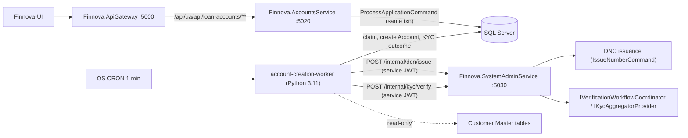
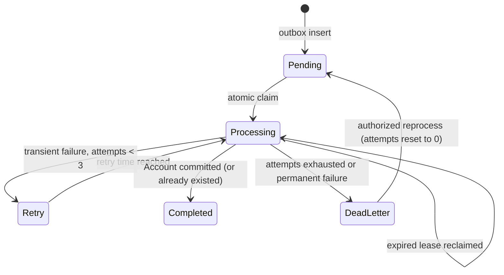

# Design Document

## Overview

Application Account Creation turns every Application that reaches `Processed` (see `.kiro/specs/application-processing`) into exactly one **Loan Account**, runs a configurable **KYC Check** against Aadhaar and PAN, and exposes List, View, and Update operations for those Accounts in the backend (`Finnova.AccountsService`) and the frontend (`Finnova-UI`).

The feature has four runtime pieces:

1. **Outbox insert (inside `ProcessApplicationCommand`).** The same SQL Server transaction that sets an Application to `Processed` also inserts one `account_creation_requests` row (Requirement 1).
2. **Python 3.11 CRON worker** (`account-creation-worker`). It mirrors the JV Posting Engine worker: one-shot process, atomic claim with a lease, bounded batch, retry schedule 1/5/30 minutes, dead-letter state, Asia/Kolkata business time, seeded `SystemUser` actor. It issues the Account Number through DNC, creates the Account, and then runs the KYC phase (Requirements 2 to 7).
3. **.NET API in `Finnova.AccountsService`.** A new `LoanAccountsController` for List, View, Update, manual KYC resolution, KYC re-check, and operational endpoints (Requirements 8 to 11).
4. **Two internal, service-authenticated endpoints in `Finnova.SystemAdminService`.** One issues DNC numbers (with the LOB and Branch extension of Requirement 16). One runs the combined KYC verification and hosts the `IKycAggregatorProvider` seam (Requirements 5, 7, 16).

The React screens (List, View/Update) follow the `LocationMaster`/`LookupMaster` pattern: service interface, mock, real axios implementation, and `VITE_USE_MOCK_API` toggle (Requirements 13, 14).

### Design goals

- Never lose a Processed Application: the outbox row is transactional and the worker is idempotent.
- Account creation never depends on KYC success (A11). KYC is a second phase with its own durable job.
- Keep raw PAN and Aadhaar out of the Account tables, logs, audit snapshots, and API responses.
- Keep host separation: Accounts operations stay in `Finnova.AccountsService`, DNC and identity verification stay in `Finnova.SystemAdminService`.
- Keep pure logic (KYC derivation, scheme fallback, status transitions, retry schedule, masking) in small pure functions so property tests are cheap.

### Scope boundary

Included: outbox, worker, Account extension, DNC extension and internal issuance endpoint, internal KYC endpoint and aggregator seam, List/View/Update/KYC resolution/operations API, gateway, frontend, tests.

Excluded: disbursement or journal posting (A4), `Cancelled`/`Pre-Closed` statuses (A3), branch transfer or financial-term edits (A13), a concrete aggregator vendor (A14), editing the `document-number-control-master` spec itself (R16.11).

## Findings From the Codebase (grounding)

| Finding | Source inspected | Design consequence |
| --- | --- | --- |
| `Account` has `AccountNumber` (EF `HasMaxLength(20)`, unique index), `AccountName` (200), `Type` and `Status` stored as strings, `Balance` precision (18,4), `BranchCode` (20). No row version, no Application/Customer link. | `Account.cs`, `AccountConfiguration.cs` | Extend in place with nullable columns (A2); widen `AccountNumber` (Decision D1); add `RowVersion` for R8.18. |
| `AccountType.Loan` and `AccountStatus {Active, Inactive, Frozen, Closed}` already exist. | enum files | Reuse as-is (A3). |
| `NumberingScheme` holds configuration and live sequence state on one row (`CurrentValue`, `PeriodKey`). `Scope` is `Global/Company/Branch` with `ScopeId`. `FormatTemplate` max 100. Unique index `(DocumentType, Scope, ScopeId)`. | `NumberingScheme.cs`, `NumberingSchemeConfiguration.cs` | Sequence state is already per scheme row, so adding a `LineOfBusinessId` column to the row key gives independent LOB/Branch sequences without a new state table (Decision D5). |
| DNC issuance is `POST api/dcn/issue`, policy `SystemAdmin`, via `IssueNumberCommand(DocumentType, Scope, ScopeId, Actor)`. | `DocumentNumberControlController.cs` | Keep the admin endpoint; add an internal endpoint that calls the same command with LOB/Branch inputs. |
| `Customer` has name parts `FirstName`..`SixthName`, `CustomerCode`, `Status`, `Addresses`, `IndividualDetails`, `Documents`. There is **no PAN or Aadhaar column** on `Customer`. | `Customer.cs` | PAN/Aadhaar resolution rule in Decision D2. |
| `IndividualCustomerDetails` has `IndiaIdentityType` and `IndiaIdentityReference` (one identity per customer). `CustomerDocumentReference` has `DocumentCode` (max 20) and `Value` (max 200); `Document.IsAadhaarDocument` marks Aadhaar definitions. | entity + configuration files | Primary source is `CustomerDocumentReference.Value`; fallback is `IndiaIdentityReference` (D2). |
| `CustomerAddress` has `AddressType {Communication=1, Permanent=2}`, `City`, `State`, `PostalCode`, `Mobile`, and house/block/way/area/landmark parts. | `CustomerAddress.cs`, enum | Mobile and city for the list; composed address for KYC. |
| Identity verification already has `FullVerificationWorkflowRequest`, `IVerificationWorkflowCoordinator`, `VerificationSession`, `ValidationRecord`, enums `ValidationStatus {Success, Failure, Unavailable}` and `ComparisonOutcome {Match, NonMatch, NoUsableMatch}`. Controllers use policy `SystemAdmin` under `api/identity-verification`. | contracts, controllers | The internal KYC endpoint wraps the coordinator and maps the four results. |
| `Finnova.AccountsService` already defines policies `SystemAdmin` and `ApplicationProcessor`. `Finnova.SystemAdminService` defines `SystemAdmin`, `JveOperationsRead/Recovery` (claim based). | both `Program.cs` | Add Accounts policies in the Accounts host; add service-token policies in the SystemAdmin host. |
| Gateway `systemadmin-route` is `/api/systemadmin/{**catch-all}` with prefix removed, and `accounts-route` is `/api/accounts/{**catch-all}`. Alias pattern is `/api/ua/api/<feature>` to `/api/<feature>`. Application Processing alias already points to `accounts-cluster`. | `Finnova.ApiGateway/appsettings.json` | Controller route is `api/loan-accounts` (not `api/accounts/loan-accounts`, see D8). Internal endpoints must be explicitly denied at the gateway (D3). |
| No Python code exists in the repository yet. | file search | The worker is a new package (D9). |
| **There is no role table.** Roles are JWT `ClaimTypes.Role` claims emitted by `TokenService.GenerateToken` from the single `UserAccount.Role` enum (`User`, `Admin`, `Manager`, `Auditor`); `Admin` additionally receives `SystemAdmin`. `GLMaker`, `GLChecker`, `GLViewer`, and `ApplicationProcessor` exist only as `RequireRole(...)` policies in `Finnova.AccountsService/Program.cs`; nothing seeds or assigns them in code. Existing seeding is EF `HasData` inside entity configurations (for example `AssetConfiguration`, `user_accounts`). | `Finnova.Service/Auth/TokenService.cs`, `UserRole.cs`, `UserAccount.cs`, `Program.cs` | Role creation needs a small role catalog and assignment table plus claim emission (Decision D12). Seeding mirrors `HasData`; policy registration mirrors the `AddPolicy` block. |
| No `SystemUser` exists in the code or seeds. | repository search | The migration seeds a `SystemUser` `user_accounts` row and its `service_credentials` row (task 4). |
| The identity verification "mapping registry" is the pair `ComparisonInputMapping.MappingProfile` (per operation, in configuration) and `ConfiguredComparisonAdapterResolver`, which accepts a requested profile string only if it equals the configured `AdapterName` or `MappingProfile`. Extracted values travel as a `Dictionary<string,string>` (tests use keys `documentName`, `documentAddress`). There is no customer-master profile. | `IdentityVerificationOptions.cs`, `SystemAdminService/Program.cs`, `IdentityVerificationApiTests.cs` | Add a code-level `MappingProfileRegistry` with a `customer-master` profile and let the resolver also accept registered names (Decision D14). |

## Architecture

### Runtime topology



The worker never calls the gateway. It calls the SystemAdmin host directly on the internal network. The gateway has no route to `/internal/**` and explicitly denies it (D3).

### Two-phase processing

Phase 1 (Account creation) and Phase 2 (KYC) are separate durable units so a KYC failure or worker crash cannot affect the Account (A11, R5.9).

```mermaid
sequenceDiagram
    participant API as AccountsService (ProcessApplication)
    participant DB as SQL Server
    participant W as Worker
    participant DNC as SystemAdmin /internal/dcn/issue
    participant KYC as SystemAdmin /internal/kyc/verify
    API->>DB: txn: Application=Processed, schedule, status audit, INSERT account_creation_requests(Pending)
    W->>DB: atomic claim (UPDATE ... OUTPUT, lease 10 min)
    W->>DB: read Application, Customer, LOB, Branch (read only)
    W->>DNC: issue LoanAccount number (LOB, Branch)
    DNC-->>W: issued number + resolved scheme
    W->>DB: txn: re-check no Account; INSERT accounts(Active, Kyc=Pending); INSERT account_kyc_jobs(Pending); audit; request=Completed
    Note over W,DB: Phase 1 committed
    W->>DB: claim account_kyc_jobs (Pending/Retry/expired lease)
    alt KycMode = Bypass
        W->>DB: txn: KYC fields = Bypassed, flag=true, history, audit, job=Completed
    else Internal or Aggregator
        W->>KYC: verify (PAN, Aadhaar, name, address, correlationId)
        KYC-->>W: four results + session id / provider ref
        W->>DB: txn: derive status+flag, history, audit, job=Completed
    end
```

### Request state machine



The `account_kyc_jobs` row uses the same states and lease columns. Its terminal `Completed` is reached even when the KYC outcome is `Failed` or `Unavailable`, because the outcome lives on the Account.

## Reused Versus New

### Reused

- `Account`, `AccountType.Loan`, `AccountStatus`, `AccountsController` (unchanged operations, R8.20), `PaginatedResponse<T>`.
- `Application`, `ApplicationSchedule`, `ProcessApplicationCommand`, status audit (Application Processing).
- Customer Master entities (read only): `Customer`, `CustomerAddress`, `IndividualCustomerDetails`, `CustomerDocumentReference`, `Document`.
- DNC: `NumberingScheme`, `IssueNumberCommand` handler, scheme audit.
- Identity Verification: `IVerificationWorkflowCoordinator`, `VerificationSession`, result enums.
- Gateway alias pattern, `ExceptionHandlingMiddleware` error contract, shared UI axios, service/mock/real/toggle pattern, `LocationMaster.tsx` as page reference.
- JV Posting Engine worker conventions: claim, lease, retry, dead letter, `SystemUser`, logging redaction.

### New

- Backend: Account extension columns and migration, `account_creation_requests`, `account_kyc_jobs`, `account_kyc_history`, `account_kyc_resolution_requests`, `account_audit_entries`, loan-account CQRS slice (including maker-checker KYC resolution), `LoanAccountsController`, Accounts policies, `app_roles` and `user_account_roles` with seeding and claim emission, `SchemeResolver`, `KycStatusDeriver`, `KycResolutionRules`, `AccountStatusRules`, internal DNC and KYC endpoints, service-token endpoint, `IKycAggregatorProvider` seam, `customer-master` mapping profile, gateway deny and alias routes.
- DNC extension: `NumberingScheme.LineOfBusinessId`, tokens `{LOB}` and `{BRANCH}`, validator and index changes, issue contract change.
- Worker: Python package with ports and adapters.
- Frontend: `LoanAccountList`, `LoanAccountView`, service layer, routes, nav, DNC master LOB picker.

## Requirements Coverage Map

| Requirement | Design coverage |
| --- | --- |
| R1 Enqueue | `ProcessApplicationCommandHandler` adds `IAccountCreationRequestRepository.Add` inside the existing unit of work; unique index on `ApplicationId`; no row for Draft/Submitted because only the process path inserts. |
| R2 Claim and process | Python `Claimer` (atomic `UPDATE ... OUTPUT` with `READPAST`), `RetryPolicy`, `RunSummary` logger, secrets from environment. |
| R3 Create Account | Python `AccountCreator` plus `AccountWriter` transaction; DNC call before the transaction; idempotent re-check; reference-problem notes. |
| R4 Account Number | DNC issuance via `/internal/dcn/issue`; column widened to 100 (D1); `NoNumberingScheme` dead letter; gap-accepted retry. |
| R5 KYC Check | `KycPhaseRunner`, `KycStatusDeriver`, internal `/internal/kyc/verify`, `CustomerIdentityReader` (D2). |
| R6 Bypass | `KycModeResolver` reads config each run; `BypassKycStrategy`. |
| R7 Aggregator | `IKycAggregatorProvider`, `NormalizedKycResult`, `AggregatorKycStrategy`, secure config. |
| R8 List/View/Update | `GetLoanAccountsQuery`, `GetLoanAccountByIdQuery`, `UpdateLoanAccountCommand`, `AccountStatusRules`, rowversion. |
| R9 KYC resolution (maker-checker) | `SubmitKycResolutionCommand`, `DecideKycResolutionCommand` (approve/reject), `KycResolutionRules`, `account_kyc_resolution_requests` with filtered unique index, `RequestKycRecheckCommand`, `account_kyc_history`, policies `ApplicationProcessor` (maker) and `KycApprover` (checker), self-decision 403 (D13). |
| R10 Operations | `GetAccountQueueStatusQuery`, `GetAccountDeadLettersQuery`, `ReprocessAccountRequestCommand`. |
| R11 Security/audit | Policies, 401-before-403 via standard auth pipeline, `account_audit_entries` append-only, masking and redaction. |
| R12 Gateway | New alias routes to `accounts-cluster`; explicit deny routes for `/internal/**`. |
| R13/R14 UI | `LoanAccountList`, `LoanAccountView`, `loanAccount.service` family. |
| R15 Verification | Testing Strategy section. |
| R16 DNC extension | `LineOfBusinessId` on `NumberingScheme`, `SchemeResolver`, validator rules, internal issuance endpoint. |
| R17 Customer Master mapping profile | `MappingProfileRegistry`, `CustomerMasterMappingProfile`, resolver change, facade applies the profile to structured name and address parts (D14). |
| R18 Role creation and seeding | `app_roles`, `user_account_roles`, `AppRoleCatalog`, idempotent seeding, `TokenService` claim emission, policy registration (D12). |

## Resolved Open Design Items

### D1. Account Number column length versus DNC template

`accounts.AccountNumber` is currently `HasMaxLength(20)`. DNC `FormatTemplate` allows 100 characters and `Prefix`/`Suffix` up to 20 each, so a rendered number can exceed 20. Decision: widen `AccountNumber` to `nvarchar(100)` by migration `AlterColumn`. The unique index remains valid (200 bytes, below the 1700-byte index key limit). Existing rows are unaffected because widening is lossless. DNC validation additionally rejects any scheme whose **maximum possible rendered length** exceeds 100 for `DocumentType = LoanAccount`. The implementer must grep for other tables or contracts that copy `AccountNumber` with length 20 (for example `transactions`, DTO validators) and widen them in the same migration. This resolves Requirement 4.9 and Assumption A5.

### D2. Where PAN and Aadhaar come from in Customer Master

`Customer` has no PAN or Aadhaar column. Decision, in order of precedence (read only, by the worker's `CustomerIdentityReader`):

1. **PAN:** the `CustomerDocumentReference` row for the customer whose `DocumentCode` equals the configured PAN document code (`AccountCreation:Kyc:PanDocumentCode`, default `PAN`) and whose `Value` is non-empty.
2. **Aadhaar:** the `CustomerDocumentReference` row whose document definition has `IsAadhaarDocument = true`, or whose `DocumentCode` equals `AccountCreation:Kyc:AadhaarDocumentCode` (default `AADHAAR`), with non-empty `Value`.
3. **Fallback:** `IndividualCustomerDetails.IndiaIdentityType`/`IndiaIdentityReference` when the type (case-insensitive, trimmed) equals `PAN` or `AADHAAR` and the corresponding value from steps 1 or 2 is absent.
4. **Name:** `FirstName` through `SixthName` joined by single spaces, skipping empty parts. This is also the Customer display name and the `CustomerNameSnapshot`.
5. **Address (for Aadhaar address comparison):** the `Permanent` address if present, otherwise `Communication`. The worker sends the address **as structured parts** (`HouseNumber, BlockNumber, WayNumber, AreaSheik, LocationLandmark, City, State, PostalCode, Country`) and the name as structured parts (`FirstName`..`SixthName`); the `customer-master` mapping profile (D14) composes them server-side with empty parts skipped.
6. **Mobile and city for the list:** the `Communication` address, otherwise `Permanent`.

Non-individual customers have no `IndividualDetails`; PAN may still come from step 1. Missing values yield `NotChecked` (R5.7). Values read this way are held in worker memory only, sent over TLS to the internal endpoint, and never logged or stored. The document codes `PAN` and `AADHAAR` are **assumed values** (Assumption A26), exposed as configuration (`AccountCreation:Kyc:PanDocumentCode`, `AccountCreation:Kyc:AadhaarDocumentCode`) and to be changed later against the actual Document Master content. No design work is blocked on them; changing them is a configuration edit.

### D3. Internal endpoint routes and service authentication

| Endpoint | Host | Route | Policy |
| --- | --- | --- | --- |
| DNC issuance | `Finnova.SystemAdminService` | `POST /internal/dcn/issue` | `ServiceDncIssue` (claim `permission = svc.dcn.issue`) |
| KYC verify | `Finnova.SystemAdminService` | `POST /internal/kyc/verify` | `ServiceKycVerify` (claim `permission = svc.kyc.verify`) |
| Service token | `Finnova.SystemAdminService` | `POST /internal/service-auth/token` | anonymous, credential-checked |

Authentication: the worker holds a service credential (`client_id` = the seeded `SystemUser` id, `client_secret`) in secure environment configuration. It exchanges it at `/internal/service-auth/token` for a short-lived JWT (10 minutes) signed with the existing JWT key, with claims `sub = SystemUser id`, `role = ServiceAccount`, and the two `permission` claims. The secret is stored only as a salted hash (PBKDF2) in a `service_credentials` row seeded with the `SystemUser`. The token endpoint is rate limited and audits failures. The worker caches the token until 60 seconds before expiry.

Exposure control (defense in depth):

1. Routes live under `/internal/**`, not `/api/**`, so no existing gateway route matches them directly.
2. The `systemadmin-route` catch-all would forward `/api/systemadmin/internal/**` and `ua-*` aliases would forward `/api/ua/api/internal/**`. Add gateway routes with `Order = -1` for `/api/systemadmin/internal/{**catch-all}` and `/api/ua/api/internal/{**catch-all}` using `AuthorizationPolicy: "DenyAll"` (a policy with `RequireAssertion(_ => false)`) so they never forward.
3. The SystemAdmin host adds middleware that returns 404 for `/internal/**` when the request has an `X-Forwarded-For` or `X-Forwarded-Host` header (YARP adds these), so a misconfigured gateway still cannot reach them.

Tradeoff: a custom token endpoint is more code than a shared API key, but it reuses the existing JWT validation, gives per-endpoint least-privilege claims, expires quickly, and is auditable with the `SystemUser` identity (R3.10).

### D4. Scheme-resolution fallback location

Decision: the fallback is evaluated **inside DNC** (server side), by a pure `SchemeResolver.Resolve(schemes, documentType, lobId, branchId)` in `Finnova.Service/DocumentNumberControl/Internal`. Reasons: the DNC owns scheme data and the sequence update must be atomic with the resolution; evaluating in the worker would race with scheme changes and leak scheme internals. The internal endpoint returns `ResolvedSchemeId`, `ResolvedSchemeCode`, `ResolvedScopeLevel` for audit and testing. Consequence for Requirement 15.2: the exhaustive fallback property test lives in .NET (FsCheck). The `pytest` suite tests the worker's DNC client against a mocked endpoint, including the `NoNumberingScheme` mapping and the echoed resolved scope. This is confirmed (Assumption A25, Requirement 15.2): .NET FsCheck owns the exhaustive fallback test of `SchemeResolver`, and `pytest` tests the worker's DNC client against a mocked issuance endpoint without re-implementing the fallback.

### D5. DNC extension impact

Changes to the DNC (summarised for the separate update of `document-number-control-master`, R16.11):

- **Data:** add nullable `LineOfBusinessId` (Guid) to `numbering_schemes`. Replace unique index `(DocumentType, Scope, ScopeId)` with `(DocumentType, Scope, ScopeId, LineOfBusinessId)` (R16.9). SQL Server unique indexes treat NULLs as equal, so the existing uniqueness for non-LOB schemes is preserved.
- **Scope levels (no new enum values):** LOB+Branch = `Scope Branch`, `ScopeId = branchId`, `LineOfBusinessId = lob`. LOB only = `Scope Global`, `ScopeId null`, `LineOfBusinessId = lob`. Branch only = `Scope Branch`, `LineOfBusinessId null`. Global = all null. `Company` scope is ignored by the fallback.
- **Sequence state:** already stored on the scheme row (`CurrentValue`, `PeriodKey`), so each LOB/Branch scheme row has its own counter (R16.7) with no new table.
- **Tokens:** `{LOB}` renders the LOB code; `{BRANCH}` renders the Branch code (resolved by the issue handler from the LOB and organization-node repositories).
- **Validator:** accepts the new tokens; rejects `{LOB}` when `LineOfBusinessId` is null and `{BRANCH}` when `Scope` is not `Branch` (R16.6); rejects, for `LoanAccount`, a template whose maximum rendered length exceeds 100 (D1).
- **Issuance:** `IssueNumberCommand` gains optional `LineOfBusinessId` and `BranchId` and a flag `UseFallback`. With `UseFallback` it calls `SchemeResolver`; otherwise it keeps today's exact-scope behavior (the admin endpoint is unchanged). Missing LOB or Branch fails with a validation error before the counter moves (R16.12). No scheme found raises `NumberingSchemeNotFoundException` with code `ERR-DCN-404` (existing), which the worker maps to `NoNumberingScheme`.
- **Audit:** scheme audit records the new column.
- **UI (DNC Master):** LOB picker on the scheme form, token help text for `{LOB}` and `{BRANCH}`, LOB column in the list.
- **Existing schemes and tests:** `LineOfBusinessId` defaults to null; existing DNC tests keep passing. New tests are listed in the task list.

### D6. Status values for KYC

`KycStatus`: `Pending`, `Passed`, `Failed`, `PartiallyVerified`, `Unavailable`, `Bypassed`. Check results: `Passed`, `Failed`, `NotChecked`, `Unavailable`, `Bypassed`. `KycSource`: `Bypass`, `Internal`, `Aggregator`, `Manual`. Note that A9 lists five source values in R6.2 and `Manual` in R9.1; the stored source includes all four.

## Components and Interfaces

### Backend: Finnova.Models

- Entities: `Account` (extended), `AccountCreationRequest`, `AccountKycJob`, `AccountKycHistoryEntry`, `AccountKycResolutionRequest`, `AccountAuditEntry`, `AppRole`, `UserAccountRole`.
- Enums: `AccountRequestStatus`, `KycStatus`, `KycCheckResult`, `KycSource`, `KycMode`, `KycResolutionStatus` (`Pending`, `Approved`, `Rejected`).
- Exceptions: `LoanAccountNotFoundException` (`ERR-ACC-404`), `LoanAccountConflictException` (`ERR-ACC-409`), `LoanAccountValidationException` (`ERR-ACC-400`), `KycResolutionForbiddenException` (`ERR-ACC-403`, HTTP 403 for self-decision).
- Contracts in `Finnova.Models/Contracts/LoanAccounts`.

### Backend: Finnova.Service (`LoanAccounts` slice)

| Component | Responsibility |
| --- | --- |
| `GetLoanAccountsQuery` + validator + handler | Search, filters, paging, ordering (R8.1 to R8.8). |
| `GetLoanAccountByIdQuery` | View with KYC history, finance summary, masked PAN/Aadhaar (R8.9 to R8.11). |
| `UpdateLoanAccountCommand` + validator + handler | Name and status updates; no-op; immutable fields ignored; rowversion (R8.12 to R8.18). |
| `SubmitKycResolutionCommand` + validator + handler | Maker step: Account must be flagged and have no Pending request; reason 10 to 500 after trim; inserts a `Pending` request; Account KYC fields unchanged; audit entry (R9.1, R9.7 to R9.9). |
| `DecideKycResolutionCommand` (`Decision = Approve | Reject`) + validator + handler | Checker step: request must be `Pending`; comment mandatory; checker must differ from maker (else 403 via `KycResolutionForbiddenException`); approve sets `KycStatus = Passed`, `KycFlagged = false`, `KycSource = Manual`, appends history; reject records the decision only; both in one transaction with audit (R9.2 to R9.6, R9.10). |
| `GetPendingKycResolutionQuery` (used by view) | Returns the Pending request of an Account, if any. |
| `KycResolutionRules` (pure) | `CanSubmit(flagged, hasPending, reason)`, `CanDecide(status, makerId, checkerId, comment)`, `ApplyApproval(account state)`. Shared by handlers and property tests. |
| `RequestKycRecheckCommand` | Inserts or resets an `account_kyc_jobs` row for a flagged Account (R9.11). |
| `AppRoleCatalog` (static) + `AppRoleSeeder` | Declares the four roles and their descriptions; used by `HasData` and by the idempotency test (R18). |
| `GetAccountQueueStatusQuery`, `GetAccountDeadLettersQuery`, `ReprocessAccountRequestCommand` | Operations (R10). |
| `AccountStatusRules` (pure) | `IsTransitionAllowed(from, to)`; `Closed` never updatable. |
| `KycStatusDeriver` (pure) | `Derive(four results) -> (KycStatus, flag)`. Shared by API (manual resolution tests) and mirrored in Python. |
| `PiiMasker` (pure) | `Mask(value)` reveals at most the last four characters. |
| `LoanAccountMapper` | Entity to `LoanAccountListItemResponse`/`LoanAccountResponse`. |

Repositories (`Finnova.Repository`): `ILoanAccountRepository` (paged read model joining `customers` and `customer_addresses`, tracked load, rowversion update), `IAccountCreationRequestRepository`, `IAccountKycJobRepository`, `IAccountKycHistoryRepository`, `IAccountAuditRepository` (append only; no update or delete methods, R11.8). `ProcessApplicationCommandHandler` is modified to call `IAccountCreationRequestRepository.Add` inside its existing transaction.

### Backend: SystemAdminService

- `InternalDncController` (`/internal/dcn/issue`) sends the extended `IssueNumberCommand` with `UseFallback = true`.
- `InternalKycController` (`/internal/kyc/verify`) delegates to `IKycVerificationFacade`.
- `IKycVerificationFacade`: `Internal` mode applies the `customer-master` mapping profile (D14) to the structured name and address parts, then runs `IVerificationWorkflowCoordinator` with `VerificationWorkflowType.Full`, building `ComparisonSourceContract` from extracted values `{ documentName, documentAddress }` and `MappingProfile = "customer-master"`. A field whose mapped value is empty is not compared and is reported as `NotChecked` (R17.4). `Aggregator` mode calls `IKycAggregatorProvider`.
- `MappingProfileRegistry` (`Finnova.Service/IdentityVerification/Mapping`): `IReadOnlyCollection<string> Names`, `Get(name)`; contains `CustomerMasterMappingProfile` with pure `Map(CustomerNameParts, CustomerAddressParts) -> MappedVerificationValues(Name, Address)`. `ConfiguredComparisonAdapterResolver` additionally accepts a requested name that the registry contains; existing configured profiles and adapter names keep working, and no existing profile is altered (R17.5).
- `IKycAggregatorProvider.VerifyAsync(ProviderNeutralKycRequest, CancellationToken) -> NormalizedKycResult`. No concrete adapter ships; DI registers `NullKycAggregatorProvider` that throws `KycAggregatorNotConfiguredException` (maps to a worker configuration error, R7.6). `Bypass` never reaches the facade.
- `ServiceAuthController` (`/internal/service-auth/token`) and `ServiceCredentialValidator`.

### Backend: AccountsService

`LoanAccountsController` (`[Route("api/loan-accounts")]`, MediatR only):

| Method | Route | Policy | Result |
| --- | --- | --- | --- |
| GET | `api/loan-accounts` | `AccountsRead` | `200 PaginatedResponse<LoanAccountListItemResponse>` |
| GET | `api/loan-accounts/{id}` | `AccountsRead` | `200 LoanAccountResponse` or `404 ERR-ACC-404` |
| PUT | `api/loan-accounts/{id}` | `ApplicationProcessor` | `200` or `409 ERR-ACC-409` |
| POST | `api/loan-accounts/{id}/kyc/resolution-requests` | `ApplicationProcessor` (maker) | `201 KycResolutionRequestResponse`; `400`, `409` (not flagged, or Pending exists) |
| POST | `api/loan-accounts/{id}/kyc/resolution-requests/{requestId}/approve` | `KycApprover` (checker) | `200 LoanAccountResponse`; `400` (no comment), `403` (self-decision), `409` (not Pending) |
| POST | `api/loan-accounts/{id}/kyc/resolution-requests/{requestId}/reject` | `KycApprover` (checker) | `200 LoanAccountResponse`; same errors as approve |
| POST | `api/loan-accounts/{id}/kyc/recheck` | `ApplicationProcessor` | `202` |
| GET | `api/loan-accounts/operations/queue-status` | `AccountsOps` | `200` |
| GET | `api/loan-accounts/operations/dead-letters` | `AccountsOps` | `200 PaginatedResponse` |
| POST | `api/loan-accounts/operations/requests/{requestId}/reprocess` | `AccountsOps` | `200` or `409` |

Policies added in `Program.cs` beside the existing `ApplicationProcessor` policy: `AccountsRead` (`RequireAssertion`: role `AccountsViewer` or `ApplicationProcessor`), `KycApprover` (`RequireRole("KycApprover")`), `AccountsOps` (`RequireAssertion`: role `AccountsOperator`, plus `SystemAdmin` only because this operational policy explicitly lists it per A17). `ApplicationProcessor` already exists and is unchanged. Self-decision is enforced in the handler, not the policy: the checker identity comes from the validated `NameIdentifier` claim, never from the request body. `ExceptionHandlingMiddleware` gets branches for the four new exceptions (the 403 branch for `KycResolutionForbiddenException`) and for the rowversion `DbUpdateConcurrencyException` (409), emitting `{ code, message, detail, correlationId }`. The existing `AccountsController` is untouched.

### Role Creation and Seeding (R18, D12)

The codebase has no role table (see Findings). To make `AccountsViewer`, `AccountsOperator`, and `KycApprover` (and the existing `ApplicationProcessor`) grantable, this feature adds a minimal catalog and assignment path, following existing conventions:

- **Catalog:** `app_roles` (`Id`, `Name` unique nvarchar(50), `Description`, `IsSystem`, `CreatedAt`). `AppRoleCatalog.Roles` declares `ApplicationProcessor`, `AccountsViewer`, `AccountsOperator`, `KycApprover` with fixed deterministic GUIDs. `AppRoleConfiguration` seeds them with `builder.HasData(...)`, the same mechanism `AssetConfiguration` and `user_accounts` use. `HasData` with fixed keys is idempotent across migrations and re-runs (R18.3); `ApplicationProcessor` is seeded as a catalog row only and its policy and any grants elsewhere are not altered (R18.2).
- **Assignment:** `user_account_roles` (`UserAccountId`, `AppRoleId`, composite PK, FK restrict both sides). Assignment through the User Management API is out of scope; a System Administrator assigns rows by the existing access-management process or a data script. The migration does not assign roles to any user other than `SystemUser`, which receives none (the worker uses service-token claims, D3).
- **Claim emission:** `TokenService.GenerateToken` gains an optional `IReadOnlyCollection<string> extraRoles` parameter (default empty, so existing callers and tests compile). The login handler in `Finnova.UAService` loads role names via `IAppRoleRepository.GetRoleNamesForUserAsync(userId)` and passes them in; each becomes a `ClaimTypes.Role` claim next to the existing `UserRole` and `SystemAdmin` claims. `Finnova.AccountsService` validates the same JWT, so `RequireRole` policies work unchanged.
- **Policy registration:** in `Finnova.AccountsService/Program.cs` as listed under the controller table. The policy-to-role mapping is: List/View → `AccountsRead`; Update, resolution request, recheck → `ApplicationProcessor`; approve/reject → `KycApprover`; operations → `AccountsOps`.
- **Ordering:** the tables are created by the same migration as the loan-account tables.

### Gateway

Add aliases `ua-loan-accounts-alias-route` (`/api/ua/api/loan-accounts/{**catch-all}`) and `ua-loan-accounts-alias-root` (`/api/ua/api/loan-accounts`) to `accounts-cluster`, with `PathRemovePrefix /api/ua/api` and `PathPrefix /api`. Add the two `DenyAll` internal routes (D3). The Authorization header passes through by default.

### Python worker (`workers/account-creation-worker`)

Layout:

```text
workers/account-creation-worker/
  pyproject.toml            # python >=3.11, pyodbc, httpx, pytest, hypothesis
  src/account_worker/
    main.py                 # one-shot entry: build config, run, exit code
    config.py               # env loading + validation (KycMode, batch, lease, retry)
    domain/
      kyc.py                # derive_kyc_status, derive_flag, normalize_result
      retry.py              # next_state(attempt) -> Retry(delay)/DeadLetter
      claim.py              # is_claimable(row, now)
      redaction.py          # redact(text)
      identity.py           # compose_name (snapshot only), name/address parts, pick_identifiers
    ports.py                # Protocols: RequestStore, AccountStore, CustomerReader, DncClient, KycClient, Clock
    adapters/
      sql_store.py          # pyodbc implementation, one transaction per unit
      dnc_client.py         # httpx + token cache
      kyc_client.py         # httpx + token cache
    services/
      claimer.py, account_creator.py, kyc_phase.py, run.py
  tests/
```

Domain modules import no SQL, HTTP, or environment code. Concurrency: one process per CRON tick; overlapping ticks are safe because claims are atomic.

Baseline configuration (A16):

| Setting | Default | Environment key |
| --- | --- | --- |
| Batch size | 50 | `ACW_BATCH_SIZE` |
| Lease and processing deadline | 10 minutes | `ACW_LEASE_MINUTES` |
| Retry delays | 1, 5, 30 minutes; max 3 attempts | `ACW_RETRY_MINUTES` |
| KYC mode | `Bypass` | `AccountCreation__Kyc__Mode` |
| DB connection, service credential | secure env, never logged | `ACW_DB_CONN`, `ACW_SVC_CLIENT_ID`, `ACW_SVC_CLIENT_SECRET` |
| SystemAdmin base URL | internal host URL | `ACW_SYSADMIN_URL` |
| Time zone | Asia/Kolkata | `ACW_TZ` |

Claim SQL (requests; the KYC job claim is identical on `account_kyc_jobs`):

```sql
WITH due AS (
  SELECT TOP (@batch) *
  FROM account_creation_requests WITH (ROWLOCK, UPDLOCK, READPAST)
  WHERE (Status = 'Pending')
     OR (Status = 'Retry' AND NextAttemptAtUtc <= SYSUTCDATETIME())
     OR (Status = 'Processing' AND LeaseExpiresAtUtc < SYSUTCDATETIME())
  ORDER BY CreatedAtUtc, Id
)
UPDATE due
SET Status = 'Processing', ClaimedBy = @worker,
    LeaseExpiresAtUtc = DATEADD(MINUTE, @lease, SYSUTCDATETIME())
OUTPUT inserted.Id, inserted.ApplicationId, inserted.ApplicationNumber,
       inserted.CorrelationId, inserted.InitiatedByUserId, inserted.AttemptCount;
```

Before every write the worker checks it still owns the lease (`ClaimedBy = @worker AND LeaseExpiresAtUtc > now`) and stops new work after the processing deadline.

Account creation order per request: load context (read) → resolve actor (initiating user or `SystemUser`) → call DNC → open transaction → re-check that no Account exists for `ApplicationId` (if one does, mark Completed, no insert) → insert Account, `account_kyc_jobs`, audit entry → set request `Completed` → commit (R3.9). If the unique index on `AccountNumber` or `ApplicationId` fails, roll back and mark `Retry` (R4.8). A number already issued is abandoned (A24).

Error classification: transient (network, timeout, 5xx, deadlock, DNC 429) → `Retry`. Permanent: `ApplicationNotProcessed`, `CustomerNotFound`, `NoNumberingScheme` (after retries exhaust, per R4.4), unknown `SystemUser`. `NoNumberingScheme` is retried first because a System Administrator may create the scheme.

## Data Models

All timestamps are UTC. English-only values. Table names are snake_case plural as in existing configurations.

### `accounts` (extended; existing columns unchanged except `AccountNumber`)

| Column | Type | Rules |
| --- | --- | --- |
| `AccountNumber` | nvarchar(100) | Widened from 20 (D1); unique index kept. |
| `ApplicationId` | uniqueidentifier null | Filtered unique index `WHERE ApplicationId IS NOT NULL` (A6, R3.7). |
| `CustomerId`, `LineOfBusinessId`, `BranchId` | uniqueidentifier null | Indexed; no cascade delete. |
| `ProductCode`, `SchemeCode` | nvarchar(50) null | Indexed. |
| `CustomerNameSnapshot` | nvarchar(300) null | Captured at creation (A18). |
| `CreationNotes` | nvarchar(1000) null | Reference problems (R3.8). |
| `KycStatus` | nvarchar(30) null | Enum string. |
| `KycFlagged` | bit not null default 0 | Index `(KycFlagged, KycStatus)`. |
| `KycSource` | nvarchar(20) null | |
| `KycCheckedAtUtc` | datetime2 null | |
| `KycVerificationSessionId` | uniqueidentifier null | No FK (cross-feature record). |
| `KycPanValidation`, `KycPanNameMatch`, `KycAadhaarValidation`, `KycAadhaarAddressMatch` | nvarchar(20) null | Check results. |
| `KycProviderReference` | nvarchar(100) null | R7.9. |
| `RowVersion` | rowversion | Concurrency token (R8.18). |

Loan Accounts are rows with `Type = 'Loan'`. For non-loan rows the new columns are null and `KycFlagged = 0`. `Balance` starts at 0.00; `Currency = 'INR'`; `Status = 'Active'`; `OpenedAt` = Application `DisbursementDate` at 00:00 UTC; `AccountName` = `"{CustomerName} {ApplicationNumber}"` truncated to 200; `BranchCode` from the Branch.

### `account_creation_requests`

`Id` (PK), `ApplicationId` (unique), `ApplicationNumber` (50), `CorrelationId` (64), `InitiatedByUserId` null, `Status` (`Pending|Processing|Retry|Completed|DeadLetter`), `AttemptCount` int ≥ 0, `NextAttemptAtUtc` null, `ClaimedBy` (100) null, `LeaseExpiresAtUtc` null, `FailureReason` (100) null (safe code only), `CreatedAtUtc`, `UpdatedAtUtc`, `CompletedAtUtc` null. Check constraints: Retry requires `NextAttemptAtUtc`; Processing requires `ClaimedBy` and lease; AttemptCount ≤ 3. Indexes: `(Status, NextAttemptAtUtc)`, `(Status, LeaseExpiresAtUtc)`.

### `account_kyc_jobs`

`AccountId` (PK, FK to `accounts`, restrict), `Status`, `AttemptCount`, `NextAttemptAtUtc`, `ClaimedBy`, `LeaseExpiresAtUtc`, `RecheckRequestedBy` null, `RecheckReason` null, `CreatedAtUtc`, `UpdatedAtUtc`. Same indexes and claim pattern as the request table. A re-check sets `Status = Pending` for an Account whose job is `Completed` (R9.5).

### `account_kyc_history` (append only)

`Id`, `AccountId`, `Source` (`Bypass|Internal|Aggregator|Manual`), `Mode`, `KycStatus`, four check results, `VerificationSessionId` null, `ProviderReference` null, `PreviousStatus` null, `Reason` (500) null (manual only), `Comment` (500) null (checker comment), `ResolutionRequestId` null, `MakerUserId` null, `CheckerUserId` null, `Actor`, `CorrelationId`, `OccurredAtUtc`. Automated outcomes and approved manual resolutions are history entries; Pending and Rejected resolution requests are read from `account_kyc_resolution_requests`, and the view merges both ordered by time so `Pending`, `Approved`, and `Rejected` all appear (R8.9, R9.6). Never stores PAN or Aadhaar. Index `(AccountId, OccurredAtUtc)`.

### `account_kyc_resolution_requests` (maker-checker, R9)

| Column | Type | Rules |
| --- | --- | --- |
| `Id` | uniqueidentifier PK | |
| `AccountId` | uniqueidentifier not null | FK to `accounts`, restrict. |
| `Status` | nvarchar(20) not null | `Pending`, `Approved`, `Rejected`. |
| `MakerUserId` | uniqueidentifier not null | From the validated claim. |
| `Reason` | nvarchar(500) not null | Trimmed length 10 to 500 (check constraint). |
| `PreviousKycStatus` | nvarchar(30) not null | Status when submitted. |
| `SubmittedAtUtc` | datetime2 not null | |
| `CheckerUserId` | uniqueidentifier null | Required when not `Pending`; check constraint `CheckerUserId <> MakerUserId`. |
| `DecisionComment` | nvarchar(500) null | Required when not `Pending`. |
| `DecidedAtUtc` | datetime2 null | Required when not `Pending`. |
| `CorrelationId` | nvarchar(64) not null | |
| `RowVersion` | rowversion | Concurrency token: two checkers deciding at once, the loser gets 409. |

Indexes: **filtered unique index** `UX_account_kyc_resolution_pending` on `(AccountId)` `WHERE Status = 'Pending'` (at most one Pending per Account, R9.9, R9.13); `(AccountId, SubmittedAtUtc)`; `(Status, SubmittedAtUtc)` for checker lookups. Rows are never deleted. The pending indicator on list and view is `EXISTS (Pending row)`, so no denormalized flag is stored and it cannot drift.

### `app_roles` and `user_account_roles`

`app_roles`: `Id`, `Name` (50, unique), `Description` (200), `IsSystem` bit, `CreatedAt`. `user_account_roles`: `UserAccountId`, `AppRoleId` (composite PK, FKs restrict). See Role Creation and Seeding.

### `account_audit_entries` (append only)

`Id`, `AccountId` null, `RequestId` null, `Action` (`Created|KycOutcome|Updated|StatusChanged|KycResolutionSubmitted|KycResolutionApproved|KycResolutionRejected|KycRecheck|Reprocessed|DeadLettered`), `Source` (`Worker|User`), `Actor`, `CorrelationId`, `ChangeSummary` (1000, non-sensitive old/new values only), `OccurredAtUtc`. No update or delete repository methods.

### `service_credentials` (SystemAdmin database objects)

`ClientId` (PK, the `SystemUser` id), `SecretHash`, `Salt`, `IsActive`, `LastUsedAtUtc`. Seeded with the `SystemUser`.

### DNC change

`numbering_schemes.LineOfBusinessId` uniqueidentifier null; new unique index `(DocumentType, Scope, ScopeId, LineOfBusinessId)`. Migration command (implementer runs it): `dotnet ef migrations add AddLoanAccountsAndDncLob --project Finnova.Repository --startup-project Finnova.AccountsService`.

## Contracts

```csharp
public sealed record LoanAccountListItemResponse(
    Guid Id, string ApplicationNumber, string AccountNumber, string AccountStatus,
    string CustomerCode, string CustomerName, string? MobileMasked, string? City,
    string KycStatus, bool KycFlagged, string? KycSource, string? KycMode, DateTime? KycCheckedAtUtc,
    bool HasPendingKycResolution, DateTime OpenedAt);

public sealed record KycCheckResultsResponse(
    string PanValidation, string PanNameMatch, string AadhaarValidation, string AadhaarAddressMatch);

public sealed record KycHistoryEntryResponse(
    string Source, string KycStatus, KycCheckResultsResponse Checks, string? Reason,
    string? PreviousStatus, string Actor, DateTime OccurredAtUtc);

public sealed record KycResolutionRequestResponse(
    Guid Id, Guid AccountId, string Status, Guid MakerUserId, string MakerName, string Reason,
    string PreviousKycStatus, DateTime SubmittedAtUtc,
    Guid? CheckerUserId, string? CheckerName, string? DecisionComment, DateTime? DecidedAtUtc);

public sealed record LoanAccountResponse(
    Guid Id, Guid ApplicationId, string ApplicationNumber, string AccountNumber, string AccountName,
    string AccountStatus, Guid CustomerId, string CustomerCode, string CustomerName,
    string? MobileMasked, string? City, string? PanMasked, string? AadhaarMasked,
    Guid LineOfBusinessId, Guid BranchId, string ProductCode, string SchemeCode,
    decimal FinanceAmount, decimal IrrPercent, int Tenure, string RepaymentFrequency, DateOnly DisbursementDate,
    string KycStatus, bool KycFlagged, string? KycSource, DateTime? KycCheckedAtUtc,
    KycCheckResultsResponse KycChecks, Guid? KycVerificationSessionId,
    IReadOnlyList<KycHistoryEntryResponse> KycHistory,
    KycResolutionRequestResponse? PendingKycResolution,
    IReadOnlyList<KycResolutionRequestResponse> KycResolutionRequests, string? CreationNotes,
    DateTime OpenedAt, DateTime CreatedAt, DateTime UpdatedAt, string RowVersion);

public sealed record UpdateLoanAccountRequest(string? AccountName, string? Status, string RowVersion);
public sealed record SubmitKycResolutionRequest(string Reason);          // maker; 10..500 after trim
public sealed record DecideKycResolutionRequest(string Comment);         // checker; mandatory, <= 500
public sealed record RecheckKycRequest(string? Reason);

// Internal (SystemAdmin) contracts
public sealed record InternalIssueRequest(string DocumentType, Guid LineOfBusinessId, Guid BranchId, string CorrelationId);
public sealed record InternalIssueResponse(string IssuedNumber, Guid ResolvedSchemeId, string ResolvedSchemeCode, string ResolvedScopeLevel);
public sealed record CustomerNameParts(string? First, string? Second, string? Third, string? Fourth, string? Fifth, string? Sixth);
public sealed record CustomerAddressParts(string? House, string? Block, string? Way, string? Area, string? Landmark,
    string? City, string? State, string? PostalCode, string? Country);
public sealed record MappedVerificationValues(string Name, string Address);   // empty string when no usable value
public sealed record InternalKycRequest(Guid CustomerId, string? Pan, string? Aadhaar,
    CustomerNameParts Name, CustomerAddressParts? Address, string CorrelationId, string Mode);
public sealed record InternalKycResponse(
    string PanValidation, string PanNameMatch, string AadhaarValidation, string AadhaarAddressMatch,
    Guid? VerificationSessionId, string? ProviderReference, string? SafeReason, DateTime TimestampUtc);
```

List query parameters: `search`, `kycStatus`, `kycFlagged`, `accountStatus`, `lineOfBusinessId`, `branchId`, `productCode`, `schemeCode`, `hasPendingKycResolution` (optional extra filter so a Checker can find Accounts awaiting a decision without a separate queue screen), `page` (default 1), `pageSize` (default 20, max 100). `RowVersion` is base64; update requests send the last read value, and a mismatch returns 409 (R8.18). The update handler ignores any other field (R8.16).

Mapping from verification results (Internal mode): `ValidationStatus.Success` → `Passed`, `Failure` → `Failed`, `Unavailable` → `Unavailable`; `ComparisonOutcome.Match` → `Passed`, `NonMatch` → `Failed`, `NoUsableMatch` → `NotChecked`. `NoUsableMatch` maps to `NotChecked` so the overall result becomes `PartiallyVerified` (A9).

## Correctness Properties

*A property is a characteristic or behavior that should hold true across all valid executions of a system-essentially, a formal statement about what the system should do. Properties serve as the bridge between human-readable specifications and machine-verifiable correctness guarantees.*

After prework and reflection, criteria that share a pure function are merged (5.4, 5.11, 7.4 into Property 1; 5.5, 5.6, 5.12, 6.2 into Property 2; 2.1 to 2.3 into Property 4; 2.6, 2.7 into Property 5). Database-dependent criteria (1.1, 8.18, 11.1 to 11.3, 12, 16.10) are covered by examples and integration tests, not properties.

### Property 1: KYC status derivation

For any four KYC Check Results drawn from `Passed`, `Failed`, `NotChecked`, `Unavailable`, `Bypassed`, the derived status is `Passed` if and only if all four are `Passed`; otherwise `Failed` if any is `Failed`; otherwise `Unavailable` if any is `Unavailable`; otherwise `PartiallyVerified`. The same derivation applies to a Normalized KYC Result from an aggregator.

**Validates: Requirements 5.4, 5.11, 7.4**

### Property 2: KYC flag equivalence

For any four KYC Check Results (and for any Bypass outcome), `KycFlagged` is false if and only if the derived status is `Passed`. For any Account processed in `Bypass` mode, the recorded status is `Bypassed`, all four results are `Bypassed`, the source is `Bypass`, the flag is true, and the number of identity-provider calls made is zero.

**Validates: Requirements 5.5, 5.6, 5.12, 6.1, 6.2**

### Property 3: KYC mode parsing

For any configuration string, the parsed mode is `Bypass` when absent or empty, the matching mode when the string is exactly `Bypass`, `Internal`, or `Aggregator`, and a configuration error otherwise (in which case the run claims no requests).

**Validates: Requirements 6.3, 6.4, 6.5**

### Property 4: Claim eligibility

For any set of request rows and any current time, a row is claimable if and only if its status is `Pending`, or `Retry` with `NextAttemptAtUtc` ≤ now, or `Processing` with `LeaseExpiresAtUtc` < now; a `Processing` row with an unexpired lease is never claimable; and the claimed set is at most the batch size.

**Validates: Requirements 2.1, 2.3, 10.5**

### Property 5: Retry and dead-letter schedule

For any attempt count n of a failed request, the next state is `Retry` with delay 1, 5, or 30 minutes for n = 1, 2, 3 respectively when attempts remain, and `DeadLetter` once the third attempt has failed; a dead-lettered request never has an Account created.

**Validates: Requirements 2.6, 2.7**

### Property 6: Scheme resolution fallback

For any set of schemes, any Document Type, and any LOB and Branch, the resolver returns the first active scheme in the order LOB+Branch, LOB only, Branch only, Global; it never returns an inactive scheme or a scheme of another Document Type; and returns "none" only when no level has an active scheme.

**Validates: Requirements 4.2, 16.8**

### Property 7: Idempotent account creation

For any Processed Application and any number of repeated processing attempts of its request (including after a rollback or crash), exactly one Account exists for the `ApplicationId` and the first Account is unchanged by later attempts.

**Validates: Requirements 3.7, 4.7, 4.8**

### Property 8: Account status transition rule

For any pair of Account statuses (from, to), a transition is allowed if and only if it is `Active→Inactive`, `Active→Frozen`, `Inactive→Active`, or `Frozen→Active`; any update to a `Closed` Account is rejected and leaves the Account unchanged.

**Validates: Requirements 8.13, 8.14, 8.15**

### Property 9: Update no-op and immutability

For any Account and any update request, supplying values equal to the stored values leaves the Account and `UpdatedAt` unchanged; supplying values for immutable fields (Application Number, Account Number, Customer, LOB, Branch, Product, Scheme, Type, Currency, Balance, opening date) never changes those fields.

**Validates: Requirements 4.10, 8.16, 8.17**

### Property 10: List search and filters

For any set of Accounts, any non-empty trimmed search term, and any combination of filters, every returned item contains the term (case-insensitively) in Application Number, Account Number, Customer Code, or Customer name, and matches every supplied filter; every Account matching all criteria appears across the pages.

**Validates: Requirements 8.2, 8.3**

### Property 11: Pagination and ordering

For any set of Accounts and any valid page and page size, the items are ordered by `CreatedAt` descending then Account Number ascending, the page holds at most the page size, the total count equals the number of matching Accounts, and a page beyond the last returns no items with the same total.

**Validates: Requirements 8.5, 8.7, 8.8**

### Property 12: Sensitive value masking

For any string, the masked value reveals at most its last four characters and has the same length as the original, and no response or audit snapshot contains the unmasked PAN or Aadhaar.

**Validates: Requirements 8.11, 11.4, 11.5**

### Property 13: Four-eyes and Passed only on approval

For any Account state and any sequence of resolution actions (submit, approve, reject) by any mix of users, the Account's `KycStatus` becomes `Passed` with `KycSource = Manual` if and only if a `Pending` request was approved by a user different from its maker; an approval or rejection by the maker is refused and leaves the request and Account unchanged; and a rejection never changes the Account's `KycStatus` or `KycFlagged`.

**Validates: Requirements 9.2, 9.3, 9.4, 9.13**

### Property 14: Dead-letter reprocess

For any request status, reprocess succeeds if and only if the status is `DeadLetter`; on success the status is `Pending` and the attempt count is 0; any other status is rejected and unchanged.

**Validates: Requirements 10.3, 10.4**

### Property 15: Log redaction

For any text containing a PAN-shaped value (five letters, four digits, one letter) or a 12-digit Aadhaar-shaped value, the redacted text contains neither the PAN nor the Aadhaar value.

**Validates: Requirements 2.9, 2.10, 5.2, 11.5**

### Property 16: DNC token and scope consistency

For any format template and scheme scope, validation rejects the scheme if the template contains `{LOB}` and the scope has no Line of Business, or contains `{BRANCH}` and the scope is not Branch; otherwise the supported tokens `{LOB}` and `{BRANCH}` are accepted.

**Validates: Requirements 16.5, 16.6**

### Property 17: Independent sequences per scope

For any sequence of issuances over schemes with distinct (Scope, ScopeId, LineOfBusinessId) keys, each scheme's counter advances only for issuances resolved to that scheme, and two different keys never produce a shared counter value history.

**Validates: Requirements 16.2, 16.7, 16.9, 3.6**

### Property 18: At most one Pending resolution request per Account

For any sequence of resolution actions on one Account, the number of `Pending` requests is never greater than one; submitting while one is `Pending` is refused and leaves it unchanged; and every earlier request and history entry remains unchanged (append only).

**Validates: Requirements 9.6, 9.9, 9.13**

### Property 19: Resolution input validation

For any Account flag, any reason string, and any decision comment, a submission succeeds if and only if the flag is true, no request is `Pending`, and the trimmed reason length is 10 to 500; a decision succeeds if and only if the request is `Pending`, the comment is non-blank, and the checker differs from the maker; every refusal leaves the Account and request unchanged.

**Validates: Requirements 9.1, 9.5, 9.7, 9.8, 9.10**

### Property 20: Customer Master mapping profile

For any name parts and address parts, mapping is deterministic (identical inputs give identical `Name` and `Address`), joins the non-blank trimmed parts in field order with single separators, produces an empty value when all parts of a field are blank, and never contains a PAN or Aadhaar value that was not in the supplied parts.

**Validates: Requirements 17.2, 17.3, 17.4, 17.6**

### Property 21: Idempotent role seeding

For any number of repeated seed runs over any initial set of roles that may already contain some of the catalog roles, the resulting set contains each of `ApplicationProcessor`, `AccountsViewer`, `AccountsOperator`, and `KycApprover` exactly once and preserves every pre-existing role unchanged.

**Validates: Requirements 18.1, 18.2, 18.3**

## Error Handling

| Condition | Result |
| --- | --- |
| Missing, expired, or invalid JWT | `401`, no data (standard authentication happens before authorization, so a request failing both gets 401, R11.3). |
| Authenticated but lacking role | `403`, no change. |
| Search > 100 chars, page < 1, page size outside 1 to 100, reason outside 10 to 500, account name outside 1 to 150 | `400 ERR-ACC-400` with `message` and `detail`. |
| Unknown Account or request id | `404 ERR-ACC-404`. |
| Invalid status transition, Closed Account update, resolution request when not flagged or when one is Pending, decision on a non-Pending request, reprocess when not dead-lettered, rowversion mismatch (including two checkers deciding at once; the filtered unique index backs the Pending rule if two makers race) | `409 ERR-ACC-409`. |
| Checker equals maker on approve or reject | `403 ERR-ACC-403`; request and Account unchanged; audited as a refused attempt without sensitive values. |
| Missing or blank approve/reject comment; reason outside 10 to 500 | `400 ERR-ACC-400`. |
| Caller lacks `ApplicationProcessor` (submit) or `KycApprover` (decide) | `403` from the policy. |
| Worker: DNC unreachable or 5xx or 429 | Request `Retry`, attempt incremented. |
| Worker: no active scheme, inactive scheme, exhausted sequence | `Retry`, then `DeadLetter` with reason `NoNumberingScheme` and the DNC code as safe detail. |
| Worker: Application not `Processed` | `DeadLetter` `ApplicationNotProcessed`. |
| Worker: Customer cannot be resolved | `DeadLetter` `CustomerNotFound`. |
| Worker: LOB, Branch, or Customer inactive or missing (except Customer) | Account still created; `CreationNotes` set; KYC flagged (R3.8). |
| Worker: duplicate `AccountNumber` or `ApplicationId` at insert | Roll back, `Retry`; on retry the existence check completes the request without a second Account. |
| Worker: KYC endpoint unreachable after three attempts with exponential backoff | KYC `Unavailable`, flag true, Account kept (R5.8, R7.8). |
| Worker: invalid or missing KYC mode, aggregator not configured | Configuration error: safe log line, no claims, non-zero exit code. |
| Lost lease before write | Worker abandons the item without writing; the next run reclaims it. |

Error bodies follow the application-processing contract: `{ code, message, detail, correlationId }`, English only. Worker failure reasons are stable codes, never raw exception text. Exceptions carrying values are redacted before logging.

## Security

- **Authentication and authorization:** JWT on every public endpoint; policies in the Accounts host (`AccountsRead`, `ApplicationProcessor`, `AccountsOps`). `SystemAdmin` is not a super-role unless added explicitly in policy configuration (A17); the only such entry is `AccountsOps`. Roles are created and seeded by this feature (D12, R18). The maker and checker identities come from validated claims; the four-eyes check compares them in the handler and is backed by a database check constraint.
- **Service identity:** the worker uses the seeded `SystemUser` credential via the short-lived service token (D3). Tokens carry least-privilege `permission` claims. The secret is stored only as a hash on the server side and only in environment secrets on the worker side.
- **PII:** PAN and Aadhaar exist only in Customer Master and inside identity verification. The worker holds them in memory and sends them over TLS. They are excluded from logs, audit snapshots, KYC history, and API responses (masked to the last four characters on View only). `ProviderReference` and `VerificationSessionId` are the only linkage stored.
- **Internal exposure:** `/internal/**` routes are denied at the gateway and blocked when forwarded headers are present (D3).
- **Audit:** immutable `account_audit_entries` and `account_kyc_history`, no update or delete paths.
- **Worker:** no listening port; DB account has least privilege (read on masters, read/write on the new worker-owned tables (`account_creation_requests`, `account_kyc_jobs`, `account_kyc_history`, `account_audit_entries`) and `accounts`; read-only on `account_kyc_resolution_requests`).
- **Dependencies:** pin exact versions in `pyproject.toml` and lock file.

## Design Decisions and Tradeoffs

| # | Decision | Alternatives | Rationale |
| --- | --- | --- | --- |
| D1 | Widen `AccountNumber` to 100. | Keep 20 and constrain templates. | DNC templates can be up to 100; constraining would break DNC flexibility. Widening is lossless. |
| D2 | PAN/Aadhaar from `CustomerDocumentReference` with `IndiaIdentityReference` fallback. | Add PAN/Aadhaar columns to `Customer`. | No schema change to Customer Master; uses the existing data-driven document model. Document codes `PAN` and `AADHAAR` are assumed, configurable values. |
| D3 | Custom service token with per-endpoint claims, `/internal/**` plus gateway deny. | Static API key; mTLS. | Reuses JWT validation, short-lived, least privilege, audited per identity. mTLS is stronger but needs platform support not evident in the repo. |
| D4 | Scheme fallback inside DNC. | Fallback in worker. | Resolution and counter advance are one authority; avoids races and leaking scheme internals. Confirmed; .NET FsCheck owns the fallback test and pytest tests the DNC client against a mock (R15.2). |
| D5 | LOB as a nullable column on the scheme row. | New `Scope` enum values; separate sequence-state table. | Smallest change; sequence state is already per row, so independence is automatic. |
| D6 | Separate `account_kyc_jobs` for Phase 2. | One request row covering both phases. | R3.9 requires Completed with the Account commit; a separate job keeps KYC durable and re-runnable (R9.5) without reopening the request. |
| D7 | KYC columns on `accounts`. | Separate KYC table joined for the list. | List and filter performance; history is still append-only in its own table. |
| D8 | Route `api/loan-accounts` (user-confirmed, Assumption A1) with gateway alias `/api/ua/api/loan-accounts`. | `api/accounts/loan-accounts`. | The alias convention maps `/api/ua/api/<x>` to `/api/<x>` on `accounts-cluster`; the existing `accounts-route` (`/api/accounts/**`) stays unchanged. |
| D9 | Worker in `workers/account-creation-worker` of this repository. | Separate repository. | Keeps spec, contracts, and tests together; JV worker has no code yet to share. |
| D10 | Bypassed Accounts are flagged (R6.2). | Unflagged until verified. | Keeps unverified Accounts discoverable. |
| D11 | `NoUsableMatch` maps to `NotChecked`. | Map to `Failed`. | Avoids false Failed on inconclusive comparison; yields `PartiallyVerified` per A9. |
| D12 | Role catalog (`app_roles`) plus `user_account_roles`, seeded by `HasData`; `TokenService` emits assigned roles as extra claims. | Hard-code roles only in policies (status quo). | There is no assignment path today, so policies alone would be unusable (see Role Creation and Seeding). Additive: the `UserAccount.Role` enum and existing roles are untouched. |
| D13 | Maker-checker KYC resolution as its own table and two commands. | The earlier single `ResolveKycCommand`. | R9 requires four-eyes, a retained Pending/Approved/Rejected history, and one Pending per Account. A request row with a filtered unique index enforces this in the database. |
| D14 | Code-level `MappingProfileRegistry` with a `customer-master` profile; facade sends structured name/address parts. | Add a configured profile per operation only. | Deterministic, testable composition (R17.6) and no PAN/Aadhaar in the profile; the resolver accepts registered names while existing configured profiles keep working. |

## Testing Strategy

PBT applies to the pure logic (KYC derivation, flag, mode parsing, claim eligibility, retry schedule, scheme fallback, idempotency model, status transitions, update semantics, filter/pagination, masking, resolution rules, redaction, DNC token validation, sequence independence). It does not apply to controller wiring, SQL claim statements, gateway configuration, or React rendering; those use example, integration, and component tests.

### Property tests

- **.NET:** FsCheck.Xunit in `Finnova.Tests`, `MaxTest = 100` minimum. Properties 1, 2 (derivation part), 3 (shared parser), 6, 8, 9, 10, 11, 12, 13, 14, 16, 17, 18, 19, 20, 21 with in-memory repositories or pure functions (`KycResolutionRules`, `CustomerMasterMappingProfile`, `AppRoleSeeder` over a fake role store). Property 6 is the exhaustive `SchemeResolver` fallback test and lives only here (R15.2).
- **Python:** `pytest` + `hypothesis` (`max_examples >= 100`). Properties 1, 2 (including zero provider calls through a fake KYC client), 3, 4, 5, 7 (in-memory store model with injected failures), 15.
- Each test carries a tag comment: `Feature: application-account-creation, Property N: <title>`. Each property is implemented by a single property test.

### Example and integration tests

- xUnit and `WebApplicationFactory<Program>` for the Accounts host: list filtering and paging, view with masked values, update, no-op, concurrency conflict (409), closed rejection, 401-before-403, existing `AccountsController` regression, gateway alias configuration test, deny-route configuration test.
- Process-application integration: one request row inserted on success, none on rollback, duplicate insert rejected (R1.1 to R1.4).
- Worker integration against SQL Server test database: claim exclusivity with two connections, create-Account transaction atomicity, KYC failure leaves Account with flag set, reprocess creates no second Account.
- SystemAdmin: internal DNC issuance with fallback and LOB/Branch tokens; internal endpoints reject user JWTs and unauthenticated calls; token endpoint rejects wrong secrets; DNC admin endpoint behavior unchanged.
- Maker-checker API (`WebApplicationFactory<Program>`): submit succeeds and leaves the Account unchanged; duplicate Pending returns 409; approve by a different `KycApprover` sets `Passed`/`Manual` and appends history; reject keeps the flag; self-approval and self-rejection return 403; missing comment returns 400; maker without `KycApprover` gets 403 on decide; checker without `ApplicationProcessor` gets 403 on submit; list and view show the pending indicator; the filtered unique index rejects a second Pending row against a relational test database (SQL Server integration, since InMemory ignores filtered indexes).
- Role seeding: an integration test that applies the seed twice and asserts four unique rows, that `TokenService` emits assigned roles as claims, and that policies accept/deny accordingly.
- Mapping profile: unit tests for `CustomerMasterMappingProfile` (name, address, blanks), resolver accepts `customer-master` and still rejects unknown names, existing `test` profile behavior unchanged, facade reports `NotChecked` for an empty mapped field.
- Python: DNC client against a mocked server (success, no scheme, inactive scheme, transient failure, gap on retry). No scheme-fallback logic is tested in Python.
- Frontend (Vitest + React Testing Library, jsdom): maker dialog validation and pending badge, checker approve/reject with mandatory comment, actions hidden for the maker and for users without `KycApprover`, service mock and real behavior, list rendering with columns, filters resetting to page 1, empty and error states, `Bypassed` label distinct from `Passed`, view with masked values, update and resolution validation (reason 10 to 500), read-only mode, double-submit prevention.

Build must be green (`dotnet build`, `npm run build`, `pytest`) before the feature is complete. These commands are run by the implementer, not during this spec task.

## Frontend Design (Finnova-UI)

Files (mirroring `location.service.ts` and `LocationMaster.tsx`):

- `src/models/loanAccount.ts`: types for list item, detail, KYC checks, history, status unions matching backend strings.
- `src/services/interfaces/loanAccount.service.ts`, `src/services/real/loanAccount.service.ts` (shared axios, base `/loan-accounts`), `src/services/mock/loanAccount.service.ts`, `src/services/loanAccount.service.ts` (toggle by `VITE_USE_MOCK_API`), barrel exports.
- `src/pages/LoanAccountList.tsx` (MUI `DataGrid` server-side paging, search, filters; LOB, Branch, Product, Scheme options from the existing reference/Lookup services).
- `src/pages/LoanAccountView.tsx` with `KycChecksPanel`, `KycHistoryTable` (merges history and resolution requests: Pending, Approved, Rejected), `LoanAccountEditForm`, `KycResolutionRequestDialog` (maker: reason 10 to 500), `KycResolutionDecisionDialog` (checker: approve or reject with mandatory comment), and `PendingKycResolutionPanel`.
- Maker flow: shown when the Account is flagged, has no Pending request, and the user holds `ApplicationProcessor`; after submit the panel shows the pending request and the request action is hidden (R14.11) while the displayed KYC Status is unchanged (R14.5).
- Checker flow: approve and reject are offered only when the user holds `KycApprover` and the signed-in user id differs from the request's `MakerUserId` (R14.12, R14.13). The server remains the authority (403).
- Pending badge: `PendingKycResolutionChip` on list rows and the view header. A Checker finds work through a "Pending KYC resolution" filter on the existing list (`hasPendingKycResolution=true`); R13 and R14 do not require a separate queue screen, so none is added.
- Role awareness: `AuthContext` already declares an optional `roles?: string[]`. The implementer checks where it is populated; if it is not filled from the login response, a small `getRolesFromToken(token)` helper decodes the JWT role claims (`http://schemas.microsoft.com/ws/2008/06/identity/claims/role` and `role`) and fills it. No new context is introduced.
- `KycStatusChip`: `Bypassed` has a distinct label and color from `Passed`; flag icon with accessible text.
- Routes `/loan-accounts` and `/loan-accounts/:id` in `App.tsx` (protected); a nav entry in `Layout.tsx`. Read-only mode when the user lacks `ApplicationProcessor`.
- Link to Application and schedule uses the existing application-processing routes.
- DNC Master: LOB picker and token help in the scheme form and LOB column in the list.

The frontend does not use Redux or RxJS. Errors display `error.response.data.message`; the shared axios interceptor already toasts 401/403/409.

## Assumed Values and Tracked Follow-ups

No design question is waiting on confirmation. The following are recorded so they are not lost:

- **Assumed value (A26, D2):** Document Master codes `PAN` and `AADHAAR`. Configurable; to be changed later against the actual Document Master content.
- **Tracked cross-spec change (R16.11):** `.kiro/specs/document-number-control-master` is updated separately to reflect the DNC extension (D5). This feature does not edit it.
- **Out of scope by decision:** `Cancelled` and `Pre-Closed` Account statuses (A3), a concrete KYC aggregator vendor (A14), role assignment screens in User Management (D12), a separate Checker queue screen (the pending filter on the list is sufficient).

## Implementation-Ordered Task List

1. **Backend domain:** add enums (`AccountRequestStatus`, `KycStatus`, `KycCheckResult`, `KycSource`, `KycMode`, `KycResolutionStatus`); extend `Account`; create `AccountCreationRequest`, `AccountKycJob`, `AccountKycHistoryEntry`, `AccountKycResolutionRequest`, `AccountAuditEntry`, `AppRole`, `UserAccountRole`; add `LineOfBusinessId` to `NumberingScheme`.
2. **Backend exceptions:** `LoanAccountNotFoundException`, `LoanAccountConflictException`, `LoanAccountValidationException`, `KycResolutionForbiddenException`.
3. **Backend contracts:** loan-account, KYC resolution request/response, internal issue, internal KYC (with name/address parts) records in `Finnova.Models/Contracts`.
4. **EF configuration, seeding, and migration:** extend `AccountConfiguration` (length 100, new columns, filtered unique index, rowversion); configurations for `account_creation_requests`, `account_kyc_jobs`, `account_kyc_history`, `account_kyc_resolution_requests` (check constraints, filtered unique `WHERE Status = 'Pending'`, rowversion), `account_audit_entries`, `service_credentials`, `app_roles` (with `HasData` for the four roles), `user_account_roles`; seed the `SystemUser` `user_accounts` row and its credential row; update `NumberingSchemeConfiguration` index; register DbSets; document the `dotnet ef migrations add` command.
5. **Repositories:** loan-account, request, job, history, resolution-request, audit, and `IAppRoleRepository` with DI registration.
6. **Pure helpers:** `AccountStatusRules`, `KycStatusDeriver`, `KycResolutionRules`, `PiiMasker`, `SchemeResolver`, `AppRoleCatalog`/`AppRoleSeeder`, `CustomerMasterMappingProfile`, DNC template-token validator extension.
7. **Role claims and mapping registry:** modify `TokenService.GenerateToken` (optional extra roles) and the UAService login handler to load assigned roles; add `MappingProfileRegistry` and update `ConfiguredComparisonAdapterResolver` to accept registered profile names.
8. **DNC service changes:** extended `IssueNumberCommand` and handler (`UseFallback`, `{LOB}`/`{BRANCH}` tokens, existence validation), create/update validators, audit field.
9. **Process-application outbox:** modify `ProcessApplicationCommandHandler` to insert the request in its transaction.
10. **Loan-account CQRS slice** in `Finnova.Service`: list/view queries (pending indicator, `hasPendingKycResolution` filter), update command, `SubmitKycResolutionCommand`, `DecideKycResolutionCommand`, recheck, operations, validators, mapper.
11. **AccountsService host:** `LoanAccountsController` (including resolution-request, approve, and reject routes), policies `AccountsRead`, `KycApprover`, `AccountsOps`, `ExceptionHandlingMiddleware` branches (400/403/404/409).
12. **SystemAdminService host:** service credentials and token endpoint, `InternalDncController`, `InternalKycController`, `IKycVerificationFacade` (applies the `customer-master` profile), `IKycAggregatorProvider` seam, `/internal` forwarded-header guard, service policies.
13. **Gateway:** loan-accounts alias routes and `DenyAll` internal routes.
14. **Backend tests:** FsCheck properties 1 to 3, 6, 8 to 14, 16 to 21; WebApplicationFactory tests including maker-checker, role seeding, and mapping profile; DNC regression and extension tests; gateway config tests.
15. **Python worker:** package skeleton, config, domain modules, ports, SQL and HTTP adapters (sending name and address parts), services, `main.py`, CRON sample (`* * * * * ...`), README.
16. **Python tests:** hypothesis properties (1, 2, 3, 4, 5, 7, 15), DNC client mock tests, SQL integration tests.
17. **Frontend model, service interface, real, mock, toggle, barrels** for loan accounts including resolution request, approve, and reject calls (and DNC LOB picker service change).
18. **Frontend pages and components, routes (`App.tsx`), navigation (`Layout.tsx`)**: list with pending filter and badge, view with maker dialog, checker decision dialog, pending panel, `getRolesFromToken` helper if `AuthContext.roles` is unpopulated, DNC Master LOB picker.
19. **Frontend Vitest tests**, including maker and checker visibility rules.