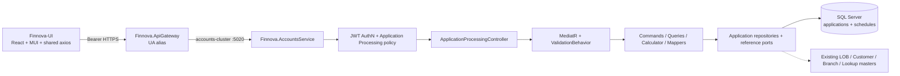

# Design Document: Application Processing

## Overview

Application Processing is an operational finance workflow for capturing a generic India-only finance application, previewing its reducing-balance amortization schedule, and processing the application into a finalized, immutable schedule. The feature spans the backend repository at `d:\Projects\Finnova\Finnova-API` and the separate Finnova-UI repository.

The form is intentionally generic. It captures Line of Business, Customer, Branch, Product, Scheme, finance amount, annual IRR, tenure, repayment frequency, disbursement date, and optional processing charges. Reference-backed values are selected from existing masters and lookup data. Repayment Frequency remains a fixed enum because the schedule algorithm depends on its periods-per-year mapping.

All monetary values are INR and are rounded to paise. All labels, lookup values, examples, test data, and messages are English-only. The feature does not add Arabic or other non-English data, bilingual fields, translation scaffolding, or RTL handling.

### Goals

- Persist a validated application with a server-generated unique Application Number.
- Use active Line of Business, Customer, Branch Master, Product lookup, and Scheme lookup values rather than free-form classification text.
- Provide deterministic schedule preview without mutating application state.
- Process an application transactionally into `Processed` state with a persisted, immutable final schedule.
- Make the financial algorithm explicit, reproducible, and testable with FsCheck properties.
- Expose paged application search and the reference reads needed by the form.
- Preserve existing service ownership: Application Processing is operational and is hosted by `Finnova.AccountsService`; lookup/master ownership remains with the existing owning components.
- Follow the actual platform stack: ASP.NET Core, MediatR, FluentValidation, EF Core with SQL Server, JWT Bearer authentication, MUI, React hooks/Context, shared axios, and Vitest/React Testing Library.

### Non-goals

- Customer, Line of Business, Branch Master, Product, Scheme, or Lookup Master CRUD, seed management, or lifecycle administration.
- Product-specific, customer-specific, flat-rate, interest-only, balloon, moratorium, variable-rate, or regulatory finance rules.
- Reopening or reprocessing a finalized application.
- Disbursement execution, accounting posting, collections, payment allocation, document generation, or notification delivery.
- A new lookup management API. Product and Scheme options use the existing Lookup dropdown convention.
- Redux, Redux Toolkit, RxJS, a second axios client, or a new UI component framework.
- Multi-language or RTL support.

### Scope and repository paths

- **Backend:** `d:\Projects\Finnova\Finnova-API`, solution `Finnova.Backend.slnx`.
- **Frontend product-context path:** `E:\Finnova\Finnova-UI\Finnova-UI`.
- **Frontend path available in this environment:** `d:\Projects\Finnova\Finnova-UI`. The product-context path is not mounted here; implementation tasks must target the available repository when executed, or the product-context path when that checkout is used. No UI source is changed by this design task.

## Components and Interfaces

### Reused platform assets

| Concern | Existing asset | Reuse |
| --- | --- | --- |
| Persistence | `FinnovaDbContext`, `IRepository<T>`, `RepositoryBase<T>`, SQL Server registration | Add Application Processing DbSets/configurations and feature repositories without replacing the generic repository pattern. |
| Existing masters | `LineOfBusiness`, `Customer`, `Location`/Branch Master, `LookupValue` | Read active records through narrow reference ports. Do not copy master rows into Application Processing. |
| Lookup reads | `LookupController` `GET /api/lookup/dropdown?module={module}&type={type}`, `LookupDropdownItemResponse(Code, Label)`, `ILookupRepository.GetActiveByModuleAndTypeAsync` | Product and Scheme use this active code/label projection. No Product/Scheme management endpoint is introduced. |
| CQRS | MediatR request/handler slices and `ValidationBehavior<,>` | Commands and queries are independent feature slices. |
| Validation | FluentValidation and the existing MediatR validation pipeline | Request and query validation runs before handlers. Financial validation is shared with process-time validation. |
| Host | Existing `Finnova.AccountsService` on the accounts cluster | Add the controller and DI registrations here rather than creating a host. |
| AuthN/AuthZ | JWT Bearer and `SystemAdmin` policy already configured in `Finnova.AccountsService` | Apply the confirmed Application Processing authorization policy to all feature endpoints. |
| Middleware | `Finnova.AccountsService.Middlewares.ExceptionHandlingMiddleware` | Extend it with typed Application Processing errors and a stable `ERR-APP-*` code family. |
| Gateway | `accounts-cluster`, existing UA alias pattern, CORS and Authorization forwarding | Add application-processing UA aliases that preserve the accounts host boundary. |
| Pagination | `PaginatedResponse<T>` | Use the existing `Data`, `Total`, `Page`, `PageSize`, `TotalPages` contract. |
| Frontend HTTP | `src/services/api.ts` in the available UI checkout | Shared bearer-token injection, timeout, 401/403/409 notification, and redirect behavior are reused. |
| Frontend feature pattern | Location/Lookup/Nationality service and page patterns | Add model, interface, mock, real, toggle, page, components, route, navigation, and tests using the existing conventions. |

### New components

- `Application`, `ApplicationSchedule`, `ApplicationInstallment`, and internal status-audit entities.
- EF configurations, DbSets, migration, feature repositories, and transaction/unit-of-work coordination.
- Application Processing request/response records, enums, typed exceptions, validators, handlers, mappers, and reference adapters.
- A pure `AmortizationCalculator` and a date/rounding policy used by preview and process paths.
- `ApplicationProcessingController` in `Finnova.AccountsService`.
- Gateway aliases for `/api/ua/api/application-processing/**` to `accounts-cluster`.
- Frontend Application Processing model, service interface, mock and real services, form/page components, schedule table, reference option loaders, route, navigation item, and Vitest/RTL tests.

## 3. Requirements Coverage Map

The map uses the current requirements numbering and covers every acceptance criterion.

| Requirement | Design coverage |
| --- | --- |
| R1.1–R1.3 | `CreateApplicationCommand`, defaults for `Draft` and `0.00`, transactional persistence, response mapper; API `POST /api/application-processing`. |
| R1.4 | FluentValidation required/type validation and handler-side reference validation; no entity is written on failure. |
| R1.5–R1.8 | `IApplicationReferenceValidator` delegates to active LOB, Customer, Branch, and Lookup ports; typed invalid-reference errors; no duplicated master data. |
| R1.9–R1.14 | Shared monetary, IRR, tenure, frequency, charges, and date-window validators with an injected UTC clock. |
| R2.1–R2.2 | `IApplicationNumberGenerator`, unique SQL index, retry-safe generation, and concurrency integration tests. |
| R2.3–R2.4 | Create ignores client Application Number; update command does not bind or apply number/status fields. |
| R3.1–R3.2 | `AmortizationCalculator` line-count and periodic-rate rules. |
| R3.3–R3.4 | Positive-IRR EMI branch and zero-IRR branch, both rounded to paise. |
| R3.5–R3.6 | Recurrence calculation and final-line adjustment in the calculator. |
| R3.7–R3.10 | Calculator invariants and schedule summary construction. |
| R3.11–R3.13 | Pure deterministic generation, due-date month arithmetic, and tenure-one edge behavior. |
| R4.1–R4.2 | Update command for Draft/Submitted, shared validation, status preservation, timestamp behavior, and atomic rejection. |
| R4.3–R4.4 | Typed not-found and processed-immutable exceptions. |
| R4.5–R4.6 | No-op comparison before mutation and ignored immutable fields. |
| R5.1 | `ProcessApplicationCommand`, transactionally finalized schedule, Processed state, and response containing the schedule. |
| R5.2–R5.4 | Processed/id-not-found/invalid-stored-data guards with no state change on rejection. |
| R5.5 | Final schedule read from persisted header/rows only; no recalculation for Processed applications. |
| R5.6 | Preview query invokes the pure calculator and does not persist or change status. |
| R6.1–R6.3 | Application Processing reference-read facade for active LOB, searchable active Customer, and active Branch Master options. |
| R6.4–R6.6 | Existing `GET /api/lookup/dropdown` is reused for Product, Scheme, and configured additional lookup types. |
| R6.7 | Submit-time reference validation rechecks active options and prevents create/update/process. |
| R6.8 | `[Authorize]`/policy on reference endpoints and host authentication middleware. |
| R7.1–R7.7 | `GetApplicationsQuery`, normalized search, AND-combined reference filters, and repository query composition. |
| R7.8 | Query validator rejects search terms over 100 characters. |
| R7.9–R7.11 | `PaginatedResponse<ApplicationResponse>` and page/page-size defaults. |
| R7.12–R7.14 | Paging validator and empty beyond-last-page result with accurate totals. |
| R7.15–R7.16 | CreatedAt/Application Number deterministic ordering and successful empty result. |
| R7.17–R7.18 | `GET /api/application-processing/{id}` and typed not-found behavior. |
| R8.1–R8.3 | Form controls and startup option loading through the feature service and existing Lookup service. |
| R8.4–R8.6 | Client validation mirrors server rules; submit calls the service only for valid values and shows returned metadata. |
| R8.7–R8.8 | Schedule table columns, INR formatting, ordered rows, totals, and empty state. |
| R8.9–R8.11 | Submit lock, error retention, and explicit option-load failure states. |
| R8.12 | English-only labels/messages, one display field per option, and no RTL attributes/layout. |
| R9.1–R9.4 | JWT validation, configured authorization claim/policy, middleware order, `[Authorize]` attributes, and WebApplicationFactory coverage. |

## Architecture

### Host placement and request flow

Application Processing is placed in the existing `Finnova.AccountsService` because it is an operational finance workflow, not master-data administration. This resolves the host-placement assumption in the requirements. It remains separate from the SystemAdmin master controllers. The feature may read shared master tables through repository ports, but it does not transfer ownership of those masters to AccountsService.

Boundary rules:

1. The controller binds HTTP contracts, obtains the acting user identity from the validated principal when auditing, and sends MediatR requests. It does not calculate EMIs or query EF directly.
2. MediatR handlers coordinate validation, state transitions, reference checks, and repository calls. They do not own master-data CRUD.
3. `AmortizationCalculator` is pure. It accepts a value object containing validated financial terms and returns a schedule DTO/value object without a database or clock dependency.
4. Repositories expose application-specific queries and persistence operations. Reference ports expose only active projections and existence checks needed by Application Processing.
5. EF configurations define schema, precision, indexes, and processed-schedule restrictions. Migrations are generated but not run as part of this specification work.
6. The frontend owns interaction state only. It does not duplicate financial calculations beyond display validation and does not optimistically change persisted application state.

### Backend command/query slices

- **Create:** `CreateApplicationCommand` + validator + handler.
- **Update:** `UpdateApplicationCommand` + validator + handler; only Draft/Submitted and no-op-aware.
- **Preview:** `PreviewApplicationScheduleQuery` + handler; pure calculator, no writes.
- **Process:** `ProcessApplicationCommand` + handler; revalidates stored references/terms, creates final schedule, sets Processed, writes status audit in one transaction.
- **Read:** `GetApplicationByIdQuery`, `GetApplicationsQuery`, `GetApplicationScheduleQuery`.
- **References:** `GetActiveLinesOfBusinessQuery`, `SearchActiveCustomersQuery`, and `GetActiveBranchesQuery`. Lookup dropdowns are delegated to the existing Lookup endpoint.

### Persistence transaction boundary

The current generic `RepositoryBase<T>` saves each mutation. Processing needs stronger atomicity than independent repository calls. Add an application-specific `IApplicationUnitOfWork` over the scoped `FinnovaDbContext`, with one explicit database transaction for:

1. loading and locking the application row;
2. revalidating state and active references;
3. inserting the schedule header and installment rows;
4. changing application status and timestamps;
5. adding the status audit entry;
6. committing once.

A SQL Server concurrency token (`rowversion`) on `Application` protects update/process races. The handler returns a conflict (`409`) when another request wins the race. The final schedule has a unique index on `ApplicationId`, so a second finalization cannot create a second schedule.

## Data Models

### Application entity

`Application` is the aggregate root. It contains references and finance terms but no embedded Customer, LOB, Branch, or Lookup master object.

| Field | Shape and rule |
| --- | --- |
| `Id` | `Guid` primary key. |
| `ApplicationNumber` | Required unique string generated by the service; client values are never accepted. Prefix/length are configuration. |
| `LineOfBusinessId` | Required `Guid` reference to active `LineOfBusiness`; no duplicated name/description. |
| `CustomerId` | Required `Guid` reference to active `Customer`; no duplicated customer name or address. The external option projection includes Customer Code and an English display label. |
| `BranchId` | Required `Guid` reference to active Branch Master/`Location`; no duplicated branch name/code. |
| `ProductCode` | Required lookup `Code`; module/type are validated against configuration and active `LookupValue`. |
| `SchemeCode` | Required lookup `Code`; module/type are validated against configuration and active `LookupValue`. |
| `FinanceAmount` | Required `decimal(18,2)` INR, `> 0` and within the configured maximum. |
| `IrrPercent` | Required `decimal(9,4)` annual percentage, 0 through 100 inclusive. |
| `Tenure` | Required `int`, 1 through 600. |
| `RepaymentFrequency` | Required enum serialized as its string name: `Monthly`, `Quarterly`, `Half-Yearly`, `Annual`. |
| `DisbursementDate` | Required date-only value. Stored as SQL Server `date`, interpreted using the application/business calendar, not browser local time. |
| `ProcessingCharges` | Required `decimal(18,2)` INR, default 0.00 and non-negative. |
| `Status` | Required enum: `Draft`, `Submitted`, `Processed`; default Draft. |
| `CreatedAtUtc`, `UpdatedAtUtc` | UTC audit timestamps. |
| `Version` | SQL Server `rowversion`/concurrency token. |

The exact property casing follows the existing C# conventions, while JSON uses the host's configured camelCase serialization. A Customer/LOB/Branch database foreign key is a deployment decision because those masters are owned by other slices. The resolved design uses active-reference validation at command time plus stored IDs and does not add navigation graphs or cascade deletes. If the database team requires physical FKs, they must be non-cascading and added only after confirming master deletion behavior.

### Application schedule header

`ApplicationSchedule` belongs to one application and has a unique `ApplicationId`.

- `Id`, `ApplicationId`.
- `IsFinalized` and `GeneratedAtUtc`.
- Input snapshot: `FinanceAmount`, `IrrPercent`, `Tenure`, `RepaymentFrequency`, `DisbursementDate`.
- Calculation snapshot: `PeriodicInterestRate`, `EmiAmount`.
- Summary snapshot: `TotalInstallmentAmount`, `TotalInterestAmount`, `TotalPrincipalAmount`.
- A finalized schedule is immutable. Preview schedules are not inserted.

The snapshot makes later reads independent of mutable application fields and permits the service to prove that a Processed schedule is the schedule generated at processing time.

### Installment row

`ApplicationInstallment` belongs to one `ApplicationSchedule`, ordered by a unique `(ScheduleId, InstallmentNumber)` index.

- `Id`, `ScheduleId`, `InstallmentNumber`.
- `DueDate` as SQL Server `date`.
- `OpeningBalance`, `InterestPortion`, `PrincipalPortion`, `InstallmentAmount`, `ClosingBalance` as `decimal(18,2)`.

There is no update or delete command for a finalized schedule. The application’s Processed state, repository guards, and database relationship restriction together enforce immutability.

### Status/audit entity

`ApplicationStatusAuditEntry` is an internal append-only record with `Id`, `ApplicationId`, `FromStatus`, `ToStatus`, `ChangedBy`, and `ChangedAtUtc`. It records creation/defaulting, permitted status changes, and processing. It has no public mutation endpoint. It is not a second copy of application data and is not required for schedule calculation.

### EF configuration

Add configurations discovered by `ApplyConfigurationsFromAssembly`:

- `ApplicationConfiguration`: table `applications`; unique index on `ApplicationNumber`; indexes for `CreatedAtUtc`, `CustomerId`, `LineOfBusinessId`, `BranchId`, `ProductCode`, and `SchemeCode`; required precision; `rowversion`; no cascade delete from master references.
- `ApplicationScheduleConfiguration`: table `application_schedules`; unique `ApplicationId`; precision and date columns; relationship to rows with restricted delete for finalized data.
- `ApplicationInstallmentConfiguration`: table `application_installments`; unique `(ScheduleId, InstallmentNumber)`; indexes for `(ScheduleId, InstallmentNumber)`.
- `ApplicationStatusAuditEntryConfiguration`: table `application_status_audit_entries`; append-only indexes by application and UTC timestamp.

Register the corresponding DbSets in `FinnovaDbContext` and repositories in `Finnova.Repository.DependencyInjection`. The migration command is documented for implementation, for example `dotnet ef migrations add AddApplicationProcessing --project Finnova.Repository --startup-project Finnova.AccountsService`; it must be run by the implementer, not during this spec task.

## 6. API Contracts and Route Design

All application endpoints require a valid JWT and the configured Application Processing authorization policy. The exact claim/role remains a deployment configuration until the authorization owner confirms it. The default proposal is a dedicated `ApplicationProcessor` role, with `SystemAdmin` included only if explicitly configured rather than silently assumed.

### Backend routes

The Accounts host routes are relative to `Finnova.AccountsService` and use the controller prefix `api/application-processing`.

| Method | Route | Request | Response |
| --- | --- | --- | --- |
| POST | `/api/application-processing` | Create request with references and terms; Application Number/Status ignored | `201 ApplicationResponse` |
| PUT | `/api/application-processing/{id}` | Updateable references/terms/charges; number/status ignored | `200 ApplicationResponse` |
| GET | `/api/application-processing` | `search`, `lineOfBusinessId`, `customerId`, `productCode`, `branchId`, `schemeCode`, `page`, `pageSize` | `200 PaginatedResponse<ApplicationResponse>` |
| GET | `/api/application-processing/{id}` | — | `200 ApplicationResponse` or `404` |
| GET | `/api/application-processing/{id}/schedule` | — | `200 ApplicationScheduleResponse`; Processed reads persisted schedule, Draft/Submitted previews |
| POST | `/api/application-processing/{id}/schedule/preview` | no body | `200 ApplicationScheduleResponse`; never persists |
| POST | `/api/application-processing/{id}/process` | no body | `200 ProcessApplicationResponse` containing application and finalized schedule |
| GET | `/api/application-processing/references/lines-of-business` | — | active `LineOfBusinessRefResponse[]` |
| GET | `/api/application-processing/references/customers` | `search`, `page`, `pageSize` | active searchable Customer option page |
| GET | `/api/application-processing/references/branches` | optional configured scope filters | active Branch Master option list/page |
| GET | `/api/lookup/dropdown` | existing `module`, `type` query | existing `LookupDropdownItemResponse[]` |

The Product and Scheme rows are deliberately served by the existing Lookup route. Application Processing does not expose a parallel lookup management or lookup dropdown implementation. The UI calls this existing route through the gateway, and the backend validation port calls the existing lookup repository/contract.

### Request and response shape

The create/update request contains `lineOfBusinessId`, `customerId`, `branchId`, `productCode`, `schemeCode`, `financeAmount`, `irrPercent`, `tenure`, `repaymentFrequency`, `disbursementDate`, and optional `processingCharges`. It does not expose an embedded master object. The response includes the persisted IDs/codes, status, generated Application Number, audit timestamps, and resolved display projections only where the existing reference contract makes them available.

`ApplicationScheduleResponse` contains `applicationId`, `isFinalized`, calculation inputs/snapshot, `periodicInterestRate`, `emiAmount`, `installments`, and summary totals. Each installment has number, due date, opening balance, interest portion, principal portion, installment amount, and closing balance. Monetary JSON values are numeric with two decimal places according to the existing serializer contract; the UI formats them as INR.

### Gateway aliases and host separation

The direct accounts route remains `/api/accounts/{**catch-all}` to `accounts-cluster`. Because the shared UI service convention composes feature paths under the UI’s gateway prefix, add two aliases mirroring the existing lookup/nationality aliases:

- `/api/ua/api/application-processing/{**catch-all}` -> `accounts-cluster`, remove `/api/ua/api`, add `/api`.
- `/api/ua/api/application-processing` -> `accounts-cluster`, with the same transforms.

This makes `/api/ua/api/application-processing` reach `/api/application-processing` on AccountsService without moving the controller to SystemAdminService or collapsing hosts. The real UI service uses a feature-relative base path consistent with the deployed `VITE_API_BASE_URL`; the implementer must verify the deployed base URL rather than hard-coding a second axios origin.

## 7. Financial Algorithm Design

### Inputs and period mapping

The calculator accepts validated terms:

- `P = FinanceAmount` in INR.
- `IRR` as an annual percentage, for example `12.5` means 12.5% per annum.
- `r = IRR / 100 / periodsPerYear`.
- `n = Tenure`.
- Periods per year: Monthly = 12, Quarterly = 4, Half-Yearly = 2, Annual = 1.

### EMI and rounding

For `IRR > 0`, calculate the unrounded reducing-balance EMI:

`EMI = P × r × (1 + r)^n / ((1 + r)^n - 1)`.

For `IRR = 0`, use `P / n`. Round monetary results to two decimals using `MidpointRounding.AwayFromZero`, which is round-half-up for the non-negative values admitted by validation. Keep the calculator’s intermediate rate and power calculation at sufficient decimal precision; round the EMI and each monetary line field at the defined monetary boundaries, not through binary floating-point formatting.

### Line construction

1. Set installment 1 opening balance to `P`; each later opening balance is the previous closing balance.
2. For each non-final row, compute interest as `round(opening × r, 2)`.
3. Apply the rounded EMI for positive IRR, or rounded `P / n` for zero IRR.
4. Compute principal as installment amount minus interest and closing as opening minus principal.
5. On the final row, compute interest from the final opening balance, set principal exactly to the final opening balance, set installment amount to principal plus interest, and set closing balance exactly to `0.00`.
6. Build due dates by applying one calendar-month period from the disbursement date: 1, 3, 6, or 12 months for the four frequencies. Use date-only month arithmetic with the platform date API’s month-end clamping behavior, and apply the same rule to every subsequent date.
7. Sum line values for the schedule totals. Total principal must equal the input principal exactly to the paisa, and total installment must equal total principal plus total interest.

### Invariants and deterministic behavior

The calculator must guarantee, for valid inputs:

- exactly `n` rows numbered 1 through `n`;
- no negative opening, interest, principal, installment, or closing values;
- closing balance never exceeds opening balance;
- opening balances do not increase across rows;
- principal total equals `P` exactly in paise;
- final closing balance is exactly zero;
- identical input terms and disbursement date produce identical lines, due dates, and totals.

Preview invokes this calculator and returns its result without persistence. Process invokes the same calculator inside the transaction, maps the result to the schedule header/rows, and persists it before changing status to Processed. A Processed schedule read returns stored rows and totals, not a newly recalculated preview.

## 8. Reference and Dropdown Loading Design

### Active LOB

`GET /references/lines-of-business` returns the existing `LineOfBusinessRefResponse(Id, LobName, LobDescription)` projection, filtered to `IsActive`. The application form renders a selection control with the ID as the value and the English name/description as the label. Application Processing does not create, edit, seed, or duplicate LOB rows.

### Active Customer searchable selection

`GET /references/customers?search=&page=&pageSize=` delegates to the Customer read boundary. It returns a minimal option projection such as Customer ID, immutable Customer Code, and an English display label. It must not return the complete Customer aggregate, addresses, bank accounts, documents, or sensitive onboarding data. Search is trimmed, case-insensitive, bounded, and active-only. The UI uses MUI Autocomplete with debounced search and retains the selected ID/code when the visible page changes.

### Active Branch Master options

`GET /references/branches` delegates to the existing Branch Master reference source. The exact current Branch Master endpoint/response contract is not established in the requirements, so the Application Processing layer uses an `IBranchReferencePort` adapter. The adapter maps the owning source to a minimal ID/code/name option and excludes inactive records. It does not create a second branch table. If branch options must be scoped by LOB, that scope is an explicit adapter query parameter rather than an invented database relationship.

### Product and Scheme Lookup dropdowns

The UI calls the existing `GET /api/lookup/dropdown?module={module}&type={type}` convention and receives `LookupDropdownItemResponse(Code, Label)`. Product and Scheme are selection controls, not text fields. Active state is determined by the existing Lookup repository. Application Processing validates submitted codes against the same configured module/type pair, preventing a stale option from being submitted after deactivation.

### Configuration and unresolved lookup names

Deployment configuration owns:

- `ApplicationProcessing:AuthorizationPolicy` or equivalent policy name;
- `ApplicationProcessing:LookupModule` (proposed value `ApplicationProcessing`, alternative `Origination`);
- `ApplicationProcessing:ProductLookupType`;
- `ApplicationProcessing:SchemeLookupType`;
- any additional classification `type` values;
- `ApplicationProcessing:ApplicationNumberPrefix` and generation settings;
- finance maximum and disbursement-window values if the product owner changes the stated generic assumptions;
- Branch Master adapter/base route if it is not available through the shared database.

The design does not assert unverified Product/Scheme module/type strings or a Branch Master route. Startup validation should fail clearly when required module/type configuration is missing. An unknown or empty lookup scope is a configuration error, not a silently empty dropdown.

### Loading, stale, inactive, and failure behavior

- Load LOB, Customer initial options, Branch, Product, and Scheme independently so one failure identifies its affected control.
- Show loading indicators while a control is loading; do not represent a failed load as a valid empty list.
- On an option-load failure, show an English error state and disable submission until the affected required selection can be loaded or retried.
- If a selected option becomes inactive between load and submit, the server rechecks active state and returns a field-specific validation error; the UI preserves entered values and asks the user to refresh that selection.
- A Customer search response may be paged; the selected value is retained separately from the current result page.
- No inactive or unknown Product/Scheme code is included in a successful dropdown response.

## 9. Backend CQRS, Validation, Repository, DI, Middleware, and Authorization

### Validation

Create/update validators enforce presence, type, ranges, enum names, two-decimal monetary scale, search length, page bounds, and date window. Handlers then perform active-reference checks because those checks require repositories/ports. Process revalidates stored values and references, protecting against legacy invalid data or masters becoming inactive after creation.

Validators must return field names and stable English messages. Validation failures occur before mutation. The no-op update comparison happens after validation and reference resolution but before setting `UpdatedAtUtc`; an identical update returns the existing record without changing its timestamp.

### Repositories and reference ports

`IApplicationRepository` provides paged filtered reads, tracked aggregate loading for mutation, no-tracking by-id reads, and a rowversion-aware update path. `IApplicationScheduleRepository` provides final schedule reads and inserts. `IApplicationStatusAuditRepository` provides append-only writes.

Reference ports are intentionally narrow:

- `ILineOfBusinessReferencePort`: active options and active-exists check.
- `ICustomerReferencePort`: active search options and active-exists check by ID.
- `IBranchReferencePort`: active options and active-exists check.
- `ILookupReferencePort`: active code/label options and active-exists check by module/type/code, backed by `ILookupRepository`.

The service layer depends on ports, not on UI routes or master-management handlers. DI registers adapters in `Finnova.AccountsService` and the common repository layer. Existing Customer/LOB/Location repositories may be adapted rather than duplicated.

### Mappers and contracts

Static mapper extensions convert entities to `ApplicationResponse`, `ApplicationScheduleResponse`, option responses, and paginated responses. Mappers do not invoke repositories. A schedule response maps stored final rows or pure preview rows through the same contract.

### Application number and concurrency

The server ignores client numbers. The proposed generic implementation generates an opaque, non-empty `APP-` identifier from a cryptographically random GUID token, optionally including a configured prefix. A unique SQL index is the final invariant. This avoids a race-prone count-based sequence and does not invent dependency on the Document Number Control master. A future DCN integration can replace `IApplicationNumberGenerator` without changing the application contract.

Create retries only on a unique-number conflict. Update and process use rowversion and a transaction. Concurrent process requests allow one finalization; the loser receives a conflict and does not alter the application or schedule.

### Authorization and 401-before-403

Every create, update, query, schedule, process, and reference action has `[Authorize(Policy = configured Application Processing policy)]` or the confirmed policy equivalent. `UseAuthentication()` remains before `UseAuthorization()`. Missing, malformed, invalid-signature, or expired JWTs therefore return 401 before policy evaluation can return 403. A valid token without the required role/claim returns 403. The gateway forwards the Authorization header; the UI never constructs an alternate token mechanism.

### Middleware and error contract

Add typed exceptions such as `ApplicationNotFoundException`, `ApplicationAlreadyProcessedException`, `ApplicationReferenceInvalidException`, `ApplicationConflictException`, and `ApplicationConfigurationException`. Map them in AccountsService middleware to stable codes such as `ERR-APP-404`, `ERR-APP-409`, `ERR-APP-400`, and `ERR-APP-503` where appropriate. Validation maps to `ERR-APP-400`.

The current Accounts middleware returns `ProblemDetails.Detail` and a `code` extension, while the current UI interceptor primarily reads `error.response.data.message`. The feature design resolves this contract gap by requiring the Application Processing error response to include the same English message in both `detail` and a `message` extension/property, while preserving the existing `code` extension and correlation ID convention. This is a small cross-cutting middleware adjustment, not a new error transport.

## 10. Frontend Design

Implementation targets `d:\Projects\Finnova\Finnova-UI` in this environment, or `E:\Finnova\Finnova-UI\Finnova-UI` in the product-context checkout. The UI is React 18 + TypeScript + Vite + MUI with hooks and Context only. No Redux or RxJS is introduced.

### Models and service boundary

Add a model module containing:

- application response/form/update types;
- `ApplicationStatus` and `RepaymentFrequency` string unions matching backend enum JSON;
- schedule/header/installment/summary types;
- LOB, Customer, Branch, and Lookup dropdown option types;
- paginated application and customer option response types.

Add `IApplicationProcessingService` with methods for create, update, get, search, preview, process, final schedule read, LOB options, Customer search, Branch options, Product options, Scheme options, and any configured classification options. Add a mock implementation with English-only data and backend-shaped errors, a real implementation using the shared `api`, and a toggle module selected by `VITE_USE_MOCK_API`. Export each through the existing barrels.

The real service uses the configured gateway-relative feature path and makes Product/Scheme requests against the existing `/lookup/dropdown` route rather than inventing a new lookup client. It does not create an axios instance.

### Page and components

Add an `ApplicationProcessing` page and focused components:

- `ApplicationForm`: controlled state, field errors, dirty/retained values, create/update mode, and submit lock.
- `ReferenceSelect`/`CustomerAutocomplete`: accessible selection controls for LOB, Customer, Branch, Product, Scheme, and configured classifications.
- `FinanceTermsFields`: INR amount/charges, IRR, tenure, fixed frequency, and date input.
- `ApplicationSummary`: Application Number and Status.
- `AmortizationScheduleTable`: ordered rows, due dates, INR two-decimal display, totals, and empty state.
- `ReferenceLoadError` and form/API error presentation.

The page loads independent option sources with hooks. Customer search is debounced. The form disables submit while a create/update/process call is pending. API failures retain the entered values and the current schedule/application state unless a successful response replaces them.

### Client validation and formatting

Client rules mirror server rules: required selected option IDs/codes, positive Finance Amount up to the configured generic maximum, IRR 0–100, integer tenure 1–600, fixed frequency values, non-negative Processing Charges, and disbursement date window. Input accepts paise precision and displays INR with two decimals in schedule cells. Client validation is a usability layer only; server validation remains authoritative.

### Navigation and accessibility

Add a protected route in `App.tsx` and an Administration navigation item in `Layout.tsx`, using a route name that does not collide with existing master pages. Use labels, helper text, error text, and empty states in English. Use semantic labels, `aria-describedby` for field errors, keyboard-operable dialogs/menus, visible focus styling, and accessible table headers. Do not add `dir="rtl"`, language variants, Arabic strings, or bilingual fields.

## Error Handling

### Error behavior

- 400: field validation, invalid enum/range, inactive/unknown references, missing configuration in a request path where the client can correct it.
- 401: missing, malformed, invalid, or expired JWT.
- 403: valid JWT without the required authorization claim.
- 404: unknown application ID.
- 409: processed mutation, duplicate number conflict, rowversion conflict, or concurrent processing conflict.
- 503: unavailable Branch Master/reference adapter or missing required deployment configuration, where the client cannot correct the input.
- 500: unexpected errors use a generic message and correlation ID; no raw exception details are returned.

Rejected create/update/process operations must not write an application, schedule, status audit, or timestamp. Preview must not write anything. Middleware and UI messages remain English.

### Security controls

- Validate JWT issuer, audience, lifetime, signature, and configured clock skew through the existing host setup.
- Enforce authorization on all feature and reference endpoints, including reads.
- Do not accept actor identity, Application Number, Status, or master display values as trusted client fields.
- Use parameterized EF queries and bounded search/page parameters.
- Return minimal Customer option data. Do not log full customer aggregates, addresses, bank details, identity documents, tokens, or authorization headers.
- Log correlation ID, application ID, operation, outcome, and elapsed time where useful; log Application Number only under the platform’s approved operational-data policy. Never log finance form payloads or customer-sensitive data at Information level.
- Use HTTPS at the gateway/deployment boundary and preserve the bearer header only for the intended backend route.
- Protect finalized schedule rows from update/delete paths and prevent cascade behavior that could silently erase financial history.

## Correctness Properties

*A property is a characteristic or behavior that should hold true across all valid executions of a system-essentially, a formal statement about what the system should do. Properties serve as the bridge between human-readable specifications and machine-verifiable correctness guarantees.*

The properties below apply only to the pure amortization calculator. CRUD, reference reads, authorization, database behavior, and UI rendering use example-based or integration tests instead.

### Property 1: Schedule shape and installment numbering

For any valid finance amount, non-negative IRR, tenure, frequency, and disbursement date, the calculator shall return exactly `Tenure` installment rows numbered consecutively from 1 through `Tenure`.

**Validates: Requirements 3.1**

### Property 2: Periodic rate conversion

For any valid annual IRR and supported repayment frequency, the calculator’s periodic rate shall equal `IRR / 100 / periodsPerYear`, where periods per year are 12, 4, 2, and 1 for Monthly, Quarterly, Half-Yearly, and Annual respectively.

**Validates: Requirements 3.2**

### Property 3: Reducing-balance line recurrence

For any valid positive-principal schedule, every row after the first shall use the prior row’s closing balance as its opening balance, and every row shall satisfy `Closing = Opening - Principal` with `Principal = Installment - Interest` after the defined paise rounding.

**Validates: Requirements 3.5**

### Property 4: Principal conservation and non-negative balances

For any valid schedule, the sum of all principal portions shall equal the input Finance Amount exactly to the paisa, and every opening balance, interest portion, principal portion, installment amount, and closing balance shall be non-negative.

**Validates: Requirements 3.7, 3.8**

### Property 5: Final-line settlement

For any valid schedule, the final row shall have principal equal to its opening balance, installment amount equal to principal plus interest, and closing balance exactly `0.00`.

**Validates: Requirements 3.6**

### Property 6: Balance monotonicity

For any valid schedule, each closing balance shall be less than or equal to its opening balance, and each opening balance after the first shall be less than or equal to the preceding opening balance.

**Validates: Requirements 3.9**

### Property 7: Summary-total identity

For any valid schedule, total principal shall equal Finance Amount, and total installment amount shall equal total principal plus total interest, with all totals rounded to paise.

**Validates: Requirements 3.10**

### Property 8: Deterministic generation

For any fixed valid finance terms and disbursement date, generating the schedule twice shall produce identical installment rows, due dates, and summary totals.

**Validates: Requirements 3.11**

### Property 9: Due-date recurrence

For any valid disbursement date, tenure, and supported frequency, installment 1 shall be one configured frequency period after disbursement and every later due date shall be one identical frequency period after the prior due date.

**Validates: Requirements 3.12**

#### Reflection

The final-line settlement property subsumes the final balance portion of the tenure-one case, but tenure-one remains an explicit example/theory because it exercises the degenerate one-row schedule and both zero-IRR and positive-IRR branches. Due-date recurrence is independent of monetary recurrence. Summary identity is distinct from per-row balance identity because it catches aggregation and rounding errors. No CRUD, external-reference, authorization, or UI property is added because repeated randomized executions would not provide more confidence than representative integration or RTL tests.

## Testing Strategy

The feature uses complementary unit, property, integration, and UI tests. Do not use property-based testing for simple CRUD wiring, external master behavior, configuration smoke checks, or UI layout.

### Backend unit and property tests

- xUnit facts/theories cover default status/charges, accepted enum strings, validation boundaries, date-window edges, no-op update, immutable processed state, unknown IDs, and tenure-one schedules.
- FsCheck.Xunit tests target the pure `AmortizationCalculator`. Every correctness property is implemented by one property-based test with at least 100 iterations. Each test comment uses the exact form `Feature: application-processing, Property N: <property text>`.
- Independent reference calculations verify positive-IRR EMI, zero-IRR behavior, round-half-up paise handling, month-end date arithmetic, final-line adjustment, and summary identities.
- Tests use a fixed clock and fixed generated inputs so determinism does not depend on system time.

### Backend integration tests

Using `WebApplicationFactory<Program>` and an isolated SQL Server/test database or the repository’s established test database strategy:

- create/update/preview/process flows and persisted final schedule;
- concurrent application-number creation and concurrent process conflict;
- active/inactive LOB, Customer, Branch, Product, and Scheme validation;
- paged search filters, defaults, empty results, deterministic ordering, and not-found responses;
- reference option endpoints and existing Lookup dropdown delegation;
- JWT missing/invalid/expired -> 401, valid unauthorized -> 403, valid authorized -> success, proving 401-before-403;
- middleware ProblemDetails shape, stable `ERR-APP-*` codes, `message`/`detail`, and correlation ID;
- no writes after rejected create/update/process and no writes for preview.

### Frontend Vitest and React Testing Library

- Service tests cover mock behavior and real-service route/payload mapping with the shared axios instance.
- Option loading tests cover active LOB, Customer search, Branch, Product, and Scheme calls, loading indicators, selected-option retention, stale/inactive selection errors, and explicit failure states.
- Form tests cover required fields, reference selection controls, fixed frequency options, INR precision, date/range validation, one-call submit behavior, and duplicate-submit prevention.
- Schedule tests cover empty state, ordered rows, all required columns, INR two-decimal formatting, totals, preview display, and persisted/final status display.
- Error tests cover API errors preserving entered values and current state, 401/403 interceptor behavior through the shared service, and no silent empty dropdown.
- Navigation tests cover protected route and Administration menu entry. Accessibility assertions cover labels, keyboard operation, focus, and absence of RTL/bilingual fields.

## 14. Design Decisions, Tradeoffs, and Assumption Resolution

| Topic | Resolution |
| --- | --- |
| Host placement | Resolve to existing `Finnova.AccountsService` because Application Processing is operational finance work. Keep SystemAdmin as owner of lookup/master administration. |
| Customer reference shape | Persist `CustomerId` and validate it resolves to an active Customer at submission/process time. Expose Customer Code and a minimal English label for selection. Do not duplicate Customer data. |
| LOB and Branch references | Persist `LineOfBusinessId` and `BranchId`; resolve active status through narrow adapters. No duplicate master names or free-form codes. |
| Physical foreign keys | Default design uses application-level active-reference validation to preserve cross-master ownership. Non-cascading physical FKs remain optional pending database-owner confirmation. |
| Product/Scheme scope | Keep module/type values in deployment configuration. Proposed module is `ApplicationProcessing`, alternative `Origination`; no exact type names are invented. |
| Branch endpoint | Keep the owning Branch Master route/contract behind `IBranchReferencePort`; the exact endpoint remains configurable because the current requirements do not establish it. |
| Authorization | Use a configurable Application Processing policy, proposed as a dedicated `ApplicationProcessor` role. Include SystemAdmin only through explicit policy configuration. |
| Application number | Use a generated opaque `APP-` token with a unique index and conflict retry. This satisfies uniqueness without a count race or unconfirmed DCN dependency. |
| Schedule storage | Previews are transient. Processed schedules are snapshotted in a header and rows and read back unchanged. This favors auditability and repeatable financial history over recalculating from mutable terms. |
| Rounding | Use non-negative round-half-up semantics via `MidpointRounding.AwayFromZero` at paise boundaries. This matches the requirements’ INR assumptions. |
| Date arithmetic | Use date-only values and frequency-specific month increments. Month-end clamping follows the platform date API and is covered by tests. |
| Update scope | Preserve the requirement’s decision that Draft and Submitted are editable. Processed is immutable. Status is changed only by processing, not by ordinary update. |
| Error payload | Preserve existing `code`/ProblemDetails conventions and add a compatible `message` value alongside `detail` so the current UI interceptor can surface backend messages. |
| UI repository path | The product-context path is `E:\Finnova\Finnova-UI\Finnova-UI`; this environment has `d:\Projects\Finnova\Finnova-UI`. Tasks must state the chosen checkout explicitly. |

## 15. Implementation-Ordered Task List

1. **Backend domain:** Create Application, ApplicationSchedule, ApplicationInstallment, ApplicationStatusAuditEntry, enums, value objects, and typed Application Processing exceptions in `Finnova.Models`.
2. **Backend financial core:** Create the pure amortization calculator, period mapping, round-half-up money policy, due-date helper, and application-number generator abstraction.
3. **Backend contracts:** Add create/update/query/reference/schedule/process request and response records, enum JSON contracts, and mapper extensions.
4. **Backend persistence:** Add EF configurations, DbSets, precision/index/concurrency settings, repositories, application unit-of-work, DI registrations, and document the EF migration command for `Finnova.Repository` with `Finnova.AccountsService` as startup project.
5. **Backend reference adapters:** Add active LOB, Customer, Branch, and Lookup validation/read ports. Delegate Product/Scheme reads to the existing Lookup dropdown convention and keep module/type/branch details configurable.
6. **Backend CQRS:** Implement create, update, preview, process, schedule-read, get-by-id, paged search, and reference queries with validators, state guards, transaction handling, concurrency handling, and mappers.
7. **Backend host:** Add `ApplicationProcessingController` to `Finnova.AccountsService`, register MediatR/validators/ports, apply authorization, and add typed middleware branches with RFC 7807 `code`, `message`, `detail`, and correlation ID behavior.
8. **Gateway:** Add direct/UA alias routes for `/api/application-processing` to `accounts-cluster`, preserving existing SystemAdmin lookup and master routes.
9. **Backend tests:** Add xUnit facts/theories, FsCheck.Xunit properties with at least 100 iterations, and WebApplicationFactory integration tests for financial invariants, persistence, references, paging, auth, authorization, concurrency, and error transport.
10. **Frontend model/service:** In the selected Finnova-UI checkout, create application/schedule/reference models, service interface, mock service, real shared-axios service, toggle module, and barrel exports. Reuse the existing Lookup dropdown route for Product and Scheme.
11. **Frontend UI:** Create the Application Processing page, form, selection controls, customer autocomplete, schedule table, summary, loading/error states, protected route, and Administration navigation item. Use hooks/Context and MUI only.
12. **Frontend tests:** Add Vitest/RTL tests for services, reference loading, client validation, submit locking, application responses, preview/final schedules, error retention, empty state, navigation, and accessibility/English-only behavior.
