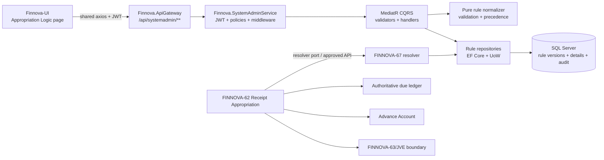
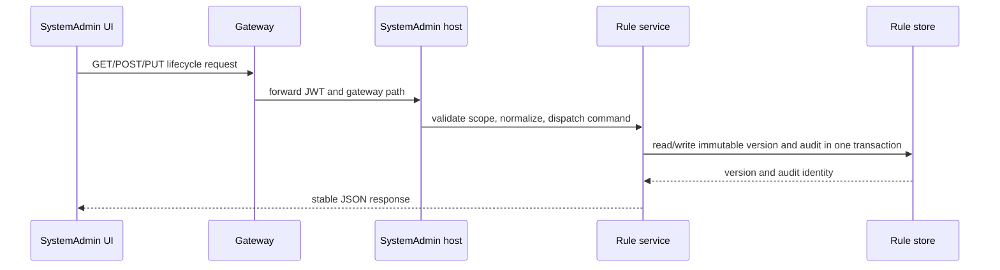
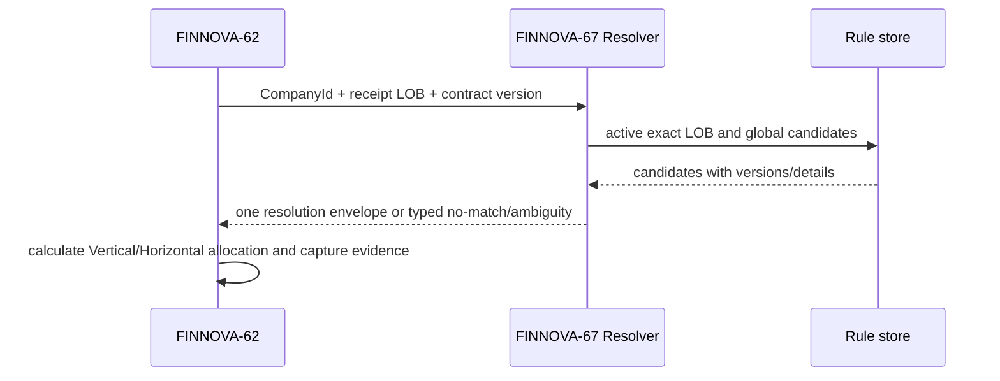

# Design Document: Appropriation Logic Master

**Jira:** FINNOVA-67  
**Feature slug:** `appropriation-logic-master`  
**Backend:** `E:\Finnova\Finnova-API` (`Finnova.Backend.slnx`)  
**Frontend:** `E:\Finnova\Finnova-UI\Finnova-UI` (React 18 + TypeScript + Vite + MUI)  
**Consumers:** FINNOVA-62 Receipt Appropriation Suggest and Suggest-mode Confirm  
**Posting boundary:** FINNOVA-63/JVE; no journal writes in FINNOVA-67

## Overview

FINNOVA-67 is a SystemAdmin master-data vertical slice. It stores versioned appropriation policy for one Company and either a global scope or one exact Line of Business. It exposes CRUD/lifecycle APIs for the SystemAdmin UI and a narrow resolver contract for FINNOVA-62. The resolver applies exact active LOB precedence, then global fallback, and fails closed for no match or ambiguity.

The feature has two distinct responsibilities:

1. **Configuration:** validate and persist Company/LOB scope, Vertical/Horizontal direction, Full Due, ordered due-head details, percentages, activation, concurrency, idempotency, and immutable audit.
2. **Consumption contract:** return a stable, immutable resolution envelope containing rule identity/version, matched scope, fallback indicator, direction, Full Due, ordered details, mapping identifiers, and compatibility version.

FINNOVA-67 does not calculate receipt allocations. It does not read or update customer dues as a posting operation, does not create Receipt Appropriation rows, and does not call the Journal Writer. FINNOVA-62 consumes the resolver result and owns allocation traversal, percentage application, residual/Advance Account behavior, and Confirm. FINNOVA-63/JVE owns journal submission/posting after the approved receipt/accounting boundary.

## Architecture



### Request and resolution flows





### Reused versus new

| Concern | Reused | New in FINNOVA-67 |
| --- | --- | --- |
| Authentication | Existing JWT bearer and SystemAdmin role/policy | Master-maintenance and resolver policies only where missing |
| Errors | Existing ProblemDetails and `ExceptionHandlingMiddleware` | Typed rule exceptions and stable `ERR-APPROP-RULE-*` mapping |
| CQRS | Existing MediatR and FluentValidation registration | Rule commands, queries, resolver handler, mapper |
| Persistence | Existing `FinnovaDbContext`, SQL Server, EF configurations, `IApplicationUnitOfWork` | Rule aggregate, immutable versions/details, idempotency records, audit records |
| Reference data | Existing Company and LOB repositories/ports | Due-head mapping adapter contract; no duplicate due ledger |
| Gateway | Existing `/api/systemadmin/**` YARP route | Alias only if UI base path needs it, preserving systemadmin host separation |
| UI HTTP | Shared `src/services/api.ts` and `VITE_USE_MOCK_API` | Rule service interface, real/mock/toggle/barrel |
| UI state | React hooks, MUI, existing protected layout | Screenshot-aligned page and components |
| Tests | xUnit, FsCheck.Xunit, WebApplicationFactory, Vitest/RTL | Rule properties, lifecycle/security/contract tests |

## Requirements Coverage Map

| Requirement | Design coverage |
| --- | --- |
| R1 scope and precedence | Sections 3, 5, 6, 7, 8, 10 |
| R2 screenshot UI | Sections 2, 8, 9 |
| R3 direction and Full Due | Sections 5, 6, 7, 9 |
| R4 ordered details | Sections 5, 6, 7 |
| R5 percentages and duplicates | Sections 5, 6, 7, 10 |
| R6 due mapping/payment separation | Sections 4, 5, 6, 7 |
| R7 lifecycle/versioning | Sections 5, 7, 10 |
| R8 concurrency/idempotency | Sections 5, 7, 10 |
| R9 audit/read contracts | Sections 5, 7, 10 |
| R10 stable API/errors | Sections 7, 10 |
| R11 authentication/scope | Sections 3, 7, 10 |
| R12 Jira scenarios | Sections 6, 7, 9, 11 |
| R13 testing/boundaries | Section 12 and implementation tasks |

## Data Models

### Domain ownership

The master owns configuration and history. A rule version is immutable after creation. An active pointer or active flag identifies the version selected by the resolver. A lifecycle command creates a new version or a new activation transition rather than editing an old version in place.

```text
AppropriationRule (aggregate identity)
  -> AppropriationRuleVersion (immutable Company/LOB policy snapshot)
       -> AppropriationRuleDetail (immutable ordered due-head percentage)
       -> AppropriationRuleAuditEntry (append-only mutation evidence)
       -> RuleMutationIdempotency (normalized request hash and result)
```

### `AppropriationRuleVersion`

| Field | Type/rule |
| --- | --- |
| `Id` | GUID version identity |
| `RuleId` | GUID logical rule identity |
| `CompanyId` | Required authoritative company scope |
| `LineOfBusinessId` | Nullable; null is global scope |
| `Direction` | `Vertical` or `Horizontal` |
| `FullDue` | Boolean |
| `IsActive` | Boolean; at most one active per Company + scope |
| `VersionNumber` | Positive server-generated integer |
| `VersionToken` | SQL rowversion/concurrency token |
| `IdempotencyKey` | Required mutation key with uniqueness policy |
| `CreatedBy`, `CreatedAtUtc` | Immutable actor/timestamp |
| `ActivatedAtUtc`, `DeactivatedAtUtc` | Nullable lifecycle timestamps |
| `Details` | Ordered immutable child collection |

### `AppropriationRuleDetail`

| Field | Type/rule |
| --- | --- |
| `Id` | GUID |
| `RuleVersionId` | Required parent |
| `SequenceNumber` | One-based contiguous integer |
| `AppropriationDueType` | Canonical enum/string; unique within version |
| `CashFlowDueTypeCode` | Mapped authoritative ledger code |
| `Percentage` | decimal(5,2), 0.00..100.00 |

The initial mapping catalog is English and India-specific: `Installment`, `Principal`, `Interest`, `Insurance`, `ODI`, `BankCharges`, and `ChequeReturnCharges`. The exact ledger code remains an adapter concern. `Receipt Type` is only a UI label.

### `AppropriationRuleAuditEntry`

Append-only fields: `Id`, `RuleId`, `RuleVersionId`, `CompanyId`, nullable `LineOfBusinessId`, operation, actor identity, correlation ID, idempotency key, normalized request hash, UTC timestamp, and safe before/after summary. The entry contains no JWT, secret, payment credential, or unnecessary personal data.

### `RuleMutationIdempotency`

`IdempotencyKey`, operation, normalized request hash, RuleId, RuleVersionId, serialized result reference, created timestamp, and row version. A unique key prevents duplicate mutation results. A same-key different-hash request is a conflict.

### Resolver projections and contracts

```csharp
public enum AppropriationDueType
{
    Installment = 0,
    Principal = 1,
    Interest = 2,
    Insurance = 3,
    Odi = 4,
    BankCharges = 5,
    ChequeReturnCharges = 6
}

public enum AppropriationDirection { Vertical = 0, Horizontal = 1 }

public sealed record AppropriationRuleDetailProjection(
    Guid DetailId,
    AppropriationDueType DueType,
    string CashFlowDueTypeCode,
    decimal Percentage,
    int SequenceNumber);

public sealed record AppropriationRuleResolution(
    string ResolverContractVersion,
    Guid RuleId,
    Guid RuleVersionId,
    int VersionNumber,
    Guid CompanyId,
    Guid? LineOfBusinessId,
    bool UsedGlobalFallback,
    AppropriationDirection Direction,
    bool FullDue,
    IReadOnlyList<AppropriationRuleDetailProjection> Details);
```

FINNOVA-62 maps each `CashFlowDueTypeCode` to the authoritative due ledger and captures the complete resolution envelope on Suggest preview and confirmed Suggest appropriation. FINNOVA-62, not FINNOVA-67, applies the percentages to receipt amounts and due balances.

### UI model

The UI model mirrors camelCase API contracts and uses `string` for editable percentages to preserve two-decimal input without browser floating-point loss.

- `AppropriationRuleForm`: Company ID, optional LOB ID, display LOB, direction, Full Due, active, details, expected version, idempotency key.
- `AppropriationRuleDetailForm`: local row ID, canonical due type, label `Receipt Type`, percentage string, sequence.
- `AppropriationRuleResponse`: saved version, scope, lifecycle, ordered detail response, audit metadata.
- `ResolverCompatibility`: contract version and supported client version.

## Components and Interfaces

### Backend components

1. **Domain entities/enums:** immutable rule version and detail, canonical direction and due-head enum, lifecycle operation enum.
2. **Normalizer:** validates scale/range, maps display due-head to canonical due type and ledger code, rejects duplicates, sorts/recompacts sequence, and computes normalized payload hash.
3. **Precedence resolver:** queries active exact LOB and global candidates for one Company, rejects ambiguity, returns exact LOB first, then global.
4. **Repositories:** read active candidates, list history, add immutable versions, deactivate/activate pointers, append audit, and resolve idempotency.
5. **CQRS:** list/get queries; create/update/activate/deactivate commands; resolver query. Commands validate authorization and concurrency then save aggregate plus audit atomically.
6. **Controller:** exposes stable route contracts and delegates to MediatR. No EF queries or policy calculation live in the controller.
7. **Middleware/host:** maps typed exceptions, registers SystemAdmin and service resolver policies, and keeps auth before business scope.
8. **Due mapping port:** reads authoritative mapping/availability. It is not a due-balance repository and cannot write receipt or accounting data.

### API routes and contracts

The preferred host route is `/api/appropriation-logic`. If SystemAdmin convention uses `/api/systemadmin/appropriation-logic`, the gateway alias must preserve that host boundary and the frontend real service must use the approved composition. The contracts below are logical and versioned; the final route prefix follows the existing host convention.

- `GET /api/appropriation-logic?companyId=&lineOfBusinessId=&includeInactive=` lists rule versions or active scope summaries.
- `GET /api/appropriation-logic/{ruleId}` returns the selected version and ordered details.
- `POST /api/appropriation-logic` creates a version using `companyId`, nullable `lineOfBusinessId`, `direction`, `fullDue`, `active`, details, `idempotencyKey`.
- `PUT /api/appropriation-logic/{ruleId}` updates using `expectedVersion`, normalized fields, and `idempotencyKey`.
- `POST /api/appropriation-logic/{ruleId}/activate` activates a validated version using expected version and idempotency key.
- `POST /api/appropriation-logic/{ruleId}/deactivate` deactivates using expected version and idempotency key.
- `GET /api/appropriation-logic/resolve?companyId=&lineOfBusinessId=` is the approved service resolver operation. It returns 200 for one resolution and typed 404/409-style configuration errors for no match/ambiguity.

The resolver request derives Company and LOB from authoritative receipt context in FINNOVA-62. A browser cannot select a rule ID or override Company scope. `resolverContractVersion` is mandatory on successful resolver responses.

### Frontend components

- `AppropriationLogicMaster.tsx`: page state, load/save/clear/cancel, mutation idempotency, and error preservation.
- `AppropriationLogicHeader.tsx`: `Line of Business`, `Type`, `Full Due`, `Active` controls.
- `AppropriationLogicDetailsGrid.tsx`: `S.No.`, `Receipt Type`, `Percentage`, `Edit`, `Delete`, new-row selector/Add.
- `AppropriationLogicFooter.tsx`: Save/Clear/Cancel actions.
- `appropriationLogic.service.ts`: interface-selected mock/real implementation through `VITE_USE_MOCK_API`.
- `App.tsx` and `Layout.tsx`: protected route and SystemAdmin navigation entry.

### FINNOVA-62 adapter interface

FINNOVA-62 replaces the unresolved/static rule assumption with an adapter that consumes the resolver contract:

```csharp
public interface IAppropriationRuleResolver
{
    Task<AppropriationRuleResolutionResult> ResolveAsync(
        Guid companyId,
        Guid lineOfBusinessId,
        CancellationToken cancellationToken);
}

public sealed record AppropriationRuleResolutionResult(
    AppropriationRuleResolutionStatus Status,
    AppropriationRuleResolution? Rule,
    string ResolverContractVersion,
    string? ErrorCode);
```

The FINNOVA-62 handler must reject unsupported resolver contract versions, no-match results, ambiguous results, missing mappings, duplicate details, totals above 100%, and invalid direction before calculation. Suggest response and confirmed audit snapshot must carry `RuleId`, `RuleVersionId`/version number, `ResolverContractVersion`, `UsedGlobalFallback`, direction, Full Due, ordered detail IDs, due types, ledger codes, sequence, and percentages.

## Precedence and runtime algorithm

### Configuration normalization

1. Verify Company and optional LOB scope.
2. Normalize `null`/approved `All` global UI value to null storage.
3. Validate direction and Full Due.
4. Validate every percentage scale and range.
5. Reject duplicate canonical due heads.
6. Resolve each due-head mapping to an active ledger code.
7. Assign one-based sequence in submitted row order or preserve explicit server order for an update.
8. Reject total above 100%; retain totals below 100% as residual policy context.
9. Compute normalized request hash and save immutable version, audit, and idempotency record atomically.

### Resolver precedence

For `(CompanyId, receiptLobId)`:

```text
exact = active rules where CompanyId = C and LineOfBusinessId = receiptLobId
global = active rules where CompanyId = C and LineOfBusinessId is null
if count(exact) > 1: AMBIGUOUS
if count(exact) == 1: return exact[0], UsedGlobalFallback=false
if count(global) > 1: AMBIGUOUS
if count(global) == 1: return global[0], UsedGlobalFallback=true
return NO_APPLICABLE_RULE
```

The query is constrained by Company and authorization scope. A global rule is never selected from another Company. A stale or inactive version is not a candidate.

### Runtime consumption by FINNOVA-62

FINNOVA-62 reloads the authoritative receipt Company/LOB and calls the resolver on Suggest. It obtains current eligible dues, maps each configured ledger code to due rows, and applies the resolved sequence. Vertical traversal groups by contract and completes the detail sequence within Contract 1 before Contract 2. Horizontal traversal groups by detail sequence and processes that due head across all eligible contracts before the next detail. Full Due controls whether each matching due is filled to its outstanding balance before traversal advances. A detail target is `receiptAmount * percentage / 100`, rounded to two decimals. A total below 100% does not force redistribution; residual remains for Advance Account. FINNOVA-62 re-resolves and rechecks rule version on Suggest-mode Confirm.

## Error, security, concurrency, and audit handling

| Condition | HTTP | Code |
| --- | ---: | --- |
| Invalid required field, enum, detail, scale | 400 | `ERR-APPROP-RULE-VALIDATION` |
| Missing active rule in resolver | 404/422 per host convention | `ERR-APPROP-RULE-NOT-FOUND` |
| Multiple active rules for one scope | 409 | `ERR-APPROP-RULE-AMBIGUOUS` |
| Duplicate due head | 422 | `ERR-APPROP-DUPLICATE-DUE-HEAD` |
| Total percentage above 100 | 422 | `ERR-APPROP-RULE-TOTAL-OVER-100` |
| Missing/inactive due mapping | 422 | `ERR-APPROP-DUE-MAPPING` |
| Stale expected version | 409 | `ERR-APPROP-RULE-STALE` |
| Same key, different payload | 409 | `ERR-APPROP-IDEMPOTENCY-CONFLICT` |
| Missing/invalid JWT | 401 | platform authentication code |
| Missing role or Company scope | 403 | `ERR-APPROP-RULE-403` |
| Dependency unavailable | 503 | `ERR-APPROP-RULE-DEPENDENCY` |

Middleware returns stable English ProblemDetails and correlation ID. SQL messages, stack traces, JWTs, and secrets are never returned. Mutation commands authorize before loading mutation data where possible and recheck Company scope before saving. Resolver service authorization is separate from mutation authorization.

All mutation writes use one database transaction. A unique active-scope index or equivalent serializable activation operation protects at-most-one active rule. Rowversion plus expected version rejects stale edits. Idempotency lookup occurs before mutation; same-key same-hash returns the original result. An audit entry is inserted in the same transaction as the version change. Audit rows are append-only and not updated or deleted by the feature.

## Error Handling

The SystemAdmin host maps typed `AppropriationLogicException` values to the platform ProblemDetails contract. Validation and duplicate detail errors return field context; no-match and ambiguity are distinguishable for FINNOVA-62; stale and idempotency conflicts preserve the existing version. All messages are English and safe for clients. Authentication and authorization failures return 401/403 before mutation. The resolver never chooses an arbitrary rule, and no error path writes an audit entry or changes receipt, due, or journal data.

## Testing Strategy

The pure normalizer, duplicate detection, sequence compaction, precedence resolver, and compatibility gate have broad input-dependent behavior, so property-based tests apply to those functions. Use FsCheck.Xunit in `Finnova.Tests` with at least 100 iterations per property. Tests do not call external services; resolver integration tests use in-memory or mocked repositories.

Backend example and edge tests cover the screenshot contract, Company/LOB validation, exact LOB over global fallback, no match, ambiguity, duplicate due heads, zero percentage, total below 100, total above 100, invalid mapping, activation, deactivation, stale version, idempotency, one audit entry, 401/403, and no journal/due/receipt writes. WebApplicationFactory tests verify routing, policies, JSON enum names, errors, and middleware.

Frontend Vitest/RTL tests cover screenshot labels and controls, new-row Add, edit/delete/resequence, percentage validation, Clear/Cancel, loading/error states, mock/real service toggle, request payloads, active/inactive state, and absence of payment-mode labels in due-head options. No RTL or non-English content is tested or introduced.

## Correctness Properties

*A property is a characteristic or behavior that should hold true across all valid executions of a system-essentially, a formal statement about what the system should do. Properties serve as the bridge between human-readable specifications and machine-verifiable correctness guarantees.*

### Property 1: Scope normalization and uniqueness

For any valid Company, optional LOB scope, and normalized rule mutation, the normalized scope shall preserve Company identity, represent global scope as one null/All equivalent, and contain no duplicate detail scope for the same Company and exact LOB.

**Validates: Requirements 1.1, 1.2, 1.3, 5.5**

### Property 2: Ordered sequence normalization

For any valid non-empty detail collection with unique due heads, normalization shall return contiguous one-based sequence numbers in the configured order, and deleting any one detail then normalizing shall preserve the relative order of all remaining details.

**Validates: Requirements 4.1, 4.2, 4.3, 4.4**

### Property 3: Percentage bounds and residual semantics

For any generated detail collection whose individual percentages are in the inclusive 0.00-to-100.00 range, normalization shall accept totals from 0.00 through 100.00, expose the difference from 100.00 as residual percentage, and reject totals above 100.00 without persistence.

**Validates: Requirements 5.1, 5.2, 5.3, 5.4, 5.6**

### Property 4: Exact LOB precedence

For any Company, receipt LOB, and active candidate set, resolution shall return the unique exact LOB rule when one exists, otherwise the unique global rule, and shall return ambiguity whenever the selected precedence tier contains more than one active rule.

**Validates: Requirements 1.5, 1.6, 1.7, 7.6**

### Property 5: Resolution evidence preservation

For any valid active rule returned by the resolver, the resolution envelope shall preserve rule identity/version, Company scope, matched LOB scope, fallback flag, direction, Full Due, resolver contract version, and details in ascending sequence without changing percentages or mappings.

**Validates: Requirements 6.1, 6.2, 6.5, 9.3, 9.4, 10.6**

### Property 6: Idempotent mutation behavior

For any valid mutation payload and idempotency key, applying the same normalized payload twice shall return one Rule_Version and one successful mutation audit entry, while applying a different normalized payload with the same key shall preserve the first result and return an idempotency conflict.

**Validates: Requirements 8.3, 8.4, 8.5, 9.1, 9.2**

## Property Reflection

Properties 1 and 4 are separate because scope representation/validation is distinct from candidate selection precedence. Properties 2 and 5 are separate because sequence normalization concerns mutation input while evidence preservation concerns the read contract. Property 6 subsumes separate “same-key retry” cases without duplicating them. The UI and persistence wiring remain example/integration tests because they do not benefit from 100 generated executions.

## Design decisions and tradeoffs

- **Immutable versions instead of in-place updates:** increases rows and audit data but makes receipt evidence reproducible and prevents a confirmed receipt from silently changing meaning.
- **Null global scope with UI `All`:** avoids a fake LOB entity and keeps Company + scope uniqueness clear. An existing `All` sentinel may be adapted at the boundary but is never treated as a separate global policy.
- **Fail closed on ambiguity:** prevents arbitrary policy selection. A 409 is safer than guessing which active rule applies.
- **Total up to 100, not exactly 100:** permits residual to Advance Account and matches FINNOVA-67. Totals above 100 are rejected to preserve deterministic maximum-target semantics until product explicitly chooses another policy.
- **Canonical due-head mapping:** prevents the screenshot’s `Receipt Type` label from becoming a second definition of receipt payment modes or due ledger heads.
- **Resolver contract version:** allows FINNOVA-62 to reject incompatible evidence rather than silently applying a changed schema.
- **No journal ownership:** keeps configuration, receipt allocation, and accounting posting boundaries separate and consistent with JVE.

## Prerequisite gates

Implementation must stop until the following are confirmed:

1. The exact SystemAdmin host route and gateway composition for the UI.
2. The Company and LOB entity/port names and authorization-scope contract.
3. The authoritative due-head mapping and whether `LegalCharges` is represented by `OtherCharges`, a dedicated code, or an existing due type. The Jira scenario uses the display value `Legal Charges`; the canonical enum must be approved before coding.
4. The active-version storage strategy and the exact SQL Server filtered unique index or transaction isolation approach.
5. FINNOVA-62’s resolver adapter endpoint/port, supported `resolverContractVersion`, and receipt Suggest/Confirm snapshot fields.
6. Confirmation that totals above 100 are rejected and totals below 100 route residual to Advance Account.
7. The approved SystemAdmin policy name and whether a narrower Risk & Policy Administrator permission exists.
8. The frontend checkout path and existing SystemAdmin master-page route/navigation anchors.

## Implementation-ordered task list

1. Backend domain enums, entities, immutable audit/idempotency models.
2. Backend domain exceptions and stable error codes.
3. Backend request/response and resolver contracts.
4. Backend EF configurations, DbSets, indexes, and documented migration command.
5. Backend repositories, pure normalizer/precedence helpers, and DI ports.
6. Backend CQRS lifecycle, resolver, activation, validation, version, idempotency, and audit handlers.
7. Backend controller, middleware, SystemAdmin policies, and gateway route.
8. Backend xUnit, FsCheck (100+ iterations), and WebApplicationFactory tests.
9. FINNOVA-62 resolver adapter and hard-coded-rule compatibility-gate updates.
10. Frontend models, service interface, real/mock/toggle/barrels.
11. Frontend screenshot-aligned page/components, protected route, and navigation.
12. Frontend Vitest/RTL tests.
