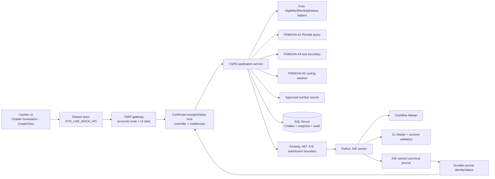
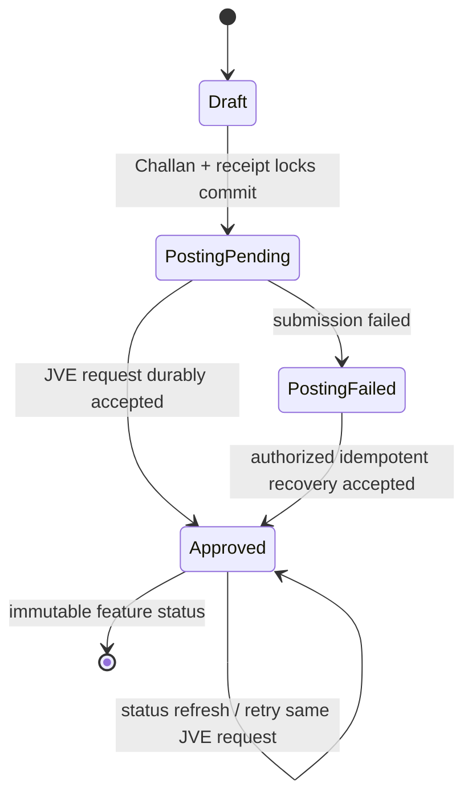

# Design Document — Challan Processing and Pay-In-Slip Generation

**Jira:** FINNOVA-66  
**Feature slug:** `challan-processing-pay-in-slip-generation`  
**Source of truth:** `requirements.md`  
**Implementation languages:** C#/.NET 8-compatible project conventions for backend, SQL Server/EF Core for persistence, and React 18 + TypeScript + MUI + Vite for frontend.  
**Ownership rule:** FINNOVA-66 creates an immutable Challan and one approved JVE Posting Request. JVE owns Cashflow/GL resolution and canonical journal creation.

## Overview

FINNOVA-66 gives an authorized Cashier a single-screen workflow for listing, selecting, excluding, and generating a consolidated Bank Deposit Challan. The UI follows the supplied legacy reference without copying non-India values: `Home > Collections > Challan Generation`, `Challan Generation - Create`, required filter/header fields, `Past Receipts`, the five named actions, and the instrument grid. The business-required `Exclude` action is added as an explicit table action.

The backend treats the browser as an untrusted selector. The browser may submit only server-issued receipt IDs, filters, and an idempotency key. The backend re-queries every receipt and rechecks its FINNOVA-61 eligibility, FINNOVA-64 protection state, branch/LOB scope, and FINNOVA-65 routing inside the generation transaction. It computes the amount from server values, allocates a unique Challan_No, stores immutable routing snapshots, locks selected receipts, and submits one approved JVE request. A failed JVE post retains the committed Challan and receipt locks for controlled recovery.

`Approved` means the JVE request was durably accepted by the existing .NET submission boundary. `PostingStatus` is separate and reports the asynchronous JVE outcome. FINNOVA-66 never writes canonical Journal Header or Journal Line tables and never resolves a new route after the JVE request is accepted.

## Scope and non-goals

### In scope

- Cashier-facing listing, filters, dependent lookups, selection, exclusion, totals, generation, status, and print behavior.
- Feature-owned Challan, ChallanReceipt membership, RoutingSnapshot, generation idempotency, and audit projections where compatible owners do not already exist.
- Server-side eligibility query, stable pagination, atomic receipt recheck, receipt lock call, unique number allocation, and status transitions.
- FINNOVA-65 routing adapter and immutable snapshot persistence.
- FINNOVA-63/JVE submission adapter using the existing `JvPostingSubmissionRequest` boundary.
- Protected API routes, ProblemDetails mapping, YARP route/alias, and frontend real/mock service selection.
- xUnit, FsCheck.Xunit, WebApplicationFactory, Vitest, and React Testing Library coverage.

### Non-goals

- A second Receipt model, receipt capture flow, receipt authorization engine, or receipt status owner.
- A replacement for FINNOVA-64 receipt locking/protection.
- A replacement for FINNOVA-65 routing master or a second routing table.
- Cashflow Master, GL Master, Cashier-account, or deposit-bank clearing-account administration.
- Direct writes to canonical Journal Header, Journal Line, or canonical journal source-link tables.
- A browser-side Challaned state mutation, browser-generated amount, browser-generated Challan_No, or client-side routing decision.
- Arabic, bilingual fields, non-English localization, RTL, Redux, RxJS, or an ad-hoc axios client.

## Compatibility gates before implementation

1. **FINNOVA-61 gate:** Confirm the actual Receipt entity/table, server-issued ID type, amount/date/type/instrument/customer fields, active/cancelled/bounced/challaned fields, and query owner. If the receipt contract is planning-only, create an adapter contract and stop before adding a parallel model.
2. **FINNOVA-63 gate:** Confirm the authorization/posting-state owner, Cashier permission and scope claims, existing JVE submission call, and whether FINNOVA-63 already owns the Challan aggregate. Extend the existing contract instead of adding duplicate status fields.
3. **FINNOVA-64 gate:** Confirm the lock/edit-protection API or state transition. The generation transaction must call that boundary or use its approved shared transaction hook.
4. **FINNOVA-65 gate:** Confirm the exact `IChallanRoutingResolver` and `ChallanRoutingSnapshot` names and fields, including Deposit Bank clearing GL source. Store the returned snapshot without re-resolving after submission.
5. **JVE gate:** Confirm the existing `JvPostingSubmissionRequest`, `JvPostingSubmissionService`, request payload schema, `Collections.ChallanPayInSlip` event/rule key, and how the JVE worker returns durable journal identity/status. No guessed JVE or canonical journal model is permitted.
6. **Numbering gate:** Confirm whether Document Number Control owns Challan_No. If it does, use that service transactionally. If it does not, obtain an approved server-side sequence owner before implementing generation.
7. **Host gate:** Confirm whether `Finnova.AccountsService` or another existing Collections/receipt host owns the controller. The default route design below uses AccountsService only when no existing owner is confirmed.

## Architecture



### Listing flow

1. The UI loads active LOB options, then Branch options for the selected LOB, then Deposit Bank options for the selected LOB and Branch.
2. The UI submits filter identifiers and values to the listing endpoint. Display labels are never used as identifiers.
3. The application validates the request, applies the FINNOVA-61 eligibility predicate, applies date/Past Receipts and type predicates, orders by InstrumentDate, ReceiptNo, and ReceiptId, and applies server pagination.
4. The response contains only minimum screen fields, server-issued ReceiptId, server amount, record count, page, page size, and selection context.

### Generation flow

1. The UI sends selected server-issued ReceiptIds, filter context, Challan Date, and an Idempotency-Key. It does not send authoritative amounts, routing, status, or Challan_No.
2. The application locks the relevant receipt scope or uses the FINNOVA-64 transaction hook, reloads all IDs with update locks, and rechecks eligibility and scope.
3. The application resolves FINNOVA-65 routing once per selected receipt and stores immutable snapshots.
4. The application allocates Challan_No through the approved number source, calculates the server total, creates Challan and membership records, locks receipts as Challaned, and writes the initial audit event in one transaction.
5. After the feature-owned commit is durable, the application submits one approved `JvPostingSubmissionRequest` with a deterministic request ID derived from the Challan identity or stored JVE request ID. The JVE payload contains receipt IDs, Challan identity, routing snapshots, total INR amount, Cashier context, and the accounting intent key.
6. If JVE accepts the request durably, the Challan becomes Approved. If the submission fails, the Challan remains committed with a submission/PostingStatus failure and remains recoverable by the existing operations boundary.
7. The Python worker resolves Cashflow Master and GL rules, validates both accounts, and writes the canonical journal. FINNOVA-66 stores only the returned JVE/journal identity and status projection.

### Status flow



`PostingStatus` is independent:

```text
Ready -> Processing -> Posted
Ready -> Failed -> Processing -> Posted
Processing -> Failed -> DeadLetter
```

A failed JVE result never un-challans a receipt. `DeadLetter` requires controlled operations recovery and retains the original request identity.

## Reused versus new

### Reused

- FINNOVA-61 Receipt entity, query, status, amount, customer/entity, location, and receipt-type contracts.
- FINNOVA-63 Cashier authorization, posting-state ownership, and existing JVE submission boundary.
- FINNOVA-64 receipt edit protection and Challaned lock behavior.
- FINNOVA-65 `IChallanRoutingResolver` and immutable routing snapshot shape.
- Existing LOB, Location/Branch, Deposit Bank, Drawee Bank, Customer/Entity, Cashier, GL, audit, EF Core, SQL Server, JWT, ProblemDetails, and YARP conventions.
- Existing `JvPostingSubmissionRequest`/`JvPostingSubmissionService`. The feature must not create a second JVE request service.
- Shared UI `src/services/api.ts`, React hooks, MUI, `VITE_USE_MOCK_API`, service interface/real/mock/toggle conventions, `LocationMaster.tsx` table patterns, `App.tsx`, `Layout.tsx`, and Vitest/RTL setup.

### New or extended

- FINNOVA-66 Challan aggregate or an extension of the FINNOVA-63-owned aggregate.
- Challan receipt membership and immutable RoutingSnapshot persistence if no existing owner has equivalent records.
- Listing/generation/status/print contracts and pure eligibility/total/status helpers.
- Generation idempotency and audit projections if not already owned by FINNOVA-63.
- Cashier-facing API/controller/application handlers and frontend screen/services.
- JVE payload adapter that submits, records, and projects the durable outcome without journal writes.

## Requirements coverage map

| Requirements | Design coverage |
|---|---|
| 1.1–1.7 UI shell and labels | Screen layout, exact labels, India-only fixtures, explicit Exclude action |
| 2.1–2.6 dependent filters | Lookup services, reset state, server identifiers, validation |
| 3.1–3.8 eligibility and pagination | Receipt query predicate, Past Receipts, deterministic order, page metadata |
| 4.1–4.7 selection and total | Client selection state, server total, exclusion semantics, no client authority |
| 5.1–5.8 atomic generation | Update locks, eligibility recheck, numbering, membership, FINNOVA-64 lock, transaction |
| 6.1–6.5 FINNOVA-65 routing | Resolver adapter, snapshot model, fail-closed generation, no post-submit resolve |
| 7.1–7.7 JVE boundary | Approved submission payload, event key gate, separate posting status, no canonical writes |
| 8.1–8.9 lifecycle/recovery | State machine, idempotency, immutable locks, failure and dead-letter recovery |
| 9.1–9.5 print | Server-rendered PDF/printable output and policy-gated timing |
| 10.1–10.6 security/audit | Cashier policy/scope, server actor, redaction, append-only audit |
| 11.1–11.6 contracts | API records, shared axios services, React/MUI constraints |
| 12.1–12.6 testing | xUnit/PBT/integration/RTL and three-receipt acceptance scenario |

## Data Models

The exact ownership and names are confirmed by the compatibility gates. The following shape is the minimum feature contract when no existing equivalent exists.

### Challan

```csharp
public sealed class Challan
{
    public Guid Id { get; set; }
    public string ChallanNumber { get; set; } = string.Empty;
    public Guid LineOfBusinessId { get; set; }
    public Guid BranchId { get; set; }
    public Guid DepositBankId { get; set; }
    public string DepositBankNameSnapshot { get; set; } = string.Empty;
    public DateOnly ChallanDate { get; set; }
    public decimal TotalAmountInr { get; set; }
    public int SelectedReceiptCount { get; set; }
    public ChallanStatus Status { get; set; }
    public PostingStatus PostingStatus { get; set; }
    public Guid? JveRequestId { get; set; }
    public Guid? JournalId { get; set; }
    public string? PostingFailureCode { get; set; }
    public string? PostingFailureMessage { get; set; }
    public string CreatedByUserId { get; set; } = string.Empty;
    public DateTime CreatedAtUtc { get; set; }
    public DateTime UpdatedAtUtc { get; set; }
    public byte[] RowVersion { get; set; } = Array.Empty<byte>();
}
```

`ChallanStatus` is `Draft`, `PostingPending`, `Approved`, and `PostingFailed` only if the confirmed FINNOVA-63 owner uses equivalent values. `PostingStatus` is `Ready`, `Processing`, `Posted`, `Failed`, and `DeadLetter`.

### Challan receipt membership and routing snapshot

```csharp
public sealed class ChallanReceipt
{
    public Guid Id { get; set; }
    public Guid ChallanId { get; set; }
    public Guid ReceiptId { get; set; }
    public decimal AmountInr { get; set; }
    public DateOnly InstrumentDate { get; set; }
    public string ReceiptNumberSnapshot { get; set; } = string.Empty;
    public string? DraweeBankSnapshot { get; set; }
    public RoutingSnapshot RoutingSnapshot { get; set; } = null!;
}

public sealed class RoutingSnapshot
{
    public Guid Id { get; set; }
    public Guid ChallanReceiptId { get; set; }
    public Guid RuleSetId { get; set; }
    public long RuleVersion { get; set; }
    public string MatchedDraweeBankKey { get; set; } = string.Empty;
    public bool UsedOthers { get; set; }
    public Guid DepositBankAccountId { get; set; }
    public string DepositBankCode { get; set; } = string.Empty;
    public string DepositBankName { get; set; } = string.Empty;
    public string AccountNumberSnapshot { get; set; } = string.Empty;
    public string? DraweeBankClearingGlReference { get; set; }
    public DateTime ResolvedAtUtc { get; set; }
    public string CorrelationId { get; set; } = string.Empty;
}
```

### Invariants

- A Challan has one LOB, one Branch, one Challan Date, one Deposit Bank context, one server-issued Challan_No, and one nonnegative two-decimal INR total.
- Challan_No is unique in the approved numbering scope and immutable after allocation.
- Challan membership contains distinct ReceiptIds. The server amount, date, and display snapshots are copied from FINNOVA-61 during commit.
- Every selected receipt is rechecked and becomes Challaned/locked in the same transaction as membership creation. Excluded receipt IDs are never inserted into membership.
- Every selected cheque/PDC receipt has exactly one FINNOVA-65 RoutingSnapshot. Cash routing follows the confirmed FINNOVA-65/FINNOVA-63 contract and is not invented by FINNOVA-66.
- RoutingSnapshot is immutable after commit and is the only routing input in the JVE payload.
- TotalAmountInr equals the sum of membership AmountInr values rounded to two decimals. Client totals are never authoritative.
- `Approved` is monotonic and cannot return to Draft or an unapproved state.
- JVE request identity is unique per Challan and generation idempotency key. Repeated equivalent generation returns the original outcome.
- A JVE failure retains Challan, memberships, locks, snapshots, audit, and request identity.
- FINNOVA-66 owns no canonical journal table and has no repository method that writes Journal Header/Line.

## API contracts and routes

### Listing request/response

```csharp
public sealed record ChallanListingRequest(
    Guid LineOfBusinessId,
    Guid BranchId,
    DateOnly ChallanDate,
    Guid DepositBankId,
    string ReceiptType,
    string InstrumentType,
    bool PastReceipts,
    int Page,
    int PageSize);

public sealed record EligibleReceiptRow(
    Guid ReceiptId,
    DateOnly InstrumentDate,
    string ReceiptNumber,
    string EntityCustomerCode,
    string EntityCustomerName,
    string? DraweeBank,
    string Location,
    decimal AmountInr,
    string ReceiptType,
    string? InstrumentType,
    bool IsEligible);

public sealed record ChallanListingResponse(
    IReadOnlyList<EligibleReceiptRow> Items,
    int Page,
    int PageSize,
    int TotalCount,
    string CorrelationId);
```

### Generation/status/print contracts

```csharp
public sealed record GenerateChallanRequest(
    Guid LineOfBusinessId,
    Guid BranchId,
    DateOnly ChallanDate,
    Guid DepositBankId,
    string ReceiptType,
    string InstrumentType,
    bool PastReceipts,
    IReadOnlyList<Guid> ReceiptIds,
    string IdempotencyKey);

public sealed record GenerateChallanResponse(
    Guid ChallanId,
    string ChallanNumber,
    int SelectedReceiptCount,
    decimal TotalAmountInr,
    string ChallanStatus,
    string PostingStatus,
    Guid JveRequestId,
    Guid? JournalId,
    string CorrelationId);

public sealed record ChallanStatusResponse(
    Guid ChallanId,
    string ChallanNumber,
    string ChallanStatus,
    string PostingStatus,
    Guid? JveRequestId,
    Guid? JournalId,
    string? PostingFailureCode,
    string? PostingFailureMessage,
    DateTime UpdatedAtUtc);
```

The `Exclude` action is local selection state for a not-yet-committed generation. If a backend endpoint is needed for a long-lived pending selection, it must be idempotent and must not mutate FINNOVA-61 receipt status. The default design keeps exclusion in the browser and rechecks eligibility at generation.

### Routes

Default paths, adjusted by the host-placement gate:

- `GET /api/challan-processing/lookups/lines-of-business`
- `GET /api/challan-processing/lookups/branches?lineOfBusinessId={id}`
- `GET /api/challan-processing/lookups/deposit-banks?lineOfBusinessId={id}&branchId={id}`
- `POST /api/challan-processing/list`
- `POST /api/challan-processing/generate`
- `GET /api/challan-processing/{challanId}`
- `GET /api/challan-processing/{challanId}/print`
- `POST /api/challan-processing/{challanId}/posting-retry` for the existing operations permission only, if FINNOVA-63 does not already own recovery.

All routes require authentication. Listing/detail/print/generate require the confirmed Cashier permission and branch/LOB scope. Retry requires the existing operations recovery permission.

The UI uses the shared axios base URL. If the shared base URL composes `/api/ua/api`, add a YARP alias from `/api/ua/api/challan-processing/**` to the confirmed receipt/challan host and rewrite to `/api/challan-processing/**`. Do not collapse host separation.

## Components and interfaces

### Backend

- **`ReceiptEligibilityService`:** Pure predicate and query projection over FINNOVA-61 fields. It enforces active, non-cancelled, non-bounced, non-challaned state, scope, date, receipt type, instrument type, and Past Receipts.
- **`ChallanListingHandler`:** Validates filters, calls authoritative lookups and receipt query, applies stable order and page metadata, and maps minimum display fields.
- **`SelectionValidator`:** Accepts only ReceiptIds and filter context. Re-queries all IDs and reports missing/changed IDs.
- **`ChallanGenerationHandler`:** Coordinates transaction, idempotency, FINNOVA-64 lock, FINNOVA-65 snapshot, number allocation, membership, total, audit, and JVE submission adapter.
- **`ChallanStatusService`:** Projects immutable Challan status and separately refreshed JVE PostingStatus/journal identity.
- **`PayInSlipRenderer`:** Generates PDF or approved printable HTML from immutable Challan and snapshot data. It does not query live routing for a historical challan.
- **`JveChallanSubmissionAdapter`:** Maps the approved FINNOVA-66 payload to existing `JvPostingSubmissionRequest` and calls `JvPostingSubmissionService`. It has no Journal Writer dependency.
- **`ChallanRepository`:** Owns only FINNOVA-66 records or confirmed FINNOVA-63 extension records. Generation uses one transaction and row locks.
- **`ChallanAuditWriter`:** Appends immutable events with trusted actor and correlation metadata.
- **`ChallanExceptionMapping`:** Adds typed FINNOVA-66 errors to the existing middleware branch with stable English codes.

### Backend ports

```text
IReceiptEligibilityReader
  ListAsync(ChallanListingRequest, CancellationToken)
  GetForGenerationAsync(IReadOnlyCollection<Guid>, scope, CancellationToken)

IReceiptLockBoundary
  LockAndMarkChallanedAsync(receiptIds, challanId, transaction, CancellationToken)
  VerifyEditableAsync(receiptId, CancellationToken)

IChallanRoutingResolver
  ResolveAsync(ChallanRoutingResolveRequest, CancellationToken)

IChallanNumberSource
  AllocateAsync(branchId, challanDate, transaction, CancellationToken)

IJveChallanSubmissionAdapter
  SubmitApprovedAsync(ChallanPostingPayload, ClaimsPrincipal, CancellationToken)
  GetStatusAsync(jveRequestId, CancellationToken)

IPayInSlipRenderer
  RenderAsync(ChallanPrintModel, CancellationToken)
```

### Frontend

- `src/models/challanProcessing.model.ts`: filters, lookup options, receipt rows, requests, responses, status values.
- `src/services/interfaces/challanProcessing.service.ts`: lookup, list, generate, detail/status, print methods.
- `src/services/real/challanProcessing.service.ts`: shared axios implementation.
- `src/services/mock/challanProcessing.service.ts`: deterministic India-only fixtures and server-like eligibility/total behavior.
- `src/services/challanProcessing.service.ts`: `VITE_USE_MOCK_API` selector.
- `src/pages/ChallanGeneration.tsx`: filter/header form, table, selection/exclusion, totals, actions, error preservation.
- `App.tsx` and `Layout.tsx`: protected route and permission-filtered navigation entry.

## UI layout and interaction design

```text
Home > Collections > Challan Generation

Challan Generation - Create

Line of Business* [ LN - Loan ]   Branch* [ Mumbai ]   Date* [ 15/06/2025 ]
Deposit Bank* [ HDFC Bank ]       Receipt Type* [ All ]
Instrument Type* [ All ]          Challan No [ server-issued ]
Past Receipts [ ]

[Challan Listing] [Challan Generation] [Print] [Clear] [Cancel]

+-------+----------------+------------+----------------------+----------------------+-------------+----------+------------+---------+
| Sl.No | Instrument Date| Receipt No | Entity/Customer Code | Entity/Customer Name | Drawee Bank | Location | Amount     | Exclude |
+-------+----------------+------------+----------------------+----------------------+-------------+----------+------------+---------+
| 1     | 15/06/2025     | RCP-1001   | CUST-1001            | Asha Finance         | HDFC        | Mumbai   | INR 500.00 | [ ]     |
+-------+----------------+------------+----------------------+----------------------+-------------+----------+------------+---------+

Selected: 2    Total: INR 1,250.00       Records: 3    Page size: 10    [pagination]
```

- The create screen shows editable filter context and no client-issued Challan_No.
- The view screen shows saved values, server Challan_No, Challan status, PostingStatus, and immutable selected rows.
- `Exclude` is a row action/control and is never hidden behind a legacy screenshot limitation.
- `Clear` resets local filter, listing, selection, exclusion, total, and errors. `Cancel` navigates without a mutation. `Print` calls the server and handles the configured pre-Posted policy.
- Any generation/listing error leaves current fields and pending row state intact.

## Query and eligibility strategy

The server composes a single receipt query using FINNOVA-61 ownership. The core predicate is:

```text
IsActive
AND IsCancelled = false
AND IsBounced = false
AND ChallanId IS NULL or receipt status is not Challaned
AND LineOfBusinessId = request.LineOfBusinessId
AND BranchId = request.BranchId
AND ReceiptDate/CreatedDate satisfies the confirmed date contract
AND (ReceiptType = request.ReceiptType OR request.ReceiptType = All)
AND (InstrumentType = request.InstrumentType OR request.InstrumentType = All)
```

`PastReceipts` adds `CreatedDate < ChallanDate` using the confirmed business date. The query uses no client amount or display label. The generation path repeats the predicate under update locks and verifies that the request context still matches.

## Transaction, concurrency, and idempotency

- Start the approved SQL transaction before loading selected receipts for commit.
- Acquire the FINNOVA-64-approved receipt lock or update lock in deterministic ReceiptId order to reduce deadlocks.
- Recheck all receipt flags, scope, status, and selected membership. If any row fails, roll back and return a conflict containing safe ReceiptIds.
- Check the generation idempotency table by `(operation, IdempotencyKey)`. Equivalent fingerprint returns the stored result; a different fingerprint returns conflict.
- Resolve FINNOVA-65 and persist snapshots before membership is committed. A routing failure rolls back all feature-owned records.
- Allocate Challan_No from the approved number source within the transaction. A number is not allocated in the browser.
- Insert Challan, memberships, snapshots, and audit. Mark receipts Challaned through FINNOVA-64's transaction-compatible boundary.
- Commit the feature-owned transaction. Submit the JVE request using a stable request ID. Store the JVE request identity/result with an idempotent update. If the submission response is uncertain, query by request ID before retrying.
- Never insert a second Challan or submit a second JVE request for equivalent input. Never delete or un-challan committed membership because JVE later fails.

## Accounting and JVE integration

The adapter constructs `JvPostingSubmissionRequest` with:

- Stable `RequestId` tied to Challan identity.
- `SourceSystem = Collections`.
- `RuleKey = Collections.ChallanPayInSlip` until the JVE/Cashflow compatibility gate confirms the canonical key.
- Company/Branch/ValueDate/PostingDate and `CurrencyCode = INR` from the approved contract.
- `InitiationMode = Person` and `InitiatingUserId` from the authenticated Cashier, subject to the existing JVE caller validation.
- JSON `Data` containing ChallanId, ChallanNo, selected ReceiptIds, total INR amount, LOB, Branch, Challan Date, Deposit Bank snapshot, per-receipt RoutingSnapshot, and accounting intent `Dr Drawee Bank Clearing / Cr Cashier Account`.

The adapter calls the existing `JvPostingSubmissionService`. It does not call GL repositories, Cashflow Master, Journal Writer, or canonical journal tables. The Python JVE worker performs those operations, validates account sources, creates the balanced journal atomically, and returns durable journal identity/status. FINNOVA-66 stores and projects that result only.

## Error Handling

| Condition | Response/behavior |
|---|---|
| Missing/invalid JWT | 401; no receipt/challan data |
| Missing Cashier permission or scope | 403; no out-of-scope data |
| Missing required filter | 400 with field code; no query/mutation |
| No eligible receipts | 200 empty page; generation remains unavailable |
| Receipt changed or already Challaned | 409; full generation transaction rolls back |
| FINNOVA-65 missing/ambiguous route | 422/503; no Challan/JVE request |
| Number source conflict | 409/503; no partial Challan |
| JVE submission failure | Challan and locks retained; `PostingStatus = Failed`; controlled retry |
| JVE dead letter | Retain immutable request and locks; operations recovery only |
| Print before allowed status | 409; no document |
| Unknown/unhandled error | Existing middleware ProblemDetails, correlation ID, safe English detail |

Authorization uses the confirmed Cashier policy and branch/LOB scope. Audit actor/timestamps come from trusted JWT/server context. Logs and errors redact bearer tokens, account secrets, unnecessary customer data, and raw JVE payloads. The browser cannot write receipt statuses or accounting entries.

## Correctness Properties

*A property is a characteristic or behavior that should hold true across all valid executions of a system—essentially, a formal statement about what the system should do. Properties serve as the bridge between human-readable specifications and machine-verifiable correctness guarantees.*

The following properties are limited to pure or mockable FINNOVA-66 logic. UI rendering, SQL transaction atomicity, authorization, FINNOVA-65 transport, JVE transport, PDF generation, and canonical journal behavior use example or integration tests. Each property has one FsCheck.Xunit test with `MaxTest = 100` or higher.

### Property 1: Eligibility predicate is exact

For any generated receipt and listing context, the eligibility predicate returns true exactly when the receipt is active, not cancelled, not bounced, not challaned, in the requested LOB/Branch/date scope, and satisfies the selected non-`All` type filters.

**Validates: Requirements 3.1, 3.2, 3.3, 3.4, 3.5**

### Property 2: Pagination is a stable partition

For any generated deterministically ordered eligible receipt sequence and valid page size, concatenating all returned pages produces the original ordered sequence exactly once, with total count equal to the source sequence length.

**Validates: Requirements 3.7, 3.8**

### Property 3: Total equals selected server amounts

For any finite set of distinct receipt rows and any selected subset, the generation total equals the two-decimal INR sum of the selected server amounts and is independent of excluded rows or client-provided totals.

**Validates: Requirements 4.1, 4.2, 4.4, 4.6, 5.4**

### Property 4: Exclusion does not create membership

For any disjoint selected and excluded receipt ID sets, an excluded ID is absent from the generated membership and remains eligible for a later listing when no external state change occurs.

**Validates: Requirements 4.2, 4.7, 5.3**

### Property 5: Challan status is monotonic

For any valid Challan lifecycle sequence, once the status reaches Approved, no later valid operation can transition the Challan to Draft, PostingPending, or another unapproved status.

**Validates: Requirements 8.1, 8.2, 8.9**

### Property 6: Equivalent generation is idempotent

For any valid generation context, replaying the same Idempotency_Key with equivalent filters, selected ReceiptIds, and actor scope returns the same Challan and JVE request identities and creates no second membership or request; a changed fingerprint is rejected.

**Validates: Requirements 5.6, 8.6, 8.7, 8.8**

### Property 7: Server selection recheck prevents unauthorized locking

For any submitted set of server-issued ReceiptIds, if any receipt becomes ineligible before commit, the commit result is rejection and no submitted receipt is marked Challaned by that failed operation.

**Validates: Requirements 4.5, 5.1, 5.5, 5.8**

## Testing strategy

### Backend unit and property tests

- xUnit facts/theories cover exact required-field validation, no-selection rejection, Past Receipts date boundaries, Cash/PDC examples, status errors, print policy, and safe error mapping.
- FsCheck.Xunit covers Properties 1–7 with `MaxTest = 100` or higher. Each test comment uses `Feature: challan-processing-pay-in-slip-generation, Property N: <property text>`.
- Pure tests do not call SQL, HTTP, FINNOVA-65, JVE, or PDF infrastructure.

### Backend integration tests

- `WebApplicationFactory<Program>` checks 401/403, Cashier scope, request/response contracts, dependent lookups, rollback, concurrent generation, unique Challan_No, FINNOVA-65 snapshot, JVE request submission, status projection, print authorization, and no canonical journal writer dependency.
- A three-receipt scenario uses India-only fixtures: `LN - Loan`, `Mumbai`, `HDFC Bank`, INR amounts, two selected receipts, one excluded receipt. It asserts unique number, server total, two Challaned locked receipts, excluded unchallaned receipt, snapshots, and one approved JVE request.
- Failure tests inject a routing failure, number conflict, stale receipt, JVE submission failure, and retry. Each verifies no partial state or duplicate request and retained locks after JVE failure.

### Frontend Vitest/RTL tests

- Render exact breadcrumb/title/labels/buttons/columns and explicit Exclude action.
- Verify dependent lookup requests and reset behavior.
- Verify server list mapping, pagination, selection, exclusion, total, no-selection error, Clear, Cancel, Print, error preservation, status display, and mock/real service toggle.
- Mock the shared axios/service boundary; do not introduce Redux, RxJS, or a new axios client.

## Design decisions and trade-offs

1. **Server-issued selection instead of client state mutation:** This prevents stale browser data from marking receipts Challaned and makes concurrency errors explicit.
2. **Lock receipts at Challan commit:** This preserves custody even if JVE is unavailable. Operational recovery is safer than silently returning instruments to the pool.
3. **Separate Approved and PostingStatus:** FINNOVA-66 can report durable JVE acceptance without pretending asynchronous journal posting is complete.
4. **Immutable routing snapshot:** The exact FINNOVA-65 decision used for the physical deposit remains auditable after master changes.
5. **JVE-only accounting ownership:** A single canonical journal owner prevents duplicate journals and keeps Cashflow/GL rules in the existing worker.
6. **Server-side number allocation:** A number source prevents duplicate Challan_No under concurrent Cashiers and makes printed slips traceable.
7. **Client-side exclusion before commit:** Exclusion is a local selection operation, so the receipt remains in the undeposited pool without introducing a second receipt status or temporary reservation table.
8. **Pre-Posted printing assumption:** Printing an Approved slip while JVE is Processing supports physical bank operations while exposing the incomplete posting status. The policy is isolated so it can be changed without changing accounting ownership.

## Implementation-ordered task list

1. Pass FINNOVA-61/63/64/65/JVE, host, number-source, and event-key compatibility gates.
2. Create FINNOVA-66 domain enums, entities/extensions, exceptions, and pure eligibility/total/status/idempotency helpers.
3. Create backend request/response contracts and FINNOVA-65/JVE adapter contracts.
4. Add EF configurations, confirmed DbSets, migration command, indexes, and transaction constraints without changing Receipt or canonical journal ownership.
5. Implement receipt query/listing, pagination, lookup adapters, repositories, and DI registration.
6. Implement generation transaction, FINNOVA-64 lock adapter, FINNOVA-65 snapshot adapter, number allocation, audit, and JVE submission/status adapter.
7. Implement list/generate/detail/print/status/recovery handlers and controller, middleware branch, policies, and gateway alias.
8. Add backend xUnit, FsCheck.Xunit, WebApplicationFactory, concurrency, and three-receipt integration tests.
9. Create frontend model, service interface, real service, mock service, toggle, and barrels.
10. Create MUI Challan Generation page/components matching the screenshot, route, navigation, and permission guard.
11. Add Vitest/RTL tests for UI, services, status/error paths, and acceptance scenario fixtures.
12. Final contract checkpoint: confirm no source outside the task execution has been modified, no direct canonical journal writer exists, and all compatibility gates are resolved before implementation runs.
