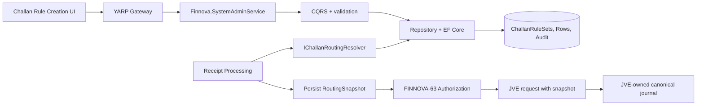

# Design Document — Challan Rule Creation and Deposit Bank Mapping

**Jira:** FINNOVA-65  
**Module:** SystemAdmin master data  
**Feature slug:** `challan-rule-engine-deposit-bank-mapping`

## Overview

FINNOVA-65 adds a SystemAdmin master for one Challan Rule Set at a time. A set has exactly one Line of Business, one authoritative level-5 Branch represented as `Location` in the UI, and one selected Deposit Bank Code. The set stores the resolved deposit-bank account snapshot and a collection of Drawee Bank mapping rows.

The approved screenshot is the authoritative UI reference. The screen title is `Challan Rule Creation`. The header contains required `Line of Business`, `Location`, and `Deposit Bank Codes` dropdowns, a read-only `Account No`, and an `Active` checkbox. The mapping grid contains `Sl.No.`, `Drawee Bank`, and actions columns. Persisted rows expose `Edit` and `Delete`; a new empty row exposes `Add`. Footer actions are `Save`, `Clear`, and `Cancel`.

The UI does not edit multiple deposit-bank groups in one form. The backend may list and detail many sets, but every create/edit command addresses one set and one deposit-bank code. Full replacement Save reconciles the complete Drawee Bank list atomically.

FINNOVA-65 remains separate from FINNOVA-16 `ChallanRule`. FINNOVA-16 continues to own drawee-bank format, validation, and routing configuration keyed only by `DraweeBankId`. FINNOVA-65 owns LOB/Location/deposit-bank mapping data and never creates canonical journals. Receipt Processing resolves the active set before challan preparation and persists a routing snapshot. FINNOVA-63 includes the snapshot in the JVE request. JVE remains the only canonical journal owner, and no FINNOVA-65 resolution occurs after posting.

## Scope and Non-Goals

### In scope

- One-set create/edit UI matching the approved screenshot.
- Dependent LOB, Location, and Deposit Bank Codes lookups.
- Server-resolved read-only Account No.
- Multiple Drawee Bank rows with Add, Edit, Delete, and full-replacement Save.
- Active-set, concrete Drawee Bank, and `OTHERS` uniqueness rules.
- Atomic versioned persistence, audit, idempotency, and optimistic concurrency.
- Administrative list/detail/audit APIs across sets.
- Internal pre-posting resolver and immutable Routing_Snapshot boundary.
- Backend xUnit, FsCheck.Xunit, WebApplicationFactory, and frontend Vitest/RTL tests.

### Non-goals

- Extending, replacing, or duplicating FINNOVA-16 `ChallanRule`.
- Creating a second LOB, Location/Branch, Drawee Bank, or deposit-bank master.
- A multi-deposit-bank-group editor on the creation screen.
- Canonical journal creation, posting, GL balance changes, or post-posting re-routing.
- Bilingual fields, non-English localization, right-to-left rendering, Redux, RxJS, or an ad-hoc axios client.

## Architecture



### Configuration data flow

1. The UI loads active LOB values. A selected LOB drives the Location lookup.
2. A selected Location drives the Deposit Bank Codes lookup.
3. A selected Deposit Bank Code resolves one active Deposit_Bank_Account. The server returns Account No; the UI renders it read-only.
4. The administrator adds, edits, or deletes local Drawee Bank rows. The form contains only the selected deposit-bank scope.
5. Save sends the complete row list, active state, expected version, and Idempotency_Key.
6. The application validates all fields and rows, locks or compares the relevant LOB/Location scope, reconciles rows, increments the version once, writes audit, and commits one transaction.
7. The API returns the committed set. The UI reloads the detail projection from the server.

### Runtime data flow

1. Receipt Processing obtains LOB, authoritative level-5 Branch/Location, incoming Drawee Bank key, evaluation date, and correlation ID.
2. `IChallanRoutingResolver` finds the one active applicable set for LOB + Location + date.
3. The resolver chooses a concrete row first, then `OTHERS`, and fails closed when no unique candidate exists.
4. Receipt Processing persists a Routing_Snapshot containing set ID/version, matched key or `OTHERS`, deposit-bank identity/account snapshot, and UTC resolution timestamp before challan authorization or JVE submission.
5. FINNOVA-63 passes the unchanged snapshot in the JVE request. FINNOVA-65 does not create journal records.
6. A posted record keeps its existing snapshot and never calls the resolver again.

## Reused Versus New Assets

### Reused

- Existing `LineOfBusiness` master.
- Existing `Location` master, with `Level == 5` required internally for the UI's `Location` field.
- Existing FINNOVA-16 `DraweeBank` master and `ChallanRule` entity/configuration, without modifying `ChallanRule`.
- Existing JWT Bearer authentication, SystemAdmin authorization policy, middleware, `FinnovaDbContext`, EF configuration discovery, and gateway host separation.
- Existing shared UI axios instance, MUI components, React hooks, service interface/real/mock/toggle pattern, routing, navigation, and Vitest/RTL setup.
- Existing FINNOVA-61 receipt/challan and FINNOVA-63 JVE contracts after compatibility gates identify the exact snapshot insertion points.

### New

- `ChallanRuleSet` aggregate with one Deposit Bank Code and resolved account snapshot.
- `DraweeBankMappingRow` child entity.
- Immutable audit and idempotency entities.
- Normalizer, pure resolver, reference ports, repositories, CQRS handlers, API controller, and stable error mapping.
- Internal receipt routing adapter and snapshot contract extension only where the existing consumer contract lacks equivalent fields.
- Frontend model, lookup/service methods, creation/edit screen, route, navigation, and tests.

## Requirements Coverage Map

| Requirements | Design coverage |
|---|---|
| 1.1–1.7 exact screen structure | Screen layout, MUI components, row action state, footer actions |
| 2.1–2.6 one-set scope and dependencies | Dependent lookup interfaces, one-set aggregate, Location-to-Branch mapping |
| 3.1–3.5 account resolution | Deposit-bank lookup port, read-only Account No projection, ambiguity handling |
| 4.1–4.6 row editing and fallback | Local row editor, full replacement command, concrete/OTHERS resolution |
| 5.1–5.6 cross-set uniqueness | Scope-aware application checks, database/equivalent concurrency guard, resolver precedence |
| 6.1–6.6 atomic Save | One transaction, expected version, idempotency, server reload |
| 7.1–7.4 Clear and Cancel | Local form state model and navigation behavior |
| 8.1–8.6 contracts and snapshot boundary | Administrative routes, internal resolver, Receipt Processing and JVE adapter |
| 9.1–9.5 errors and security | JWT/SystemAdmin policy, ProblemDetails, preserved UI state, fail-closed resolver |
| 10.1–10.5 testing and ownership | Unit/PBT/integration/RTL plan and explicit FINNOVA-16/JVE boundaries |

## Screen Layout and Interaction Design

```text
Challan Rule Creation

Line of Business*       [ LN - Loan                         v ]
Location*               [ Mumbai                            v ]
Deposit Bank Codes*     [ HDFC Bank                         v ]
Account No              [ server-resolved, read-only          ]
Active                  [ x ]

Mapping grid
+--------+----------------+------------------------------+
| Sl.No. | Drawee Bank    | Actions                      |
+--------+----------------+------------------------------+
| 1      | HDFC           | Edit  Delete                 |
| 2      | SBI            | Edit  Delete                 |
| new    | [select bank]  | Add                          |
+--------+----------------+------------------------------+

                                      [Save] [Clear] [Cancel]
```

The example values are India-only and English-only. The UI uses no non-India or non-English fixture values.

- `Line of Business` is required and resets Location, Deposit Bank Codes, Account No, and pending rows when changed.
- `Location` is required, displays the UI term, and maps to the authoritative level-5 `BranchId` in requests.
- `Deposit Bank Codes` is required and selects exactly one deposit-bank code for the set.
- `Account No` is a text/display control with `readOnly` semantics. It is never sent as a user-editable value.
- `Active` controls runtime eligibility. Inactive sets remain visible to administrators but are excluded from resolution.
- The grid owns local pending rows. Add appends a row, Edit changes a row in place, and Delete marks/removes a row locally. No mutation request is sent until Save.
- Save validates the full form and row list, preserves all values on error, and reloads the committed server projection on success.
- Clear restores the initial form state. Cancel navigates back without sending a mutation request.

## Data Models

### ChallanRuleSet aggregate

```csharp
public sealed class ChallanRuleSet
{
    public Guid Id { get; set; } = Guid.NewGuid();
    public Guid LineOfBusinessId { get; set; }
    public Guid BranchId { get; set; } // UI label: Location
    public string DepositBankCode { get; set; } = string.Empty;
    public Guid DepositBankAccountId { get; set; }
    public string DepositBankNameSnapshot { get; set; } = string.Empty;
    public string AccountNumberSnapshot { get; set; } = string.Empty;
    public string? DepositBankBranchSnapshot { get; set; }
    public string? MicrCodeSnapshot { get; set; }
    public string? GlCodeSnapshot { get; set; }
    public string? SlCodeSnapshot { get; set; }
    public bool IsActive { get; set; } = true;
    public DateOnly EffectiveFrom { get; set; }
    public DateOnly? EffectiveTo { get; set; }
    public long RunningRuleVersion { get; set; } = 1;
    public byte[] RowVersion { get; set; } = Array.Empty<byte>();
    public DateTime CreatedAtUtc { get; set; } = DateTime.UtcNow;
    public DateTime UpdatedAtUtc { get; set; } = DateTime.UtcNow;
    public ICollection<DraweeBankMappingRow> DraweeBankRows { get; set; } = new List<DraweeBankMappingRow>();
}
```

### Drawee Bank mapping row

```csharp
public sealed class DraweeBankMappingRow
{
    public Guid Id { get; set; } = Guid.NewGuid();
    public Guid ChallanRuleSetId { get; set; }
    public string DraweeBankKey { get; set; } = string.Empty;
    public bool IsOthers { get; set; }
    public bool IsActive { get; set; } = true;
    public DateTime CreatedAtUtc { get; set; } = DateTime.UtcNow;
    public DateTime UpdatedAtUtc { get; set; } = DateTime.UtcNow;
}
```

### Snapshot and audit

`ChallanRuleSet` stores the deposit-bank identity and display/account snapshot used by runtime resolution. `ChallanRuleSetAuditEntry` stores operation, set/row identifiers, normalized key, before/after snapshot, trusted actor, UTC timestamp, and resulting version. `ChallanRuleSetIdempotency` stores operation, key, request fingerprint, result JSON, and creation timestamp.

The Routing_Snapshot is a consumer-owned immutable projection with at least:

- `ChallanRuleSetId` and `RuleVersion`.
- `MatchedDraweeBankKey` and `UsedOthers`.
- Deposit bank account ID, code, name, branch, Account No, and approved accounting display fields.
- `ResolvedAtUtc` and correlation ID.

### Invariants

- A Challan_Rule_Set contains one and only one LOB, one level-5 Branch/Location, and one Deposit Bank Code.
- At most one active set exists for a given LOB + Location + Deposit Bank Code.
- A concrete active Drawee Bank key occurs in at most one active set for a given LOB + Location, regardless of Deposit Bank Code.
- `OTHERS` occurs in at most one active set for a given LOB + Location.
- A single Save contains no duplicate normalized key and no more than one `OTHERS` row.
- Explicit concrete matching precedes `OTHERS` fallback.
- Every committed full replacement increments the set version once and writes one success audit event in the same transaction.
- Failed Save changes no set, row, version, or success audit state.
- Inactive sets and rows do not participate in runtime resolution.
- A Routing_Snapshot is immutable after persistence and is never re-resolved after posting.

## Contracts and Routes

### Lookup contracts

```csharp
public sealed record LineOfBusinessOption(Guid Id, string DisplayName, bool IsActive);
public sealed record LocationOption(Guid BranchId, string DisplayName, int Level, bool IsActive);
public sealed record DepositBankCodeOption(
    string DepositBankCode,
    Guid DepositBankAccountId,
    string DepositBankName,
    string AccountNumber,
    bool IsActive);
```

The UI displays `BranchId` as `Location` and displays `AccountNumber` as `Account No`. The server remains the authority for both the account identity and account number.

### Administrative contracts

```csharp
public sealed record ChallanRuleSetRowRequest(string DraweeBankKey);

public sealed record CreateChallanRuleSetRequest(
    Guid LineOfBusinessId,
    Guid BranchId,
    string DepositBankCode,
    bool IsActive,
    DateOnly EffectiveFrom,
    DateOnly? EffectiveTo,
    IReadOnlyList<ChallanRuleSetRowRequest> DraweeBankRows,
    string IdempotencyKey);

public sealed record UpdateChallanRuleSetRequest(
    Guid BranchId,
    string DepositBankCode,
    bool IsActive,
    DateOnly EffectiveFrom,
    DateOnly? EffectiveTo,
    IReadOnlyList<ChallanRuleSetRowRequest> DraweeBankRows,
    long ExpectedRuleVersion,
    string IdempotencyKey);

public sealed record ChallanRuleSetResponse(
    Guid Id,
    Guid LineOfBusinessId,
    string LineOfBusinessName,
    Guid BranchId,
    string LocationName,
    string DepositBankCode,
    Guid DepositBankAccountId,
    string DepositBankName,
    string AccountNumber,
    bool IsActive,
    DateOnly EffectiveFrom,
    DateOnly? EffectiveTo,
    long RunningRuleVersion,
    IReadOnlyList<ChallanRuleSetRowResponse> DraweeBankRows,
    DateTime CreatedAtUtc,
    DateTime UpdatedAtUtc);

public sealed record ChallanRuleSetRowResponse(
    Guid Id,
    string DraweeBankKey,
    bool IsOthers,
    bool IsActive);
```

### Runtime contracts

```csharp
public sealed record ChallanRoutingResolveRequest(
    Guid LineOfBusinessId,
    Guid BranchId,
    string DraweeBankKey,
    DateOnly EvaluationDate,
    string CorrelationId);

public sealed record ChallanRoutingSnapshot(
    Guid ChallanRuleSetId,
    long RuleVersion,
    string MatchedDraweeBankKey,
    bool UsedOthers,
    Guid DepositBankAccountId,
    string DepositBankCode,
    string DepositBankName,
    string AccountNumber,
    string? DepositBankBranch,
    string? MicrCode,
    string? GlCode,
    string? SlCode,
    DateTime ResolvedAtUtc,
    string CorrelationId);

public interface IChallanRoutingResolver
{
    Task<ChallanRoutingSnapshot> ResolveAsync(
        ChallanRoutingResolveRequest request,
        CancellationToken cancellationToken = default);
}
```

### Routes

- `GET /api/challan-rule-sets` — paginated list across sets, including inactive sets.
- `GET /api/challan-rule-sets/{id}` — detail with one set and its rows.
- `POST /api/challan-rule-sets` — create one set.
- `PUT /api/challan-rule-sets/{id}` — full-replacement update with expected version.
- `GET /api/challan-rule-sets/{id}/audit` — immutable audit history.
- Internal resolver access uses `IChallanRoutingResolver`. An HTTP internal route is added only if the confirmed host boundary requires it; it is authenticated and is not a public UI route.

All administrative routes require the existing SystemAdmin policy. The gateway forwards the SystemAdmin route and adds a UI alias only if the shared UI URL composition requires one.

## Components and Interfaces

### Backend components

- **Domain entities:** `ChallanRuleSet`, `DraweeBankMappingRow`, audit, and idempotency entities. No group entity is used.
- **Normalizer:** `DraweeBankKeyNormalizer` trims, uppercases, validates ASCII alphanumeric keys, and canonicalizes `OTHERS`.
- **Reference ports:** LOB, level-5 Location/Branch, Drawee Bank, and Deposit Bank Account lookup ports.
- **Repository:** Loads sets with rows, checks scope-aware uniqueness, and exposes one transaction boundary. It must check concrete-key and `OTHERS` conflicts across active sets in the same LOB + Location.
- **CQRS service:** Create and full-replacement update handlers validate all rows before changing state. Reconciliation adds retained rows, inactivates removed rows, and updates snapshots in one transaction.
- **Controller:** Accepts one-set requests, derives actor identity from the JWT, and passes correlation/idempotency metadata to the application layer.
- **Middleware:** Maps validation, not-found, conflict, concurrency, configuration, and dependency exceptions to existing ProblemDetails conventions with English messages.
- **Runtime adapter:** Resolves before challan preparation, persists the snapshot before authorization/JVE submission, and blocks resolution for posted records.

### Frontend components

- `src/models/challanRuleSet.model.ts`: one-set, row, lookup-option, request, and response types.
- `src/services/interfaces/challanRuleSet.service.ts`: list/detail, LOB/Location/deposit-bank lookup, create, full-replacement update, and audit methods.
- `src/services/real/challanRuleSet.service.ts`: shared axios implementation.
- `src/services/mock/challanRuleSet.service.ts`: deterministic India-only values (`LN - Loan`, `Mumbai`, `HDFC Bank`, `HDFC`, `SBI`) and conflict/error behavior.
- `src/services/challanRuleSet.service.ts`: `VITE_USE_MOCK_API` selector and barrel exports.
- `src/pages/system-admin/ChallanRuleCreation.tsx`: form state, dependent selects, read-only Account No, Active checkbox, grid actions, Save/Clear/Cancel, and error preservation.
- `App.tsx` and `Layout.tsx`: route and permission-filtered navigation entry.

## Error Handling

| Condition | Status | UI/system behavior |
|---|---:|---|
| Missing or invalid JWT | 401 | No mapping data or mutation. |
| Missing SystemAdmin role | 403 | No mapping data or mutation. |
| Missing/inactive LOB, Location, Drawee Bank, or account | 400/404 | Field-specific English message; no Save changes. |
| Account No unavailable or ambiguous | 409/422 | Preserve selections and rows; show English configuration message. |
| Active set duplicate | 409 | Preserve form state; reject complete Save. |
| Concrete Drawee Bank cross-set duplicate | 409 | `Drawee bank is already mapped for this LOB and Location`. |
| OTHERS cross-set duplicate | 409 | `OTHERS is already mapped for this LOB and Location`. |
| Duplicate rows in one Save | 400/409 | Reject complete Save and preserve local rows. |
| Expected version mismatch | 412 | Preserve local values and return current version. |
| No unique runtime candidate | 422 | Fail closed; no deposit-bank decision or JVE submission. |
| Persistence/dependency failure | 500/503 | Roll back transaction and preserve UI state. |

Account numbers are masked in logs where required by existing platform policy. Tokens and credentials never appear in responses, audit JSON, or logs.

## Security

- Reuse JWT Bearer authentication and the existing SystemAdmin policy.
- Derive actor ID and timestamps from trusted server context; ignore actor fields in payloads.
- Validate all master references server-side, including level 5 for the internal BranchId.
- Use an internal authenticated resolver boundary. Do not expose runtime resolution anonymously.
- Limit runtime and JVE payloads to the routing snapshot needed by downstream processing.
- FINNOVA-65 cannot write canonical journal tables and does not own JVE posting.

## Design Decisions and Trade-offs

1. **One set per selected deposit bank:** This matches the approved screen and prevents a form from combining unrelated deposit-bank destinations. Cross-set APIs still support list/detail across many sets.
2. **Rows directly under the set:** Removing the former group layer makes the data model match the one selected Deposit Bank Codes field and makes full replacement atomic and easy to audit.
3. **Location label mapped to BranchId:** The UI uses the screenshot's `Location` terminology while the backend reuses the authoritative level-5 Branch/Location master.
4. **Full replacement Save:** One complete row list gives the server enough information to reconcile deletions atomically and avoids partially persisted grid edits.
5. **Scope-wide uniqueness:** Concrete keys and `OTHERS` are checked across deposit-bank sets for the same LOB + Location, not only within one set, so runtime routing has one destination.
6. **Application plus database/concurrency enforcement:** Application validation provides exact English messages; database constraints or a scope lock protects concurrent writes.
7. **Snapshot before posting:** Pre-posting resolution makes later configuration changes harmless to in-flight and posted records. JVE remains the canonical journal owner.
8. **Inactive visibility:** Keeping inactive sets in administrative list/detail aids audit while excluding them from runtime resolution.

## Correctness Properties

*A property is a characteristic or behavior that should hold true across all valid executions of a system—essentially, a formal statement about what the system should do. Properties bridge human-readable specifications and machine-verifiable correctness guarantees.*

The pure key normalizer and resolver have meaningful input variation and are tested with FsCheck.Xunit. UI rendering, database wiring, authorization, transactions, and external service behavior use example or integration tests instead of property-based tests.

### Property 1: Key normalization is idempotent

For all strings accepted by the Drawee Bank key grammar, normalizing the string twice produces the same canonical key, and every accepted casing and whitespace variant of `OTHERS` produces `OTHERS`.

**Validates: Requirements 4.4, 5.4, 10.2**

### Property 2: Full replacement preserves scope-wide uniqueness

For all valid LOB + Location scopes and generated Drawee Bank row lists, a full-replacement operation either commits a list with one normalized occurrence of each concrete key and at most one `OTHERS`, or rejects the complete operation without changing the prior set, rows, version, or audit success state.

**Validates: Requirements 4.4, 5.1, 5.2, 5.3, 5.4, 6.1, 6.3**

### Property 3: Explicit mapping precedes OTHERS fallback

For all valid active configurations containing a concrete row and an `OTHERS` row, an incoming key equal to the concrete row resolves to that row's deposit-bank account; for all valid incoming keys without a concrete match, the resolver returns the `OTHERS` row when one exists and returns no decision when neither exists.

**Validates: Requirements 4.5, 5.6, 8.4, 9.4**

## Testing Strategy

### Backend unit and property tests

- xUnit facts and theories cover exact validation messages, required field failures, level-5 Location checks, account ambiguity, row reconciliation, version/audit examples, and error mapping.
- FsCheck.Xunit tests implement one test per correctness property, with `MaxTest = 100` or higher and comments in the format `Feature: challan-rule-engine-deposit-bank-mapping, Property N: ...`.
- Pure tests do not call a database, HTTP endpoint, or external account service.

### Backend integration tests

- `WebApplicationFactory<Program>` verifies 401/403 authorization, administrative routes, response projections, transaction rollback, concurrency, and missing runtime mapping rejection.
- An in-memory or test SQL database verifies scope-wide uniqueness, full-replacement reconciliation, version/audit atomicity, and idempotent replay.
- Consumer adapter tests verify snapshot persistence before JVE submission, no submission on resolution failure, and no resolver call after posting.

### Frontend tests

Vitest and React Testing Library verify exact title and labels, dependent select loading and reset, read-only Account No, Active state, grid Add/Edit/Delete, Save/Clear/Cancel, successful server reload, conflict/error preservation, India-only mock data, and mock/real service selection.

## Implementation-Ordered Task List

1. Define one-set domain entities, enum, and exceptions.
2. Define one-set administrative, lookup, and runtime contracts.
3. Add EF configuration, DbSets, uniqueness enforcement, and migration command.
4. Add normalizer, pure resolver, reference ports, repositories, and DI registration.
5. Add CQRS full-replacement create/update, validation, mapping, audit, idempotency, and concurrency.
6. Add controller, middleware mapping, and gateway route/alias.
7. Add Receipt Processing snapshot adapter and FINNOVA-63 JVE request integration boundary.
8. Add backend unit, property, and integration tests.
9. Add frontend one-set models, lookup/service interface, real/mock implementations, toggle, and barrels.
10. Add the `Challan Rule Creation` page, grid components, route, and navigation.
11. Add frontend Vitest/RTL tests and final contract checks.
