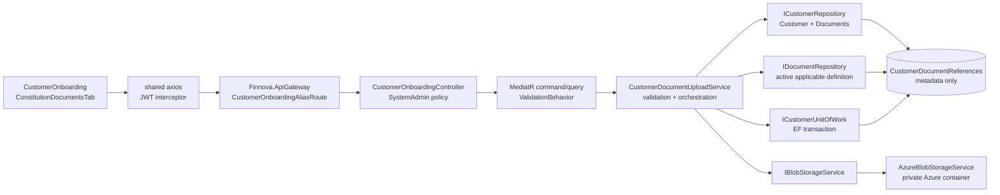

# Design Document — Customer Onboarding Document Blob Upload

**Module:** SystemAdmin / Customer Onboarding  
**Repositories:** `e:\Finnova\Finnova-API` and `E:\Finnova\Finnova-UI\Finnova-UI`  
**Related capability:** Existing Customer Onboarding and Document Master

## Overview

This feature adds a multipart upload and authenticated download slice to the existing `Finnova.SystemAdminService` Customer Onboarding API. An authorized System Administrator selects one applicable `CustomerDocumentReference` for an existing customer, submits one PDF, JPEG/JPG, or PNG file, and receives safe metadata for the current upload. The service validates ownership and the active Document Master policy before it writes anything to storage. It streams the file through the existing provider-neutral `IBlobStorageService`, which is configured to use the existing `AzureBlobStorageService` for this feature. SQL Server stores only the current blob reference and approved metadata on the existing `CustomerDocumentReference`; it never stores document bytes, base64, a public URL, or a SAS token.

The feature remains in the existing .NET 10, ASP.NET Core, MediatR/CQRS, FluentValidation, EF Core, and SQL Server architecture. The controller remains under `api/customer-onboarding`, and the existing YARP `CustomerOnboardingAliasRoute` continues to forward the UI-composed `/api/ua/api/customer-onboarding/**` path to the SystemAdmin cluster. No host or gateway cluster is introduced. The React 18 + TypeScript + Vite + MUI application extends the existing `customerOnboardingService`, its mock and real implementations, the `CustomerProjection` document model, and `ConstitutionDocumentsTab.tsx`. The shared axios instance remains the only HTTP client.

A successful upload is a latest-file replacement. Every upload gets a new service-generated key under the owning customer and document-reference scope. Metadata is committed only after Azure confirms the upload. If metadata persistence fails, the new object is deleted best-effort and the previous pointer remains authoritative. If cleanup of the superseded object fails after a successful commit, the new pointer remains authoritative and an operational warning is recorded. A small optimistic-concurrency token on the metadata row prevents two replacement requests from silently overwriting one another.

Finnova is India-only and English-only. The design adds one plain set of upload metadata fields, not language-suffixed fields. Labels, validation messages, mock data, and tests are English; no Arabic, other non-English seed values, translation framework, RTL handling, or right-to-left layout is introduced.

## What is reused

| Concern | Existing asset | Reuse decision |
| --- | --- | --- |
| Host and routing | `Finnova.SystemAdminService`, `CustomerOnboardingController`, `/api/customer-onboarding` | Add upload/download actions to the existing controller; do not add a host. |
| Authentication and authorization | JWT Bearer configuration and `SystemAdmin` policy in `Program.cs` | Apply the existing policy to both actions. The controller never trusts a caller-supplied actor or storage path. |
| Customer identity and ownership | `ICustomerRepository.GetByCodeAsync`, tracked `Customer.Documents`, `CustomerDocumentReference.CustomerId` | Load the route customer, find the requested child row within that aggregate, and fail closed if the row is absent or does not belong to that customer. |
| Document authority | `IDocumentRepository.GetActiveForConsumptionAsync` and Document Master `Document`/applicability rules | Resolve the full active applicable definition and use its `AllowedMimeTypes` and `MaxFileSizeMb`; do not copy a document name as an authoritative customer field. |
| Storage boundary | `IBlobStorageService`, `AzureBlobStorageService`, `BlobUploadResult` | Use `UploadAsync`, `DownloadAsync`, and `DeleteAsync`; never instantiate a second Azure client. The returned URI is discarded. |
| Storage package | `Azure.Storage.Blobs` 12.29.2 in `Finnova.Service` | No new Azure package is needed. |
| Database unit of work | `ICustomerUnitOfWork`, `CustomerUnitOfWork`, existing Customer transaction pattern | Commit metadata through the existing EF transaction boundary after the blob upload. |
| Error contract | `ExceptionHandlingMiddleware`, RFC 7807 `ProblemDetails`, `code` extension, Customer error family | Add typed customer-document upload branches without replacing existing customer, document, or master-data branches. |
| Gateway | `CustomerOnboardingAliasRoute` to `systemadmin-cluster` | Reuse the catch-all alias for upload and download paths. No duplicate alias is added. |
| UI HTTP and state | `src/services/api.ts`, React hooks, existing onboarding service toggle | Use shared axios, JWT interceptor, central notification behavior, and local component state. No Redux, RxJS, or ad-hoc axios client. |
| UI screen | `src/pages/CustomerOnboarding/CustomerOnboarding.tsx` and `components/ConstitutionDocumentsTab.tsx` | Add file selection, upload, status, retry, and View behavior to the existing tab. |
| Tests | xUnit, fake `IBlobStorageService`, `WebApplicationFactory<Program>`, Vitest, React Testing Library | Add focused unit, integration, and component/service tests without a live Azure dependency. |

## What is new

- Upload metadata and a concurrency token on `CustomerDocumentReference`, plus an EF configuration update and migration.
- `CustomerDocumentUploadStatus` with the states `None` and `Uploaded`.
- A provider-neutral document-upload coordinator/service and CQRS command/query handlers. The service owns validation, storage sequencing, compensation, and metadata mapping; handlers remain thin.
- A full Document Master upload-policy projection so the service can validate active applicability, MIME configuration, and maximum size without weakening the existing consumer resolver.
- Typed customer-document upload, storage, and download-not-available exceptions with stable Customer error codes.
- Multipart upload and streamed download endpoints on `CustomerOnboardingController`.
- Azure container configuration for the customer-document container and SystemAdmin registration of the existing `AddBlobStorage` extension.
- Upload methods and metadata models in the existing UI onboarding service, including a mock implementation and View behavior.

## Requirements coverage map

| Requirement | Design location |
| --- | --- |
| R1 Validate an upload request | **Validation**, **Customer identity and document authority**, `UploadCustomerDocumentCommand`, and `CustomerDocumentUploadValidator`; validation completes before `IBlobStorageService.UploadAsync`. |
| R2 Store in Azure Blob Storage | **Storage and configuration design**, generated key rules, streaming sequence, and `IBlobStorageService` integration. |
| R3 Persist and return metadata | **Data models**, **API/service contracts**, transaction sequence, mapper, and compensation rules. |
| R4 Retrieve the latest document | Download endpoint, ownership re-check, streamed `FileStreamResult`, and missing-blob mapping. |
| R5 Replacement and delete semantics | **Idempotency and concurrency**, latest-file replacement sequence, optimistic concurrency token, and explicit absence of a delete API. |
| R6 Authentication, authorization, and ownership | Controller policy, route/customer/document cross-check, actor extraction, and security section. |
| R7 Customer Onboarding UI behavior | **Frontend design**, existing page/tab integration, service toggle, and UI state rules. |
| R8 Reliability and privacy boundaries | **Error handling**, **Storage and configuration design**, **Security/privacy**, **Observability**, cancellation rules, and compensation sequence. |
| NFR-1 through NFR-8 | Existing platform stack, shared gateway/axios path, bounded multipart configuration, fake storage tests, and English-only UI/test rules described throughout this document. |
| Acceptance criteria 1–11 | Endpoint contracts, validation matrix, persistence model, replacement sequence, authorization flow, UI behavior, test plan, and explicit assumptions in **Design decisions and tradeoffs**. |

## Architecture and request flow



For upload, the controller binds one `IFormFile` and route values, MediatR validation checks structural command values, and the coordinator performs customer/document/definition and file-content validation. Only then does it open the stream and call Blob Storage. The service stores metadata in a transaction and returns a safe metadata response. For download, the controller and service repeat authentication and ownership checks, read only the current metadata pointer, call `DownloadAsync`, and return the provider stream through ASP.NET Core. Storage credentials and provider URIs never cross the controller boundary.

The existing middleware order remains `ExceptionHandlingMiddleware`, `UseAuthentication`, `UseAuthorization`, and `MapControllers`. This preserves 401 for missing or invalid tokens before 403 for an authenticated caller without the `SystemAdmin` role.

## Data models

### Existing entity extension

Extend `Finnova.Models/Domain/Entities/CustomerDocumentReference.cs`; do not create a second customer-document ownership table. The current row already owns `CustomerId`, `DocumentDefinitionId`, `DocumentCode`, `ConstitutionCode`, and the existing onboarding metadata. Keep `DmsReference` and `ViewMetadata` for their current meanings. They must not be repurposed as a blob URI or JSON binary envelope.

Add these nullable/current-upload fields:

| Field | SQL shape and purpose |
| --- | --- |
| `UploadStatus` | Required `CustomerDocumentUploadStatus`, default `None`; `Uploaded` means a current metadata pointer exists. |
| `BlobContainerName` | Nullable `nvarchar(63)`, internal configured container name. It is never accepted from a request or returned by the API. |
| `BlobName` | Nullable `nvarchar(512)`, service-generated key. It is internal metadata, not a caller-selected path and not returned to the UI. |
| `OriginalFileName` | Nullable `nvarchar(255)`, sanitized basename used for the download `Content-Disposition` filename. |
| `UploadedContentType` | Nullable `nvarchar(100)`, normalized safe value such as `application/pdf`, `image/jpeg`, or `image/png`. |
| `UploadedSizeBytes` | Nullable `bigint`, measured size confirmed by the storage result. |
| `UploadedBy` | Nullable `nvarchar(200)`, authenticated subject/name claim used for the successful mutation. |
| `UploadedAtUtc` | Nullable `datetime2`, UTC time of the successful metadata commit. |
| `UploadVersion` | Required `uniqueidentifier`, generated initially and replaced on every successful metadata replacement; configured as an EF concurrency token. |

The entity exposes one domain method such as `ReplaceUploadMetadata(...)` that sets all current-upload fields together, sets `UploadStatus = Uploaded`, and updates `UpdatedAtUtc`. It does not accept a URI, container, or key from a public contract. A public clear/delete method is deliberately absent in this release. `IsCollected` and `IsScanned` are set to `true` by the upload operation because the uploaded onboarding file is the collected scanned document; existing `Document Master` flags remain authoritative for whether a document is required.

The enum is `Finnova.Models/Domain/Enums/CustomerDocumentUploadStatus.cs`:

```text
None = 0
Uploaded = 1
```

The EF configuration in `CustomerDocumentReferenceConfiguration.cs` keeps the existing table and unique customer/definition index, adds the lengths and required/default/concurrency settings above, and adds an index on `(CustomerId, Id)` only if the query plan requires it. No `byte[]`, `varbinary`, base64, or content snapshot is added. The migration adds nullable metadata columns, the status column, the version column, and no raw-content column.

### Upload policy projection

Add a service-level record, not a new persisted entity:

```text
DocumentUploadPolicy(
    Guid DefinitionId,
    string DocumentCode,
    string? Description,
    int MaxFileSizeMb,
    IReadOnlySet<string> AllowedContentTypes)
```

`DocumentUploadPolicy` is built from the active full `Document` returned by `IDocumentRepository.GetActiveForConsumptionAsync(constitutionCode, CustomerLookupTypes.EntityRole)`. The resolver selects the requested definition ID only from that result, so unknown, inactive, or inapplicable definitions cannot supply a storage policy. `AllowedMimeTypes` tokens `PDF`, `JPG`, `JPEG`, and `PNG` are normalized to the three supported media types. Any configured token outside those supported families is ignored only if another valid permitted token remains; a definition with no valid permitted type is a safe configuration failure and never accepts a file.

## API and service contracts

### Endpoint contract

All paths are relative to the SystemAdmin host. The UI reaches them through the existing gateway-composed `/api/ua/api/customer-onboarding` prefix.

| Method | Path | Request | Success |
| --- | --- | --- | --- |
| `POST` | `/api/customer-onboarding/{customerCode}/documents/{documentReferenceId:guid}/upload` | `multipart/form-data`, exactly one form part named `file` | `200 CustomerDocumentUploadResponse` |
| `GET` | `/api/customer-onboarding/{customerCode}/documents/{documentReferenceId:guid}/download` | No body | `200` streamed file with safe content type and filename |

The controller remains `[ApiController, Authorize(Policy = "SystemAdmin"), Route("api/customer-onboarding")]`. `customerCode` is route data and `documentReferenceId` is the existing child-row ID. There is no request field for Customer ID, container, blob name, URI, SAS token, or actor. The upload action rejects a missing form file and more than one file before dispatch; the service repeats the invariant so a direct handler call cannot bypass it. The endpoint uses a request-form size limit bounded to the 25 MiB hard ceiling plus multipart overhead, and the host's multipart parser is configured to spool larger parts to disk rather than requiring an unbounded memory copy.

### Response contract

Add `CustomerDocumentUploadResponse` under `Finnova.Models/Contracts/Customers`:

```text
CustomerDocumentUploadResponse(
    Guid CustomerDocumentReferenceId,
    Guid DocumentDefinitionId,
    string DocumentCode,
    string UploadStatus,
    string OriginalFileName,
    string ContentType,
    long SizeInBytes,
    DateTime UploadedAtUtc)
```

The response contains only approved display metadata. It does not contain `CustomerId`, `BlobName`, `BlobContainerName`, `BlobUploadResult.Uri`, connection information, SAS, bearer tokens, or bytes. The existing `CustomerDocumentResponse` used by Customer create/modify is not expanded with internal blob fields. Its document definition display values continue to be resolved by the existing read projection.

Download uses the persisted normalized `UploadedContentType` and sanitized `OriginalFileName`. It returns no JSON body and never redirects. When no current upload exists, the service raises a typed document-not-available exception instead of returning an empty stream.

### CQRS contracts

The service layer adds records following existing Customer command conventions:

- `UploadCustomerDocumentCommand(string CustomerCode, Guid DocumentReferenceId, IFormFile File, string ActorId) : IRequest<CustomerDocumentUploadResponse>`.
- `DownloadCustomerDocumentQuery(string CustomerCode, Guid DocumentReferenceId) : IRequest<CustomerDocumentDownload>`.
- `CustomerDocumentDownload(Stream Content, string ContentType, string DownloadName)` is an internal application result. The controller owns disposal after ASP.NET Core has taken ownership of the stream.

The upload command validator checks non-empty customer code, non-empty document-reference ID, non-null file, a single file contract, and a non-empty length. File signature and definition-dependent checks remain in the coordinator because they require the stream and active Document Master policy. The controller extracts `ActorId` from the validated principal's `ClaimTypes.NameIdentifier`, `sub`, or `User.Identity.Name`, never from the multipart form.

## Backend components and interfaces

### Repository and unit-of-work boundaries

Reuse `ICustomerRepository.GetByCodeAsync` for the mutation path because it returns a tracked aggregate with `Documents`. The coordinator finds the row by `DocumentReferenceId`, which proves both customer ownership and child existence before any Blob Storage operation. It raises the existing safe Customer not-found/child-not-found exceptions rather than revealing another customer's existence.

Reuse `IDocumentRepository.GetActiveForConsumptionAsync` through a new `IDocumentUploadPolicyResolver`. The resolver maps the full `Document` to `DocumentUploadPolicy`, including `MaxFileSizeMb` and normalized allowed types. It does not copy the Document Master name into the customer row. The resolver is independently unit-testable with a mocked repository.

The coordinator receives `ICustomerUnitOfWork` for the metadata transaction and `IBlobStorageService` for object operations. It does not call `RepositoryBase.SaveChangesAsync` directly and does not hold a database transaction while a large file is uploading. The existing Customer transaction pattern is used after the object upload, with a concurrency conflict mapped to a safe 409.

### Stream and validation helpers

Use a pure `DocumentFileRules` helper for:

- allowed normalized content types;
- filename basename/path/control-character rules and the 255-character limit;
- configured-size and 25 MiB ceiling calculations;
- PDF, JPEG, and PNG signatures; and
- extension/content-type/signature consistency.

The coordinator opens `IFormFile.OpenReadStream()` once. It reads only a fixed small prefix, no larger than the longest supported signature, into a bounded byte array. If the stream is seekable it rewinds to position zero. If it is not seekable, a small prefix-replaying stream presents the inspected prefix followed by the original stream to Blob Storage. The complete file is never copied into a `MemoryStream` or byte array. The storage call receives the remaining request stream and the request cancellation token. The form parser's configured memory threshold and multipart length limit are explicit resource boundaries; no application code allocates based on an untrusted length.

The coordinator validates `IFormFile.Length` before opening Blob Storage and checks the byte count reported by `BlobUploadResult` after upload. If the provider reports a different size or content type, the operation is treated as a storage validation failure and the newly uploaded object is compensated. The `IBlobStorageService` implementation sets the validated normalized content type as the blob HTTP header.

### CQRS service sequence

1. The handler validates command shape and checks the request cancellation token.
2. The coordinator loads the route customer and the child row. It verifies the route customer is the owner and the row's definition is the requested active applicable definition.
3. It resolves the full upload policy and validates name, declared MIME type, signature, extension, configured size, and global 25 MiB ceiling.
4. It opens the input stream and uploads to the configured container using a generated key.
5. It begins the existing customer transaction, replaces the tracked metadata and concurrency token, adds the existing Customer audit event for a document change without file content, saves, and commits.
6. After commit, it deletes the previous blob if one existed. Deletion is best-effort because the new pointer is already authoritative.
7. It maps the row to `CustomerDocumentUploadResponse` and returns it.

The download query loads the route customer and child row first, verifies `UploadStatus == Uploaded`, validates that internal blob metadata is present, then calls `DownloadAsync` with the stored container/key. It returns a stream result only after all ownership checks pass.

### Controller and middleware integration

`CustomerOnboardingController` adds the two actions and keeps the existing SystemAdmin policy. The upload action returns `Ok(response)` rather than a location containing a storage URL. The download action returns `File(result.Content, result.ContentType, result.DownloadName, enableRangeProcessing: false)`; range support is intentionally disabled in this release.

Extend `ExceptionHandlingMiddleware` with typed branches before the shared validation/fallback branch. Proposed stable codes are:

- `ERR-CUSTOMER-DOCUMENT-UPLOAD-400` for file and upload-policy validation;
- `ERR-CUSTOMER-DOCUMENT-UPLOAD-404` for a missing current file or child document;
- `ERR-CUSTOMER-DOCUMENT-UPLOAD-409` for an optimistic-concurrency replacement conflict;
- `ERR-CUSTOMER-DOCUMENT-UPLOAD-503` for Azure unavailable, timeout, or provider failure.

The middleware preserves the current RFC 7807 `ProblemDetails` shape and `code` extension. Details are fixed English messages or safe validation summaries. It does not serialize exception data, provider responses, file names, storage paths, connection strings, or stack traces. Authentication middleware continues to produce 401/403 before the controller is reached.

## Storage and configuration design

### Provider and registration

The feature selects Azure for the first release by setting `BlobStorage:Provider` to `Azure` in deployment configuration. The existing `BlobStorageOptions` gains a provider-neutral `CustomerDocumentsContainer` setting, proposed as `finnova-customer-documents`; the final configured value must satisfy Azure lower-case container naming rules. The SystemAdmin `Program.cs` calls the existing `AddBlobStorage(builder.Configuration)` extension. The `Azure.Storage.Blobs` package and `AzureBlobStorageService` are reused. AWS implementation files are not changed.

`BlobStorage:Azure:ConnectionString` comes only from environment-specific configuration, user secrets, a secret store, or deployment variables. It is absent from committed production settings. Local development may use Azurite through `UseDevelopmentStorage=true`. The service fails host configuration safely if Azure is selected without a connection string or container name; it does not log either secret.

### Container isolation and key naming

The container is private and is selected only from trusted configuration. The key is generated server-side as:

```text
customers/{customerId:N}/documents/{documentReferenceId:N}/{uploadGuid:N}.{extension}
```

`customerId` and `documentReferenceId` are canonical GUIDs, `uploadGuid` is a cryptographically random GUID, and the extension is derived from the validated signature. The route Customer Code and original file name are not part of the key, so a customer code cannot leak through a storage listing and a caller cannot influence path traversal. A caller-provided container, URI, key, or filename is never used as the authoritative object name. A key collision is treated as a storage failure; the service does not overwrite an existing caller-selected object.

### Consistency and orphan handling

The consistency boundary is deliberately compensating rather than pretending Azure and SQL share a transaction:

- Validation happens before any blob write.
- A new blob is uploaded before metadata changes.
- Metadata and the new concurrency token commit in one EF transaction.
- On upload/provider failure, no database metadata changes.
- On metadata failure or cancellation after upload, the service deletes the new blob using a cleanup token and leaves the previous pointer unchanged.
- After a successful replacement, the service deletes the old blob. If that deletion fails, the current new metadata remains authoritative and the failure is logged as an operational warning.
- A process crash in the narrow upload-before-commit window can leave an unreferenced object. Such an object is not downloadable through the API because downloads follow SQL metadata only. The deterministic customer/document prefix allows an operator reconciliation job to identify unreferenced objects later; automatic purge, retention, and a public delete API are outside this release and require a separate authorization and retention decision.

No blob listing is performed on a request path, and no orphan is ever selected by filename or prefix as a fallback. The API trusts only the committed SQL pointer.

## Validation rules

| Input or invariant | Rule | Failure behavior |
| --- | --- | --- |
| JWT | Existing JWT Bearer scheme; valid issuer, audience, lifetime, and signature required. | 401 before Blob/SQL access. |
| Role | Existing `SystemAdmin` policy required on upload and download. | 403 before Blob/SQL access. |
| Customer code | Required route value; trim for repository lookup; must identify an existing customer. | Safe 404 or existing Customer validation family; no storage call. |
| Document reference | Required GUID; must be a child of the route customer. | Existing child-not-found/Customer document-reference error; no storage call. |
| Definition | Must be active and applicable for the reference's constitution and Customer entity role. | Existing document-definition error; no storage call. |
| File count | Exactly one multipart part named `file`; no missing or empty file. | 400 upload-validation code; no storage call. |
| Filename | Basename only, no `/`, `\`, rooted/path form, control character, `.`/`..`, or over 255 characters. | 400 field-safe English error; no storage call. |
| Declared MIME | Normalize case and approved alias `image/jpg` to `image/jpeg`; accept only PDF, JPEG/JPG, and PNG if permitted by the definition. | 400; no storage call. |
| Signature | PDF `%PDF-`, JPEG `FF D8 FF`, PNG `89 50 4E 47 0D 0A 1A 0A`; signature must match normalized declared MIME and safe extension. | 400; no storage call. |
| Definition size | `IFormFile.Length` must be at least one byte and no larger than `MaxFileSizeMb * 1024 * 1024`. Configured value must be 1–25 MiB. | 400 for file limit, safe 500/503 for invalid platform configuration; no storage call. |
| Global ceiling | 25 MiB hard maximum, independent of Document Master. | 400; no storage call. |
| Provider result | Returned size must equal measured input length and content type must equal normalized type. | Compensate new blob; return safe 503/storage failure. |
| Metadata invariant | An `Uploaded` row must have container, blob name, filename, content type, positive size, uploader, timestamp, and version. | Enforced by domain method and persistence validation; fail closed. |
| Privacy | No raw bytes, base64, URI, SAS, token, or sensitive file contents in SQL/API/log/audit/UI storage. | Code review and tests assert absence; violations fail the change. |

The service does not use the client's `Content-Length` as the size authority beyond ASP.NET Core request limits; it uses the parsed form length and the storage-reported length. It does not rely on MIME type alone. The file signature check is bounded and occurs before the stream is sent to storage.

## Error handling

| Operation/failure | Caller result | Recoverability and logging |
| --- | --- | --- |
| Missing/invalid token | 401 from authentication | No application handler or storage call. Existing auth logging applies; never log token. |
| Valid non-SystemAdmin token | 403 from authorization | No application handler or storage call. Existing auth logging applies. |
| Customer or child not found/ownership mismatch | Existing safe 404/Customer document-reference response | Fatal for this request, retry only after correcting route data. Do not reveal the other customer or call Blob. |
| Inactive/inapplicable/unknown definition | Existing Customer document-definition error, 400 | Caller must refresh definitions; no blob or row change. |
| Missing, multiple, malformed, empty, unsafe, unsupported, signature-mismatched, or oversized file | 400 `ERR-CUSTOMER-DOCUMENT-UPLOAD-400` with field-safe English detail | Correctable; no blob or metadata change. Do not log filename or bytes. |
| Azure connection/configuration missing | 503 `ERR-CUSTOMER-DOCUMENT-UPLOAD-503` | Fatal until deployment configuration is repaired. Log category and trace ID, not the connection string. |
| Azure upload timeout/unavailable/provider failure | 503 `ERR-CUSTOMER-DOCUMENT-UPLOAD-503` | Recoverable retry. Existing metadata stays unchanged. Log provider-safe category and trace ID. |
| Metadata save/concurrency failure after new upload | 409 for concurrency, otherwise 503 safe storage/persistence failure | Attempt deletion of the new object. Keep old metadata. Warn if compensation fails; never log key or content. |
| Old-blob deletion after successful commit fails | 200 success response | New metadata remains authoritative. Log a warning and trace ID for reconciliation; do not make the UI retry the already-successful replacement. |
| Current blob absent on download | 404 `ERR-CUSTOMER-DOCUMENT-UPLOAD-404` | No provider exception leaks. Log missing-object category and trace ID; metadata repair is operational work. |
| Current blob download timeout/provider failure | 503 `ERR-CUSTOMER-DOCUMENT-UPLOAD-503` | Retryable. Log category and trace ID only. |
| Request cancellation | No fabricated success response; propagate cancellation where supported | Compensation uses a bounded cleanup attempt with a non-request cancellation token. No file content is logged. |
| Unexpected exception | Existing safe 500 Customer error response | Log exception internally with trace ID and safe category; response has no stack trace/provider detail. |

All storage streams, response streams, and temporary parser resources are disposed by their owning layer. The service passes the request cancellation token to EF, Blob Storage, and prefix reads. Compensation is best-effort and must not replace the original safe failure with a raw cleanup exception.

## Security and privacy

The `[Authorize(Policy = "SystemAdmin")]` attribute and existing middleware enforce authentication and role authorization before the handler. The handler then enforces data ownership by loading the customer named by the route and locating the document reference within that customer's tracked `Documents` collection. It does not accept a customer ID or blob path from the body. A reference absent from that aggregate is treated as not found, which fails closed and avoids confirming another customer's existence.

The blob container is private. The API is the only download path; it streams the latest object and never returns an Azure URL or SAS token. Blob keys contain GUIDs and ownership scope only. The original filename is sanitized and used only as a response filename. The response uses a safe persisted MIME type and does not enable range access or inline provider redirects.

Actor identity comes from the validated JWT subject/name claim and the upload timestamp is generated in UTC. Audit data records only the existing safe Customer document-change event and actor boundary. It does not include filename, key, URI, MIME payload, or bytes. Logs use a correlation/trace ID, operation category, document-reference GUID, status, size category, and exception category. Customer codes and filenames are omitted unless an approved operational policy explicitly requires a redacted value.

Malware scanning, DLP, OCR, redaction, encryption-key ownership, and external DMS verification are residual risks and remain out of scope. Azure server-side encryption is relied on as the platform storage control; application-managed encryption is not invented here.

## Observability

The upload coordinator emits structured Information events for accepted completion and Warning events for old-blob cleanup or compensating-delete failure. Provider failures, missing objects, validation rejection counts, and concurrency conflicts have distinct safe categories. Each event includes the ASP.NET Core trace/correlation identifier, operation, document-reference GUID, and outcome. It excludes bytes, tokens, connection strings, SAS, full storage URI, customer PII, and raw provider response. The response never exposes the trace ID unless the existing host contract already does so.

Metrics may count upload attempts, accepted uploads, validation rejects by rule, provider failures, download misses, and cleanup failures. The metric dimensions are bounded enums, not filename, customer code, or blob key. Logging and metrics must not read or serialize the body stream a second time.

## Idempotency and concurrency

There is no public idempotency-key contract in this release. A repeated valid request is a new replacement with a new GUID key. The service never overwrites a caller-selected key.

`UploadVersion` is an EF concurrency token. The service captures the prior value when it loads the tracked reference and assigns a new random value during replacement. If another replacement commits first, EF raises a concurrency conflict, the second new blob is deleted best-effort, and the caller receives 409 while the winning pointer remains authoritative. The generated-key strategy means concurrent requests never write the same object. A future idempotency-key or user-visible version-history requirement needs a separate contract and retention decision.

## Frontend design

The implementation remains in `E:\Finnova\Finnova-UI\Finnova-UI` and mirrors the existing onboarding pattern, not the independent master-data service pattern.

### Models and service contract

Extend `src/models/customerOnboarding.ts` with upload metadata fields on `DocumentReferenceForm`/`CustomerProjection` as needed for the response: `uploadStatus`, `originalFileName`, `uploadedContentType`, `uploadedSizeBytes`, and `uploadedAtUtc`. Do not add `blobName`, `blobContainerName`, `uri`, `sasToken`, or file bytes to the model.

Extend `src/services/interfaces/customerOnboarding.service.ts` with:

```typescript
uploadDocument(
  customerCode: string,
  documentReferenceId: string,
  file: File,
): Promise<CustomerDocumentUpload>;

downloadDocument(
  customerCode: string,
  documentReferenceId: string,
): Promise<Blob>;
```

`CustomerDocumentUpload` contains only the safe response fields. The service interface remains the existing `CustomerOnboardingService`; no second feature client is created.

`src/services/real/customerOnboarding.service.ts` uses the shared `api` instance. Upload creates a `FormData`, appends exactly one `file`, and calls the upload route with axios's multipart handling. It does not manually create a client or set an Authorization header. Download calls the download route with `responseType: 'blob'` and returns the response Blob. It does not store the Blob, URL, or token in local storage. `src/services/mock/customerOnboarding.service.ts` implements the same methods with English-only in-memory metadata and a test-only Blob store, returning backend-shaped errors for invalid state.

`src/services/customerOnboarding.service.ts` continues to select mock or real implementation with `VITE_USE_MOCK_API`. The existing service barrel exports remain the only public service exports; no Redux or RxJS module is introduced.

### Constitution Documents tab

Modify `src/pages/CustomerOnboarding/components/ConstitutionDocumentsTab.tsx` to render each existing document row with its English code/description, mandatory marker, configured type/size guidance when available from the catalog, current upload status, safe filename/size/type metadata, and Upload/View controls.

The parent `CustomerOnboarding.tsx` passes the current mode, customer code, and `onChange` callback into the tab. In create mode, Upload is disabled with an English instruction until the Customer create call has returned a Customer Code and the row has a document-reference ID. This design chooses disablement rather than queuing a File, so a selected document is never silently lost in an in-memory queue or uploaded against a not-yet-created customer. In modify mode, upload is enabled only for a persisted row. Query mode has no Upload action but may View an existing current file.

The tab keeps per-document busy state keyed by document-reference ID, so one upload does not block unrelated document metadata. It performs client-side one-file, non-empty, allowed-type, signature-appropriate extension, and configured-size checks before calling the service. Client validation is only a UX optimization; the backend remains authoritative. It preserves the prior row on error and provides a retryable Upload action. On success it updates only safe metadata and enables View when `uploadStatus === 'Uploaded'`. View creates a temporary object URL from the response Blob, triggers a browser download/open action according to the existing UI convention, and revokes the URL in a `finally`/cleanup path. No Blob or object URL is placed in React model state beyond the immediate operation.

All visible labels and validation messages are English and use the existing left-to-right MUI layout. Delete, drag-and-drop, progress percentage, version history, preview conversion, and bulk selection are absent.

### Route, navigation, and gateway composition

No new UI route is needed. `App.tsx` already exposes `/customer-onboarding`, `/customer-onboarding/:customerCode`, and `/customer-onboarding/:customerCode/view`; the same page and mode determine upload/View availability. `Layout.tsx` already contains the Customer Onboarding navigation item. The shared axios base URL/environment continues to compose the gateway's existing customer-onboarding alias. The alias's catch-all matches the new `/documents/{id}/upload` and `/download` suffixes, so no new cluster or route is needed. A gateway task verifies this route mapping rather than adding a conflicting duplicate alias.

## Testability and verification plan

### Backend unit tests

Use a fake `IBlobStorageService`, in-memory or mocked repository boundaries, and deterministic clocks/key generators where helpful. Cover:

- each filename, MIME alias, signature, extension, size, and definition-policy rejection;
- no Blob Storage call for customer/child/definition/auth-related validation failures;
- generated key scope and absence of caller path influence;
- streaming prefix validation without full-buffer allocation;
- safe upload metadata mapping and content type/size checks;
- first upload and replacement behavior;
- metadata failure compensation and old-blob cleanup failure;
- concurrent replacement conflict and cancellation;
- missing current blob and provider failure mapping;
- response absence of blob key, URI, credentials, token, and bytes.

Property tests use FsCheck for bounded filename/key and content-type/signature invariants with at least 100 iterations where the rule is pure. xUnit facts/theories cover concrete examples and edge cases.

### Backend integration tests

Extend the existing `CustomerOnboardingAppFactory`/`WebApplicationFactory<Program>` coverage with authenticated and unauthenticated multipart requests. Replace `IBlobStorageService` with a test fake in the host so tests do not contact Azure. Verify 401, 403, route/customer ownership, multipart binding, successful metadata persistence, download headers/body, missing blob mapping, provider-failure response, and the existing gateway-compatible path shape. Assert the database contains metadata only and no binary column/content. Apply the migration to the integration test database setup used by the repository.

### Frontend tests

Vitest + React Testing Library cover real-service request shape with mocked axios, mock-service parity, one-file client validation, create-mode disablement, per-row busy state, success metadata update, failed upload state preservation/retry, View Blob handling and URL cleanup, query-mode restrictions, and English-only rendered labels. Tests never put binary fixtures into local storage or logs and do not add Redux/RxJS infrastructure.

## Design decisions and tradeoffs

- **Extend the existing reference instead of creating a new metadata table.** `CustomerDocumentReference` already owns the customer/document-definition relationship and is the exact latest-file pointer. Explicit columns are queryable and typed, while reusing `DmsReference` or `ViewMetadata` would mix external DMS metadata with Azure storage internals. A separate history table is deferred with version history.
- **Use a provider-neutral service boundary with Azure selected by configuration.** This preserves the existing AWS implementation and keeps the feature testable. It avoids embedding Azure SDK calls in a Customer handler, at the cost of not exposing provider-specific checksum or conditional-write features through the current interface.
- **Validate a bounded signature prefix, then stream.** This satisfies format checking without an unbounded memory copy. It does not perform malware scanning; that residual risk requires a separate approved boundary.
- **Use compensating storage operations rather than a distributed transaction.** Azure and SQL cannot share the existing EF transaction. The design guarantees no active SQL pointer to an uncommitted object and makes any crash-window orphan unreachable, while accepting that an operator reconciliation process is needed for rare orphan cleanup.
- **Use optimistic concurrency rather than holding a database lock during upload.** Large uploads do not hold SQL locks. A concurrent loser receives 409 and its newly uploaded object is compensated. This is preferable to serializing network I/O under a transaction.
- **Keep download in the first release.** The current UI already has a View control and the requirement calls for verification. The API stream protects credentials and supports no public URL, range, thumbnail, or conversion behavior.
- **Disable create-mode uploads until save.** This avoids retaining potentially sensitive file objects while Customer identity and document-reference IDs do not yet exist. A future queued-upload requirement needs explicit lifecycle and cancellation behavior.
- **Treat the Document Master as authoritative.** The upload policy is resolved from the active applicable definition at upload time, even if the UI cached older catalog guidance. This prevents stale UI configuration from widening the accepted type or size.
- **Do not add a delete API or cleanup worker in this release.** Replacement and compensation are required; retention, legal hold, purge, automatic orphan deletion, and delete authorization require a separate compliance decision.

## Implementation-ordered task list

The `tasks.md` document must follow this exact dependency order and provide copy-paste code for every source/configuration change:

1. **Backend domain: entities and enums.** Add `CustomerDocumentUploadStatus`; extend `CustomerDocumentReference` with current upload metadata, `UploadVersion`, and the atomic replacement method. Add the upload-policy and safe response model types where the project convention places them.
2. **Backend domain: exceptions.** Add typed upload validation, storage/provider, not-available, and concurrency exceptions plus stable `CustomerErrorCodes` constants. Do not alter existing exception meanings.
3. **Backend contracts.** Add `CustomerDocumentUploadResponse` and internal download/policy records under the existing Customer contracts/service namespaces. Keep blob keys, container names, URIs, SAS, and bytes out of public contracts.
4. **Backend EF configuration, `FinnovaDbContext`/DbSets, and migration command.** Extend `CustomerDocumentReferenceConfiguration`; confirm the existing DbSet remains the owner; add the migration command using the repository/startup project convention. Add safe SystemAdmin blob configuration without committing secrets.
5. **Backend repositories, interfaces, and DI registration.** Add the active upload-policy resolver boundary over `IDocumentRepository`, register it, register `IBlobStorageService` in SystemAdmin through the existing `AddBlobStorage`, and add any minimal customer/document lookup interface extensions required by the coordinator.
6. **Backend pure/domain helpers.** Add MIME alias normalization, signature inspection, filename/path validation, size-boundary checks, generated-key helper, bounded prefix-replaying stream, and safe response mapper. Keep these helpers independent of HTTP and Azure where possible.
7. **Backend service CQRS slice.** Add the upload command/query, FluentValidation rules, handlers, coordinator, policy resolver, stream orchestration, transaction/compensation logic, optimistic concurrency handling, and mappers. Thread cancellation through all EF, stream, and storage calls.
8. **Backend controller, middleware branch, and gateway alias verification.** Add multipart upload and streamed download actions to `CustomerOnboardingController`; add typed safe branches to `ExceptionHandlingMiddleware`; configure the multipart limits and SystemAdmin storage options; verify the existing `CustomerOnboardingAliasRoute` forwards both suffixes to `systemadmin-cluster` and do not add a duplicate route.
9. **Backend tests.** Add xUnit/FsCheck unit coverage and `WebApplicationFactory<Program>` integration coverage for authorization, ownership, multipart binding, validation, streaming, metadata, compensation, missing blobs, concurrency, and host wiring using a fake storage service.
10. **Frontend model, service interface, real service, mock service, toggle, and barrels.** Extend `customerOnboarding.ts`, `customerOnboarding.service.ts`, `real/customerOnboarding.service.ts`, and `mock/customerOnboarding.service.ts`; expose only safe metadata and Blob-returning download behavior through the existing service interface and exports.
11. **Frontend page/components, routes, and navigation.** Modify `ConstitutionDocumentsTab.tsx` and its parent prop flow for type/size guidance, one-file selection, disabled create-mode behavior, busy/success/error/retry/View states; confirm existing `App.tsx` routes and `Layout.tsx` navigation require no new entry and preserve the existing route composition.
12. **Frontend Vitest tests.** Add service, mock/real request, validation, create/modify/query state, busy/error/retry, successful metadata, View Blob, and URL cleanup tests with React Testing Library. Keep fixtures English-only and out of local storage.
