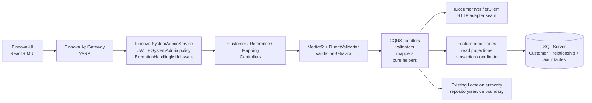
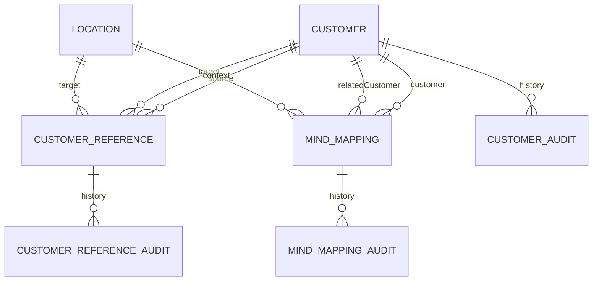

# Design Document — Customer Master, Customer References, and Mind Mappings

**Feature:** `customer-master-reference-mind-mappings`  
**Business source:** `requirements.md` in this spec directory  
**Scope:** Backend `e:\Finnova\Finnova-API` and frontend `E:\Finnova\Finnova-UI\Finnova-UI`  
**Architecture:** Existing ASP.NET Core SystemAdmin service, MediatR/CQRS, FluentValidation, EF Core/SQL Server, repository abstractions, YARP gateway, React 18, TypeScript, MUI, shared axios, and interface/real/mock/toggle services.

## Overview

This feature creates a controlled Customer-data foundation for the India-only Finnova platform. It contains three related but separate capabilities:

1. **Customer Master** — authoritative Customer records using only the fields and behavior approved by FINNOVA-51 through FINNOVA-55.
2. **Customer References** — explicit, business-maintained relationships from a Customer to another Customer or to an existing Location.
3. **Mind Mappings** — durable, versioned relationship records containing normalized Customer/Location identifiers and bounded provenance for future consumption.

The feature also defines the integration boundary for validating applicable Aadhaar and PAN documents through the existing `Finnova-Document-Verifier` API. The Customer service owns orchestration and safe persistence of the minimum approved Verification Outcome; it does not reimplement document validation or become a document repository.

The future Customer Information AI Agent is explicitly outside this feature. No model invocation, embedding generation, relationship inference, ranking, retrieval, agent orchestration, or AI-facing implementation is designed here. Mind Mappings are only bounded, authorized, versioned inputs that a separate future agent may consume.

The design is intentionally concrete about platform architecture and security boundaries, but intentionally abstract about unavailable business contracts. The complete FINNOVA-51..55 fields, lifecycle values, uniqueness rules, verifier endpoint/schema/status vocabulary, and related policy decisions remain blockers and are represented by contract-resolution seams rather than invented values.

### 1.1 Research findings that inform the design

The existing workspace establishes the following implementation conventions:

- `Finnova.SystemAdminService` is the SystemAdmin host. Its `Program.cs` registers MediatR handlers from `Finnova.Service`, FluentValidation validators, the validation pipeline, JWT Bearer authentication, the `SystemAdmin` role policy, `AddFinnovaRepository`, and `ExceptionHandlingMiddleware` in the required order.
- `Finnova.Repository.DependencyInjection` registers feature repositories and `FinnovaDbContext`; `FinnovaDbContext` discovers EF configurations through `ApplyConfigurationsFromAssembly` and exposes feature `DbSet`s.
- Existing master features use record contracts in `Finnova.Models/Contracts`, entity and enum types in `Finnova.Models/Domain`, repository interfaces/implementations, MediatR commands and queries, mapper extensions, and path-scoped RFC 7807 error codes in the SystemAdmin middleware.
- The generic `RepositoryBase<T>` currently calls `SaveChangesAsync` inside each mutation method. Because this feature requires business data and its audit entry to commit atomically, the new write path must use a feature-aware unit-of-work/transaction seam rather than composing independently committed generic `AddAsync` calls.
- `Finnova.ApiGateway/appsettings.json` already routes `/api/systemadmin/{**catch-all}` to `systemadmin-cluster` and aliases UI-composed paths such as `/api/ua/api/nationality/**` to that cluster. This feature will follow the same two-route alias pattern after the final feature prefixes are confirmed.
- The frontend contains master-data pages and tests such as `NationalityMaster.tsx`/`.test.tsx` and `OrgHierarchyMaster.tsx`/`.test.tsx`, and service implementations under `src/services/interfaces`, `src/services/real`, `src/services/mock`, plus a toggle module. The shared `src/services/api.ts` remains the only HTTP client.
- No existing Customer feature or Aadhaar/PAN verifier adapter was found in the backend workspace. The design therefore introduces explicit interfaces for both areas without assuming an external wire contract.

## 2. Goals and non-goals

### 2.1 Goals

- Preserve FINNOVA-51..55 as the sole authority for Customer fields, operations, lifecycle, validations, uniqueness, and story-specific behavior.
- Provide a stable Customer Identifier that can be referenced by Customer References and Mind Mappings.
- Keep Customer References separate from Mind Mappings in entities, contracts, services, APIs, audit scopes, and UI flows.
- Store Customer-to-Customer and Customer-to-Location relationships using validated identifiers, not copied names.
- Treat Location as an external authoritative master reference; do not create, modify, duplicate, or infer Locations here.
- Persist a versioned Mind Mapping contract with controlled relation/status values, provenance, optional bounded metadata, and normalized endpoint IDs.
- Validate applicable Aadhaar/PAN documents through an adapter to the existing verifier and persist only the approved safe outcome.
- Make Customer, relationship, mapping, verification, audit, and privacy behavior authorization-aware and transactionally safe.
- Expose stable record, query, audit, and paginated contracts to the UI and a future approved consumer without exposing EF navigation graphs or unnecessary PII.
- Provide a React/MUI administrative UI using the established shared-axios and mock-toggle conventions.
- Supply unit, property, integration, UI, and host-wiring test designs without implementing source code in this phase.

### 2.2 Non-goals

- Defining or guessing the unavailable FINNOVA-51..55 Customer field list, business key, lifecycle states, role matrix, search semantics, or validation limits.
- Defining or guessing the verifier endpoint URL, request/response JSON, authentication scheme, status names, matching rules, retry policy, timeout, idempotency key, or mandatory-document policy.
- Storing raw Aadhaar/PAN images, raw documents, authentication tokens, unnecessary full document numbers, raw verifier responses, or unbounded PII.
- Implementing a document repository, local document-validation algorithm, or alternate verifier.
- Creating or modifying Location records, copying Location hierarchy/name data into relationship records, or replacing the Location service/repository boundary with direct database coupling.
- Implementing Customer Information retrieval, AI inference, model calls, embeddings, ranking, explanations, training, vector search, RAG, or agent orchestration.
- Merging Customer References into Mind Mappings or treating either record type as evidence that a relationship is factually verified.
- Adding bilingual fields, translation scaffolding, Arabic/non-English values, RTL behavior, or non-India localization.
- Applying an EF migration, running builds/tests, or modifying backend/frontend source as part of this design phase.

## 3. Requirements coverage map

The following map covers every numbered requirement in `requirements.md`. Requirement clauses remain the authority; the design sections identify the mechanism that will satisfy them after the unresolved contracts are confirmed.

| Requirement | Design coverage |
| --- | --- |
| **R1 — Preserve FINNOVA-51..55 authority** | §6.1 contract-resolution gate; §7.1 Customer aggregate seam; §7.2–7.3 stable relationship IDs; §19 Tasks 0–3. Story traceability is mandatory before concrete Customer fields/tasks are finalized. |
| **R2 — Create and maintain Customer records** | §7.1 Customer entity boundary; §8 Customer contracts; §9 verifier-gated transaction; §10 validation/error handling; §10.3 audit atomicity; §19 Tasks 1, 3, 6–8. |
| **R3 — Customer identity, uniqueness, lifecycle integrity** | §7.1 identity/lifecycle seam; §10.1 validation layers; §10.3 transaction and history rules; §18.3 unit-of-work decision; §19 Tasks 1, 5–9. |
| **R4 — Query and search Customer records** | §8.2 logical query endpoints; §8.3 projections/mappers; §10.1 query validation; §11 privacy; §19 Tasks 3, 5, 7–9. |
| **R5 — Create and maintain Customer References** | §7.2 separate entity; §8.2 reference contracts/endpoints; §10.1 endpoint validation; §12 Location boundary; §10.3 audit; §19 Tasks 1–8. |
| **R6 — Query Customer References and resolve endpoints** | §7.2 endpoint shape; §8.2 reference queries; §8.3 authorized display mapping; §11 privacy; §12 Location resolution; §19 Tasks 5, 7–9. |
| **R7 — Persist Mind Mappings for future AI consumption** | §2.2 AI boundary; §7.3 mapping entity; §7.5 version/provenance; §8.2 mapping contracts; §10.1 normalization/validation; §19 Tasks 1–8. |
| **R8 — Query/filter/export Mind Mappings safely** | §7.3 active/history state; §8.2 versioned read projection and export boundary; §8.3 filters/mappers; §11 privacy; §19 Tasks 7–10. No export is exposed unless separately approved. |
| **R9 — Audit Customer, Reference, and Mapping changes** | §7.5 audit entities; §8.2 audit endpoints; §10.3 immutable atomic audit behavior; §15 audit properties; §19 Tasks 1, 4, 5, 7–9. |
| **R10 — Authentication, authorization, and privacy** | §10.2 authentication/error ordering; §11 JWT/policies, field minimization, masking, and redaction; §13 gateway authorization path; §19 Tasks 7–9, 11–13. |
| **R11 — Backend contracts, API consistency, integration boundaries** | §8 contracts and mappers; §9 verifier adapter; §10 validation/error handling; §12 Location boundary; §13 routes/aliases; §19 Tasks 3, 5–8, 10–11. |
| **R12 — Customer administration and relationship UI** | §14 frontend architecture and flows; §11 privacy/localization; §13 gateway aliases; §19 Tasks 10–13. |
| **R13 — Out-of-scope future AI Agent boundary** | §2.2 non-goals; §7.3 durable input model; §8.2 versioned read-only projection; §18.5 versioning decision; §19 tasks exclude model/agent infrastructure. |
| **R14 — Validate identity documents through existing verifier** | §9 complete adapter/transaction seam; §10.2 safe failure mapping; §11 PII and authorization; §17.2 verifier configuration; §19 Tasks 6–9 and 14. Unknown verifier values remain blockers. |

## Components and Interfaces

### 4.1 Reused platform components

| Concern | Existing component | Design use |
| --- | --- | --- |
| Host | `Finnova.SystemAdminService` | Add Customer, Reference, Mapping, and audit controllers; no new host. |
| Authentication | ASP.NET Core JWT Bearer in `Program.cs` | Reuse issuer/audience/lifetime/signing-key validation and role claim handling. |
| Authorization | Existing `SystemAdmin` policy | Apply to administrative mutations and reads until a confirmed narrower consumer policy exists. Separate read/manage policy seams are designed but not enabled without confirmation. |
| Mediation | MediatR assembly scanning | Commands and queries remain thin controllers over handlers. |
| Validation | `ValidationBehavior<,>` plus FluentValidation | Request validation happens before handlers; cross-record and policy validation remains in handlers/domain helpers. |
| Persistence | `FinnovaDbContext`, EF Core, SQL Server | Add entities/configurations/DbSets and a feature transaction seam. |
| Repository pattern | `IRepository<T>`, `RepositoryBase<T>`, feature-specific repositories | Reuse read abstraction and conventions; avoid per-method `SaveChangesAsync` composition for atomic feature writes. |
| Contracts | `Finnova.Models` records and `PaginatedResponse<T>` | Add feature-scoped request/response/query records and explicit mapper extensions. |
| Errors | `ExceptionHandlingMiddleware` and RFC 7807 `ProblemDetails` | Add typed Customer/reference/mapping/verifier branches and path/code family without exposing sensitive details. |
| Gateway | YARP `systemadmin-cluster` and existing UI aliases | Add resolved feature aliases using the existing root + catch-all route convention. |
| UI HTTP/auth | `src/services/api.ts` | Reuse JWT injection and centralized 401/403/409/timeout toast behavior. |
| UI architecture | React hooks, MUI, service interface/real/mock/toggle pattern | Build feature pages and dialogs without Redux, RxJS, or ad hoc axios clients. |
| UI tests | Vitest + React Testing Library/jsdom | Extend existing master-page/service test conventions. |

### 4.2 New components

Backend additions are feature-scoped and should use distinct namespaces such as `Customer`, `CustomerReferences`, `MindMappings`, and `IdentityVerification`:

- Customer, CustomerReference, MindMapping, VerificationOutcome, and three audit entities.
- Only the controlled enum members that are confirmed by FINNOVA-51..55 and the verifier contract; no speculative status/type values.
- Typed domain exceptions for not found, duplicate/conflict, invalid relationship, lifecycle conflict, verification failure/dependency failure, and contract-resolution failures where needed.
- Feature repositories and read projections, plus a transaction/unit-of-work seam for business row + audit row atomicity.
- `IDocumentVerifierClient`, an HTTP adapter, request/response boundary DTOs, safe outcome/error mappers, and configuration/options whose names and values are resolved from the existing verifier integration.
- MediatR commands, queries, validators, handlers, and mappers for each separate capability.
- Controllers and middleware mappings with stable feature error-code families after the platform code naming is confirmed.

Frontend additions should use a distinct namespace to avoid collisions with the existing Company Master organization feature:

- `customer.model.ts`, `customerReference.model.ts`, and `mindMapping.model.ts` or an equivalent feature model grouping.
- Separate interfaces for Customer, Customer Reference, Mind Mapping, and any approved Location lookup dependency.
- Real services using the shared axios instance, mock services with English-only deterministic seed data, and toggle modules selected by `VITE_USE_MOCK_API`.
- Customer Master, Customer Reference, and Mind Mapping pages or an approved tab/detail flow, with MUI grids/dialogs/selectors and explicit loading, empty, validation, forbidden, timeout, retry, and success states.
- Routes and navigation entries under the existing protected SystemAdmin administration area.

## Architecture

### 5.1 Backend vertical slice



Controllers only translate HTTP to MediatR requests and response status codes. Handlers coordinate business rules, repositories, the Location boundary, the verifier adapter, and the transaction coordinator. Mappers translate entities/read projections into approved records and never serialize EF navigation graphs. The UI never calls repositories, the verifier, or the database directly.

### 5.2 Write transaction boundary

Customer, Customer Reference, and Mind Mapping mutations that require audit use a single feature-aware transaction:

1. Authenticate and authorize before the handler is entered.
2. Validate request shape through FluentValidation.
3. Normalize only values whose rules are approved; do not silently normalize unresolved business fields.
4. Resolve referenced Customer and Location IDs through the appropriate repository/service boundary.
5. If required/supplied, call the verifier adapter before marking a Customer verified or completing the approved Customer write.
6. Add/update the business entity and exactly one corresponding immutable audit entity in the same `FinnovaDbContext` transaction.
7. Commit once and map the committed entity/projection to the response.
8. On any business, audit, verifier, or commit failure, roll back and return a safe error.

The generic `RepositoryBase<T>` remains reusable for simple reads and non-atomic operations, but new feature write repositories must expose tracked add/update operations or use a feature unit-of-work. Calling existing auto-saving `AddAsync` once for the business row and once for its audit row would violate R9.9/R9.10 and is therefore not acceptable.

### 5.3 Read boundary and projections

Reads use `AsNoTracking` projections. Each query explicitly selects approved fields and, where allowed, resolves display values from current Customer/Location records. It must not return EF navigation graphs, raw verifier payloads, internal exception details, or unapproved PII. Relationship reads preserve endpoint IDs even when an endpoint is inactive, while the response includes lifecycle state only when the caller is authorized to see it.

Mind Mapping read contracts are versioned projections. A future consumer receives only the minimum approved projection and cannot obtain direct database access. Contract-version compatibility is implemented through versioned mapper/reader branches, not by exposing internal entities.

## 6. Contract-resolution blockers and assumptions

This design carries forward the assumptions in `requirements.md`; it does not convert them into invented implementation values.

### 6.1 Mandatory blockers before concrete source tasks

1. Supply the complete acceptance criteria and approved field definitions for FINNOVA-51, FINNOVA-52, FINNOVA-53, FINNOVA-54, and FINNOVA-55.
2. Confirm the Customer business key, normalization, uniqueness scope, mutability, lifecycle values, hard-delete/deactivation policy, and duplicate/concurrency behavior.
3. Classify Customer fields as ordinary, sensitive, or PII; define roles, masking, export, retention, correction, erasure, and legal-hold behavior.
4. Confirm the existing `Finnova-Document-Verifier` endpoint, HTTP method, request/response schema, authentication mechanism, status vocabulary, matching rules, verifier reference, timeout, cancellation, retry/backoff, idempotency/deduplication, safe error mapping, and mandatory Aadhaar/PAN policy.
5. Confirm Customer Reference endpoint cardinality, directed/symmetric semantics, Reference Type vocabulary, self-reference behavior, duplicate key, inactive endpoint policy, and lifecycle.
6. Confirm Mind Mapping relation/status vocabularies, optional versus required Location, confidence semantics/range, provenance/evidence limits, duplicate/supersession policy, and editable/review workflow.
7. Confirm authorized reader and manager policies, including whether future consumers can read a minimized projection and whether verification status is visible.
8. Confirm route prefixes, error-code family, pagination defaults/limits, API versioning, UI navigation, and gateway aliases.

### 6.2 Working assumptions used to shape the seams

- Stable system-generated GUID identifiers are used for Customer, Customer Reference, Mind Mapping, and audit records.
- A Customer Reference has one source Customer and exactly one approved target kind: a target Customer or a target Location. The baseline assumption is directed references and no self-reference, but these remain confirmation points.
- A Mind Mapping has `CustomerId`, `RelatedCustomerId`, and nullable `LocationId` as the normalized tuple. The exact cardinality and optionality remain contract-controlled.
- New references use existing active endpoints unless the approved inactive-endpoint policy says otherwise; historical endpoint IDs remain preserved.
- Dates are UTC `DateTime`/ISO-8601 values using the existing platform representation.
- System Administrators manage all feature records while broader reads remain disabled until explicitly authorized.
- English-only labels, controlled values, mock data, error messages, and tests are used; no RTL or translation layer is introduced.

## Data Models

The following are conceptual shapes. Exact Customer fields and unresolved controlled values must be inserted only after the blocker gate.

### 7.1 Customer entity

`Customer` is the authoritative aggregate root. It contains:

- `Id: Guid` — immutable stable Customer Identifier.
- Only the approved FINNOVA-51..55 fields, with their confirmed nullability, lengths, formats, searchability, sensitivity, and mutability.
- Approved lifecycle state and active/archived representation, if defined by the stories.
- `CreatedAtUtc` and `UpdatedAtUtc` (or the exact established platform names).
- Optional `VerificationOutcome` owned/value data containing only the approved minimum outcome fields.

The entity must not contain raw documents, document images, verifier credentials, raw verifier responses, unnecessary full Aadhaar/PAN numbers, copied Location names, relationship collections used as API contracts, or speculative Customer properties.

### 7.2 Customer Reference entity

`CustomerReference` is separate from both Customer and MindMapping. The conceptual columns are:

- `Id: Guid`.
- `SourceCustomerId: Guid`.
- `ReferenceType` — controlled value resolved from the approved reference vocabulary.
- `TargetCustomerId: Guid?`.
- `TargetLocationId: Guid?`.
- `LifecycleState`/`IsActive` as confirmed.
- `Provenance`/source metadata as approved.
- `CreatedAtUtc`, `UpdatedAtUtc`, and any approved lifecycle timestamps.

A database check constraint or service validator must enforce the approved endpoint cardinality. The baseline shape requires exactly one target kind, but the final constraint must follow the confirmed contract. Uniqueness is enforced over the normalized approved key, with a database unique index where possible.

### 7.3 Mind Mapping entity

`MindMapping` is a durable relationship candidate/fact input, not an inference engine. The conceptual columns are:

- `Id: Guid`.
- `CustomerId: Guid`.
- `RelatedCustomerId: Guid`.
- `LocationId: Guid?`.
- `RelationType`/relation code from the approved controlled vocabulary.
- `Status` from the approved mapping lifecycle vocabulary.
- `Provenance` identifying the source process/user/system.
- Optional confidence/certainty with explicit supplied/calculated/unavailable semantics if approved.
- Optional bounded evidence/rationale if approved.
- `ContractVersion` — required for future read compatibility.
- `CreatedAtUtc`, `UpdatedAtUtc`, and approved status-transition timestamps.

Mind Mappings must not store copied Customer or Location names as authoritative endpoints. Display fields are resolved at read time, subject to authorization. Persistence does not imply truth, verification, approval, or AI inference.

### 7.4 Verification Outcome boundary

`VerificationOutcome` is the minimum approved result of an applicable Aadhaar/PAN validation:

- Document kind only if the approved contract requires it.
- Approved verification status/value.
- Non-sensitive verifier reference if supplied and approved.
- Masked/non-sensitive metadata only if approved.
- `VerifiedAtUtc`/outcome timestamp in the approved representation.
- Optional outcome version or failure metadata only if approved.

The exact property names, status values, retention, masking, and whether one or multiple document outcomes are stored must be resolved. Raw input document values and verifier response bodies never cross into the Customer entity, response contract, audit record, logs, or exceptions.

### 7.5 Audit entities and enums

Use separate immutable audit entities or a shared typed audit base only if that matches existing platform conventions. The minimum scoped entities are:

- `CustomerAuditEntry` with Customer ID, action, approved changed fields/snapshot, acting identity, provenance, timestamp, and stable audit ID.
- `CustomerReferenceAuditEntry` with reference ID, normalized endpoints, action, approved changed values, acting identity, provenance, and timestamp.
- `MindMappingAuditEntry` with mapping ID, endpoint IDs, action, changed values, provenance, contract version, acting identity where applicable, and timestamp.

`AuditAction` may contain only actions explicitly required by the approved operation set (for example create/update/lifecycle/supersession where those operations are confirmed). Do not expose audit update/delete commands. Audit reads order by timestamp descending and stable audit ID descending.

Other enum/value-object seams are named by concept rather than assigned speculative members:

- `CustomerLifecycleState`.
- `CustomerReferenceType` and `CustomerReferenceLifecycleState`.
- `MindMappingRelationType` and `MindMappingStatus`.
- `VerificationStatus` and `VerificationFailureKind`.
- `ReferenceEndpointKind` with the known endpoint categories Customer and Location.

The members and wire representation for the unresolved sets must be supplied by the story/verifier contract. SystemAdmin JSON uses the existing string-enum convention only after the vocabulary is approved.

### 7.6 Relationships and database constraints



- Customer foreign keys are local and required where the contract requires a Customer endpoint.
- Location IDs are validated through the authoritative Location boundary and stored as IDs; the feature does not duplicate Location data.
- Audit foreign-key behavior must preserve history under the confirmed Customer/reference/mapping deletion policy. If hard deletion is not approved, deactivation/archival preserves the normal references and audit rows.
- Unique indexes must match the approved normalized business key/reference key/mapping duplicate key. No speculative uniqueness index should be created before the blocker gate.
- Indexes should support approved search fields, active/status filters, endpoint lookups, contract version, provenance, and deterministic ordering.

## 8. Backend contracts, endpoints, and mapping rules

### 8.1 Contract rules

Contracts live under feature-scoped folders in `Finnova.Models/Contracts`. Use records and explicit response DTOs. Requests must not accept entity types or navigation graphs. Responses contain only fields approved for the caller and purpose. `PaginatedResponse<T>` is reused for list/search operations.

Recommended logical contract groups are:

- Customer: create, update, lifecycle request if approved, query parameters, response, safe Verification Outcome.
- Customer Reference: create, update/lifecycle if approved, query parameters, response with endpoint IDs and authorized display projections.
- Mind Mapping: create, update/status transition if approved, query parameters, versioned response, minimized future-consumer response.
- Audit: separate response records for each audit scope or a shared discriminated contract if existing conventions support it.
- Verifier adapter: internal boundary records, not public API DTOs.

The verifier request boundary is deliberately not a public Customer contract. A public Customer create/update request contains only the approved document input shape after FINNOVA-51..55 resolution; the application maps it to an internal verifier request and immediately discards raw input after the approved operation. If the contract allows the UI to supply an identifier, it must be masked/handled according to the confirmed policy and never echoed unnecessarily.

### 8.2 Logical endpoint matrix

Final route tokens are a blocker. The following logical operations define the API surface without asserting unavailable route names:

| Capability | Method/shape | Result |
| --- | --- | --- |
| Customer search/list | `GET <customer-prefix>` with approved search/filter/page parameters | `PaginatedResponse<CustomerResponse>` |
| Customer by ID | `GET <customer-prefix>/{id}` | Authorized `CustomerResponse` or not found |
| Customer create | `POST <customer-prefix>` | Created `CustomerResponse`; verifier-gated where applicable |
| Customer update | `PUT/PATCH <customer-prefix>/{id}` according to existing API convention | Updated `CustomerResponse` |
| Customer lifecycle | `POST/PATCH <customer-prefix>/{id}/lifecycle` only if approved | Updated response |
| Customer audit | `GET <customer-prefix>/{id}/audit` | Immutable audit response list, newest first |
| Customer Reference search | `GET <reference-prefix>` with approved endpoint/type/status/page filters | `PaginatedResponse<CustomerReferenceResponse>` |
| Customer Reference create | `POST <reference-prefix>` | Created `CustomerReferenceResponse` |
| Customer Reference update/lifecycle | `PUT/PATCH <reference-prefix>/{id}` only for approved fields | Updated response |
| Customer Reference audit | `GET <reference-prefix>/{id}/audit` | Immutable audit response list |
| Mind Mapping search | `GET <mapping-prefix>` with approved endpoint/relation/status/version filters | `PaginatedResponse<MindMappingResponse>` |
| Mind Mapping create | `POST <mapping-prefix>` | Created versioned response |
| Mind Mapping update/status | `PUT/PATCH <mapping-prefix>/{id}` only if approved | Updated versioned response |
| Mind Mapping audit | `GET <mapping-prefix>/{id}/audit` | Immutable audit response list |
| Future consumer projection | Separate read-only route only after a policy/story approves it | Minimum approved versioned projection |
| Export/bulk retrieval | No endpoint in the baseline | Must remain absent until explicitly approved |

The Customer create/update endpoint coordinates document verification internally when the approved contract requires or supplies Aadhaar/PAN. A separate public verifier endpoint is not assumed.

### 8.3 DTO and mapper rules

- Use one mapper per entity/projection family, for example `CustomerMappings`, `CustomerReferenceMappings`, `MindMappingMappings`, and `AuditMappings`.
- Mappers accept a projection/entity plus an authorization/purpose context where field-level minimization requires it.
- Never map EF navigation collections by default.
- Resolve Customer/Location display fields only in query projections and only after checking authorization for every referenced endpoint.
- Return stable IDs even when display fields are omitted, unless the approved privacy policy requires masking the identifier itself.
- Map inactive endpoint lifecycle state only to authorized callers.
- Map a Mind Mapping with explicit `contractVersion`; keep older supported versions readable through version-aware mappers.
- Map verifier outcomes through a pure safe mapper that copies only approved status/reference/masked metadata/timestamp fields. Unknown external status values must produce a controlled unresolved/dependency result until the status vocabulary is confirmed; they must never be passed through as arbitrary public strings.
- Convert domain and validation failures to the existing ProblemDetails shape with a stable `code`, safe English `message/detail`, and field-level errors where supported. Do not include raw verifier payloads or PII in `detail`.

## 9. Aadhaar/PAN verifier integration design

### 9.1 Adapter seam

Introduce an application-facing interface such as:

```text
IDocumentVerifierClient
  VerifyAsync(DocumentVerificationRequest request, CancellationToken cancellationToken)
      -> DocumentVerificationResult
```

The interface belongs at the application/service boundary, while the HTTP implementation belongs in the appropriate infrastructure/service project. The exact request fields, document-kind enum values, endpoint, and result vocabulary are contract placeholders until the existing verifier integration is inspected and confirmed.

The adapter has four responsibilities:

1. Build the external request from only the minimum approved Customer input.
2. Authenticate using the approved service-to-service mechanism without placing credentials in request models, logs, or exceptions.
3. Apply configured timeout and cancellation and the approved retry/idempotency policy.
4. Convert the external response or transport failure into an internal result/failure category that the Customer handler can safely act on.

The adapter must not decide Customer lifecycle, write database rows, or expose external response bodies.

### 9.2 Unknown verifier contract values

The following remain explicit blockers and must be configuration/contract documentation, not invented constants:

- Base URL, route, HTTP verb, content type, and API version.
- Authentication type, credential source, rotation, audience/scope, and header names.
- Request fields and whether Aadhaar, PAN, or both are mandatory.
- Response fields, valid/matched semantics, status names, reference format, and mismatch indicators.
- Timeout/cancellation bounds, retryable versus permanent failures, backoff, maximum attempts, and idempotency/deduplication behavior.
- Safe public error codes/messages and logging/redaction rules.
- Verification outcome retention, masking, and authorized readers.

The implementation should fail closed if required settings are missing and should expose a health/configuration failure without leaking secrets.

### 9.3 Customer transaction sequence

```mermaid
sequenceDiagram
    participant C as Customer Handler
    participant V as IDocumentVerifierClient
    participant L as Location/other authority boundary
    participant U as Feature UnitOfWork
    participant D as SQL Server
    participant A as Audit table
    C->>C: Validate approved request and normalize approved fields
    C->>V: Verify applicable Aadhaar/PAN with cancellation token
    alt valid and matched for all required documents
        V-->>C: Safe internal VerificationResult
        C->>U: Begin transaction
        C->>U: Add/update Customer with safe VerificationOutcome
        C->>A: Add exactly one Customer audit row
        U->>D: Save business + audit atomically
        D-->>U: Commit
        C-->>C: Map approved CustomerResponse
    else invalid/rejected/mismatch
        V-->>C: Safe validation failure
        C-->>C: Roll back/no write; return safe validation error
    else timeout/cancelled/unavailable/ambiguous
        V-->>C: Safe retryable dependency failure
        C-->>C: Roll back/no verified write; return retryable error
    end
```

For updates, the existing Customer remains unchanged if required verification fails. For creates, no Customer is persisted if required verification fails. A no-document operation is allowed only when FINNOVA-51..55 says no document is required and none is supplied. A one-document operation is supported only when the approved contract says the other document is not mandatory.

### 9.4 Retry and idempotency

The adapter exposes cancellation and accepts a request/correlation identifier. Actual retry count, backoff, retryable failure classes, and idempotency header/body behavior are injected from the confirmed policy. No retry is performed for validation rejection, mismatch, or other permanent failures. If the verifier supports idempotency, retries reuse the approved idempotency key for the same logical Customer operation; they do not create a new Customer attempt with a different semantic identity.

## Error Handling

### 10.1 Validation layers

1. **Transport/model binding:** malformed JSON, missing route IDs, and primitive type errors are handled by ASP.NET Core conventions.
2. **FluentValidation:** required fields, approved lengths/formats, query ranges, endpoint cardinality, allowed combinations, and confirmed controlled values.
3. **Pure/domain helpers:** approved normalization, duplicate-key composition, endpoint discriminant validation, status transitions, confidence bounds, evidence length, and safe verifier mapping.
4. **Repository/database:** unique indexes, foreign-key/reference integrity where local, concurrency, and transaction constraints.
5. **Authorization/privacy:** caller role, purpose, field-level visibility, endpoint-by-endpoint authorization, and export restrictions.

Unresolved FINNOVA-51..55 validations must remain blocked rather than silently receiving generic defaults.

### 10.2 Error mapping

Use typed exceptions rather than message matching. The middleware should add feature branches for:

- Customer not found → approved Customer 404 code.
- Customer duplicate/business-key conflict → approved Customer 409 code.
- Customer lifecycle/immutability conflict → approved Customer 400/409 code as confirmed.
- Reference endpoint/type/cardinality/duplicate conflict → approved Reference 400/409 code.
- Mind Mapping endpoint/relation/status/duplicate conflict → approved Mapping 400/409 code.
- Verification invalid/rejected/mismatch → safe validation error; no sensitive detail.
- Verifier timeout/unavailable/cancelled/ambiguous → safe retryable dependency error; no external body.
- FluentValidation failures → feature-scoped 400 ProblemDetails with field-level errors when the shared contract supports them.
- Unexpected failures → generic feature-scoped 500 detail, with correlation ID if the platform convention supports it.

401/403 remain middleware/authentication outcomes and must occur before protected data or role-specific detail is evaluated. Error messages and codes are English-only and must not reveal whether an unauthorized caller supplied a real Customer/Location ID, mapping, or document.

### 10.3 Atomic audit rules

Every successful approved create/update/lifecycle/status/supersession operation produces exactly one corresponding immutable audit entry. Rejected requests produce no ordinary change audit entry. Business row and audit row are committed in the same transaction. If audit persistence or commit fails, the business mutation is rolled back and the caller receives a safe failure.

Audit records have no feature update/delete commands. Audit reads are deterministic newest-first: timestamp descending, then audit ID descending. Read/access/security logging is separate from ordinary change audit and is not added unless the confirmed privacy policy requires it.

## 11. Authorization, privacy, and PII minimization

- Apply `[Authorize(Policy = "SystemAdmin")]` to all baseline Customer, Reference, Mapping, and audit endpoints, including reads. Introduce narrower authorized-consumer policies only after confirmation.
- Keep management and read operations as separate policy seams even if both initially resolve to `SystemAdmin`.
- Verify authorization for every Customer and Location endpoint represented in a Reference or Mind Mapping before returning display fields.
- Project only purpose-approved fields. Do not use generic `Entity` serialization or return navigation graphs.
- Store and return only the minimum approved Verification Outcome. Never persist raw Aadhaar/PAN documents/images, credentials, tokens, unnecessary full numbers, or raw external responses.
- Redact document data, tokens, verifier headers, response bodies, and unnecessary PII in logs, audit `provenance`, error messages, traces, and telemetry.
- Do not leak protected values through counts, ordering, free-text evidence/rationale, conflict messages, or not-found differences when the caller lacks access.
- Limit evidence/rationale/provenance lengths and content to the approved contract. Treat free text as sensitive input and redact/validate as required.
- Use HTTPS/service authentication according to deployment configuration for verifier calls; secrets come from the approved secret provider, never source or mock fixtures.
- English-only labels and values; left-to-right UI; no bilingual fields or RTL code.

## 12. Location authoritative-reference boundary

The existing Location Master remains the source of truth for Location identity, code, name, hierarchy, level, active state, and timestamps. Customer References and Mind Mappings store only `LocationId` after validation through an approved repository/service boundary.

The feature must not:

- Add a duplicate Location entity or copy Location hierarchy/name columns into relationship tables as authoritative data.
- Create, update, deactivate, or delete Locations.
- Infer a Location from free text or Customer attributes.
- Join directly to an unrelated Location database in a way that bypasses the approved repository/service boundary.

At read time, an authorized projection may resolve current Location display fields. If the Location is inactive/archived, the stored ID remains and the response exposes lifecycle state only under the approved policy. Missing or malformed IDs produce the approved safe validation/not-found behavior without returning unrelated references.

## 13. Gateway routes and aliases

The existing direct SystemAdmin route is reused:

```text
/api/systemadmin/{**catch-all} -> systemadmin-cluster -> Finnova.SystemAdminService:5030
```

The final public route prefixes are unresolved. Once confirmed, add the same two YARP aliases used by Lookup/Nationality/Organization Hierarchy:

```text
/api/ua/api/<customer-prefix>/{**catch-all} -> systemadmin-cluster
/api/ua/api/<customer-prefix>                 -> systemadmin-cluster
```

Transforms remove `/api/ua/api` and add `/api`, preserving the host's controller route. Repeat the pattern for the Reference and Mind Mapping prefixes if they are separate. If a shared feature prefix is approved, use one alias family only; do not collapse SystemAdmin into the UA host.

The UI real services compose paths relative to the existing shared axios base URL. They must not create a second axios client or hard-code a host port. Gateway integration tests must prove that each UI-composed path reaches the SystemAdmin controller and that Authorization passes through.

## 14. Frontend architecture and flows

### 14.1 Service/model structure

Under `E:\Finnova\Finnova-UI\Finnova-UI\src` use a distinct customer feature namespace, for example:

- `models/customer.model.ts`, `models/customerReference.model.ts`, `models/mindMapping.model.ts`, barrel exports in `models/index.ts`.
- `services/interfaces/customer.interface.ts`, `customerReference.interface.ts`, and `mindMapping.interface.ts`, barrel exports in `services/interfaces/index.ts`.
- `services/real/customer.real.ts`, `customerReference.real.ts`, and `mindMapping.real.ts` using `api`.
- Corresponding `services/mock/*.mock.ts` with English-only deterministic safe fixtures.
- Toggle modules under `services/*.service.ts`, selected by `VITE_USE_MOCK_API`, and exports from `services/index.ts`.

The real service maps API DTOs explicitly rather than relying on entity-shaped responses. It reads `ProblemDetails` only for safe code branching; the shared axios interceptor remains responsible for standard 401/403/409/timeout notifications.

### 14.2 Customer flow

- List/search page with only approved Customer columns and filters.
- Create/edit dialog or approved form flow with story-defined validation and safe verification status.
- Controlled search/select behavior for Customer endpoints used by relationship dialogs.
- Loading, empty, success, validation-error, forbidden, timeout, retry, and unsaved-input-preservation states.
- On successful save, refresh from the service response; do not optimistically mutate list state.
- On verification failure, display only the approved safe English message/status, preserve safe user input, and never show raw verifier detail.

### 14.3 Customer Reference flow

- Separate Reference page/dialog or approved Customer detail tab.
- Select source Customer and exactly one controlled target kind.
- Load Customer/Location options through approved services rather than free-text IDs where possible.
- Display endpoint IDs and authorized names/lifecycle values from the response.
- Keep the form open and preserve safe input on validation/conflict/timeout failure.
- Provide audit history separately from Mind Mapping history.

### 14.4 Mind Mapping flow

- Separate Mind Mapping page/detail flow.
- Controlled Customer, Related Customer, and optional Location selectors.
- Show only approved relation/status/provenance/confidence controls.
- No AI inference button, model control, embedding action, relationship suggestion, or Customer Information retrieval UI.
- Display contract version and source/provenance as approved.
- Distinguish active/proposed/approved/history states only when those values are confirmed.

### 14.5 UI privacy and localization

The UI never receives raw documents or verifier payloads. Sensitive values are masked according to the approved field policy. Mock fixtures contain English-only India-specific examples without real PII. All labels, statuses, errors, and validation text are English and use normal left-to-right MUI layouts.

## Correctness Properties

A property is a characteristic or behavior that should hold true across all valid executions of a system—essentially, a formal statement about what the system should do. Properties bridge human-readable requirements and machine-verifiable guarantees. This feature is not broadly property-testable because most behavior is CRUD, infrastructure wiring, authorization, or external I/O; the following properties target only isolated deterministic helpers.

### Property 1: Relationship endpoint normalization preserves the authoritative tuple

For all valid generated Customer Reference and Mind Mapping endpoint inputs, normalizing the approved endpoint shape shall preserve the stable Customer/Location identifiers, represent exactly the approved endpoint cardinality, and never introduce copied display names as authoritative endpoint data; every incompatible combination shall be rejected without a persistence command.

**Validates: Requirements 5.7**

### Property 2: Safe verifier mapping never leaks sensitive external data

For all generated verifier results and transport/error payloads containing arbitrary document values, credentials, headers, response bodies, or PII, the safe adapter mapper shall emit only the approved Verification Outcome or approved safe retry/validation error fields and shall never include raw document content, authentication tokens, unnecessary full document numbers, or the raw verifier response.

**Validates: Requirements 2.13**

### Property 3: Audit ordering is deterministic and newest-first

For all generated audit-entry collections, sorting by approved UTC change timestamp descending and stable audit identifier descending shall produce a deterministic order in which no later entry appears after an earlier entry, including when timestamps are equal.

**Validates: Requirements 9.13**

### Property 4: Approved projection minimization is monotonic

For all generated Customer, Customer Reference, Mind Mapping, and Verification Outcome source objects and authorized purpose scopes, the projection mapper shall return no field outside the scope’s approved field set and shall not expose more sensitive data when the scope is reduced.

**Validates: Requirements 8.5**

The property reflection is as follows: verifier redaction behavior in Requirements 10, 11, and 14 is consolidated into Property 2; endpoint-shape requirements are consolidated into Property 1; audit ordering remains distinct; projection minimization remains distinct because it covers authorization-purpose field sets rather than external verifier payloads.

## Testing Strategy

Testing is dual-track: example/edge/integration tests verify concrete workflows and external wiring, while FsCheck verifies universal properties only for pure helpers.

### 16.1 Backend unit tests — xUnit

Add focused tests in `Finnova.Tests` for:

- Customer validators and story-resolved field rules.
- Customer/reference/mapping handler behavior with mocked repository, Location boundary, unit-of-work, and verifier client.
- Duplicate/conflict, not-found, lifecycle, endpoint cardinality, self-reference, status, confidence, evidence, and malformed-ID cases.
- No-write/no-audit behavior for rejected requests.
- Exactly one audit entry for successful mutation.
- Customer verification success/failure/timeout/cancellation/no-document/single-document flows.
- DTO/mapping behavior, contract-version reads, safe ProblemDetails data, and absence of raw sensitive fields.

### 16.2 Backend property tests — FsCheck.Xunit

Use the repository’s existing `FsCheck.Xunit` dependency. Each property above is implemented as one property-based test, runs with a minimum of 100 iterations, and includes a test comment in the required form:

```text
Feature: customer-master-reference-mind-mappings, Property 1: Relationship endpoint normalization preserves the authoritative tuple
```

The generators must create in-memory pure inputs only. They must not call SQL Server, the verifier, gateway, filesystem, or network. Generated verifier payloads must include adversarial sensitive strings to prove redaction.

### 16.3 Backend integration tests — WebApplicationFactory

Use `WebApplicationFactory<Program>` for:

- JWT missing/invalid token → 401 before role evaluation.
- Authenticated non-admin → 403 and no protected data.
- Admin route wiring, controller responses, ProblemDetails codes, and field-level errors.
- Customer create/update/list, reference creation/query, mapping creation/query, audit reads, and inactive endpoint behavior.
- Location validation through the approved boundary.
- Verifier adapter registration/configuration, outbound call contract fixtures after the external schema is supplied, timeout/cancellation, safe errors, and transaction rollback.
- Gateway/host route integration where the test harness supports YARP; otherwise a focused route configuration smoke test.

External verifier calls should be replaced by a deterministic test adapter or local HTTP stub; tests must never contact the production verifier.

### 16.4 Frontend Vitest + React Testing Library

Add service tests for:

- Real-service path composition, request payload mapping, response DTO mapping, and shared axios use.
- Mock-service parity with real-service success/error shapes and English-only fixtures.
- `VITE_USE_MOCK_API` toggle selection.

Add component/page tests for:

- Approved Customer fields and validation.
- Customer/Location controlled selectors and invalid endpoint prevention.
- Separate Reference and Mind Mapping flows.
- Loading, empty, success, validation, 401/403, conflict, timeout, retry, and preserved-unsaved-input states.
- Verification status success/failure/retry without raw verifier detail or premature verified state.
- Audit display newest-first.
- Absence of AI controls and non-English/RTL content.

UI rendering and interactions use example-based tests, not PBT.

## 17. Migrations, deployment, and observability

### 17.1 Migrations

Create one or more EF Core migrations only after the contract-resolution gate defines concrete fields, indexes, foreign keys, retention needs, and uniqueness keys. The migration must add Customer, Customer Reference, Mind Mapping, Verification Outcome storage, and audit tables with approved constraints and indexes. It must not seed real PII, raw documents, verifier credentials, or non-English values.

Use the existing project/startup convention:

```text
dotnet ef migrations add <resolved-name> \
  --project Finnova.Repository \
  --startup-project Finnova.SystemAdminService
```

This design does not apply the migration. Deployment must review rollback/data-retention implications before applying it.

### 17.2 Configuration and secrets

Add only confirmed verifier configuration keys/options. Values such as endpoint, timeout, retry policy, audience/scope, and mandatory-document policy must be supplied by deployment/security owners. Credentials come from the approved secret store. Missing required configuration fails safely at startup/health readiness or on the protected operation according to platform convention, without logging secrets.

### 17.3 Observability

- Use structured logs with correlation/request IDs and feature operation names.
- Record timing, success/failure category, retry count, and dependency health for verifier calls without document data or response bodies.
- Emit audit entries for approved business changes; do not conflate operational logs with immutable business audit.
- Track safe metrics for Customer/reference/mapping operation counts, validation/conflict/not-found rates, verifier latency/failure classes, and transaction rollback counts.
- Redact Customer PII, raw document values, tokens, verifier credentials, and unbounded evidence from logs/traces/metrics.
- Add health/readiness checks for database and, if approved by platform convention, verifier configuration/connectivity without making a live verifier call in ordinary health checks.

## 18. Design decisions, tradeoffs, and risks

### 18.1 Separate aggregates and services

**Decision:** Keep Customer, Customer Reference, Mind Mapping, and audit concerns in separate entities, repositories, CQRS namespaces, contracts, controllers, and UI services.  
**Rationale:** Prevents explicit business relationships from being confused with future AI mapping candidates and limits authorization/PII scope.  
**Tradeoff:** More files and endpoints than a single generic relationship table.

### 18.2 Stable IDs over copied display data

**Decision:** Store validated Customer/Location IDs and resolve display values at read time.  
**Rationale:** Preserves authoritative master data and future AI contract stability.  
**Tradeoff:** Reads need joins/service resolution and must handle inactive endpoints.

### 18.3 Feature unit-of-work instead of existing auto-save composition

**Decision:** Add a transaction-aware write seam for business + audit persistence.  
**Rationale:** Required by atomic audit criteria; existing generic repository methods save independently.  
**Tradeoff:** Introduces a small infrastructure abstraction and requires careful DI/transaction testing.

### 18.4 Adapter over verifier-specific coupling

**Decision:** Customer handlers depend on `IDocumentVerifierClient`, not `HttpClient` or external DTOs.  
**Rationale:** Keeps unknown endpoint/schema/status values isolated, makes tests deterministic, and prevents external response leakage.  
**Tradeoff:** Requires explicit mapping/contract fixtures once the verifier specification is supplied.

### 18.5 Versioned Mind Mapping projection

**Decision:** Store contract version and expose version-aware read mappings.  
**Rationale:** A future agent can consume stable projections without a core schema migration for every contract revision.  
**Tradeoff:** Older versions require compatibility readers and explicit migration policy.

### 18.6 No speculative enums or Customer fields

**Decision:** Use named contract-resolution seams and add concrete members only after approval.  
**Rationale:** Avoids turning assumptions into irreversible database/API behavior.  
**Tradeoff:** Tasks cannot contain final source-level field lists until the blockers are resolved.

### 18.7 Risks

- **Unavailable story contract:** Incorrect fields or lifecycle behavior could cause rework. Mitigation: block concrete Customer entity/contracts/tasks until FINNOVA-51..55 are supplied and traced.
- **Verifier contract drift:** External status/schema changes could incorrectly mark Customers. Mitigation: adapter, contract fixtures, fail-closed unknown status handling, and configuration/version ownership.
- **PII leakage:** Free text, logs, errors, or mock data could reveal sensitive information. Mitigation: field allowlists, redaction property tests, safe error mapping, and security review.
- **Cross-repository contract mismatch:** Backend camelCase or route changes could break UI. Mitigation: explicit DTO mappers, contract tests, and gateway alias integration tests.
- **Atomicity regression:** Existing auto-saving repositories could produce a business row without audit. Mitigation: feature transaction coordinator and rollback integration tests.
- **Reference lifecycle inconsistency:** Deleting/deactivating endpoints could orphan relationships. Mitigation: preserve IDs, enforce approved lifecycle policy, and test inactive projections.
- **Future AI scope creep:** Consumers may request inference in this feature. Mitigation: versioned read-only projection and explicit out-of-scope boundary.

## 19. Implementation-ordered task list

The following sequence is the design-level task order for `tasks.md`. It contains paths and dependencies only; complete copy-paste source code belongs in `tasks.md`, not this document. Concrete field names, route prefixes, enum members, and verifier DTO values remain blocked until the contract-resolution gate in Task 0 is complete.

### Task 0 — Resolve contracts before source implementation

**Depends on:** None.  
**Paths/artifacts:** `.kiro/specs/customer-master-reference-mind-mappings/requirements.md`, approved FINNOVA-51..55 source stories, verifier contract/configuration documentation, confirmed gateway/UI route decision.  
**Outcome:** Update the validated requirements/approved design inputs with the exact Customer fields, keys, lifecycle, reference/mapping vocabularies, privacy matrix, verifier schema/status/policy, endpoint paths, error codes, and UI workflow. Do not proceed with concrete source tasks while required values are unknown.

### Task 1 — Backend domain entities and enums

**Depends on:** Task 0.  
**Paths:** `Finnova.Models/Domain/Entities/Customer.cs`, `CustomerReference.cs`, `MindMapping.cs`, `VerificationOutcome.cs`, scoped audit entities; `Finnova.Models/Domain/Enums/*Customer*.cs`, `*Reference*.cs`, `*Mapping*.cs`, `Verification*.cs`, audit action enum.  
**Outcome:** Add only approved fields, normalized stable IDs, UTC timestamps, relationships, contract version, and confirmed controlled values. Exclude raw documents, tokens, copied Location data, and AI fields.

### Task 2 — Backend domain exceptions

**Depends on:** Task 1.  
**Paths:** `Finnova.Models/Domain/Exceptions/Customer*.cs`, `CustomerReference*.cs`, `MindMapping*.cs`, `Verification*.cs`.  
**Outcome:** Add typed not-found, duplicate/conflict, lifecycle/reference validation, verification failure/dependency, and safe contract errors without embedding PII or external response bodies.

### Task 3 — Backend contracts and internal verifier boundary records

**Depends on:** Tasks 0–2.  
**Paths:** `Finnova.Models/Contracts/Customers/*`, `CustomerReferences/*`, `MindMappings/*`, `Audits/*`; internal application records under `Finnova.Service/IdentityVerification/Contracts/*`.  
**Outcome:** Add request/response/query/pagination contracts, minimized projections, versioned Mind Mapping response, and internal verifier request/result records. Keep public DTOs separate from EF entities and verifier wire DTOs.

### Task 4 — EF configuration, DbSets, migration definition

**Depends on:** Tasks 1–3.  
**Paths:** `Finnova.Repository/Configuration/CustomerConfiguration.cs`, `CustomerReferenceConfiguration.cs`, `MindMappingConfiguration.cs`, `VerificationOutcomeConfiguration.cs`, audit configurations; `Finnova.Repository/Context/FinnovaDbContext.cs`; `Finnova.Repository/Migrations/<resolved migration>`.  
**Outcome:** Add approved tables, indexes, constraints, FK behavior, owned outcome mapping, version fields, and migration generation instructions. Do not apply the migration in this workflow.

### Task 5 — Repositories, read projections, unit-of-work, and DI

**Depends on:** Task 4.  
**Paths:** `Finnova.Repository/Interfaces/I*Customer*.cs`, `I*Reference*.cs`, `I*MindMapping*.cs`, audit interfaces, `IFeatureUnitOfWork.cs`; implementations under `Finnova.Repository/Repositories`; `Finnova.Repository/DependencyInjection.cs`.  
**Outcome:** Add no-tracking query methods, approved filters/order/paging, endpoint existence/lifecycle checks, immutable audit reads, and a transaction-aware write path that avoids independent auto-save calls.

### Task 6 — Pure/domain helpers, normalization, and verifier mapping

**Depends on:** Tasks 2–5 and confirmed contracts.  
**Paths:** `Finnova.Service/Customers/Helpers/*`, `CustomerReferences/Helpers/*`, `MindMappings/Helpers/*`, `IdentityVerification/IDocumentVerifierClient.cs`, safe mapper/redactor, verifier options and adapter boundary.  
**Outcome:** Implement approved normalization, endpoint cardinality, duplicate-key composition, deterministic ordering/projection helpers, confidence/evidence validation, verifier request/response mapping, timeout/cancellation/retry seam, and safe error/redaction behavior. No raw external payload escapes the boundary.

### Task 7 — Backend CQRS services, validators, and mappers

**Depends on:** Tasks 2–6.  
**Paths:** `Finnova.Service/Customers/Commands/*`, `Queries/*`, `Validators/*`, `Mappers/*`; equivalent `CustomerReferences/*`, `MindMappings/*`, `Audits/*`; verifier orchestration handler/service.  
**Outcome:** Add commands/queries for approved operations, enforce authorization-aware field selection, use the Location boundary, call verification before Customer commit, create exactly one audit row per successful mutation, and preserve no-write/rollback behavior on failure.

### Task 8 — Controllers, middleware, and gateway aliases

**Depends on:** Tasks 3 and 7.  
**Paths:** `Finnova.SystemAdminService/Controllers/CustomerController.cs`, `CustomerReferencesController.cs`, `MindMappingsController.cs`, audit endpoints as appropriate; `Finnova.SystemAdminService/Middleware/ExceptionHandlingMiddleware.cs`; `Finnova.SystemAdminService/Program.cs` only if registration changes are required; `Finnova.ApiGateway/appsettings.json`.  
**Outcome:** Add protected endpoints, safe response status codes, feature ProblemDetails/error-code branches, verifier-safe errors, and resolved SystemAdmin/UI alias routes. Preserve host separation and 401-before-403 middleware ordering.

### Task 9 — Backend tests

**Depends on:** Tasks 1–8.  
**Paths:** `Finnova.Tests/Unit/Customer*Tests.cs`, `CustomerReference*Tests.cs`, `MindMapping*Tests.cs`, `Verification*Tests.cs`; `Finnova.Tests/Property/*` using FsCheck.Xunit; `Finnova.Tests/Integration/*` using `WebApplicationFactory<Program>`.  
**Outcome:** Add xUnit examples/edge cases, one FsCheck property test per design property with at least 100 iterations and required tags, transaction/audit rollback tests, Location boundary tests, authorization tests, gateway/host wiring tests, and verifier adapter contract fixtures. Never call a production verifier.

### Task 10 — Frontend models and service interfaces

**Depends on:** Tasks 0 and 3.  
**Paths:** `E:\Finnova\Finnova-UI\Finnova-UI\src\models\customer.model.ts`, `customerReference.model.ts`, `mindMapping.model.ts`, model barrels; `src/services/interfaces/customer.interface.ts`, `customerReference.interface.ts`, `mindMapping.interface.ts`, service barrels.  
**Outcome:** Mirror only approved camelCase DTOs, safe Verification Outcome fields, versioned mapping projections, query parameters, and paginated contracts.

### Task 11 — Frontend real/mock services and toggles

**Depends on:** Tasks 3, 8, and 10.  
**Paths:** `E:\Finnova\Finnova-UI\Finnova-UI\src\services\real\customer.real.ts`, `customerReference.real.ts`, `mindMapping.real.ts`; corresponding `src/services/mock/*`; `src/services/customer.service.ts`, `customerReference.service.ts`, `mindMapping.service.ts`; service barrel files.  
**Outcome:** Use shared axios and resolved gateway-relative paths, explicit DTO mappers, English-only mock fixtures, safe error-shape parity, and `VITE_USE_MOCK_API` selection. Do not add an axios client or raw verifier calls.

### Task 12 — Frontend pages, components, routes, and navigation

**Depends on:** Tasks 10–11.  
**Paths:** `E:\Finnova\Finnova-UI\Finnova-UI\src\pages\CustomerMaster.tsx`, `CustomerReferenceMaster.tsx`, `MindMappingMaster.tsx` or approved combined flow; `src/components/customer/*`, `customerReference/*`, `mindMapping/*`; `src/App.tsx`; `src/components/Layout.tsx`; model/service barrels as needed.  
**Outcome:** Add MUI master flows with controlled selectors, safe verification status/retry, separate Reference/Mind Mapping UX, explicit state handling, no AI controls, English-only left-to-right presentation, and refresh-from-response behavior.

### Task 13 — Frontend Vitest and React Testing Library tests

**Depends on:** Task 12.  
**Paths:** `E:\Finnova\Finnova-UI\Finnova-UI\src\pages\CustomerMaster.test.tsx`, `CustomerReferenceMaster.test.tsx`, `MindMappingMaster.test.tsx`; service/component tests beside the implementation or under `src/test`.  
**Outcome:** Cover service toggle/DTO mapping, page rendering, controlled endpoint selection, validation, success refresh, empty/loading/error/retry states, authorization/conflict/timeout behavior, verification-safe messaging, audit ordering, English/LTR constraints, and absence of AI behavior.

### Task 14 — Contract and deployment checkpoint

**Depends on:** Tasks 1–13.  
**Paths/artifacts:** approved requirements/design/task review, generated migration review, gateway configuration review, verifier configuration review, cross-repository contract matrix.  
**Outcome:** Confirm backend/UI route and camelCase parity, privacy/redaction coverage, migration safety, no raw document/token persistence, no AI implementation, and all unresolved blockers are closed before implementation begins.
