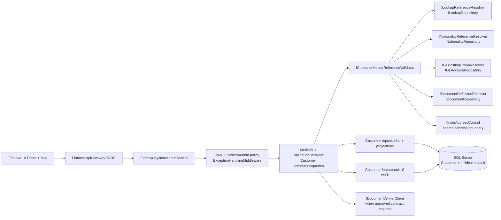

# Design Document — Customer Onboarding Master References and Mind Mappings

**Feature:** `customer-master-reference-mind-mappings`  
**Requirements source:** `requirements.md` in this spec directory  
**Current implementation slice:** Customer Onboarding record persistence, master-reference validation/projection, Constitution Document applicability, address boundary integration, and Customer audit/transaction behavior  
**Deferred follow-up slices:** Customer Reference persistence/management, MassTransit asynchronous Mind Mapping generation, PayU/Python KYC orchestration, Customer Behavior Model training, and future AI inference  
**Repositories:** Backend `e:\Finnova\Finnova-API`; frontend `E:\Finnova\Finnova-UI\Finnova-UI`

## Overview

Customer Onboarding owns the Customer record and its approved child data. Customer Onboarding does not own the master data used to classify or validate a Customer. The design therefore treats every controlled value as a boundary reference:

- `LookupValue` and `ILookupRepository.GetActiveByModuleAndTypeAsync(module, lookupType, ct)` are authoritative for controlled Customer values.
- `Nationality` and `INationalityRepository` are authoritative for active `NationalityCode` validation and read projection.
- `GLAccount` and `IGLAccountRepository` are authoritative for `CustomerPostingGroupCode`, including Company scope and active/approved/postable validation from the existing GL contract.
- `Document`, `DocumentApplicabilityRule`, and `IDocumentRepository.GetActiveForConsumptionAsync(constitution, entityRole, ct)` are authoritative for Constitution Document definitions and applicability.
- India Address Control is the shared boundary for address validation and lookup/reference semantics. The exact existing path is not confirmed, so the service consumes an explicit `IIndiaAddressControl` adapter seam and does not duplicate address-master ownership.

Customer persists stable codes, IDs, child foreign keys, and approved address results/references. Customer responses may contain current master display values through authorized read projections. `GroupName`, `IndustryName`, `ConstitutionName`, `NationalityName`, and `GLName` are not authoritative persisted Customer fields.

The current implementation slice excludes Customer Reference persistence/management and MassTransit asynchronous Mind Mapping generation. Requirements 5–9 remain preserved for future traceability, and the design records their future architecture, but neither capability is a prerequisite for the current Customer core. PayU/Python orchestration, behavior-model training, and future AI inference remain deferred boundaries as specified by the requirements.

## Research findings and repository alignment

The repository assets inspected for this design establish these constraints:

- `ILookupRepository` already exposes the active-scope method `GetActiveByModuleAndTypeAsync(string module, string lookupType, CancellationToken cancellationToken = default)`.
- `INationalityRepository` extends `IRepository<Nationality>` and currently exposes admin paging and code uniqueness methods. The resolver must use the repository's entity query path or a narrowly added active-by-code method if the implementation task confirms that addition is needed.
- `IGLAccountRepository` is Company-scoped for code checks and exposes `GLAccount` rows with `CompanyId`, `GLCode`, `Status`, `IsPostable`, and `AuthorizedVersionNumber`. The existing GL contract defines active/approved/postable validity; the resolver must not infer a Customer posting group from name or from a different company.
- `IDocumentRepository.GetActiveForConsumptionAsync` includes active live documents and applicability rules for a `constitution` and `entityRole`. It is the required consumption path for Constitution Documents. Customer must not copy document-definition rows into Customer tables.
- The existing `Organization` model uses separate communication fields such as `CommunicationAddress`, `CommunicationCity`, `CommunicationState`, `CommunicationCountry`, `CommunicationPincode`, `Telephone`, `Mobile`, `Email`, and `Website`. Customer reuses these naming conventions where the approved FRS address contract matches them, while India Address Control remains responsible for validation and lookup ownership.
- `FinnovaDbContext` discovers EF configurations through assembly scanning. Repository registration belongs in the existing repository dependency-injection registration.
- The generic repository mutation methods may save independently. Customer aggregate writes therefore require a feature-aware transaction/unit-of-work rather than composing separate auto-saving calls for Customer, child rows, audit rows, or any future outbox record.
- The frontend is React 18 + TypeScript + MUI and uses the shared axios client, service interface/real/mock/toggle pattern, React hooks, and Vitest/React Testing Library. No Redux, RxJS, or ad-hoc axios client is introduced.

## Goals and non-goals

### Goals

- Persist only the Customer fields and child rows approved by FINNOVA-51..55 and Requirements 18–27.
- Validate every Lookup, Nationality, GL, Document, and India Address Control reference before Customer mutation.
- Make stale, inactive, unknown, malformed, and cross-Company references fail with field-level errors and no partial writes.
- Resolve current display values through authorized query projections, never through caller-supplied display names or Customer-owned master-name columns.
- Preserve CustomerCode immutability, approved FRS length rules, duplicate rules, conditional applicability, bank default integrity, document metadata-only storage, and audit atomicity.
- Reuse existing repository contracts and add resolver interfaces that can be unit-tested with fakes.
- Keep the backend and frontend aligned with existing SystemAdmin, CQRS, EF Core, gateway, and UI conventions.
- Preserve future Customer Reference, MassTransit, KYC, behavior-model, and AI architecture notes without pulling deferred work into the current core sequence.

### Non-goals

- Implementing source code, migrations, builds, or tests as part of this design document.
- Persisting `GroupName`, `IndustryName`, `ConstitutionName`, `NationalityName`, `GLName`, bank-master names, or address lookup display values as authoritative Customer data.
- Inventing final Lookup module/type constants, controlled values, India identity values, document roles, GL status vocabulary, address contract fields, or story-specific fields. Unconfirmed values use named `<RESOLVE:...>` seams.
- Adding unrelated-master foreign keys merely because a code or ID is validated by another host/database. Local FKs are used only where existing architecture approves ownership.
- Storing raw Constitution Document bytes, raw Aadhaar/PAN content, raw verifier responses, credentials, or secrets.
- Implementing Customer Reference persistence/management or MassTransit asynchronous Mind Mapping generation in the current slice.
- Implementing PayU calls, the Python KYC Cron Service, behavior-model training, AI inference, embeddings, RAG, ranking, or model serving.
- Adding bilingual fields, translations, Arabic/non-English values, RTL behavior, or non-India localization.

## Requirements coverage map

| Requirement | Design coverage |
| --- | --- |
| R1 — FINNOVA-51..55 authority | Contract-resolution gate; Customer aggregate; no unsupported fields or final LOV values are invented. |
| R2 — Customer create and maintain | CQRS lifecycle, reference validator, child-row transaction, verifier/address/document boundary seams, typed errors, and audit unit of work. |
| R3 — identity, uniqueness, lifecycle | CustomerCode and approved business-key rules; normalized identity/bank keys; unique indexes; immutable-field and duplicate exceptions. |
| R4 — query/search | Explicit read projections, current master-name resolution, stable ordering, authorization, and no unrelated disclosure. |
| R5 — Customer References | Preserved as a future architecture boundary only. Persistence/management is deferred and absent from current core tasks. |
| R6 — Reference endpoint queries | Preserved as a future architecture boundary only; no current Customer dependency on Reference tables. |
| R7 — Mind Mappings | Preserved as a future architecture boundary only; no current generation or MassTransit dependency. |
| R8 — mapping queries/exports | Preserved as future versioned projection requirements; no current export or mapping implementation. |
| R9 — asynchronous Mind Mapping messaging | Future MassTransit publisher/consumer/outbox architecture note only. No current core task or prerequisite. |
| R10 — audit changes | Customer and child-row audit behavior uses one transaction; rejected reference writes create no business audit row. |
| R11 — authentication/privacy | Existing JWT/SystemAdmin policy, field-level projection, redaction, no raw documents, and no master-name write authority. |
| R12 — contracts/integration boundaries | Resolver interfaces, existing repository contracts, address adapter, gateway/UI boundaries, and explicit deferred adapters. |
| R13 — administration/UI | Customer page, service layers, mode gating, projection display, field-level errors, and shared axios conventions. |
| R14 — PayU KYC/Application Processing | Deferred external boundary note; not a Customer core task or source prerequisite. |
| R15 — Customer Behavior Model training | Deferred offline boundary note; not a Customer core task or source prerequisite. |
| R16 — AI Agent boundary | No inference, serving, embedding, retrieval, or agent orchestration. |
| R17 — Aadhaar/PAN verifier | Existing verifier adapter remains a boundary for approved document validation; safe outcome only and no raw content. |
| R18 — modes, tabs, workflow | Create/Modify/Query lifecycle, FRS sections, conditional matrix, and immutable/read-only field rules. |
| R19 — basic Customer contract | Reference-only controlled fields, known code/value lengths, CustomerCode generation, capacity flags, and projection-only names. |
| R20 — Communication/Permanent Address | Organization/Company field conventions through `IIndiaAddressControl`; approved result/reference persistence and atomic rejection. |
| R21 — Individual details | India identity seam, Marital Status Lookup resolution, date/numeric validation, and applicability rules. |
| R22 — Non-Individual details | Business type/subtype, sector/subsector, and related controlled references through Lookup Master; conditional matrix. |
| R23 — bank/default integrity | Bank child entity, normalized duplicate key, exactly-one-default invariant, no bank-master display persistence, atomic replacement. |
| R24 — Constitution Documents/DMS | Constitution Lookup plus `IDocumentRepository.GetActiveForConsumptionAsync`, `DocumentApplicabilityRule`, metadata/DMS references, and no copied definitions/raw bytes. |
| R25 — Customer Track | TrackType Lookup, account/contract boundary, Modify-only gating, and future/deferred downstream ownership. |
| R26 — credit/factoring | Read-only or conditional projections and boundary adapters; no invented calculation owner or persisted master display values. |
| R27 — cross-cutting validation/security/audit/output | Resolver orchestration, field-level errors, projection-only display names, typed middleware mapping, atomic rollback, authorization, and testing strategy. |

## Architecture

### Layered request path



Controllers translate HTTP into MediatR requests and never resolve master values themselves. FluentValidation validates request shape. The handler loads and validates every referenced master before mutating the aggregate. The reference validator returns a normalized internal reference set containing only approved identifiers/codes and current master metadata needed for the response projection. The handler then writes Customer, child rows, and audit rows once through the feature unit of work.

The UI never calls repositories, master databases, DMS, the verifier, or address control directly. Real services use the shared axios instance and the gateway alias. Mock services implement the same contracts with English-only values and no real PII.

### Current write lifecycle

1. Authenticate and authorize the caller before business data is loaded.
2. Run request-shape validation and reject unknown caller-owned display fields according to the API contract.
3. Resolve the existing Customer on Modify, enforce CustomerCode and other immutable/derived fields, and load the current aggregate for concurrency checks.
4. Resolve every Lookup-backed code from the active result of `ILookupRepository.GetActiveByModuleAndTypeAsync` using named constants. Do not accept a code merely because it has the right format.
5. Resolve NationalityCode through the active Nationality boundary, GL through Company-scoped active/approved/postable validation, Constitution Documents through the applicable Document Master query, and addresses through India Address Control.
6. Evaluate the Conditional Applicability Matrix after references are resolved. Reject missing required fields, submitted unavailable fields, and inconsistent combinations with field-level errors.
7. Resolve duplicate identity, bank, Group/Industry, and other approved business keys. Reject duplicate references before mutation.
8. If the approved FINNOVA-51..55 contract requires Aadhaar/PAN verification, call the existing verifier adapter and retain only the approved safe outcome.
9. Begin one feature transaction. Add or update Customer and children, write the corresponding immutable audit row, and commit once. No display name is copied into Customer-owned columns.
10. If any reference, boundary, validation, audit, concurrency, or persistence step fails, roll back all Customer and child changes and create no business-change audit row.
11. Query handlers use current authoritative masters to build authorized projections. A stale display name from a previous write is never treated as current Customer data.

### Deferred architecture notes

**Customer Reference persistence/management** remains a separate future vertical slice. The future slice may store stable Customer and Location IDs, directed endpoint metadata, lifecycle state, provenance, and its own audit rows. It must validate endpoints through the relevant boundary and must not make Customer names or Location names authoritative relationship fields. The current Customer implementation must not create Reference tables, repositories, controllers, UI pages, or task dependencies.

**MassTransit asynchronous Mind Mapping generation** remains a future slice. Its future design may publish a minimized event after a committed Customer/Reference change and consume it in a separate worker with idempotency, retry, and dead-letter handling. The current slice must not add MassTransit packages, broker configuration, outbox tables, publisher/consumer hosts, or messaging tasks. Future consumers must use stable IDs and versioned projections, not raw PII or master display snapshots.

PayU/Python KYC, behavior-model training, and AI inference retain the separate boundaries documented in `requirements.md`; they are not pulled into the current Customer core sequence.

## Data models

### Customer aggregate

`Customer` is the authoritative Customer aggregate root. It contains the stable `Id`, generated immutable `CustomerCode`, approved Customer-owned values, reference codes/IDs, address result/reference fields approved by India Address Control, child collections, lifecycle/audit timestamps, and approved safe verification outcome metadata.

The model must not contain authoritative persisted properties named `GroupName`, `IndustryName`, `ConstitutionName`, `NationalityName`, or `GLName`. If a response needs those labels, the response uses a separate projection record such as `CustomerReferenceDisplayProjection`. The following fields are reference-only persistence examples:

| Customer-owned field | Persistence rule |
| --- | --- |
| `GroupCode` | Store the approved code/reference only. Do not store `GroupName`. |
| `IndustryCode` | Store the approved code/reference only. Do not store `IndustryName`. |
| `ConstitutionCode` | Store the approved code/reference only. Do not store `ConstitutionName`. |
| `NationalityCode` | Store the approved active nationality code/reference only. Do not store `NationalityName`. |
| `CustomerPostingGroupCode` and/or approved `GLAccountId` | Store the approved GL reference under Company scope. Do not store `GLName`. If both code and ID are required by the existing GL contract, validate that both identify the same account before write. |
| Customer addresses | Store the approved address values/reference returned by India Address Control. Do not store an independent address lookup master or duplicate its validation rules. |

Known FRS rules remain in force. They constrain the relevant code/value or approved boundary contract even when the value is not Customer-owned master data:

| Field or value | Known rule retained in the design | Ownership/persistence note |
| --- | --- | --- |
| `CustomerCode` | Exactly 12 characters; generated and immutable | Customer-owned business key; generated through Document Number Control. |
| `GroupCode` / Group display value | GroupCode up to 4 numeric digits; Group display value up to 50 characters where the approved FRS contract exposes it | Customer stores GroupCode only; the 50-character name is a projection constraint. |
| `IndustryCode` / Industry display value | IndustryCode up to 3 characters; Industry display value up to 50 characters where the approved FRS contract exposes it | Customer stores IndustryCode only; the 50-character name is a projection constraint. |
| Business Profile | Up to 240 characters | Customer-owned approved non-individual value. |
| Geographical Coverage | Up to 120 characters | Customer-owned approved non-individual value. |
| Number of Branches | Up to 5 digits | Customer-owned numeric value when applicable. |
| JV Partner Name | Up to 120 characters | Customer-owned value when applicable; not a master display name. |
| CEO/MD Name | Up to 50 characters | Customer-owned value when applicable. |
| CEO/MD Age and Experience in Years | Up to 3 digits each | Numeric validation remains server-side. |
| Residential Address | Up to 300 characters where the approved FRS field is Customer-owned | Address Control still validates address semantics; Customer does not own lookups. |
| Business Activities | Up to 100 characters | Customer-owned approved non-individual value. |
| Bank Account Number / Bank display values | Account Number up to 16 characters; Bank Name/Branch display values up to 40 characters where exposed | Account value is Customer child data; bank names/branches are projections. |
| MICR / Bank address | MICR up to 10 characters; bank address up to 300 characters | Preserve approved child-field limits; bank master ownership remains external. |
| Contract Number / Sub-Contract Number | Up to 15 characters where exposed | Boundary-provided, read-only values. |

`TitleCode`, `MaritalStatusCode`, Customer business classifications, sector/subsector, TrackTypeCode, NationalityCode, and CustomerPostingGroupCode retain their approved code lengths only after the corresponding master contracts confirm them. Final unconfirmed lengths and values remain `<RESOLVE:...>` and are not inferred from database defaults.

The aggregate may contain user-entered name components, notes, capacity flags, approved classification codes, individual/non-individual details, bank children, document references, track rows, and approved derived projections. It must not contain copied master names, raw document bytes, verifier payloads, credentials, or unbounded PII.

### Customer child entities

- **BankAccount:** stores CustomerId, approved account type code, account number under the approved contract, approved bank identity/reference, boundary-owned contract fields, default flag, and audit timestamps. Bank name/branch are read projections, not authoritative Customer columns.
- **CustomerDocumentReference:** stores CustomerId, Constitution/document-definition reference, selected metadata, remarks/flags/values allowed by the FRS, and approved DMS reference/view metadata. It has no `byte[]`, `varbinary`, raw image, or raw document payload column. Document definition rows are not duplicated into this table.
- **CustomerTrackEntry:** stores the approved track classification code, account/contract reference, dates, reason, actor, release data, and lifecycle flags. `TrackTypeCode` is resolved from Lookup Master. Account/contract eligibility remains an explicit boundary.
- **CustomerCreditDetails:** read-only or boundary-owned projection of approved credit fields. It is not a second source of truth for account/limit calculations.
- **FactoringSubLimit:** conditional boundary-owned data or approved Customer-owned values only where FINNOVA-51..55 assigns ownership. The design does not invent calculation formulas.
- **Audit rows:** immutable Customer and child-change audit entries store approved changed references and safe snapshots. They never store raw documents, secrets, or unapproved display data.

### Read projection model

`CustomerResponse` is an authorized read projection, not a direct serialization of `Customer`. A projection may contain:

- Persisted Customer identifiers, codes, owned values, children, and timestamps.
- `GroupName`, `IndustryName`, `ConstitutionName`, `NationalityName`, and `GLName` resolved at query time from the authoritative master boundaries.
- Current Document Master display metadata for applicable document definitions.
- Current address display fields returned by the address boundary, subject to authorization.

Projection fields are explicitly nullable when a master has become inactive or unavailable under the approved read policy. A projection must not write the resolved name back to Customer. Caller-supplied display names are ignored or rejected, never used to resolve a code, and never returned as if they were authoritative.

## Master-data reference boundaries

The table below is the required reference contract for Customer create, modify, and authorized query behavior. `<RESOLVE:LookupModule>` and `<RESOLVE:LookupType>` are named constants/configuration keys to be finalized with product and the existing Lookup Master contract. They are not literal values to invent in source code or seed data.

| Customer field/group | Authoritative source | Write representation | Display projection | Validation method |
| --- | --- | --- | --- | --- |
| GroupCode / GroupName | `LookupValue` via `ILookupRepository` | `GroupCode` only | `LookupValue.Value` as `GroupName` | Active lookup list for `<RESOLVE:LookupModule>` / `<RESOLVE:GroupLookupType>`; code must match an active row. |
| IndustryCode / IndustryName | `LookupValue` via `ILookupRepository` | `IndustryCode` only | `LookupValue.Value` as `IndustryName` | Active lookup list for `<RESOLVE:LookupModule>` / `<RESOLVE:IndustryLookupType>`; preserve FRS code length. |
| ConstitutionCode / ConstitutionName | `LookupValue` via `ILookupRepository` | `ConstitutionCode` only | `LookupValue.Value` as `ConstitutionName` | Active Constitution lookup plus Document Master applicability for the Customer entity role. |
| TitleCode | `LookupValue` via `ILookupRepository` | `TitleCode` only | `LookupValue.Value` as title label | Active lookup for `<RESOLVE:LookupModule>` / `<RESOLVE:TitleLookupType>`. |
| MaritalStatusCode | `LookupValue` via `ILookupRepository` | `MaritalStatusCode` only | `LookupValue.Value` as marital-status label | Active lookup for `<RESOLVE:LookupModule>` / `<RESOLVE:MaritalStatusLookupType>`. |
| CustomerBusinessTypeCode | `LookupValue` via `ILookupRepository` | Code only | `LookupValue.Value` | Active lookup for `<RESOLVE:LookupModule>` / `<RESOLVE:CustomerBusinessTypeLookupType>`. |
| CustomerBusinessSubTypeCode | `LookupValue` via `ILookupRepository` | Code only | `LookupValue.Value` | Active lookup for `<RESOLVE:LookupModule>` / `<RESOLVE:CustomerBusinessSubTypeLookupType>` and parent/type applicability. |
| IndustrySectorCode | `LookupValue` via `ILookupRepository` | Code only | `LookupValue.Value` | Active lookup for `<RESOLVE:LookupModule>` / `<RESOLVE:IndustrySectorLookupType>`. |
| SubSectorCode | `LookupValue` via `ILookupRepository` | Code only | `LookupValue.Value` | Active lookup for `<RESOLVE:LookupModule>` / `<RESOLVE:SubSectorLookupType>` and approved parent applicability. |
| TrackTypeCode | `LookupValue` via `ILookupRepository` | Code only in Track child row | `LookupValue.Value` | Active lookup for `<RESOLVE:LookupModule>` / `<RESOLVE:TrackTypeLookupType>`. |
| NationalityCode | `Nationality` via `INationalityRepository` | `NationalityCode` only | `Nationality.Name` as `NationalityName` | Active Nationality lookup by code/reference; inactive and unknown rows are rejected. |
| CustomerPostingGroupCode | `GLAccount` via `IGLAccountRepository` | Approved GL account ID and/or `CustomerPostingGroupCode`, according to the existing GL contract; no name | `GLAccount.Name` as `GLName` | Exact CompanyId scope, active status, approved/authorized state, postable flag, and exact existing GL source rule. Code/ID mismatch is rejected. |
| Constitution Documents | `Document` + `DocumentApplicabilityRule` via `IDocumentRepository` | `CustomerDocumentReference` stores DocumentId/code plus selected metadata and DMS reference; no definition copy | Current Document code/name/category/flags from active applicable Document projection | `GetActiveForConsumptionAsync(ConstitutionCode, approvedEntityRole, ct)`; selected and mandatory rows must remain applicable. |
| Communication/Permanent Address | Shared India Address Control via `IIndiaAddressControl` | Approved address result/reference only, using Organization/Company field conventions where applicable | Address Control's approved display fields/reference | Address Control validates and resolves PIN/city/state/country/contact fields. Customer does not own lookup or duplicate validation. |

### Reference resolution invariants

- A syntactically valid code is not sufficient. The code must be present in the active authoritative source at the time of write.
- A previously valid code that becomes inactive or is removed fails new Create/Modify writes. Existing stored references remain available to authorized historical reads under the approved lifecycle policy.
- Query display values are resolved from the current master state. A master rename changes a future projection without changing Customer persistence.
- A request containing a caller-supplied display name does not override a reference. The API rejects the display field when the contract marks it invalid, or ignores it as non-authoritative when compatibility requires accepting the request shape.
- Resolvers return safe internal projections, not EF entities or navigation graphs, so application code cannot accidentally persist a master display value.

## Components and interfaces

### Reused platform components

| Concern | Existing asset | Design use |
| --- | --- | --- |
| Host | `Finnova.SystemAdminService` | Customer Onboarding controller and middleware branch. No new current-slice host. |
| AuthN/AuthZ | Existing JWT Bearer and `SystemAdmin` policy | Protect Customer reads, writes, audit, and reference validation. |
| Mediation | MediatR + validation pipeline | Commands and queries remain thin controller-to-handler requests. |
| Persistence | `FinnovaDbContext`, EF Core, SQL Server | Customer tables, child tables, audit rows, indexes, and transaction. |
| Repositories | `IRepository<T>`, existing master repositories | Reuse authoritative master reads; add only narrow feature seams where needed. |
| Contracts | `Finnova.Models` records and `PaginatedResponse<T>` | Explicit write contracts and authorized read projections. |
| Errors | `ExceptionHandlingMiddleware` + RFC 7807 | Add CustomerOnboarding typed branches and field-level errors. |
| Gateway | Existing YARP SystemAdmin route and UI alias convention | Add confirmed Customer UI alias without collapsing hosts. |
| UI | React hooks, MUI, shared axios, mock toggle | Customer forms, tabs, grids, and service layer. |
| Tests | xUnit, FsCheck.Xunit, WebApplicationFactory, Vitest/RTL | Pure helper properties plus unit/integration/UI examples. |

### Repository adapters and resolver interfaces

The following interfaces belong in the Customer application/service boundary. Implementations are registered with the existing scoped DI container and wrap the authoritative repository contracts.

```csharp
public interface ILookupReferenceResolver
{
    Task<LookupReferenceProjection> ResolveActiveAsync(
        string module,
        string lookupType,
        string code,
        string fieldName,
        CancellationToken ct = default);
}

public interface INationalityReferenceResolver
{
    Task<NationalityReferenceProjection> ResolveActiveAsync(
        string nationalityCode,
        string fieldName,
        CancellationToken ct = default);
}

public interface IGLPostingGroupResolver
{
    Task<GLPostingGroupReferenceProjection> ResolvePostableAsync(
        Guid companyId,
        string? glAccountId,
        string? customerPostingGroupCode,
        string fieldName,
        CancellationToken ct = default);
}

public interface IDocumentDefinitionResolver
{
    Task<IReadOnlyList<DocumentDefinitionProjection>>
        GetActiveForConsumptionAsync(
            string constitutionCode,
            string entityRole,
            CancellationToken ct = default);
}

public interface IIndiaAddressControl
{
    Task<ApprovedIndiaAddress> ValidateAndResolveAsync(
        IndiaAddressInput input,
        string fieldPrefix,
        CancellationToken ct = default);
}

public interface ICustomerMasterReferenceValidator
{
    Task<CustomerMasterReferenceValidationResult> ValidateAsync(
        CustomerMasterReferenceInput input,
        CustomerReferenceValidationContext context,
        CancellationToken ct = default);
}
```

`LookupReferenceProjection`, `NationalityReferenceProjection`, `GLPostingGroupReferenceProjection`, `DocumentDefinitionProjection`, and `ApprovedIndiaAddress` are internal application records. They contain only the stable code/ID, current display value needed for an authorized response, and validation metadata needed for the current command. They are not persistence entities.

`ILookupReferenceResolver` calls `ILookupRepository.GetActiveByModuleAndTypeAsync(module, lookupType, ct)` and matches the requested code in the returned active set. The resolver must use exact named constants, not free-form module/type values from an untrusted request. `INationalityReferenceResolver` uses `INationalityRepository` and must distinguish unknown from inactive when the repository can do so. `IGLPostingGroupResolver` uses `IGLAccountRepository` with CompanyId and applies the existing GL status/approval/postability contract. `IDocumentDefinitionResolver` delegates to `IDocumentRepository.GetActiveForConsumptionAsync(constitution, entityRole, ct)` and does not query Document tables through Customer DbSets. `IIndiaAddressControl` is the only address validation/lookup seam.

`ICustomerMasterReferenceValidator` orchestrates all resolvers, maps failures to field names, checks cross-reference consistency, validates Constitution document applicability, and returns a result suitable for a transaction. It does not write Customer rows. This separation lets unit tests provide fakes for each resolver and prove stale-reference behavior without a database or external host.

### DI registration and fakes

Register all resolver implementations as scoped services in the existing service/repository composition root, alongside the scoped repository dependencies:

- `ILookupReferenceResolver` → `LookupReferenceResolver`.
- `INationalityReferenceResolver` → `NationalityReferenceResolver`.
- `IGLPostingGroupResolver` → `GLPostingGroupResolver`.
- `IDocumentDefinitionResolver` → `DocumentDefinitionResolver`.
- `IIndiaAddressControl` → the confirmed shared adapter, with no guessed concrete path until the address contract is confirmed.
- `ICustomerMasterReferenceValidator` → `CustomerMasterReferenceValidator`.

Unit tests use in-memory fake implementations that can return active, inactive, unknown, mismatched, and valid boundary results. Fakes must preserve cancellation behavior and return deterministic projections. They must not seed non-English, Oman-specific, or real PII values.

### CQRS components

The current core slice adds or updates:

- Customer create, modify, query, and approved lifecycle commands/queries.
- Customer request validators for shape, lengths, mode, immutable/derived fields, and display-name rejection.
- `CustomerMasterReferenceValidator` orchestration before entity mutation.
- Applicability and pure identity/bank/default helpers.
- Customer repositories and explicit read projections. The Customer write/aggregate repository (`ICustomerRepository`/`CustomerRepository`), audit repository, read repository, and unit of work (with its EF transaction wrapper) are declared in `Finnova.Repository.Interfaces` and implemented in `Finnova.Repository.Repositories` — matching every existing repository (`INationalityRepository`, `IDocumentRepository`, ...) and the project reference direction `Finnova.Service` → `Finnova.Repository` → `Finnova.Models`. They are not declared in `Finnova.Service`. The CQRS handlers consume them through `using Finnova.Repository.Interfaces;`.
- Customer mapper methods that join current master projections only on authorized reads.
- Customer controller actions and the CustomerOnboarding middleware branch.
- Customer UI model, service interface, real service, mock service, toggle, page, tabs, grids, route, navigation, and Vitest tests.

Customer Reference and Mind Mapping CQRS components are future follow-up work and must not be added to the current core task dependencies.

## Contracts and API shape

### Write contracts

Customer create/modify contracts accept only Customer-owned values plus reference codes/IDs and approved address input. They must not include authoritative `GroupName`, `IndustryName`, `ConstitutionName`, `NationalityName`, or `GLName` fields. If temporary compatibility requires these properties in a transport record, validators mark them non-authoritative and the handler rejects or ignores them without resolving from the supplied text.

The GL write contract carries the identifier/code shape required by the existing GL contract. The handler passes CompanyId from the approved Customer/company context, not from an untrusted display value. The resolver rejects a code/ID pair that does not identify the same Company-scoped active, approved, postable account.

Document write contracts carry selected Document definition references and DMS metadata only. They never carry raw bytes or a `byte[]` document body. Address write contracts use the approved India Address Control input shape after the exact contract is confirmed.

### Read contracts

`CustomerResponse` contains a `CustomerData` persistence projection and an optional `CustomerMasterDisplayProjection`. The display projection can include current Lookup `Value`, Nationality `Name`, GL `Name`, current Document metadata, and approved address display values. The projection is built for the caller's authorization and purpose and is never mapped back into a Customer entity.

### Logical endpoints

Final route names remain `<RESOLVE:customer-route-prefix>` until the host and UI route conventions are confirmed. The logical operations are:

| Operation | Shape | Behavior |
| --- | --- | --- |
| Customer query/list | `GET <customer-prefix>` | Paginated authorized projection with current master display values. |
| Customer by ID/code | `GET <customer-prefix>/{id-or-code}` | Authorized projection or safe not-found. |
| Customer create | `POST <customer-prefix>` | Resolves all references before one transaction. |
| Customer modify | `PUT/PATCH <customer-prefix>/{id-or-code}` | Loads current entity, rejects immutable fields, validates all references, then commits atomically. |
| Approved lifecycle | `POST/PATCH <customer-prefix>/{id-or-code}/lifecycle` | Only if FINNOVA-51..55 approves the operation. |
| Customer audit | `GET <customer-prefix>/{id-or-code}/audit` | Immutable audit projection, newest-first. |

There is no current Customer Reference or Mind Mapping endpoint. Their future routes and UI aliases are not prerequisites for Customer Onboarding.

## EF Core and persistence design

### Tables and ownership

Customer tables store codes/IDs and Customer-owned values. Master tables remain owned by their existing features. Use local FKs only for Customer-owned child rows and approved local Customer relationships. Do not add FKs from Customer to LookupValue, Nationality, GLAccount, Document, or an address master when those records are hosted or owned by a separate feature/database unless the existing architecture explicitly approves that ownership. Boundary validation plus stored code/ID is the default.

`CustomerDocumentReference` stores a DocumentId/code and selected metadata/DMS reference, but no copied Document definition row. The active Document Master query is the source of current applicability and display metadata. Customer records retain only the selected reference and approved DMS metadata needed for the Customer workflow.

Communication and Permanent Address are persisted only after India Address Control returns an approved address result/reference. Customer does not add a duplicate address lookup table or a second copy of address validation logic.

### Required indexes and constraints

Add indexes that support approved Customer query and write invariants:

- Unique `CustomerCode` index.
- Approved business-key uniqueness index with the FINNOVA-51..55 normalization/scope.
- `CompanyId + CustomerPostingGroupGLAccountId` and/or `CompanyId + CustomerPostingGroupCode` lookup index, matching the final GL write representation.
- Indexes for queried Lookup code fields such as GroupCode, IndustryCode, ConstitutionCode, TitleCode, MaritalStatusCode, CustomerBusinessTypeCode, CustomerBusinessSubTypeCode, IndustrySectorCode, SubSectorCode, and TrackTypeCode where query behavior approves them.
- NationalityCode index.
- Constitution/document reference indexes on CustomerDocumentReference, including CustomerId + DocumentId/code and applicability/query fields approved by the FRS.
- Normalized identity key index with a uniqueness constraint at the approved Customer scope.
- Normalized bank duplicate key index, including CustomerId and approved bank/account identity.
- Track account/type index for approved active-classification uniqueness.
- Filtered unique index or equivalent transaction/check strategy for exactly one active default bank account per Customer. The exact SQL Server expression must be confirmed during implementation.
- Concurrency token/index strategy for Customer updates if the platform uses row versioning or an equivalent contract.

Do not create an index for a copied master display name. Do not create a foreign key to an unrelated master solely to make a validated boundary reference look relational.

### Migration and transaction note

The implementation task may add EF configurations, DbSets, and a migration command, but the design phase does not run migrations. All Customer aggregate rows, child rows, and one corresponding audit row commit in one feature transaction. A reference failure occurs before mutation; an audit or database failure rolls the entire transaction back. No current outbox table is needed because MassTransit generation is deferred.

The single feature transaction is realized by a dedicated `ICustomerUnitOfWork`/`CustomerUnitOfWork` over `FinnovaDbContext`, not by the generic `RepositoryBase<T>` auto-saving methods. The generic base commits on every `AddAsync`/`UpdateAsync`, which would split a Customer write into separate commits; the Customer repositories therefore stage changes (`DbSet.AddAsync` only, overriding the auto-saving base) while the unit of work owns `SaveChangesAsync` and `BeginTransactionAsync`. The returned `ICustomerTransaction` wraps the EF `IDbContextTransaction`; its `DisposeAsync` rolls back any transaction the handler did not explicitly commit, so an exception on any step (reference resolution, applicability, duplicate/default-bank check, audit, or save) leaves no partial Customer, child, or audit write. Handlers open the transaction, stage aggregate + children + audit, call `SaveChangesAsync`, then `CommitAsync`.

## Error handling and exceptions

### Typed exceptions

Create feature-scoped exceptions with safe identifiers and no PII in messages:

- `CustomerLookupReferenceNotFoundException` — fields: `Field`, `Module`, `LookupType`, `Code`. Message identifies the field and safe code/scope only.
- `CustomerNationalityReferenceNotFoundException` — field and safe `NationalityCode` category. Unknown and inactive Nationality rows use this typed exception in the current slice; the message does not contain a nationality name or Customer data.
- `CustomerGLPostingGroupInvalidException` — fields: `Field`, `CompanyId`, `GLCode`, optional safe `GLAccountId`, and a reason category such as not found, wrong Company, inactive, unapproved, or non-postable. It does not include GL descriptions or customer data.
- `CustomerDocumentDefinitionUnavailableException` — fields: `Field`, `ConstitutionCode`, `EntityRole`, optional safe DocumentId/code. It reports missing/inactive/non-applicable definitions without raw document content.
- `CustomerAddressControlValidationException` — fields: address field prefix and safe validation code/category. It does not echo unnecessary address PII.
- `CustomerImmutableFieldException` — fields: `Field` and safe Customer identifier. Covers CustomerCode and other read-only/derived fields.
- `CustomerDuplicateReferenceException` — fields: `Field`, duplicate-kind, and safe normalized-key category. It does not include raw identity or account values.
- Existing Customer not-found, business-key duplicate, concurrency, verifier, and child-specific exceptions remain typed and feature-scoped.

Messages and error codes are English-only. Exception constructors must not accept or serialize raw request payloads, display names, identity documents, account numbers, DMS paths, or secrets.

### Middleware ProblemDetails mapping

The Customer error-code family is fixed by this spec as `ERR-CUSTOMER`. The current SystemAdmin middleware emits RFC 7807 `ProblemDetails` with `Status`, `Title`, `Detail`, and `Extensions["code"]`. The Customer task adds typed switch arms and Customer path selection without replacing the middleware or changing non-Customer path behavior. The current middleware task does not add an `errors` extension; field-level details are present only where the existing shared validation contract already supports them.

| Exception or condition | HTTP | Customer code |
| --- | ---: | --- |
| `CustomerLookupReferenceNotFoundException` | 400 | `ERR-CUSTOMER-LOOKUP-REF` |
| `CustomerNationalityReferenceNotFoundException` | 400 | `ERR-CUSTOMER-NATIONALITY-REF` |
| `CustomerGLPostingGroupInvalidException` | 400 | `ERR-CUSTOMER-GL-REF` |
| `CustomerDocumentDefinitionUnavailableException` | 400 | `ERR-CUSTOMER-DOCUMENT-REF` |
| `CustomerAddressControlValidationException` | 400 | `ERR-CUSTOMER-ADDRESS-REF` |
| `CustomerConditionalApplicabilityException` or FluentValidation failure | 400 | `ERR-CUSTOMER-400` |
| `CustomerImmutableFieldException` | 409 | `ERR-CUSTOMER-IMMUTABLE` |
| `CustomerDuplicateReferenceException` | 409 | `ERR-CUSTOMER-DUPLICATE-REF` |
| Duplicate Customer identity or bank account | 409 | `ERR-CUSTOMER-DUPLICATE` |
| Default-bank invariant violation | 409 | `ERR-CUSTOMER-DEFAULT-BANK` |
| `CustomerCodeConflictException` | 409 | `ERR-CUSTOMER-409` |
| `CustomerNotFoundException` or child not found | 404 | `ERR-CUSTOMER-404` |
| `CustomerBoundaryUnavailableException` | 503 | `ERR-CUSTOMER-503` |
| Unexpected CustomerOnboarding failure | 500 | `ERR-CUSTOMER-500` |

Customer exception classes expose the semantic constants above through `ErrorCode`. Middleware uses the safe exception message only as `Detail`; it does not serialize structured exception properties, raw request values, account numbers, address payloads, document metadata, or external responses. Existing Lookup, Nationality, GL, Document, and other non-Customer branches remain unchanged.
### Atomic failure behavior

- A stale or unknown reference fails before `Customer`, child, or audit mutation.
- A duplicate group/industry/identity/bank key fails before mutation.
- An immutable-field attempt does not modify the existing Customer.
- An address-control rejection does not persist either address or unrelated Customer fields.
- A document-definition failure does not persist selected document rows or the parent Customer update.
- If any later persistence or audit step fails, the feature transaction rolls back Customer, all child rows, and audit rows together.
- Rejected reference/business writes create no business-change audit entry. Authentication and security access logs remain separate from business audit.

## CQRS and request lifecycle detail

### Create and Modify

The Create handler creates the generated CustomerCode only after request shape validation and before the transaction. The Modify handler loads by stable identifier or controlled CustomerCode selection and compares all submitted immutable/derived fields to the stored values. Both handlers call `ICustomerMasterReferenceValidator` before attaching or changing entities.

The reference validator performs these stages in order:

1. Reject caller-owned display names or mark them ignored according to the transport compatibility decision.
2. Load active Lookup scopes and match every controlled code against the correct named module/type constant.
3. Load active Nationality and reject unknown/inactive codes.
4. Resolve GL by CompanyId and exact code/ID, requiring the existing active/approved/postable rule.
5. Load active applicable Constitution Documents using ConstitutionCode plus approved Customer entity role/type.
6. Call India Address Control for Communication and Permanent Address and return only approved values/references.
7. Evaluate parent/child classification consistency and the Conditional Applicability Matrix.
8. Resolve duplicate identity, bank, Group/Industry, and approved business keys.
9. Return normalized reference data and field-level errors without writing.

Only a successful validation result enters the feature unit of work. Query handlers use the same named boundary contracts to resolve current display values and never trust stored display snapshots.

### Query and projection

Customer queries select only approved Customer columns and child data. They resolve current names through Lookup, Nationality, GL, and Document projections, and address display values through the address boundary. Query mapping is authorization-aware and purpose-limited. Query mode has no save, upload, default-account, track, or factoring mutation controls.

## Error Handling

Customer errors use the established `ExceptionHandlingMiddleware` and shared ProblemDetails shape. The middleware maps typed failures rather than inspecting exception message text. Each response is feature-scoped, contains only the existing safe status, code, and detail fields, and uses the fixed `ERR-CUSTOMER` prefix. Error messages, codes, and field labels are English-only.

### Request and validation failures

- Transport and model-binding failures return HTTP 400 with the shared validation response. The response identifies the invalid field, expected shape, and safe validation code without echoing raw request bodies, uploaded content, identity values, account numbers, display names, or external payloads.
- FluentValidation field-level failures return HTTP 400. FRS length, format, required-field, date, numeric, percentage, and mode rules use the field name and a feature-scoped code. Conditional Applicability Matrix failures return the same field-level structure and identify the controlling field and the unavailable, required, or inconsistent field without exposing unrelated Customer data.
- `CustomerConditionalApplicabilityException` returns HTTP 400 with safe field-level errors for each affected field. A submitted value for a field that is not applicable is rejected or ignored only according to the approved contract; the value is never persisted as an authoritative Customer value.

### Customer error mapping

| Condition or exception | HTTP status | Safe response code/status family | Safe response content |
| --- | ---: | --- | --- |
| Transport or model-binding error | 400 | `ERR-CUSTOMER-400` | Field, expected shape, and validation category only. |
| FluentValidation FRS or conditional applicability error | 400 | `ERR-CUSTOMER-400` | `{ field, code, message }` entries for FRS and applicability rules. |
| `CustomerNotFoundException` | 404 | `ERR-CUSTOMER-404` | Safe resource type and the existing middleware detail only. |
| `CustomerCodeConflictException` | 409 | `ERR-CUSTOMER-409` | Safe conflict detail only; no existing Customer payload. |
| `CustomerImmutableFieldException` | 409 | `ERR-CUSTOMER-IMMUTABLE` | The safe exception detail and `code` extension identify the immutable/derived-field category. |
| Duplicate Customer identity/business key | 409 | `ERR-CUSTOMER-DUPLICATE` | The safe exception detail and `code` extension identify the duplicate category; normalized identity values are not returned. |
| Duplicate bank account/reference | 409 | `ERR-CUSTOMER-DUPLICATE` | The safe exception detail and `code` extension identify the duplicate category; account numbers and bank payloads are not returned. |
| Default-bank invariant violation, including an attempted state with zero or multiple active defaults | 409 | `ERR-CUSTOMER-DEFAULT-BANK` | The safe exception detail and `code` extension identify the default-bank invariant category. |
| `CustomerLookupReferenceNotFoundException` | 400 | `ERR-CUSTOMER-LOOKUP-REF` | The safe exception detail and `code` extension identify the failed reference category without serializing exception properties or caller-supplied display names. |
| `CustomerNationalityReferenceNotFoundException` | 400 | `ERR-CUSTOMER-NATIONALITY-REF` | Field and safe nationality-code/reference category only. No nationality name or Customer data is returned. |
| `CustomerGLPostingGroupInvalidException` | 400 | `ERR-CUSTOMER-GL-REF` | Safe exception detail and semantic code only; CompanyId, GLCode, account identifiers, descriptions, and Customer data are not serialized. |
| `CustomerDocumentDefinitionUnavailableException` | 400 | `ERR-CUSTOMER-DOCUMENT-REF` | Safe exception detail and semantic code only; Constitution, entity-role, document metadata, and raw content are not serialized. |
| `CustomerAddressControlValidationException` | 400 | `ERR-CUSTOMER-ADDRESS-REF` | Safe exception detail and semantic code only; address errors, PII, and external response bodies are not serialized. |
| `CustomerBoundaryUnavailableException` | 503 | `ERR-CUSTOMER-503` | Dependency category and retry-safe guidance only. External payloads, credentials, tokens, and upstream response bodies are excluded. |
| Unexpected Customer failure | 500 | `ERR-CUSTOMER-500` | Generic Customer failure message and correlation metadata only. Stack traces and sensitive details are logged through protected server diagnostics, not returned. |

`CustomerCodeConflictException`, duplicate identity, duplicate bank, default-bank, and other Customer business conflicts follow the fixed Customer error contract consistently. The implementation must not create a second incompatible code family or expose different payload shapes for equivalent conflict categories. Existing endpoint-specific middleware branches remain intact for non-Customer resources.

### Authentication, authorization, and information disclosure

Existing JWT authentication remains 401-before-403: a missing, invalid, or expired JWT produces HTTP 401 before authorization or resource-existence checks; an authenticated caller who lacks the required SystemAdmin policy receives HTTP 403. Customer error mapping must not reveal whether a protected Customer or master reference exists before authentication and authorization succeed.

Caller-supplied display names are never authoritative. The service resolves display values from active authoritative masters, ignores or rejects display-name fields according to the transport contract, does not echo supplied display names as persisted values, and does not include those values in audit or error payloads. All messages and codes remain English-only and feature-scoped, with the fixed `ERR-CUSTOMER` prefix.

### Atomic transaction rule

Master-reference validation, child updates, audit writes, and the final transaction commit form one atomic Customer feature operation. A failed master-reference validation, FluentValidation/conditional applicability check, child update, audit write, uniqueness/default-bank check, concurrency check, or transaction commit writes no partial Customer, child, or business-audit change. Reference and request validation occur before mutation; any failure after mutation rolls the complete feature transaction back. Rejected requests create no business-change audit row, while authentication and security access logs remain separate from Customer business audit.

## Security and localization

- Require the existing JWT Bearer authentication and SystemAdmin authorization policy for current Customer management and read endpoints until a narrower authorized-consumer policy is approved.
- Authenticate and authorize before revealing whether a Customer, master reference, document definition, or address reference exists.
- Do not expose raw identity values, raw documents, DMS bytes, tokens, credentials, or external response bodies in API responses, ProblemDetails, audit rows, logs, telemetry, or mock fixtures.
- Apply field-level projection and masking to current master names and address data.
- Use service-to-service authentication for future external adapters; secrets come from approved configuration/secret providers.
- Use English-only labels, lookup values, error messages, tests, and mock data. Do not add RTL, bilingual fields, or Arabic/non-English values.

## Frontend design

The frontend implementation lives in `E:\Finnova\Finnova-UI\Finnova-UI` and follows existing master-page conventions:

- `src/models/customer.model.ts` contains persisted Customer references separately from optional read-projection display fields. The model must not imply that `groupName`, `industryName`, `constitutionName`, `nationalityName`, or `glName` are writeable Customer fields.
- `src/services/interfaces/customer.interface.ts` defines create/modify/query contracts with codes/IDs and approved address input only.
- `src/services/real/customer.real.ts` uses the shared `api` instance and maps authorized response projections explicitly.
- `src/services/mock/customer.mock.ts` uses deterministic English-only India-compatible fixtures with no real PII.
- `src/services/customer.service.ts` selects mock or real behavior through `VITE_USE_MOCK_API`.
- The Customer page uses React hooks and MUI tabs for Basic/Address, Individual, Non-Individual, Bank, Constitution Documents, Customer Track, Customer Credit, and Factoring Sub-Limit.
- Create, Modify, and Query modes share the backend applicability result. Modify and Query select an existing CustomerCode; Create receives a generated CustomerCode after save. Query is read-only.
- The UI displays current master names from response projections and never posts them as authoritative values. Stale-reference errors remain field-level and preserve safe form input.
- Communication/Permanent Address reuse Organization/Company naming conventions, use the address boundary's approved result, and expose Copy Communication to Permanent only as a local/approved command action.
- Gateway aliases follow the existing `/api/ua/api/**` to SystemAdmin pattern after the route prefix is confirmed. No second axios client is introduced.

Customer Reference and Mind Mapping pages/services are deferred and must not be part of the current core UI task sequence.

## Correctness properties

A property is a characteristic or behavior that should hold true across all valid executions of a system. Properties bridge the human requirements and automated checks. This feature is primarily CRUD, EF persistence, UI rendering, and external-boundary integration, so properties focus on pure reference validation, projection rules, invariants, and safe transformation. Example-based unit tests and integration tests cover repository, middleware, gateway, and transaction wiring.

### Property 1: Active Lookup references are fail-closed

For any generated Lookup-backed Customer field, the resolver shall accept a code only when the code matches an active row returned for the exact named module/type scope, and shall return a field-level failure for unknown, inactive, or wrong-scope codes without producing a mutation command.

**Validates: Requirements 2.15, 2.18, 19.1, 19.4, 21.1, 22.1, 22.2, 25.1, 27.1, 27.2**

### Property 2: Nationality references require an active authoritative row

For any generated NationalityCode, the nationality resolver shall accept only an active `Nationality` row from `INationalityRepository`, shall distinguish inactive from unknown when supported, and shall never use a caller-supplied NationalityName to make an invalid code valid.

**Validates: Requirements 2.15, 2.16, 2.18, 21.1, 21.8, 27.1, 27.2**

### Property 3: GL posting groups preserve Company and postability boundaries

For any generated CompanyId and GL posting-group code/ID pair, the GL resolver shall accept only the authoritative account in that Company scope that satisfies the existing active, approved, and postable rule; a wrong Company, inactive, unapproved, non-postable, unknown, or mismatched code/ID shall fail without a write.

**Validates: Requirements 2.15, 2.18, 19.6, 22.8, 27.1, 27.2**

### Property 4: Constitution document resolution is current and applicable

For any generated ConstitutionCode and approved Customer entity role, the document resolver shall return only rows from `GetActiveForConsumptionAsync(constitution, entityRole, ct)`, reject unavailable or stale definitions, and preserve only CustomerDocumentReference metadata/DMS references rather than copied definitions or raw bytes.

**Validates: Requirements 2.18, 19.7, 24.1, 24.5, 24.6, 24.8, 24.9, 27.1, 27.2**

### Property 5: Address validation remains owned by India Address Control

For any generated Communication or Permanent Address input, Customer validation shall accept only the approved result returned by `IIndiaAddressControl`, reject stale/unknown/invalid address references with a field-level error, and never create a Customer-owned lookup or substitute local validation for the boundary result.

**Validates: Requirements 2.15, 2.18, 20.1, 20.4, 20.5, 20.8, 27.1, 27.2**

### Property 6: Master display names are projection-only

For any valid Customer reference set and any current master display values, Customer persistence shall contain codes/IDs and approved address results only, while an authorized read projection may contain current GroupName, IndustryName, ConstitutionName, NationalityName, and GLName. A caller-supplied display name shall never become authoritative persisted data.

**Validates: Requirements 2.15, 2.16, 2.17, 19.1, 19.3, 19.5, 27.3, 27.5**

### Property 7: Reference validation is atomic with Customer mutation

For any Customer create or modify request containing one or more generated master references, if any Lookup, Nationality, GL, Document, Address Control, duplicate, immutable-field, authorization, or persistence check fails, then Customer rows, child rows, and business audit rows shall remain unchanged; if all checks pass, the approved aggregate and exactly one audit outcome shall commit together.

**Validates: Requirements 2.5, 2.7, 2.18, 3.3, 3.4, 10.3, 19.8, 20.8, 23.7, 24.9, 27.2, 27.3, 27.4**

### Property 8: Bank child invariants remain stable

For any generated active bank-account collection and add/update/default operation, the normalized duplicate key shall remain unique and exactly one active default shall remain whenever the approved workflow requires a default. An operation that violates an invariant shall be rejected with the prior collection unchanged.

**Validates: Requirements 23.2, 23.6, 23.7, 23.8, 23.9, 23.10**

### Property 9: Immutable and derived Customer fields remain unchanged

For any Modify request, changing CustomerCode, a confirmed read-only field, or a derived/boundary-owned value shall produce `CustomerImmutableFieldException` and leave the stored Customer, children, and audit state unchanged.

**Validates: Requirements 2.10, 18.3, 18.4, 18.5, 18.6, 18.7, 27.4**

### Property reflection

The stale-reference behaviors for Lookup, Nationality, GL, Document, and Address Control are distinct resolver cases but share one fail-closed invariant. Properties 1–5 remain separate because each protects a different authoritative contract and error shape; their test data can share a generator harness without combining assertions into an opaque test. Property 6 is not redundant because it verifies storage/projection separation rather than reference validity. Property 7 covers transaction atomicity and is not implied by the resolver properties. Properties 8 and 9 cover separate aggregate invariants and remain independent.

## Testing strategy

### Unit tests

- Test each resolver with fake repositories for active, inactive, unknown, wrong-scope, unavailable, and cancellation cases.
- Test `ICustomerMasterReferenceValidator` with one invalid boundary at a time and assert field name, safe code, no entity mutation, and no display-name trust.
- Test named Lookup constants and exact module/type routing.
- Test GL CompanyId, status, authorization/approval, postability, and code/ID mismatch rules against fake `GLAccount` rows.
- Test Document applicability using fake results equivalent to `GetActiveForConsumptionAsync` and mandatory/image-required document checks.
- Test `IIndiaAddressControl` pass-through and safe exception mapping without reimplementing address-master behavior.
- Test CustomerCode, known code/value lengths, date/numeric/percentage rules, conditional applicability, identity normalization, duplicate keys, bank default replacement, and immutable fields.
- Test mapper behavior: response projections include current names only when authorized and Customer entities contain no authoritative display-name properties.
- Test typed exception fields and safe messages for PII leakage.

### Property-based tests

Use FsCheck.Xunit in `Finnova.Tests` with a minimum of 100 iterations per property test. Each property test is a single test and includes a comment in this format:

`Feature: customer-master-reference-mind-mappings, Property N: <property title>`

Implement properties 1–9 against pure helpers or fake resolver/repository seams. Do not use PBT to test SQL Server, gateway routing, external master behavior, or UI layout itself.

### Integration tests

Use `WebApplicationFactory<Program>` and in-memory/test database seams for:

- Customer create/modify with all references valid.
- Unknown/inactive Lookup, Nationality, GL, Document, and Address Control references returning field-level ProblemDetails.
- GL wrong Company, unapproved, inactive, and non-postable cases.
- Document applicability and CustomerDocumentReference metadata-only persistence.
- Address Control rejection and approved address persistence.
- Projection-only names changing when a master display value changes, without changing Customer columns.
- Atomic rollback when reference validation, child persistence, audit persistence, uniqueness, or concurrency fails.
- Exactly one active default bank account and duplicate bank/identity conflict behavior.
- Middleware mapping to CustomerOnboarding codes, 401/403 ordering, and safe not-found behavior.
- Gateway alias and Authorization forwarding once the final route prefix is confirmed.

### Frontend tests

Use Vitest + React Testing Library/jsdom for:

- Service interface parity between real and mock implementations.
- Mapping API projections to UI models without treating display names as write fields.
- Create/Modify/Query mode gating and read-only CustomerCode/derived fields.
- Lookup/Nationality/GL/Document/address stale-reference errors and preserved form input.
- Address copy behavior, bank default/duplicate feedback, Constitution Document metadata display, and authorized display projections.
- Loading, empty, validation, forbidden, conflict, timeout, retry, and successful save states.

## Design decisions and tradeoffs

1. **Boundary validation over local FK ownership.** Customer validates external master references at the application boundary and stores stable codes/IDs. This preserves host/database separation and avoids coupling Customer migrations to unrelated master tables. A local FK is added only for Customer-owned children or when existing architecture explicitly approves cross-feature ownership.
2. **Projection-only master names.** Storing names would make Customer stale after a master rename and would let caller text become authoritative. Query-time projection keeps one source of truth at the cost of additional read resolution.
3. **Resolver interfaces over direct repository calls in handlers.** Resolvers centralize active/status/Company/applicability rules and make stale-reference tests deterministic. The tradeoff is several small interfaces, which is preferable to repeating inconsistent checks in every command.
4. **Explicit address adapter despite an unconfirmed path.** The adapter allows the feature to proceed without inventing a repository or duplicating address logic. The exact implementation is a confirmation gate before source task execution.
5. **Feature transaction instead of generic auto-save composition.** Customer, children, and audit rows must roll back together. The transaction seam is more code than independent repository calls but prevents partial customer records.
6. **Deferred relationship/messaging slices.** Customer core can be implemented and validated without creating tables or broker infrastructure whose contracts are unconfirmed. Future stable-ID/projection seams remain documented so the later stories do not require a Customer schema redesign.
7. **English-only India scope.** One display value per master and standard left-to-right UI match product context. No localization scaffolding is added without an explicit future requirement.

## Ordered implementation task list

The following is the implementation order for the current core slice. The list is design guidance; it does not implement any source file in this workflow.

1. **Backend domain entities and reference-safe contracts**
   - Create/update Customer aggregate, approved child entities, address value/reference shape, audit entities, and enums with codes/IDs only.
   - Remove authoritative `GroupName`, `IndustryName`, `ConstitutionName`, `NationalityName`, and `GLName` from persisted Customer design; place them only in read projection records.
   - Preserve known FRS lengths and `<RESOLVE:...>` gates for unknown lengths/vocabularies.

2. **Backend domain exceptions and safe error records**
   - Add `CustomerLookupReferenceNotFoundException`, nationality not-found/inactive exceptions, `CustomerGLPostingGroupInvalidException`, `CustomerDocumentDefinitionUnavailableException`, `CustomerAddressControlValidationException`, `CustomerImmutableFieldException`, and `CustomerDuplicateReferenceException` under `Finnova.Models/Domain/Exceptions`.
   - Add safe field-error/problem mapping records if the existing contract requires them.

3. **Backend request/response contracts and projections**
   - Create Customer create/modify/query contracts under `Finnova.Models/Contracts/Customers`.
   - Create separate persistence/reference and authorized display projection records.
   - Exclude caller-supplied master display names from authoritative write contracts.

4. **Backend EF configuration, DbSets, indexes, and migration command**
   - Add Customer, child, audit configurations and DbSets in the existing repository context.
   - Add CustomerCode/business-key, Company+GL, lookup-code, nationality, constitution/document, identity, bank duplicate, track, and exactly-one-default indexes.
   - Ensure no unrelated master FKs are added without architecture approval, no raw document binary column exists, and document definitions are not duplicated.
   - Record the EF migration command for the user to run later; do not run it in this workflow.

4a. **Customer persistence repositories and unit of work** (tasks.md Task 4A)
   - Declare `ICustomerRepository`, `ICustomerAuditRepository`, `ICustomerReadRepository`, `ICustomerUnitOfWork`, and `ICustomerTransaction` in `Finnova.Repository/Interfaces`; implement `CustomerRepository`, `CustomerAuditRepository`, `CustomerReadRepository`, and `CustomerUnitOfWork` in `Finnova.Repository/Repositories` over `FinnovaDbContext`, reusing the `RepositoryBase<T>` pattern.
   - Load the full Customer aggregate (`Include`/`ThenInclude`) for Modify and child commands; expose code/identity existence checks for duplicate rules; stage writes only so the unit of work owns the single feature transaction.
   - Register the four repositories in the existing `Finnova.Repository/DependencyInjection.cs` (same registration block as Task 4.2); do not register them a second time and do not create a Customer-owned Lookup/Nationality/GL/Document/Address repository.

5. **Authoritative repository adapters and DI registration**
   - Reuse `ILookupRepository.GetActiveByModuleAndTypeAsync`, `INationalityRepository`, `IGLAccountRepository`, and `IDocumentRepository.GetActiveForConsumptionAsync`.
   - Add narrowly scoped active-by-code queries only if required by the confirmed repository implementation; do not bypass the existing contracts.
   - Add `IIndiaAddressControl` adapter seam and register scoped resolver services in the existing composition root.

6. **Reference resolver interfaces and implementations**
   - Implement `ILookupReferenceResolver`, `INationalityReferenceResolver`, `IGLPostingGroupResolver`, and `IDocumentDefinitionResolver` with named `<RESOLVE:...>` constants and safe internal projections.
   - Implement the confirmed `IIndiaAddressControl` adapter without duplicating address ownership.
   - Provide unit-test fakes for active, inactive, unknown, wrong-scope, unavailable, and cancellation outcomes.

7. **Pure Customer validation and applicability helpers**
   - Implement CustomerCode, immutable-field, known length/format, identity duplicate, bank duplicate/default, date/numeric/percentage, and Conditional Applicability Matrix helpers.
   - Ensure helpers reject display-name authority and preserve English-only/India-only behavior.

8. **Customer master-reference orchestration**
   - Implement `ICustomerMasterReferenceValidator` to resolve all active references and address results before mutation, enforce Constitution document applicability, and return field-level errors.
   - Add duplicate Group/Industry/identity/bank checks and GL Company/status/approval/postability checks.

9. **Customer CQRS service slice**
   - Implement Create/Modify/Query commands, validators, handlers, mappers, and transaction/unit-of-work integration.
   - Load and validate every active reference before entity mutation.
   - Ignore/reject caller display names, resolve current names on query, and roll back all business/audit writes on any failure.

10. **Customer controller, middleware, and gateway alias**
    - Add Customer controller actions and authorization policy usage.
    - Map every Customer reference/business exception to CustomerOnboarding ProblemDetails codes with field-level errors and safe messages.
    - Add the confirmed SystemAdmin gateway/UI alias route; preserve Authorization forwarding.

11. **Backend tests**
    - Add xUnit example/edge tests, FsCheck.Xunit tests for Properties 1–9 at 100+ iterations, and `WebApplicationFactory<Program>` integration tests for references, projection-only names, authorization, middleware, and atomic rollback.

12. **Frontend model/service boundary**
    - Add Customer persistence/reference models, authorized display projection models, service interface, real service, mock service, toggle, and barrels in the Finnova-UI repository.
    - Keep write models free of authoritative display-name fields and use the shared axios instance.

13. **Frontend Customer page and UI integration**
    - Add Create/Modify/Query page, tabs/components, address copy flow, bank/document grids, applicability gating, route in `App.tsx`, navigation in `Layout.tsx`, and loading/error/success states.
    - Display current master names from projections but never post them as Customer authority.

14. **Frontend tests**
    - Add Vitest/React Testing Library tests for service parity, reference errors, mode/read-only behavior, address/document/bank interactions, projections, and success/error paths.

15. **Checkpoint**
    - Confirm the current core task sequence contains no Customer Reference persistence/management tasks and no MassTransit tasks. Confirm PayU/Python/behavior-model/AI work remains deferred.

### Explicitly deferred follow-up tasks

- Customer Reference entities, repositories, CQRS, controller, UI, and audit management.
- MassTransit publisher, broker/outbox tables, Customer Onboarding Worker, Mind Mapping generation, retry/DLQ, and message contracts.
- PayU integration and Python KYC Cron Service implementation.
- Customer Behavior Model training pipeline and model registry.
- AI Agent inference, embeddings, vector search, RAG, ranking, and serving.

## Format validation checklist

- This document is design-only and does not change backend/frontend source files.
- The requirements coverage map includes Requirements 19–27 and the new master-reference behavior.
- The required Master-data reference boundaries table is present near the Customer data model.
- Persisted Customer fields contain codes/IDs and approved address results, not master display names.
- Resolver interfaces, DI/fake strategy, typed exceptions, middleware mappings, EF/index rules, CQRS lifecycle, correctness properties, and testing strategy are present.
- Customer Reference and MassTransit are future notes only and absent from current core prerequisites/tasks.
- India-only, English-only, and no-RTL constraints are preserved.
