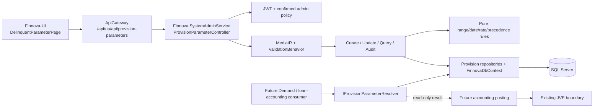

# Design Document — Delinquent Provision Rate & Parameter Master

**JIRA:** FINNOVA-15  
**Module:** SystemAdmin  
**Feature:** Delinquent Provision Rate & Parameter Master  
**Repositories:** `E:\Finnova\Finnova-API` and `E:\Finnova\Finnova-UI\Finnova-UI`

## Overview

FINNOVA-15 adds a versioned master-data slice for delinquency provision parameters. The feature stores one logical Provision Parameter Set per Company, Delinquent Type, optional LOB scope, effective-date policy, and ordered bucket rows. SystemAdmin/Risk & Policy Administrator users create, modify, activate, deactivate, and query sets through the existing SystemAdmin host. A read-only `IProvisionParameterResolver` returns the applicable version to an approved future consumer.

The design deliberately keeps configuration ownership separate from accounting execution. FINNOVA-15 does not calculate demand, appropriate receipts, create receipt allocations, create journal rows, or submit directly to a ledger. A future consumer may use the resolver and, if it posts accounting entries, must cross the existing JVE submission boundary.

The screenshot defines the UI shape. The page title is `Delinquent Parameter`; the form contains the Statutory/Company radio group, Company and LOB scope selectors, Month/Days period selector, Active checkbox, `Cut of Month` label mapped internally to `CutOffMonth`, effective date and ageing fields, a provision bucket grid, and Save/Clear/Cancel actions. UI values remain English and India-specific, with no RTL or translation layer.

## Requirements Coverage Map

| Requirement | Design coverage |
| --- | --- |
| R1 UI shape | `DelinquentParameterPage`, `ProvisionBucketGrid`, MUI form contract, route and navigation tasks |
| R2 authoritative references | `ICompanyReferencePort`, `ILineOfBusinessReferencePort`, dependent lookup endpoints, null LOB global scope |
| R3 create | `CreateProvisionParameterCommand`, transaction boundary, idempotency record, create audit |
| R4 Statutory/Company | `DelinquentType` enum and validator |
| R5 scope and precedence | `ProvisionScopeKey`, active overlap query, `ProvisionParameterResolver` exact-Lob-first selection |
| R6 period and ageing | `PeriodType` enum, `CutOffMonth`/`AgeingDays` validation, canonical `AgeFrom`/`AgeTo` |
| R7 ranges and dates | `ProvisionRangeRules`, inclusive interval algorithm, exact overlap message |
| R8 percentages | decimal precision configuration and `ProvisionRateRules` |
| R9 effective dating | `EffectiveDateRules`, active resolver query, no-match/ambiguity typed exceptions |
| R10 modify/lifecycle | `UpdateProvisionParameterCommand`, Version/RowVersion, atomic audit |
| R11 query/audit | paged query, detail query, audit query, deterministic ordering |
| R12 concurrency/idempotency | `ProvisionIdempotencyRecord`, normalized fingerprint, row-version check, conflict mapping |
| R13 immutable audit | append-only `ProvisionParameterAuditEntry`, no update/delete repository surface |
| R14 security/errors | existing JWT, confirmed SystemAdmin/Risk & Policy Administrator policy, stable `ERR-PROV-*` ProblemDetails |
| R15 resolver/JVE boundary | read-only resolver interface and adapter; no Receipt Processing/JVE writes |
| R16 testing | FsCheck pure-helper properties, xUnit examples, WebApplicationFactory integration, Vitest/RTL UI tests |

## Architecture

The feature is a vertical slice through existing platform layers.



### Request lifecycle

1. The gateway forwards the Authorization header to the existing SystemAdmin host.
2. JWT authentication runs before authorization. The confirmed SystemAdmin/Risk & Policy Administrator policy protects administrative reads and mutations.
3. The controller obtains actor identity from trusted claims and obtains the `Idempotency-Key` header for mutation commands.
4. MediatR validation checks shape and field rules before the handler opens the mutation transaction.
5. The handler validates Company/LOB references, normalizes the semantic request, runs pure range/date/rate checks, checks active effective-scope conflicts, and performs the idempotency lookup.
6. A successful mutation writes the set, ordered buckets, idempotency record, and exactly one audit row atomically.
7. The middleware converts typed domain errors and validation errors to stable English ProblemDetails.

## Reused and New Assets

### Reused

- Existing `Finnova.SystemAdminService` host, JWT Bearer configuration, `SystemAdmin` policy, controller pipeline, health/openapi setup, and `WebApplicationFactory<Program>` test shim.
- Existing `Finnova.ApiGateway` YARP `systemadmin-cluster` and UI alias convention (`/api/ua/api/...` rewritten to `/api/...`).
- Existing `Finnova.Repository.Context.FinnovaDbContext`, `ApplyConfigurationsFromAssembly`, SQL Server registration, `IRepository<T>`, repository base, MediatR, FluentValidation, and ProblemDetails middleware.
- Existing authoritative Company and `LineOfBusiness` masters and their read/reference ports. The names and exact adapters are a compatibility gate before task execution.
- Existing `PaginatedResponse<T>` and shared UI axios instance, mock/real service toggle convention, MUI, React hooks, and route/navigation patterns.
- Existing JVE posting boundary for any future accounting consumer. No FINNOVA-15 handler references receipt or journal write services.

### New

- `DelinquentType`, `PeriodType`, and `ProvisionAuditAction` enums.
- `ProvisionParameterSet`, `ProvisionBucket`, `ProvisionParameterAuditEntry`, and `ProvisionIdempotencyRecord` entities.
- Request/response records and resolver DTOs.
- Repository interfaces and EF configurations with unique logical-scope indexes, decimal precision, row-version concurrency, and immutable audit surface.
- Pure helpers for canonical normalization, inclusive range/date overlap, active set precedence, and request fingerprints.
- CQRS commands, queries, validators, handlers, typed exceptions, mapper, controller, gateway aliases, and middleware branch.
- React model, interface, real/mock services, screenshot-aligned page and bucket editor, route/navigation changes, and Vitest/RTL tests.

## Data Models

The entities and invariants below are the durable contract for the feature.

### Enums

```csharp
public enum DelinquentType { Statutory = 0, Company = 1 }
public enum PeriodType { Month = 0, Days = 1 }
public enum ProvisionAuditAction { Create = 0, Update = 1, Activate = 2, Deactivate = 3 }
```

The API serializes enum names as strings, matching the existing host convention.

### ProvisionParameterSet

`ProvisionParameterSet` is the logical current version:

| Field | Type | Rule |
| --- | --- | --- |
| Id | `Guid` | generated identifier |
| CompanyId | `Guid` | FK/reference to authoritative Company; required |
| LineOfBusinessId | `Guid?` | authoritative LOB; null means All/global |
| DelinquentType | enum | Statutory or Company |
| PeriodType | enum | Month or Days |
| IsActive | `bool` | default true; inactive is resolver-ineligible |
| CutOffMonth | `int?` | canonical internal field, proposed 1..31 |
| EffectiveStartDate | `DateOnly?` | null only for non-dated set |
| EffectiveEndDate | `DateOnly?` | null means open-ended; cannot exist without start |
| AgeingDays | `int` | 0..36500 |
| Version | `int` | starts at 1 and increments once per successful update |
| RowVersion | `byte[]` | SQL Server rowversion for optimistic concurrency |
| CreatedAtUtc/UpdatedAtUtc | `DateTime` | UTC timestamps |

The logical applicability key is `(CompanyId, DelinquentType, LineOfBusinessId, effective date)`. A filtered/compound uniqueness constraint cannot alone express interval overlap, so the handler performs a transaction-scoped overlap check and the database uses supporting indexes. The handler takes an update lock or serializable transaction for active-scope conflict validation.

### ProvisionBucket

| Field | Type | Rule |
| --- | --- | --- |
| Id | `Guid` | generated identifier |
| ProvisionParameterSetId | `Guid` | required parent reference |
| SortOrder | `int` | unique within set, starts at 1 |
| Category | `string` | one English category from confirmed catalog; max 100 |
| StartDate/EndDate | `DateOnly?` | optional row override; inclusive and contained in set range |
| AgeFrom | `int` | >= 0 |
| AgeTo | `int?` | >= AgeFrom; null only on final row |
| BaseProvisionPercentage | `decimal(5,2)` | 0..100 |
| CashProvisionPercentage | `decimal(5,2)` | 0..100 and <= base by default |

The API names the age fields `AgeFrom` and `AgeTo`. The UI may show the screenshot's `Age of arrears (in Months)` column label when PeriodType is Month and `Age of arrears (in Days)` when PeriodType is Days; no separate bilingual field is introduced.

### ProvisionParameterAuditEntry

The audit row contains `Id`, `ProvisionParameterSetId`, `Version`, `Action`, `ActorId`, `ChangedAtUtc`, `CorrelationId`, `IdempotencyKey`, `BeforeSnapshotJson`, and `AfterSnapshotJson`. The snapshots are canonical JSON generated from normalized records, not raw request bodies. Audit rows have no update or delete repository methods and no API mutation endpoint. The audit table has no cascade-delete path from the logical set.

### ProvisionIdempotencyRecord

The idempotency row contains `Id`, `Key`, `Operation`, `RequestFingerprint`, `StatusCode`, `ResponseJson`, `ResourceId`, `CreatedAtUtc`, and `ExpiresAtUtc` if the platform retention policy requires expiry. A unique index on `(Key, Operation)` prevents duplicate completion. Same key plus same fingerprint returns stored response; same key plus different fingerprint raises `ProvisionIdempotencyConflictException`.

### Invariants

- A set always has at least one bucket.
- Bucket order is contiguous and deterministic.
- Age ranges are inclusive and non-overlapping within the same effective scope.
- Only the last ordered bucket may have `AgeTo = null`.
- Date intervals are valid, row intervals are contained by a dated parent, and overlapping row dates are rejected.
- Percentages are decimal values with two fractional digits at most; cash percentage does not exceed base percentage unless the compatibility gate changes that rule.
- Only active sets are resolver candidates.
- Exact LOB beats global; same-specificity ambiguity fails closed.
- Version increments once for a successful update and row-version comparison rejects stale updates.
- Each successful mutation creates exactly one audit entry; rejected work creates none.
- No model, repository, or handler writes a journal or invokes receipt appropriation.

## Correctness Properties

A property is a characteristic or behavior that should hold true across all valid executions of a system. Properties bridge the human-readable requirements and automated correctness guarantees by stating what must remain true for every generated valid input.

The prework classified UI rendering, EF wiring, JWT setup, gateway routing, and simple CRUD effects as example, integration, edge-case, or smoke tests. The properties below are limited to pure normalization, interval, precedence, serialization, and state-transition logic where generated inputs provide additional value. The reflection step consolidated overlapping criteria so each property has a distinct validation purpose.

### Property 1: Valid bucket age ranges are non-overlapping and ordered

For all generated valid ordered bucket lists, every finite bucket has `AgeFrom <= AgeTo`, only the final bucket may have a null `AgeTo`, and every pair of bucket age intervals is disjoint under inclusive-boundary semantics.

**Validates: Requirements 6.3, 6.4, 7.1, 7.3**

### Property 2: Equivalent normalized provision documents have identical semantic fingerprints

For all valid provision documents, changing JSON property order, insignificant whitespace, or equivalent enum casing before normalization SHALL produce the same semantic fingerprint, while changing any Company, scope, date, bucket order, age, or rate value SHALL produce a different fingerprint.

**Validates: Requirements 12.1, 12.6**

### Property 3: Decimal rate normalization preserves valid precision

For all decimal provision rates with values from 0 through 100 and at most two decimal places, normalize-serialize-deserialize SHALL preserve the exact decimal value and reject values outside the range or with more than two decimal places.

**Validates: Requirements 8.1, 8.2, 8.4**

### Property 4: Cash provision never exceeds base provision

For all generated bucket percentage pairs, validation SHALL accept the pair exactly when both values satisfy the decimal bounds and `CashProvisionPercentage <= BaseProvisionPercentage`.

**Validates: Requirements 8.3, 8.5**

### Property 5: Effective-date membership is inclusive and open-ended correctly

For all generated effective date intervals and evaluation dates, an active set SHALL match exactly when the date is on or after the start and on or before a non-null end, or when the end is null; a non-dated set SHALL match every evaluation date.

**Validates: Requirements 9.1, 9.2, 9.3, 9.7**

### Property 6: Exact LOB scope takes precedence over global scope

For all generated candidate sets containing one matching exact-LOB set and one matching global set for the same Company, DelinquentType, and evaluation date, resolver selection SHALL return the exact-LOB set without merging bucket rows.

**Validates: Requirements 5.3, 15.3**

### Property 7: Resolver selection fails closed for same-specificity ambiguity or no match

For all generated candidate sets, resolver selection SHALL return one candidate only when the selected specificity contains exactly one applicable active set; it SHALL raise no-match when neither specificity has a candidate and SHALL raise ambiguity when the selected specificity contains more than one candidate.

**Validates: Requirements 5.4, 9.4, 15.4**

### Property 8: Successful version transitions advance exactly once

For all generated valid current set states and valid replacement documents, applying one successful update SHALL increment Version by exactly one, preserve the new normalized document, and produce one corresponding before/after audit transition; applying no-op or rejected updates SHALL not advance Version.

**Validates: Requirements 10.1, 10.2, 10.3, 10.6, 12.4, 13.1**

### Property 9: Audit snapshot round trips preserve semantic values

For all generated normalized provision documents, serializing an audit before/after snapshot and deserializing it SHALL preserve CompanyId, optional LOB, regime, period, dates, ageing parameters, ordered categories, age ranges, and decimal rates.

**Validates: Requirements 13.2**

### Property 10: Active-scope overlap detection is symmetric and excludes the current set

For all generated candidate and existing active effective ranges with the same Company, DelinquentType, and LOB scope, overlap detection SHALL return the same result regardless of operand order, SHALL reject intersecting inclusive intervals, and SHALL ignore the current set identifier during an update.

**Validates: Requirements 5.5, 7.5**

## Components and Interfaces

The feature is split into domain, persistence, application, transport, and UI components. Domain rules do not depend on EF Core or HTTP. The application layer owns transaction orchestration, while the resolver adapter exposes only read operations to future consumers.

- **Domain:** enums, entities, typed exceptions, and pure rules.
- **Persistence:** EF Core configurations, repositories, idempotency store, and transaction scope.
- **Application:** MediatR commands/queries, validators, mappers, audit snapshot builder, and resolver adapter.
- **Transport:** `ProvisionParameterController`, authorization attributes, ProblemDetails middleware branch, and YARP aliases.
- **Frontend:** `DelinquentParameterPage`, bucket editor, reference loading, and service toggle.

### API and Gateway Contracts

### Administrative routes

The controller is `ProvisionParameterController` with route `api/provision-parameters` and confirmed admin policy on every action.

| Method | Route | Purpose | Success |
| --- | --- | --- | --- |
| GET | `/api/provision-parameters` | paged admin query | 200 `PaginatedResponse<ProvisionParameterSummaryResponse>` |
| GET | `/api/provision-parameters/{id:guid}` | set detail with buckets | 200 `ProvisionParameterResponse` |
| GET | `/api/provision-parameters/{id:guid}/audit` | immutable audit history | 200 list |
| POST | `/api/provision-parameters` | create set | 201 set detail |
| PUT | `/api/provision-parameters/{id:guid}` | modify current set | 200 set detail |
| GET | `/api/provision-parameters/references/companies` | active Company options | 200 list |
| GET | `/api/provision-parameters/references/lines-of-business` | active LOB options plus All/global | 200 list |

Mutation headers:

- `Authorization: Bearer <JWT>` is required.
- `Idempotency-Key` is required for POST and PUT.
- `If-Match` may carry the base64 row token; the JSON body also carries `Version`. The handler requires the configured canonical form and rejects disagreement.
- `X-Correlation-Id` is accepted or generated by middleware and stored in audit.

### Consumer resolver contract

```csharp
public interface IProvisionParameterResolver
{
    Task<ResolvedProvisionParameter> ResolveAsync(
        Guid companyId,
        DelinquentType delinquentType,
        Guid? lineOfBusinessId,
        DateOnly evaluationDate,
        CancellationToken cancellationToken = default);
}
```

`ResolvedProvisionParameter` is read-only and contains set identity, Version, CompanyId, optional LOB, DelinquentType, PeriodType, CutOffMonth, AgeingDays, effective dates, and ordered immutable `ResolvedProvisionBucket` values. The resolver has no create/update/delete method and is registered as a scoped adapter over the repository. No Receipt Processing or JVE dependency is registered in the FINNOVA-15 slice.

### Gateway routes

Add two YARP aliases to the existing `ReverseProxy.Routes` object:

- `/api/ua/api/provision-parameters/{**catch-all}` → `systemadmin-cluster`, remove `/api/ua/api`, prefix `/api`.
- `/api/ua/api/provision-parameters` → same transforms.

The existing `/api/systemadmin/{**catch-all}` route remains the canonical host route. Route order must keep the specific alias before any broad UA catch-all.

## Validation and Overlap Algorithm

1. Normalize strings by trimming; normalize enum values through the typed JSON enum converter; normalize bucket order from the submitted array; normalize decimals to two places; normalize dates to `DateOnly`.
2. Validate required fields, references, period/ageing controls, percentage bounds, category catalog, parent/row date containment, and final open-ended bucket placement.
3. For each bucket, compare its inclusive age interval and its effective row interval. Two age intervals overlap if both `AgeFrom <= other.AgeTo` and `other.AgeFrom <= AgeTo`, treating null `AgeTo` as positive infinity. The exact message for an age overlap is `Provision rate ranges must not overlap`.
4. Compare date intervals for rows that share the same effective scope. Null end means positive infinity. A date-only boundary touching is overlap because boundaries are inclusive.
5. For a mutation that would be active, query active sets with the same Company, DelinquentType, and LOB scope. Reject if the candidate effective range overlaps another active set. For an update, exclude the current set id.
6. In the resolver, filter active sets by Company, DelinquentType, and inclusive evaluation date. Partition exact LOB candidates and global candidates. Return the only exact candidate if one exists; otherwise return the only global candidate; fail with ambiguity for more than one candidate at the selected specificity; fail with no-match if neither partition has a candidate.
7. Save the mutation, idempotency record, and audit row in one serializable transaction. A unique idempotency index and row-version check remain the final protection against concurrent retries.

Pure rule functions are isolated from EF and HTTP so FsCheck can exercise them with at least 100 generated cases.

## Lifecycle, Versioning, Audit, Concurrency, and Idempotency

- Create resolves `IsActive ?? true`, sets Version 1, assigns a row-version through EF, persists buckets, stores the normalized response, and writes one Create audit entry.
- Update accepts a complete replacement document for the current set. The handler validates all fields before modifying tracked entities. It requires expected Version and row token, increments Version once, updates buckets atomically, and writes one Update, Activate, or Deactivate audit action. If multiple fields change together, the action is Update with the full before/after snapshot; lifecycle is represented in the snapshot and action selection.
- The idempotency fingerprint is built from operation name and canonical semantic JSON. Replaying the same key/fingerprint returns the stored status and response. A different fingerprint produces `ERR-PROV-IDEMPOTENCY-CONFLICT`.
- A stale Version or RowVersion produces `ERR-PROV-CONCURRENCY`, status 409, with no audit row. The transaction rolls back all bucket and set changes.
- Audit writes use the actor from `ClaimTypes.NameIdentifier`/`sub`, correlation id from the request, and UTC `DateTime`. The request body has no actor field.
- Audit reads are admin-only, newest first, and immutable. No delete cascade or mutation route exists.

## UI Layout and Interaction Design

`DelinquentParameterPage.tsx` follows the existing MUI master-page conventions while using hooks and the shared service toggle.

- Header: title `Delinquent Parameter`, optional query/filter controls, and a create action.
- Form card: radio group for Delinquent Type; Company select; LOB select with `All`; Period Type select; Active checkbox; `Cut of Month`; Effective Start Date; Effective End Date; Ageing Days.
- Grid: editable ordered rows with Category select/text input, Start Date, End Date, AgeFrom/AgeTo editor presented under the screenshot label, Base Provision %, and Cash Provision %. Add/remove/reorder controls are local until Save.
- Footer: Save submits the complete document with Idempotency-Key; Clear resets local state; Cancel discards local changes and navigates away.
- Query mode shows current Version, Active state, effective dates, selected scope, and immutable audit dialog. Modify mode supplies Version and row token.
- Error handling reads stable ProblemDetails detail/code through the shared axios interceptor. The exact overlap detail is shown in English without replacing it with a localized or Arabic message.

## Error Handling


### Stable error map

| Condition | Status | Code | Detail |
| --- | ---: | --- | --- |
| missing/invalid JWT | 401 | platform auth code | authentication required |
| authenticated user lacks confirmed admin policy | 403 | platform authorization code | SystemAdmin/Risk & Policy Administrator authorization required |
| invalid field or reference | 400 | `ERR-PROV-VALIDATION` | English field-level detail |
| age range overlap | 409 | `ERR-PROV-RANGE-OVERLAP` | `Provision rate ranges must not overlap` |
| active effective-scope overlap | 409 | `ERR-PROV-EFFECTIVE-OVERLAP` | effective parameter scope conflicts |
| stale Version/RowVersion | 409 | `ERR-PROV-CONCURRENCY` | provision parameter was changed by another administrator |
| idempotency conflict | 409 | `ERR-PROV-IDEMPOTENCY-CONFLICT` | idempotency key was reused for different data |
| resolver no match | 404 | `ERR-PROV-NO-MATCH` | no active provision parameter matches the request |
| resolver ambiguity | 409 | `ERR-PROV-AMBIGUOUS` | multiple active provision parameters match the request |
| audit mutation | 409 | `ERR-PROV-AUDIT-IMMUTABLE` | audit entries are immutable |
| unexpected failure | 500 | `ERR-PROV-500` | unexpected error |

The middleware branch is typed where possible and path-scoped for shared FluentValidation errors. Every ProblemDetails response contains the stable code extension, English detail, and correlation id.

Security rules:

- Every administrative endpoint is protected by the confirmed SystemAdmin/Risk & Policy Administrator policy.
- The actor id is trusted JWT identity, never a request body value.
- Company and LOB references are validated at the trust boundary.
- No consumer resolver method permits mutation.
- Audit snapshots exclude secrets and use canonical English values.
- The resolver does not expose arbitrary inactive or future versions to consumers.
- No receipt, appropriation, journal, or direct ledger service is injected.

## Security

Security controls are described in the Error Handling section and are applied at the controller, service, reference, and audit boundaries.

## Testing Strategy

PBT applies to pure range/date/rate/normalization/precedence helpers because their behavior varies across a large input space and has universal invariants. It does not apply to EF wiring, JWT setup, YARP routing, or MUI layout; those receive example, smoke, and integration tests.

- **FsCheck.Xunit:** one property test per design correctness property, minimum 100 iterations, with comments in the required `Feature: delinquent-provision-parameter-master, Property N: ...` format. Generators cover valid and invalid inclusive intervals, open-ended final buckets, date intervals, decimals, scope candidates, and normalized request permutations.
- **xUnit unit tests:** validators, exact overlap error, percentage boundaries, category behavior, missing references, lifecycle, idempotency fingerprints, audit snapshots, and no-journal/no-receipt dependency assertions.
- **WebApplicationFactory:** 401/403 policy behavior, create/modify/query/audit routes, ProblemDetails codes, exact error message, stale concurrency, repeated idempotent requests, and route-compatible host wiring. Tests use representative in-memory data and do not run application processes outside the test host.
- **Frontend Vitest + RTL:** screenshot labels and controls, dependent reference loading, bucket add/remove/reorder, Clear/Cancel, create/modify/query, exact overlap error display, active lifecycle, Version/concurrency payload, and English-only rendering.
- **Boundary tests:** assert no `ReceiptProcessing`, appropriation, journal, or JVE write dependency is called by FINNOVA-15. A future consumer integration test belongs to that consumer's repository/feature.

## Design Decisions and Tradeoffs

1. **Logical set updated in place with Version plus immutable snapshots.** This keeps resolver queries simple and satisfies version/audit requirements. Append-only physical versions would make historical reads stronger but add scope complexity; the compatibility gate can choose that model before implementation.
2. **Null LOB for global scope.** It matches the existing UI `All` concept and avoids a duplicate global LOB master row.
3. **Inclusive boundaries.** This makes `[0,30]` and `[31,60]` adjacent and valid while detecting the ticket's `[0,30]`/`[15,45]` example. The assumption is explicit and testable.
4. **Pure overlap and precedence rules.** Keeping these outside EF makes the most error-prone behavior property-testable and avoids provider-specific SQL interval logic.
5. **Serializable mutation transaction plus indexes.** SQL interval overlap cannot be fully represented by a simple unique index; a serializable transaction prevents two concurrent active creates from passing the same overlap check.
6. **Typed resolver failure.** No-match and ambiguity are safer than silently selecting a rate. The resolver fails closed and leaves consumer policy decisions outside the master.
7. **Separate idempotency table.** It makes browser retries safe without polluting the parameter entity and retains the exact response required for a replay.
8. **No Receipt Processing integration.** The ticket is a provision configuration master. A future accounting consumer must use the existing JVE boundary, so this feature cannot create journal behavior accidentally.

## Implementation-Ordered Task List

1. Confirm compatibility gates and create enums, entities, exceptions, and pure domain value types.
2. Create contracts, response models, and resolver records.
3. Add EF configurations, DbSets, indexes, row-version/concurrency settings, and migration command.
4. Add repositories, reference ports, resolver interface/adapter, and DI registrations.
5. Add pure normalization, range/date/rate/precedence helpers and fingerprinting.
6. Add CQRS commands, queries, validators, handlers, mappers, transactions, versioning, idempotency, and audit writes.
7. Add controller, middleware error branch, authorization policy compatibility, and gateway aliases.
8. Add backend unit, FsCheck, and WebApplicationFactory tests, including no-receipt/no-journal boundary tests.
9. Add frontend models, interfaces, real/mock services, toggle, and barrels.
10. Add the screenshot-aligned MUI page, bucket editor, route, and navigation.
11. Add Vitest/RTL tests and the final compatibility gate assertions.
