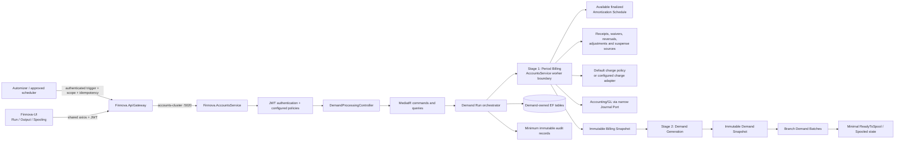
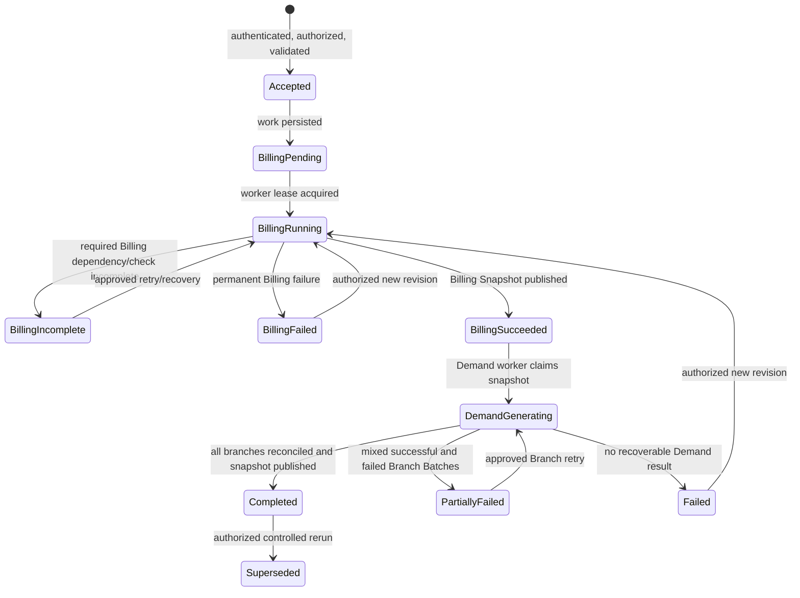
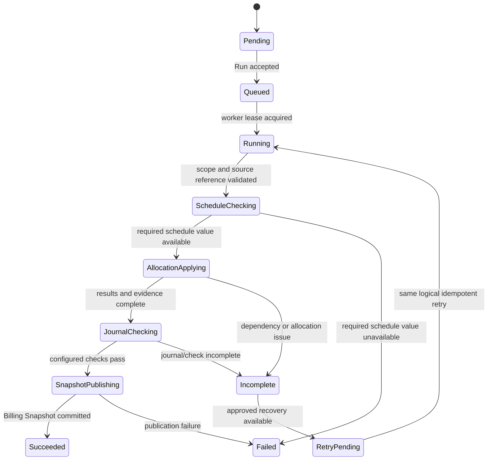

# Design Document: Demand Processing

## Overview

Demand Processing is an operational finance workflow that produces a period-specific MIS of account dues and arrears. A **Demand Run** is the immutable operational unit for two ordered internal stages:

1. **Period Billing** reads the available finalized Amortization Schedule and approved account-level financial events, produces Billing Period Results, invokes the Accounting/GL capability through a narrow Journal Port, and publishes a Billing Snapshot when configured checks pass.
2. **Demand Generation** consumes the published Billing Snapshot, creates account-level Demand Rows, groups them into branch-wise Demand Batches, reconciles the results, and publishes the Demand Snapshot used by output and spooling views.

Demand Generation cannot bypass Period Billing. Demand Spooling only changes the minimal persisted spool state of an eligible completed batch. It does not calculate demand or perform downstream delivery in this release.

The initial backend host and worker boundary is `Finnova.AccountsService`. No separate Billing host is required. The backend scope is `e:\Finnova\Finnova-API` and the frontend scope is `E:\Finnova\Finnova-UI\Finnova-UI`.

The design uses the confirmed platform rules:

- Run IDs are immutable GUIDs. Controlled reruns use linked immutable Run Revisions.
- Frequency, Billing completion/snapshot settings, charge policy, Journal Port adapter/settings, roles/policies, retention, polling, pagination, and PDF settings are appSettings-driven. Frequency defaults to `Monthly`.
- Month/Year uses the `Asia/Kolkata` business timezone. Technical, lifecycle, audit, and PDF generated-at timestamps use UTC.
- Amounts are INR `decimal(19,2)` and use `MidpointRounding.AwayFromZero`.
- An omitted Branch resolves to all authorized Active Branches for the selected LOB. Deactivated Branches are excluded from new generation but retained history remains readable within caller scope.
- All Active accounts are considered. Zero-demand accounts remain as rows. An in-scope Branch with no eligible accounts produces a non-failure `NoDemand` batch.
- Branch failures are isolated, separately inspectable and retryable, successful Branch Batches remain intact, and the overall Run becomes `PartiallyFailed` when at least one Branch succeeds and another fails.
- The detailed Processing Cut-off source and any new schedule finalization watermark/source-version integration are deferred. A Run must retain one internally consistent snapshot or source reference, but no new external watermark is a prerequisite.
- The default charge policy is explicit and has an adapter seam for an approved authoritative Billing/charge source.
- Accounting/GL owns journal creation, posting, idempotency, and reconciliation. AccountsService/Demand Processing stores journal references and configured check results only.
- Authorized server-side PDF export is in scope for Demand Generation Output and Demand Spooling/batch views. Browser print and spool transport are deferred.
- Minimum immutable audit records are required. Detailed audit taxonomy, content, retention, and purge rules remain configurable or deferred.

### 1.1 Goals

- Execute Period Billing and Demand Generation in one ordered, auditable Demand Run.
- Use the selected finalized schedule value as the Scheduled Installment without recomputing EMI or mutating the schedule.
- Apply approved receipts, waivers, reversals, adjustments, suspense treatment, and other account-level events exactly once under the approved allocation policy.
- Keep Current Due, Arrears, ODI, Other Charges, Total Charges, and Total Demand distinct and traceable.
- Prevent Billing Snapshot, Demand Snapshot, Demand Rows, and spool readiness before the configured Billing and journal publication gates succeed.
- Preserve zero-demand rows, NoDemand branch outcomes, deactivated-Branch history, and branch-isolated failures.
- Prevent duplicate logical Billing results, allocations, journal requests, Demand Rows, Demand Batches, and spool state transitions on equivalent retries.
- Provide authorized, scope-filtered server-side PDF exports from persisted values without recalculation.
- Reuse existing .NET, EF Core, CQRS, JWT, middleware, YARP, React, MUI, shared axios, and testing conventions.

### 1.2 Non-goals and deferred boundaries

- Creating or editing LOB, Branch, Customer, Account, Amortization Schedule, receipt, waiver, reversal, adjustment, charge master, or accounting master records.
- Recomputing EMI or deriving a replacement installment from account inputs.
- Mutating a finalized Amortization Schedule.
- Exposing an independent Demand Generation or Billing endpoint that bypasses the overall Run.
- Deploying a separate Billing host in the initial release.
- Making a new schedule watermark, finalization version, or source-version integration a prerequisite.
- Making Demand Processing the owner of Accounting/GL journals or the ledger.
- Adding downstream spool delivery semantics; this release retains only minimal ReadyToSpool/Spooled/NotReady state.
- Adding browser print as a separate capability.
- Introducing Redux, RxJS, an ad-hoc axios client, bilingual fields, translation scaffolding, non-English data, or RTL behavior.

## Architecture

### 2.1 Reused versus new components

#### Reused components

| Concern | Existing component/convention | Design use |
| --- | --- | --- |
| Host and worker | `Finnova.AccountsService` | Controller, authentication, authorization, middleware, CQRS registration, and the initial Period Billing/Demand worker boundary. |
| CQRS | Existing MediatR registration | Commands and queries for Run lifecycle, Billing, Demand Generation, reads, reruns, and minimal spool-state changes. |
| Validation | Existing FluentValidation pipeline | Validate normalized scope, period, Frequency, idempotency, rerun, and export requests before financial reads. |
| Persistence | Existing `FinnovaDbContext`, EF Core configurations, repositories | Persist Demand-owned runs, stages, results, snapshots, batches, failures, minimum audit entries, and leases. |
| Authentication | Existing JWT Bearer pipeline | Authenticate before authorization, scope checks, source reads, or processable mutation. |
| Authorization | Existing policy/claim conventions | Read configured policy names and admin override settings from appSettings; enforce LOB/Branch scope in handlers and queries. |
| Errors | Existing `ExceptionHandlingMiddleware` | Map stable Demand/Billing/export error codes to safe ProblemDetails responses. |
| Gateway | Existing YARP `Finnova.ApiGateway` | Forward UI-composed Demand routes to `accounts-cluster` with Authorization. |
| UI HTTP | `src/services/api.ts` in Finnova-UI | Shared JWT propagation and centralized 401/403/409/timeout/error-toast behavior. |
| UI service boundary | Interface, mock, real, toggle, and barrel patterns | Add Demand Processing service modules without another HTTP client. |
| UI rendering | MUI controls, DataGrid, dialogs, alerts, cards | Build Run, Output, and Spooling/batch views. |
| UI state | React hooks and existing Context | Manage form, filters, polling, loading, and last-good-data state. |
| Tests | xUnit, FsCheck.Xunit, WebApplicationFactory, Vitest, RTL | Test pure financial rules, HTTP/security boundaries, persistence, exports, and screen behavior. |

#### New components

- Demand Run, Run Revision, Billing Stage Run, Billing Period Result, Billing Allocation Evidence, Billing Snapshot, Demand Snapshot, Demand Row, Demand Batch, Demand failure, lease, and minimum audit entities.
- Stage, Run, Batch, failure-class, source, and spool-status enums.
- Typed exceptions and stable error codes for validation, BillingIncomplete, BillingScopeMismatch, schedule diagnostics, allocation conflicts, journal checks, idempotency, concurrency, data quality, reconciliation, PDF export, and spool readiness.
- Narrow ports for finalized schedules, account/customer/master projections, allocation events, charge values, and Accounting/GL journals.
- A configurable `IChargePolicyAdapter` seam that can use the default charge formulas or an approved authoritative Billing/charge source.
- A narrow `IJournalPort` seam that invokes the Accounting/GL capability and returns journal references/check results.
- Pure helpers for normalization, schedule installment, allocation, charges, eligibility, totals, fingerprinting, batching, reconciliation, and publication gates.
- A server-side `IDemandPdfExportService`/adapter contract. The design does not select or add a PDF library because the repository has no established PDF dependency; the implementation task must choose an approved existing library or a separately approved adapter implementation.
- Minimal spool state transition handling. There is no downstream delivery interface or delivery metadata; the handler changes only persisted batch status and minimum audit.

### 2.2 Logical architecture



Source systems remain authoritative for schedules, accounts, customers, LOBs, Branches, receipts, waivers, reversals, adjustments, charges, and the accounting ledger. Demand Processing stores execution records, retained source references, Billing-derived values, snapshots, output, minimal spool state, and minimum audit evidence that it owns.

### 2.3 Ordered Run lifecycle

1. Authenticate and authorize Automizer or an approved user.
2. Normalize LOB, optional Branch, Frequency, and Month/Year. Resolve an omitted Branch to all authorized Active Branches for the LOB. Reject a deactivated Branch for new generation.
3. Compute the normalized logical scope and idempotency fingerprint. Create or resolve the authoritative Run and Run Revision without reading financial amounts when validation fails.
4. Create or resolve the internal Billing Stage Run and dispatch the Period Billing worker within AccountsService.
5. Period Billing reads one internally consistent source snapshot/reference, selects eligible Active accounts, reads available finalized schedule entries, applies approved events exactly once, captures charges, invokes the Journal Port, and evaluates configured Billing checks.
6. Publish one immutable Billing Snapshot only when the configured completion/snapshot contract and required journal checks pass. The Run retains available cut-off/source references; a new external watermark is not required.
7. Enqueue or dispatch Demand Generation only after the Billing Snapshot is published. Demand Generation copies persisted Billing-derived values, creates rows and branch batches, reconciles them, and publishes a Demand Snapshot.
8. Output queries read persisted Demand Snapshot data. Spooling changes only a persisted batch status after the readiness guard passes.

Equivalent concurrent requests resolve to one authoritative logical Run or existing completed result. A controlled rerun creates a linked revision and preserves prior output. A failed Branch Batch does not invalidate successful Branch Batches; the overall Run becomes `PartiallyFailed` when the branch outcomes are mixed.

### 2.4 Worker and lifecycle boundary

The initial implementation uses the existing AccountsService worker boundary. It may use the repository's established durable queue or a persisted work record plus hosted dispatcher, but the selected mechanism must remain inside AccountsService and must persist work state before returning the accepted response.

A work item contains Run ID, revision, stage, normalized logical scope, idempotency key, and correlation ID. It does not contain a bearer token, connection string, or unnecessary customer fields. A database-backed lease and rowversion protect stage ownership across restarts. A lost lease or process restart leaves the Run non-completed and eligible only for the configured recovery/rerun path.

Demand Generation work is created only after the Billing Snapshot publication transaction commits. The worker resolves successful existing stage/results before applying an allocation or invoking the Journal Port again. No worker behavior may create a second logical result for a redelivery or equivalent trigger.

### 2.5 Boundary rules

- **Controller:** Binds HTTP requests, uses configured authorization, extracts correlation data, maps status codes, and dispatches MediatR. It does not query EF or calculate money.
- **Run orchestrator:** Owns stage ordering, Run/Revisions, durable state transitions, idempotency, leases, recovery, and publication gates.
- **Period Billing service:** Coordinates schedule, account, allocation, charge, and Journal Port interfaces. It owns no source schedule, event master, or ledger.
- **Demand Generation service:** Reads exactly one published Billing Snapshot, maps rows, groups batches, reconciles totals, and publishes the Demand Snapshot.
- **Charge adapter:** Supplies authoritative ODI and Other Charges when configured. The default adapter implements the confirmed formulas. Neither adapter is called by the UI.
- **Journal Port:** Calls Accounting/GL. AccountsService stores references and configured check results only.
- **Pure helpers:** Have no database, HTTP, logger, or clock dependency. They implement normalization, arithmetic, allocation, eligibility, totals, grouping, fingerprinting, and gates.
- **Repositories:** Persist Demand-owned records and apply mandatory scope predicates. They do not own source lifecycle.
- **PDF export service:** Loads authorized persisted output, renders a PDF through an approved adapter, and returns a server-generated file response. It never recalculates amounts.
- **Spool state handler:** Validates scope and `ReadyToSpool`, changes only the minimal persisted status to `Spooled`, records actor/time in the minimum audit record, and returns the resulting status. It does not invoke a delivery transport.
- **Frontend:** Owns form/filter/loading/polling state and displays persisted values. It does not calculate EMI, override Billing values, or act as a security boundary.

## Requirements coverage map

| Requirement | Design coverage |
| --- | --- |
| R1 Define and validate a Demand Run | Sections 2.3, 3.1, 4.1, 5.1, and 7.1: authentication, normalization, immutable GUID, omitted Branch expansion, deactivated-Branch rejection, and audit. |
| R2 Enforce successful internal Billing stage | Sections 2.3, 4.2, 6, and 7: Billing Snapshot publication gate and no Demand bypass. |
| R3 Execute schedule-driven Period Billing | Sections 2.5, 4.2-4.5, 5.2, and 6.1: available finalized schedule, one consistent source reference, exactly-once allocation, explicit charges, Journal Port, and Billing publication. |
| R4 Select eligible accounts | Sections 2.3, 4.4, and 6.2: Active status, scope, resolvable references, diagnostics, and exclusion rules. |
| R5 Calculate account-level Demand | Sections 4.6, 6.2, 8, and 9: Billing-derived components, INR arithmetic, zero-demand rows, and deterministic ordering. |
| R6 Create branch-wise batches | Sections 2.3, 4.6, 6.3, and 7.3: one batch per represented Branch, NoDemand outcome, totals, isolation, and reconciliation. |
| R7 Trigger automatic/manual processing | Sections 2.3, 2.4, 5.1, and 7.1: Automizer/manual command, common workflow, worker boundary, and idempotency. |
| R8 Maintain history and idempotent reruns | Sections 4.1, 4.7, 5.1, and 7.4: retained Run/Revisions, deactivated-Branch reads, unchanged-result resolution, and configurable retention. |
| R9 Concurrency and atomic publication | Sections 2.4, 4.7, 6, and 7.4: leases, uniqueness, transaction boundaries, and mixed Branch outcome handling. |
| R10 Failures and reconciliation | Sections 6, 7, and 8: stable failure classes, safe diagnostics, branch isolation, retry paths, and reconciliation gates. |
| R11 Demand Run screen | Section 9.2: protected scope form, stage statuses, BillingIncomplete, polling, and permission gating. |
| R12 Demand Generation Output | Sections 5.2, 5.3, 9.3, and 10: persisted row queries, scope filters, deactivated-Branch history, and PDF export. |
| R13 Demand Spooling | Sections 2.5, 4.6, 5.2, 7.3, and 9.4: minimal ReadyToSpool/Spooled/NotReady guard and batch PDF export without transport. |
| R14 Authentication, authorization, and scope | Sections 2.5, 5.4, 8, and 9.5: configured policies, JWT ordering, and query/action scope. |
| R15 Audit and traceability | Sections 4.8 and 8: minimum immutable audit fields and safe references; detailed taxonomy remains deferred. |
| R16 Deterministic behavior/testing | Sections 6.4 and 11: pure calculation properties, integration tests, PDF contract tests, and UI tests. |
| R17 India/English/no RTL | Sections 4.6, 9, and 10: INR, `Asia/Kolkata`, UTC, English-only display, and left-to-right UI. |

## Data Models

### 4.1 Demand Run and Run Revision

`DemandRun` is the retained lifecycle aggregate for one logical LOB, Branch scope, Frequency, and Month/Year. `DemandRunRevision` is an immutable result revision created only for an authorized controlled rerun. Run ID is an immutable GUID; revision numbers are immutable within the logical Run lineage.

| Field | Rule |
| --- | --- |
| `Id` | Immutable system-generated GUID. |
| `LogicalScopeKey` | Canonical normalized LOB, resolved Branch scope, Frequency, Month/Year, and action scope. |
| `LineOfBusinessId` | Required source-owned LOB reference. |
| `BranchScope` | Resolved Active authorized Branch IDs in stable order. Omitted input is not persisted as an unresolved wildcard. |
| `Frequency`, `PeriodYear`, `PeriodMonth` | Exact configured Frequency and business period. Default Frequency is `Monthly`. |
| `BusinessTimezone` | `Asia/Kolkata` for period interpretation. |
| `ProcessingCutoffReference` | Available internally consistent snapshot/cut-off reference. It may be null only when the source contract provides no reference; no new watermark is required. |
| `IdempotencyKey`, `PayloadFingerprint` | Immutable normalized request identity and conflict fingerprint. |
| `Source`, `ActorId`, `CorrelationId` | Automizer or user source and safe actor/correlation references. |
| `Status` | Accepted, BillingPending, BillingRunning, BillingIncomplete, BillingFailed, BillingSucceeded, DemandGenerating, Completed, PartiallyFailed, Failed, Deferred, or Superseded. |
| `RevisionNumber` | Immutable positive revision identifier. |
| `BillingStageRunId`, `BillingSnapshotId`, `DemandSnapshotId` | References set when the relevant stage records/publications exist. |
| `RowCount`, totals, batch count | Reconciled persisted summaries using INR precision. |
| Lifecycle timestamps | UTC request, start, stage completion, final completion, and failure timestamps. |
| `Version` | SQL Server rowversion for optimistic concurrency and lease transitions. |

### 4.2 Billing Stage Run and Billing Period Result

`BillingStageRun` is the Demand-owned execution record for Period Billing. Billing completion and snapshot rules are read from appSettings. The record retains the available internally consistent source reference but does not require a new schedule watermark or source-version system.

| Field | Rule |
| --- | --- |
| `Id`, `RunId`, `RevisionNumber` | Immutable stage identity and parent dimensions. |
| `LogicalBillingScopeKey` | Normalized LOB, resolved Branch scope, Frequency, Month/Year, and approved idempotency identity. |
| `Status` | Pending, Queued, Running, Incomplete, Failed, Cancelled, Succeeded, RetryPending, or Superseded. |
| `ProcessingCutoffReference` | Available run snapshot/cut-off reference used by both stages. |
| `ScheduleReference` | Available schedule identity/entry reference. It is evidence, not a new external watermark prerequisite. |
| `AllocationPolicyReference`, `ChargePolicyReference` | Policy names/versions used for the result. |
| `JournalBatchReference`, `JournalCheckSummary` | References and configured check results returned by Accounting/GL. |
| `BillingSnapshotId`, `BillingSnapshotVersion` | Set only after successful publication. |
| Counts/totals/diagnostics | Eligible, successful, excluded, failed, allocation, journal, and reconciliation evidence. |
| Source/actor/correlation and UTC timestamps | Operational traceability. |

`BillingPeriodResult` is created for an eligible account only when the schedule, allocation, charge, and configured result checks succeed for that account. It retains the account's source dimensions and all persisted Billing-derived values.

| Field | Rule |
| --- | --- |
| `AccountId`, `CustomerId`, `LineOfBusinessId`, `BranchId` | Source references and retained dimensions. |
| `AccountStatusAtCutoff`, `EligibilityDecision` | Evidence for Active eligibility. |
| `ScheduleId`, `ScheduleEntryId`, available source reference | Identifies the selected finalized schedule entry when provided. |
| `ScheduledPrincipal`, `ScheduledInterestOrEmi` | Values read from the selected schedule entry. |
| `ScheduledInstallment` | `ScheduledPrincipal + ScheduledInterestOrEmi`, rounded to INR precision. Never derived from account inputs. |
| `CurrentDue` | Unpaid selected-period Scheduled Installment after approved allocation. |
| `Arrears` | Prior-period unpaid value, separate from current-period unpaid value. |
| `Odi`, `OtherCharges` | Separate Billing components supplied by the default policy or charge adapter. |
| `AllocationPolicyReference` and child evidence | Policy and source-event references/outcomes. |
| `JournalReference` | Accounting/GL reference and configured check outcome. |
| `Status` | Succeeded, Excluded, Failed, or Incomplete. Only successful results enter a published Billing Snapshot. |
| `ProcessingCutoffReference`, policy references, timestamps | Reproducibility and audit evidence. |

### 4.3 Allocation evidence

`BillingAllocationEvidence` is Demand-owned evidence that an approved receipt, waiver, reversal, adjustment, or other event was considered and, when applicable, applied exactly once. The source event remains owned by its source system.

| Field | Rule |
| --- | --- |
| `BillingPeriodResultId`, `BillingStageRunId` | Parent dimensions. |
| `SourceEventType`, `SourceEventId`, `SourceEventVersion` | Source identity when the source provides it. |
| `EventEffectiveUtc`, `EventSourceReference` | Evidence of period/cut-off eligibility. |
| `AllocationPolicyReference`, `AllocationSequence` | Policy and deterministic sequence. |
| `AllocatedAmount`, `Currency`, `TargetComponent` | INR amount and approved target such as Current Due, Arrears, Charges, or suspense. |
| `Outcome` and safe reason | Applied, Excluded, Deferred, Reversed, or Rejected. |
| `SourceFingerprint`, `ApplicationKey` | Stable logical identity used to prevent duplicate application. |

A unique logical application key prevents an equivalent retry from applying the same source event twice. The design does not require a new source-version integration; it uses the references available from existing contracts.

### 4.4 Billing Snapshot

`BillingSnapshot` is an immutable publication containing the complete successful Billing Period Results for the exact Run Revision, retained scope, period, and available source reference.

| Field | Rule |
| --- | --- |
| `Id`, `Version`, `BillingStageRunId` | Immutable snapshot identity and parent. |
| Logical scope and period | Must equal the Demand Run Revision. |
| `ProcessingCutoffReference` | Common internally consistent source reference, if supplied. |
| Result counts and component totals | Reconciled successful Billing totals. |
| `JournalBatchReference`, `JournalCheckSummary` | Proof that configured Accounting/GL checks passed. |
| `PublicationStatus` | Pending, Published, Rejected, or Superseded. Only Published unlocks Demand Generation. |
| `ContentFingerprint` | Deterministic content identity for the persisted result set. |
| Published actor/source/correlation and UTC timestamp | Publication evidence. |

### 4.5 Demand Snapshot, Demand Row, and Demand Batch

`DemandSnapshot` is the immutable publication of Demand Generation output and references exactly one Published Billing Snapshot.

`DemandRow` contains Account, Customer, LOB, Branch, Month/Year, Frequency, Billing Period Result reference, Billing Snapshot version, Current Due, Arrears, ODI, Other Charges, Total Charges, Total Demand, row status, zero-demand indicator, and stable Account ordering. It copies persisted Billing-derived values and does not calculate EMI or replace Scheduled Installment.

`DemandBatch` is one logical Branch collection for one Run Revision. It stores Branch/LOB/period dimensions, row count, component totals, Total Demand, Demand Snapshot reference, and minimal spool status:

- `NotReady` while publication or reconciliation is incomplete, or when the batch is empty/failed.
- `ReadyToSpool` when the batch is completed and reconciled.
- `Spooled` after an authorized state transition using the persisted batch.
- `NoDemand` for an empty in-scope Branch. This is a non-failure and is not spoolable.
- `Failed` when branch reconciliation or generation fails.

There is no downstream delivery metadata persisted for a Demand Batch.

### 4.6 Source ownership and charge policy

| Data | Owner | Demand behavior |
| --- | --- | --- |
| Amortization Schedule | Existing schedule/lending source | Read available finalized selected-period values and references; never mutate or recompute. |
| Account, Customer, LOB, Branch, status | Existing account/master sources | Read scoped projections at one internally consistent snapshot/cut-off and retain safe references/display values. |
| Receipts, waivers, reversals, adjustments, suspense events | Existing financial sources | Read approved events and retain allocation evidence. |
| ODI and Other Charges | Billing/Accounting source or configured charge adapter | Consume authoritative values through `IChargePolicyAdapter`; use the default formulas when no replacement adapter is configured. |
| Accounting/GL journal and ledger | Existing Accounting/GL capability | Invoke through `IJournalPort`; store references/check results only. |
| Billing and Demand execution/results/snapshots/batches | Demand Processing | Own lifecycle, retained output, and reconciliation records. |

#### Default charge policy

The default `IChargePolicyAdapter` implements these formulas:

- `ODI = overdue principal balance × configured annual ODI rate × overdue days ÷ configured day-count basis`.
- Day-count basis defaults to `365` when absent.
- ODI excludes the current-period Scheduled Installment from overdue principal, is rounded to INR 2 decimals using `MidpointRounding.AwayFromZero`, and uses an optional configured cap. No cap applies by default.
- `Other Charges = net eligible posted non-ODI charge events effective for the account and period - eligible waivers/reversals/adjustments allocated to those charge events after suspense treatment`.
- Other Charges exclude scheduled installment, principal, interest, arrears, and ODI. If the net is negative, the implementation retains adjustment evidence and clamps Other Charges to zero. Other Charges are rounded to INR 2 decimals using `MidpointRounding.AwayFromZero`.
- `Total Charges = ODI + Other Charges`.
- `Total Demand = Current Due + Arrears + Total Charges`.

A configured approved Billing/charge adapter may return the same separate `ODI` and `OtherCharges` contract and policy references. Demand Generation never calls the adapter and never recomputes values in the API response, PDF export, or UI.

### 4.7 Persistence and indexes

Add Demand-owned entities and configurations through the existing `ApplyConfigurationsFromAssembly` convention. Required constraints include:

- unique authoritative Run logical scope/revision identity;
- unique Billing Stage Run for the normalized logical Billing scope and approved idempotency identity;
- unique successful Billing Period Result by Billing Stage Run and Account;
- unique logical allocation application key;
- unique Published Billing Snapshot by Billing Stage Run/revision;
- unique Demand Row by Demand Snapshot and Account;
- unique Demand Batch by Demand Snapshot and Branch;
- unique journal idempotency reference at the Billing Stage Run boundary;
- indexes for period, LOB, Branch, statuses, account, customer, snapshot version, completion time, and correlation ID;
- `decimal(19,2)` for all INR amounts and UTC datetime columns;
- rowversion for Run/stage/batch state transitions;
- restricted deletion for results, snapshots, allocation evidence, journal references, failures, batches, and audit records.

Deactivated Branches remain queryable through retained Run/Row/Batch records. New generation validates that selected or resolved Branches are Active.

### 4.8 Minimum audit model

`DemandAuditEntry` is append-only and records at least:

- Run ID and Run Revision;
- LOB and Branch scope, including the affected Branch for batch transitions;
- actor/source and correlation ID;
- previous and new status where applicable;
- UTC timestamp;
- outcome/error code; and
- safe references such as stage, snapshot, batch, schedule, journal, or source identifiers.

The detailed event taxonomy, additional content, retention duration, archival mechanism, and purge authority are configuration/deferred decisions. Audit entries must not contain bearer tokens, credentials, connection strings, secrets, or unnecessary customer fields.

## Contracts and interfaces

All endpoints require JWT Bearer authentication and use the existing JSON conventions. The client cannot provide Run ID, stage status, totals, Billing Snapshot ID, journal status, actor identity, or authoritative financial values.

### 5.1 Commands and queries

```text
StartDemandRunRequest
  lineOfBusinessId: Guid
  branchId?: Guid
  frequency: string
  periodYear: int
  periodMonth: int
  idempotencyKey: string

RerunDemandRunRequest
  reason: string
  idempotencyKey: string

DemandRunQuery
  periodYear?: int
  periodMonth?: int
  lineOfBusinessId?: Guid
  branchId?: Guid
  status?: string
  billingStatus?: string
  demandStatus?: string
  page: int = 1
  pageSize: int = configured bound

DemandRowsQuery
  runId?: Guid
  revisionNumber?: int
  periodYear?: int
  periodMonth?: int
  lineOfBusinessId?: Guid
  branchId?: Guid
  accountId?: Guid
  customerId?: Guid
  rowStatus?: string
  page: int = 1
  pageSize: int = configured bound

DemandBatchesQuery
  runId?: Guid
  revisionNumber?: int
  periodYear?: int
  periodMonth?: int
  lineOfBusinessId?: Guid
  branchId?: Guid
  status?: string
  page: int = 1
  pageSize: int = configured bound

SpoolBatchRequest
  idempotencyKey?: string

DemandPdfExportQuery
  runId?: Guid
  revisionNumber?: int
  periodYear?: int
  periodMonth?: int
  lineOfBusinessId?: Guid
  branchId?: Guid
  accountId?: Guid
  customerId?: Guid
  rowStatus?: string
  pageSize?: int
```

`SpoolBatchRequest` contains only an optional idempotency key. The server takes the persisted batch as the only financial source.

### 5.2 Application ports

- `IFinalizedSchedulePort`: returns the available selected-period schedule entry, principal, interest/EMI, and safe schedule reference. It does not require a new watermark/source-version contract.
- `IAccountSourcePort`: returns account/customer/LOB/Branch/status projections and authorized Active Branches for a LOB.
- `IAllocationEventPort`: returns approved event projections and source identities used by the allocation policy.
- `IAllocationPolicy`: pure policy that applies events exactly once and returns allocation evidence, Current Due, and Arrears inputs.
- `IChargePolicyAdapter`: returns separate ODI and Other Charges, policy reference, evidence references, and configured check outcomes. The default implementation uses the formulas in Section 4.6.
- `IJournalPort`: accepts a stable Billing Stage logical identity and Billing-derived journal request, then returns journal references and configured generation/posting/reconciliation checks. Accounting/GL remains the owner of the ledger and journal idempotency.
- `IDemandRepository`: persists and queries Runs, Revisions, stages, results, snapshots, rows, batches, failures, leases, and audit entries with scope predicates.
- `IBillingSnapshotRepository`: reads/publishes immutable Billing snapshots and checks publication completeness.
- `IDemandUnitOfWork`: coordinates Billing Snapshot, Demand Snapshot, status, and audit publication transactions.
- `IDemandLeaseStore`: acquires and renews durable stage leases using rowversion/unique logical identity.
- `IAuthorizationScopeResolver`: derives authorized LOB/Branch scope from the authenticated principal or Automizer identity.
- `IDemandPdfExportService`: accepts an authorized export model containing persisted values and metadata, renders a PDF through an approved adapter, and returns bytes/content type/file name. It has no calculation responsibility.
- `IPdfRendererAdapter`: implementation seam for the selected server-side PDF renderer. The implementation must reuse an established repository dependency if one exists or document the separately approved dependency/implementation choice in the task execution; it must not silently introduce an unrelated library.
- `IClock`: provides UTC timestamps and business-period normalization boundary.

There is intentionally no downstream delivery port or delivery-state contract.

### 5.3 API endpoints

Controller prefix: `/api/demand-processing` in AccountsService.

| Method | Route | Purpose | Success |
| --- | --- | --- | --- |
| POST | `/api/demand-processing/runs` | Start or resolve the ordered Automizer/manual Run | `202 DemandRunAcceptedResponse` |
| GET | `/api/demand-processing/runs/{runId}` | Read Run, stage status, snapshots, diagnostics, and totals | `200 DemandRunResponse` |
| GET | `/api/demand-processing/runs` | Read authorized history/status | `200 PaginatedResponse<DemandRunSummaryResponse>` |
| POST | `/api/demand-processing/runs/{runId}/rerun` | Create a linked authorized Run Revision | `202 DemandRunAcceptedResponse` |
| GET | `/api/demand-processing/runs/{runId}/rows` | Read persisted Demand Rows | `200 PaginatedResponse<DemandRowResponse>` |
| GET | `/api/demand-processing/batches` | Read authorized Branch Batches | `200 PaginatedResponse<DemandBatchResponse>` |
| GET | `/api/demand-processing/batches/{batchId}` | Read one batch and safe diagnostics | `200 DemandBatchResponse` |
| POST | `/api/demand-processing/batches/{batchId}/spool` | Change an eligible persisted batch from ReadyToSpool to Spooled | `200 SpoolStatusResponse` or existing status |
| GET | `/api/demand-processing/exports/output` | Render authorized Demand Generation Output PDF | `200 application/pdf` |
| GET | `/api/demand-processing/exports/batches` | Render authorized Demand Spooling/batch PDF | `200 application/pdf` |

There is no public Billing-only generation route, Demand-only generation route, or downstream delivery route.

### 5.4 Response contracts and export contract

`DemandRunResponse` includes Run ID, revision, normalized scope, period, overall status, Billing/Demand stage statuses, available Processing Cut-off/source reference, Billing Stage Run ID, Billing Snapshot version, Demand Snapshot ID/version, counts/totals, source, actor, correlation ID, diagnostics, and UTC lifecycle timestamps.

`DemandRowResponse` includes Account, Customer, Branch, LOB, Month/Year, Frequency, Current Due, Arrears, ODI, Other Charges, Total Charges, Total Demand, Billing Period Result reference, Billing Snapshot version, row status, zero-demand indicator, and deterministic order fields.

`DemandBatchResponse` includes Branch, LOB, Frequency, Month/Year, Run/revision, Billing Snapshot version, Demand Snapshot version, row count, component totals, Total Demand, minimal spool status, source/actor, last state-change UTC timestamp, and failure class/reason when present.

The server-side PDF export contract is:

```text
DemandPdfExportRequest
  exportType: Output | Batch
  authorizedScope: LOB/Branch scope resolved server-side
  filters: normalized persisted-data filters

DemandPdfDocumentModel
  title: English string
  generatedAtUtc: DateTimeOffset
  runMetadata: Run ID, revision, LOB, Branch, Frequency, Month/Year
  billingMetadata: Billing Stage Run ID, Billing Snapshot version
  rowsOrBatches: persisted values selected by authorized filters
  totals: persisted/reconciled INR totals
  status: persisted status and safe failure information

IDemandPdfExportService.RenderAsync(request, cancellationToken)
  -> PdfFileResult { Content, ContentType, FileName }
```

The service applies authorization and data scope before loading data. It includes persisted values, run/period/Branch metadata, totals, and a UTC generated-at timestamp. It does not recalculate demand or expose unauthorized data. Browser print remains deferred. PDF renderer selection is an implementation decision in the task list and must not introduce a transport dependency.

### 5.5 Error codes and idempotency

Extend `ExceptionHandlingMiddleware` with RFC 7807-compatible responses containing `status`, `code`, `message`, `correlationId`, and safe field errors.

| Condition | HTTP | Code |
| --- | --- | --- |
| Missing/invalid JWT | 401 | Existing platform authentication response |
| Authenticated identity outside policy/scope | 403 | Existing platform authorization response |
| Missing/malformed input | 400 | `ERR-DEMAND-VALIDATION` |
| Unsupported Frequency/period | 400 | `ERR-DEMAND-FREQUENCY` / `ERR-DEMAND-PERIOD` |
| No authorized Active Branches for omitted Branch | 400 | `ERR-DEMAND-NO-ACTIVE-BRANCH` |
| Deactivated Branch for new generation | 400 | `ERR-DEMAND-BRANCH-DEACTIVATED` |
| Billing incomplete or required check missing | 409 | `ERR-DEMAND-BILLING-INCOMPLETE` |
| Billing scope mismatch | 409 | `ERR-DEMAND-BILLING-SCOPE` |
| Schedule diagnostic | 422 | `ERR-BILLING-SCHEDULE-INCOMPLETE` |
| Allocation conflict | 409/422 | `ERR-BILLING-ALLOCATION-CONFLICT` |
| Required journal check missing/fails | 409/422 | `ERR-BILLING-JOURNAL-INCOMPLETE` |
| Billing Snapshot blocked | 409 | `ERR-BILLING-SNAPSHOT-BLOCKED` |
| Changed idempotent request | 409 | `ERR-DEMAND-IDEMPOTENCY-CONFLICT` |
| Concurrent active Run/lease | 409 or existing accepted response | `ERR-DEMAND-CONCURRENT` |
| Not found in caller scope | 404 | `ERR-DEMAND-NOT-FOUND` |
| Invalid source/reference/amount | 422 | `ERR-DEMAND-DATA-QUALITY` |
| Aggregate/dimension mismatch | 422 | `ERR-DEMAND-RECONCILIATION` |
| PDF export unavailable/invalid | 422/503 | `ERR-DEMAND-PDF-EXPORT` |
| Batch not ReadyToSpool | 409 | `ERR-DEMAND-SPOOL-NOT-READY` |

The fingerprint uses normalized LOB/Branch scope, Frequency, Month/Year, action, Billing reference when supplied, and immutable request fields. Equivalent requests resolve existing records. A changed idempotency payload is rejected without changing the original Run. No logical count increases for allocations, Billing Period Results, journals, snapshots, Demand Rows, or Batches on equivalent retries.

## Components and Interfaces

### 6.1 Proposed namespaces and files

```text
Finnova.Models/
  Domain/Entities/DemandRun.cs
  Domain/Entities/DemandRunRevision.cs
  Domain/Entities/BillingStageRun.cs
  Domain/Entities/BillingPeriodResult.cs
  Domain/Entities/BillingAllocationEvidence.cs
  Domain/Entities/BillingSnapshot.cs
  Domain/Entities/DemandSnapshot.cs
  Domain/Entities/DemandRow.cs
  Domain/Entities/DemandBatch.cs
  Domain/Entities/DemandFailure.cs
  Domain/Entities/DemandAuditEntry.cs
  Domain/DomainEnums/DemandRunStatus.cs
  Domain/DomainEnums/BillingStageStatus.cs
  Domain/DomainEnums/DemandBatchStatus.cs
  Domain/DomainEnums/DemandFailureClass.cs
  Contracts/DemandProcessing/...

Finnova.Service/DemandProcessing/
  Commands/StartDemandRun/
  Commands/RerunDemandRun/
  Commands/RunPeriodBilling/
  Commands/GenerateDemand/
  Commands/SpoolDemandBatch/
  Queries/GetDemandRun/
  Queries/GetDemandRows/
  Queries/GetDemandBatches/
  Calculation/
  Billing/
  Allocation/
  Eligibility/
  Batching/
  PdfExport/
  Ports/
  Validation/
  Workers/
  Mappers/

Finnova.Repository/
  Interfaces/IDemandProcessingRepository.cs
  Interfaces/IFinalizedSchedulePort.cs
  Interfaces/IAccountSourcePort.cs
  Interfaces/IAllocationEventPort.cs
  Interfaces/IChargePolicyAdapter.cs
  Interfaces/IJournalPort.cs
  Interfaces/IDemandPdfExportService.cs
  Interfaces/IPdfRendererAdapter.cs
  Repositories/DemandProcessingRepository.cs
  Configuration/Demand*.Configuration.cs
```

### 6.2 CQRS and worker slices

- `StartDemandRunCommand`: authenticate/authorize through the host, normalize inputs, resolve scope, compute idempotency, create or resolve Run/Billing Stage Run, append minimum audit, enqueue Period Billing, and return `202`.
- `RunPeriodBillingCommand`: claim the Billing lease, read the internally consistent source reference and available schedule/events, select Active accounts, apply allocation, obtain charges through `IChargePolicyAdapter`, invoke `IJournalPort`, evaluate configured checks, and publish Billing Snapshot atomically.
- `GenerateDemandCommand`: require Published Billing Snapshot, map persisted components, create rows and branch batches, handle empty Branches as NoDemand, isolate Branch failures, reconcile totals, and publish Demand Snapshot.
- `RerunDemandRunCommand`: authorize, preserve the prior revision, create linked immutable revision, and submit the same ordered workflow.
- `SpoolDemandBatchCommand`: enforce authorization and the exact `ReadyToSpool` guard, set `Spooled` using optimistic concurrency, append minimum audit, and return persisted status. It performs no delivery.
- Queries: Run/history, Billing diagnostics/results as authorized, Demand Rows, Batches, and PDF export source data. Every query applies authorization scope before filters and paging.

### 6.3 Pure helpers

- `PeriodNormalizer`: validates Month/Year and uses `Asia/Kolkata` for business period interpretation.
- `ScheduleInstallmentCalculator`: returns selected schedule principal plus scheduled interest/EMI and rejects missing required schedule values without deriving a replacement EMI.
- `AllocationEngine`: applies each approved event once and returns evidence, Current Due, and Arrears inputs.
- `DefaultChargePolicyAdapter`: implements the ODI, Other Charges, Total Charges, rounding, cap, and negative-clamp rules in Section 4.6.
- `DemandCalculation`: calculates Total Charges and Total Demand from persisted Billing components.
- `EligibilityPredicate`: requires in-scope LOB/Branch, resolvable Customer/Branch/LOB references, and exactly Active status at the retained snapshot/cut-off reference.
- `BatchingAndReconciliation`: deterministic Branch grouping, NoDemand classification, row dimensions, totals, and mismatch detection.
- `IdempotencyFingerprint`: canonical normalized request identity.
- `PublicationGate`: verifies exact scope, successful Billing, complete required results/check groups, journal checks, and Published Billing Snapshot before Demand Generation.

## State transitions and workflow rules

### 7.1 Overall Run state machine



`Completed` requires successful Billing and Demand Snapshot publication. A `BillingIncomplete` or `BillingFailed` Run has no processable Demand Snapshot or spoolable batch. A mixed branch result is `PartiallyFailed`; successful batches remain inspectable and eligible for the configured spool guard, while failed batches remain inspectable and retryable.

### 7.2 Billing Stage state machine



The design does not require a new schedule watermark. The stage retains the available schedule/source reference and uses one internally consistent run snapshot/reference for the stage.

### 7.3 Period Billing and Demand Generation rules

Period Billing:

1. Validate normalized LOB, resolved Branch scope, configured Frequency, Month/Year, and idempotency before financial reads.
2. Resolve the existing Billing Stage Run for equivalent retries.
3. Select all Active accounts in scope at the retained internally consistent snapshot/reference. Exclude Closed, Cancelled, Pre-Closed, unsupported, unresolved, or conflicting accounts with diagnostics.
4. Read the available selected-period schedule entry. Set Scheduled Installment to scheduled principal plus scheduled interest/EMI. Do not recalculate EMI or mutate the schedule.
5. Apply receipts, part-payments, waivers, reversals, adjustments, and suspense under the approved allocation policy exactly once, retaining evidence.
6. Calculate Current Due and Arrears as separate values. Obtain ODI and Other Charges from the default formula adapter or approved authoritative adapter.
7. Invoke Accounting/GL through `IJournalPort`. Store journal references and configured check results only.
8. Publish Billing Snapshot only when Billing completion/snapshot settings and required journal checks pass.

Demand Generation:

1. Claim only a Run with a Published Billing Snapshot.
2. Copy Current Due, Arrears, ODI, and Other Charges from Billing Period Results. Calculate Total Charges and Total Demand with approved INR precision.
3. Retain every Active account row, including zero-demand rows.
4. Create one Demand Batch per represented Branch. Create a `NoDemand` non-failure batch for each in-scope Branch with no eligible account.
5. Reconcile row dimensions and totals. Isolate failed Branches; preserve successful Branches; mark the Run `PartiallyFailed` for mixed outcomes.
6. Publish Demand Snapshot only after successful Branch outcomes and reconciliation gates. `ReadyToSpool` applies only to a completed reconciled non-empty batch.

Minimal spooling:

1. Verify caller scope, batch identity, Run Revision, Published Demand Snapshot, and `ReadyToSpool` status.
2. In one state transition, set the batch to `Spooled`, retain actor and UTC state-change time, and append minimum audit.
3. Repeated requests return the existing `Spooled` status. Non-ready and NoDemand batches remain unchanged and return `ERR-DEMAND-SPOOL-NOT-READY`.
4. No downstream delivery operation or delivery metadata is created.

### 7.4 Concurrency, reruns, and history

A durable unique logical scope identity and rowversion/lease designate one authoritative active Run Revision. Equivalent requests return the existing Run. A changed idempotency payload returns conflict and preserves the original.

An unchanged completed result is returned without a new calculation. An authorized controlled rerun creates a linked revision and preserves the prior Run, Rows, Batches, snapshots, statuses, failures, and audit records. Deactivated Branches are excluded from later new generation but their retained Runs, Rows, and Batches remain readable to authorized callers.

Retention duration, archival behavior, purge authority, and detailed event taxonomy are configuration/deferred. No design value is hard-coded for retention.

## Error Handling

### 8.1 Publication transactions

**Billing publication:** source reads may occur before the write transaction. The selected available source reference, Billing Period Results, allocation evidence, charge policy references, Journal Port references/checks, Billing Snapshot, stage status, and minimum audit transition must commit as one logical publication boundary. A failed required check leaves the stage incomplete/failed and the Billing Snapshot unpublished.

**Demand publication:** Demand Generation reads one Published Billing Snapshot and writes Demand Rows, Demand Batches, Demand Snapshot, stage status, and minimum audit transitions atomically. Output queries expose only records linked to the published snapshot and permitted status.

**Spool state:** A batch status transition uses optimistic concurrency and one persistence transaction. It stores only the minimal status, actor, UTC time, and minimum audit. No external send occurs.

### 8.2 Failure classes

- **BillingIncomplete:** Billing stage or configured completion/snapshot check is missing, partial, in progress, or unavailable. No Demand Snapshot or spoolable batch.
- **BillingScheduleIncomplete:** required schedule value/reference is absent or the selected period cannot be resolved. No successful result for the affected account.
- **BillingAllocationConflict:** duplicate event identity, policy conflict, or conservation failure. Preserve evidence and block required publication.
- **BillingJournalIncomplete:** Accounting/GL generation, posting, idempotency, or configured check result is missing or unsuccessful. Accounting/GL remains the owner; Demand remains blocked.
- **BillingSnapshotBlocked:** required publication gate is inconsistent or incomplete.
- **Dependency:** required source or configured adapter is unavailable.
- **Transient:** configured timeout or temporary dependency failure, eligible only for configured recovery.
- **Permanent:** invalid input or amount that cannot be processed.
- **DataQuality:** unresolved or conflicting Account, Customer, Branch, LOB, or status reference.
- **Reconciliation:** row, batch, schedule, component, or snapshot totals/dimensions do not reconcile.
- **Authorization:** request rejected before financial data disclosure or processable mutation.
- **Idempotency:** changed payload/key conflicts with an existing Run.
- **Spooling:** batch is not ReadyToSpool or the caller is outside the authorized scope.
- **PdfExport:** authorized persisted values cannot be rendered by the configured PDF adapter.

All diagnostics contain only the identifiers and references required for reconciliation, such as Run/stage/snapshot/batch IDs, scope, period, correlation ID, code, and UTC timestamp. They exclude tokens, credentials, connection strings, secrets, and unnecessary customer fields.

## Security and data scope

- All API endpoints use the existing JWT Bearer authentication pipeline.
- Authentication occurs before authorization, scope resolution, source reads, Run creation, spool-state changes, or PDF data loading.
- Roles and policy names for Run/rerun, manual initiation, output/history, PDF export, and spooling are read from appSettings. Configured admin-role overrides apply within the configured admin data scope. No operational role name is hard-coded outside configuration defaults.
- Backend handlers and query repositories enforce LOB/Branch scope. UI filters never provide security.
- Omitted Branch is expanded only to authorized Active Branches. Deactivated Branches can be queried only as retained history within caller scope.
- Automizer uses an authenticated identity. Client-provided source values cannot impersonate Automizer.
- PDF export authorization is checked before querying rows/batches. The export contains only persisted values in the caller's scope.
- The client cannot mutate schedules, Billing results, allocation evidence, journal state, snapshots, rows, batches, failures, or audit entries.
- Database uniqueness, rowversion, leases, and transaction gates prevent duplicate logical financial results and partial publication.
- Audit records are immutable and minimum-sized. They never contain secrets or unnecessary customer fields.
- All labels, statuses, errors, seed/reference values, fixtures, PDF text, and documentation examples are English-only. Amounts are INR. UI remains left-to-right and adds no RTL handling.

## Frontend architecture

The frontend target is `E:\Finnova\Finnova-UI\Finnova-UI`. It communicates only through the shared axios instance and mirrors existing service/page conventions.

### 9.1 Models and service modules

Proposed files:

```text
src/models/demandProcessing.model.ts
src/services/interfaces/demandProcessing.interface.ts
src/services/mock/demandProcessing.mock.ts
src/services/real/demandProcessing.real.ts
src/services/demandProcessing.service.ts
src/pages/DemandRun.tsx
src/pages/DemandGenerationOutput.tsx
src/pages/DemandSpooling.tsx
src/components/demandProcessing/DemandRunForm.tsx
src/components/demandProcessing/DemandStageStatus.tsx
src/components/demandProcessing/BillingStageStatus.tsx
src/components/demandProcessing/DemandRowsGrid.tsx
src/components/demandProcessing/DemandBatchesGrid.tsx
src/components/demandProcessing/DemandFailurePanel.tsx
src/components/demandProcessing/SpoolConfirmationDialog.tsx
```

Models include Run, Revision, Billing Stage, Billing Snapshot, Demand Snapshot, Demand Row, Demand Batch, failure, PDF export response metadata, requests, queries, and string-union statuses. They use one English display value per business value, no bilingual fields, no translation scaffolding, and no client-owned EMI calculation.

`IDemandProcessingService` exposes methods equivalent to:

```text
startRun(request): Promise<DemandRunAcceptedResponse>
getRun(runId): Promise<DemandRun>
getHistory(query): Promise<PaginatedResponse<DemandRunSummary>>
rerun(runId, request): Promise<DemandRunAcceptedResponse>
getRows(query): Promise<PaginatedResponse<DemandRow>>
getBatches(query): Promise<PaginatedResponse<DemandBatch>>
spoolBatch(batchId, request): Promise<SpoolStatusResponse>
exportOutputPdf(query): Promise<Blob>
exportBatchPdf(query): Promise<Blob>
```

The real service uses only shared `api` and the gateway-compatible base path. The mock provides deterministic English-only stage, NoDemand, PartiallyFailed, deactivated-history, PDF, and minimal spool-state fixtures. No service method starts Demand Generation independently or accepts financial values from the browser.

### 9.2 Demand Run screen

Route proposal: `/demand-processing/run`.

- Show LOB, Branch, Frequency, Month, and Year controls. Branch options for a new Run contain only authorized Active Branches and allow empty Branch to mean all authorized Active Branches.
- Show Billing status before Demand status, including Run ID, period, scope, Billing reference, available source reference, and journal check state.
- Poll or refresh while the Run is accepted, Billing pending/running/incomplete, Billing succeeded/Demand generating, deferred, or partially failed according to configured polling settings.
- Show distinct BillingIncomplete, BillingFailed, Demand failure, PartiallyFailed, conflict, timeout, unauthorized, and completed states.
- Manual Run/rerun controls appear only after the server permits the action and require the approved confirmation flow.
- Preserve entered values on validation/service failure. Do not show an EMI calculator, Billing editor, allocation editor, or Demand Generate bypass button.

### 9.3 Demand Generation Output screen

Route proposal: `/demand-processing/output`.

- Query persisted Rows using Run, Month/Year, LOB, Branch, Account, Customer, and row-status filters.
- Display Account, Customer, Branch, LOB, Month/Year, Frequency, Current Due, Arrears, ODI, Other Charges, Total Charges, Total Demand, row status, Run ID, Billing Snapshot version, and zero-demand indicator.
- Use server-side paging with configured bounds and deterministic Account ordering.
- Display retained rows for a deactivated Branch when an authorized user filters history. Mark the Branch as deactivated without excluding the retained row.
- Distinguish empty, loading, still-processing, BillingIncomplete, failed, unauthorized, and timeout states. Preserve last-good data on refresh failure.
- Provide authorized PDF export. The browser requests a server-rendered PDF from persisted data; it does not recompute totals and does not expose browser print as a feature.

### 9.4 Demand Spooling/batch screen

Route proposal: `/demand-processing/spooling`.

- Query only Branch Batches within the caller's authorized LOB/Branch scope, including retained deactivated-Branch history when authorized.
- Display Branch, deactivated label when applicable, LOB, Frequency, Month/Year, Run/revision, Billing Snapshot version, Demand Snapshot version, row count, component totals, Total Demand, minimal spool status, last state-change UTC time, and safe failure class.
- Enable the spool action only for `ReadyToSpool`. Disable it for `NotReady`, `NoDemand`, `Failed`, `BillingIncomplete`, `DemandGenerating`, or unreconciled batches and display the machine-readable reason.
- Confirm the action, send only batch identity and optional idempotency key, display the returned persisted status, and never recalculate rows.
- Provide authorized server-rendered batch PDF export with persisted batch values, metadata, totals, and UTC generated-at timestamp.
- Do not display downstream delivery details because that capability is deferred.

### 9.5 Routing and localization

Add protected routes in `App.tsx` inside the authenticated `Layout` group and add navigation according to existing role/navigation conventions. The gateway path must match the configured alias. Use standard MUI left-to-right layout. Add no `dir="rtl"`, RTL handling, bilingual field, translation framework, Arabic content, or non-English fixture.

## Correctness Properties

*A property is a characteristic or behavior that should hold true across all valid executions of a system. Properties bridge human-readable requirements and executable correctness checks. Each applicable property is implemented as one FsCheck.Xunit property test with at least 100 iterations; external I/O and UI rendering use example or integration tests instead.*

### Property 1: Billing arithmetic preserves schedule and charge rules

For all valid selected schedule entries, allocation outcomes, charge-policy inputs, and configured rounding values, the Billing result SHALL set Scheduled Installment to scheduled principal plus scheduled interest/EMI, SHALL retain separate ODI and Other Charges, SHALL apply the default ODI and Other Charges formulas when the default adapter is selected, SHALL clamp negative Other Charges only after retaining evidence, and SHALL round all monetary components to INR 2 decimals using `MidpointRounding.AwayFromZero`.

**Validates: Requirements 3.6, 3.19, 3.20, 3.24, 3.25, 3.26, 3.27, 3.28, 3.29, 3.30, 3.31, 3.32, 3.33, 3.34, 3.35, 3.36, 3.37, 3.38, 3.39, 3.40, 5.10, 16.1, 16.5, 17.1, 17.2, 17.3, 17.4, 17.5**

### Property 2: Allocation is exactly once and conserves approved values

For all valid account obligations and approved allocation-event sequences, each logical source event SHALL produce at most one applied allocation evidence record, equivalent retry SHALL not change applied totals, Current Due SHALL equal the selected-period unpaid Scheduled Installment after allocation, and prior-period unpaid values SHALL remain separate Arrears.

**Validates: Requirements 3.15, 3.16, 3.17, 3.18, 3.19, 3.20, 3.21, 3.36, 3.37, 3.45, 3.46, 3.47, 3.48, 3.49, 3.50, 16.6, 16.7, 16.8, 16.16, 16.19**

### Property 3: Demand totals are deterministic and source-derived

For all valid Billing Period Results and configured adapter outputs, repeated Demand mapping with identical normalized inputs and Billing Snapshot version SHALL preserve Current Due, Arrears, ODI, Other Charges, and source references, SHALL calculate `Total Charges = ODI + Other Charges`, SHALL calculate `Total Demand = Current Due + Arrears + Total Charges`, and SHALL order Account identifiers identically.

**Validates: Requirements 5.1, 5.2, 5.3, 5.4, 5.5, 5.6, 5.7, 5.8, 5.9, 5.10, 5.11, 5.12, 5.13, 5.14, 5.18, 5.19, 5.20, 5.21, 16.1, 16.2, 16.3, 16.4, 16.9, 16.10**

### Property 4: Eligibility and scope invariants hold

For all account projections, a successful Billing Period Result and Demand Row SHALL be eligible only when the account belongs to the normalized LOB and Active Branch scope, has resolvable Customer/Branch/LOB references, has authoritative status exactly Active at the retained internally consistent snapshot/reference, and has a valid schedule/result; every excluded status, unresolved reference, invalid schedule, deactivated new-generation Branch, or out-of-scope account SHALL be excluded and diagnosed.

**Validates: Requirements 3.1, 3.2, 3.3, 3.4, 3.5, 3.6, 3.7, 3.8, 3.9, 3.10, 3.11, 3.12, 3.13, 3.14, 4.1, 4.2, 4.3, 4.4, 4.5, 4.6, 4.7, 4.8, 4.9, 4.10, 4.11, 4.12, 4.13, 4.14, 4.15, 4.16, 4.17, 4.18, 4.19, 4.20, 4.21, 8.23, 8.24, 8.25, 8.26, 8.27, 16.11, 16.12, 16.13**

### Property 5: Equivalent processing is idempotent

For all valid logical scopes, Billing references, normalized request payloads, and idempotency keys, repeating the same Run, Billing Stage, Demand Generation, or minimal spool-state request SHALL not increase the logical count of allocations, Billing Period Results, journals, snapshots, Demand Rows, Demand Batches, or spool state transitions; a changed immutable payload SHALL return an idempotency conflict and preserve the original records.

**Validates: Requirements 3.45, 3.46, 3.47, 3.48, 7.3, 7.4, 7.5, 7.6, 7.7, 7.15, 7.16, 7.17, 7.18, 7.19, 8.7, 8.8, 8.9, 8.10, 8.11, 8.12, 8.13, 8.14, 8.15, 8.16, 8.17, 8.18, 8.19, 9.1, 9.2, 9.3, 9.4, 9.5, 13.7, 13.8, 13.9, 13.10, 13.11, 13.12, 13.13, 13.14, 16.16, 16.17, 16.18, 16.19, 16.20, 16.25, 16.26, 16.27**

### Property 6: Publication is gated by Billing success

For all combinations of Billing stage status, required Billing check groups, scope match, journal check state, and snapshot publication state, Demand Snapshot publication, completed Demand output, and `ReadyToSpool` SHALL be possible only when the exact Billing Stage Run succeeds, required Billing results and checks succeed, configured journal checks pass, and the Billing Snapshot is Published.

**Validates: Requirements 2.1, 2.2, 2.3, 2.4, 2.5, 2.6, 2.7, 2.8, 2.9, 2.10, 2.11, 2.12, 2.13, 2.14, 2.15, 2.16, 2.17, 2.18, 2.19, 2.20, 2.21, 2.22, 2.24, 3.41, 3.42, 3.43, 3.44, 3.45, 3.46, 3.47, 3.48, 3.49, 3.50, 3.51, 3.52, 3.53, 3.54, 3.55, 3.56, 3.57, 7.8, 7.9, 7.10, 9.6, 9.7, 9.8, 9.9, 9.10, 9.11, 9.12, 9.13, 9.14, 9.23, 16.21, 16.22, 16.23, 16.24**

### Property 7: Branch batching is a deterministic reconciled partition

For all valid completed Demand Rows and resolved Branch scopes, every row SHALL belong to exactly one matching Branch Batch, represented in-scope empty Branches SHALL produce one non-failure NoDemand batch, each batch total SHALL equal its persisted row sum at approved precision, and a dimension or total mismatch SHALL make only the affected batch failed and not ready to spool.

**Validates: Requirements 6.1, 6.2, 6.3, 6.4, 6.5, 6.6, 6.7, 6.8, 6.9, 6.10, 6.11, 6.12, 6.13, 6.14, 6.15, 6.16, 6.17, 6.18, 6.19, 6.20, 6.21, 9.15, 9.16, 9.17, 9.18, 9.19, 9.20, 9.21, 9.22, 16.14, 16.15, 17.6, 17.7, 17.8, 17.9, 17.10, 17.11, 17.12**

## Testing Strategy

### 11.1 Backend unit and property tests

Use xUnit in `Finnova.Tests` and FsCheck.Xunit for pure logic. Each correctness property above is one property-based test with at least 100 iterations and a comment in the required format:

```text
Feature: demand-processing, Property N: <property text>
```

Property tests cover schedule arithmetic, charge formulas, rounding, allocation evidence/conservation, eligibility, scope, deterministic demand totals, idempotency fingerprinting, publication gates, and branch partition/reconciliation. They use mocked ports and pure models, not real source systems or Accounting/GL.

Example and edge tests cover missing schedule values, zero values, cap/no-cap ODI, negative Other Charges with evidence, allocation conflicts, Current Due/Arrears boundaries, all excluded statuses, missing references, deactivated Branches, omitted Branch with no authorized Active Branches, NoDemand batches, partial Branch failure, configured defaults, journal check outcomes, PDF export authorization/content, minimal spool status, safe diagnostics, and UTC/English/INR constraints.

### 11.2 Backend integration tests

Use `WebApplicationFactory<Program>` with the approved isolated relational test harness. Verify:

- JWT 401/403 ordering and no processable mutation on denial;
- configured roles/policies, LOB/Branch scope, Automizer identity, and omitted Branch expansion;
- AccountsService controller, worker, DI, middleware, and gateway-composed route wiring;
- one Run with ordered Billing and Demand stages and no independent Demand bypass route;
- Billing completion/snapshot configuration, one internally consistent source reference, no new watermark prerequisite, schedule/charge adapters, Journal Port references/checks, and publication gating;
- duplicate/concurrent starts, worker recovery, idempotent allocation and journal requests, and Run Revision lineage;
- zero-demand rows, NoDemand batches, deactivated-Branch history, branch-isolated failures, `PartiallyFailed`, and batch retryability;
- persisted output filtering, deterministic paging, authorized Output and Batch PDF export, PDF scope enforcement, persisted values, totals, metadata, and UTC generated-at timestamp;
- ReadyToSpool/Spooled/NotReady behavior without downstream delivery records;
- EF precision, rowversion, uniqueness, restricted deletion, and minimum audit fields.

### 11.3 Frontend Vitest and React Testing Library tests

Cover shared mock/real service selection, shared axios/JWT behavior, protected routes, form validation, normalized omitted-Branch requests, stage status display, BillingIncomplete/failed/partial states, polling, rerun permission, deactivated-Branch history labels, zero-demand output, deterministic filters/paging, last-good-data preservation, output PDF download, batch PDF download, minimal spool status action, disabled non-ready actions, and no client-side recalculation or transport status UI.

PBT is not used for UI rendering/layout, PDF renderer internals, configuration wiring, database races, JWT middleware, YARP routing, Accounting/GL behavior, or simple persistence. Those concerns use examples, contract tests, integration tests, smoke checks, or adapter tests.

## Design decisions and tradeoffs

- **AccountsService host and worker:** keeps the first implementation close to account, Billing, and transaction dependencies and avoids a new deployment. Ports preserve a future extraction seam without requiring a separate Billing host.
- **One Run with two stages:** gives Operations one lifecycle and audit unit and makes Billing-before-Demand explicit. It requires durable stage state and worker coordination.
- **Internally consistent source reference without a new watermark:** satisfies snapshot consistency while avoiding an unapproved external schedule/version dependency. The design retains whatever source reference existing contracts provide.
- **Config-driven Billing completion and journal checks:** allows existing Billing/Accounting contracts to supply completion semantics without hard-coding a new external contract. Publication remains blocked until the configured checks pass.
- **Charge adapter seam:** keeps authoritative Billing/charge ownership outside Demand Processing while providing a fully implementable default policy and stable output contract.
- **Accounting/GL Journal Port:** prevents a second ledger implementation. AccountsService owns orchestration and references/checks, while Accounting/GL owns creation, posting, idempotency, and reconciliation.
- **Branch isolation:** allows successful Branch Batches to remain useful while making failures visible and retryable. The Run reports `PartiallyFailed` for mixed outcomes.
- **Zero-demand and NoDemand retention:** preserves complete scope accounting and makes empty Branch outcomes explicit without treating them as errors.
- **Minimal spool state:** meets the current operational guard without inventing transport semantics. Downstream delivery can be added later behind a new approved contract.
- **Server-side PDF adapter:** protects persisted financial values and authorization. The implementation chooses an approved renderer instead of assuming a library absent from the repository.
- **Minimum audit record:** provides traceability now while leaving detailed taxonomy, retention, and purge policy configurable/deferred.

## Rollout and migration considerations

1. Confirm only implementation-level settings that are already requirements-driven: appSettings sections for Frequency, Billing completion/snapshot, charge policy, Journal Port adapter, roles/policies, retention, PDF renderer settings, polling, and pagination.
2. Add Demand-owned Billing/Demand tables, constraints, INR precision, rowversion, minimum audit, and restricted deletion through a reviewed EF migration. Do not add a schedule watermark or downstream delivery table.
3. Implement AccountsService worker recovery, source adapters, charge adapter, Journal Port, PDF renderer adapter, and configured publication gates.
4. Add YARP aliases under the existing UI-composed prefix to AccountsService and forward Authorization.
5. Enable a controlled LOB/Branch/period. Compare Billing Period Results, Journal Port references/checks, Demand Snapshot totals, zero-demand rows, NoDemand batches, and branch-isolated failures with approved source results.
6. Deploy the UI with mock mode for local development and shared-gateway real mode. Confirm PDF export scope, deactivated-Branch history, no Billing edit controls, and minimal spool states.
7. Monitor BillingIncomplete, journal check failures, allocation conflicts, reconciliation failures, idempotency conflicts, lease conflicts, PDF failures, and PartiallyFailed Branch outcomes.
8. Roll back by disabling new triggers/actions while preserving immutable Runs, revisions, results, snapshots, rows, batches, minimal spool state, and audit records. Do not delete financial history.

## Implementation-ordered task list for `tasks.md`

This sequence is the design checklist for the existing `tasks.md`. It is preserved here for implementation order; this update does not modify `tasks.md`.

1. **Confirm implementation settings and existing contracts:** map appSettings for Frequency/default Monthly, Billing completion/snapshot checks, charge policy/defaults, Journal Port adapter/settings, roles/policies, retention, PDF renderer settings, polling, and pagination. Confirm the available internally consistent source/cut-off reference without introducing a new schedule watermark or source-version prerequisite.
2. **Backend domain entities and enums:** create Demand Run, Run Revision, Branch scope, Billing Stage Run, Billing Period Result, Allocation Evidence, Billing Snapshot, Demand Snapshot, Demand Row, Demand Batch, failure, lease, and minimum audit models; add Run/stage/batch/failure/source/spool-status enums. Keep spooling to minimal state only.
3. **Backend typed exceptions and error codes:** add validation, BillingIncomplete, BillingScopeMismatch, schedule, allocation, journal, snapshot, idempotency, concurrency, dependency, data-quality, reconciliation, PDF export, and spool-not-ready errors.
4. **Backend contracts and source projections:** add Run/rerun/query/response records, Billing and Demand contracts, schedule/account/event projections, charge adapter contracts, Journal Port requests/check results, authorization scope records, PDF export request/document/file records, and mappers.
5. **Backend EF configuration and context:** add configurations, `decimal(19,2)` precision, UTC fields, source references, publication/status constraints, allocation/journal/snapshot uniqueness, rowversion/lease fields, minimum audit append-only rules, DbSets, and the reviewed EF migration. Do not create a new schedule watermark or downstream delivery table.
6. **Backend repositories and ports:** implement Demand repositories, Billing Snapshot repository, source adapters, charge policy adapter seam and default formula adapter, Journal Port adapter, authorization scope resolver, unit of work, lease store, UTC clock, and PDF export repository/renderer adapter. Register DI in AccountsService. Keep spooling to minimal persisted state.
7. **Backend pure Billing helpers:** implement period normalization, schedule-derived installment, allocation ordering/evidence/conservation, Current Due/Arrears, default ODI and Other Charges formulas, cap/defaults, negative clamp with evidence, INR rounding, fingerprint, and Billing publication gate.
8. **Backend pure Demand helpers:** implement Active eligibility, source-reference validation, Billing-to-Demand mapping, Total Charges/Total Demand, zero-demand preservation, deterministic ordering, Branch batching, NoDemand classification, aggregate reconciliation, and Demand publication gate.
9. **Backend Start/Rerun CQRS slice:** implement authentication/policy integration, normalization, omitted-Branch Active scope resolution, deactivated-Branch validation, idempotent Run/Billing Stage creation, durable lease, minimum audit, accepted response, worker dispatch, recovery, and no-bypass orchestration.
10. **Backend Period Billing CQRS/worker slice:** implement internally consistent source-reference handling, schedule resolution without a new watermark dependency, Active eligibility, exactly-once allocation, Billing Period Results/evidence, charge adapter invocation, Journal Port generation/posting/check orchestration, Billing failure states, and atomic Billing Snapshot publication.
11. **Backend Demand Generation/publication slice:** implement Published Billing Snapshot guard, persisted-component Demand Rows, zero-demand rows, Branch Batches, NoDemand outcomes, branch failure isolation, reconciliation, Demand Snapshot publication, stage transitions, totals, and diagnostics.
12. **Backend read CQRS slice:** implement Run/history, Billing diagnostics/results, Demand Rows, Batches, failures, minimum audit, and retained deactivated-Branch queries with mandatory authorization predicates, deterministic ordering, filters, and pagination.
13. **Backend minimal spool-state slice:** implement authorized ReadyToSpool guard, NoDemand/Failed/NotReady rejection, idempotent `Spooled` transition, actor/UTC timestamp, minimum audit, and returned status. Keep downstream delivery outside this release.
14. **Backend server-side PDF export slice:** implement Output and Batch export endpoints, authorized scoped persisted-data queries, document models, UTC generated-at metadata, totals, safe file response, and `IDemandPdfExportService`/`IPdfRendererAdapter`. Reuse an established PDF library if present; otherwise record and obtain approval for the renderer dependency/implementation rather than silently adding one.
15. **Backend controller and middleware:** add DemandProcessingController, Run/row/batch/spool/PDF routes, configured endpoint authorization, response mapping, safe ProblemDetails codes, and correlation handling. Do not add Billing bypass, Demand bypass, or downstream delivery routes.
16. **Gateway routing:** add AccountsService YARP aliases for the UI-composed Demand Processing prefix, rewrite to `/api/demand-processing`, forward Authorization, and confirm route precedence.
17. **Backend tests:** add FsCheck properties 1-7 with at least 100 iterations, xUnit arithmetic/allocation/charge/journal/stage/error/PDF/spool-state edge tests, repository/transaction tests, authorization/idempotency tests, and WebApplicationFactory integration tests for worker wiring, publication gates, concurrency, reruns, deactivated history, exports, and branch isolation.
18. **Frontend model and service boundary:** add Run/Billing/Demand/batch/PDF models, service interface, real shared-axios implementation, mock implementation, toggle selector, and barrel exports. Include deactivated-Branch labels and minimal spool statuses.
19. **Frontend Demand Run screen:** add scope form, omitted-Branch behavior, Billing-first/Demand-second statuses, BillingIncomplete/failed/partial states, polling/retry/recovery, confirmation, protected route, navigation, and permission gating. Do not add EMI or Billing edit controls.
20. **Frontend Demand Generation Output screen:** add persisted Billing-derived columns, deactivated-Branch history display, snapshot/reference display, server-side filters/pagination, INR formatting, loading/empty/failure/BillingIncomplete/last-good-data states, and authorized PDF download without client recalculation.
21. **Frontend Demand Spooling screen:** add Branch Batch grid, deactivated-Branch history display, minimal readiness/status guard, persisted totals, confirmation dialog, `Spooled` action, route, navigation, authorized batch PDF download, and no downstream delivery UI.
22. **Frontend tests and rollout validation:** add Vitest/RTL service-toggle/shared-axios tests, permission/route tests, stage/partial/NoDemand/deactivated-history tests, output filtering/paging/PDF tests, and minimal spool-state/no-recalculation tests. Review migration/configuration and enable controlled processing only after Billing, journal, Demand, export, audit, and branch-isolation checks pass.
