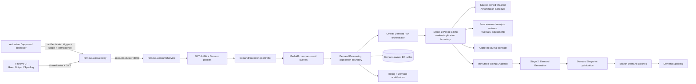
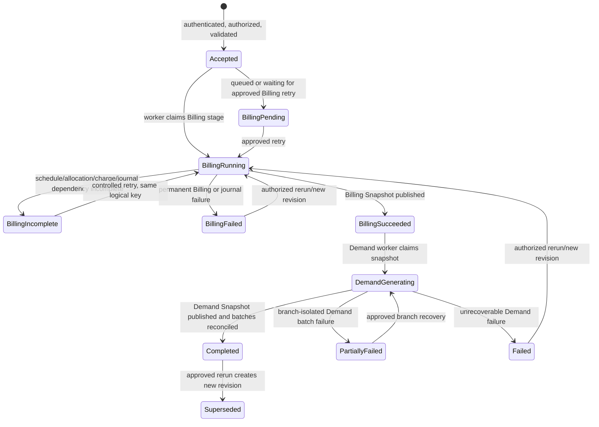
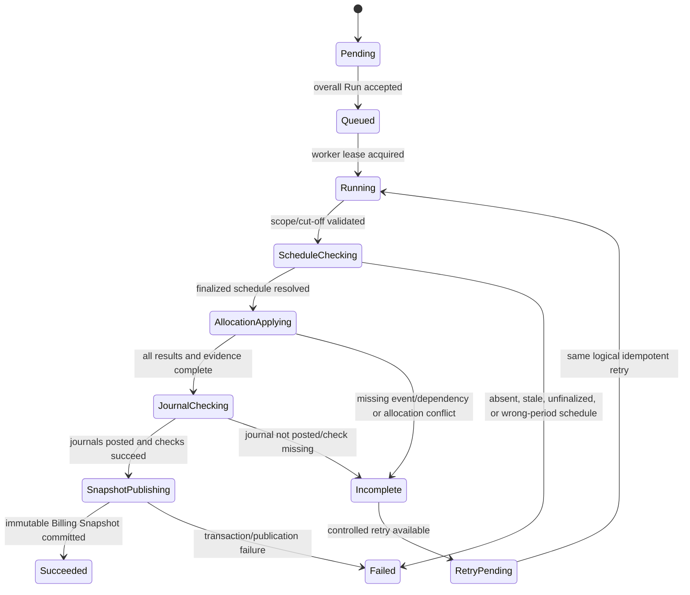
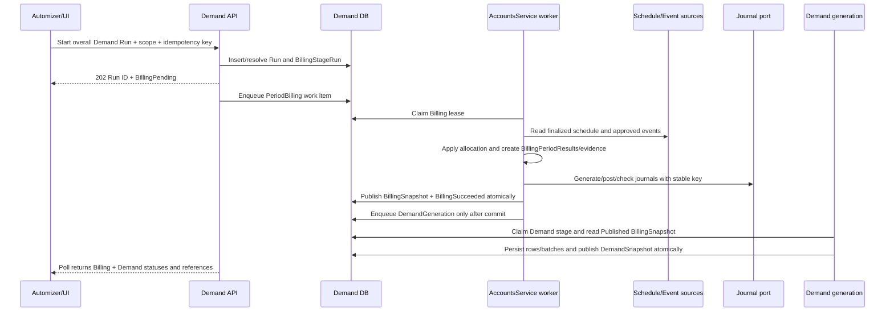

# Design Document: Demand Processing

## Overview

Demand Processing is an operational finance workflow that produces a period-specific MIS of account dues and arrears. **One Demand Run is the operational unit for two ordered stages: Period Billing first, then Demand Generation/Spooling.** Demand Generation is never an independent entry path and cannot start from an incomplete Billing stage.

The Period Billing stage is an application/background-worker boundary. It may initially run inside `Finnova.AccountsService`; a separately deployed Billing service is not required. Automizer or the approved scheduler triggers the overall Demand Run. The worker resolves finalized schedule data, applies approved account-level financial allocations, creates and posts billing journals, and publishes one immutable Billing Snapshot. Only after that publication gate succeeds does Demand Generation create account rows, branch batches, and a Demand Snapshot for output and spooling.

This design covers both platform sides:

- **Backend:** `e:\Finnova\Finnova-API`, solution `Finnova.Backend.slnx`.
- **Frontend:** `E:\Finnova\Finnova-UI\Finnova-UI`, React 18, TypeScript, Vite, Material UI, shared axios, React hooks/Context, Vitest, and React Testing Library.

The implementation target is the existing repository structure. This document creates no source files, migration, or test changes.

### 1.1 FRS and requirements baseline

The following behavior is treated as explicit and is preserved throughout the design:

- Demand Processing contains two ordered internal stages: **Period Billing**, followed by **Demand Generation/Spooling**.
- The Demand Run is the single operational unit for scope, period, stage statuses, diagnostics, audit history, snapshots, retries, and final output.
- Automizer or the approved scheduler triggers the overall run. A manual start or recovery path, if approved, uses the same workflow and controls.
- Period Billing reads the finalized Amortization Schedule for the selected period. It sets Scheduled Installment to scheduled principal plus scheduled interest/EMI, does not recompute EMI, and never mutates the schedule.
- Period Billing applies approved receipts, waivers, reversals, adjustments, and other account-level events exactly once under an approved allocation policy.
- Current Due is the unpaid selected-period Scheduled Installment after allocation. Arrears is previous-period unpaid value. ODI and Other Charges remain separate components.
- Billing journals must be generated and posted, and all Billing checks must succeed, before a Billing Snapshot or Demand Snapshot is published.
- Demand Generation includes only eligible Active accounts at the approved cut-off, excludes Closed, Cancelled, and Pre-Closed accounts, calculates `Total Demand = Current Due + Arrears + ODI + Other Charges`, and creates branch-wise batches.
- Demand output and spooling consume persisted Billing-derived values. They do not calculate EMI, edit billing values, recalculate rows, or bypass Billing.
- Retried requests are idempotent by the normalized LOB/branch/frequency/Month-Year logical scope plus the approved idempotency key. The same logical period must not create duplicate Billing Period Results, allocations, billing journals, Demand Rows, or successful logical spool deliveries.
- Authentication, authorization, branch/LOB scope, auditability, deterministic behavior, INR precision, English-only text, and no RTL behavior are required.

### 1.2 Proposed decisions and assumptions

The requirements mark the following decisions as assumptions pending confirmation. The design uses explicit interfaces and configuration so those decisions can change without changing the stage ordering or publication gates.

| Decision | Proposed design | Requirement assumption |
| --- | --- | --- |
| Host placement | Run the initial Billing worker and Demand application boundary in `Finnova.AccountsService`. A separate Billing deployment is optional future extraction, not a prerequisite. | A1, A24 |
| Trigger | Automizer or the approved scheduler starts the overall Demand Run. The service owns stage progression. | A12, A25 |
| Run identity | Generate an immutable GUID Run identifier and a revision number for approved reruns. | A2, A13 |
| Idempotency | Canonical key includes normalized LOB, branch scope, frequency, Month-Year, source versions, and approved idempotency key. Durable uniqueness resolves concurrent retries. | A13, A14, A29 |
| Business period | API carries `periodYear` and `periodMonth`; derive the period in `Asia/Kolkata` unless another approved timezone replaces it. Persist technical timestamps in UTC. | A3 |
| Frequency | Validate an exact value supported by the Billing contract. Demand Processing cannot invent a new frequency. | A4 |
| Scope | LOB is required. An omitted Branch means all authorized branches only if the confirmed policy permits omission; otherwise validation rejects it. | A5 |
| Schedule | The source-owned finalized Amortization Schedule is authoritative. Demand owns only schedule identity/version references. | A26 |
| Allocation | Use an approved allocation policy/version and durable event references. Each approved event is applied once and allocation evidence is retained. | A7, A27 |
| Charges | Persist ODI and Other Charges separately. The proposed `Total Charges` is `ODI + Other Charges`, calculated once. | A6, A28 |
| Journal boundary | Billing owns or invokes the approved journal generation/posting contract. Demand records journal references and blocks snapshot publication until required checks succeed. | A29 |
| Partial failure | Default to branch isolation for Demand Generation, but Billing failure affecting required results blocks the Billing Snapshot and therefore blocks all Demand Generation for that Run. | A16 |
| Zero demand | Retain eligible zero-demand rows by default with an explicit indicator, unless the approved policy requires omission. | A17 |
| Money | INR `decimal(19,2)` with the approved non-negative rounding policy, proposed as `MidpointRounding.AwayFromZero`. | A18 |
| Retention | Preserve Billing and Demand execution/results/audit history under the approved financial-record retention policy. | A19, A30 |
| Authorization | Separate policies for run/rerun, output/history, spooling, and optional audit read. Enforce LOB/Branch scope in handlers and queries. | A20 |
| Frontend | Show both stage statuses and persisted Billing-derived values. No EMI calculator or free-form Billing edit is exposed. | A22 |
| Testing | Use FsCheck.Xunit for pure schedule/allocation/idempotency logic, xUnit and WebApplicationFactory for boundaries, and Vitest/RTL for UI. | A23 |

If an assumption changes, contracts, persistence, tests, and the implementation task list must be updated before implementation. It must not be silently converted into new business behavior.

### 1.3 Goals

- Execute Period Billing and Demand Generation in one ordered, auditable Demand Run.
- Produce Scheduled Installment directly from finalized schedule principal plus scheduled interest/EMI.
- Apply account-level financial events exactly once and retain allocation evidence.
- Prevent Demand Snapshot publication, Demand Rows, and spooling before successful Billing and journal checks.
- Produce reproducible Billing Period Results and Demand output from immutable source/version references.
- Prevent duplicate Billing results, allocations, journals, Demand Rows, batches, and logical spool deliveries on retry.
- Preserve source ownership boundaries while retaining the references required for financial reconciliation.
- Give Operations clear stage-specific statuses, diagnostics, and recovery information in English.
- Reuse existing backend, gateway, persistence, authentication, and frontend patterns.

### 1.4 Non-goals

- Creating or editing LOB, Branch, Customer, Account, Amortization Schedule, receipt, waiver, reversal, adjustment, charge master, or accounting master records.
- Recomputing EMI or deriving a replacement installment from account inputs.
- Mutating a finalized Amortization Schedule.
- Allowing a Demand Generation or Spooling endpoint to bypass Period Billing.
- Introducing a separately deployed Billing service as a required component of the first implementation.
- Replacing Automizer or defining formulas that the approved Billing/allocation policy owns.
- Recalculating a Billing Period Result or Demand Row when viewing, exporting, or spooling.
- Adding Redux/RxJS, an ad-hoc axios client, bilingual fields, translation scaffolding, non-English data, or RTL behavior.

## Architecture

The existing repository supports this design directly:

- `Finnova.AccountsService/Program.cs` already registers controllers, MediatR, FluentValidation, JWT Bearer authentication, authorization, repository services, exception middleware, and the public `Program` test shim.
- `Finnova.Repository.Context.FinnovaDbContext` is the shared EF Core context and uses `ApplyConfigurationsFromAssembly`; new Demand-owned entities and configurations follow this pattern.
- Existing service slices use feature folders under `Finnova.Service`, repository contracts under `Finnova.Repository.Interfaces`, and contracts/entities under `Finnova.Models`.
- The Accounts host is the proposed initial host for both the Billing worker boundary and Demand Processing application layer. No new host is necessary for the first release.
- The YARP gateway needs aliases under the existing UI-composed prefix and forwards to `accounts-cluster`.
- The UI has shared axios, feature service interfaces, real/mock/toggle modules, MUI grids, React hooks, and Vitest/RTL patterns to reuse.

### 2.1 Logical architecture



The source systems remain authoritative for schedules, accounts, customers, receipts, waivers, reversals, adjustments, charges, and master data. Demand Processing reads narrow, versioned projections and stores execution/result records that it owns.

### 2.2 One Demand Run and its ordered stages

A Demand Run has one normalized logical scope: LOB, Branch scope, Frequency, Month-Year, Processing Cut-off, and approved idempotency key. Its lifecycle is:

1. Authenticate and authorize Automizer or an approved user before processable state is created.
2. Normalize scope and period, resolve authorized branches, and compute the logical idempotency fingerprint.
3. Create or resolve the authoritative Demand Run and Billing Stage Run. Equivalent concurrent requests resolve to the same record.
4. Queue or dispatch the Period Billing worker within the approved AccountsService worker boundary.
5. Period Billing resolves the finalized Amortization Schedule, selects eligible Active accounts at the approved cut-off, applies approved allocations exactly once, calculates Billing Period Results, generates/posts journals, and performs all Billing checks.
6. Publish one immutable Billing Snapshot only after every required Billing and journal check succeeds. On incomplete or failed Billing, retain diagnostics and keep the Demand Run non-processable.
7. Demand Generation reads only that Billing Snapshot, creates Demand Rows and branch-wise Demand Batches, reconciles them, and publishes one Demand Snapshot.
8. Demand Output reads persisted Demand Snapshot data. Demand Spooling reads completed persisted batches and never recalculates them.

There is no public command for “generate demand now” that skips the Billing stage. Internal worker handlers may resume a stage only after verifying the durable state and its predecessor's publication gate.

### 2.3 Worker, queue, and lifecycle boundary

The first implementation may use an existing durable queue or a persisted work record plus an `IHostedService`/background dispatcher inside `Finnova.AccountsService`. The boundary is application-level even when the worker runs in the same process:

- `StartDemandRun` creates the durable Run and stage records, returns quickly with `202`, and enqueues a stage work item.
- The work item contains Run ID, stage, revision, logical scope key, approved idempotency key, correlation ID, and no bearer token or raw sensitive payload.
- A worker claims work with a database-backed lease and rowversion. It renews the lease while processing and stops publication if renewal fails.
- Period Billing and Demand Generation are separate work phases. Demand Generation work is enqueued only after Billing Snapshot publication.
- A process restart leaves durable `Accepted`, `BillingPending`, `BillingRunning`, `BillingFailed`, `BillingSucceeded`, `DemandGenerating`, or recovery state. Startup recovery may requeue eligible work; it must not mark incomplete work successful.
- A future separately deployed Billing service can implement the same Billing ports, but extraction is optional and does not change the public Demand Run contract.

Retries are idempotent by the normalized LOB/branch/frequency/Month-Year scope plus the approved idempotency key and source-version fingerprint. The worker must resolve existing successful stage/results before applying a second allocation or journal operation.

### 2.4 Boundary rules

- **Controller:** HTTP binding, authentication/authorization attributes, correlation extraction, status codes, and MediatR dispatch only. It does not query EF or calculate money.
- **Run orchestrator:** Owns stage ordering, durable state transitions, idempotency, leases, recovery, and publication gates. It never recomputes source financial values.
- **Period Billing application service:** Coordinates schedule, account, allocation, charge, and journal ports. It produces Billing Period Results and the Billing Snapshot. It does not own source schedules or event masters.
- **Demand Generation application service:** Consumes one immutable Billing Snapshot, applies eligibility/output/batching rules, and publishes Demand Snapshot data. It cannot execute without a successful Billing Snapshot reference.
- **Pure domain helpers:** Calculate scheduled installment from schedule components, apply allocation policy, calculate unpaid Current Due/Arrears, calculate charges, normalize money, determine eligibility, group rows, and reconcile aggregates. They have no database, HTTP, logging, or clock dependency.
- **Repositories:** Persist Demand-owned execution, results, snapshots, audit, and outbox records. They do not own source lifecycle.
- **Source ports:** Return narrow immutable projections and references for schedule, account/customer/master, receipt/event, charge, and journal data.
- **Frontend:** Owns form/filter/loading/polling state and displays persisted values. It does not calculate EMI, alter Billing fields, or use a client-side value as an authoritative total.

## Components and Interfaces

### 3.1 Reused components

| Concern | Existing component/convention | Design use |
| --- | --- | --- |
| Host and worker | `Finnova.AccountsService` | Controller, auth, middleware, DI, and initial hosted worker boundary. |
| CQRS | MediatR registration | Add Run, Billing, Demand Generation, read, and spool handlers. |
| Validation | FluentValidation and validation behavior | Validate scope, period, frequency, idempotency, and commands before financial reads. |
| Persistence | `FinnovaDbContext`, EF configurations, repository DI | Add Demand-owned stage/result/snapshot/audit tables and constraints. |
| Authentication | Existing JWT Bearer pipeline | Authenticate before authorization or any processable mutation. |
| Authorization | Existing policy/role claims | Add explicit Demand policies and source-aware scope checks. |
| Errors | `ExceptionHandlingMiddleware` | Add Billing-specific stable codes and safe ProblemDetails mapping. |
| Gateway | YARP aliases | Forward UI-composed Demand routes to AccountsService. |
| UI HTTP | `src/services/api.ts` | JWT propagation and central 401/403/409/timeout handling. |
| UI service pattern | Interfaces, mock, real, toggle, barrels | Add Demand Processing service modules. |
| UI rendering | MUI DataGrid/Card/Alert/Dialog/Select | Build stage/status, output, and spooling screens. |
| UI state | React hooks and existing Context | No Redux, RxJS, or new global store. |
| Tests | xUnit, FsCheck.Xunit, WebApplicationFactory, Vitest, RTL | Test pure financial logic and all integration boundaries. |

### 3.2 New backend components

- Demand Run aggregate, stage enums, Billing Stage Run, Demand stage state, revision, scope, failure, audit, and outbox entities.
- Billing Period Result, allocation evidence/event reference, Billing Snapshot, Demand Row, Demand Batch, and Demand Snapshot entities.
- Typed exceptions and error codes for BillingIncomplete, BillingScopeMismatch, BillingScheduleIncomplete, BillingAllocationConflict, BillingJournalIncomplete, BillingSnapshotUnavailable, IdempotencyConflict, concurrency, data quality, reconciliation, dependency, and spooling outcomes.
- Narrow source ports for finalized schedules, account/customer/master data, receipt/waiver/reversal/adjustment events, charge values, and journal generation/posting/checks.
- Pure schedule, allocation, unpaid-balance, charge, eligibility, batching, reconciliation, fingerprint, and publication-gate helpers.
- Repositories, EF configurations, DbSets, indexes, transaction/unit-of-work coordination, leases, and migration.
- CQRS commands/queries, validators, mappers, controller, middleware mappings, DI, worker dispatcher, and recovery coordinator.

### 3.3 New frontend components

- Demand model and API types including Billing and Demand stage statuses, Billing Period Result summaries, snapshots, failures, and schedule references.
- `IDemandProcessingService`, mock implementation with English-only fixtures, real shared-axios implementation, toggle module, and barrels.
- Demand Run page/components with two-stage status and BillingIncomplete/failed states.
- Demand Generation Output page/components that display persisted Billing-derived amounts.
- Demand Spooling page/components with batch readiness and attempt history.
- Vitest/RTL coverage for service selection, screens, permissions, states, and retry behavior.

## Requirements coverage map

| Requirement | Design coverage |
| --- | --- |
| R1 Define and validate a Demand Run | Sections 2.2, 3.4, 4.1, 5.1, and 6.1: normalized scope, auth, run identity, idempotency, and audit. |
| R2 Enforce successful internal Billing stage | Sections 2.2, 2.3, 4.2, 7, and 8: ordered stages, Billing gates, statuses, and no bypass route. |
| R3 Execute schedule-driven Period Billing | Sections 4.3, 4.4, 7, 8.2, and 9: schedule references, principal-plus-interest installment, allocation, charges, journals, and snapshot publication. |
| R4 Select eligible accounts | Sections 4.5 and 8.3: Active status at cut-off, resolvable references, and source evidence. |
| R5 Calculate account-level Demand | Sections 4.6, 8.3, 9.3, and 11: Billing-derived Current Due/Arrears/charges and deterministic totals. |
| R6 Create branch-wise batches | Sections 4.7 and 8.4: branch partition, totals, status, and spooling guard. |
| R7 Trigger automatic processing/manual initiation | Sections 2.3, 6.1, 7.1, and 10: Automizer contract, worker lifecycle, authorization, and idempotency. |
| R8 Maintain history and idempotent reruns | Sections 4.1, 4.10, 8.5, 10, and 12: revisions, source versions, stage results, and retained history. |
| R9 Concurrency and atomic publication | Sections 2.3, 4.10, 7.4, 8.1, and 10.2: leases, uniqueness, transaction/publication gates. |
| R10 Failures and reconciliation | Sections 5.7, 6.4, 7, 8.2-8.5, and 9.4: stage-specific failure classes and safe diagnostics. |
| R11 Demand Run screen | Section 11.2: scope form, Billing/Demand status, polling, BillingIncomplete, and permission gating. |
| R12 Demand Generation Output | Section 11.3: persisted values, Billing references, filters, pagination, and no client recalculation. |
| R13 Demand Spooling | Sections 4.7, 8.4, 11.4: ready guard, stable batch identity, attempts, and no recalculation. |
| R14 Authentication, authorization, and scope | Sections 2.4, 6.2, 9.2, 11.5, and 12.2. |
| R15 Audit and traceability | Sections 4.8, 9.5, and 12.3: stage/result/snapshot/journal/allocation audit evidence. |
| R16 Deterministic correctness/testing | Sections 9, 13, and 14: schedule, allocation, retry, publication, and batching properties. |
| R17 India/English/no RTL | Sections 4.6, 11, and 12.4: INR, English-only content, and left-to-right UI. |

## Data Models

### 4.1 Demand Run aggregate and revision

`DemandRun` is the lifecycle aggregate for one accepted scope and period. `DemandRunRevision` retains an immutable calculated revision when a controlled rerun is approved. The Run owns the two ordered stage records and references the final snapshots.

| Field | Rule |
| --- | --- |
| `Id` | Immutable GUID Run identifier. |
| `LogicalScopeKey` | Canonical generated key for normalized LOB, branch scope, frequency, Month-Year, and source scope identity. |
| `LineOfBusinessId` | Required source-owned LOB reference. |
| `BranchScope` | Resolved authorized branches in a child table and stable order. |
| `Frequency`, `PeriodYear`, `PeriodMonth` | Exact Billing-supported frequency and business period. |
| `ProcessingCutoffUtc` | Approved cut-off retained for both stages. |
| `IdempotencyKey`, `PayloadFingerprint` | Approved key and immutable normalized payload fingerprint. |
| `Source`, `ActorId`, `CorrelationId` | Automizer or User; safe actor reference; correlation metadata. |
| `Status` | `Accepted`, `BillingPending`, `BillingRunning`, `BillingIncomplete`, `BillingFailed`, `BillingSucceeded`, `DemandGenerating`, `Completed`, `PartiallyFailed`, `Failed`, `Deferred`, `Superseded`, or `Conflict`. |
| `RevisionNumber` | Positive immutable revision number unique within the logical scope. |
| `BillingStageRunId`, `BillingSnapshotId` | Required references after stage creation/publication. |
| `DemandSnapshotId` | Set only after successful Demand Generation publication. |
| `RowCount`, component totals, batch count | Reconciled summary values at approved INR precision. |
| `Version` | SQL Server `rowversion` for lease/state concurrency. |
| Lifecycle timestamps | UTC request, start, stage completion, final completion, and failure times. |

A completed unchanged request resolves to the existing revision. A controlled rerun preserves the original and creates a linked revision; it never silently overwrites delivered output.

### 4.2 BillingStageRun

`BillingStageRun` is Demand Processing's execution record for the first ordered stage. It is Demand-owned and does not become the source-of-truth schedule or accounting ledger.

| Field | Rule |
| --- | --- |
| `Id`, `RunId`, `RevisionNumber` | Immutable identity and parent reference. |
| `LogicalBillingScopeKey` | Normalized LOB, branch scope, frequency, Month-Year, and approved idempotency/source fingerprint. |
| `Status` | `Pending`, `Queued`, `Running`, `Incomplete`, `Failed`, `Cancelled`, `Succeeded`, `RetryPending`, or `Superseded`. |
| `Source` and worker metadata | Automizer/User source, worker attempt, host, lease, and correlation reference. |
| `ProcessingCutoffUtc` | Cut-off used for eligibility and source event selection. |
| `ScheduleFinalizationReference` | Source schedule watermark/finalization version required for the run. |
| `AllocationPolicyReference` | Immutable approved allocation policy/version. |
| `ChargePolicyReference` | ODI/Other Charges policy/version. |
| `JournalBatchReference` | Required after journal generation/posting. |
| `BillingSnapshotId`/`Version` | Set only after successful immutable snapshot publication. |
| Counts/totals | Eligible, successful, excluded, failed, allocation, and journal reconciliation counts. |
| `FailureCode`, safe diagnostic | Machine-readable Billing code and redacted details. |
| timestamps/version | UTC stage lifecycle and rowversion. |

`BillingStageRun` has a unique authoritative record for the same logical Billing scope, period, source versions, revision, and approved idempotency key. A retry reads this record before doing any financial mutation.

### 4.3 BillingPeriodResult

`BillingPeriodResult` is the Demand-owned retained account result of Period Billing. It is created only when the selected finalized schedule and required allocation/charge checks succeed for the affected account.

| Field | Rule |
| --- | --- |
| `Id`, `BillingStageRunId`, `RunId`, `RevisionNumber` | Immutable parent dimensions. |
| `AccountId`, `CustomerId`, `LOB`, `Branch` | Source references and retained dimensions. |
| `AccountStatusAtCutoff`, `EligibilityDecision` | Status/reference evidence used by Billing. |
| `ScheduleId`, `ScheduleVersion`, `ScheduleEntryId`, `ScheduleEntryVersion` | Exact source-owned finalized schedule references. |
| `ScheduledPrincipal`, `ScheduledInterestOrEmi` | Values read from the selected schedule entry. |
| `ScheduledInstallment` | Exactly `ScheduledPrincipal + ScheduledInterestOrEmi` under approved precision. Never recomputed from account inputs. |
| `CurrentDue` | Unpaid selected-period Scheduled Installment after approved allocations. |
| `Arrears` | Previous-period unpaid value from prior Billing results, kept separate from Current Due. |
| `Odi`, `OtherCharges` | Separate source/policy values, excluded from installment/current due/arrears. |
| `AllocationPolicyReference` | Policy/version used for allocation. |
| `AllocationEvidence` | Child allocation rows or event references described below. |
| `JournalReference` | Billing journal batch/entry reference and posting/check status. |
| `Status` | `Succeeded`, `Excluded`, `Failed`, or `Incomplete`; only successful results enter a successful Billing Snapshot. |
| `SourceCutoff`, `SourceSnapshotVersion`, timestamps | Reproducibility and audit references. |

A missing, unfinalized, stale, or wrong-period schedule produces a failure diagnostic and no successful Billing Period Result for that account.

### 4.4 Allocation evidence and event references

`BillingAllocationEvidence` is Demand-owned evidence of how each approved event affected a Billing Period Result. The source event remains owned by the receipt/waiver/reversal/adjustment system.

| Field | Rule |
| --- | --- |
| `Id`, `BillingPeriodResultId`, `BillingStageRunId` | Immutable identity and parent. |
| `SourceEventType`, `SourceEventId`, `SourceEventVersion` | Receipt, waiver, reversal, adjustment, or other approved event reference. |
| `EventEffectiveUtc`, `EventSourceCutoff` | Evidence that the event was eligible for the run. |
| `AllocationPolicyReference`, `AllocationSequence` | Policy/version and deterministic order. |
| `AllocatedAmount`, `Currency` | INR amount applied once to the result. |
| `TargetComponent` | Selected installment/current due, prior-period arrears, charge, suspense, or approved target. |
| `Outcome` | `Applied`, `Excluded`, `Deferred`, `Reversed`, or `Rejected` with safe reason. |
| `IdempotencyKey`, `SourceFingerprint` | Unique event/application identity. |

A unique constraint on Billing Stage Run, source event identity/version, target scope, and allocation policy prevents the same event from being applied twice. Evidence supports allocation conservation and retry investigation.

### 4.5 BillingSnapshot

`BillingSnapshot` is an immutable publication owned by Demand Processing. It contains the exact successful Billing Period Results and references needed by Demand Generation.

| Field | Rule |
| --- | --- |
| `Id`, `Version`, `BillingStageRunId` | Immutable identity/version. |
| Logical scope and period | Must equal the parent Demand Run. |
| `ProcessingCutoffUtc`, schedule finalization reference | Common source boundary. |
| `ResultCount`, component totals | Reconciled successful-result counts/totals. |
| `JournalBatchReference`, journal check summary | Proof that required journals were generated/posted/checked. |
| `PublicationStatus` | `Pending`, `Published`, `Rejected`, or `Superseded`; only Published can unlock Demand Generation. |
| `ContentFingerprint` | Deterministic hash of results/references/policy versions. |
| `PublishedAtUtc`, actor/source/correlation | Immutable publication evidence. |

The snapshot is published in one transaction with the final Billing Stage status, journal check evidence, and audit event. No later source mutation changes the snapshot.

### 4.6 Demand Snapshot, Demand Row, and Demand Batch

`DemandSnapshot` is the immutable publication of Demand Generation output. It references exactly one Published BillingSnapshot and contains complete reconciled Demand Rows and Demand Batches.

`DemandRow` contains Account, Customer, LOB, Branch, Month-Year, Frequency, `BillingPeriodResultId`, Billing Snapshot version, Current Due, Arrears, ODI, Other Charges, Total Charges, Total Demand, zero-demand indicator, and deterministic Account ordering. The row copies persisted Billing-derived values; it does not calculate or edit a Scheduled Installment.

`DemandBatch` is one logical branch-scoped collection for a Run Revision. It stores row count, every component total, Total Demand, stable batch identity, `ReadyToSpool`/`Spooled`/failure state, and the parent Demand Snapshot reference. One row belongs to exactly one matching branch batch.

### 4.7 Source ownership versus Demand ownership

| Data | Owner | Demand behavior |
| --- | --- | --- |
| Amortization Schedule and finalized schedule entries | Existing Accounts/lending schedule source | Read finalized identity/version and scheduled principal/interest; never mutate or own schedule values. |
| Account, Customer, LOB, Branch, status | Existing master/account sources | Read versioned/narrow projections for scope and eligibility; retain references and approved display snapshot values only. |
| Receipts, waivers, reversals, adjustments, other allocation events | Existing collection/financial sources | Read eligible events; retain one allocation evidence record per applied event. |
| ODI and Other Charges source/policy | Approved Billing/charge owner | Read and retain separate values and policy references; Demand does not recompute. |
| Billing journals/ledger | Approved accounting owner | Invoke approved posting/check contract and retain journal references; do not create a second ledger. |
| BillingStageRun, BillingPeriodResult, allocation evidence | Demand Processing | Own execution/result/evidence records and lifecycle audit. |
| BillingSnapshot, DemandSnapshot, DemandRun, DemandRow, DemandBatch | Demand Processing | Own immutable publications and operational output. |
| Audit, failure, lease, outbox records | Demand Processing/platform | Own append-only traceability and delivery coordination. |

### 4.8 EF Core configuration, indexes, and migration

Add Demand entities/configurations under the existing domain/configuration conventions and register DbSets in `FinnovaDbContext`. Use `ApplyConfigurationsFromAssembly`.

Required constraints and indexes include:

- unique authoritative `(LogicalScopeKey, RevisionNumber)` for Demand Runs;
- unique active lease/authoritative stage record for a normalized logical Billing scope, revision, source versions, and approved idempotency key;
- unique `(BillingStageRunId, AccountId)` for successful Billing Period Results;
- unique `(BillingPeriodResultId, SourceEventType, SourceEventId, SourceEventVersion, AllocationPolicyReference)` for allocation evidence;
- unique `(BillingStageRunId, ScheduleId, ScheduleVersion, AccountId)` where the approved schedule identity requires it;
- unique Published Billing Snapshot for a Billing Stage Run and revision;
- unique `(DemandSnapshotId, AccountId)` for Demand Rows;
- unique `(DemandSnapshotId, BranchId)` for logical Demand Batches;
- unique `(BatchId, AttemptNumber)` for spool attempts;
- unique journal idempotency key by Billing Stage Run/logical scope/period;
- indexes for period, LOB, Branch, stage status, Billing status, account, customer, snapshot version, completion time, and audit correlation;
- `decimal(19,2)` INR columns and UTC datetime columns;
- non-cascading references to source IDs unless deletion behavior is explicitly approved;
- restricted deletion for all Billing/Demand results, snapshots, evidence, failures, journals references, spool attempts, and audit records.

The migration is generated and reviewed by the implementer after source contracts and table ownership are confirmed. This design does not apply a migration.

## Contracts and API flow

All endpoints require JWT Bearer authentication. JSON uses configured camelCase and string status values. The client cannot supply Run ID, stage status, totals, Billing Snapshot ID, schedule version, journal status, or actor identity.

### 5.1 Start and query contracts

```text
StartDemandRunRequest
  lineOfBusinessId: Guid
  branchId?: Guid
  frequency: string
  periodYear: int
  periodMonth: int
  idempotencyKey: string
  confirmationToken?: string       // only if approved manual action requires it

StartDemandRerunRequest
  reason: string
  idempotencyKey: string
  confirmationToken: string

DemandRunQuery
  periodYear?: int
  periodMonth?: int
  lineOfBusinessId?: Guid
  branchId?: Guid
  status?: string
  billingStatus?: string
  demandStatus?: string
  page: int = 1
  pageSize: int = 20

DemandRowsQuery
  runId?: Guid
  revisionNumber?: int
  periodYear?: int
  periodMonth?: int
  lineOfBusinessId?: Guid
  branchId?: Guid
  accountId?: Guid
  customerId?: Guid
  page: int = 1
  pageSize: int = 20

DemandBatchesQuery
  runId?: Guid
  revisionNumber?: int
  periodYear?: int
  periodMonth?: int
  lineOfBusinessId?: Guid
  branchId?: Guid
  status?: string
  page: int = 1
  pageSize: int = 20

SpoolBatchRequest
  idempotencyKey?: string
  confirmationToken?: string
```

A Billing-specific internal work contract carries Run ID, BillingStageRun ID, scope, period, source/version references, approved idempotency key, and correlation ID. It is not exposed as a second public Billing API that could create an out-of-band result.

### 5.2 Endpoint semantics

Controller prefix: `/api/demand-processing` in AccountsService.

| Method | Route | Purpose | Success |
| --- | --- | --- | --- |
| POST | `/api/demand-processing/runs` | Automizer/scheduler or approved manual start of the overall two-stage run | `202 DemandRunAcceptedResponse` |
| GET | `/api/demand-processing/runs/{runId}` | Query Run, Billing stage, Demand stage, snapshot references, diagnostics | `200 DemandRunResponse` |
| GET | `/api/demand-processing/runs` | Authorized history/status query, including Billing/Demand filters | `200 PaginatedResponse<DemandRunSummaryResponse>` |
| POST | `/api/demand-processing/runs/{runId}/rerun` | Controlled rerun of the overall Run; preserves prior revision | `202 DemandRunAcceptedResponse` |
| GET | `/api/demand-processing/runs/{runId}/rows` | Query persisted Demand Rows after Billing/Demand publication | `200 PaginatedResponse<DemandRowResponse>` |
| GET | `/api/demand-processing/batches` | Query branch batches and Billing/Demand readiness | `200 PaginatedResponse<DemandBatchResponse>` |
| GET | `/api/demand-processing/batches/{batchId}` | Query batch and safe diagnostics | `200 DemandBatchResponse` |
| POST | `/api/demand-processing/batches/{batchId}/spool` | Spool/re-spool a completed persisted batch only | `202 SpoolAcceptedResponse` or `200` existing acknowledgement |
| GET | `/api/demand-processing/batches/{batchId}/spool-attempts` | Query immutable spool attempts | `200 SpoolAttemptResponse[]` |

There is deliberately no public `POST /billing`, `POST /demand-generation`, `POST /spool-from-billing`, or equivalent endpoint that allows a caller to bypass the overall Run. Spooling remains available only for a batch linked to a published Demand Snapshot and a successful Billing Snapshot.

### 5.3 Response contracts

`DemandRunResponse` includes Run ID, revision, normalized scope, period, overall status, `billingStage` status and diagnostics, `demandStage` status and diagnostics, Billing Stage Run ID, Billing Snapshot version, Demand Snapshot ID/version when available, schedule finalization reference, allocation policy reference, journal reference/check state, counts/totals, source, actor, correlation ID, and UTC timestamps.

`BillingStageResponse` includes Billing status, Processing Cut-off, schedule/version checks, eligible/successful/failed account counts, allocation event counts, allocation policy reference, Billing Period Result count, journal status/reference, Billing Snapshot publication status/version, retry/idempotency state, safe failure code, and last transition.

`BillingPeriodResultResponse` is exposed only through an authorized Run/result diagnostic contract where approved. It includes Account, schedule identity/version, scheduled principal, scheduled interest/EMI, Scheduled Installment, Current Due, Arrears, ODI, Other Charges, allocation evidence references/summary, journal reference, Billing Snapshot version, status, and source cut-off. It does not provide a client edit action.

`DemandRowResponse` includes Account, Customer, Branch, LOB, Month-Year, Frequency, Current Due, Arrears, ODI, Other Charges, Total Charges, Total Demand, Billing Period Result reference, Billing Snapshot version, row status, and stable ordering fields.

`DemandBatchResponse` includes Branch, LOB, period, Run/revision, Billing Snapshot and Demand Snapshot versions, row count, component totals, Total Demand, batch status, last spool time, source/actor, acknowledgement/reference, and safe failure information.

### 5.4 Error codes and idempotency

Extend `ExceptionHandlingMiddleware` with a stable Demand/Billing error family and RFC 7807-compatible JSON containing `status`, `code`, `message`, `correlationId`, and safe field errors.

| Condition | HTTP | Code |
| --- | --- | --- |
| Missing/invalid JWT | 401 | Platform authentication response |
| Authenticated identity out of policy/scope | 403 | Platform authorization response |
| Missing/malformed input | 400 | `ERR-DEMAND-VALIDATION` |
| Unsupported frequency/period | 400 | `ERR-DEMAND-FREQUENCY` / `ERR-DEMAND-PERIOD` |
| Billing not complete or required dependency missing | 409 or configured deferred response | `ERR-DEMAND-BILLING-INCOMPLETE` |
| Billing scope mismatch | 409 | `ERR-DEMAND-BILLING-SCOPE` |
| Schedule absent/unfinalized/stale/wrong period | 422 | `ERR-BILLING-SCHEDULE-INCOMPLETE` |
| Allocation event duplicate/conflict/policy failure | 409/422 | `ERR-BILLING-ALLOCATION-CONFLICT` |
| Required journal check/posting incomplete | 409/422 | `ERR-BILLING-JOURNAL-INCOMPLETE` |
| Billing Snapshot cannot publish | 409 | `ERR-BILLING-SNAPSHOT-BLOCKED` |
| Billing retry with changed source/payload | 409 | `ERR-DEMAND-IDEMPOTENCY-CONFLICT` |
| Active concurrent worker/lease | 409 or existing accepted reference | `ERR-DEMAND-CONCURRENT` |
| Run/batch not found in caller scope | 404 | `ERR-DEMAND-NOT-FOUND` |
| Invalid source/reference/amount | 422 | `ERR-DEMAND-DATA-QUALITY` |
| Aggregate/dimension mismatch | 422 | `ERR-DEMAND-RECONCILIATION` |
| Demand requested before Billing publication | 409 | `ERR-DEMAND-BILLING-INCOMPLETE` |
| Spool requested before Demand Snapshot/batch readiness | 409 | `ERR-DEMAND-SPOOL-NOT-READY` |
| Downstream spool failure | 502/409 | `ERR-DEMAND-SPOOL` |
| Unexpected dependency failure | 503 | `ERR-DEMAND-DEPENDENCY` |

The service computes a canonical fingerprint from normalized LOB/branch scope, frequency, Month-Year, action, approved source references, and immutable request payload. Reusing an idempotency key with a different fingerprint is rejected without modifying the original Run. Retried equivalent requests resolve the existing stage/results and do not insert duplicate allocations, Billing Period Results, journal requests, Demand Rows, or batches.

## Backend component and interface design

### 6.1 Proposed namespaces and files

```text
Finnova.Models/
  Domain/Entities/DemandRun.cs
  Domain/Entities/DemandRunRevision.cs
  Domain/Entities/BillingStageRun.cs
  Domain/Entities/BillingPeriodResult.cs
  Domain/Entities/BillingAllocationEvidence.cs
  Domain/Entities/BillingSnapshot.cs
  Domain/Entities/DemandSnapshot.cs
  Domain/Entities/DemandRow.cs
  Domain/Entities/DemandBatch.cs
  Domain/Entities/DemandFailure.cs
  Domain/Entities/DemandSpoolAttempt.cs
  Domain/Entities/DemandAuditEntry.cs
  Domain/DomainEnums/BillingStageStatus.cs
  Domain/DomainEnums/DemandStageStatus.cs
  Domain/DomainEnums/DemandRunStatus.cs
  Contracts/DemandProcessing/...

Finnova.Service/DemandProcessing/
  Commands/StartDemandRun/
  Commands/RerunDemandRun/
  Commands/RunPeriodBilling/
  Commands/GenerateDemand/
  Commands/SpoolDemandBatch/
  Queries/GetDemandRun/
  Queries/GetBillingResults/
  Queries/GetDemandRows/
  Queries/GetDemandBatches/
  Calculation/
  Billing/
  Allocation/
  Eligibility/
  Batching/
  Ports/
  Validation/
  Workers/
  Mappers/

Finnova.Repository/
  Interfaces/IDemandProcessingRepository.cs
  Interfaces/IFinalizedSchedulePort.cs
  Interfaces/IAccountSourcePort.cs
  Interfaces/IAllocationEventPort.cs
  Interfaces/IChargeSourcePort.cs
  Interfaces/IJournalPort.cs
  Repositories/DemandProcessingRepository.cs
  Configuration/Demand*.Configuration.cs
```

The exact casing follows existing conventions. Contracts may be placed in `Finnova.Models.Contracts.DemandProcessing`; entities remain in the domain layer.

### 6.2 Source and application ports

- `IFinalizedSchedulePort`: resolve finalized schedule and selected period entry by account, period, cut-off, and supported frequency; return schedule ID/version, entry ID/version, scheduled principal, scheduled interest/EMI, and finalization metadata.
- `IAccountSourcePort`: read account/customer/LOB/Branch/status projections at the approved cut-off and resolve authorized scope.
- `IAllocationEventPort`: read approved receipts, waivers, reversals, adjustments, and other events with source identity/version and cut-off; it must support exactly-once event identity.
- `IAllocationPolicy`: pure approved ordering and component allocation policy with policy/version reference.
- `IChargeSourcePort`: return ODI and Other Charges separately with charge policy/version and source references.
- `IJournalPort`: generate/post/check billing journals using the Billing Stage logical idempotency key; return journal references and check results. It must not create duplicate journals on retry.
- `IBillingSnapshotRepository`: persist/read immutable Billing Period Results and publish one Billing Snapshot only after all gates.
- `IDemandRepository`: persist/read Run, stage, snapshots, rows, batches, failures, audits, leases, and spool attempts.
- `IDemandUnitOfWork`: transaction boundaries for stage publication, Demand Snapshot publication, and spool state.
- `IDemandLeaseStore`: acquire/renew/release durable logical scope and stage lease using uniqueness/rowversion.
- `IDemandSpoolTransport`: deliver a completed batch reference/snapshot with stable downstream key and record acknowledgement.
- `IClock`: UTC clock and business-period normalization boundary.
- `IAuthorizationScopeResolver`: derive permitted LOB/Branch IDs from the principal or Automizer identity.

Ports return typed immutable projections/result objects and do not leak EF entities into handlers. A snapshot reader must reject mixed source versions.

### 6.3 CQRS and worker slices

- `StartDemandRunCommand`: authenticate/authorize through the host, validate and normalize, resolve scope, compute idempotency key, create or resolve Run/BillingStageRun, append audit, enqueue first stage, and return `202`.
- `RunPeriodBillingCommand`: claim Billing Stage Run, validate exact scope/frequency/period, resolve schedule finalization, select eligible Active accounts at cut-off, apply allocation, create results/evidence, invoke journals, and publish Billing Snapshot transactionally.
- `GenerateDemandCommand`: accept only a Published Billing Snapshot, create Demand Rows/Batches, reconcile, publish Demand Snapshot transactionally, and advance Run stage status.
- `RerunDemandRunCommand`: authorize and preserve prior revision, create a new stage/revision with explicit lineage and idempotency, then follow the same two-stage workflow.
- `SpoolDemandBatchCommand`: authorize branch, require a completed batch linked to a Published Demand Snapshot and successful Billing Snapshot, create an attempt/outbox record, deliver stable key, persist acknowledgement, and audit.
- Queries: Run/status/history, Billing results/diagnostics, Demand rows, batches, and spool attempts. Every query applies authorization scope before filters/paging.

### 6.4 Pure financial and domain helpers

- `ScheduleInstallmentCalculator`: `ScheduledInstallment = scheduledPrincipal + scheduledInterestOrEmi` from the selected finalized schedule entry only; rejects missing/stale/wrong-period entries.
- `AllocationEngine`: applies the approved ordering once per source event, returns allocation evidence and remaining unpaid amounts, and preserves source event identity.
- `UnpaidBalanceCalculator`: calculates Current Due from the selected period's unpaid Scheduled Installment and Arrears from prior-period unpaid Billing results without moving current unpaid value into previous periods.
- `ChargeCalculator`: retains ODI and Other Charges separately and calculates Total Charges once.
- `DemandCalculation`: calculates Total Demand from persisted Billing-derived components.
- `EligibilityPredicate`: exact Active status, valid customer/LOB/Branch references, in-scope dimensions, and cut-off evidence.
- `BatchingAndReconciliation`: deterministic branch partition and row/component aggregate checks.
- `IdempotencyFingerprint`: canonical scope/source/action payload fingerprint.
- `PublicationGate`: verifies Billing status, all required result/allocations, journal checks, and snapshot publication before Demand Generation or spooling.

## State transitions and workflow rules

### 7.1 Overall Demand Run state machine



The top-level Run status must expose the current Billing and Demand stage statuses separately. A Run cannot be `Completed` unless Billing Snapshot and Demand Snapshot are both published. `BillingIncomplete`, `BillingFailed`, and `BillingSucceeded` are durable stage outcomes, not transient UI-only labels.

### 7.2 Billing Stage state machine



Billing failure for any required eligible result prevents a successful Billing Snapshot. The affected result is never silently dropped into a successful snapshot.

### 7.3 Detailed Period Billing flow

1. Resolve the exact normalized LOB, Branch scope, Frequency, Month-Year, Processing Cut-off, approved idempotency key, and source-version fingerprint.
2. Resolve or create the Billing Stage Run. If a successful same-key result already exists, return its Billing Snapshot and do not repeat financial operations.
3. Resolve the source-owned finalized Amortization Schedule for each eligible Active account. Retain schedule ID, schedule version, entry ID/version, and finalization reference.
4. Select accounts whose authoritative status is exactly Active and whose LOB, Branch, Customer, and references are resolvable at the approved cut-off. Exclude Closed, Cancelled, Pre-Closed, unsupported, or invalid accounts with diagnostics.
5. Read the selected schedule entry. Set `Scheduled Installment` to `scheduled principal + scheduled interest/EMI`. Do not recompute EMI, replace the schedule value, or mutate the schedule.
6. Read eligible receipts, waivers, reversals, adjustments, and other account-level events. Apply each event exactly once according to the approved allocation policy and retain an evidence row/event reference for each applied event.
7. Calculate unpaid `Current Due` from the selected period's Scheduled Installment after allocation. Calculate previous-period `Arrears` from prior Billing Period Results. Keep the current selected-period unpaid balance out of prior-period Arrears.
8. Read and retain separate ODI and Other Charges. Exclude them from Scheduled Installment, Current Due, and Arrears.
9. Create Billing Period Results with schedule references, allocation evidence, policy versions, charges, cut-off, and source versions.
10. Generate/post billing journals using the stable logical Billing idempotency key. Verify required journal checks and retain journal references.
11. Reconcile result counts, allocation conservation, schedule equality, charge components, and journal references.
12. Publish exactly one immutable Billing Snapshot in the same application transaction as the successful stage state and publication audit. Enqueue Demand Generation only after commit.

### 7.4 Demand Generation and spooling flow

1. Claim Demand Generation only when the parent Billing Stage Run is `Succeeded` and Billing Snapshot is `Published`.
2. Verify the snapshot's scope, frequency, period, cut-off, schedule finalization reference, and journal check summary match the Demand Run.
3. Copy persisted Billing-derived Current Due, Arrears, ODI, and Other Charges into Demand Rows. Calculate Total Charges and Total Demand with approved precision.
4. Sort by Branch then Account identifier, create one logical batch per represented Branch, persist aggregate totals, and reconcile each row/batch/revision.
5. Publish Demand Snapshot with the Billing Snapshot reference only after complete row/batch reconciliation. Set batches `ReadyToSpool` only after this transaction commits.
6. Spooling queries only `ReadyToSpool` batches linked to the Demand Snapshot and successful Billing Snapshot. It sends a stable batch/revision/branch key, records attempts and acknowledgement, and never changes Billing Period Results or Demand Rows.

### 7.5 Worker and queue lifecycle



A lost lease, worker crash, queue redelivery, or timeout returns to durable recovery. No redelivery may create a second event allocation, Billing Period Result, journal, snapshot, Demand Row, or batch.

## Persistence, transactions, publication, and observability

### 8.1 Transaction/publication gates

**Billing transaction:** source reads may be outside the write transaction, but the selected source versions, result/evidence inserts, journal request/result references, reconciliation checks, Billing Snapshot publication, stage status, and publication audit must be committed as one logical publication boundary. If the journal contract is external, its stable idempotency key and returned reference are persisted before the snapshot gate succeeds.

**Demand transaction:** Demand Generation reads one Published Billing Snapshot and writes Demand Rows, Demand Batches, Demand Snapshot, stage status, and audit atomically. Readers expose only rows/batches linked to a published snapshot and allowed status.

**Spooling transaction:** claim immutable batch state, insert one attempt/outbox record, send with stable idempotency key, and persist acknowledgement/state with optimistic concurrency. A transport retry never mutates the financial output.

### 8.2 Failure handling

- **BillingIncomplete:** missing/in-progress/partial Billing dependency, schedule, event, charge, or journal check. Retain stage diagnostics; create no successful Billing Snapshot and no processable Demand output.
- **BillingScheduleIncomplete:** schedule absent, unfinalized, stale at cut-off, or missing selected period. No successful Billing Period Result for the affected account.
- **BillingAllocationConflict:** duplicate event, policy mismatch, allocation failure, or conservation mismatch. Preserve evidence and block publication.
- **BillingJournalIncomplete:** journal generation/posting/check failure. Billing Snapshot remains unpublished.
- **BillingSnapshotBlocked:** all source results may exist, but a required publication gate is missing or inconsistent. Demand Generation remains blocked.
- **Dependency/Transient:** retain source, scope, correlation, attempt, and safe diagnostics; permit only configured retry/recovery.
- **DataQuality:** unresolved account/customer/LOB/Branch/status or invalid amount; exclude affected account and retain evidence.
- **Reconciliation:** schedule equality, allocation conservation, component totals, row dimensions, or snapshot mismatch; block the affected publication/spool state.
- **Authorization:** reject before data disclosure or processable mutation. Security audit may record the rejected request.
- **Idempotency:** changed payload/key returns conflict and preserves original records; equivalent retry resolves existing records.
- **Spooling:** preserve immutable output, append an attempt, and expose only approved retry/re-spool.

Diagnostics contain Run ID, stage, Billing Stage Run ID, Billing Snapshot/Demand Snapshot versions, account/batch identifiers where necessary, scope, period, correlation ID, status/code, and UTC time. They exclude bearer tokens, connection strings, secrets, and unnecessary raw customer fields.

### 8.3 Audit and evidence

Append-only `DemandAuditEntry` records must cover accepted/rejected starts, stage transitions, schedule checks, allocation outcomes, journal requests/checks, Billing Snapshot publication, Demand Snapshot publication, batch transitions, spool attempts, retries, reruns, and failures. Each record includes request/Run/stage/batch identifiers, logical scope, period, actor/source, correlation ID, prior/new status, reason/failure class, relevant schedule/snapshot/journal reference, and UTC timestamp.

Allocation evidence and schedule references are retained with the Billing Period Result. Journal references are retained with both Billing Stage Run and Billing Snapshot. Demand Rows and Batches retain their Billing Period Result/Billing Snapshot references so an output row can be traced back without recreating financial logic.

### 8.4 Observability

Structured logs and metrics include correlation ID, Run ID, revision, Billing Stage Run ID, Billing Snapshot version, Demand Snapshot version, batch ID, period, LOB/Branch scope, source, worker attempt, duration, status, failure class, row/result/event counts, journal outcome, and spool outcome. Never log JWTs, credentials, raw tokens, or unnecessary customer data.

Recommended metrics include:

- accepted/rejected Runs and active lease conflicts;
- Billing queued/running/incomplete/failed/succeeded counts;
- schedule-missing/stale/finalization failures;
- allocation event counts, duplicate/conflict counts, and conservation failures;
- journal generation/posting/check failures;
- Billing Snapshot publication latency and blocked gates;
- Demand Generation duration, rows, branches, reconciliation failures;
- BillingIncomplete and idempotency conflicts;
- spool attempts, acknowledgements, retries, downstream latency, and failures;
- API/UI latency and timeout counts using existing telemetry.

## Error Handling

Errors are stage-specific, durable, machine-readable, and safe to expose. The controller and `ExceptionHandlingMiddleware` map typed application outcomes to the stable codes in Section 5.4. A failure in Period Billing prevents Billing Snapshot publication and therefore prevents Demand Generation and Spooling. A Demand Generation failure prevents Demand Snapshot publication but preserves the successful Billing Snapshot and its evidence for controlled recovery. A spool failure preserves both snapshots and all financial output and appends only a new spool attempt.

- **Authentication/authorization:** return 401 or 403 before source reads or processable mutations. A security audit entry may record the rejected request without creating a Run.
- **Validation:** return field-specific validation errors and create no processable Run or stage result.
- **Billing incomplete:** retain stage status, source/version references, failed check, retry/defer reason, and correlation ID. Return `ERR-DEMAND-BILLING-INCOMPLETE`; expose no Demand Snapshot or spoolable batch.
- **Schedule failure:** classify absent, unfinalized, stale, or wrong-period schedule as `ERR-BILLING-SCHEDULE-INCOMPLETE`; create no successful Billing Period Result for that account.
- **Allocation failure:** classify duplicate/conflicting source event, policy mismatch, or conservation failure as `ERR-BILLING-ALLOCATION-CONFLICT`; preserve existing evidence and block the Billing Snapshot.
- **Journal failure:** classify missing generation, posting, or required check as `ERR-BILLING-JOURNAL-INCOMPLETE`; do not mark Billing succeeded or publish the Billing Snapshot.
- **Snapshot/publication failure:** keep the stage out of success, roll back incomplete publication records where the transaction permits, retain an immutable failure/audit record, and allow only controlled retry or rerun.
- **Dependency/transient failure:** retain attempt and safe source diagnostics, use the configured retry/lease recovery path, and never apply financial events again on retry.
- **Data quality/reconciliation:** exclude only the affected invalid account when the approved policy permits account-level exclusion; otherwise block the stage. In either case retain the account/reference/component and discrepancy code.
- **Idempotency/concurrency:** resolve equivalent retries to the existing Run/stage/result or return a conflict for changed payloads. Never create duplicate allocation evidence, Billing Period Results, journal requests, snapshots, rows, batches, or logical spool deliveries.
- **Frontend:** branch on machine-readable stage/error codes, preserve submitted filters and last-good data, show English messages, and expose only approved refresh/retry/recovery actions. The UI never hides a BillingIncomplete state by presenting Demand as ready.

All diagnostics exclude bearer tokens, connection strings, secrets, and unnecessary raw customer data. They include only the identifiers and values needed for reconciliation: Run/stage/snapshot/batch IDs, scope, period, source/version references, correlation ID, failure class/code, and UTC timestamp.

## Frontend architecture

The frontend target is `E:\Finnova\Finnova-UI\Finnova-UI`. It mirrors existing service/page conventions and communicates only through the shared axios instance.

### 9.1 Model and service modules

Proposed files:

```text
src/models/demandProcessing.model.ts
src/services/interfaces/demandProcessing.interface.ts
src/services/mock/demandProcessing.mock.ts
src/services/real/demandProcessing.real.ts
src/services/demandProcessing.service.ts
src/pages/DemandRun.tsx
src/pages/DemandGenerationOutput.tsx
src/pages/DemandSpooling.tsx
src/components/demandProcessing/DemandRunForm.tsx
src/components/demandProcessing/DemandStageStatus.tsx
src/components/demandProcessing/BillingStageStatus.tsx
src/components/demandProcessing/DemandRowsGrid.tsx
src/components/demandProcessing/DemandBatchesGrid.tsx
src/components/demandProcessing/DemandFailurePanel.tsx
src/components/demandProcessing/SpoolConfirmationDialog.tsx
```

Models include `DemandRun`, `BillingStageRun`, `BillingPeriodResultSummary`, `BillingSnapshot`, `DemandSnapshot`, `DemandRow`, `DemandBatch`, `DemandFailure`, `SpoolAttempt`, request/query types, and string-union statuses. They use one English display value per business value, no bilingual fields, and no client-owned EMI calculation fields beyond persisted schedule references/values needed for display and reconciliation.

`IDemandProcessingService` exposes methods equivalent to:

```text
startRun(request): Promise<DemandRunAcceptedResponse>
getRun(runId): Promise<DemandRun>
getHistory(query): Promise<PaginatedResponse<DemandRunSummary>>
rerun(runId, request): Promise<DemandRunAcceptedResponse>
getBillingResults(query): Promise<PaginatedResponse<BillingPeriodResultSummary>>
getRows(query): Promise<PaginatedResponse<DemandRow>>
getBatches(query): Promise<PaginatedResponse<DemandBatch>>
spoolBatch(batchId, request): Promise<SpoolAcceptedResponse>
getSpoolAttempts(batchId): Promise<SpoolAttempt[]>
```

The real implementation uses only shared `api`, with a gateway-compatible base path. The mock returns deterministic English-only stage transitions, BillingIncomplete/failed states, persisted Billing-derived amounts, pagination, and idempotent repeated actions. No UI service method starts Demand Generation independently or accepts free-form billing values.

### 9.2 Demand Run screen

Route proposal: `/demand-processing/run`.

- Controls: LOB, Branch, Frequency, Month, Year, and approved manual confirmation.
- On submit, send only normalized scope and approved idempotency data. Disable duplicate submission, preserve input, and show Run ID.
- Display **Billing status first** and Demand status second, including stage timestamps, schedule finalization reference, allocation policy reference, journal check state, and snapshot version when available.
- Poll/refresh while the Run is Accepted, BillingPending, BillingRunning, BillingIncomplete with retry permitted, BillingSucceeded/DemandGenerating, or Deferred.
- Distinguish loading, BillingIncomplete, BillingFailed, Demand failed, partial failure, completed, conflict, timeout, unauthorized, and empty states.
- BillingIncomplete and BillingFailed expose only approved refresh/retry/recovery actions. They do not expose Demand Generate or Spool buttons.
- Manual start/rerun controls appear only after server-side permission checks and required confirmation. The UI does not infer permission solely from a client role string.

The screen has no EMI calculator, no Scheduled Installment input, no allocation editor, no receipt/waiver/reversal/adjustment editor, and no free-form Billing override. Billing values are read-only persisted results.

### 9.3 Demand Generation Output screen

Route proposal: `/demand-processing/output`.

- Query only Runs with a Published Billing Snapshot and eligible Demand Snapshot/status.
- Filters: Run, Month-Year, LOB, Branch, Account, Customer, and row status.
- Use server-side MUI DataGrid paging and stable Account identifier ordering.
- Columns: Account, Customer, Branch, LOB, Month-Year, Frequency, Current Due, Arrears, ODI, Other Charges, Total Charges, Total Demand, Billing Period Result reference, Billing Snapshot version, and row status.
- Display persisted values with two INR decimals. Make `Current Due + Arrears + Total Charges = Total Demand` verifiable, but do not calculate a replacement total in the browser.
- Preserve the last successful page on refresh failure/timeout. Distinguish empty, processing, BillingIncomplete, failed, and unauthorized states.
- Export/print is absent unless separately authorized and supported by an API contract.

### 9.4 Demand Spooling screen

Route proposal: `/demand-processing/spooling`.

- Query only branch batches linked to a published Demand Snapshot and successful Billing Snapshot.
- Columns: Branch, LOB, Frequency, Month-Year, Run/revision, Billing Snapshot version, Demand Snapshot version, row count, Current Due, Arrears, ODI, Other Charges, Total Charges, Total Demand, status, last spool time, source/actor, acknowledgement/reference, and failure class.
- Disable spool for BillingIncomplete, BillingFailed, Billing Snapshot pending, Demand Generating, unreconciled, Pending, Failed, NoDemand, out-of-scope, or otherwise ineligible batches. Explain the machine-readable reason in English.
- Confirm an eligible spool, send only the persisted batch identity and approved idempotency key, display acknowledgement/correlation, and refresh status without recalculating rows.
- Re-spool uses the same immutable batch and appends attempt history.

### 9.5 Routing, navigation, and localization

Add protected routes in `App.tsx` within the existing authenticated `Layout` group and add the Demand Processing navigation item according to current role/navigation conventions. The gateway base path must match the configured alias. Use MUI's standard left-to-right layout. Add no `dir="rtl"`, RTL direction handling, bilingual field, translation framework, Arabic content, or non-English fixture.

## Correctness Properties

*A property is a characteristic or behavior that should hold true across all valid executions of a system-essentially, a formal statement about what the system should do. Properties serve as the bridge between human-readable specifications and machine-verifiable correctness guarantees.*

FsCheck is appropriate for the pure schedule, allocation, unpaid-balance, charge, eligibility, batching, idempotency, and publication-gate model. It is not used for JWT middleware, SQL Server behavior, gateway routing, UI layout, or external journal/delivery behavior.

### Property 1: Scheduled installment is schedule-derived

For all eligible accounts with a finalized schedule entry for the selected period, the Billing Period Result SHALL set `ScheduledInstallment` equal to the finalized entry's `ScheduledPrincipal + ScheduledInterestOrEmi`, retain the exact schedule identity/version, and produce the same value on repeat processing; no account inputs or recomputed EMI may change the result.

**Validates: Requirements 3.3, 3.4, 3.5, 3.10, 16.1, 16.2**

### Property 2: Allocation is exactly once and conserves the approved balance

For all valid account schedule obligations and approved receipt, waiver, reversal, adjustment, and other event sequences under one allocation policy, each source event SHALL produce at most one applied allocation evidence record, retrying the same event SHALL not change the applied total, and the resulting unpaid Scheduled Installment plus approved allocated amounts SHALL equal the policy-defined obligation/conservation total; Current Due SHALL be the selected-period unpaid amount and previous-period unpaid values SHALL remain Arrears.

**Validates: Requirements 3.7, 3.8, 3.10, 3.12, 3.13, 16.3, 16.7**

### Property 3: Billing component and Demand totals are deterministic

For all valid finalized schedule results, allocation outcomes, separate ODI/Other Charges, scope, policy versions, and Billing Snapshot versions, repeated processing SHALL preserve schedule references and component values, produce `TotalCharges = ODI + OtherCharges`, produce `TotalDemand = CurrentDue + Arrears + TotalCharges` at approved INR precision, and preserve deterministic Account ordering.

**Validates: Requirements 5.2, 5.3, 5.4, 5.6, 5.9, 16.1, 16.4**

### Property 4: Eligibility and scope invariants hold

For all generated account projections, a successful Billing Period Result and Demand Row SHALL exist if and only if the account is within the normalized LOB/Branch scope, has resolvable Customer/Branch/LOB references, has authoritative status exactly Active at the pinned cut-off, and has a valid finalized schedule/result; every excluded status, unresolved reference, invalid schedule, or out-of-scope account SHALL be excluded and diagnosed.

**Validates: Requirements 2.1, 3.2, 3.6, 4.1, 4.5, 4.6, 4.7, 16.5**

### Property 5: Equivalent Billing retries are idempotent

For all valid logical Billing scopes, source versions, and approved idempotency keys, repeating the same Billing Stage Run or redelivering the same worker item SHALL not increase the logical counts of allocation evidence, Billing Period Results, billing journals, Billing Snapshots, Demand Rows, or Demand Batches, and a changed immutable payload SHALL return IdempotencyConflict without changing the original result.

**Validates: Requirements 3.12, 7.3, 7.7, 8.3, 9.1, 9.2, 16.7, 16.9**

### Property 6: Publication is gated by Billing success

For all Demand Run state sequences, Demand Snapshot publication, Demand Row/Batch readiness, and Demand Spooling SHALL be impossible until the exact Billing Stage Run is successful, all required Billing Period Results and allocation checks succeed, all required billing journal checks succeed, and the immutable Billing Snapshot is published; any BillingIncomplete or failed prerequisite SHALL leave Demand output unpublished and blocked.

**Validates: Requirements 2.2, 2.3, 2.4, 2.5, 2.6, 3.11, 3.13, 3.14, 9.3, 16.8**

### Property 7: Batching is a deterministic reconciled partition

For all valid completed Demand Rows and normalized branch scopes, each row SHALL belong to exactly one batch whose dimensions match the row, represented branches SHALL have deterministic logical batch identity/order, and each batch/revision total SHALL equal the sum of its persisted rows at approved precision.

**Validates: Requirements 6.1, 6.4, 6.5, 6.6, 6.7, 9.5, 16.6**

Each property test uses FsCheck.Xunit with at least 100 iterations and includes a comment in the required format:

```text
Feature: demand-processing, Property N: <property text>
```

External I/O, journal posting, database races, middleware, gateway routing, and downstream acknowledgement remain example or integration tests. The property tests use mocked ports and pure models.

## Security and data scope

- All API endpoints use JWT Bearer authentication in the existing middleware order.
- Authentication happens before authorization, scope resolution, source reads, stage creation, or processable mutation.
- Policies are separate for start/rerun, output/history, spooling, and optional Billing/audit diagnostics. Exact role/policy names remain an assumption for confirmation.
- Scope is enforced in the backend command/query predicates. UI filters are never a security boundary.
- Automizer has a dedicated authenticated identity and cannot be impersonated through a client `source` field.
- The API exposes Billing results and allocation evidence only to authorized operational/financial readers. It never exposes bearer tokens, raw source credentials, or unnecessary customer data.
- The client cannot mutate schedule values, Billing Period Results, allocation evidence, journal state, snapshots, rows, batches, failures, or audit records.
- Durable uniqueness, rowversion, leases, idempotency keys, and transaction gates protect against duplicate financial application and partial publication.
- Amounts are INR. User-facing labels, statuses, errors, seed values, fixtures, and docs are English-only. UI remains left-to-right with no RTL behavior.

## Testing Strategy

### 13.1 Backend unit and property tests

Use xUnit in `Finnova.Tests` and FsCheck.Xunit for pure logic. Each property above is one property-based test with a minimum of 100 iterations and its required design-property comment.

Cover with properties:

- schedule principal-plus-interest equality and exact schedule/version retention;
- allocation exactly-once evidence and unpaid-amount conservation;
- separate ODI/Other Charges and component sums;
- Active eligibility, scope, cut-off, deterministic ordering;
- retry/idempotency model for duplicate events, worker redelivery, journal keys, snapshots, rows, and batches;
- publication gate for Billing success, all result checks, journals, and Demand Snapshot readiness;
- branch partition and aggregate reconciliation.

Cover with xUnit facts/theories and edge cases:

- missing/unfinalized/stale/wrong-period schedules;
- zero principal/interest, approved rounding boundaries, unsupported currency/sign/precision;
- partial receipts, waivers, reversals, adjustments, duplicate/conflicting event versions;
- previous-period arrears and no current-to-previous leakage;
- ODI/Other Charges missing or invalid;
- journal posting/check failure and retry;
- each excluded status and unresolved reference;
- BillingIncomplete, BillingScopeMismatch, idempotency conflict, lease loss, partial branch failure, rerun lineage, safe diagnostics, and no Demand Snapshot before Billing success.

### 13.2 Backend integration tests

Use `WebApplicationFactory<Program>` and an isolated relational test database or approved harness. Verify:

- JWT missing/invalid/expired returns 401 before authorization; out-of-scope identity returns 403.
- Controller, DI, worker registration, middleware, gateway-composed route, and Authorization forwarding.
- Start creates/resolves one overall Run and two ordered stage records; no independent Demand Generation route exists.
- Exact Billing schedule/source version, allocation evidence, journal idempotency, Billing Snapshot publication, and Demand transition.
- Concurrent equivalent starts and worker redelivery resolve to one Run/stage/result/journal.
- Atomic publication never exposes a Completed/Demand Snapshot state with failed Billing checks or partial rows.
- Authorized Billing/Demand history, row, batch, allocation evidence, journal references, and audit scope filtering.
- Controlled rerun lineage, immutable historical records, spooling acknowledgement, duplicate spool request, and downstream failure recovery.
- Migration indexes, decimal precision, rowversion, and append-only constraints after the implementer generates the migration.

### 13.3 Frontend Vitest and RTL tests

Cover:

- mock/real selection through `VITE_USE_MOCK_API` and use of the shared axios instance;
- unauthorized route and permission-gated run/rerun/spool controls;
- Run form validation, normalized request, returned Run ID, Billing-first/Demand-second statuses, polling, BillingIncomplete, BillingFailed, Demand failure, conflict, timeout, and retry states;
- absence of EMI calculator, free-form Billing edits, Demand bypass action, and client-side financial overrides;
- output columns, persisted INR formatting, Billing Snapshot/reference display, server-side filters, deterministic pagination, empty state, and last-good-data preservation;
- spooling eligibility gate, confirmation, acknowledgement, failed retry, attempt history, and no recalculation;
- English-only labels/statuses and absence of RTL attributes.

Property-based testing is not required for UI rendering/layout, configuration, gateway wiring, simple persistence, or external journal/downstream behavior. Use example, integration, snapshot, or smoke tests for those concerns.

## Rollout and migration considerations

1. Confirm Billing Completion/Snapshot, finalized schedule/version, allocation event/policy, ODI/Other Charges, journal posting/check, idempotency, frequency, period/timezone, branch omission, zero/empty behavior, role policies, retention, and spool acknowledgement contracts.
2. Add Demand-owned Billing and Demand tables, indexes, decimal precision, rowversion, publication constraints, allocation evidence, journal reference, and append-only audit records through a reviewed EF migration. Do not backfill historical results without an approved reconciliation decision.
3. Deploy AccountsService code with worker/queue settings, lease/recovery settings, policy names, source adapters, journal adapter, spool transport, retention, and polling limits. Validate required configuration at startup.
4. Add YARP aliases for `/api/ua/api/demand-processing` and `/api/ua/api/demand-processing/{**catch-all}` to `accounts-cluster`, rewriting to `/api/demand-processing` and forwarding Authorization.
5. Enable one controlled Automizer LOB/Branch/period. Compare Billing Period Results and journal references with the approved source/ledger, then compare Demand Snapshot totals and branch batches.
6. Deploy the UI with mock mode available for local development and real mode pointed to the shared gateway prefix. Confirm stage statuses, BillingIncomplete/failed states, no billing edit controls, and role navigation.
7. Monitor schedule failures, allocation conflicts, BillingIncomplete, journal failures, snapshot gate blocks, idempotency/lease conflicts, reconciliation failures, spool acknowledgement, and latency before broad automation.
8. Rollback disables new triggers or UI actions while preserving immutable Runs, Billing results, snapshots, evidence, journal references, Demand output, spool attempts, and audit history. Do not drop tables or delete financial output during rollback.

## Design decisions, tradeoffs, and unresolved assumptions

### 15.1 Decisions and tradeoffs

- **One Run with two ordered stages:** gives Operations one status/history/audit unit and makes the Billing-to-Demand gate explicit. The tradeoff is more lifecycle state and worker coordination than an isolated Demand calculation.
- **Billing worker inside AccountsService initially:** avoids a new deployment and keeps operational account/Billing dependencies close. The tradeoff is stronger internal ports and future extraction discipline.
- **Immutable Billing Snapshot before Demand:** prevents mixed schedule/event/journal reads and gives Demand reproducibility. The tradeoff is snapshot storage and a clear source-version contract.
- **Schedule-derived installment:** preserves the finalized schedule as the authority and prevents financial drift. The tradeoff is that missing/stale schedules block an account/result rather than allowing a fallback calculation.
- **Allocation evidence and stable event keys:** supports exactly-once logical application and financial investigation. The tradeoff is additional evidence storage and policy-version management.
- **Journal gate before snapshot:** prevents unposted dues from becoming demand. The tradeoff is that journal outages block the whole Billing publication even when source schedule data is available.
- **Database uniqueness plus lease:** works across replicas/restarts and prevents duplicate Billing/Demand results. The tradeoff is more transaction/index/recovery design than an in-memory lock.
- **At-least-once worker/transport with idempotent keys:** is realistic for queues and external journals/spooling. The logical result is exactly-once, while physical transmission depends on the downstream contract.
- **Branch isolation during Demand Generation:** lets successful branch batches proceed after a branch-specific output failure. Billing-stage failure remains a publication blocker. The tradeoff is operational `PartiallyFailed` recovery.
- **Persisted values, no UI recalculation/editing:** keeps financial authority in backend Billing/Demand records. The tradeoff is less interactive editing, which is intentional for a controlled financial workflow.

### 15.2 Unresolved assumptions requiring confirmation

Before copying implementation tasks from `tasks.md`, confirm:

- host route/policy names and whether the first worker uses the existing queue or a persisted work dispatcher;
- Automizer/scheduler trigger schema, authentication, retry, and manual initiation permissions;
- exact Frequency values and Month-Year/timezone policy;
- omitted Branch semantics and authorized LOB/Branch scope resolution;
- finalized schedule source, version/finalization watermark, stale rule, and selected entry contract;
- receipt/waiver/reversal/adjustment event scope, ordering, duplicate identity, suspense/excess treatment, and conservation rule;
- Current Due/Arrears treatment for part-paid and reversed installments;
- ODI and Other Charges formulas, policy versions, caps, rounding, and ownership;
- journal generation/posting/check ownership, transaction boundary, idempotency, and reconciliation behavior;
- Billing failure scope, all-or-nothing versus account-level exclusion, and branch isolation after Billing succeeds;
- zero-demand and empty-branch behavior;
- controlled rerun and post-spooling revision policy;
- downstream spooling mechanism, acknowledgement, retry limits, and logical idempotency capability;
- financial retention/archive duration and purge authority;
- FsCheck generators, integration database, performance thresholds, and UI polling interval.

These are implementation decisions to confirm. They must not be hidden in code or used to relax the explicit Billing-before-Demand requirements.

## Implementation-ordered task list for `tasks.md`

This sequence is the design checklist for the existing tasks file. It preserves dependency order and includes the internal Billing stage before Demand Generation. The task list below is not a source-code patch and does not modify `tasks.md`.

1. **Confirm Billing contracts and configuration:** finalize finalized schedule/version, account cut-off, allocation event/policy, ODI/Other Charges, journal generation/posting/checks, snapshot publication, Automizer trigger, worker/queue boundary, idempotency, authorization, retention, and spool acknowledgement assumptions.
2. **Backend Billing and Demand domain entities/enums:** create `DemandRun`, revisions, branch scope, `BillingStageRun`, `BillingPeriodResult`, `BillingAllocationEvidence`, `BillingSnapshot`, `DemandSnapshot`, `DemandRow`, `DemandBatch`, failure, audit, lease, spool-attempt, and outbox models; add stage/status/failure/source enums and value objects.
3. **Backend typed exceptions and error codes:** add validation, BillingIncomplete, BillingScopeMismatch, schedule incomplete, allocation conflict, journal incomplete, Billing Snapshot blocked, idempotency conflict, concurrency, dependency, data-quality, reconciliation, and spooling results.
4. **Backend contracts and source projections:** add start/rerun/query/response records, Billing stage/result/snapshot contracts, finalized schedule projections, allocation event/evidence projections, charge projections, journal request/check/acknowledgement records, authorization scope records, and mapper DTOs.
5. **Backend EF configuration and context:** add Billing/Demand configurations, money precision, source-reference fields, publication/status constraints, allocation/journal/snapshot uniqueness, leases/rowversion, audit append-only rules, DbSets, and the reviewed EF migration command/output.
6. **Backend repositories and ports:** implement Demand-owned persistence/queries, Billing result/snapshot repository, source adapters, account/scope adapters, journal adapter, unit-of-work, lease store, clock, worker queue/dispatcher, and spool transport; register DI in AccountsService.
7. **Backend pure Billing helpers:** implement scope/period normalization, schedule-derived Scheduled Installment, allocation ordering/evidence/conservation, unpaid Current Due/Arrears, separate ODI/Other Charges, amount rounding, fingerprint, and Billing publication gate.
8. **Backend pure Demand helpers:** implement Active eligibility, source-reference validation, Billing-to-Demand mapping, Total Charges/Total Demand, deterministic ordering, branch batching, aggregate reconciliation, zero/empty policy, and Demand publication gate.
9. **Backend start/rerun CQRS slice:** implement authentication/policy integration, normalization, idempotent Run/BillingStageRun creation, durable lease, audit, accepted response, worker dispatch, recovery, and no-bypass orchestration state.
10. **Backend Period Billing CQRS/worker slice:** implement schedule resolution, cut-off eligibility, event allocation exactly once, Billing Period Results/evidence, charge capture, journal generation/posting/checks, Billing failure states, and atomic Billing Snapshot publication.
11. **Backend Demand Generation/publication slice:** implement Published Billing Snapshot guard, Demand Rows, branch batches, reconciliation, Demand Snapshot publication, stage transitions, totals, diagnostics, and no-output-before-Billing behavior.
12. **Backend read CQRS slice:** implement Run/history, Billing stage/results/diagnostics, Demand Snapshot/rows, batches, failures, audit, and spool-attempt queries with mandatory scope predicates, deterministic ordering, filters, and pagination.
13. **Backend spooling slice:** implement immutable batch readiness guard, spool/re-spool command, attempt/outbox persistence, stable downstream idempotency key, acknowledgement, retry state, audit, and no-recalculation behavior.
14. **Backend controller and middleware:** add `DemandProcessingController`, overall-run-only start/query/rerun routes, Billing/Demand response mapping, endpoint authorization, safe Billing/Demand ProblemDetails codes, correlation handling, and OpenAPI metadata; do not add a bypass route.
15. **Gateway routing:** add AccountsService YARP aliases for `/api/ua/api/demand-processing` and `/api/ua/api/demand-processing/{**catch-all}`, stripping `/api/ua/api`, prefixing `/api`, forwarding Authorization, and confirming route precedence.
16. **Backend tests:** add FsCheck properties 1–7 with at least 100 iterations, xUnit schedule/allocation/journal/stage/error/edge tests, repository/transaction tests, authorization and idempotency tests, and WebApplicationFactory integration tests for worker wiring, publication gates, concurrency, reruns, and spooling.
17. **Frontend model and service boundary:** add Demand Run/Billing/Demand stage models, Billing result/snapshot/reference types, service interface, real shared-axios implementation, mock implementation, toggle selector, and model/service barrel exports.
18. **Frontend Demand Run screen:** add scope form, normalized request, Billing-first/Demand-second status components, BillingIncomplete/failed states, polling/retry/recovery states, confirmation, protected route, navigation, and permission gating. Do not add EMI or Billing edit controls.
19. **Frontend Demand Generation Output screen:** add Billing-derived output columns, snapshot/reference display, server-side filters/pagination, INR formatting, loading/empty/failure/BillingIncomplete/last-good-data states, and no client-side authoritative recalculation.
20. **Frontend Demand Spooling screen:** add Billing/Demand readiness guard, branch batch grid, persisted totals, confirmation dialog, spool/re-spool action, acknowledgement/attempt history, retry state, route, and navigation wiring.
21. **Frontend tests:** add Vitest/RTL service-toggle/shared-axios tests, permission/route tests, stage status and BillingIncomplete/failed state tests, output filtering/pagination/error tests, and spooling action/retry/no-recalculation tests.
22. **Migration and rollout validation:** review/apply the EF migration in deployment, seed/configure only approved English reference values, deploy worker/host/gateway configuration, run controlled schedule/allocation/journal/Billing Snapshot/Demand reconciliation, and enable broader scope only after metrics and audit checks pass.
