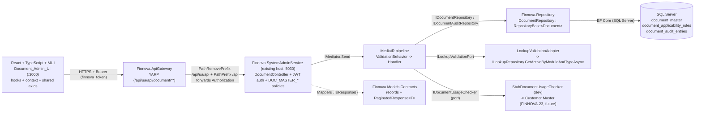
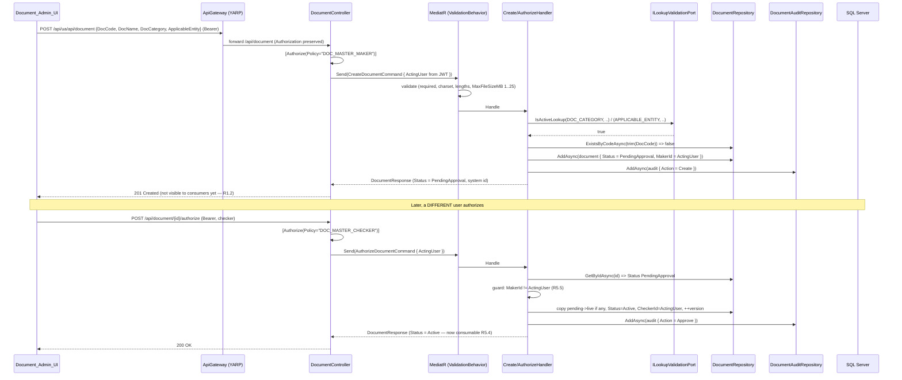

# Design Document: Document Master Management (FINNOVA-49, FINNOVA-50, FINNOVA-52)

## Overview

The Document Master Management feature adds a centralized, SystemAdmin-scoped catalog of
statutory, KYC, financial, legal, and incorporation document definitions used across the
Finnova platform. A Document Master Maker creates and edits document definitions, applicability
rules (document × constitution × entity role × mandatory flag), and validation/masking
configuration; every change is submitted for approval and held without affecting consumers. A
Document Master Checker reviews a submission against the live values (old/new side by side) and
authorizes it (making it consumable) or rejects it with a mandatory remark (returning it to the
Maker). A Maker cannot authorize a record they created or edited, even when that user also holds
the Checker role. Every action is captured in an immutable audit trail. Customer Master and
other modules consume active document definitions, their applicability, and their validation
configuration from this master.

> Finnova is an India-only platform; all display values and labels are English-only. Each
> document carries single English display fields (`DocName`, `DocShortName`, `Description`).
> There are no bilingual fields, no Arabic content, and no right-to-left rendering.

This design follows the platform's layered CQRS conventions exactly, as already realized by the
Lookup, Nationality, Organization Hierarchy, Court, Entity, Drawee Bank, DCN, Asset, and GL
masters:
`Finnova.Models` (entities + enums + exceptions + record contracts) ->
`Finnova.Repository` (EF Core on SQL Server, generic `IRepository<T>` + `RepositoryBase<T>`,
per-entity repositories, `IEntityTypeConfiguration<T>`) ->
`Finnova.Service` (MediatR Commands/Queries with FluentValidation validators, static
`.ToResponse()` mappers, and outbound Ports) ->
the existing `Finnova.SystemAdminService` host (controllers injecting `IMediator`, JWT Bearer
auth, `ValidationBehavior<,>` pipeline, `ExceptionHandlingMiddleware`) ->
the `Finnova.ApiGateway` YARP reverse proxy ->
the React + TypeScript + Material UI frontend (hooks + context + shared axios, **not**
Redux/RxJS).

### What is reused (already exists) vs what is new

**Reused — present in the codebase today, not re-created by this feature:**

- **Host `Finnova.SystemAdminService` (port 5030).** Already hosts Lookup, Nationality,
  OrganizationHierarchy, Court, Entity, DraweeBank, DocumentNumberControl, Asset, and
  UserManagement controllers. Document Master adds a single `DocumentController` to this host.
- **JWT Bearer authentication** in `Program.cs` (`ValidateIssuer`/`ValidateAudience`/
  `ValidateLifetime`/`ValidateIssuerSigningKey`, `RoleClaimType = ClaimTypes.Role`).
- **MediatR `ValidationBehavior<,>`** pipeline (runs FluentValidation before every handler) and
  **`ExceptionHandlingMiddleware`** (`Finnova.SystemAdminService.Middleware`), already wired in
  `Program.cs`. This feature adds a typed exception branch to the middleware.
- **Persistence** — SQL Server via `AddFinnovaRepository(connectionString)` and
  `FinnovaDbContext` (`ApplyConfigurationsFromAssembly` auto-discovers new configurations).
- **Gateway** — `systemadmin-route` plus the `ua-<name>-alias-route`/`ua-<name>-alias-root`
  UI-prefix alias pattern. This feature adds the `document` aliases.
- **Lookup read surface** — `ILookupRepository.GetActiveByModuleAndTypeAsync(module, type, ct)`
  already returns active lookup values; this feature reads it to validate lookup-backed fields.
- **Maker-checker precedent** — the GL Account feature already implements a complete
  maker-checker lifecycle (`MakerId`/`CheckerId`/`AuthorizedVersionNumber`/`RejectionReason`,
  self-authorization guard, audit-on-action). Document Master mirrors it.
- **Audit snapshot precedent** — `GLAuditSnapshot`/`CourtAuditSnapshot` serialize editable
  fields to compact JSON for audit entries; this feature adds `DocumentAuditSnapshot`.
- **Acting-user resolution** — `CourtController.GetActingAdmin()` resolves the actor from the
  validated JWT principal (`ClaimTypes.NameIdentifier`/`sub`/`Name`); this feature mirrors it as
  `GetActingUser()`.
- **Ports precedent** — `Finnova.Service/GL/Ports` defines outbound port interfaces with dev
  stubs registered in DI; this feature adds `IDocumentUsageChecker` the same way.
- **`PaginatedResponse<T>`** contract for paged lists.

**New — introduced by this feature:**

- Domain: `Document`, `DocumentApplicabilityRule`, `DocumentAuditEntry` entities;
  `DocumentStatus`, `DocumentAuditAction` enums; the Document exception set.
- Contracts: `Finnova.Models/Contracts/Documents/*` request/response records.
- Repository: `IDocumentRepository`, `IDocumentAuditRepository`, their EF implementations, EF
  configurations (`document_master`, `document_applicability_rules`, `document_audit_entries`),
  DbSet additions, DI registration.
- Service: the `Finnova.Service/Document/` CQRS slice (commands, queries, validators),
  `DocumentMapper`, `DocumentAuditSnapshot`, a `ILookupValidationPort` + adapter, and the
  `IDocumentUsageChecker` port + dev stub.
- API: `DocumentController`, two new authorization policies `DOC_MASTER_MAKER` /
  `DOC_MASTER_CHECKER`, the middleware exception branch, and the gateway aliases.
- Frontend (Finnova-UI): `document.service` interface/real/mock/toggle/barrels, a
  `DocumentMaster` page and components, route, nav, and Vitest tests.

### Requirements coverage map

| Requirement | Covered by |
|---|---|
| R1 Create document definition | `CreateDocumentCommand` + validator (required fields, DocCode charset/length, DocName length, MaxFileSizeMB default 5 / range 1–25, lookup-backed `DocCategory`/`ApplicableEntity`, flag defaults), `Document` entity with `Status = PendingApproval` |
| R2 DocCode uniqueness | `IDocumentRepository.ExistsByCodeAsync` (trim + case-insensitive), unique index on `DocCode`, `DocumentDuplicateCodeException`, DocCode read-only while `Active` (edit guard), editable while never-authorized |
| R3 Edit under maker-checker | `UpdateDocumentCommand`, `PendingValuesJson` pending-edit model, `Status = PendingModification`, single-pending guard (`DocumentConflictException`), resubmit on `ReturnedToMaker` |
| R4 Applicability rules | `DocumentApplicabilityRule` child collection, `UpdateApplicabilityRulesCommand`, lookup-backed `Constitution`/`EntityRole` validation, duplicate-combo rejection, unique index, pending-until-authorized |
| R5 Maker-checker lifecycle | `AuthorizeDocumentCommand` / `RejectDocumentCommand`, old/new `GetPendingReviewQuery`, self-auth guard (`ERR-DOC-001`), `ReturnedToMaker` + retained pending, `ResubmitDocumentCommand`, `AuthorizedVersionNumber` bump |
| R6 Activate / inactivate | `SetDocumentStatusCommand` (inactivate/reactivate under maker-checker), consumption query excludes `Inactive`, by-id read still returns `Inactive` with indicator |
| R7 Delete protection | `DeleteDocumentCommand`, `IDocumentUsageChecker` port (5s fail-safe), `DocumentInUseException` (`ERR-DOC-002`), hard-delete only never-authorized `PendingApproval`, block `Active` delete |
| R8 Immutable audit trail | `DocumentAuditEntry` entity, one entry per persisted action, remark on reject, no entry on rejected action, `GetDocumentAuditTrailQuery` (timestamp desc, id desc tie-break), immutability (no update/delete surface), empty for unknown id |
| R9 Validation / masking config | `UpdateValidationConfigCommand` + validator (lookup-backed `ValidationEngine`, mask-required-when-masking, Aadhaar-always-masked via `IsAadhaarDocument`, regex compile check, length caps, MaxFileSizeMB range, allowed MIME set), stored-not-executed boundary |
| R10 Query & search | `GetDocumentsPagedQuery` + validator (substring search on code/name, category/status AND filters, `PaginatedResponse<T>`, page/size defaults + bounds, DocCode asc + Id tie-break, empty result) |
| R11 Active-document consumption | `GetActiveDocumentsForConsumptionQuery`, active-only + applicability match, resolved mandatory + validation/masking fields, live values while pending, empty vs unknown-value error |
| R12 AuthN/AuthZ enforcement | JWT Bearer scheme (reused), `DOC_MASTER_MAKER` / `DOC_MASTER_CHECKER` policies, `[Authorize]`, auth-before-authz, self-auth independent of roles |
| R13 Admin UI | React `DocumentMaster` page + components, lookup-backed selects (no free text), role-gated controls, old/new authorize view, field validation, `ERR-DOC-001`/`ERR-DOC-002` messages, 10s timeout, shared axios Bearer |

### Resolved assumptions (carried from requirements, decided here)

These requirements-level assumptions are resolved in this design; rationale is in **Design
Decisions & Tradeoffs**.

- **Status modeling** → a domain `DocumentStatus` enum (not Lookup-backed), constrained to the
  lifecycle values, consistent with `GLStatus`.
- **Maker-checker versioning model** → the `Document` row always holds the latest submitted
  values and `Status` gates consumer visibility; for an **edit of an already-Active document**
  the pending edit is held in a `PendingValuesJson` JSON column while the live columns keep
  serving consumers, and authorize copies pending → live and clears the column.
- **In-use detection** → an outbound `IDocumentUsageChecker` port with a no-op dev stub
  (reports "not in use") registered in DI, fail-safe (block delete) on error/timeout.
- **Aadhaar marker** → a dedicated `IsAadhaarDocument` boolean flag on the entity.
- **Validation ownership boundary** → the master stores `ValidationEngine`/`FormatRegex`/
  `MaskPattern` and validates regex syntax only; it never executes format/checksum validation.
- **Applicability placement** → a separate `DocumentApplicabilityRule` child collection.
- **Audit scope** → a feature-scoped `document_audit_entries` table, mirroring prior masters.

---

## Architecture

### High-level layered CQRS view



Layer responsibilities:

- **Finnova.Models** — `Document`, `DocumentApplicabilityRule`, `DocumentAuditEntry` entities;
  `DocumentStatus`/`DocumentAuditAction` enums; the Document exception set; request/response
  records; reuse of `PaginatedResponse<T>`.
- **Finnova.Repository** — `IDocumentRepository : IRepository<Document>`,
  `IDocumentAuditRepository`, EF implementations, `DocumentConfiguration` /
  `DocumentApplicabilityRuleConfiguration` / `DocumentAuditEntryConfiguration`, DbSets, DI.
- **Finnova.Service** — `Document/` slice (`Commands/`, `Queries/`, `Internal/`, `Ports/`),
  FluentValidation validators, `DocumentMapper`, `DocumentAuditSnapshot`,
  `ILookupValidationPort` + adapter, `IDocumentUsageChecker` + dev stub.
- **Finnova.SystemAdminService (existing host)** — `DocumentController`, two new policies, the
  middleware exception branch. (Auth, pipeline, middleware already present.)
- **Finnova.ApiGateway** — new `ua-document-alias-route` / `ua-document-alias-root`.
- **Frontend** — `DocumentMaster` page + components, `document.service` layer, route, nav.

### Create → pending → authorize (happy path)



### Self-authorization rejection (ERR-DOC-001)

```mermaid
sequenceDiagram
    participant UI as Document_Admin_UI
    participant C as DocumentController
    participant H as AuthorizeDocumentHandler
    participant R as DocumentRepository
    participant MW as ExceptionHandlingMiddleware

    UI->>C: POST /api/document/{id}/authorize (Bearer; same user who created it)
    C->>H: Send(AuthorizeDocumentCommand { ActingUser = maker })
    H->>R: GetByIdAsync(id) => Status PendingApproval, MakerId == ActingUser
    H->>H: guard fails -> throw DocumentSelfAuthorizationException (ERR-DOC-001)
    H-->>MW: exception bubbles (no state change, no audit entry — R8.3)
    MW->>MW: map DocumentSelfAuthorizationException -> 409 ProblemDetails
    MW-->>UI: 409 { code: "ERR-DOC-001", message: "You cannot authorize a record you created or edited" }
    Note over UI: document remains PendingApproval, pending change unchanged (R5.5)
```

### Reject → ReturnedToMaker → resubmit

```mermaid
sequenceDiagram
    participant UI as Document_Admin_UI
    participant C as DocumentController
    participant H as Reject/Update/ResubmitHandler
    participant R as DocumentRepository
    participant A as DocumentAuditRepository

    UI->>C: POST /api/document/{id}/reject { remark } (checker)
    C->>H: Send(RejectDocumentCommand { ActingUser, Reason })
    H->>R: GetByIdAsync(id) => PendingApproval/PendingModification
    H->>H: validate remark 1..500 (trim); MakerId != ActingUser
    H->>R: Status=ReturnedToMaker, keep pending values, RejectionReason=remark
    H->>A: AddAsync(audit { Action = Reject, Remarks = remark })  (R8.2)
    H-->>C: DocumentResponse (ReturnedToMaker)

    UI->>C: PUT /api/document/{id} { corrected } (maker)
    C->>H: Send(UpdateDocumentCommand) on ReturnedToMaker (R3.6)
    H->>R: update retained pending values, keep live unchanged

    UI->>C: POST /api/document/{id}/resubmit (maker)
    C->>H: Send(ResubmitDocumentCommand)
    H->>R: Status=PendingApproval, MakerId=ActingUser (R5.10)
    H->>A: AddAsync(audit { Action = Submit })
    H-->>C: DocumentResponse (PendingApproval, ready for a different checker)
```

---

## Data Models

### `DocumentStatus` enum

Lives in `Finnova.Models/Domain/Enums/DocumentEnums.cs`. Modeled as a domain enum constrained
to the lifecycle values (resolves the requirements' "Status modeling" assumption), mirroring
`GLStatus`.

```csharp
namespace Finnova.Models.Domain.Enums;

/// <summary>
/// Lifecycle state of a document definition. Domain-enum (not Lookup-backed) so the maker-checker
/// state machine is enforced in code, consistent with GLStatus.
/// </summary>
public enum DocumentStatus
{
    PendingApproval,     // newly created, never authorized (requirements: PENDING_APPROVAL)
    Active,              // authorized & consumable       (requirements: ACTIVE)
    Inactive,            // authorized then retired        (requirements: INACTIVE)
    PendingModification, // edit of an Active doc awaiting authorization (live values still served)
    ReturnedToMaker      // post-reject; pending change returned for correction (requirements: RETURNED_TO_MAKER)
}

/// <summary>Governance action captured by a document audit entry (R8).</summary>
public enum DocumentAuditAction
{
    Create,
    Submit,          // resubmit after correction
    Update,          // edit of attributes
    ApplicabilityChange,
    ValidationConfigChange,
    Approve,
    Reject,
    Inactivate,
    Reactivate,
    Delete
}
```

**Status-name reconciliation (resolved design decision).** The requirements name the lifecycle
states `PENDING_APPROVAL`, `ACTIVE`, `INACTIVE`, and `RETURNED_TO_MAKER`. The domain enum maps
`PENDING_APPROVAL → PendingApproval`, `ACTIVE → Active`, `INACTIVE → Inactive`,
`RETURNED_TO_MAKER → ReturnedToMaker`. The enum adds one state the requirements imply but do not
name: `PendingModification`, used when an **already-Active** document has a pending edit, so the
live values stay visible to consumers while the edit awaits authorization (GL uses the identical
`PendingAuthorization` vs `PendingModification` split). On the wire the status serializes by its
string name (the host registers `JsonStringEnumConverter`), so the UI sees `PendingModification`
and treats it as "pending" exactly like `PendingApproval` for review/consumer-gating purposes.

### `Document` entity

Lives in `Finnova.Models/Domain/Entities/Document.cs`, carrying the GL maker-checker field set
(`Status`/`MakerId`/`CheckerId`/`AuthorizedVersionNumber`/`RejectionReason`) plus the document
attributes and the pending-edit payload column.

```csharp
using Finnova.Models.Domain.Enums;

namespace Finnova.Models.Domain.Entities;

/// <summary>
/// A single document definition in the Document Master (FINNOVA-49/50/52). India-only: single
/// English display fields. The row always holds the latest submitted values; Status gates
/// consumer visibility. For an edit of an Active document, PendingValuesJson holds the pending
/// edit while the live columns keep serving consumers until authorization.
/// </summary>
public class Document
{
    public Guid Id { get; set; } = Guid.NewGuid();

    // --- identity & display (English-only) ---
    public string DocCode { get; set; } = string.Empty;        // max 20; letters/digits/hyphen; unique (CI)
    public string DocName { get; set; } = string.Empty;        // max 150
    public string? DocShortName { get; set; }                  // optional short label
    public string? Description { get; set; }                   // optional

    // --- classification (lookup-backed, validated against ACTIVE lookup values) ---
    public string DocCategory { get; set; } = string.Empty;    // Lookup DOC_CATEGORY code
    public string ApplicableEntity { get; set; } = string.Empty; // Lookup APPLICABLE_ENTITY code

    // --- document flags ---
    public bool IsMandatory { get; set; }                      // default false (R1.9)
    public bool HasExpiry { get; set; }                        // default false (R1.9)
    public bool RequiresMasking { get; set; }                  // default false (R1.9)
    public bool IsAadhaarDocument { get; set; }                // Aadhaar marker (R9.4) — resolved via flag

    // --- validation / masking configuration (stored, NOT executed — R9.11) ---
    public string ValidationEngine { get; set; } = "NONE";     // Lookup VALIDATION_ENGINE code
    public string? FormatRegex { get; set; }                   // max 500; must compile if non-empty
    public string? MaskPattern { get; set; }                   // max 200; required when RequiresMasking
    public int MaxFileSizeMb { get; set; } = 5;                // 1..25 inclusive; default 5 (R1.6)
    public string AllowedMimeTypes { get; set; } = string.Empty; // CSV of {PDF,JPG,PNG}; non-empty

    // --- maker-checker lifecycle (mirrors GLAccount) ---
    public DocumentStatus Status { get; set; } = DocumentStatus.PendingApproval; // R1.1
    public string? MakerId { get; set; }                       // last maker of the pending change
    public string? CheckerId { get; set; }                     // last checker
    public int AuthorizedVersionNumber { get; set; }           // starts 0; +1 per authorized modification
    public string? RejectionReason { get; set; }               // last rejection remark (<=500)

    /// <summary>
    /// Pending edit payload for an edit of an already-Active document. While set, the scalar
    /// columns above remain the LIVE (authorized) values served to consumers; the Checker view
    /// compares live columns vs this payload. Cleared on authorize (copy pending->live) or when
    /// the document was never authorized (pending values live directly in the columns).
    /// </summary>
    public string? PendingValuesJson { get; set; }

    public DateTime CreatedAt { get; set; } = DateTime.UtcNow;
    public DateTime UpdatedAt { get; set; } = DateTime.UtcNow;

    // --- applicability matrix (R4) ---
    public List<DocumentApplicabilityRule> ApplicabilityRules { get; set; } = new();
}
```

### `DocumentApplicabilityRule` child entity

Lives in `Finnova.Models/Domain/Entities/DocumentApplicabilityRule.cs`. One row per
(document × constitution × entity role) with a per-mapping mandatory flag; the combination is
unique.

```csharp
namespace Finnova.Models.Domain.Entities;

/// <summary>
/// Maps a document to one Constitution and one Entity Role with an Is Mandatory flag (R4).
/// The (DocumentId, Constitution, EntityRole) combination is unique.
/// </summary>
public class DocumentApplicabilityRule
{
    public Guid Id { get; set; } = Guid.NewGuid();
    public Guid DocumentId { get; set; }

    public string Constitution { get; set; } = string.Empty;   // Lookup CONSTITUTION code
    public string EntityRole { get; set; } = string.Empty;     // Lookup APPLICABLE_ENTITY code
    public bool IsMandatory { get; set; }

    public Document? Document { get; set; }
}
```

### `DocumentAuditEntry` entity

Lives in `Finnova.Models/Domain/Entities/DocumentAuditEntry.cs`, mirroring `GLAuditEntry` /
`CourtAuditEntry` (JSON before/after snapshots, summary, optional remark, UTC timestamp).

```csharp
using Finnova.Models.Domain.Enums;

namespace Finnova.Models.Domain.Entities;

/// <summary>
/// Immutable audit record for a document action (R8). One row per persisted action. No update or
/// delete surface is exposed for this table.
/// </summary>
public class DocumentAuditEntry
{
    public Guid Id { get; set; } = Guid.NewGuid();
    public Guid DocumentId { get; set; }

    public DocumentAuditAction Action { get; set; }
    public string? OldValues { get; set; }     // compact JSON snapshot (null for Create)
    public string? NewValues { get; set; }     // compact JSON snapshot
    public string Summary { get; set; } = string.Empty;
    public string? Remarks { get; set; }       // rejection remark on Reject (R8.2)

    public string ChangedBy { get; set; } = string.Empty;    // acting user id (from JWT)
    public DateTime ChangedAtUtc { get; set; } = DateTime.UtcNow;
}
```

### EF configurations

Live in `Finnova.Repository/Configuration/`, mirroring `CourtConfiguration` (lowercase
snake_case table names, `HasMaxLength`, unique `HasIndex`, query indexes).
`FinnovaDbContext.ApplyConfigurationsFromAssembly` auto-discovers them.

```csharp
using Microsoft.EntityFrameworkCore;
using Microsoft.EntityFrameworkCore.Metadata.Builders;
using Finnova.Models.Domain.Entities;

namespace Finnova.Repository.Configuration;

public class DocumentConfiguration : IEntityTypeConfiguration<Document>
{
    public void Configure(EntityTypeBuilder<Document> b)
    {
        b.ToTable("document_master");
        b.HasKey(x => x.Id);

        b.Property(x => x.DocCode).IsRequired().HasMaxLength(20);
        b.Property(x => x.DocName).IsRequired().HasMaxLength(150);
        b.Property(x => x.DocShortName).HasMaxLength(100);
        b.Property(x => x.Description).HasMaxLength(1000);
        b.Property(x => x.DocCategory).IsRequired().HasMaxLength(50);
        b.Property(x => x.ApplicableEntity).IsRequired().HasMaxLength(50);

        b.Property(x => x.ValidationEngine).IsRequired().HasMaxLength(50);
        b.Property(x => x.FormatRegex).HasMaxLength(500);
        b.Property(x => x.MaskPattern).HasMaxLength(200);
        b.Property(x => x.MaxFileSizeMb).IsRequired();
        b.Property(x => x.AllowedMimeTypes).IsRequired().HasMaxLength(100);

        b.Property(x => x.Status).IsRequired().HasConversion<string>().HasMaxLength(30);
        b.Property(x => x.MakerId).HasMaxLength(100);
        b.Property(x => x.CheckerId).HasMaxLength(100);
        b.Property(x => x.RejectionReason).HasMaxLength(500);
        b.Property(x => x.PendingValuesJson);   // nvarchar(max)

        // DocCode uniqueness (R2.1/2.2). Default CI collation backs the case-insensitive rule;
        // the handler trims so stored values are canonical.
        b.HasIndex(x => x.DocCode).IsUnique();
        // Query/filter paths (R10): status + category filters, DocName substring order tie-break by id.
        b.HasIndex(x => new { x.Status, x.DocCategory });
        b.HasIndex(x => x.DocName);

        b.HasMany(x => x.ApplicabilityRules)
            .WithOne(r => r.Document!)
            .HasForeignKey(r => r.DocumentId)
            .OnDelete(DeleteBehavior.Cascade);
    }
}

public class DocumentApplicabilityRuleConfiguration : IEntityTypeConfiguration<DocumentApplicabilityRule>
{
    public void Configure(EntityTypeBuilder<DocumentApplicabilityRule> b)
    {
        b.ToTable("document_applicability_rules");
        b.HasKey(x => x.Id);
        b.Property(x => x.Constitution).IsRequired().HasMaxLength(50);
        b.Property(x => x.EntityRole).IsRequired().HasMaxLength(50);
        b.Property(x => x.IsMandatory).IsRequired();

        // Unique applicability combination per document (R4.4).
        b.HasIndex(x => new { x.DocumentId, x.Constitution, x.EntityRole }).IsUnique();
    }
}

public class DocumentAuditEntryConfiguration : IEntityTypeConfiguration<DocumentAuditEntry>
{
    public void Configure(EntityTypeBuilder<DocumentAuditEntry> b)
    {
        b.ToTable("document_audit_entries");
        b.HasKey(x => x.Id);
        b.Property(x => x.Action).IsRequired().HasConversion<string>().HasMaxLength(40);
        b.Property(x => x.Summary).IsRequired().HasMaxLength(400);
        b.Property(x => x.Remarks).HasMaxLength(500);
        b.Property(x => x.ChangedBy).IsRequired().HasMaxLength(100);
        b.Property(x => x.ChangedAtUtc).IsRequired();

        // Newest-first reads with a deterministic id tie-break (R8.4).
        b.HasIndex(x => new { x.DocumentId, x.ChangedAtUtc });
    }
}
```

Register the DbSets in `FinnovaDbContext` (mirroring existing DbSet properties):

```csharp
public DbSet<Document> Documents => Set<Document>();
public DbSet<DocumentApplicabilityRule> DocumentApplicabilityRules => Set<DocumentApplicabilityRule>();
public DbSet<DocumentAuditEntry> DocumentAuditEntries => Set<DocumentAuditEntry>();
```

**EF Core migration (SQL Server)** — after adding the entities, configurations, and DbSets,
generate the migration from the repository project against the existing host:

```
dotnet ef migrations add AddDocumentMaster \
  --project Finnova.Repository \
  --startup-project Finnova.SystemAdminService
dotnet ef database update --project Finnova.Repository --startup-project Finnova.SystemAdminService
```

---

## Contracts (records)

Live in `Finnova.Models/Contracts/Documents/`, mirroring the `Courts`/`Lookups` contracts
style. Paged listing reuses `PaginatedResponse<DocumentResponse>` directly.

```csharp
namespace Finnova.Models.Contracts.Documents;

// ---- Create (R1). Nullable flags/size so the service applies defaults (R1.6, R1.9). ----
public record CreateDocumentRequest(
    string DocCode,
    string DocName,
    string? DocShortName,
    string? Description,
    string DocCategory,
    string ApplicableEntity,
    bool? IsMandatory,
    bool? HasExpiry,
    bool? RequiresMasking,
    bool? IsAadhaarDocument,
    int? MaxFileSizeMb
);

// ---- Edit document attributes (R3). DocCode is NOT editable once Active (R2.3). ----
public record UpdateDocumentRequest(
    string DocName,
    string? DocShortName,
    string? Description,
    string DocCategory,
    string ApplicableEntity,
    bool IsMandatory,
    bool HasExpiry
);

// ---- One applicability mapping (R4). ----
public record ApplicabilityRuleRequest(
    string Constitution,
    string EntityRole,
    bool IsMandatory
);

// ---- Replace the applicability matrix as a pending change (R4.1). ----
public record UpdateApplicabilityRulesRequest(
    IReadOnlyList<ApplicabilityRuleRequest> Rules
);

// ---- Validation / masking configuration (R9). ----
public record UpdateValidationConfigRequest(
    string ValidationEngine,
    string? FormatRegex,
    bool RequiresMasking,
    string? MaskPattern,
    int MaxFileSizeMb,
    IReadOnlyList<string> AllowedMimeTypes   // subset of {PDF,JPG,PNG}, non-empty
);

// ---- Reject carries a mandatory remark (R5.6). Authorize/Resubmit carry no body. ----
public record RejectDocumentRequest(string Reason);

// ---- Applicability rule in responses. ----
public record ApplicabilityRuleResponse(
    Guid Id, string Constitution, string EntityRole, bool IsMandatory
);

// ---- Full admin-facing response. ----
public record DocumentResponse(
    Guid Id,
    string DocCode,
    string DocName,
    string? DocShortName,
    string? Description,
    string DocCategory,
    string ApplicableEntity,
    bool IsMandatory,
    bool HasExpiry,
    bool RequiresMasking,
    bool IsAadhaarDocument,
    string ValidationEngine,
    string? FormatRegex,
    string? MaskPattern,
    int MaxFileSizeMb,
    IReadOnlyList<string> AllowedMimeTypes,
    string Status,                 // DocumentStatus name
    string? MakerId,
    string? CheckerId,
    int AuthorizedVersionNumber,
    string? RejectionReason,
    IReadOnlyList<ApplicabilityRuleResponse> ApplicabilityRules,
    DateTime CreatedAt,
    DateTime UpdatedAt
);

// ---- Checker review: live vs pending side by side (R5.1). ----
public record DocumentPendingReviewResponse(
    Guid Id,
    string Status,
    DocumentResponse Live,         // currently authorized values
    DocumentResponse Pending       // proposed values (from PendingValuesJson, or the row itself
                                   // for a never-authorized PendingApproval doc)
);

// ---- Audit entry (R8.4). ----
public record DocumentAuditEntryResponse(
    Guid Id,
    Guid DocumentId,
    string Action,
    string? OldValues,
    string? NewValues,
    string Summary,
    string? Remarks,
    string ChangedBy,
    DateTime ChangedAtUtc
);

// ---- Active-document consumption projection for Customer Master (R11.2). ----
public record ActiveDocumentForConsumptionResponse(
    Guid Id,
    string DocCode,
    string DocName,
    bool IsMandatory,              // resolved from the matching applicability rule (R11.2)
    bool HasExpiry,
    string ValidationEngine,
    string? FormatRegex,
    bool RequiresMasking,
    string? MaskPattern,
    int MaxFileSizeMb,
    IReadOnlyList<string> AllowedMimeTypes
);
```

---

## Components and Interfaces

This feature is composed of three collaborating layers plus two outbound ports. The
**Repository Layer** exposes data access (`IDocumentRepository`, `IDocumentAuditRepository`);
the **Service Layer** holds CQRS logic, validators, mappers, the lookup-validation adapter, and
the usage-checker port; the **API Layer** exposes the HTTP surface via `DocumentController`.

### Repository Layer

#### `IDocumentRepository`

Lives in `Finnova.Repository/Interfaces/IDocumentRepository.cs`.

```csharp
using Finnova.Models.Domain.Entities;
using Finnova.Models.Domain.Enums;

namespace Finnova.Repository.Interfaces;

public interface IDocumentRepository : IRepository<Document>
{
    /// <summary>Loads a document with its applicability rules (tracked for updates).</summary>
    Task<Document?> GetByIdWithRulesAsync(Guid id, CancellationToken ct = default);

    /// <summary>
    /// Paged admin grid (R10). search = substring on DocCode/DocName (CI); category/status
    /// optional AND filters. Ordered by DocCode asc then Id asc. Returns (items, total).
    /// </summary>
    Task<(List<Document> Items, int Total)> GetPagedAsync(
        string? search, string? docCategory, DocumentStatus? status,
        int page, int pageSize, CancellationToken ct = default);

    /// <summary>
    /// Active documents whose applicability matrix includes (constitution, entityRole) (R11.1).
    /// </summary>
    Task<List<Document>> GetActiveForConsumptionAsync(
        string constitution, string entityRole, CancellationToken ct = default);

    /// <summary>Case-insensitive, trimmed DocCode uniqueness check (R2). excludeId skips self.</summary>
    Task<bool> ExistsByCodeAsync(string docCode, Guid? excludeId = null, CancellationToken ct = default);
}
```

#### `IDocumentAuditRepository`

```csharp
using Finnova.Models.Domain.Entities;

namespace Finnova.Repository.Interfaces;

public interface IDocumentAuditRepository
{
    Task AddAsync(DocumentAuditEntry entry, CancellationToken ct = default);

    /// <summary>Entries for a document, newest-first with id desc tie-break (R8.4). Empty for
    /// an unknown id (R8.6).</summary>
    Task<List<DocumentAuditEntry>> GetByDocumentIdAsync(Guid documentId, CancellationToken ct = default);
}
```

Register both in `AddFinnovaRepository` (`Finnova.Repository/DependencyInjection.cs`):

```csharp
services.AddScoped<IDocumentRepository, DocumentRepository>();
services.AddScoped<IDocumentAuditRepository, DocumentAuditRepository>();
```

### Service Layer (CQRS)

Feature slice `Finnova.Service/Document/` with `Commands/`, `Queries/`, `Internal/`, `Ports/`.
Every request is a record implementing `IRequest<TResponse>`; handlers implement
`IRequestHandler<,>`; validators are `AbstractValidator<T>` run by the shared
`ValidationBehavior<,>`. Handlers resolve `ActingUser` from the command (set by the controller
from the JWT), never from a client body.

#### Commands and Queries

| Request | Type | Purpose | Key requirements |
|---|---|---|---|
| `CreateDocumentCommand` | command | Create a `PendingApproval` document | R1, R2 |
| `UpdateDocumentCommand` | command | Edit attributes → pending (Active) / in-place (never-authorized / ReturnedToMaker) | R3 |
| `UpdateApplicabilityRulesCommand` | command | Replace applicability matrix as a pending change | R4 |
| `UpdateValidationConfigCommand` | command | Set validation/masking config as a pending change | R9 |
| `AuthorizeDocumentCommand` | command | Checker authorizes → Active, copy pending→live | R5 |
| `RejectDocumentCommand` | command | Checker rejects with remark → ReturnedToMaker | R5 |
| `ResubmitDocumentCommand` | command | Maker resubmits a ReturnedToMaker doc | R5.10 |
| `SetDocumentStatusCommand` | command | Inactivate / reactivate (maker-checker) | R6 |
| `DeleteDocumentCommand` | command | Hard-delete never-authorized, usage-guarded | R7 |
| `GetDocumentsPagedQuery` | query | Paged/filtered admin grid | R10 |
| `GetDocumentByIdQuery` | query | Single read (returns Inactive with indicator) | R6.3 |
| `GetPendingReviewQuery` | query | Live vs pending for the checker | R5.1, R5.2 |
| `GetDocumentAuditTrailQuery` | query | Audit entries newest-first | R8.4, R8.6 |
| `GetActiveDocumentsForConsumptionQuery` | query | Customer Master consumption | R11 |

#### Ports

```csharp
// Finnova.Service/Document/Ports/DocumentPorts.cs
namespace Finnova.Service.Document.Ports;

/// <summary>
/// Validates lookup-backed fields against ACTIVE Lookup Master values (R1.8, R4.3, R9.2).
/// Adapter delegates to the existing ILookupRepository.GetActiveByModuleAndTypeAsync.
/// </summary>
public interface ILookupValidationPort
{
    Task<bool> IsActiveLookupAsync(string lookupType, string code, CancellationToken ct = default);
}

/// <summary>
/// Outbound check for whether a document is referenced by Customer Master (FINNOVA-23) (R7).
/// Owned by the Customer Master epic; a no-op dev stub reports "not in use" until it ships.
/// </summary>
public interface IDocumentUsageChecker
{
    Task<bool> IsReferencedByCustomerMasterAsync(Guid documentId, CancellationToken ct = default);
}
```

```csharp
// Finnova.Service/Document/Ports/DocumentPortAdapters.cs
using Finnova.Repository.Interfaces;

namespace Finnova.Service.Document.Ports;

/// <summary>
/// Reads ACTIVE lookup values for the Document Master's lookup-backed fields. The Module scope
/// is "SystemAdmin" — the module under which the Lookup Master seeds DOC_CATEGORY,
/// APPLICABLE_ENTITY, CONSTITUTION, and VALIDATION_ENGINE types that this master consumes.
/// </summary>
public sealed class LookupValidationAdapter : ILookupValidationPort
{
    public const string Module = "SystemAdmin";
    private readonly ILookupRepository _lookups;
    public LookupValidationAdapter(ILookupRepository lookups) => _lookups = lookups;

    public async Task<bool> IsActiveLookupAsync(string lookupType, string code, CancellationToken ct = default)
    {
        var active = await _lookups.GetActiveByModuleAndTypeAsync(Module, lookupType, ct);
        return active.Any(v => string.Equals(v.Code, code, StringComparison.OrdinalIgnoreCase));
    }
}

/// <summary>
/// DEV STUB (resolved assumption: in-use detection). Reports "not in use" so never-authorized
/// documents can be deleted (R7.2) until Customer Master (FINNOVA-23) provides a real adapter.
/// Replace before production. Fail-safe (block delete) on error/timeout is enforced by the
/// delete handler, not by this stub.
/// </summary>
public sealed class StubDocumentUsageChecker : IDocumentUsageChecker
{
    public Task<bool> IsReferencedByCustomerMasterAsync(Guid documentId, CancellationToken ct = default)
        => Task.FromResult(false);
}
```

Register in the host (`Program.cs`), mirroring how `Finnova.AccountsService` registers GL
port stubs:

```csharp
builder.Services.AddScoped<Finnova.Service.Document.Ports.ILookupValidationPort,
    Finnova.Service.Document.Ports.LookupValidationAdapter>();
// Document in-use checker — dev stub (resolved assumption). Replace with the Customer Master
// adapter (FINNOVA-23) before production.
builder.Services.AddScoped<Finnova.Service.Document.Ports.IDocumentUsageChecker,
    Finnova.Service.Document.Ports.StubDocumentUsageChecker>();
```

#### `DocumentAuditSnapshot`

Lives in `Finnova.Service/Document/Internal/DocumentAuditSnapshot.cs`, mirroring
`GLAuditSnapshot` / `CourtAuditSnapshot`.

```csharp
using System.Text.Json;
using Finnova.Models.Domain.Entities;

namespace Finnova.Service.Document.Internal;

/// <summary>Compact JSON snapshots of a document's editable fields for audit entries (R8).</summary>
public static class DocumentAuditSnapshot
{
    private static readonly JsonSerializerOptions Options = new() { WriteIndented = false };

    public static string Editable(Document d) => JsonSerializer.Serialize(new
    {
        d.DocCode, d.DocName, d.DocShortName, d.Description,
        d.DocCategory, d.ApplicableEntity,
        d.IsMandatory, d.HasExpiry, d.RequiresMasking, d.IsAadhaarDocument,
        d.ValidationEngine, d.FormatRegex, d.MaskPattern, d.MaxFileSizeMb, d.AllowedMimeTypes,
        Status = d.Status.ToString(),
        d.AuthorizedVersionNumber,
        Rules = d.ApplicabilityRules
            .Select(r => new { r.Constitution, r.EntityRole, r.IsMandatory })
    }, Options);
}
```

#### Representative handler: `CreateDocument` (R1, R2)

```csharp
public record CreateDocumentCommand(
    string DocCode, string DocName, string? DocShortName, string? Description,
    string DocCategory, string ApplicableEntity,
    bool? IsMandatory, bool? HasExpiry, bool? RequiresMasking, bool? IsAadhaarDocument,
    int? MaxFileSizeMb, string ActingUser) : IRequest<DocumentResponse>;

public class CreateDocumentCommandHandler : IRequestHandler<CreateDocumentCommand, DocumentResponse>
{
    private readonly IDocumentRepository _repository;
    private readonly IDocumentAuditRepository _audit;
    private readonly ILookupValidationPort _lookups;

    public CreateDocumentCommandHandler(IDocumentRepository repository,
        IDocumentAuditRepository audit, ILookupValidationPort lookups)
    { _repository = repository; _audit = audit; _lookups = lookups; }

    public async Task<DocumentResponse> Handle(CreateDocumentCommand request, CancellationToken ct)
    {
        var code = request.DocCode.Trim();

        // R1.8 lookup-backed fields must be ACTIVE lookup values.
        if (!await _lookups.IsActiveLookupAsync("DOC_CATEGORY", request.DocCategory, ct))
            throw new ValidationException("Doc Category is not an active lookup value.");
        if (!await _lookups.IsActiveLookupAsync("APPLICABLE_ENTITY", request.ApplicableEntity, ct))
            throw new ValidationException("Applicable Entity is not an active lookup value.");

        // R2.2 case-insensitive, trimmed uniqueness.
        if (await _repository.ExistsByCodeAsync(code, null, ct))
            throw new DocumentDuplicateCodeException();

        var entity = new Document
        {
            DocCode = code,
            DocName = request.DocName.Trim(),
            DocShortName = request.DocShortName?.Trim(),
            Description = request.Description?.Trim(),
            DocCategory = request.DocCategory,
            ApplicableEntity = request.ApplicableEntity,
            IsMandatory = request.IsMandatory ?? false,         // R1.9
            HasExpiry = request.HasExpiry ?? false,             // R1.9
            RequiresMasking = request.RequiresMasking ?? false, // R1.9
            IsAadhaarDocument = request.IsAadhaarDocument ?? false,
            MaxFileSizeMb = request.MaxFileSizeMb ?? 5,         // R1.6 default
            Status = DocumentStatus.PendingApproval,            // R1.1 / R1.2
            MakerId = request.ActingUser,
        };

        await _repository.AddAsync(entity, ct);
        await _audit.AddAsync(new DocumentAuditEntry
        {
            DocumentId = entity.Id,
            Action = DocumentAuditAction.Create,
            OldValues = null,
            NewValues = DocumentAuditSnapshot.Editable(entity),
            Summary = $"Created document '{entity.DocCode}'.",
            ChangedBy = request.ActingUser,
            ChangedAtUtc = DateTime.UtcNow,
        }, ct);

        return entity.ToResponse();
    }
}
```

```csharp
// CreateDocumentCommandValidator.cs — maps R1.3/1.4/1.5/1.7
public class CreateDocumentCommandValidator : AbstractValidator<CreateDocumentCommand>
{
    public CreateDocumentCommandValidator()
    {
        RuleFor(x => x.DocCode).NotEmpty().WithMessage("Doc Code is required.")
            .Must(c => c is not null && c.Trim().Length <= 20)
                .WithMessage("Doc Code must not exceed 20 characters.")
            .Matches("^[A-Za-z0-9-]+$").WithMessage("Doc Code may contain only letters, digits, and hyphens.");
        RuleFor(x => x.DocName).NotEmpty().WithMessage("Doc Name is required.")
            .Must(n => n is not null && n.Trim().Length <= 150).WithMessage("Doc Name must not exceed 150 characters.");
        RuleFor(x => x.DocCategory).NotEmpty().WithMessage("Doc Category is required.");
        RuleFor(x => x.ApplicableEntity).NotEmpty().WithMessage("Applicable Entity is required.");
        RuleFor(x => x.MaxFileSizeMb).InclusiveBetween(1, 25)
            .WithMessage("Max file size must be between 1 and 25 MB")
            .When(x => x.MaxFileSizeMb.HasValue);   // R1.7
    }
}
```

#### Representative handler: `AuthorizeDocument` (R5) — self-auth guard

```csharp
public record AuthorizeDocumentCommand(Guid Id, string ActingUser) : IRequest<DocumentResponse>;

public class AuthorizeDocumentCommandHandler : IRequestHandler<AuthorizeDocumentCommand, DocumentResponse>
{
    private readonly IDocumentRepository _repository;
    private readonly IDocumentAuditRepository _audit;

    public AuthorizeDocumentCommandHandler(IDocumentRepository repository, IDocumentAuditRepository audit)
    { _repository = repository; _audit = audit; }

    public async Task<DocumentResponse> Handle(AuthorizeDocumentCommand request, CancellationToken ct)
    {
        var entity = await _repository.GetByIdWithRulesAsync(request.Id, ct)
            ?? throw new DocumentNotFoundException();

        // R5.9 — must be awaiting authorization.
        if (entity.Status is not (DocumentStatus.PendingApproval or DocumentStatus.PendingModification))
            throw new DocumentConflictException("There is no pending change to act upon.");

        // R5.5 / R12.6 — self-authorization prohibited, independent of role membership.
        if (string.Equals(entity.MakerId, request.ActingUser, StringComparison.Ordinal))
            throw new DocumentSelfAuthorizationException();   // ERR-DOC-001

        var wasModification = entity.Status == DocumentStatus.PendingModification;

        // Copy pending edit -> live columns, then clear the pending payload (R5.3).
        if (wasModification && entity.PendingValuesJson is not null)
            DocumentPendingPayload.ApplyTo(entity, entity.PendingValuesJson);
        entity.PendingValuesJson = null;

        entity.Status = DocumentStatus.Active;
        entity.CheckerId = request.ActingUser;
        if (wasModification) entity.AuthorizedVersionNumber += 1;   // R4.5-style versioning
        entity.UpdatedAt = DateTime.UtcNow;
        await _repository.UpdateAsync(entity, ct);

        await _audit.AddAsync(new DocumentAuditEntry
        {
            DocumentId = entity.Id,
            Action = DocumentAuditAction.Approve,
            OldValues = DocumentAuditSnapshot.Editable(entity),
            NewValues = DocumentAuditSnapshot.Editable(entity),
            Summary = $"Authorized document '{entity.DocCode}'.",
            ChangedBy = request.ActingUser,
            ChangedAtUtc = DateTime.UtcNow,
        }, ct);

        return entity.ToResponse();
    }
}
```

> `DocumentPendingPayload` (in `Finnova.Service/Document/Internal/`) serializes/deserializes the
> editable attribute subset held in `PendingValuesJson` and applies it onto the entity's live
> columns on authorize. It is the single source of truth for the pending-edit shape.

#### Representative handler: `RejectDocument` (R5.6, R5.7)

```csharp
public record RejectDocumentCommand(Guid Id, string Reason, string ActingUser) : IRequest<DocumentResponse>;

public class RejectDocumentCommandHandler : IRequestHandler<RejectDocumentCommand, DocumentResponse>
{
    private readonly IDocumentRepository _repository;
    private readonly IDocumentAuditRepository _audit;

    public RejectDocumentCommandHandler(IDocumentRepository repository, IDocumentAuditRepository audit)
    { _repository = repository; _audit = audit; }

    public async Task<DocumentResponse> Handle(RejectDocumentCommand request, CancellationToken ct)
    {
        var entity = await _repository.GetByIdWithRulesAsync(request.Id, ct)
            ?? throw new DocumentNotFoundException();

        if (entity.Status is not (DocumentStatus.PendingApproval or DocumentStatus.PendingModification))
            throw new DocumentConflictException("There is no pending change to act upon.");  // R5.9

        if (string.Equals(entity.MakerId, request.ActingUser, StringComparison.Ordinal))
            throw new DocumentSelfAuthorizationException();  // ERR-DOC-001 (self-review on reject too)

        // R5.7 — remark 1..500 after trim. (Also enforced by the validator as a fast-fail.)
        var remark = (request.Reason ?? string.Empty).Trim();
        if (remark.Length is < 1 or > 500)
            throw new ValidationException("A rejection remark of 1 to 500 characters is required.");

        // R5.6 — return to maker, retain pending values, record the remark; live unchanged.
        entity.Status = DocumentStatus.ReturnedToMaker;
        entity.CheckerId = request.ActingUser;
        entity.RejectionReason = remark;
        entity.UpdatedAt = DateTime.UtcNow;
        await _repository.UpdateAsync(entity, ct);

        await _audit.AddAsync(new DocumentAuditEntry
        {
            DocumentId = entity.Id,
            Action = DocumentAuditAction.Reject,
            OldValues = DocumentAuditSnapshot.Editable(entity),
            NewValues = DocumentAuditSnapshot.Editable(entity),
            Summary = $"Rejected document '{entity.DocCode}'.",
            Remarks = remark,                                 // R8.2
            ChangedBy = request.ActingUser,
            ChangedAtUtc = DateTime.UtcNow,
        }, ct);

        return entity.ToResponse();
    }
}
```

#### Representative handler: `UpdateApplicabilityRules` (R4)

```csharp
public record UpdateApplicabilityRulesCommand(
    Guid Id, IReadOnlyList<ApplicabilityRuleRequest> Rules, string ActingUser)
    : IRequest<DocumentResponse>;

public class UpdateApplicabilityRulesCommandHandler
    : IRequestHandler<UpdateApplicabilityRulesCommand, DocumentResponse>
{
    private readonly IDocumentRepository _repository;
    private readonly IDocumentAuditRepository _audit;
    private readonly ILookupValidationPort _lookups;

    public UpdateApplicabilityRulesCommandHandler(IDocumentRepository repository,
        IDocumentAuditRepository audit, ILookupValidationPort lookups)
    { _repository = repository; _audit = audit; _lookups = lookups; }

    public async Task<DocumentResponse> Handle(UpdateApplicabilityRulesCommand request, CancellationToken ct)
    {
        var entity = await _repository.GetByIdWithRulesAsync(request.Id, ct)
            ?? throw new DocumentNotFoundException();

        // R4.4 — reject duplicate (Constitution, EntityRole) combinations in the submission.
        var seen = new HashSet<(string, string)>();
        foreach (var r in request.Rules)
            if (!seen.Add((r.Constitution, r.EntityRole)))
                throw new ValidationException("Duplicate applicability mapping in submission.");

        // R4.3 — each Constitution/EntityRole must be an ACTIVE lookup value.
        foreach (var r in request.Rules)
        {
            if (!await _lookups.IsActiveLookupAsync("CONSTITUTION", r.Constitution, ct))
                throw new ValidationException($"Constitution '{r.Constitution}' is not an active lookup value.");
            if (!await _lookups.IsActiveLookupAsync("APPLICABLE_ENTITY", r.EntityRole, ct))
                throw new ValidationException($"Entity Role '{r.EntityRole}' is not an active lookup value.");
        }

        // R4.1 / R4.6 — stage as a pending change; the live matrix keeps serving consumers.
        var pendingRules = request.Rules
            .Select(r => new DocumentApplicabilityRule
            {
                DocumentId = entity.Id, Constitution = r.Constitution,
                EntityRole = r.EntityRole, IsMandatory = r.IsMandatory
            }).ToList();
        entity.PendingValuesJson = DocumentPendingPayload.ForApplicability(pendingRules);
        entity.Status = entity.Status == DocumentStatus.Active
            ? DocumentStatus.PendingModification : DocumentStatus.PendingApproval;
        entity.MakerId = request.ActingUser;
        entity.UpdatedAt = DateTime.UtcNow;
        await _repository.UpdateAsync(entity, ct);

        await _audit.AddAsync(new DocumentAuditEntry
        {
            DocumentId = entity.Id,
            Action = DocumentAuditAction.ApplicabilityChange,
            OldValues = DocumentAuditSnapshot.Editable(entity),
            NewValues = entity.PendingValuesJson,
            Summary = $"Submitted applicability change for '{entity.DocCode}'.",
            ChangedBy = request.ActingUser,
            ChangedAtUtc = DateTime.UtcNow,
        }, ct);

        return entity.ToResponse();
    }
}
```

#### Representative handler: `GetActiveDocumentsForConsumption` (R11)

```csharp
public record GetActiveDocumentsForConsumptionQuery(string Constitution, string EntityRole)
    : IRequest<List<ActiveDocumentForConsumptionResponse>>;

public class GetActiveDocumentsForConsumptionQueryHandler
    : IRequestHandler<GetActiveDocumentsForConsumptionQuery, List<ActiveDocumentForConsumptionResponse>>
{
    private readonly IDocumentRepository _repository;
    private readonly ILookupValidationPort _lookups;

    public GetActiveDocumentsForConsumptionQueryHandler(
        IDocumentRepository repository, ILookupValidationPort lookups)
    { _repository = repository; _lookups = lookups; }

    public async Task<List<ActiveDocumentForConsumptionResponse>> Handle(
        GetActiveDocumentsForConsumptionQuery request, CancellationToken ct)
    {
        // R11.6 — unknown Constitution / Entity Role is a validation error, not an empty set.
        if (!await _lookups.IsActiveLookupAsync("CONSTITUTION", request.Constitution, ct))
            throw new ValidationException($"Unknown Constitution '{request.Constitution}'.");
        if (!await _lookups.IsActiveLookupAsync("APPLICABLE_ENTITY", request.EntityRole, ct))
            throw new ValidationException($"Unknown Entity Role '{request.EntityRole}'.");

        // R11.1/R11.3 — Active only, applicability matrix must include the pair; Live values only
        // (the repository projects live columns, never PendingValuesJson — R11.4).
        var docs = await _repository.GetActiveForConsumptionAsync(
            request.Constitution, request.EntityRole, ct);

        return docs.Select(d =>
        {
            var rule = d.ApplicabilityRules.First(r =>
                r.Constitution == request.Constitution && r.EntityRole == request.EntityRole);
            return d.ToConsumptionResponse(rule.IsMandatory);   // R11.2 resolved mandatory
        }).ToList();   // empty set allowed (R11.5)
    }
}
```

#### `DocumentMapper`

Lives in `Finnova.Service/Mappers/DocumentMapper.cs`, mirroring `CourtMapper`/`LookupMapper`.

```csharp
using Finnova.Models.Contracts.Documents;
using Finnova.Models.Domain.Entities;

namespace Finnova.Service.Mappers;

public static class DocumentMapper
{
    public static DocumentResponse ToResponse(this Document d) => new(
        d.Id, d.DocCode, d.DocName, d.DocShortName, d.Description,
        d.DocCategory, d.ApplicableEntity,
        d.IsMandatory, d.HasExpiry, d.RequiresMasking, d.IsAadhaarDocument,
        d.ValidationEngine, d.FormatRegex, d.MaskPattern, d.MaxFileSizeMb,
        SplitMime(d.AllowedMimeTypes),
        d.Status.ToString(), d.MakerId, d.CheckerId, d.AuthorizedVersionNumber, d.RejectionReason,
        d.ApplicabilityRules.Select(r => new ApplicabilityRuleResponse(
            r.Id, r.Constitution, r.EntityRole, r.IsMandatory)).ToList(),
        d.CreatedAt, d.UpdatedAt);

    public static List<DocumentResponse> ToResponseList(this IEnumerable<Document> items)
        => items.Select(i => i.ToResponse()).ToList();

    public static ActiveDocumentForConsumptionResponse ToConsumptionResponse(
        this Document d, bool resolvedMandatory) => new(
        d.Id, d.DocCode, d.DocName, resolvedMandatory, d.HasExpiry,
        d.ValidationEngine, d.FormatRegex, d.RequiresMasking, d.MaskPattern,
        d.MaxFileSizeMb, SplitMime(d.AllowedMimeTypes));

    public static DocumentAuditEntryResponse ToResponse(this DocumentAuditEntry e) => new(
        e.Id, e.DocumentId, e.Action.ToString(), e.OldValues, e.NewValues,
        e.Summary, e.Remarks, e.ChangedBy, e.ChangedAtUtc);

    private static IReadOnlyList<string> SplitMime(string csv) =>
        string.IsNullOrWhiteSpace(csv) ? Array.Empty<string>()
            : csv.Split(',', StringSplitOptions.RemoveEmptyEntries | StringSplitOptions.TrimEntries);
}
```

### API Layer

#### `DocumentController`

Lives in `Finnova.SystemAdminService/Controllers/DocumentController.cs`, mirroring
`CourtController` (attribute routing, `IMediator`, `ActionResult<T>`, `GetActingUser()` from the
JWT). Maker-only writes use `[Authorize(Policy = "DOC_MASTER_MAKER")]`; checker-only
authorize/reject use `[Authorize(Policy = "DOC_MASTER_CHECKER")]`; reads require authentication.

```csharp
using System.Security.Claims;
using Finnova.Models.Contracts.Common;
using Finnova.Models.Contracts.Documents;
using Finnova.Service.Document.Commands.CreateDocument;
using Finnova.Service.Document.Commands.AuthorizeDocument;
using Finnova.Service.Document.Commands.RejectDocument;
// ... other command/query usings
using MediatR;
using Microsoft.AspNetCore.Authorization;
using Microsoft.AspNetCore.Mvc;

namespace Finnova.SystemAdminService.Controllers;

/// <summary>Document Master endpoints (FINNOVA-49/50/52). Maker/Checker split per R12.</summary>
[ApiController]
[Route("api/document")]
public class DocumentController : ControllerBase
{
    private readonly IMediator _mediator;
    public DocumentController(IMediator mediator) => _mediator = mediator;

    [HttpGet]
    [Authorize]                                   // any authenticated SystemAdmin user (R10, R12)
    [ProducesResponseType(typeof(PaginatedResponse<DocumentResponse>), StatusCodes.Status200OK)]
    public async Task<ActionResult<PaginatedResponse<DocumentResponse>>> GetPaged(
        [FromQuery] string? search, [FromQuery] string? category, [FromQuery] string? status,
        [FromQuery] int page = 1, [FromQuery] int pageSize = 20)
        => Ok(await _mediator.Send(new GetDocumentsPagedQuery(search, category, status, page, pageSize)));

    [HttpGet("{id:guid}")]
    [Authorize]
    [ProducesResponseType(typeof(DocumentResponse), StatusCodes.Status200OK)]
    [ProducesResponseType(StatusCodes.Status404NotFound)]
    public async Task<ActionResult<DocumentResponse>> GetById(Guid id)
        => Ok(await _mediator.Send(new GetDocumentByIdQuery(id)));

    [HttpGet("{id:guid}/review")]
    [Authorize(Policy = "DOC_MASTER_CHECKER")]
    [ProducesResponseType(typeof(DocumentPendingReviewResponse), StatusCodes.Status200OK)]
    public async Task<ActionResult<DocumentPendingReviewResponse>> GetReview(Guid id)
        => Ok(await _mediator.Send(new GetPendingReviewQuery(id)));

    [HttpGet("{id:guid}/audit")]
    [Authorize]
    [ProducesResponseType(typeof(List<DocumentAuditEntryResponse>), StatusCodes.Status200OK)]
    public async Task<ActionResult<List<DocumentAuditEntryResponse>>> GetAudit(Guid id)
        => Ok(await _mediator.Send(new GetDocumentAuditTrailQuery(id)));

    [HttpGet("consume")]
    [Authorize]
    [ProducesResponseType(typeof(List<ActiveDocumentForConsumptionResponse>), StatusCodes.Status200OK)]
    public async Task<ActionResult<List<ActiveDocumentForConsumptionResponse>>> Consume(
        [FromQuery] string constitution, [FromQuery] string entityRole)
        => Ok(await _mediator.Send(new GetActiveDocumentsForConsumptionQuery(constitution, entityRole)));

    [HttpPost]
    [Authorize(Policy = "DOC_MASTER_MAKER")]
    [ProducesResponseType(typeof(DocumentResponse), StatusCodes.Status201Created)]
    [ProducesResponseType(StatusCodes.Status400BadRequest)]
    [ProducesResponseType(StatusCodes.Status409Conflict)]
    public async Task<ActionResult<DocumentResponse>> Create([FromBody] CreateDocumentRequest r)
    {
        var result = await _mediator.Send(new CreateDocumentCommand(
            r.DocCode, r.DocName, r.DocShortName, r.Description, r.DocCategory, r.ApplicableEntity,
            r.IsMandatory, r.HasExpiry, r.RequiresMasking, r.IsAadhaarDocument, r.MaxFileSizeMb,
            GetActingUser()));
        return CreatedAtAction(nameof(GetById), new { id = result.Id }, result);
    }

    [HttpPut("{id:guid}")]
    [Authorize(Policy = "DOC_MASTER_MAKER")]
    public async Task<ActionResult<DocumentResponse>> Update(Guid id, [FromBody] UpdateDocumentRequest r)
        => Ok(await _mediator.Send(new UpdateDocumentCommand(
            id, r.DocName, r.DocShortName, r.Description, r.DocCategory, r.ApplicableEntity,
            r.IsMandatory, r.HasExpiry, GetActingUser())));

    [HttpPut("{id:guid}/applicability")]
    [Authorize(Policy = "DOC_MASTER_MAKER")]
    public async Task<ActionResult<DocumentResponse>> UpdateApplicability(
        Guid id, [FromBody] UpdateApplicabilityRulesRequest r)
        => Ok(await _mediator.Send(new UpdateApplicabilityRulesCommand(id, r.Rules, GetActingUser())));

    [HttpPut("{id:guid}/validation-config")]
    [Authorize(Policy = "DOC_MASTER_MAKER")]
    public async Task<ActionResult<DocumentResponse>> UpdateValidationConfig(
        Guid id, [FromBody] UpdateValidationConfigRequest r)
        => Ok(await _mediator.Send(new UpdateValidationConfigCommand(
            id, r.ValidationEngine, r.FormatRegex, r.RequiresMasking, r.MaskPattern,
            r.MaxFileSizeMb, r.AllowedMimeTypes, GetActingUser())));

    [HttpPost("{id:guid}/authorize")]
    [Authorize(Policy = "DOC_MASTER_CHECKER")]
    [ProducesResponseType(typeof(DocumentResponse), StatusCodes.Status200OK)]
    [ProducesResponseType(StatusCodes.Status409Conflict)]   // ERR-DOC-001 / not-pending
    public async Task<ActionResult<DocumentResponse>> Authorize(Guid id)
        => Ok(await _mediator.Send(new AuthorizeDocumentCommand(id, GetActingUser())));

    [HttpPost("{id:guid}/reject")]
    [Authorize(Policy = "DOC_MASTER_CHECKER")]
    public async Task<ActionResult<DocumentResponse>> Reject(Guid id, [FromBody] RejectDocumentRequest r)
        => Ok(await _mediator.Send(new RejectDocumentCommand(id, r.Reason, GetActingUser())));

    [HttpPost("{id:guid}/resubmit")]
    [Authorize(Policy = "DOC_MASTER_MAKER")]
    public async Task<ActionResult<DocumentResponse>> Resubmit(Guid id)
        => Ok(await _mediator.Send(new ResubmitDocumentCommand(id, GetActingUser())));

    [HttpPost("{id:guid}/inactivate")]
    [Authorize(Policy = "DOC_MASTER_MAKER")]
    public async Task<ActionResult<DocumentResponse>> Inactivate(Guid id)
        => Ok(await _mediator.Send(new SetDocumentStatusCommand(id, Active: false, GetActingUser())));

    [HttpPost("{id:guid}/reactivate")]
    [Authorize(Policy = "DOC_MASTER_MAKER")]
    public async Task<ActionResult<DocumentResponse>> Reactivate(Guid id)
        => Ok(await _mediator.Send(new SetDocumentStatusCommand(id, Active: true, GetActingUser())));

    [HttpDelete("{id:guid}")]
    [Authorize(Policy = "DOC_MASTER_MAKER")]
    [ProducesResponseType(StatusCodes.Status204NoContent)]
    [ProducesResponseType(StatusCodes.Status404NotFound)]
    [ProducesResponseType(StatusCodes.Status409Conflict)]   // ERR-DOC-002 / active delete
    public async Task<IActionResult> Delete(Guid id)
    {
        await _mediator.Send(new DeleteDocumentCommand(id, GetActingUser()));
        return NoContent();
    }

    /// <summary>Resolves the acting user from the validated JWT principal (mirrors
    /// CourtController.GetActingAdmin), so the audit actor and self-auth check cannot be
    /// spoofed by the request body.</summary>
    private string GetActingUser()
        => User.FindFirstValue(ClaimTypes.NameIdentifier)
           ?? User.FindFirstValue("sub")
           ?? User.FindFirstValue(ClaimTypes.Name)
           ?? User.Identity?.Name
           ?? string.Empty;
}
```

#### Endpoint summary

| Method | Route (host) | Policy | Success | Errors |
|---|---|---|---|---|
| GET | `/api/document` | authenticated | 200 `PaginatedResponse<DocumentResponse>` | 400, 401 |
| GET | `/api/document/{id}` | authenticated | 200 `DocumentResponse` | 401, 404 |
| GET | `/api/document/{id}/review` | `DOC_MASTER_CHECKER` | 200 `DocumentPendingReviewResponse` | 400, 401, 403, 404 |
| GET | `/api/document/{id}/audit` | authenticated | 200 `List<DocumentAuditEntryResponse>` | 401 |
| GET | `/api/document/consume` | authenticated | 200 `List<ActiveDocumentForConsumptionResponse>` | 400, 401 |
| POST | `/api/document` | `DOC_MASTER_MAKER` | 201 `DocumentResponse` | 400, 401, 403, 409 |
| PUT | `/api/document/{id}` | `DOC_MASTER_MAKER` | 200 | 400, 401, 403, 404, 409 |
| PUT | `/api/document/{id}/applicability` | `DOC_MASTER_MAKER` | 200 | 400, 401, 403, 404, 409 |
| PUT | `/api/document/{id}/validation-config` | `DOC_MASTER_MAKER` | 200 | 400, 401, 403, 404, 409 |
| POST | `/api/document/{id}/authorize` | `DOC_MASTER_CHECKER` | 200 | 401, 403, 404, 409 (ERR-DOC-001) |
| POST | `/api/document/{id}/reject` | `DOC_MASTER_CHECKER` | 200 | 400, 401, 403, 404, 409 |
| POST | `/api/document/{id}/resubmit` | `DOC_MASTER_MAKER` | 200 | 401, 403, 404, 409 |
| POST | `/api/document/{id}/inactivate` | `DOC_MASTER_MAKER` | 200 | 401, 403, 404, 409 |
| POST | `/api/document/{id}/reactivate` | `DOC_MASTER_MAKER` | 200 | 401, 403, 404, 409 |
| DELETE | `/api/document/{id}` | `DOC_MASTER_MAKER` | 204 | 401, 403, 404, 409 (ERR-DOC-002) |

Through the gateway these are reached as `/api/ua/api/document...` (UI axios base includes the
`/api/ua/api` prefix) or `/api/systemadmin/document...`.

#### Program.cs additions (authorization policies + port DI)

Add the two role policies to the existing `AddAuthorization` call and register the ports:

```csharp
builder.Services.AddAuthorization(options =>
{
    options.AddPolicy("SystemAdmin", p => p.RequireRole("SystemAdmin"));          // existing
    options.AddPolicy("DOC_MASTER_MAKER",   p => p.RequireRole("DOC_MASTER_MAKER"));   // new (R12.2)
    options.AddPolicy("DOC_MASTER_CHECKER", p => p.RequireRole("DOC_MASTER_CHECKER")); // new (R12.3)
});
```

#### Gateway aliases (`Finnova.ApiGateway/appsettings.json`)

Add these two routes to `ReverseProxy.Routes`, following the exact existing alias pattern (the
shared UI axios base URL includes the `/api/ua/api` prefix):

```jsonc
"ua-document-alias-route": {
  "ClusterId": "systemadmin-cluster",
  "Match": { "Path": "/api/ua/api/document/{**catch-all}" },
  "Transforms": [
    { "PathRemovePrefix": "/api/ua/api" },
    { "PathPrefix": "/api" }
  ]
},
"ua-document-alias-root": {
  "ClusterId": "systemadmin-cluster",
  "Match": { "Path": "/api/ua/api/document" },
  "Transforms": [
    { "PathRemovePrefix": "/api/ua/api" },
    { "PathPrefix": "/api" }
  ]
}
```

No cluster change is needed — `systemadmin-cluster` already targets the host at :5030, and YARP
forwards the `Authorization` header by default.

---

## Error Handling

Errors are modeled as a small set of typed domain exceptions plus FluentValidation's
`ValidationException`, all translated to RFC 7807 `ProblemDetails` by the existing
`ExceptionHandlingMiddleware`, which already carries a stable `code` extension the frontend
branches on. This feature adds a typed Document branch to that middleware (no message sniffing).

### Document exception set

Lives in `Finnova.Models/Domain/Exceptions/DocumentExceptions.cs`, mirroring the GL/Court
exception style (error-code constants on the types that carry a user-facing code).

```csharp
namespace Finnova.Models.Domain.Exceptions;

/// <summary>Targeted document id does not exist (R3.3, R5.2, R7.4).</summary>
public class DocumentNotFoundException : Exception
{
    public DocumentNotFoundException() : base("The document was not found.") { }
}

/// <summary>DocCode already exists (trim + case-insensitive) (R2.2).</summary>
public class DocumentDuplicateCodeException : Exception
{
    public const string ErrorCode = "ERR-DOC-409";
    public DocumentDuplicateCodeException()
        : base("A document with this Doc Code already exists.") { }
}

/// <summary>State conflict: no pending change, already pending, or active-delete (R3.5, R5.9, R7.3).</summary>
public class DocumentConflictException : Exception
{
    public DocumentConflictException(string message) : base(message) { }
}

/// <summary>Delete blocked because the document is in use by Customer Master (R7.1).</summary>
public class DocumentInUseException : Exception
{
    public const string ErrorCode = "ERR-DOC-002";
    public DocumentInUseException()
        : base("Document is in use and cannot be deleted. You can mark it Inactive") { }
}

/// <summary>Self-authorization prohibited: maker == checker (R5.5, R12.6).</summary>
public class DocumentSelfAuthorizationException : Exception
{
    public const string ErrorCode = "ERR-DOC-001";
    public DocumentSelfAuthorizationException()
        : base("You cannot authorize a record you created or edited") { }
}
```

### Error model

| Exception | Meaning | HTTP status | `code` |
|---|---|---|---|
| `DocumentSelfAuthorizationException` | Maker attempting to authorize/reject own change (R5.5, R12.6) | 409 Conflict | `ERR-DOC-001` |
| `DocumentInUseException` | Delete blocked — referenced by Customer Master (R7.1) | 409 Conflict | `ERR-DOC-002` |
| `DocumentDuplicateCodeException` | DocCode collision (R2.2) | 409 Conflict | `ERR-DOC-409` |
| `DocumentConflictException` | No pending change / already pending / active-delete / usage-unknown fail-safe (R3.5, R5.9, R7.3, R7.5) | 409 Conflict | `ERR-DOC-409` |
| `DocumentNotFoundException` | Unknown document id (R3.3, R5.2, R7.4) | 404 Not Found | `ERR-DOC-404` |
| `FluentValidation.ValidationException` | Field/lookup/combo/remark validation failure | 400 Bad Request | `ERR-DOC-400` |
| any other `Exception` | Unexpected error | 500 Internal Server Error | `ERR-DOC-500` |

### Middleware branch additions

Extend the existing path-scoped validation/fallback code selection and add the typed Document
branch to the `switch` in `ExceptionHandlingMiddleware` (mirroring the Court/Entity branches):

```csharp
// path-scoped validation/fallback code family (extends the existing chain)
var isDocument = ctx.Request.Path.StartsWithSegments("/api/document", StringComparison.OrdinalIgnoreCase);
var validationDocumentCode = isDocument ? "ERR-DOC-400" : validationAssetCode;
var fallbackDocumentCode   = isDocument ? "ERR-DOC-500" : fallbackAssetCode;

// typed Document branch (add to the `ex switch`)
DocumentSelfAuthorizationException => (409, DocumentSelfAuthorizationException.ErrorCode, ex.Message), // ERR-DOC-001
DocumentInUseException            => (409, DocumentInUseException.ErrorCode, ex.Message),              // ERR-DOC-002
DocumentDuplicateCodeException    => (409, DocumentDuplicateCodeException.ErrorCode, ex.Message),      // ERR-DOC-409
DocumentConflictException         => (409, "ERR-DOC-409", ex.Message),
DocumentNotFoundException         => (404, "ERR-DOC-404", ex.Message),
// and point the shared validation/fallback arms at validationDocumentCode / fallbackDocumentCode
```

### Handling guarantees

- `ValidationBehavior<,>` runs validators before each handler, so field/lookup/combo/remark
  violations are rejected as `ValidationException` (→ 400) before any state change.
- Handler guards throw `DocumentNotFoundException` / `DocumentConflictException` /
  `DocumentDuplicateCodeException` / `DocumentSelfAuthorizationException` /
  `DocumentInUseException` **before** persisting, so rejected actions leave stored state
  unchanged and write **no** audit entry (R8.3).
- The delete handler treats an error or >5s timeout from `IDocumentUsageChecker` as "cannot
  confirm" and throws `DocumentConflictException` (fail-safe block, R7.5).

---

## Security & Authentication Flow

The JWT Bearer scheme already exists in the host (`ValidateIssuer`/`ValidateAudience`/
`ValidateLifetime`/`ValidateIssuerSigningKey`, `RoleClaimType = ClaimTypes.Role`). This feature
reuses it and adds two authorization policies.

- **Authentication before authorization (R12.1, R12.5).** `UseAuthentication()` precedes
  `UseAuthorization()` in the existing middleware order, so a request with a missing, expired,
  malformed, or bad-signature token is rejected 401 before any policy (403) is evaluated.
- **Role policies (R12.2, R12.3).** `DOC_MASTER_MAKER` gates create/edit/applicability/
  validation-config/inactivate/reactivate/delete/resubmit; `DOC_MASTER_CHECKER` gates
  authorize/reject and the pending-review read. Reads (`GetPaged`, `GetById`, `GetAudit`,
  `consume`) require authentication only.
- **Self-authorization independent of roles (R12.6).** The maker≠checker guard lives in the
  `AuthorizeDocument`/`RejectDocument` handlers and keys on `entity.MakerId == ActingUser`, so a
  user holding both `DOC_MASTER_MAKER` and `DOC_MASTER_CHECKER` is still blocked from authorizing
  their own change (→ `ERR-DOC-001`). This is enforced after the policy check, independently of
  which roles the token carries.
- **Acting user from the JWT (R8.1, R12).** `GetActingUser()` resolves the actor from the
  validated principal (`NameIdentifier`/`sub`/`Name`), never from the request body, so the audit
  actor and the self-auth check cannot be spoofed.

> **Open dependency (A — token issuance & role claims).** Issuing JWTs that carry the
> `DOC_MASTER_MAKER` / `DOC_MASTER_CHECKER` role claims is owned outside this feature (the UA
> login surface). Until those claims are issued, the host can be exercised with dev-signed
> tokens. Flagged for confirmation.

---

## Frontend Design (Finnova-UI: React + TypeScript + MUI)

The UI mirrors the established `location.service.ts` / `lookup.service.ts` pattern: a typed
model, a service interface, a real axios implementation, a mock implementation, a toggle module
selecting between them via `VITE_USE_MOCK_API`, and barrels. It uses React hooks + context and
the shared axios instance (`src/services/api.ts`, which injects the JWT from
`localStorage('finnova_token')` and centrally handles 401/403/409/timeout toasts). No Redux, no
RxJS.

### Service layer

```
src/
├─ models/document.model.ts
├─ services/
│  ├─ interfaces/document.service.ts        // IDocumentService
│  ├─ real/document.service.real.ts         // axios impl against /api/ua/api/document
│  ├─ mock/document.service.mock.ts         // in-memory mock for VITE_USE_MOCK_API
│  └─ document.service.ts                    // toggle: export real or mock
```

```typescript
// models/document.model.ts (English-only single display fields; no bilingual, no RTL)
export type DocumentStatus =
  | 'PendingApproval' | 'Active' | 'Inactive' | 'PendingModification' | 'ReturnedToMaker';

export interface ApplicabilityRule {
  id?: string; constitution: string; entityRole: string; isMandatory: boolean;
}

export interface DocumentModel {
  id: string;
  docCode: string; docName: string; docShortName?: string; description?: string;
  docCategory: string; applicableEntity: string;
  isMandatory: boolean; hasExpiry: boolean; requiresMasking: boolean; isAadhaarDocument: boolean;
  validationEngine: string; formatRegex?: string; maskPattern?: string;
  maxFileSizeMb: number; allowedMimeTypes: string[];
  status: DocumentStatus; makerId?: string; checkerId?: string;
  authorizedVersionNumber: number; rejectionReason?: string;
  applicabilityRules: ApplicabilityRule[];
  createdAt: string; updatedAt: string;
}

export interface PendingReview { id: string; status: DocumentStatus; live: DocumentModel; pending: DocumentModel; }
export interface Paginated<T> { data: T[]; total: number; page: number; pageSize: number; totalPages: number; }
```

```typescript
// services/interfaces/document.service.ts
import { DocumentModel, PendingReview, Paginated, ApplicabilityRule } from '../../models/document.model';

export interface IDocumentService {
  getPaged(params: { search?: string; category?: string; status?: string; page?: number; pageSize?: number; }): Promise<Paginated<DocumentModel>>;
  getById(id: string): Promise<DocumentModel>;
  getReview(id: string): Promise<PendingReview>;
  getAudit(id: string): Promise<AuditEntry[]>;
  create(req: CreateDocumentReq): Promise<DocumentModel>;
  update(id: string, req: UpdateDocumentReq): Promise<DocumentModel>;
  updateApplicability(id: string, rules: ApplicabilityRule[]): Promise<DocumentModel>;
  updateValidationConfig(id: string, req: ValidationConfigReq): Promise<DocumentModel>;
  authorize(id: string): Promise<DocumentModel>;
  reject(id: string, reason: string): Promise<DocumentModel>;
  resubmit(id: string): Promise<DocumentModel>;
  inactivate(id: string): Promise<DocumentModel>;
  reactivate(id: string): Promise<DocumentModel>;
  remove(id: string): Promise<void>;
}
```

The real implementation uses the shared axios instance, so the Bearer token is attached and the
10-second timeout + 401/403/409 handling are centralized (R13.11, R13.12). The base path is
`/api/ua/api/document`, matching the gateway alias.

```typescript
// services/document.service.ts (toggle)
import { real } from './real/document.service.real';
import { mock } from './mock/document.service.mock';
export const documentService = import.meta.env.VITE_USE_MOCK_API === 'true' ? mock : real;
```

### Page and components

```
src/pages/DocumentMaster/
├─ DocumentMaster.tsx            // page: filters + MUI DataGrid + dialogs (mirrors LookupMaster/LocationMaster)
├─ DocumentFilters.tsx          // search + DocCategory + Status filters (R13.1)
├─ DocumentFormDialog.tsx       // create/edit; DocCode read-only when Active (R13.3/13.4/13.6)
├─ ApplicabilityRulesForm.tsx   // multi-select Constitution × Entity Role + per-row mandatory (R4, R13.2)
├─ ValidationConfigForm.tsx     // ValidationEngine select, regex, masking, file rules (R9, R13.2)
└─ AuthorizeDialog.tsx          // checker: live vs pending side by side + Authorize/Reject (R13.5/13.7)
```

- **Grid (R13.1):** MUI `DataGrid` (`@mui/x-data-grid`) with server-side pagination, filters for
  Doc Category and Status, substring search on DocCode/DocName, ordered by DocCode ascending.
- **Lookup-backed selects (R13.2):** Doc Category, Applicable Entity, Constitution, Entity Role,
  and Validation Engine controls are populated from the existing lookup dropdown service (active
  values only); no free-text entry.
- **View / Edit (R13.3, R13.4):** View renders fields read-only; Edit renders the DocCode
  control read-only when `status === 'Active'`.
- **Authorize (R13.5):** the checker dialog calls `getReview` and renders `live` vs `pending`
  side by side; Reject requires a non-empty remark before submit (R13.7).
- **Role-gated controls (R13.10):** the current user's roles (from the decoded JWT / auth
  context) hide or disable Authorize/Reject when `DOC_MASTER_CHECKER` is absent, and Create/
  Edit/Delete when `DOC_MASTER_MAKER` is absent.
- **Error messages (R13.8, R13.9):** on `ERR-DOC-001` show "You cannot authorize a record you
  created or edited"; on `ERR-DOC-002` show "Document is in use and cannot be deleted. You can
  mark it Inactive"; the row/dialog is left unchanged. The shared axios layer reads
  `error.response.data.message` / `code`.
- **Timeout (R13.11):** the shared axios instance enforces a 10-second timeout and surfaces a
  retry-able error.
- **Route + nav:** add a `/document-master` route in `App.tsx` and a nav entry in `Layout.tsx`,
  mirroring the Lookup/Location master entries.

### Frontend tests (Vitest + React Testing Library, jsdom)

- **Service tests:** real impl composes the correct URLs/bodies and maps responses; mock impl
  behaves consistently (create → appears in list; authorize → status Active; reject → remark
  required).
- **Component/page tests:** grid renders filtered/paginated rows and empty-state; create dialog
  blocks submit on a missing required field with a field-level message (R13.6); lookup selects
  reject free text (R13.2); DocCode read-only when Active (R13.4); authorize dialog shows
  live/pending side by side (R13.5) and requires a remark to reject (R13.7); `ERR-DOC-001` and
  `ERR-DOC-002` surface the exact messages and leave state unchanged (R13.8, R13.9); role gating
  hides/disables the correct controls (R13.10).
- Run with `npm test` (use `vitest --run` for a single pass, not watch mode). Do **not** use
  RxJS marble tests or Redux store tests — they do not apply to this stack.

---

## Design Decisions & Tradeoffs

1. **Pending-values storage — `PendingValuesJson` for Active-doc edits; in-place otherwise.**
   An edit to a never-authorized `PendingApproval` doc (or a `ReturnedToMaker` doc) mutates the
   row directly, because there are no live values to protect. An edit to an already-`Active`
   doc holds the pending edit in `PendingValuesJson` while the scalar columns keep serving
   consumers the authorized values; authorize copies pending → live and clears the column.
   *Rationale:* satisfies R3.1/R3.2 (consumers see live values; checker sees old/new) with a
   single table and no shadow rows. *Precedent/alternative:* GL mutates the entity in place and
   relies purely on `Status` (`PendingModification`) to gate consumer visibility; that is simpler
   but cannot serve the pre-edit live values of an attribute while the edit is pending, which
   R3.1 requires here. The `PendingValuesJson` approach is the chosen model; GL's in-place model
   is the noted precedent.

2. **`DocumentStatus` domain enum vs Lookup-backed status.** Status is a controlled state
   machine (`PendingApproval`/`PendingModification` → `Active`/`ReturnedToMaker`; `Active` ↔
   `Inactive`), so it is a domain enum constrained in code, consistent with `GLStatus`. The
   Lookup `STATUS` type still enumerates the externally meaningful states for display, but the
   lifecycle transitions are enforced by the enum, not by lookup rows. `ReturnedToMaker` is a
   lifecycle-only state and intentionally not a Lookup `STATUS` value (resolves the requirements'
   status-modeling assumption).

3. **Applicability as a child collection.** The matrix is multi-valued (document × constitution
   × entity role), so it is modeled as `DocumentApplicabilityRule` rows with a unique index on
   `(DocumentId, Constitution, EntityRole)` (R4.4), mirroring GL's `List<GLBranchApplicability>`.

4. **In-use detection via `IDocumentUsageChecker` port.** Customer Master (FINNOVA-23) is a
   separate, not-yet-existing epic, so the dependency is an outbound port with a no-op dev stub
   (reports "not in use"), registered in DI exactly like GL's `Stub*` ports. The delete handler
   fails safe (blocks) when the check errors or exceeds 5s (R7.5). This is the integration seam
   Customer Master implements later.

5. **Aadhaar marker — dedicated `IsAadhaarDocument` flag.** Rather than parse the DocName or
   rely on a magic DocCode, a boolean flag identifies Aadhaar documents so R9.4
   ("Aadhaar must always be masked") is robust to renames and code conventions.

6. **Two policies (`DOC_MASTER_MAKER` / `DOC_MASTER_CHECKER`) vs the existing single
   `SystemAdmin` policy.** The other masters authorize with one `SystemAdmin` policy, but R12
   mandates a maker/checker split for Document Master, so this feature introduces two dedicated
   policies. *Flag for confirmation:* whether `SystemAdmin` should also be accepted (e.g.
   `RequireRole("DOC_MASTER_MAKER", "SystemAdmin")`) as a super-role, or whether the two
   document roles are exclusive. This design keeps them exclusive pending confirmation.

7. **Validation-ownership boundary — store, don't execute.** The master stores
   `ValidationEngine`/`FormatRegex`/`MaskPattern` and only validates that `FormatRegex` compiles
   as a syntactically valid regex (R9.5); it never executes format/checksum validation (e.g. the
   Aadhaar Verhoeff checksum) against document instances — that is the consuming module's job
   (R9.11).

8. **Audit via per-feature `document_audit_entries` with JSON snapshots.** Mirrors
   `GLAuditEntry`/`CourtAuditEntry`: compact before/after JSON via `DocumentAuditSnapshot`,
   summary + optional remark, UTC timestamp, newest-first reads with an id tie-break, and no
   update/delete surface (immutability, R8.5). A shared platform-wide audit store is deferred.

### Open questions / assumptions carried forward

- **A1 (Token issuance & role claims):** issuing `DOC_MASTER_MAKER`/`DOC_MASTER_CHECKER` claims
  is owned outside this feature; confirm claim strings and whether `SystemAdmin` is a super-role.
- **A2 (Lookup Module scope):** the adapter reads lookups under Module `"SystemAdmin"`; confirm
  the Module value the Lookup Master seeds `DOC_CATEGORY`/`APPLICABLE_ENTITY`/`CONSTITUTION`/
  `VALIDATION_ENGINE` under.
- **A3 (In-use adapter):** the real `IDocumentUsageChecker` is delivered by Customer Master;
  the dev stub is replaced, not shipped to production.
- **A4 (Single pending change):** only one pending change per document at a time; concurrent
  pending edits are rejected with a conflict (R3.5). Queuing is out of scope.

---

## Correctness Properties

*A property is a characteristic or behavior that should hold true across all valid executions of
a system — essentially, a formal statement about what the system should do. Properties serve as
the bridge between human-readable specifications and machine-verifiable correctness guarantees.*

The Document Master's service layer carries substantial input/output logic (validation,
uniqueness, applicability-combo rules, state transitions, pending/live separation, mapping) over
a large input space, which is where universally-quantified properties add value. Authentication/
authorization (R12) and UI behavior (R13) are validated by integration and React Testing Library
tests instead (see Testing Strategy). The properties below were derived from the prework
analysis and consolidated to remove redundancy.

### Property 1: Maker cannot authorize or reject own change (PROP-MAKER-NE-CHECKER)

*For any* document in a pending state (`PendingApproval` or `PendingModification`) whose
`MakerId` equals the acting user, both authorize and reject are rejected with error code
`ERR-DOC-001`, and the document's Status, live values, and pending change remain unchanged.

**Validates: Requirements 5.5, 12.6**

### Property 2: DocCode uniqueness is trimmed and case-insensitive

*For any* catalog and *for any* create (or rename on a never-authorized document), if a stored
document already has the same DocCode after trimming and case-insensitive comparison, the
operation is rejected and the stored catalog is left unchanged.

**Validates: Requirements 2.1, 2.2**

### Property 3: Aadhaar documents are always masked

*For any* validation-config submission against a document whose `IsAadhaarDocument` flag is
true, if the submission sets `RequiresMasking` to false the submission is rejected with the
message "Aadhaar must always be masked" and no configuration is persisted.

**Validates: Requirements 9.4**

### Property 4: Mask pattern is required when masking is enabled

*For any* validation-config submission where `RequiresMasking` is true, if the mask pattern is
null, empty, or whitespace-only the submission is rejected with the message "Mask pattern is
required when masking is enabled" and no configuration is persisted.

**Validates: Requirements 9.3**

### Property 5: Max file size is bounded to 1..25

*For any* create or validation-config submission, the submission is accepted only when
`MaxFileSizeMb` is an integer in the inclusive range 1 to 25; any value outside the range is
rejected with the message "Max file size must be between 1 and 25 MB" and nothing is persisted.

**Validates: Requirements 1.7, 9.8**

### Property 6: Applicability combination uniqueness

*For any* applicability submission, if two or more submitted rules share the same
(Constitution, Entity Role) pair the whole submission is rejected and no applicability rule from
it is persisted; otherwise every submitted pair is distinct in the resulting matrix.

**Validates: Requirements 4.4**

### Property 7: Format regex must compile when present

*For any* validation-config submission with a non-empty `FormatRegex`, the submission is
accepted only if the value compiles as a syntactically valid regular expression; an
uncompilable value is rejected and nothing is persisted.

**Validates: Requirements 9.5**

### Property 8: Pending edit never alters live values until authorize

*For any* already-`Active` document and *for any* valid edit, after submission a consumption
query continues to return the pre-edit (live) values; only after a different user authorizes do
consumption queries return the edited values.

**Validates: Requirements 3.1, 3.2, 5.3, 5.4, 11.4**

### Property 9: Status transition legality

*For any* document and *for any* lifecycle action, the action succeeds only from a legal source
state — authorize/reject only from `PendingApproval`/`PendingModification`; resubmit only from
`ReturnedToMaker`; inactivate only from `Active`; reactivate only from `Inactive`; hard-delete
only from a never-authorized `PendingApproval` — and an action from any other state is rejected
with a conflict leaving Status, live values, and pending change unchanged.

**Validates: Requirements 5.9, 6.1, 6.4, 7.2, 7.3**

### Property 10: Authorize makes live values consumable and excludes non-active

*For any* document, a consumption query for a matching (Constitution, Entity Role) returns the
document if and only if its Status is `Active` and its applicability matrix contains that pair;
documents that are `Inactive`, `PendingApproval`, `PendingModification`, or `ReturnedToMaker` are
never returned to consumers.

**Validates: Requirements 6.2, 11.1, 11.3**

### Property 11: Audit entry is written exactly once per persisted action and never on rejection

*For any* sequence of operations, each successfully persisted action (create/edit/applicability/
validation-config/authorize/reject/inactivate/reactivate/delete) records exactly one audit entry
for the affected document, a reject entry carries the remark, and an operation rejected by
validation, uniqueness, conflict, or self-authorization records no audit entry.

**Validates: Requirements 8.1, 8.2, 8.3**

### Property 12: Audit trail ordering is deterministic newest-first

*For any* document, the audit trail is ordered by change timestamp descending, and entries
sharing an identical timestamp are ordered by audit entry id descending, so repeated reads over
identical data return the identical sequence.

**Validates: Requirements 8.4**

### Property 13: Paginated query echoes paging and reports correct totals

*For any* catalog and *for any* page number and page size, the paged query returns at most
`pageSize` items ordered by DocCode ascending with an Id tie-break, echoes the requested page and
size, reports Total equal to the count of all documents matching the applied filters, and returns
an empty item collection with Total 0 and success when nothing matches.

**Validates: Requirements 10.3, 10.8, 10.9**

---

## Testing Strategy

The feature uses a dual approach: property-based tests for universal service-layer logic and
example/edge/integration tests for concrete scenarios, authorization, and UI.

### Backend (xUnit)

**Property-based tests** (library: **FsCheck.Xunit** — do not hand-roll generators). Each
property test:
- Runs a **minimum of 100 iterations** (FsCheck default is 100; keep or raise, never lower).
- Uses a mocked `IDocumentRepository` / `IDocumentAuditRepository` backed by in-memory lists and
  a fake `ILookupValidationPort` / `IDocumentUsageChecker`, so logic is exercised without a
  database and 100+ iterations stay cheap.
- Is tagged with a comment referencing the design property:
  `// Feature: document-master-management, Property {n}: {property text}`.
- Implements each of Properties 1–13 as a **single** property test.

Custom generators produce: valid/edge `Document` records (boundary DocCode lengths 1/20,
DocName 1/150, MaxFileSizeMb 0/1/25/26, allowed/disallowed MIME sets), Aadhaar vs non-Aadhaar
docs, valid/invalid regex strings, random applicability submissions (with and without duplicate
combos), and random lifecycle action sequences.

**Unit (example / edge) tests** — handlers and validators with Arrange-Act-Assert and mocked
dependencies:
- Validators: required-field omissions (R1.3), DocCode charset/length (R1.4), DocName length
  (R1.5), reject remark bounds (R5.7), paging bounds (R10.6, R10.7), allowed MIME set (R9.9).
- Handlers: duplicate code (R2.2), DocCode read-only when Active (R2.3), single-pending conflict
  (R3.5), not-found (R3.3/R5.2/R7.4), self-auth on authorize and reject (R5.5), inactivate/
  reactivate transitions (R6), delete of never-authorized vs active vs in-use (R7.1/R7.2/R7.3),
  usage-checker timeout fail-safe (R7.5), consumption unknown-value error vs empty (R11.5/R11.6).

**Integration tests** (`WebApplicationFactory<Program>` against the SystemAdmin host, SQL Server
or a SQL Server test container) — 1–3 representative cases each, not property tests:
- Authorization: 401 for missing/expired/tampered tokens (R12.1, R12.5); 403 for a maker-only
  route without `DOC_MASTER_MAKER` and a checker-only route without `DOC_MASTER_CHECKER`
  (R12.2, R12.3); 2xx with the correct role; a dual-role user still blocked from self-authorize
  (R12.6).
- One end-to-end create → authorize (by a second user) → consume against a real database to
  validate the migration, unique indexes, the pending→live copy, and ordering.

### Frontend (Vitest + React Testing Library, jsdom)

As listed under Frontend Design: service tests (real/mock), component/page behavior (grid,
create/edit, lookup selects, authorize old/new, reject remark, `ERR-DOC-001`/`ERR-DOC-002`
messages, role gating). No RxJS marble tests, no Redux store tests.

---

## Implementation-Ordered Task List

The `tasks.md` file should apply changes in this dependency order (dependencies before
dependents), per the spec-workflow default for a SystemAdmin master-data feature:

1. **Backend domain — entities + enums.** `DocumentStatus`/`DocumentAuditAction`
   (`DocumentEnums.cs`); `Document`, `DocumentApplicabilityRule`, `DocumentAuditEntry` entities.
2. **Backend domain — exceptions.** `DocumentExceptions.cs` (`DocumentNotFoundException`,
   `DocumentDuplicateCodeException`, `DocumentConflictException`,
   `DocumentInUseException` [ERR-DOC-002], `DocumentSelfAuthorizationException` [ERR-DOC-001]).
3. **Backend contracts.** `Finnova.Models/Contracts/Documents/*` request/response records.
4. **Backend EF configuration + DbContext + migration.** The three
   `IEntityTypeConfiguration<T>` classes; `FinnovaDbContext` DbSets; `dotnet ef migrations add
   AddDocumentMaster`.
5. **Backend repositories + interfaces + DI.** `IDocumentRepository`/`DocumentRepository`,
   `IDocumentAuditRepository`/`DocumentAuditRepository`; register in `AddFinnovaRepository`.
6. **Backend domain helpers / ports.** `DocumentAuditSnapshot`, `DocumentPendingPayload`,
   `ILookupValidationPort` + `LookupValidationAdapter`, `IDocumentUsageChecker` +
   `StubDocumentUsageChecker`.
7. **Backend service CQRS slice.** All commands/queries with validators and mappers
   (`CreateDocument`, `UpdateDocument`, `UpdateApplicabilityRules`, `UpdateValidationConfig`,
   `AuthorizeDocument`, `RejectDocument`, `ResubmitDocument`, `SetDocumentStatus`,
   `DeleteDocument`; `GetDocumentsPaged`, `GetDocumentById`, `GetPendingReview`,
   `GetDocumentAuditTrail`, `GetActiveDocumentsForConsumption`); `DocumentMapper`.
8. **Backend controller + middleware branch + gateway alias + Program.cs.** `DocumentController`;
   the typed Document branch in `ExceptionHandlingMiddleware`; the two `AddAuthorization`
   policies and the port DI registrations in `Program.cs`; the `ua-document-alias-route` /
   `ua-document-alias-root` entries in `Finnova.ApiGateway/appsettings.json`.
9. **Backend tests.** FsCheck property tests (Properties 1–13), xUnit unit/validator tests, and
   `WebApplicationFactory` integration tests.
10. **Frontend model + service interface + real + mock + toggle + barrels.**
    `document.model.ts`, `interfaces/document.service.ts`, `real/document.service.real.ts`,
    `mock/document.service.mock.ts`, `document.service.ts`.
11. **Frontend page + components + route + nav.** `DocumentMaster.tsx` and the
    filter/form/applicability/validation/authorize components; route in `App.tsx`; nav in
    `Layout.tsx`.
12. **Frontend Vitest tests.** Service and component/page tests enumerated above.
