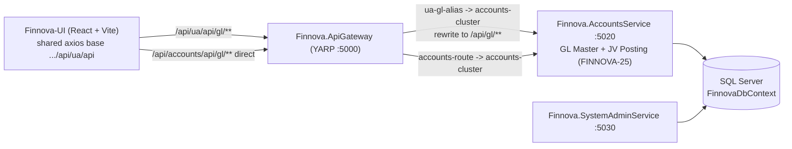
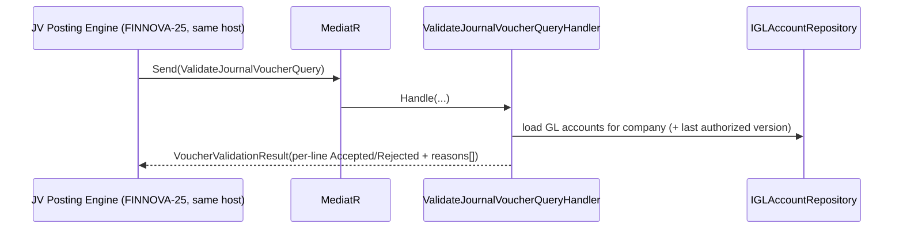
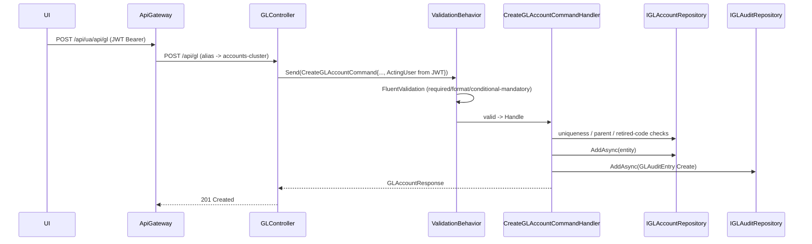
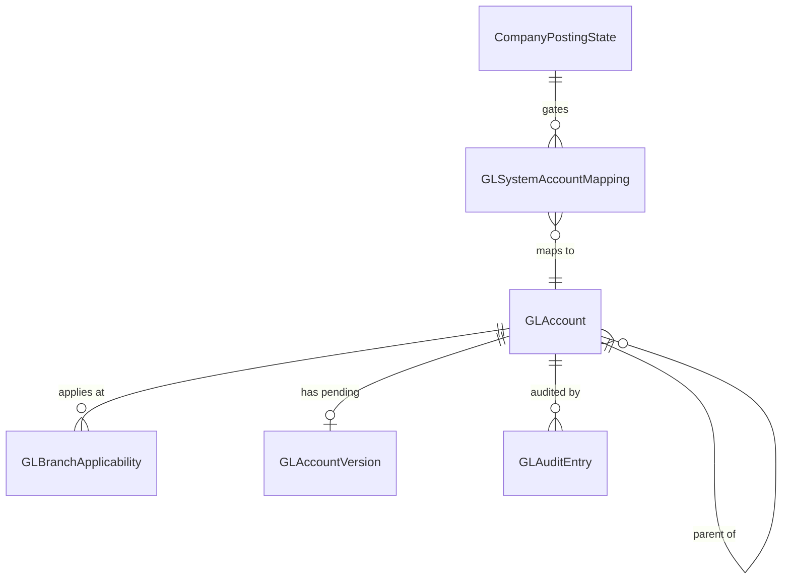

# Design Document

## Overview

GL Master Management (FINNOVA-31 → FINNOVA-38) delivers the Finnova Chart of Accounts (CoA) as a governed four-level hierarchy (L1 Nature → L2 → L3 → L4 Leaf Ledger), plus the Maker-Checker workflow, structural locking + versioning, lifecycle management (freeze / deactivate / restricted delete), mandatory System GL configuration per company, a high-performance per-line GL validation service consumed by the JV posting engine, search/filter/tree/export, bulk CoA upload with dry-run, an immutable audit trail, and role-based authorization — with a React administrative screen.

The feature follows the platform's established layered CQRS conventions exactly as implemented by the **Court Master (FINNOVA-13)**, which is the primary structural reference throughout this document: ASP.NET Core Web API → MediatR commands/queries → FluentValidation (via the `ValidationBehavior` pipeline) → EF Core + SQL Server through the generic `IRepository<T>` / `RepositoryBase<T>`, record-based contracts with `.ToResponse()` mappers, and the shared `PaginatedResponse<T>` contract.

The one deliberate departure from the other SystemAdmin masters is **host placement**: GL Master is hosted in **`Finnova.AccountsService`** (gateway `accounts-cluster`, prefix `/api/accounts/**`), **not** in `Finnova.SystemAdminService`. GL is an accounting concern and must be co-located with the FINNOVA-25 JV posting engine so that the Requirement 6 **GL Validation Service is an in-process MediatR call** rather than a cross-host hop. Because `Finnova.AccountsService` does not yet carry the governance stack that `Finnova.SystemAdminService` already has (JWT auth, authorization policies, the MediatR `ValidationBehavior`, the exception→ProblemDetails middleware, and the string-enum JSON converter), the **first task group of this feature is to port that governance stack into `Finnova.AccountsService`**.

> Spec-workflow note: this is a documents-only spec. This design describes the "why" and the shape; the companion `tasks.md` carries the copy-paste code. No code is implemented and no builds/tests are run as part of producing the spec.

> Localization: Finnova is **India-only, English-only**. Every GL account carries a single English `Name`. There are no bilingual fields, no Arabic content, and no right-to-left rendering anywhere in the backend contracts or the UI.

---

## Architecture

### Host and gateway topology



- The existing `accounts-route` already forwards `/api/accounts/**` to `accounts-cluster` with `PathRemovePrefix: /api/accounts`. A controller routed at `api/gl` is therefore reachable at **`/api/accounts/api/gl/**`**.
- The shared UI axios base URL targets a `/api/ua/api` prefix (product-context). To keep the UI's URL composition consistent with how `lookup` / `nationality` / `court` are aliased, we **add two gateway alias routes** — `ua-gl-alias-route` and `ua-gl-alias-root` — that match `/api/ua/api/gl/**` and forward to **`accounts-cluster`** (not `systemadmin-cluster`, unlike the other aliases), rewriting the path to `/api/gl/**`. This lets the UI call `/api/ua/api/gl/**` without a second axios base URL while host separation stays intact.

### In-process flow (GL Validation Service for JV posting, R6)

Because GL Master and the JV posting engine share the `Finnova.AccountsService` process, FINNOVA-25 validates each voucher line by sending a `ValidateJournalVoucherQuery` through the in-process MediatR mediator — no HTTP hop, no serialization boundary. The validation handler reads GL master state (and, where needed, the balance/posting ports) and returns a per-line Accepted/Rejected result with the full set of rejection reasons per line.



### Request pipeline (write path, e.g. Create GL)



The `ExceptionHandlingMiddleware` (new, in AccountsService) sits at the front of the pipeline and converts typed domain exceptions and `FluentValidation.ValidationException` into RFC 7807 `ProblemDetails` with a stable `code` extension (`ERR-GL-*`).

---

## What Is Reused vs What Is New

### Reused (unchanged)

- `RepositoryBase<T>` / `IRepository<T>` generic data access (`AddAsync` saves immediately).
- `FinnovaDbContext` with `ApplyConfigurationsFromAssembly` and SQL Server (`UseSqlServer`).
- `PaginatedResponse<T>(Data, Total, Page, PageSize, TotalPages)`.
- MediatR + FluentValidation + `ValidationBehavior<TRequest,TResponse>` pipeline behavior.
- `.ToResponse()` mapper convention; records for contracts; `Internal/<Entity>AuditSnapshot` JSON helper pattern (mirroring `CourtAuditSnapshot`).
- Typed exception → ProblemDetails convention (mirroring `ExceptionHandlingMiddleware` in SystemAdminService), with static `ErrorCode` constants where the frontend branches on them (mirroring `CourtDuplicateCodeException.ErrorCode`).
- `TokenService` / `JwtSettings` DI and `AddFinnovaRepository` — **already present** in `AccountsService.Program.cs`.
- Frontend: shared `src/services/api.ts` axios instance (JWT injection + central 401/403/409 handling), MUI, the interface/mock/real/toggle/barrel service pattern (reference: `location.service.ts` / `lookup.service.ts`), and the master-page pattern (`LocationMaster.tsx` / `LookupMaster.tsx`).

### New

- **Governance stack ported into `Finnova.AccountsService`** (JSON string-enum converter, `ValidationBehavior` registration, JWT Bearer auth, four authorization policies, a new `ExceptionHandlingMiddleware` with a GL branch, Swagger Bearer, middleware ordering, `public partial class Program {}` test shim).
- Domain entities: `GLAccount`, `GLBranchApplicability`, `GLAccountVersion`, `GLSystemAccountMapping`, `CompanyPostingState`, `GLAuditEntry`; enums; typed exceptions.
- Contracts for CRUD, workflow, lifecycle, system-GL, bulk, tree, export, audit — plus the **JV validation-service contract** (`ValidateJournalVoucherQuery` / `VoucherValidationResult`).
- Repositories + interfaces + DI registrations; pure domain helpers (`GLCodeRules`, `NatureRules`, `JvLineValidator`); CQRS command/query slices; the `GLController`; the gateway alias routes.
- Dependency **ports** (interfaces) to other subsystems/masters (balance, voucher references, reference-checks, company, calendar, branch, currency, cost/profit centre).
- Frontend GL Master screen (CoA tree, maker/checker queues, lifecycle dialogs, bulk upload dry-run, audit drawer, export) + service layer + tests.

---

## Requirements Coverage Map

| Req | Summary | Primary design elements |
|-----|---------|--------------------------|
| R1 | Create with hierarchy + master validations | `CreateGLAccountCommand(+Handler/Validator)`, `GLCodeRules` (9-digit, parent-prefix), `NatureRules` (nature-from-parent, normal-balance), `GLAccount`, `IAccountingCalendarPort` (closed-period) |
| R2 | Code/Name uniqueness + non-reuse | `IGLAccountRepository.ExistsByCodeAsync/ExistsByNameAsync/GetInactiveByCodeAsync`, `GLDuplicateCodeException`, `GLRetiredCodeException`, `GLDuplicateNameException`; validation ordered before uniqueness in `ValidationBehavior` |
| R3 | Maker-Checker authorize/reject | `SubmitGLAccountCommand`, `AuthorizeGLAccountCommand`, `RejectGLAccountCommand`, `Status` enum, maker≠checker guard, `GLAuditEntry` |
| R4 | Edit, structural lock, versioning | `UpdateGLAccountCommand`, `GLAccountVersion`, `AuthorizedVersionNumber`, `IGLBalanceQueryPort.HasAuthorizedPostingAsync`, structural-field classifier |
| R5 | Freeze / deactivate / restricted delete | `FreezeGLAccountCommand`, `DeactivateGLAccountCommand`, `DeleteGLAccountCommand`, lifecycle pre-condition ports (`IGLBalanceQueryPort`, `IVoucherReferenceQueryPort`, `IGLReferenceCheckPort`) |
| R6 | JV validation service | `ValidateJournalVoucherQuery(+Handler)`, `JvLineValidator` (pure), `VoucherValidationResult` — in-process MediatR |
| R7 | Mandatory System GL config | `GLSystemAccountMapping`, `SystemGLType` enum, `MapSystemGLCommand`, `GetSystemGLCompletenessQuery`, `EnableJvPostingCommand`, `CompanyPostingState`, `ICompanyQueryPort` (multi-currency) |
| R8 | Search/filter/tree/export | `GetGLAccountsPagedQuery`, `GetGLTreeQuery`, `ExportGLAccountsQuery`, `IGLAccountRepository.GetPagedAsync`, `PaginatedResponse<T>`, GL-read policy |
| R9 | Bulk upload + migration | `DryRunGLUploadCommand`, `CommitGLUploadCommand`, `AuthorizeGLBatchCommand`, `RejectGLBatchCommand`, dependency-ordered parse/validate, batch id + 30-min dry-run window |
| R10 | Immutable audit trail | `GLAuditEntry`, `GLAuditAction` enum, `IGLAuditRepository`, `GetGLAuditTrailQuery` (desc order), immutability (no update/delete API) |
| R11 | AuthZ/AuthN enforcement | JWT Bearer scheme, policies `GLMaker`/`GLChecker`/`SystemAdmin`/`GLRead`, auth-before-authz ordering, 401 vs 403 |
| R12 | Admin UI | `GLMaster.tsx` + components, service interface/mock/real/toggle/barrels, route + nav, Vitest tests |

---

## Data Models

### Entity-relationship (description)

- **`GLAccount`** is the aggregate root, scoped to a `CompanyId`. It self-references via `ParentGLId` (nullable; null only for L1). It owns a set of **`GLBranchApplicability`** rows (one per applicable branch — modeled as a child entity because branch applicability is a set, not a scalar). It optionally owns one pending **`GLAccountVersion`** while `Status = PendingModification`.
- **`GLSystemAccountMapping`** links a `(CompanyId, SystemGLType)` to a `GLAccountId`; at most one active mapping per `(CompanyId, SystemGLType)`.
- **`CompanyPostingState`** holds the per-company "JV posting enabled" gate (R7).
- **`GLAuditEntry`** records every governance action against a `GLAccountId` (or a System GL mapping), immutable, newest-first on read.



### `GLAccount` (entity)

| Field | Type | Notes |
|-------|------|-------|
| `Id` | `Guid` | `= Guid.NewGuid()` |
| `CompanyId` | `Guid` | scopes all uniqueness checks |
| `GLCode` | `string` | exactly 9 numeric digits; unique within company; non-reusable |
| `Name` | `string` | English only; ≤ 150 chars (assumption); unique within company (case-insensitive) |
| `Level` | `GLLevel` enum | `L1..L4` |
| `ParentGLId` | `Guid?` | null only for L1 |
| `AccountNature` | `AccountNature` enum | derived from parent |
| `NormalBalance` | `NormalBalance` enum | derived from nature |
| `GLType` | `GLType` enum | `Normal/Control/Tax` |
| `SubLedgerType` | `string?` | mandatory when `GLType = Control` |
| `TaxType` | `string?` | mandatory when `GLType = Tax` |
| `IsPostable` | `bool` | true only for L4 |
| `CurrencyId` | `Guid` | GL master currency |
| `AllowManualJV` | `bool` | non-structural |
| `CostCentreMandatory` | `bool` | non-structural |
| `ProfitCentreMandatory` | `bool` | non-structural |
| `ReportingLine` | `string?` | non-structural |
| `EffectiveFrom` | `DateTime` | required; not in closed period |
| `EffectiveTo` | `DateTime?` | ≥ `EffectiveFrom` (assumption) |
| `Status` | `GLStatus` enum | see enum below |
| `MakerId` | `string?` | last maker (submission/modification) |
| `CheckerId` | `string?` | last checker (authorize/reject) |
| `AuthorizedVersionNumber` | `int` | starts at 0; +1 on each authorized modification |
| `RejectionReason` | `string?` | last rejection reason (≤ 500) |
| `CreatedAt` / `UpdatedAt` | `DateTime` | `= DateTime.UtcNow` |

### `GLBranchApplicability` (child entity)

`Id (Guid)`, `GLAccountId (Guid FK)`, `BranchId (Guid)`. Unique on `(GLAccountId, BranchId)`.

### `GLAccountVersion` (pending-modification snapshot — R4)

`Id (Guid)`, `GLAccountId (Guid FK)`, `VersionNumber (int)`, `ProposedPayload (string JSON of non-structural fields)`, `MakerId (string)`, `SubmittedAtUtc (DateTime)`, `State (Pending/Authorized/Rejected)`. Exactly one `Pending` row per GL account at a time.

### `GLSystemAccountMapping` (R7)

`Id (Guid)`, `CompanyId (Guid)`, `SystemGLType (enum)`, `GLAccountId (Guid)`, `IsActive (bool)`, `CreatedAt/UpdatedAt`. Unique filtered index on `(CompanyId, SystemGLType)` where `IsActive = true`.

### `CompanyPostingState` (R7)

`CompanyId (Guid PK)`, `JvPostingEnabled (bool)`, `UpdatedAt (DateTime)`.

### `GLAuditEntry` (R10 — mirrors `CourtAuditEntry`)

`Id (Guid)`, `GLAccountId (Guid)`, `Action (GLAuditAction enum)`, `OldValues (string? JSON, null on Create)`, `NewValues (string JSON, empty on Delete)`, `Summary (string)`, `Remarks (string?, ≤ 1000)`, `ChangedBy (string, from JWT)`, `ChangedByRole (string?)`, `ChangedAtUtc (DateTime, UTC, ms precision)`.

### Enums (Domain/Enums)

- `GLLevel { L1 = 1, L2 = 2, L3 = 3, L4 = 4 }`
- `AccountNature { Asset, Liability, Equity, Income, Expense }`
- `NormalBalance { Debit, Credit }`
- `GLType { Normal, Control, Tax }`
- `GLStatus { Draft, PendingAuthorization, Active, Rejected, PendingModification, Frozen, Inactive }`
- `SystemGLType { Suspense, RoundOff, InterBranchClearingHO, InterBranchClearingBranch, RetainedEarnings, RealizedFX, UnrealizedFX }`
- `GLAuditAction { Create, Submit, Approve, Reject, Update, ModApprove, ModReject, Freeze, Deactivate, Delete, SystemGLMap }`
- `JvEntryMode { Manual, System }`
- `ExportFormat { Xlsx, Csv }`

All enums serialize by name over the wire (via the `JsonStringEnumConverter` registered in the ported governance stack), matching how the UI sends them.

### Structural vs non-structural classification (R4.1)

- **Structural (locked once an authorized posting exists):** `GLCode`, `ParentGLId`, `AccountNature`, `NormalBalance`, `GLType`, `IsPostable`, `CurrencyId`, `SubLedgerType`.
- **Non-structural (versioned, Maker-Checker on change):** `AllowManualJV`, `CostCentreMandatory`, `ProfitCentreMandatory`, branch applicability, `ReportingLine`.

---

## Contracts

All contracts are records under `Finnova.Models/Contracts/GL`.

### Requests

```
CreateGLAccountRequest(Guid CompanyId, string GLCode, string Name, Guid? ParentGLId,
    GLType GLType, string? SubLedgerType, string? TaxType, Guid CurrencyId,
    bool AllowManualJV, bool CostCentreMandatory, bool ProfitCentreMandatory,
    string? ReportingLine, DateTime EffectiveFrom, DateTime? EffectiveTo,
    IReadOnlyList<Guid> ApplicableBranchIds)

UpdateGLAccountRequest(bool AllowManualJV, bool CostCentreMandatory, bool ProfitCentreMandatory,
    string? ReportingLine, IReadOnlyList<Guid> ApplicableBranchIds)   // non-structural only

RejectGLRequest(string Reason)                         // 1..500
FreezeGLRequest(string Reason)                         // 1..500
MapSystemGLRequest(Guid CompanyId, SystemGLType Type, Guid GLAccountId)
GLAccountFilter(string? GLCode, string? Name, AccountNature? Nature, GLType? Type,
    GLStatus? Status, Guid? ParentGLId, int Page = 1, int PageSize = 20)
ExportGLRequest(ExportFormat Format, GLAccountFilter Filter)
```

### Responses

```
GLAccountResponse(Guid Id, Guid CompanyId, string GLCode, string Name, GLLevel Level,
    Guid? ParentGLId, AccountNature AccountNature, NormalBalance NormalBalance, GLType GLType,
    string? SubLedgerType, string? TaxType, bool IsPostable, Guid CurrencyId,
    bool AllowManualJV, bool CostCentreMandatory, bool ProfitCentreMandatory, string? ReportingLine,
    DateTime EffectiveFrom, DateTime? EffectiveTo, GLStatus Status, int AuthorizedVersionNumber,
    IReadOnlyList<Guid> ApplicableBranchIds, DateTime CreatedAt, DateTime UpdatedAt)

GLTreeNodeResponse(Guid Id, string GLCode, string Name, GLLevel Level, bool IsPostable,
    GLStatus Status, IReadOnlyList<GLTreeNodeResponse> Children)   // siblings ordered by GLCode asc

GLAuditEntryResponse(Guid Id, Guid GLAccountId, string Action, string? OldValues,
    string NewValues, string Summary, string? Remarks, string ChangedBy, DateTime ChangedAtUtc)

SystemGLCompletenessResponse(Guid CompanyId, bool IsComplete,
    IReadOnlyList<SystemGLType> MissingOrInvalid)

GLUploadRowResult(int RowNumber, string GLCode, bool Success, string? Error)
GLUploadReportResponse(Guid BatchId, bool AllSuccess, IReadOnlyList<GLUploadRowResult> Rows)
```

Paged reads use `PaginatedResponse<GLAccountResponse>`.

### GL Validation Service contract (R6 — consumed in-process by FINNOVA-25)

```
ValidateJournalVoucherQuery(Guid CompanyId, DateTime ValueDate, Guid BranchId,
    JvEntryMode Mode, IReadOnlyList<JvLineInput> Lines) : IRequest<VoucherValidationResult>

JvLineInput(int LineNumber, Guid GLAccountId, Guid CurrencyId,
    Guid? CostCentreId, Guid? ProfitCentreId, string? SubLedgerReference)

VoucherValidationResult(IReadOnlyList<JvLineResult> Lines)
JvLineResult(int LineNumber, bool Accepted, IReadOnlyList<string> Reasons)  // reasons asc by criterion
```

Header-level validation (missing header attribute, 0 lines, > 1000 lines → R6.14) is enforced by a FluentValidation validator and rejects the whole request before per-line evaluation.

---

## Components and Interfaces

### Repositories (`Finnova.Repository`)

- **`IGLAccountRepository : IRepository<GLAccount>`**
  - `GetPagedAsync(GLAccountFilter, ct)` → `(List<GLAccount> Items, int Total)` — AND-combined filters, case-insensitive substring on code/name, company-scoped, ordered, `Skip/Take`, `Count` (mirrors `CourtRepository.GetPagedAsync`).
  - `ExistsByCodeAsync(companyId, code, excludeId?, ct)` — trimmed exact match, scoped to company (R2.1/2.3).
  - `GetInactiveByCodeAsync(companyId, code, ct)` — supports retired-code precedence (R2.4).
  - `ExistsByNameAsync(companyId, name, excludeId?, ct)` — case-insensitive trimmed (R2.5).
  - `GetWithChildrenAndBranchesAsync(id, ct)`, `GetTreeAsync(companyId, ct)`, `HasActiveChildrenAsync(id, ct)`.
- **`IGLSystemAccountMappingRepository`**, **`ICompanyPostingStateRepository`**, **`IGLAuditRepository`** (`GetByGLAccountIdAsync` ordered `ChangedAtUtc` desc, then `Id` desc — mirrors `CourtAuditRepository`).

All concrete repositories extend `RepositoryBase<T>` and are registered in `AddFinnovaRepository`.

### Pure domain helpers (`Finnova.Service/GL/Internal`) — unit/property testable

- **`GLCodeRules`** — `IsNineNumericDigits(code)`; `BeginsWithParentPrefix(childCode, parentCode)`.
- **`NatureRules`** — `NormalBalanceFor(nature)` (Asset/Expense→Debit; Liability/Equity/Income→Credit); `LevelFrom(parentLevel?)`.
- **`JvLineValidator`** — pure function `Evaluate(line, glSnapshot, voucherContext) → reasons[]` producing all applicable reasons in ascending criterion order (R6.2–R6.11, R6.13). Keeping this pure makes R6 property-testable without I/O.
- **`GLAuditSnapshot`** (Internal) — serializes the editable surface to compact JSON (mirrors `CourtAuditSnapshot`).

### CQRS slices (`Finnova.Service/GL/{Commands,Queries}/<Name>`)

Each folder holds the `Command`/`Query` record (carrying an acting-user/`ActingUser` string resolved from the JWT, never from the body), a `Handler`, and a `Validator`. Handlers trim inputs, run uniqueness/parent/lifecycle checks against repositories + ports, throw typed exceptions, write exactly one `GLAuditEntry` in the same flow, and return responses via `.ToResponse()` mappers in `Finnova.Service/Mappers`.

Commands: `CreateGLAccount`, `UpdateGLAccount`, `SubmitGLAccount`, `AuthorizeGLAccount`, `RejectGLAccount`, `FreezeGLAccount`, `DeactivateGLAccount`, `DeleteGLAccount`, `MapSystemGL`, `EnableJvPosting`, `DryRunGLUpload`, `CommitGLUpload`, `AuthorizeGLBatch`, `RejectGLBatch`.
Queries: `GetGLAccountById`, `GetGLAccountsPaged`, `GetGLTree`, `ExportGLAccounts`, `GetGLAuditTrail`, `GetSystemGLCompleteness`, `ValidateJournalVoucher`.

### Dependency ports (interfaces — confirm ownership with other teams)

| Port | Purpose | Classification |
|------|---------|----------------|
| `IGLBalanceQueryPort` | current balance + `HasAuthorizedPostingAsync` (R4 lock, R5 zero-balance) | **Hard dependency** — owned by FINNOVA-25 |
| `IVoucherReferenceQueryPort` | parked/draft/pending vouchers referencing a GL (R5.5) | **Hard dependency** — FINNOVA-25 |
| `IGLReferenceCheckPort` | mapped in active accounting rule / product / charge (R5.7) | Assumed-existing masters — confirm |
| `ICompanyQueryPort` | company existence + multi-currency flag (R7.8) | Assumed-existing (Company master) |
| `IAccountingCalendarPort` | closed-period check (R1.12) | Assumed-existing (financial calendar) |
| `IBranchQueryPort` | branch existence for applicability (R6.7) | Assumed-existing (Branch master) |
| `ICurrencyQueryPort` | currency existence (R6.9) | Assumed-existing (Currency master) |
| `ICostProfitCentrePort` | cost/profit centre existence | Assumed-existing |

These are declared as interfaces now; `tasks.md` provides minimal stub/dev implementations behind DI so the host wires up, with a clear "replace with real adapter" marker. This matches the requirements' Dependencies section (ports are the contract boundary with FINNOVA-25 and the other masters).

### Controller (`Finnova.AccountsService/Controllers/GLController.cs`)

`[ApiController]`, `[Route("api/gl")]`, constructor-injected `IMediator`. Each action sends a MediatR message and carries `[Authorize(Policy = ...)]`:

- **`GLMaker`**: create, update, submit, freeze, deactivate, delete, bulk dry-run/commit.
- **`GLChecker`**: authorize/reject account, authorize/reject modification, authorize/reject batch.
- **`SystemAdmin`**: map system GL, enable JV posting.
- **`GLRead`** (GLMaker OR GLChecker OR SystemAdmin OR GLViewer): paged list, by-id, tree, export, audit trail, system-GL completeness.

`ProducesResponseType` attributes document 201/200/400/404/409. A private `GetActingUser()` resolves the actor from the JWT principal (`ClaimTypes.NameIdentifier` → `sub` → `ClaimTypes.Name`), never from the request body — mirroring `CourtController.GetActingAdmin()`.

> Note: the R6 validation handler is invoked **in-process** by the JV posting engine via MediatR; it does not require its own public controller endpoint for FINNOVA-25. (An optional authenticated diagnostic endpoint can be added later if the UI needs a "pre-validate voucher" preview.)

### Middleware (`Finnova.AccountsService/Middleware/ExceptionHandlingMiddleware.cs` — new)

AccountsService needs its own middleware (the SystemAdminService one is internal to that host). It maps GL exceptions path-scoped to `/api/gl`:

- `GLNotFoundException` → 404 `ERR-GL-404`
- `GLDuplicateCodeException` / `GLRetiredCodeException` / `GLDuplicateNameException` / `GLConflictException` (lifecycle / structural-lock / self-authorization / already-pending / system-GL-locked) → 409 `ERR-GL-409`
- `FluentValidation.ValidationException` → 400 `ERR-GL-400`
- anything else → 500 `ERR-GL-500`

### Frontend components (Finnova-UI)

- Service layer: `src/services/interfaces/gl.service.ts`, `src/services/mock/gl.service.mock.ts`, `src/services/real/gl.service.real.ts` (uses shared `api.ts`), a toggle module selecting mock vs real via `VITE_USE_MOCK_API`, and barrel exports — mirroring `lookup.service.ts`.
- `src/models/gl.ts` — TypeScript model mirroring the response contracts and enums.
- Page `GLMaster.tsx` + components: recursive CoA tree (MUI `x-tree-view` or a recursive MUI `List`), create/edit dialog (Nature + Normal Balance shown **read-only, derived** from the selected parent; Sub-ledger/Tax required conditionally; submit disabled until valid), checker authorization queue (approve/reject disabled on own records; reject disabled until a 1–500 char reason), lifecycle dialogs (mandatory reason), bulk-upload dry-run report table + commit, audit-trail drawer, export button (XLSX/CSV).
- Route added in `App.tsx`; nav entry in `Layout.tsx`.
- UI composes URLs against the gateway alias `/api/ua/api/gl/**` (no second axios base URL).

---

## Correctness Properties

*A property is a characteristic or behavior that should hold true across all valid executions of a system — essentially, a formal statement about what the system should do. Properties serve as the bridge between human-readable specifications and machine-verifiable correctness guarantees.*

These properties are the executable specifications the property-based tests (FsCheck.Xunit, minimum 100 iterations per property) validate against the pure domain helpers (`NatureRules`, `GLCodeRules`, `JvLineValidator`, the structural/lifecycle guards) and the handler-level invariants. Each property is universally quantified and testable in isolation of I/O. India-only / English-only context is unchanged: a single English `Name` per account, no bilingual fields, no RTL.

### Property 1: Normal-balance derivation is total and correct (PROP-NORMALBALANCE)

*For any* `AccountNature`, `NatureRules.NormalBalanceFor(nature)` returns `Debit` when the nature is `Asset` or `Expense` and `Credit` when the nature is `Liability`, `Equity`, or `Income`, and the function is total — it returns a value for every defined enum member and never throws.

- **Validates: Requirements 1.10**
- **Target:** `Finnova.Service/GL/Internal/NatureRules.NormalBalanceFor`

### Property 2: Child nature equals parent nature (PROP-NATURE-INHERITANCE)

*For any* parent GL account and any child created under it, the child's derived `AccountNature` always equals the parent's `AccountNature`, regardless of any nature value supplied on the request (supplied nature is ignored).

- **Validates: Requirements 1.9**
- **Target:** `CreateGLAccountCommandHandler` nature-derivation step (via `NatureRules`)

### Property 3: GL Code is exactly nine ASCII digits (PROP-GLCODE-FORMAT)

*For any* string, `GLCodeRules.IsNineNumericDigits(code)` returns true iff the string consists of exactly nine ASCII digit characters (`0`–`9`); it returns false for any length other than 9, for any string containing a non-digit character, and for any string containing whitespace.

- **Validates: Requirements 1.5**
- **Target:** `Finnova.Service/GL/Internal/GLCodeRules.IsNineNumericDigits`

### Property 4: Parent-prefix rule is leading-substring equivalence (PROP-PARENTPREFIX)

*For any* parent code `P` and child code `C`, `GLCodeRules.BeginsWithParentPrefix(C, P)` is true iff `C` begins with `P` as a leading substring.

- **Validates: Requirements 1.6**
- **Target:** `Finnova.Service/GL/Internal/GLCodeRules.BeginsWithParentPrefix`

### Property 5: Postable ⇔ Leaf (L4) (PROP-POSTABLE-L4)

*For any* GL account, `IsPostable` may be true only when `Level = L4`; for every account at `Level` L1, L2, or L3 the resolved `IsPostable` is always false.

- **Validates: Requirements 1.2, 1.3**
- **Target:** `CreateGLAccountCommandHandler` postable-resolution / `CreateGLAccountCommandValidator` (header-postable rejection)

### Property 6: Level derivation from parent (PROP-LEVEL-DERIVATION)

*For any* optional parent level, `NatureRules.LevelFrom(parentLevel)` yields L1 iff no parent is provided, otherwise `parentLevel + 1`, and the resulting level never exceeds L4 (a parent at L4 cannot produce a valid child level).

- **Validates: Requirements 1.1, 1.8**
- **Target:** `Finnova.Service/GL/Internal/NatureRules.LevelFrom`

### Property 7: Maker ≠ Checker invariant (PROP-MAKER-NE-CHECKER)

*For any* pending GL account (or pending modification) and any acting user, a transition to `Active` (authorize) or `Rejected` (reject) is permitted only when `actingUser != MakerId`; when `actingUser == MakerId` the state and all attributes are left unchanged and the operation is rejected. This holds uniformly for account authorization, modification authorization, and lifecycle (freeze/deactivate) authorization.

- **Validates: Requirements 3.3, 4.6, 5.12**
- **Target:** authorize/reject command handlers (self-authorization guard over `MakerId`)

### Property 8: JV per-line validation is pure and complete (PROP-JV-COMPLETENESS)

*For any* generated line / GL snapshot / voucher context, `JvLineValidator.Evaluate` is a pure function (identical inputs always produce the identical set of reasons) and returns the complete set of all applicable rejection reasons for that line (every violated criterion among R6.2–R6.10/R6.13, not just the first); a line is `Accepted` iff its reasons set is empty.

- **Validates: Requirements 6.11, 6.12**
- **Target:** `Finnova.Service/GL/Internal/JvLineValidator.Evaluate`

### Property 9: JV reasons are deterministically ordered (PROP-JV-ORDERING)

*For any* line whose evaluation yields one or more rejection reasons, the reasons are emitted in ascending criterion-number order deterministically, so the same input always produces the same ordered reason sequence.

- **Validates: Requirements 6.12**
- **Target:** `Finnova.Service/GL/Internal/JvLineValidator.Evaluate`

### Property 10: Audit entries are written exactly once per successful action (PROP-AUDIT-EXACTLY-ONCE)

*For any* mutating GL action (create, update, submit, authorize, reject, freeze, deactivate, delete, system-GL map), a successful execution increases the persisted audit-entry count for the affected GL identifier by exactly one, while any action rejected by validation, uniqueness, structural-lock, lifecycle pre-condition, or self-authorization adds exactly zero audit entries.

- **Validates: Requirements 10.1, 10.2**
- **Target:** command handlers + `IGLAuditRepository` (single `AddAsync` on the success path only)

### Property 11: Retired-code rejection takes precedence over plain duplicate (PROP-RETIRED-PRECEDENCE)

*For any* create request whose trimmed GL Code matches an existing account in the same Company, if a matching account with `Status = Inactive` exists the request is rejected with the retired-code (non-reusable) error in preference to the plain duplicate-code error; the retired-code outcome is deterministic regardless of other non-Inactive matches.

- **Validates: Requirements 2.4**
- **Target:** `CreateGLAccountCommandHandler` uniqueness/non-reuse ordering (via `IGLAccountRepository.GetInactiveByCodeAsync` / `ExistsByCodeAsync`)

---

## Error Handling

- **Validation failures** (required/format/conditional-mandatory/pagination range/reason length) are raised by FluentValidation inside `ValidationBehavior` → `ERR-GL-400` (400). Validation runs **before** uniqueness/non-reuse (R2.6).
- **Not found** (by id, update/freeze/deactivate/delete/audit on a missing GL) → `GLNotFoundException` → `ERR-GL-404` (404). Audit read of a missing GL returns `[]` (R10.5) rather than 404.
- **Conflicts** → `ERR-GL-409` (409): duplicate code (R2.3), retired-code reuse with precedence over plain duplicate (R2.4), duplicate name (R2.5), structural-field change once postings exist (R4.2), self-authorization (R3.3/R4.6/R5.12), modification already pending (R4.4), lifecycle pre-condition failures (R5.4–R5.7), delete of an ever-authorized GL (R5.9), duplicate active system-GL mapping (R7.7), unmap while operational (R7.5).
- **Fallback** → `ERR-GL-500` (500), generic detail (no internals leaked).
- Every error is RFC 7807 `ProblemDetails` with a `code` extension the UI branches on. Rejected requests record **no** audit entry (R10.2) because the exception short-circuits before `AddAsync`.

---

## Security

- **Authentication:** JWT Bearer scheme ported into `AccountsService.Program.cs`, validating issuer, audience, lifetime, and signing key from the `Jwt` config section, with `RoleClaimType = ClaimTypes.Role`. Missing/expired/malformed/bad-signature tokens → 401 (R11.1), enforced **before** authorization (R11.5) by placing `UseAuthentication()` before `UseAuthorization()`.
- **Authorization policies:** `GLMaker`, `GLChecker`, `SystemAdmin`, and `GLRead` (satisfied by any of GLMaker/GLChecker/SystemAdmin/GLViewer). A GL-Viewer-only user is confined to read operations; any write returns 403 (R8.8, R11.2–R11.4, R11.6).
- **Actor from token, never body:** every command's acting-user is resolved by `GLController.GetActingUser()` from the validated principal, so the audit actor and maker/checker identity cannot be spoofed.
- **Maker ≠ Checker enforcement point:** enforced inside the authorize/reject **handlers** by comparing the resolved acting-user against the stored `MakerId` (pending record / pending version), throwing `GLConflictException` (self-authorization) → 409. This covers R3.3, R4.6, and R5.12 uniformly, independent of role claims.
- India-only/English-only: no localization, no RTL; a single English `Name` per account.

---

## Design Decisions and Tradeoffs

1. **Host in AccountsService (not SystemAdminService).** Chosen so the R6 validation service is an in-process MediatR call co-located with FINNOVA-25. Tradeoff: AccountsService must be provisioned with the governance stack it currently lacks — captured as the first task group. Alternative (host in SystemAdminService, call validation cross-host) rejected: adds a network hop and serialization to the hot JV-posting path.

2. **Gateway alias → accounts-cluster.** Add `ua-gl-alias-route` / `ua-gl-alias-root` matching `/api/ua/api/gl/**` and forwarding to **accounts-cluster** (rewriting to `/api/gl/**`), so the UI reuses its existing `/api/ua/api` axios base. Tradeoff: an alias that points to a different cluster than the other `/api/ua/api/*` aliases — acceptable and documented; host separation is preserved. Alternative (give the UI a second axios base at `/api/accounts/api`) rejected to keep one base URL and match the established alias pattern.

3. **Versioning via a separate `GLAccountVersion` table (not a JSON pending-payload column).** A dedicated table gives a queryable, auditable pending modification with its own maker/timestamp/version number and cleanly models "exactly one pending version" with a constraint. Tradeoff: one extra table and a small join. Alternative (pending-payload JSON column on `GLAccount`) rejected: harder to query/audit and conflates authorized vs proposed state. The last **authorized** configuration (current `GLAccount` fields + `AuthorizedVersionNumber`) always governs JV validation until the checker approves (R4.4).

4. **Branch applicability as a child entity (`GLBranchApplicability`), not a CSV/JSON column.** It is a set with membership queries (R6.7); a child table with a unique `(GLAccountId, BranchId)` index is the natural, indexable model. Tradeoff: extra table + load; acceptable and consistent with relational norms.

5. **In-process validation service with a pure `JvLineValidator`.** The decision logic is a pure function over a GL snapshot + voucher context, returning all applicable reasons per line in ascending criterion order (R6.12). This keeps R6 property-testable (100+ FsCheck iterations) and free of I/O, while the handler supplies the data. Tradeoff: the handler must pre-load GL snapshots for the voucher's lines.

6. **Structural-lock detection through `IGLBalanceQueryPort`.** Whether an authorized posting exists is owned by FINNOVA-25, so the lock test (R4.2) and zero-balance test (R5.4) go through a port, not a local table. Tradeoff: a hard runtime dependency on FINNOVA-25; marked explicitly and stubbed in dev until the adapter lands.

7. **Dedicated audit entity (`GLAuditEntry`) mirroring `CourtAuditEntry`.** Keeps the established JSON-snapshot + summary pattern, immutability (no update/delete surface), and newest-first reads. Tradeoff: a per-feature audit table rather than a shared audit store — consistent with every other master in the codebase.

### New assumptions recorded for confirmation

- **A1 (GLViewer claim):** the GL-read policy treats a `GLViewer` role claim as read-eligible alongside GLMaker/GLChecker/SystemAdmin; the exact claim string (`GLViewer`) is proposed for confirmation.
- **A2 (Dependency ports in dev):** ports (`IGLBalanceQueryPort`, etc.) ship with minimal dev stubs so the host wires up before FINNOVA-25 / the referenced masters expose real adapters; the stubs are replaced, not shipped to production.
- **A3 (Bulk dry-run window persistence):** the 30-minute dry-run validity window (R9.10) is tracked by persisting the dry-run batch id + timestamp; the exact storage (reuse `GLAccountVersion`/a small `GLUploadBatch` table) is proposed for confirmation during task authoring.
- **A4 (Export generation library):** XLSX export uses a standard .NET spreadsheet library chosen in `tasks.md`; CSV is generated directly. The specific XLSX library is proposed for confirmation.

---

## Testing Strategy

Per product-context testing standards (xUnit + FsCheck.Xunit + `WebApplicationFactory<Program>`), delivered in `Finnova.Tests` and runnable with `dotnet test` (command only; not run as part of the spec).

- **Property-based tests (FsCheck.Xunit, ≥ 100 iterations)** for the pure logic:
  - `NatureRules.NormalBalanceFor` — for all natures, Asset/Expense ⇒ Debit, else Credit (R1.10).
  - `GLCodeRules.IsNineNumericDigits` and `BeginsWithParentPrefix` — for all generated strings/parent pairs (R1.5/R1.6).
  - `JvLineValidator.Evaluate` — for all generated line/snapshot/context combinations, the reason set is exactly the applicable criteria in ascending order, and an accepted line has zero reasons (R6.2–R6.12).
- **Example/edge xUnit facts** (mocked/in-memory repo + mocked ports) for handler behavior: retired-code precedence over duplicate (R2.4), self-authorization rejection (R3.3), structural-lock rejection when `HasAuthorizedPosting` is true (R4.2), deactivation pre-conditions (R5.3–R5.7), system-GL completeness incl. multi-currency on/off (R7.8), no-op modification suppression (R4.11), audit count increases by exactly one on success and not on rejection (R10.1/R10.2).
- **Integration tests (`WebApplicationFactory<Program>`)** against the AccountsService host: 401 without token / 403 for wrong role / 200 for GLRead, create→submit→authorize happy path, and gateway-reachability of `api/gl`.
- **Frontend (Vitest + RTL):** service mock/real behavior, create/edit dialog derived read-only fields + conditional-mandatory gating, checker queue self-record disabling, dry-run report rendering, error-path toasts. No Redux/RxJS tests.

---

## Implementation-Ordered Task List

The companion `tasks.md` applies tasks in this dependency order (governance-stack port first; dependencies before dependents):

1. **Port the governance stack into `Finnova.AccountsService`** — `AddControllers().AddJsonOptions(JsonStringEnumConverter)`; register the `ValidationBehavior` pipeline behavior; JWT Bearer auth (`AddAuthentication`/`AddJwtBearer` with issuer/audience/lifetime/signing-key, `RoleClaimType = ClaimTypes.Role`, reading `Jwt` section); `AddAuthorization` policies `GLMaker`/`GLChecker`/`SystemAdmin`/`GLRead`; new `ExceptionHandlingMiddleware` (GL branch, `ERR-GL-*`); middleware order (`UseMiddleware<ExceptionHandlingMiddleware>()` → `UseAuthentication()` → `UseAuthorization()` → `MapControllers()`); Swagger Bearer security; `public partial class Program {}` test shim. (`TokenService`/`JwtSettings`/`AddFinnovaRepository` already present.)
2. **Backend domain: entities + enums** — `GLAccount`, `GLBranchApplicability`, `GLAccountVersion`, `GLSystemAccountMapping`, `CompanyPostingState`, `GLAuditEntry`; the enums listed above.
3. **Backend domain: exceptions** — `GLNotFoundException`, `GLDuplicateCodeException`, `GLRetiredCodeException`, `GLDuplicateNameException`, `GLConflictException` (with static `ErrorCode` where the UI branches).
4. **Backend contracts** — request/response records + the `ValidateJournalVoucherQuery`/`VoucherValidationResult` contract.
5. **Backend EF configuration + `FinnovaDbContext` DbSets + migration command** — `IEntityTypeConfiguration<T>` for each entity (`ToTable`, `HasKey`, property lengths, unique indexes incl. filtered active system-GL index); add DbSets; then `dotnet ef migrations add AddGLMaster` (document the command; do not generate migration code).
6. **Backend repositories + interfaces + DI** — `IGLAccountRepository`/`GLAccountRepository`, system-GL mapping repo, company-posting-state repo, `IGLAuditRepository`/`GLAuditRepository`; register all in `AddFinnovaRepository`.
7. **Backend pure/domain helpers** — `GLCodeRules`, `NatureRules`, `JvLineValidator`, `GLAuditSnapshot`; declare the dependency **ports** + dev stubs and register them.
8. **Backend service CQRS slices** — all commands/queries (handlers + validators + mappers), including the in-process `ValidateJournalVoucher` query.
9. **Backend controller + middleware branch + gateway alias** — `GLController` (`api/gl`, per-action policies, `GetActingUser()`); the `ExceptionHandlingMiddleware` GL branch (from task 1); add `ua-gl-alias-route`/`ua-gl-alias-root` to `Finnova.ApiGateway/appsettings.json` forwarding to accounts-cluster.
10. **Backend tests** — FsCheck property tests, xUnit handler facts, `WebApplicationFactory<Program>` integration tests.
11. **Frontend model + service** — `gl.ts` model; service interface + mock + real (shared `api.ts`) + toggle + barrels, URL-composed against `/api/ua/api/gl`.
12. **Frontend page + components + route + nav** — `GLMaster.tsx` with CoA tree, create/edit dialog (derived read-only Nature/Normal Balance), checker queue, lifecycle dialogs, bulk-upload dry-run, audit drawer, export; route in `App.tsx`, nav in `Layout.tsx`.
13. **Frontend Vitest tests** — service + component/page behavior (success/error paths).
