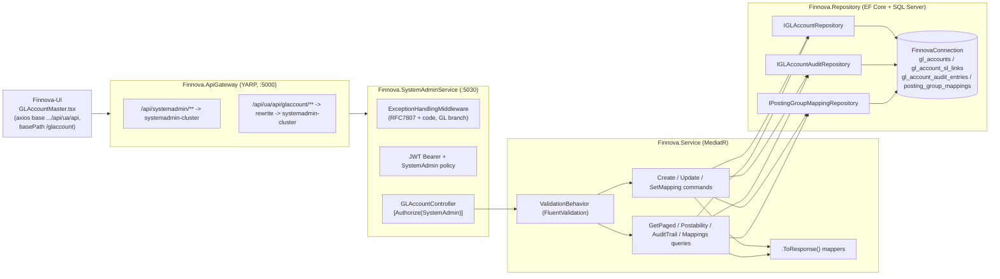
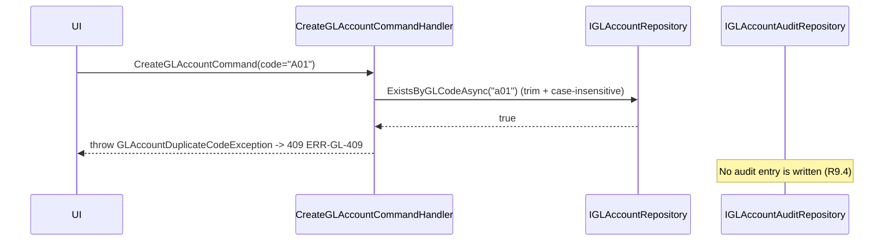
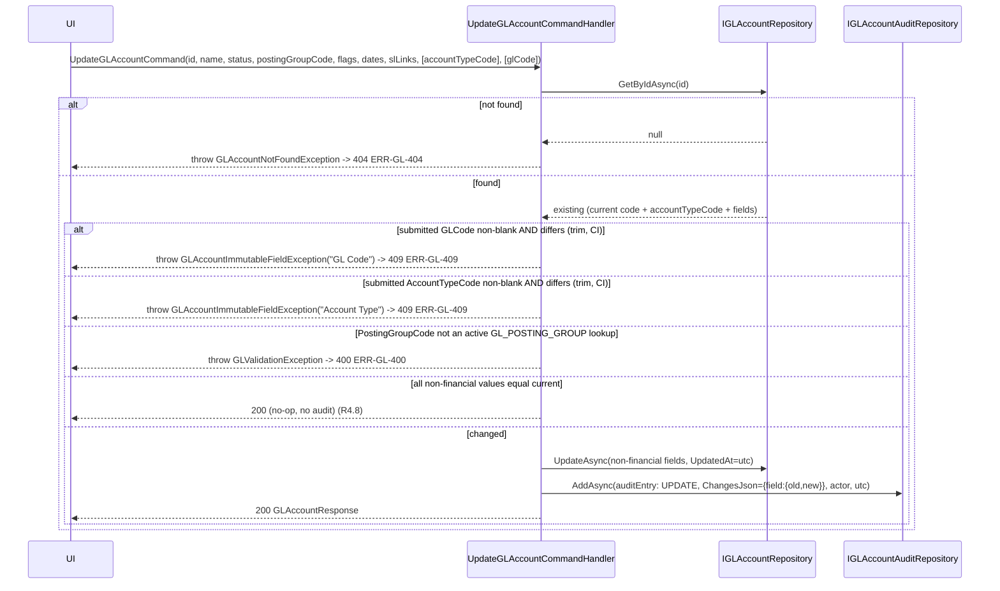
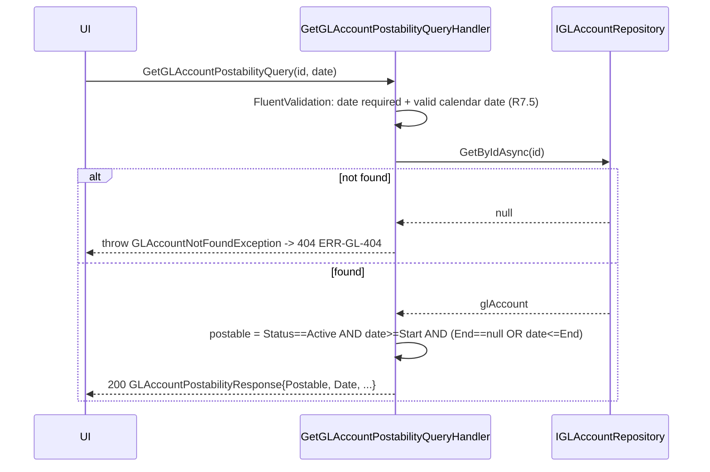
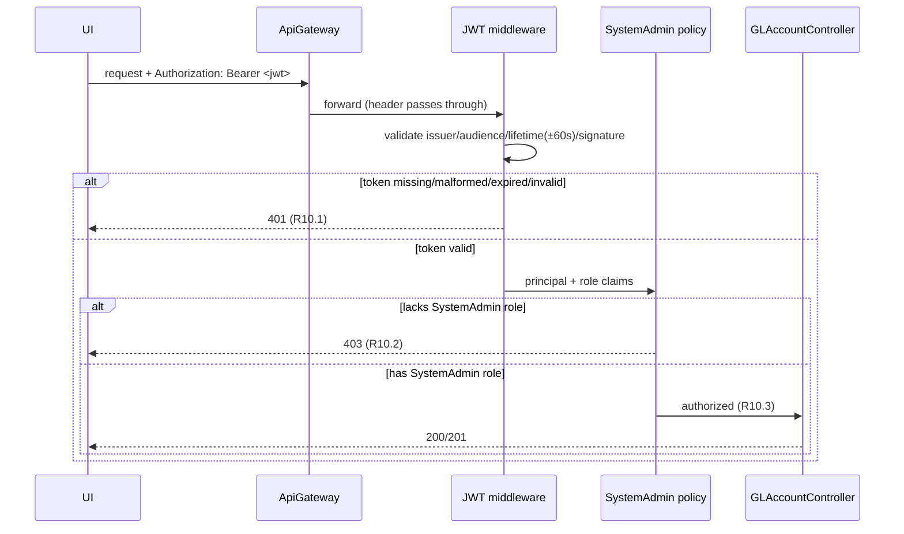

# Design Document — GL Master Management

**JIRA:** FINNOVA (GL Master) · **Module:** SystemAdmin · **Master:** GL Master / General Ledger Account Master
**Related features:** Nationality Master Management and Lookup Master Management — this design mirrors their established layered CQRS conventions and extends the same host, middleware, and gateway.

## Overview

GL Master Management is a master-data capability that lets a System Administrator define and maintain the General Ledger (GL) accounts that underpin the Finnova Financial Accounting system — posting rules, account grouping, sub-ledger (SL) mapping, and downstream integrations (Customer Master, Asset Master, LPO, Billing, Receipts, Payments, Cashflow Master). The GL Master is the single source of truth for the chart of accounts; account definitions are standardized here rather than duplicated per module.

A System Administrator can:

- **Create** a GL account (GL Code, GL Name, Account Type, Posting Group, Currency, Status, journal-permission flags, linked SL accounts, effective dates) with the service resolving defaults, Company Code, and User Branch (R1, R2, R5). Account Type, Currency, and Posting Group are **reference codes validated against the Lookup Master** (`GL_ACCOUNT_TYPE`, `CURRENCY`, `GL_POSTING_GROUP` under Module `SystemAdmin`); the User Branch is a **Level-5 Location id** (`UserBranchId`) validated against the Branch/Location Master (R1, R11).
- **Modify** the non-financial attributes of an existing GL account while GL Code and Account Type remain immutable (R3, R4).
- **Search** GL accounts by code, name, account type, or status with pagination (R8).
- **Resolve postability** of a GL account at a given date (R7) and **manage posting-group-to-GL mappings** for the required posting groups (R6).
- Review an immutable, GL-scoped **audit trail** of every create and modify (R9).

All operations — including reads — are restricted to System Administrators (R10). The actual transaction-time posting enforcement remains the responsibility of consuming accounting modules; GL Master only *exposes and validates* structural correctness and derived postability.

The feature is delivered as an API-only slice inside the **existing** `Finnova.SystemAdminService` host (the same host that already exposes Lookup and Nationality masters), reached through the **existing** `Finnova.ApiGateway` YARP reverse proxy. The user-facing screen lives in the separate `Finnova-UI` React application.

### What already exists and is reused (NOT re-established by this feature)

The following infrastructure was established by prior SystemAdmin master-data features and is treated as a fixed dependency. This design **adds to** it; it does not recreate or re-wire it.

| Concern | Existing asset | Reuse in this feature |
| --- | --- | --- |
| Host | `Finnova.SystemAdminService` (port 5030), `public partial class Program {}` shim present for `WebApplicationFactory<Program>` | Add `GLAccountController`; no new host |
| AuthN | JWT Bearer (`ValidateIssuer/Audience/Lifetime/SigningKey`, `RoleClaimType = ClaimTypes.Role`), 60s clock skew | Reused as-is (R10.1) |
| AuthZ | `SystemAdmin` policy = `RequireRole("SystemAdmin")` | Applied to every GL endpoint (R10.2, R10.3) |
| Mediation | MediatR scanning the assembly of `Finnova.Service.Lookup.Commands.CreateLookupValue.CreateLookupValueCommand`; `ValidationBehavior<,>` registered as `IPipelineBehavior`; `AddValidatorsFromAssembly` | New GL commands/queries + validators flow through it, same assembly |
| Serialization | Global `JsonStringEnumConverter` registered | `Status` enum serializes **by name** ("Active") in requests/responses; `AccountTypeCode`/`CurrencyCode`/`PostingGroupCode` are plain strings and are unaffected by the converter |
| Lookup Master | `ILookupRepository` (`GetActiveByModuleAndTypeAsync`, `ExistsByCodeAsync`, `ScopeExistsAsync`, `GetByModuleTypeCodeAsync`), `LookupValueConfiguration` EF `HasData` seed, `LookupController` dropdown endpoint | **Reused** to validate/resolve `GL_ACCOUNT_TYPE`/`CURRENCY`/`GL_POSTING_GROUP` codes and to seed their values; no new lookup repo |
| Location Master | `ILocationRepository` (`GetByLevelAsync`, `GetAllFlatAsync`, `GetByIdAsync`), `Location` entity (Level 5 = Branch) | **Reused** to validate `UserBranchId` as an active Level-5 Location and to resolve its Code/Name; no new location repo |
| Errors | `ExceptionHandlingMiddleware` → RFC 7807 `ProblemDetails` with a `code` extension; big `switch` on exception type + path-scoped validation/fallback code selection | **Extended** with a GL branch and an `isGl` path check (see Error Handling) |
| Persistence | `AddFinnovaRepository(connectionString "FinnovaConnection")` → EF Core + SQL Server; `FinnovaDbContext.OnModelCreating` calls `ApplyConfigurationsFromAssembly(typeof(FinnovaDbContext).Assembly)` | New DbSets + auto-discovered EF configs + repositories registered here |
| Generic repo | `RepositoryBase<T> : IRepository<T>` (`GetByIdAsync`, `GetAllAsync`, `FindAsync`, `AddAsync`, `UpdateAsync`, `DeleteAsync`, `CountAsync`) | GL repositories derive from it and add specialized methods, exactly like `LookupRepository`/`ILookupRepository` |
| Gateway | `systemadmin-route` `/api/systemadmin/{**catch-all}` → `systemadmin-cluster`; UI-alias pattern `/api/ua/api/{master}/**` | **Add** an equivalent GL UI-alias route pair |
| Contracts | `Finnova.Models`, `PaginatedResponse<T>`, `.ToResponse()` mapper convention | Followed exactly |
| Tests | xUnit + FsCheck.Xunit (v2) + `WebApplicationFactory<Program>` in `Finnova.Tests` | Extended with GL suites |

> **Middleware order (fixed):** `ExceptionHandlingMiddleware` → `UseAuthentication` → `UseAuthorization` → `MapControllers`. This ordering is what guarantees 401-before-403 (R10.4). It is **not** re-created; GL only adds a controller and one middleware `switch` branch.

### What is new in this feature (designed here)

- A `GLAccount` entity plus a `GLAccountSLLink` child entity (linked SL accounts), and `GLAccountStatus` / `GLAccountAuditAction` enums. Account Type is **not** modeled as an enum — it is a reference code (`AccountTypeCode`) validated against the active `GL_ACCOUNT_TYPE` lookup values; only Status stays an enum (`GLAccountStatus`).
- **Reference-data seeding:** this feature seeds the `GL_ACCOUNT_TYPE`, `CURRENCY`, and `GL_POSTING_GROUP` lookup values (English-only) by **extending** the existing `LookupValueConfiguration` EF `HasData` seed — no new seeder is introduced (see Data Models → Reference Data Seeding).
- **Reuse of the Lookup and Location masters:** Account Type / Currency / Posting Group codes are validated and their display labels resolved via the existing `ILookupRepository`; the User Branch (`UserBranchId`) is validated against an active Level-5 `Location` via the existing `ILocationRepository`. No new repository is introduced for these.
- A **new** GL-scoped audit trail: a `GLAccountAuditEntry` entity + repository + table, immutable (no update/delete), written on create and on update within the same unit of work, storing a serialized before/after of changed fields.
- A `PostingGroupMapping` entity + repository + table resolving each required posting group to one GL account.
- New domain exceptions (`GLAccountNotFoundException`, `GLAccountDuplicateCodeException`, `GLAccountImmutableFieldException`, `PostingGroupMappingValidationException`, `GLValidationException`) and an extension to `ExceptionHandlingMiddleware` mapping them (and GL-path validation/fallback) to `ERR-GL-xxx` codes.
- `GLAccountController` with paged search, create, update, postability, audit-trail-read, and posting-group-mapping read/set endpoints.
- The `Finnova-UI` GL Master screen (React + MUI), mirroring `LookupMaster.tsx`.

### Localization

Finnova is India-only and English-only. A GL account carries a single English `GLName`. There are **no** bilingual fields, no Arabic content, and no right-to-left rendering. The seeded reference values (Account Type, Currency, Posting Group) carry a single English `Value` label. The default currency is the seeded `CURRENCY` lookup value `INR`, applied when a create request omits Currency (R1.6).

## Requirements Coverage Map

| Requirement | Covered by |
| --- | --- |
| R1 Create GL account | `CreateGLAccountCommand` (+ validator, handler), `GLAccountController.Create`, `GLAccount` entity, defaults (Status/flags/Currency/Company/Branch), handler validation of `AccountTypeCode`/`CurrencyCode`/`PostingGroupCode` against active lookups and `UserBranchId` against an active Level-5 Location (via `ILookupRepository`/`ILocationRepository`), audit-on-create |
| R2 GL Code validation & uniqueness | Validator (NotEmpty, MaxLength 20, alphanumeric `Must`, reserved-`000` `Must`), `ExistsByGLCodeAsync` (trim + case-insensitive) + unique index; handler throws `GLAccountDuplicateCodeException` |
| R3 Immutability of financial attributes | `UpdateGLAccountCommand` handler compares submitted GL Code / `AccountTypeCode` to current (trim + CI) and throws `GLAccountImmutableFieldException`; blank/omitted code treated as unchanged |
| R4 Modify non-financial attributes | `UpdateGLAccountCommand` (+ validator, handler), `GLAccountNotFoundException`, `PostingGroupCode` validated against active `GL_POSTING_GROUP` lookup, no-op-on-identical, audit-on-update |
| R5 Effective date range validity | Validator `Must` rules (start required, end ≥ start, equal-dates allowed), applied on create and update |
| R6 Posting-group-to-GL mapping | `PostingGroupMapping` entity/repo, `SetPostingGroupMappingCommand` (+ validator, handler) validating the submitted group against active `GL_POSTING_GROUP` lookup values (via `ILookupRepository`), `GetPostingGroupMappingsQuery` enumerating active `GL_POSTING_GROUP` values as the required-group set, `PostingGroupMappingValidationException` |
| R7 Postability | `GetGLAccountPostabilityQuery` (+ validator, handler), `GLAccountPostabilityResponse`, `GLAccountNotFoundException` |
| R8 Query & search | `GetGLAccountsPagedQuery` (+ validator, handler), `GetPagedAsync` (string `accountTypeCode` filter + `GLAccountStatus?` filter), `PaginatedResponse<GLAccountResponse>`, Status enum-filter validity |
| R9 Audit trail | `GLAccountAuditEntry` entity/repo, `GetGLAccountAuditTrailQuery`, immutability (no update/delete API), no-audit-on-rejection, audit-fails-blocks-persist caveat |
| R10 AuthN/AuthZ | `[Authorize(Policy="SystemAdmin")]` on all endpoints; existing JWT scheme + `SystemAdmin` policy; middleware order enforces 401-before-403 |
| R11 Reference data seeding & resolution | **MODIFY** `LookupValueConfiguration.SeedData()` to add English-only `GL_ACCOUNT_TYPE`/`CURRENCY`/`GL_POSTING_GROUP` rows (deterministic `Id(n)` + `HasData`); handler validation of `AccountTypeCode`/`CurrencyCode`/`PostingGroupCode` against active lookups and `UserBranchId` against an active Level-5 Location; response label resolution from Lookup/Location masters |

## Architecture

The feature is a vertical slice through the platform's four layers. Requests enter through the gateway, are authenticated/authorized at the host, dispatched via MediatR (with the validation pipeline), and executed by handlers over the repository layer.



### Request lifecycle (cross-cutting)

`ExceptionHandlingMiddleware` runs first (outermost), then `UseAuthentication` → `UseAuthorization` → controller. This ordering guarantees a request that is both unauthenticated and lacking the role is rejected with **401** before authorization evaluates to 403 (R10.4). MediatR's `ValidationBehavior` runs FluentValidation before each handler; a failure throws `FluentValidation.ValidationException`, which the middleware maps to a GL `400` on GL paths.

### Create sequence (happy path + audit)

```mermaid
sequenceDiagram
    participant UI
    participant Ctrl as GLAccountController
    participant Med as MediatR (+Validation)
    participant H as CreateGLAccountCommandHandler
    participant GR as IGLAccountRepository
    participant LR as ILookupRepository
    participant LOC as ILocationRepository
    participant AR as IGLAccountAuditRepository
    UI->>Ctrl: POST /glaccount {code,name,accountTypeCode,postingGroupCode,currencyCode?,start,...}
    Ctrl->>Med: CreateGLAccountCommand(..., companyCode, userBranchId, actingAdmin)
    Med->>Med: FluentValidation (required, lengths, format, Status enum, dates)
    Med->>H: Handle
    H->>GR: ExistsByGLCodeAsync(code)  (trim + case-insensitive)
    GR-->>H: false
    H->>LR: ExistsByCodeAsync("SystemAdmin","GL_ACCOUNT_TYPE", accountTypeCode) active
    H->>LR: ExistsByCodeAsync("SystemAdmin","CURRENCY", currencyCode ?? "INR") active
    H->>LR: ExistsByCodeAsync("SystemAdmin","GL_POSTING_GROUP", postingGroupCode) active
    H->>LOC: GetByIdAsync(userBranchId) -> Level==5 && IsActive
    Note over H: any lookup/branch invalid -> throw GLValidationException -> 400 ERR-GL-400
    H->>GR: AddAsync(glAccount: codes + defaults Status/flags/CurrencyCode/Company/BranchId) [unit of work]
    H->>LR: resolve Account Type/Currency/Posting Group labels for response
    H->>LOC: resolve UserBranch Code/Name for response
    H->>AR: AddAsync(auditEntry: CREATE, ChangesJson=resulting fields, actor, utc)
    H-->>Ctrl: GLAccountResponse (Status as name; codes + resolved labels)
    Ctrl-->>UI: 201 Created
```

### Duplicate-code rejection sequence (no audit written)



### Update sequence (immutability + audit)



### Postability sequence



## Data Models

New entities are added to `Finnova.Models/Domain/Entities` and enums to `Finnova.Models/Domain/Enums`. All string props default to `string.Empty`, `Id` defaults to `Guid.NewGuid()`, timestamps default to `DateTime.UtcNow` — mirroring the `LookupValue` / `Nationality` style. Enums are stored as `int` in the database but serialize **by name** on the wire (global `JsonStringEnumConverter`).

### `GLAccount` entity

```csharp
namespace Finnova.Models.Domain.Entities;

/// <summary>
/// A single General Ledger account in the chart of accounts (R1). India-only platform:
/// one English GLName. GLCode and AccountTypeCode are immutable after create (R3).
/// AccountTypeCode/CurrencyCode/PostingGroupCode are Lookup Master codes; UserBranchId is a
/// Level-5 Location id. These references are validated in the handler, not by a DB FK.
/// </summary>
public class GLAccount
{
    public Guid Id { get; set; } = Guid.NewGuid();

    public string GLCode { get; set; } = string.Empty;              // max 20, unique CI, alphanumeric, not "000" (R2)
    public string GLName { get; set; } = string.Empty;              // max 100, single English name (R1, R4)
    public string AccountTypeCode { get; set; } = string.Empty;     // max 50; references active GL_ACCOUNT_TYPE lookup; immutable (R1.11, R3.2)
    public string PostingGroupCode { get; set; } = string.Empty;    // max 50; references active GL_POSTING_GROUP lookup (R1.14, R4.5)
    public string CurrencyCode { get; set; } = string.Empty;        // max 10; references active CURRENCY lookup; default resolved to "INR" (R1.6)
    public GLAccountStatus Status { get; set; } = GLAccountStatus.Active; // default Active (R1.2)

    public bool AllowManualJournal { get; set; } = true;        // default true (R1.4)
    public bool AllowSystemJournal { get; set; } = true;        // default true (R1.5)

    public string CompanyCode { get; set; } = string.Empty;     // from request context (R1.7)
    public Guid UserBranchId { get; set; }                      // Level-5 Location id, from request context (R1.7)

    public DateTime EffectiveStartDate { get; set; }            // required (R5.1)
    public DateTime? EffectiveEndDate { get; set; }             // optional (R5.2)

    // Linked SL accounts modeled as a child collection (R1.8, R4.6).
    public List<GLAccountSLLink> LinkedSLAccounts { get; set; } = new();

    public DateTime CreatedAt { get; set; } = DateTime.UtcNow;
    public DateTime UpdatedAt { get; set; } = DateTime.UtcNow;
}
```

### `GLAccountSLLink` child entity

```csharp
namespace Finnova.Models.Domain.Entities;

/// <summary>
/// One sub-ledger (SL) account linked to a GL account (R1.8). Stored as provided; no
/// cross-catalog validation against an external SL catalog (SL dependency assumption).
/// </summary>
public class GLAccountSLLink
{
    public Guid Id { get; set; } = Guid.NewGuid();
    public Guid GLAccountId { get; set; }                       // FK/index back to the owning GL account
    public string SLAccountCode { get; set; } = string.Empty;   // max 50
}
```

> **Design note (child table vs inline column):** Linked SL accounts are a 0..N collection, so they are modeled as a child entity `GLAccountSLLink` with its own table `gl_account_sl_links` and an index on `GLAccountId`, rather than a delimited string column. This keeps each link queryable and avoids parse/format round-trips. The SL dependency assumption holds: links are stored and returned as provided; existence is **not** validated against an external SL catalog unless that contract is confirmed. See Design Decisions.

### Enums

```csharp
namespace Finnova.Models.Domain.Enums;

/// <summary>Lifecycle state of a GL account (R1.2). Defaults to Active.</summary>
public enum GLAccountStatus { Active = 0, Inactive = 1 }

/// <summary>Discriminates the mutation an audit entry records (R9.1, R9.2).</summary>
public enum GLAccountAuditAction { Create = 0, Update = 1 }
```

> **Note:** There is **no** `GLAccountType` enum. Account Type is a reference code (`AccountTypeCode`) whose permitted values are the active `GL_ACCOUNT_TYPE` lookup values (seeded `ASSET`/`LIAB`/`INC`/`EXP`), validated in the handler. Only `GLAccountStatus` and `GLAccountAuditAction` remain as enums.

### `GLAccountAuditEntry` entity (new audit trail)

```csharp
namespace Finnova.Models.Domain.Entities;

/// <summary>
/// Immutable audit record capturing one change to a GL account (R9). Written on create and on
/// update within the same unit of work. Never updated or deleted (R9.7, R9.8).
/// </summary>
public class GLAccountAuditEntry
{
    public Guid Id { get; set; } = Guid.NewGuid();

    public Guid GLAccountId { get; set; }                       // affected GL account (R9.1/9.2)
    public GLAccountAuditAction Action { get; set; }            // Create | Update (R9.1/9.2)

    /// <summary>Serialized before/after of changed fields: {"field":{"old":...,"new":...}}.
    /// On Create, captures the resulting field values (old = null). (R9.1, R9.2)</summary>
    public string ChangesJson { get; set; } = string.Empty;     // nvarchar(max)

    /// <summary>Short human-readable summary of what changed (e.g. "Status: Active -> Inactive").</summary>
    public string Summary { get; set; } = string.Empty;         // max 1000

    public string ChangedBy { get; set; } = string.Empty;       // acting admin id from JWT (R9.1/9.2)
    public DateTime ChangedAtUtc { get; set; } = DateTime.UtcNow; // UTC, ms resolution (R9.1/9.2)
}
```

> **Design note (ChangesJson vs child AuditFieldChange table):** Unlike nationality (one editable field → `OldName`/`NewName`), a GL update may change many non-financial fields at once (R4.1, R9.2). Rather than a column per field or a separate `AuditFieldChange` child table, the entry stores a single `ChangesJson` nvarchar(max) capturing `{field: {old, new}}`, plus a human `Summary`. This keeps the audit write a single row and generalizes to future editable fields. The tradeoff is that `ChangesJson` is not individually indexable/queryable per field; if per-field audit querying is later required, migrating to a child `AuditFieldChange(EntityId, Field, OldValue, NewValue)` table is the path. See Design Decisions.

### `PostingGroupMapping` entity

```csharp
namespace Finnova.Models.Domain.Entities;

/// <summary>
/// Resolves a required posting group to exactly one GL account (R6). At most one mapping per
/// posting group (unique PostingGroup). GLAccountId is a reference without a DB FK constraint
/// so the mapping store is independent of GL row lifecycle; existence/active checks are done
/// in the handler at set-time (R6.4, R6.5).
/// </summary>
public class PostingGroupMapping
{
    public Guid Id { get; set; } = Guid.NewGuid();
    public string PostingGroup { get; set; } = string.Empty;    // max 50, unique (R6.1)
    public Guid GLAccountId { get; set; }                       // mapped GL account (R6.2)
    public DateTime CreatedAt { get; set; } = DateTime.UtcNow;
    public DateTime UpdatedAt { get; set; } = DateTime.UtcNow;
}
```

### EF Core configuration (auto-discovered)

Four `IEntityTypeConfiguration<T>` classes in `Finnova.Repository/Configuration`, auto-discovered by the existing `ApplyConfigurationsFromAssembly(typeof(FinnovaDbContext).Assembly)` call.

```csharp
// GLAccountConfiguration
builder.ToTable("gl_accounts");
builder.HasKey(x => x.Id);
builder.Property(x => x.GLCode).IsRequired().HasMaxLength(20);
builder.Property(x => x.GLName).IsRequired().HasMaxLength(100);
builder.Property(x => x.AccountTypeCode).IsRequired().HasMaxLength(50);     // GL_ACCOUNT_TYPE lookup code
builder.Property(x => x.PostingGroupCode).IsRequired().HasMaxLength(50);    // GL_POSTING_GROUP lookup code
builder.Property(x => x.CurrencyCode).IsRequired().HasMaxLength(10);        // CURRENCY lookup code
builder.Property(x => x.Status).IsRequired();                      // stored as int
builder.Property(x => x.AllowManualJournal).IsRequired();
builder.Property(x => x.AllowSystemJournal).IsRequired();
builder.Property(x => x.CompanyCode).HasMaxLength(20);
builder.Property(x => x.UserBranchId).IsRequired();               // Level-5 Location id (Guid)
builder.Property(x => x.EffectiveStartDate).IsRequired();
// Uniqueness of GLCode (R2.1/2.6). SQL Server default collation (SQL_Latin1_General_CP1_CI_AS)
// is case-insensitive, so the unique index backs the case-insensitive rule. Codes are trimmed
// by the handler before persistence so stored values are canonical.
builder.HasIndex(x => x.GLCode).IsUnique();
// Query path: filter by (AccountTypeCode, Status), search/order by GLName/GLCode (R8).
builder.HasIndex(x => x.GLName);
builder.HasIndex(x => new { x.AccountTypeCode, x.Status });
builder.HasIndex(x => x.UserBranchId);                           // branch lookups/filtering
// NO DB foreign keys to lookup_values or locations: AccountTypeCode/CurrencyCode/
// PostingGroupCode/UserBranchId are validated in the handler against the active lookup/location
// masters, consistent with the posting-group-mapping decision (lifecycle independence).
// Owned/related child collection.
builder.HasMany(x => x.LinkedSLAccounts).WithOne().HasForeignKey(l => l.GLAccountId);

// GLAccountSLLinkConfiguration
builder.ToTable("gl_account_sl_links");
builder.HasKey(x => x.Id);
builder.Property(x => x.SLAccountCode).IsRequired().HasMaxLength(50);
builder.HasIndex(x => x.GLAccountId);

// GLAccountAuditEntryConfiguration
builder.ToTable("gl_account_audit_entries");
builder.HasKey(x => x.Id);
builder.Property(x => x.GLAccountId).IsRequired();
builder.Property(x => x.Action).IsRequired();                     // stored as int
builder.Property(x => x.ChangesJson).IsRequired();                // nvarchar(max) (no HasMaxLength)
builder.Property(x => x.Summary).HasMaxLength(1000);
builder.Property(x => x.ChangedBy).IsRequired().HasMaxLength(200);
builder.Property(x => x.ChangedAtUtc).IsRequired();
// Read path: entries for a GL account ordered by time desc then id desc (R9.5). No FK to
// gl_accounts, so audit survives independently and "missing id -> empty" (R9.6) needs no handling.
builder.HasIndex(x => new { x.GLAccountId, x.ChangedAtUtc });

// PostingGroupMappingConfiguration
builder.ToTable("posting_group_mappings");
builder.HasKey(x => x.Id);
builder.Property(x => x.PostingGroup).IsRequired().HasMaxLength(50);
builder.HasIndex(x => x.PostingGroup).IsUnique();                 // at most one mapping per group (R6.1)
```

Immutability (R9.7, R9.8) is enforced by not exposing any update/delete path (repository or API) for audit entries.

### `FinnovaDbContext` additions

```csharp
public DbSet<GLAccount> GLAccounts => Set<GLAccount>();
public DbSet<GLAccountAuditEntry> GLAccountAuditEntries => Set<GLAccountAuditEntry>();
public DbSet<PostingGroupMapping> PostingGroupMappings => Set<PostingGroupMapping>();
// (GLAccountSLLink is reachable via the GLAccount.LinkedSLAccounts navigation; a dedicated DbSet is optional.)
```

### Migration note

A single EF Core migration adds the four tables and indexes. Generated with the platform's convention (documented as a step; **not** run as part of this documents-only spec):

```
dotnet ef migrations add AddGLMaster \
  --project Finnova.Repository --startup-project Finnova.SystemAdminService
```

Applied via `dotnet ef database update` (or the host's existing startup migration path). The GL tables themselves need no row seed; the **reference-data** seed (lookup values) is applied by extending `LookupValueConfiguration` (see below), so the same migration that adds the GL tables also carries the new `lookup_values` `HasData` rows. Any optional smoke seed must be English-only (e.g. `GL1001` / `"Cash in Hand"`).

### Reference Data Seeding

The `GL_ACCOUNT_TYPE`, `CURRENCY`, and `GL_POSTING_GROUP` lookup values are provisioned by **extending the existing** `Finnova.Repository/Configuration/LookupValueConfiguration.cs` seed — **MODIFY**, not a new seeder (R11). The file's `Configure` method already calls `builder.HasData(SeedData())`; the only change is to append rows to `SeedData()` using the file's existing `V(...)` row helper and `Id(n)` GUID factory, choosing an unused `n` range (e.g. `20..40`) so the deterministic ids do not collide with the existing lookup seed (`1..~19`).

Deterministic/idempotent seeding: the existing helpers produce stable values — `Id(n) = new($"00000000-0000-0000-0001-{n:D12}")` and a static `SeedDate = new(2024, 1, 1, 0, 0, 0, DateTimeKind.Utc)` — so EF `HasData` emits the same insert on every migration run (no new GUID or timestamp per build). This keeps the migration reproducible and lets EF detect the rows as already-present on re-apply.

Rows to add (Module `SystemAdmin`, English-only `Value`, `IsActive = true`; `DisplayOrder` ascending within each type; `IsSystemLocked` left at the helper default):

| LookupType | Code | Value (English) | Note |
| --- | --- | --- | --- |
| `GL_ACCOUNT_TYPE` | `ASSET` | `Asset` | |
| `GL_ACCOUNT_TYPE` | `LIAB` | `Liability` | |
| `GL_ACCOUNT_TYPE` | `INC` | `Income` | |
| `GL_ACCOUNT_TYPE` | `EXP` | `Expense` | |
| `CURRENCY` | `INR` | `Indian Rupee` | default currency |
| `GL_POSTING_GROUP` | `CUST` | `Customer` | |
| `GL_POSTING_GROUP` | `DEAL` | `Dealer` | |
| `GL_POSTING_GROUP` | `INS` | `Insurance` | |
| `GL_POSTING_GROUP` | `UNEARN` | `Unearned Income` | |
| `GL_POSTING_GROUP` | `LEASEREC` | `Lease Receivable` | |

The **`GLAccount` stores the lookup `Code`** (not the label): e.g. `AccountTypeCode = "ASSET"`, `CurrencyCode = "INR"`, `PostingGroupCode = "CUST"`. The handler validates each code against the active lookup values of its type and resolves the human label (`Value`) for the response. This is the **only** change needed to `LookupValueConfiguration`; no other seeding mechanism is introduced. The seed is English-only — no Arabic/bilingual values — per product-context.

## Contracts

New records under `Finnova.Models/Contracts/GLAccounts` (following the `Lookups` / `Nationalities` folder pattern). Account Type, Currency, and Posting Group are **string lookup codes** (no enum import); only `GLAccountStatus` is an enum and serializes by name due to the global `JsonStringEnumConverter`.

```csharp
// CreateGLAccountRequest.cs — optional fields are nullable so the service applies defaults.
// UserBranchId is NOT in the request body — it is resolved from the request context/claims (R1.7).
public record CreateGLAccountRequest(
    string GLCode,
    string GLName,
    string AccountTypeCode,                 // active GL_ACCOUNT_TYPE lookup code (R1.11)
    string PostingGroupCode,                // active GL_POSTING_GROUP lookup code (R1.14)
    string? CurrencyCode,                   // active CURRENCY lookup code; defaults to INR (R1.6)
    GLAccountStatus? Status,                // defaults to Active (R1.2)
    bool? AllowManualJournal,               // defaults to true (R1.4)
    bool? AllowSystemJournal,               // defaults to true (R1.5)
    DateTime EffectiveStartDate,            // required (R5.1)
    DateTime? EffectiveEndDate,             // optional (R5.2)
    List<string>? LinkedSLAccounts);        // defaults to empty (R1.8)

// UpdateGLAccountRequest.cs — only non-financial attributes are editable (R4). AccountTypeCode and
// GLCode are carried only for the equality/immutability check (R3.1-R3.5); they are NOT updated.
public record UpdateGLAccountRequest(
    string? GLCode,                         // optional; blank/omitted = unchanged (R3.5)
    string? AccountTypeCode,                // optional; equality check only (R3.2, R3.4)
    string GLName,                          // editable, required (R4.2, R4.3)
    GLAccountStatus Status,                 // editable (R4.4)
    string PostingGroupCode,                // editable, required; active GL_POSTING_GROUP lookup code (R4.5)
    bool AllowManualJournal,                // editable (R4.1)
    bool AllowSystemJournal,                // editable (R4.1)
    DateTime EffectiveStartDate,            // editable (R4.1, R5)
    DateTime? EffectiveEndDate,             // editable (R4.1, R5)
    List<string>? LinkedSLAccounts);        // editable; <=100 entries (R4.6)

// GLAccountResponse.cs — admin-facing response. Codes are the stored lookup/location references;
// *Label and UserBranch Code/Name are RESOLVED (joined) from the Lookup/Location masters for display.
// Only Status serializes as a name; the *Code fields are plain strings.
public record GLAccountResponse(
    Guid Id,
    string GLCode,
    string GLName,
    string AccountTypeCode,
    string PostingGroupCode,
    string CurrencyCode,
    GLAccountStatus Status,
    bool AllowManualJournal,
    bool AllowSystemJournal,
    string CompanyCode,
    Guid UserBranchId,
    string? UserBranchCode,                 // resolved from Location (nullable if unresolved)
    string? UserBranchName,                 // resolved from Location (nullable if unresolved)
    string? AccountTypeLabel,               // resolved GL_ACCOUNT_TYPE Value (optional display)
    string? CurrencyLabel,                  // resolved CURRENCY Value (optional display)
    string? PostingGroupLabel,              // resolved GL_POSTING_GROUP Value (optional display)
    DateTime EffectiveStartDate,
    DateTime? EffectiveEndDate,
    List<string> LinkedSLAccounts,
    DateTime CreatedAt,
    DateTime UpdatedAt);

// GLAccountAuditEntryResponse.cs — one audit row (R9.5).
public record GLAccountAuditEntryResponse(
    Guid Id,
    Guid GLAccountId,
    string Action,                          // "Create" | "Update"
    string ChangesJson,
    string Summary,
    string ChangedBy,
    DateTime ChangedAtUtc);

// GLAccountPostabilityResponse.cs — derived postability at a date (R7).
public record GLAccountPostabilityResponse(
    Guid GLAccountId,
    string GLCode,
    bool Postable,
    DateTime Date,
    GLAccountStatus Status,
    DateTime EffectiveStartDate,
    DateTime? EffectiveEndDate);

// PostingGroupMappingResponse.cs — one required posting group and its (optional) mapped GL account (R6.6).
public record PostingGroupMappingResponse(
    string PostingGroup,
    Guid? GLAccountId,                      // null when not yet mapped (R6.6)
    string? GLCode,
    string? GLName,
    bool IsMapped);

// SetPostingGroupMappingRequest.cs — body for setting one mapping (R6.2).
public record SetPostingGroupMappingRequest(Guid GLAccountId);
```

`GLAccountPostabilityResponse` is unchanged and keeps its `GLAccountStatus Status` enum field (serialized by name).

> **Serialization note:** Because Account Type / Currency / Posting Group are now **string codes**, the global `JsonStringEnumConverter` no longer applies to them — they are serialized/deserialized as ordinary strings. `GLAccountStatus Status` remains an enum serialized by name ("Active"/"Inactive"). The resolved `*Label` and `UserBranchCode`/`UserBranchName` fields are plain strings carried only for display; the UI sends codes/ids, never labels.

The paged search reuses the existing `PaginatedResponse<T>` exactly:

```csharp
PaginatedResponse<GLAccountResponse>(List<GLAccountResponse> Data, int Total, int Page, int PageSize, int TotalPages)
```

## Components and Interfaces

### Repository Layer (`Finnova.Repository`)

Three feature repositories, each a specialization of the generic base, registered in `DependencyInjection.AddFinnovaRepository`.

```csharp
public interface IGLAccountRepository : IRepository<GLAccount>
{
    /// <summary>Search + filter + page (R8). Term filters GLCode OR GLName (substring, CI);
    /// null/blank term = no filter. Optional accountTypeCode (equality on AccountTypeCode) and
    /// Status equality filters. Ordered by GLCode asc (CI, deterministic). Returns page + total
    /// (pre-paging).</summary>
    Task<(List<GLAccount> Items, int Total)> GetPagedAsync(
        string? searchTerm, string? accountTypeCode, GLAccountStatus? status,
        int page, int pageSize, CancellationToken ct = default);

    /// <summary>Case-insensitive, trimmed uniqueness check on GLCode (R2). excludeId supports
    /// self-exclusion for update scenarios.</summary>
    Task<bool> ExistsByGLCodeAsync(string glCode, Guid? excludeId = null, CancellationToken ct = default);

    /// <summary>Load a GL account with its LinkedSLAccounts included (for update/response).</summary>
    Task<GLAccount?> GetWithLinksAsync(Guid id, CancellationToken ct = default);
}

public interface IGLAccountAuditRepository : IRepository<GLAccountAuditEntry>
{
    /// <summary>Audit entries for a GL account, ordered ChangedAtUtc desc then Id desc (R9.5).
    /// Missing id returns an empty list, never an error (R9.6).</summary>
    Task<List<GLAccountAuditEntry>> GetByGLAccountIdAsync(Guid glAccountId, CancellationToken ct = default);
}

public interface IPostingGroupMappingRepository : IRepository<PostingGroupMapping>
{
    /// <summary>All stored posting-group mappings (R6.6).</summary>
    Task<List<PostingGroupMapping>> GetAllMappingsAsync(CancellationToken ct = default);

    /// <summary>The mapping for one posting group, or null if unmapped (R6.2 overwrite path).</summary>
    Task<PostingGroupMapping?> GetByPostingGroupAsync(string postingGroup, CancellationToken ct = default);
}
```

`GLAccountRepository` implementation notes (mirrors `LookupRepository`):

```csharp
public async Task<(List<GLAccount> Items, int Total)> GetPagedAsync(
    string? searchTerm, string? accountTypeCode, GLAccountStatus? status,
    int page, int pageSize, CancellationToken ct = default)
{
    var query = DbSet.AsNoTracking().Include(x => x.LinkedSLAccounts).AsQueryable();
    if (!string.IsNullOrWhiteSpace(searchTerm))
    {
        var term = searchTerm.Trim();
        // EF Core translates Contains to SQL LIKE; default CI collation makes it case-insensitive (R8.1).
        query = query.Where(x => x.GLCode.Contains(term) || x.GLName.Contains(term));
    }
    if (!string.IsNullOrWhiteSpace(accountTypeCode))                                        // R8.2
    {
        var atc = accountTypeCode.Trim();
        query = query.Where(x => x.AccountTypeCode == atc);     // CI via default collation
    }
    if (status.HasValue)      query = query.Where(x => x.Status == status.Value);           // R8.3
    var total = await query.CountAsync(ct);                       // total before paging (R8.6, R8.12)
    var items = await query
        .OrderBy(x => x.GLCode)                                   // deterministic CI order (R8.13)
        .Skip((page - 1) * pageSize).Take(pageSize)
        .ToListAsync(ct);
    return (items, total);
}

public async Task<bool> ExistsByGLCodeAsync(string glCode, Guid? excludeId = null, CancellationToken ct = default)
{
    var c = glCode.Trim();
    return await DbSet.AsNoTracking().AnyAsync(
        x => x.GLCode == c && (excludeId == null || x.Id != excludeId), ct);   // CI via collation (R2.1)
}
```

`GLAccountAuditRepository.GetByGLAccountIdAsync`:

```csharp
return await DbSet.AsNoTracking()
    .Where(x => x.GLAccountId == glAccountId)
    .OrderByDescending(x => x.ChangedAtUtc).ThenByDescending(x => x.Id)   // R9.5
    .ToListAsync(ct);   // empty list when none match (R9.6)
```

DI registration additions (`AddFinnovaRepository`):

```csharp
services.AddScoped<IGLAccountRepository, GLAccountRepository>();
services.AddScoped<IGLAccountAuditRepository, GLAccountAuditRepository>();
services.AddScoped<IPostingGroupMappingRepository, PostingGroupMappingRepository>();
```

> **No new repository for references.** `ILookupRepository` and `ILocationRepository` are already DI-registered by the existing Lookup/Location features and are **reused** by the GL handlers to validate `AccountTypeCode`/`CurrencyCode`/`PostingGroupCode` and `UserBranchId` and to resolve display labels. GL adds no lookup/location repository.

> **Unit of work note:** `RepositoryBase.AddAsync`/`UpdateAsync` each call `SaveChangesAsync` per call. To keep the GL mutation and its audit entry together, the handler shares the same scoped `FinnovaDbContext`; the audit `AddAsync` is invoked immediately after the GL change so both commit within the same request scope. R9.3 ("never persist a change without its audit entry") is satisfied in the common path because the audit write follows synchronously in the same scope; strict all-or-nothing across the two `SaveChanges` calls would require wrapping both in a single explicit `IDbContextTransaction` — flagged in Design Decisions as a low-risk enhancement.

### Service Layer (`Finnova.Service/GLAccount`)

CQRS slice mirroring `Finnova.Service/Lookup` (folders `Commands/<Name>/<Name>Command + Validator + Handler`, `Queries/...`). The acting administrator identifier is resolved in the controller from the JWT (`ClaimTypes.NameIdentifier`/`sub`, fallback `Name`) and passed into commands so handlers stay free of `HttpContext`.

All reference-validating handlers inject `ILookupRepository` and `ILocationRepository` (both already DI-registered) in addition to the GL repositories. Lookup-code validity means an **active** lookup value of the right type exists (`ExistsByCodeAsync("SystemAdmin", <type>, code)` for an active row, or `GetByModuleTypeCodeAsync(...)` + an `IsActive` check); branch validity means `ILocationRepository.GetByIdAsync(userBranchId)` returns a `Location` with `Level == 5 && IsActive` (equivalently, `GetByLevelAsync(5)` contains the id). All reference-validation failures throw `GLValidationException` → `ERR-GL-400`.

**Commands**

- `CreateGLAccountCommand(CreateGLAccountRequest Request, string CompanyCode, Guid UserBranchId, string ActingAdmin) : IRequest<GLAccountResponse>`
  - Validator: `GLCode` NotEmpty + MaxLength(20) + `Must` alphanumeric (ASCII letters/digits only, R2.3) + `Must` not-equal-`000` after trim (R2.4); `GLName` NotEmpty + MaximumLength(100) (R1.9, R1.10); `AccountTypeCode` NotEmpty + MaximumLength(50) (R1.9); `PostingGroupCode` NotEmpty + MaximumLength(50) (R1.9, R1.10); `Status` `IsInEnum` when provided (R1.3); `EffectiveStartDate` required (R5.1); `Must` end ≥ start when end present (R5.3). (Equal dates allowed, R5.4.) Reference-code *existence* against the lookup/location masters is a handler check (needs the repositories), not a pure-format validator rule.
  - Handler (injects `IGLAccountRepository`, `IGLAccountAuditRepository`, `ILookupRepository`, `ILocationRepository`): trim `GLCode`; `ExistsByGLCodeAsync` → throw `GLAccountDuplicateCodeException` if duplicate (R2.6), writing no record and no audit (R9.4). Resolve `CurrencyCode = Request.CurrencyCode ?? "INR"`. Validate against **active** lookup values: `AccountTypeCode` in `GL_ACCOUNT_TYPE` (R1.11), `CurrencyCode` in `CURRENCY` (R1.6), `PostingGroupCode` in `GL_POSTING_GROUP` (R1.14) — any miss throws `GLValidationException`. Validate `UserBranchId` is an existing active Level-5 `Location` (R1.7) — else `GLValidationException`. Build the entity applying defaults (`Status ?? Active`, `AllowManualJournal ?? true`, `AllowSystemJournal ?? true`, resolved `CurrencyCode`), set `CompanyCode`/`UserBranchId` from context (R1.7), map `LinkedSLAccounts` to child links (R1.8), `AddAsync`, then `AddAsync` a `Create` audit entry (`ChangesJson` = resulting fields, `ChangedBy = ActingAdmin`, `ChangedAtUtc = UtcNow`) (R9.1). Resolve display labels (`GetByModuleTypeCodeAsync` for each lookup, `Location` Code/Name) and return `entity.ToResponse(...)` enriched with labels + `UserBranchCode`/`UserBranchName`.

- `UpdateGLAccountCommand(Guid Id, UpdateGLAccountRequest Request, string ActingAdmin) : IRequest<GLAccountResponse>`
  - Validator: `GLName` NotEmpty + MaximumLength(100) (R4.2, R4.3); `PostingGroupCode` NotEmpty + MaximumLength(50) (R4.5); `Status` `IsInEnum` (R4.4); `LinkedSLAccounts` count ≤ 100 (R4.6); `EffectiveStartDate` required + `Must` end ≥ start (R5.1, R5.3).
  - Handler (injects `IGLAccountRepository`, `IGLAccountAuditRepository`, `ILookupRepository`, `ILocationRepository`): `GetWithLinksAsync` or throw `GLAccountNotFoundException` (R4.7). Immutability checks first: if submitted `GLCode` is non-blank and differs from current (trim + CI) → throw `GLAccountImmutableFieldException("GL Code")` (R3.1); blank/omitted code is treated as unchanged (R3.5). If submitted `AccountTypeCode` is non-blank and differs from current (trim + CI) → throw `GLAccountImmutableFieldException("Account Type")` (R3.2); equal/omitted is unchanged (R3.4). Validate `PostingGroupCode` is an **active** `GL_POSTING_GROUP` lookup value → else `GLValidationException` (R4.5). If all submitted non-financial values equal the current record (including the SL-link set), return the existing record as a successful no-op with **no** audit (R4.8). Otherwise capture before-values, apply changes, refresh `UpdatedAt`, replace child links, `UpdateAsync`, then write an `Update` audit entry with `ChangesJson = {field:{old,new}}` for changed fields only (R9.2). Resolve labels + `UserBranchCode`/`UserBranchName` and return the enriched response.

- `SetPostingGroupMappingCommand(string PostingGroup, Guid GLAccountId, string ActingAdmin) : IRequest<PostingGroupMappingResponse>`
  - Validator: `PostingGroup` NotEmpty; `GLAccountId` NotEmpty. (Membership in the required set is a handler check against the lookup — not a hardcoded `Must` list.)
  - Handler (injects `IPostingGroupMappingRepository`, `IGLAccountRepository`, `ILookupRepository`): validate `PostingGroup` is an **active** `GL_POSTING_GROUP` lookup value via `ILookupRepository.ExistsByCodeAsync("SystemAdmin", "GL_POSTING_GROUP", PostingGroup)` (active) → else throw `PostingGroupMappingValidationException` (R6.3). The previously-proposed hardcoded `GLPostingGroups` constant is **replaced** by this lookup. Load the GL account by `GLAccountId` → if missing throw `PostingGroupMappingValidationException` ("mapped GL account not found", R6.4); if `Status == Inactive` throw `PostingGroupMappingValidationException` ("inactive GL account cannot be mapped", R6.5). Upsert via `GetByPostingGroupAsync`: overwrite existing or add new, overwriting any prior mapping (R6.2). Returns the resulting mapping.

**Queries**

- `GetGLAccountsPagedQuery(string? SearchTerm, string? AccountTypeCode, GLAccountStatus? Status, int Page = 1, int PageSize = 20) : IRequest<PaginatedResponse<GLAccountResponse>>`
  - Validator: `Page >= 1` (R8.9); `PageSize` InclusiveBetween(1, 100) (R8.10); `SearchTerm` MaximumLength(100) after trim (R8.11); `Status` `IsInEnum` when provided (R8.15); `AccountTypeCode` MaximumLength(50) when provided. Blank/whitespace term or blank `AccountTypeCode` treated as no filter by the repository (R8.5).
  - Handler: calls `GetPagedAsync(SearchTerm, AccountTypeCode, Status, ...)`, computes `TotalPages = ceil(Total / PageSize)`, resolves display labels + `UserBranchCode`/`UserBranchName` for the page's accounts (batch-reading the active lookup values and the referenced Level-5 Locations once per page to avoid N+1), returns `PaginatedResponse<GLAccountResponse>` (R8.6, R8.12, R8.14).

- `GetGLAccountPostabilityQuery(Guid Id, DateTime? Date) : IRequest<GLAccountPostabilityResponse>`
  - Validator: `Date` required + must be a valid calendar date (R7.5).
  - Handler: `GetByIdAsync` or throw `GLAccountNotFoundException` (R7.4). Compute `Postable = Status == Active && Date >= EffectiveStartDate && (EffectiveEndDate == null || Date <= EffectiveEndDate)` (R7.1, R7.2, R7.3). Returns `GLAccountPostabilityResponse`.

- `GetGLAccountAuditTrailQuery(Guid GLAccountId) : IRequest<List<GLAccountAuditEntryResponse>>`
  - Handler: `GetByGLAccountIdAsync`, maps to responses. Missing id → empty list (R9.6).

- `GetPostingGroupMappingsQuery() : IRequest<List<PostingGroupMappingResponse>>`
  - Handler (injects `IPostingGroupMappingRepository`, `IGLAccountRepository`, `ILookupRepository`): enumerate the **active `GL_POSTING_GROUP` lookup values** (`ILookupRepository.GetActiveByModuleAndTypeAsync("SystemAdmin", "GL_POSTING_GROUP")`) as the required-group set, left-join the stored mappings and the referenced GL accounts; return one entry per required group, each with its mapped account where present and `IsMapped=false` otherwise (R6.6).

**Mappers** (`Finnova.Service/Mappers/GLAccountMapper.cs`) — static `.ToResponse()` extensions. The mapper is **pure** and produces the **code-only core** of the response; the `*Label`, `UserBranchCode`, and `UserBranchName` display values are **resolved in the handler/query** (which have the lookup/location repositories) and passed as optional arguments. `Status` passes through (serialized by name); SL links project to `List<string>`.

```csharp
// Pure code-only core; labels/branch display default to null and are supplied by the handler.
public static GLAccountResponse ToResponse(
    this GLAccount x,
    string? userBranchCode = null, string? userBranchName = null,
    string? accountTypeLabel = null, string? currencyLabel = null, string? postingGroupLabel = null) =>
    new(x.Id, x.GLCode, x.GLName, x.AccountTypeCode, x.PostingGroupCode, x.CurrencyCode, x.Status,
        x.AllowManualJournal, x.AllowSystemJournal, x.CompanyCode, x.UserBranchId,
        userBranchCode, userBranchName, accountTypeLabel, currencyLabel, postingGroupLabel,
        x.EffectiveStartDate, x.EffectiveEndDate,
        x.LinkedSLAccounts.Select(l => l.SLAccountCode).ToList(),
        x.CreatedAt, x.UpdatedAt);

// Code-only list projection (handlers/queries enrich labels where needed).
public static List<GLAccountResponse> ToResponseList(this IEnumerable<GLAccount> items) =>
    items.Select(i => i.ToResponse()).ToList();

public static GLAccountAuditEntryResponse ToResponse(this GLAccountAuditEntry a) =>
    new(a.Id, a.GLAccountId, a.Action.ToString(), a.ChangesJson, a.Summary, a.ChangedBy, a.ChangedAtUtc);
```

> **Label resolution placement:** the mapper stays pure (no repository dependency); the handler/query owns label resolution because it has `ILookupRepository`/`ILocationRepository` and can batch-read to avoid N+1. For the paged list the handler builds the active-lookup and Level-5-Location maps once and calls `ToResponse(...)` per row with the resolved values.

### API Layer (`Finnova.SystemAdminService/Controllers/GLAccountController.cs`)

`[ApiController]`, `[Route("api/[controller]")]` → controller `GLAccountController` yields route base `api/GLAccount`. ASP.NET Core routing is **case-insensitive**, so the UI's `/api/glaccount` path matches the same controller. Every action is `[Authorize(Policy = "SystemAdmin")]` (R10.1–R10.3 — read is admin-only too). The acting admin id is read from `User` claims (`ClaimTypes.NameIdentifier`/`sub`, fallback `Name`); `CompanyCode` and `UserBranchId` (a Level-5 Location id) are likewise resolved from the request context (claims) and passed into the create command (R1.7).

#### Endpoint summary

| Method | Route | Auth | Body / Query | Success | Purpose | Reqs |
| --- | --- | --- | --- | --- | --- | --- |
| GET | `api/glaccount` | SystemAdmin | `?search=&accountTypeCode=&status=&page=1&pageSize=20` | 200 `PaginatedResponse<GLAccountResponse>` | Paged search + filter | R8 |
| POST | `api/glaccount` | SystemAdmin | `CreateGLAccountRequest` | 201 `GLAccountResponse` | Create | R1, R2, R5 |
| PUT | `api/glaccount/{id:guid}` | SystemAdmin | `UpdateGLAccountRequest` | 200 `GLAccountResponse` | Update non-financial | R3, R4, R5 |
| GET | `api/glaccount/{id:guid}/postability` | SystemAdmin | `?date=YYYY-MM-DD` | 200 `GLAccountPostabilityResponse` | Postability at date | R7 |
| GET | `api/glaccount/{id:guid}/audit` | SystemAdmin | — | 200 `List<GLAccountAuditEntryResponse>` | Audit trail (desc) | R9.5, R9.6 |
| GET | `api/glaccount/posting-group-mappings` | SystemAdmin | — | 200 `List<PostingGroupMappingResponse>` | Read mappings | R6.6 |
| PUT | `api/glaccount/posting-group-mappings/{postingGroup}` | SystemAdmin | `SetPostingGroupMappingRequest` | 200 `PostingGroupMappingResponse` | Set/overwrite a mapping | R6.2–R6.5 |

`Create` returns `CreatedAtAction(nameof(GetPaged), new { search = result.GLCode }, result)` → 201. `GetAuditTrail` always returns 200 with a possibly-empty list (R9.6). `GetPostingGroupMappings` returns the full required-group set (R6.6).

#### Exception-to-status mapping (GL branch)

| Exception / condition | HTTP | `code` | Requirement |
| --- | --- | --- | --- |
| `GLAccountNotFoundException` | 404 | `ERR-GL-404` | R4.7, R7.4 |
| `GLAccountDuplicateCodeException` | 409 | `ERR-GL-409` | R2.6 |
| `GLAccountImmutableFieldException` | 409 | `ERR-GL-409` | R3.1, R3.2 |
| `PostingGroupMappingValidationException` | 400 | `ERR-GL-400` | R6.3, R6.4, R6.5 |
| `GLValidationException` | 400 | `ERR-GL-400` | general GL domain validation |
| `FluentValidation.ValidationException` on GL path | 400 | `ERR-GL-400` | R1.3/1.9/1.10/1.11/1.12, R2.2/2.3/2.4/2.5, R4.2–4.6, R5.1/5.3, R7.5, R8.9/8.10/8.11/8.15 |
| Missing/expired/invalid token | 401 | (auth middleware) | R10.1 |
| Authenticated, non-admin | 403 | (auth middleware) | R10.2 |
| Any other exception on GL path | 500 | `ERR-GL-500` | — |

> Immutability-violation is mapped to **409 Conflict** (not 400). Rationale: the request is structurally well-formed but conflicts with the invariant that GL Code / Account Type are fixed after create — a conflict with existing state, which 409 expresses more precisely than 400. This choice is documented in Design Decisions; it can be switched to 400 if the UI prefers to treat it as a field-validation error.

## Error Handling

The existing `ExceptionHandlingMiddleware` is a big `switch` on exception type, plus a path-scoped chain that picks the validation/fallback `code` based on the request path (branches already exist for Lookup/Nationality/Org/DCN/Court/Entity/User/DraweeBank/Asset). This design **extends** that switch with a GL branch and adds an `isGl` path check — it does not replace existing branches. Conceptual extension:

```csharp
// path-scoped flags (existing style)
var path = context.Request.Path;
bool isGl = path.StartsWithSegments("/api/glaccount");   // CI; also matches /api/GLAccount
// ... existing isLookup / isNationality / isOrg / ... flags ...

// validation/fallback code chosen by path (existing chained style), now including GL:
string validationCode = isGl ? "ERR-GL-400" : /* ...existing chain... */ "ERR-LKP-400";
string fallbackCode   = isGl ? "ERR-GL-500" : /* ...existing chain... */ "ERR-LKP-500";

var (status, code, detail) = ex switch
{
    // ---- existing branches (unchanged): Lookup / Nationality / Org / DCN / Court / Entity / User / DraweeBank / Asset ----

    // ---- new GL branch (typed, no message sniffing) ----
    GLAccountNotFoundException            => (404, "ERR-GL-404", ex.Message),
    GLAccountDuplicateCodeException       => (409, "ERR-GL-409", ex.Message),
    GLAccountImmutableFieldException      => (409, "ERR-GL-409", ex.Message),
    PostingGroupMappingValidationException => (400, "ERR-GL-400", ex.Message),
    GLValidationException                 => (400, "ERR-GL-400", ex.Message),

    // ---- shared tail (unchanged shape; code now resolves via the path chain incl. isGl) ----
    FluentValidation.ValidationException v => (400, validationCode, v.Message),
    _                                      => (500, fallbackCode, "Unexpected error.")
};
```

GL uses **dedicated typed exceptions** (matching the Org/DCN/Court/Entity/User/DraweeBank/Asset approach) so the switch maps by type — no brittle message-string matching. Generic `FluentValidation.ValidationException` on a GL path resolves to `ERR-GL-400` via the `isGl` path chain, and an unhandled error on a GL path yields `ERR-GL-500`. The `ProblemDetails` shape is unchanged: `{ Status, Title = code, Detail, Extensions["code"] = code }`, so the UI keeps reading `error.response.data.message` and the `code` extension exactly as it does today.

Key error behaviors:
- Rejected create/update (validation, duplicate, or immutability) writes **no** GL record and **no** audit entry (R1.9, R2.6, R3.1, R3.2, R4.2, R9.4).
- Not-found update/postability leaves the master unchanged and returns 404 (R4.7, R7.4).
- Audit read for a missing id is **not** an error — it returns 200 with `[]` (R9.6).
- Audit entries have no update/delete endpoint, so any attempt to mutate them is unsupported by design (R9.7, R9.8).
- If the audit entry cannot be recorded for an otherwise-successful mutation, the mutation is not treated as complete (R9.3) — the handler writes the audit synchronously in the same scope so a thrown audit-write error surfaces as `ERR-GL-500` and the change does not return success.

## Security & Authentication Flow

This feature adds no new authentication or authorization infrastructure — it consumes the scheme and policy the host already configures (JWT Bearer with 60s clock skew, `SystemAdmin` = `RequireRole("SystemAdmin")`).



- Middleware order (`Authentication` before `Authorization`) enforces **401-before-403** for requests that both fail token validity and lack the role (R10.4).
- All endpoints carry `[Authorize(Policy = "SystemAdmin")]`, so read (query, postability, mappings, audit) is admin-only (R10 assumption confirmed). If consuming-module dropdowns later need public/active reads, that is a new requirement to raise explicitly (product-context rule on assumptions).
- `ChangedBy`, `CompanyCode`, and `UserBranchId` are derived from the validated principal's claims, not from request input, so the audit actor and context cannot be spoofed by the client body (R1.7, R9.1).

## Frontend Design (Finnova-UI)

Implemented in `E:\Finnova\Finnova-UI\Finnova-UI` (React 18 + TypeScript + MUI + Vite; hooks + Context; **no Redux, no RxJS**). It mirrors the Lookup/Nationality master pattern exactly: model → service interface → mock + real implementations → env toggle → MUI page.

### Gateway alias + service base URL

The shared axios instance (`src/services/api.ts`) has a base URL that includes the gateway UA prefix (`.../api/ua/api`) and already injects the JWT and centrally toasts 401/403/409/timeout (reading `error.response.data.message`). To let the UI reach the SystemAdmin-hosted GL endpoints through that same prefix, add a **gateway alias** mirroring the existing nationality alias, in `Finnova.ApiGateway/appsettings.json`:

```jsonc
"ua-glaccount-alias-route": {
  "ClusterId": "systemadmin-cluster",
  "Match": { "Path": "/api/ua/api/glaccount/{**catch-all}" },
  "Transforms": [ { "PathRemovePrefix": "/api/ua/api" }, { "PathPrefix": "/api" } ]
},
"ua-glaccount-alias-root": {
  "ClusterId": "systemadmin-cluster",
  "Match": { "Path": "/api/ua/api/glaccount" },
  "Transforms": [ { "PathRemovePrefix": "/api/ua/api" }, { "PathPrefix": "/api" } ]
}
```

With this alias the real service uses a service-relative base path of `'/glaccount'` (identical convention to `lookup.real.ts` / `nationality.real.ts`). Host separation is preserved — GL stays on `systemadmin-cluster`; no hosts are collapsed. ASP.NET routing being case-insensitive, the rewritten `/api/glaccount/**` reaches `GLAccountController`.

### Reference-data dropdowns (reused services)

The GL page does **not** hardcode Account Type / Currency / Posting Group options or model Branch as free text. It loads options from the existing masters:

- **Account Type / Currency / Posting Group options** come from the existing **lookup service** (`src/services/lookup.service.ts`) hitting the dropdown endpoint `GET /api/ua/api/lookup/dropdown?module=SystemAdmin&type=GL_ACCOUNT_TYPE | CURRENCY | GL_POSTING_GROUP`, which returns `List<LookupDropdownItemResponse(Code, Label)>` → `LookupOption[]`. No new lookup service is created; the GL page calls the existing one for each of the three types.
- **Branch options** come from the existing **location/branch service** in Finnova-UI (the Level-5 Location source), returning `BranchOption[]` (`id`, `code`, `name`). The Add dialog binds the Branch control (where branch selection is surfaced) to these.

The Add/Edit dialogs render **MUI `Select`** dropdowns bound to these fetched options rather than free-text inputs or hardcoded enums; the Currency `Select` appears wherever currency is shown. The UI **sends codes/ids** (e.g. `accountTypeCode = "ASSET"`, `userBranchId = <guid>`), never labels — labels are display-only.

### Model (`src/models/glaccount.model.ts`)

```typescript
// Account Type / Currency / Posting Group are lookup CODES (plain strings), not fixed unions.
export type GLAccountStatus = 'Active' | 'Inactive';

export interface GLAccount {
  id: string;
  glCode: string;
  glName: string;
  accountTypeCode: string;
  postingGroupCode: string;
  currencyCode: string;
  status: GLAccountStatus;
  allowManualJournal: boolean;
  allowSystemJournal: boolean;
  companyCode: string;
  userBranchId: string;
  userBranchCode?: string | null;    // resolved display from Location
  userBranchName?: string | null;    // resolved display from Location
  accountTypeLabel?: string | null;  // resolved lookup label (optional)
  currencyLabel?: string | null;     // resolved lookup label (optional)
  postingGroupLabel?: string | null; // resolved lookup label (optional)
  effectiveStartDate: string;        // ISO date
  effectiveEndDate: string | null;
  linkedSLAccounts: string[];
  createdAt: string;
  updatedAt: string;
}

export interface GLAccountCreateData {
  // userBranchId is NOT sent — resolved server-side from context.
  glCode: string; glName: string; accountTypeCode: string; postingGroupCode: string;
  currencyCode?: string; status?: GLAccountStatus;
  allowManualJournal?: boolean; allowSystemJournal?: boolean;
  effectiveStartDate: string; effectiveEndDate?: string | null;
  linkedSLAccounts?: string[];
}

export interface GLAccountUpdateData {
  glCode?: string; accountTypeCode?: string;   // carried for immutability equality check only
  glName: string; status: GLAccountStatus; postingGroupCode: string;
  allowManualJournal: boolean; allowSystemJournal: boolean;
  effectiveStartDate: string; effectiveEndDate?: string | null;
  linkedSLAccounts?: string[];
}

export interface GLAccountAuditEntry {
  id: string; glAccountId: string;
  action: 'Create' | 'Update';
  changesJson: string; summary: string;
  changedBy: string; changedAtUtc: string;
}

export interface GLAccountPostability {
  glAccountId: string; glCode: string; postable: boolean;
  date: string; status: GLAccountStatus;
  effectiveStartDate: string; effectiveEndDate: string | null;
}

// A dropdown option fetched from the Lookup dropdown endpoint (code + display label).
export interface LookupOption { code: string; label: string; }

// A branch option fetched from the Location/Branch service (Level-5 Location).
export interface BranchOption { id: string; code: string; name: string; }

export interface PostingGroupMapping {
  postingGroup: string; glAccountId: string | null;
  glCode: string | null; glName: string | null; isMapped: boolean;
}
```

### Service interface (`src/services/interfaces/glaccount.interface.ts`)

```typescript
export interface GLAccountQueryParams {
  search?: string; accountTypeCode?: string; status?: GLAccountStatus;
  page?: number; pageSize?: number;
}

export interface IGLAccountService {
  getPaged(params: GLAccountQueryParams): Promise<PaginatedResponse<GLAccount>>;
  create(data: GLAccountCreateData): Promise<GLAccount>;
  update(id: string, data: GLAccountUpdateData): Promise<GLAccount>;
  getPostability(id: string, date: string): Promise<GLAccountPostability>;
  getAuditTrail(id: string): Promise<GLAccountAuditEntry[]>;
  getPostingGroupMappings(): Promise<PostingGroupMapping[]>;
  setPostingGroupMapping(postingGroup: string, glAccountId: string): Promise<PostingGroupMapping>;
}
```

### Implementations + toggle

- `src/services/real/glaccount.real.ts`: uses the shared `api` instance; `basePath = '/glaccount'`; maps API DTOs (camelCase JSON; `status` enum by name; `accountTypeCode`/`currencyCode`/`postingGroupCode` as strings; resolved `*Label`/`userBranchCode`/`userBranchName`) to UI models; `getPaged` passes `search/accountTypeCode/status/page/pageSize`; `create` POSTs (no `userBranchId` in body); `update` PUTs to `/{id}`; `getPostability` GETs `/{id}/postability?date=`; `getAuditTrail` GETs `/{id}/audit`; `getPostingGroupMappings` GETs `/posting-group-mappings`; `setPostingGroupMapping` PUTs `/posting-group-mappings/{group}` with `{ glAccountId }`.
- `src/services/mock/glaccount.mock.ts`: in-memory list seeded with English-only samples (e.g. `GL1001`/`"Cash in Hand"` with `accountTypeCode "ASSET"`, `currencyCode "INR"`, `postingGroupCode "CUST"`; `GL2001`/`"Vendor Payable"` with `"LIAB"`/`"DEAL"`), using the **same seeded reference codes** as the backend (`ASSET`/`LIAB`/`INC`/`EXP`, `INR`, `CUST`/`DEAL`/`INS`/`UNEARN`/`LEASEREC`); enforces case-insensitive code uniqueness throwing a `409`-shaped error `{ code: 'ERR-GL-409', message: 'GL Code already exists' }`; enforces GL-code format (alphanumeric) and reserved-`000` rejection; immutability of `glCode`/`accountTypeCode` on update; validates `accountTypeCode`/`currencyCode`/`postingGroupCode` against the seeded reference codes and surfaces a `400`-shaped error on a bad code; effective-date range validity; search substring + `accountTypeCode`/`status` filters, `GLCode asc` ordering, pagination; postability truth table; in-memory audit append on create/update; posting-group mapping overwrite + invalid-group/inactive/not-found rejection.
- `src/services/glaccount.service.ts`: `const useMock = import.meta.env.VITE_USE_MOCK_API === 'true';` selecting mock vs real, exported and re-exported from `src/services/index.ts`.

### Page (`src/pages/GLAccountMaster.tsx`)

Mirrors `LookupMaster.tsx`:
- State via `useState`/`useEffect`/`useCallback`/`useMemo` only.
- On mount, loads the three lookup dropdowns (Account Type / Currency / Posting Group) via the existing lookup service and the Branch options via the location/branch service, holding them in state for the filter and dialog `Select`s.
- A debounced search `TextField` plus an **Account Type** filter `Select` (options from the `GL_ACCOUNT_TYPE` lookup, value = code) and a `status` filter `Select` driving `glAccountService.getPaged` (passing `accountTypeCode`).
- An `@mui/x-data-grid` grid (GL Code, GL Name, Account Type, Posting Group, Currency, Status, Updated) rendering the resolved labels (falling back to the code) with row actions **Edit**, **View Audit**, and **Postability**.
- MUI `Dialog`s: **Add** (code, name, **Account Type `Select`**, **Posting Group `Select`**, **Currency `Select`** — all bound to the fetched lookup options and submitting codes; status, journal flags, effective start/end dates, linked SL accounts; the Branch `Select` is shown where branch selection is surfaced, submitting an id, though the backend ultimately resolves `UserBranchId` from context), **Edit** (GL Code + Account Type shown read-only; non-financial fields editable, Posting Group/Currency as `Select`s), **Audit trail** (newest-first; action, summary/changes, changedBy, timestamp), a **Postability** check (date picker → postable yes/no), and a **Posting-Group Mapping** management section/dialog (list required groups from the `GL_POSTING_GROUP` lookup, set/overwrite each to an active GL account).
- Errors (including the 409 duplicate-code / immutability and 400 mapping errors) surface through the shared axios interceptor's toast; the grid is left unchanged on failure (same pattern as `LookupMaster`).

## Correctness Properties

*A property is a characteristic or behavior that should hold true across all valid executions of a system — essentially, a formal statement about what the system should do. Properties serve as the bridge between human-readable specifications and machine-verifiable correctness guarantees.*

The properties below are derived from the prework analysis of the acceptance criteria. Redundant criteria were consolidated (defaults across R1.2/1.4/1.5/1.6/1.8; uniqueness across R2.1/2.2/2.6; immutability across R3.1–R3.5; date range across R5.2/5.3/5.4; postability across R7.1/7.2/7.3; search across R8.1–R8.5/8.14; pagination across R8.6/8.12; audit ordering across R9.5/9.6). Length/enum boundaries (R1.10, R2.4, R2.5, R4.3, R4.4, R4.6, R8.7–R8.11, R8.15) are covered by example/edge unit tests; reference-code and branch validation against the active lookup/location masters (R1.6, R1.7, R1.11, R1.14, R4.5, R11) is consolidated into Property 22. Criteria that depend on the host's auth wiring (R10) and the audit-fail-blocks-persist atomicity caveat (R9.3) are verified by integration tests; audit immutability (R9.7, R9.8) is a structural/design guarantee. These are noted after the properties.

### Property 1: Create round trip

*For any* valid create input (non-empty, in-bounds, alphanumeric non-`000` `GLCode`; valid `GLName`, active `AccountTypeCode`, active `PostingGroupCode`, active `UserBranchId`, `EffectiveStartDate`) applied to a store with no matching code, the create SHALL persist the record and the created record SHALL be retrievable by a subsequent paged query, echoing the submitted `GLCode`, `GLName`, `AccountTypeCode`, and `PostingGroupCode` with a non-empty generated `Id`.

**Validates: Requirements 1.1, 1.13**

### Property 2: Create applies defaults

*For any* valid create input that omits `Status`, `AllowManualJournal`, `AllowSystemJournal`, `Currency`, and `LinkedSLAccounts`, the persisted record SHALL have `Status == Active`, `AllowManualJournal == true`, `AllowSystemJournal == true`, `Currency == "INR"`, and an empty `LinkedSLAccounts` collection.

**Validates: Requirements 1.2, 1.4, 1.5, 1.6, 1.8**

### Property 3: GL Code uniqueness on create

*For any* stored GL account and *any* casing or surrounding-whitespace variant of its `GLCode`, a create request using that variant SHALL be rejected with `GLAccountDuplicateCodeException`, SHALL create no new record, and SHALL leave the existing record unchanged.

**Validates: Requirements 2.1, 2.6**

### Property 4: GL Code format accept/reject

*For any* candidate `GLCode`, the create SHALL be accepted (on format grounds) if and only if, after trimming, the code is non-empty, consists solely of ASCII letters and digits, and is not equal to `000`; any code containing a non-alphanumeric character SHALL be rejected with a validation error identifying `GLCode`.

**Validates: Requirements 2.3, 2.4**

### Property 5: Required-field validation rejects with no change

*For any* create or update request in which a required field (`GLCode`, `GLName`, `AccountTypeCode`, `PostingGroupCode`, `EffectiveStartDate`; and on update `GLName`/`PostingGroupCode`) is omitted, empty, or whitespace-only, the request SHALL be rejected with a validation error identifying the offending field, SHALL persist no new record, and SHALL leave any existing record unchanged.

**Validates: Requirements 1.9, 2.2, 4.2, 4.5**

### Property 6: Immutability of GL Code and Account Type

*For any* stored GL account, an update that submits a non-blank `GLCode` differing (trim + case-insensitive) from the current code, or a non-blank `AccountTypeCode` differing (trim + CI) from the current code, SHALL be rejected with `GLAccountImmutableFieldException` and SHALL preserve the existing record unchanged; whereas submitting a `GLCode` that is blank/omitted or equal (trim + CI), and an `AccountTypeCode` that is blank/omitted or equal (trim + CI), SHALL NOT be rejected on immutability grounds and SHALL preserve the existing code and account-type code.

**Validates: Requirements 3.1, 3.2, 3.3, 3.4, 3.5**

### Property 7: Update round trip

*For any* stored GL account and *any* valid set of non-financial values that differ from the current ones, applying the update SHALL persist the changes so that retrieving the record afterward yields the submitted values, and the record's `UpdatedAt` SHALL be no earlier than its previous value.

**Validates: Requirements 4.1**

### Property 8: Identical update is a no-op with no audit

*For any* stored GL account, submitting an update whose non-financial values (including the `LinkedSLAccounts` set) all equal the record's current values SHALL return the existing record unchanged and SHALL write no audit entry.

**Validates: Requirements 4.8, 9.4**

### Property 9: Effective date range validity

*For any* create or update input, the request SHALL be accepted (on date grounds) if `EffectiveEndDate` is absent, or present and on or after `EffectiveStartDate` (equal dates allowed as a single-day range); and SHALL be rejected with a validation error when `EffectiveEndDate`, compared by calendar date, is earlier than `EffectiveStartDate`.

**Validates: Requirements 5.2, 5.3, 5.4**

### Property 10: Postability truth table

*For any* GL account and *any* queried date, the returned `Postable` SHALL be `true` if and only if `Status == Active` and the date is on or after `EffectiveStartDate` and (when `EffectiveEndDate` is present) on or before `EffectiveEndDate`; an `Inactive` account SHALL yield `false` for every date, and a date outside the effective range SHALL yield `false`.

**Validates: Requirements 7.1, 7.2, 7.3**

### Property 11: Posting-group mapping overwrite and uniqueness

*For any* required posting group and *any* sequence of set-mapping requests to Active GL accounts, after the sequence there SHALL be exactly one stored mapping for that posting group, resolving to the GL account of the most recent successful request, and the returned mapping SHALL reflect that account.

**Validates: Requirements 6.1, 6.2**

### Property 12: Invalid posting-group mapping is rejected with no change

*For any* set-mapping request whose posting group is not one of the required groups, or whose `GLAccountId` does not exist, or whose referenced GL account has `Status == Inactive`, the request SHALL be rejected with `PostingGroupMappingValidationException` and SHALL leave the stored mappings unchanged.

**Validates: Requirements 6.3, 6.4, 6.5**

### Property 13: Posting-group mapping read completeness

*For any* mapping state, the mappings read SHALL include every required posting group exactly once, each annotated with its mapped GL account and `IsMapped == true` where a mapping exists, and `IsMapped == false` with a null account where it does not.

**Validates: Requirements 6.6**

### Property 14: Search filter conjunction

*For any* dataset and *any* combination of search term, `AccountTypeCode` filter, and `Status` filter, every returned record SHALL contain the trimmed term (case-insensitive) as a substring of its `GLCode` or `GLName` (when a term is supplied) AND equal the supplied `AccountTypeCode` AND match the supplied `Status`; a term that is empty or whitespace, or an omitted filter, SHALL impose no constraint; and a request matching nothing SHALL return an empty collection with `Total == 0`.

**Validates: Requirements 8.1, 8.2, 8.3, 8.4, 8.5, 8.14**

### Property 15: Pagination consistency

*For any* dataset and *any* valid `page`/`pageSize`, the response `Total` SHALL equal the count of records matching the filter, `TotalPages` SHALL equal `ceil(Total / pageSize)`, at most `pageSize` items SHALL be returned, the reported `Page`/`PageSize` SHALL echo the request, and a page beyond the last SHALL return an empty item collection while still reporting the correct total.

**Validates: Requirements 8.6, 8.12**

### Property 16: List ordering is deterministic

*For any* dataset, the paged list SHALL be ordered by `GLCode` ascending using a case-insensitive comparison, and repeated queries over identical data SHALL return the same sequence.

**Validates: Requirements 8.13**

### Property 17: Audit entry written on create

*For any* successful create, exactly one audit entry SHALL be recorded with `Action = Create`, `GLAccountId` equal to the created id, `ChangesJson` capturing the resulting field values, `ChangedBy` equal to the acting administrator, and a UTC `ChangedAtUtc`.

**Validates: Requirements 9.1**

### Property 18: Audit entry written on update

*For any* successful non-financial change, exactly one audit entry SHALL be recorded with `Action = Update`, `GLAccountId` equal to the record id, `ChangesJson` capturing the prior and new values of each changed field, `ChangedBy` equal to the acting administrator, and a UTC `ChangedAtUtc`.

**Validates: Requirements 9.2**

### Property 19: No audit entry on rejection

*For any* create or update request that is rejected by validation, the uniqueness rule, or the immutability rule, the total count of persisted audit entries SHALL be unchanged.

**Validates: Requirements 9.4**

### Property 20: Audit trail ordering is deterministic

*For any* set of audit entries recorded for a GL account (including the empty set), the audit-trail query SHALL return them ordered by `ChangedAtUtc` descending and, for entries sharing a timestamp, by `Id` descending; repeated queries over identical data SHALL return the same sequence, and a GL account id with no entries SHALL yield an empty result.

**Validates: Requirements 9.5, 9.6**

### Property 21: Mapper preserves fields

*For any* `GLAccount`, `ToResponse` SHALL preserve `Id`, `GLCode`, `GLName`, `AccountTypeCode`, `PostingGroupCode`, `CurrencyCode`, `Status`, `AllowManualJournal`, `AllowSystemJournal`, `CompanyCode`, `UserBranchId`, `EffectiveStartDate`, `EffectiveEndDate`, the `LinkedSLAccounts` codes, `CreatedAt`, and `UpdatedAt`, and SHALL carry through any supplied display values (`UserBranchCode`/`UserBranchName`/`AccountTypeLabel`/`CurrencyLabel`/`PostingGroupLabel`) unchanged; and *for any* `GLAccountAuditEntry`, `ToResponse` SHALL preserve `Id`, `GLAccountId`, the `Action` name, `ChangesJson`, `Summary`, `ChangedBy`, and `ChangedAtUtc`.

**Validates: Requirements 1.1, 4.1, 9.1, 9.2, 9.5**

### Property 22: Reference codes and branch validated against active masters

*For any* create request, the request SHALL be rejected with `GLValidationException` (and SHALL persist no record and no audit entry) if its `AccountTypeCode` is not an active `GL_ACCOUNT_TYPE` lookup value, OR its resolved `CurrencyCode` (the submitted value, or `INR` when omitted) is not an active `CURRENCY` lookup value, OR its `PostingGroupCode` is not an active `GL_POSTING_GROUP` lookup value, OR its `UserBranchId` is not an existing active Level-5 `Location`; and *for any* update request, the request SHALL be rejected with `GLValidationException` (preserving the existing record) if its `PostingGroupCode` is not an active `GL_POSTING_GROUP` lookup value. Conversely, when all referenced codes and the branch id resolve to active master values, the request SHALL NOT be rejected on reference-validation grounds.

**Validates: Requirements 1.6, 1.7, 1.11, 1.14, 4.5, 11.1**

> **Context resolution (R1.7)** is covered by an example test asserting persisted `CompanyCode`/`UserBranchId` come from the request context, not the body (plus the active-Level-5 branch check in Property 22). **Length/enum/boundary rules (R1.10, R1.12, R2.4, R2.5, R4.3, R4.4, R4.6, R5.1, R7.5, R8.7–R8.11, R8.15)** are covered by example/edge unit tests (boundary accept/reject). **Reference-code/branch validation (R1.6, R1.11, R1.14, R4.5, R11)** is covered by Property 22 plus example tests that seed the active lookup/location values. **Not-found paths (R4.7, R7.4)** are example tests. **Authorization (R10.1–R10.4)** is not amenable to property-based testing (it exercises the host's JWT/authorization wiring, whose behavior does not vary meaningfully with generated input); it is covered by `WebApplicationFactory<Program>` integration tests asserting 401 (missing/expired/invalid token), 403 (authenticated non-admin), 200/201 (valid admin), and 401-before-403 ordering. **Audit-fail-blocks-persist (R9.3)** is covered by a fault-injection integration test and documented as a unit-of-work caveat. **Audit immutability (R9.7, R9.8)** is a structural guarantee covered by design and an example test asserting no mutate API exists.

## Testing Strategy

Tests ship in the same change, in the `Finnova.Tests` project (xUnit + FsCheck.Xunit v2 + `WebApplicationFactory<Program>` already referenced), and the frontend suite in `Finnova-UI` (Vitest + React Testing Library). All tests must pass and both builds must be green (`dotnet build` / `npm run build`) before the feature is complete. (This spec is documents-only; the tasks file carries the test code for the user to apply.)

### Backend — dual approach

**Property-based tests (FsCheck.Xunit, `[Property(MaxTest = 200)]`, min 100 iterations).** These target pure service-layer logic over a mocked/in-memory repository (mirroring the existing `Finnova.Tests/Infrastructure/InMemoryLookupRepository.cs` + generators). New infrastructure: `InMemoryGLAccountRepository`, `InMemoryGLAccountAuditRepository`, `InMemoryPostingGroupMappingRepository`, plus a seeded `InMemoryLookupRepository` (active `GL_ACCOUNT_TYPE`/`CURRENCY`/`GL_POSTING_GROUP` values) and `InMemoryLocationRepository` (active Level-5 branches) for reference validation, `GLAccountBuilder`, and `GLAccountGenerators` (valid + edge strings within max lengths 20/100/50/10, casing/whitespace variants for uniqueness, alphanumeric vs symbol-injected codes, reserved `000`, in-set vs out-of-set reference codes and branch ids for Property 22, date pairs including equal/inverted, status/date combinations for postability, datasets for search/pagination, and audit-entry sets including empty). Each property test is tagged:

`// Feature: gl-master-management, Property {n}: {property text}`

| Property | Test focus |
| --- | --- |
| 1 create round trip | create-then-getPaged retrievability, echoed fields |
| 2 create defaults | omitted Status/flags/Currency/SL → defaults |
| 3 code uniqueness | case/whitespace variants rejected, store unchanged |
| 4 code format | alphanumeric/not-`000` accept vs symbol/`000` reject |
| 5 required-field validation | blank required fields rejected, no change |
| 6 immutability | differing GLCode/AccountTypeCode rejected; equal/blank unchanged |
| 7 update round trip | changed values persisted, UpdatedAt advances |
| 8 identical no-op | unchanged record, zero audit entries |
| 9 date range | end≥start accepted, end<start rejected, equal allowed |
| 10 postability truth table | postable == Active && in-range |
| 11 mapping overwrite | exactly one mapping, latest account wins |
| 12 invalid mapping | bad group / missing / inactive rejected, no change |
| 13 mapping read | all required groups present, correct IsMapped |
| 14 search filter | term + accountTypeCode + status conjunction, blank/omitted = no filter |
| 15 pagination | Total/TotalPages/window/beyond-last-empty |
| 16 list ordering | GLCode CI asc, deterministic |
| 17 audit on create | exactly one Create entry, fields correct |
| 18 audit on update | exactly one Update entry, before/after of changed fields |
| 19 no audit on rejection | audit count unchanged after reject |
| 20 audit ordering | desc time, desc id, empty set |
| 21 mapper | field preservation for both mappers |
| 22 reference validation | bad AccountTypeCode/CurrencyCode/PostingGroupCode/UserBranchId rejected; all-active accepted |

Each correctness property is implemented by a **single** property-based test using randomization (not example enumeration).

**Example / edge unit tests (plain xUnit facts/theories, mocked or in-memory repo).** Focused, few, complementary to the properties:
- Validator boundaries: `GLCode` 20 accept / 21 reject (R2.5), reserved `000` reject (R2.4); `GLName` 100 accept / 101 reject (R1.10, R4.3); `PostingGroupCode` 50 accept / 51 reject (R1.10); `LinkedSLAccounts` 100 accept / 101 reject (R4.6); invalid `Status` enum rejected (R1.3, R4.4, R8.15); invalid/missing dates rejected (R1.12, R5.1, R7.5).
- Reference validation (seeded active masters): an unknown `AccountTypeCode` (R1.11), unknown `CurrencyCode` (R1.6), unknown `PostingGroupCode` (R1.14/R4.5), or `UserBranchId` not an active Level-5 Location (R1.7) each rejected with `GLValidationException`; omitted currency defaults to active `INR` and is accepted.
- Query defaults: `Page == 1`, `PageSize == 20` (R8.7, R8.8); `Page < 1`, `PageSize < 1`/`> 100`, `search > 100` rejected (R8.9, R8.10, R8.11).
- Context resolution: persisted `CompanyCode`/`UserBranchId` come from context, not body (R1.7).
- Not-found: update unknown id → `GLAccountNotFoundException`, `UpdateAsync` never called (R4.7); postability unknown id → `GLAccountNotFoundException`, no result (R7.4).
- Audit immutability: the audit repository exposes only add + immutable reads; no update/delete path (R9.7, R9.8).

**Integration tests (`WebApplicationFactory<Program>`, mirroring the SystemAdmin app factory).** Boot the SystemAdmin host in-process with the EF Core InMemory provider and mint dev-signed JWTs:
- 401 for missing/malformed/expired/invalid token on every endpoint (R10.1).
- 403 for a valid non-admin token on every endpoint (R10.2).
- 200/201 for a valid `SystemAdmin` token (R10.3), including an end-to-end **create → list → update → audit → postability → set-mapping** flow that also exercises SQL-collation-backed case-insensitive uniqueness against SQL Server in the CI DB path where available.
- 401-before-403 for an invalid token lacking the role (R10.4).
- Audit-fail-blocks-persist: a fault-injected audit-write failure results in the mutation not being reported as success (R9.3).

### Frontend — Vitest + React Testing Library (jsdom)

Mirrors `LookupMaster.test.tsx`. No RxJS marble tests, no Redux store tests.
- **Service unit tests:** the mock service enforces case-insensitive code uniqueness (throws the `ERR-GL-409`-shaped error), GL-code format + reserved-`000` rejection, immutability of `glCode`/`accountTypeCode` on update, reference-code validation against the seeded codes (bad `accountTypeCode`/`currencyCode`/`postingGroupCode` → 400-shaped error), effective-date validity, search + `accountTypeCode`/status filtering, `GLCode asc` ordering, pagination, postability, audit append, and posting-group mapping overwrite + invalid rejection; the real service maps DTOs↔models (`status` by name, `*Code` as strings) and composes the `/glaccount` paths correctly (with a mocked `api`); dropdown/branch option loading uses the existing lookup/location services (mocked `api`).
- **Page/component tests:** `GLAccountMaster` renders the grid, opens Add/Edit/Audit/Postability/Mapping dialogs, submits create/update, and surfaces the duplicate-code / immutability / mapping error paths (asserting the grid is unchanged and the toast message is read from `error.response.data.message`). Success and error paths both covered.

## Design Decisions & Tradeoffs

1. **Reuse the existing SystemAdmin host, do not create a new one.** GL Master is a SystemAdmin concern and the host already has JWT + `SystemAdmin` policy + validation pipeline + ProblemDetails middleware + global `JsonStringEnumConverter`. Adding a controller and one middleware branch keeps host separation intact and avoids duplicating auth wiring. Tradeoff: the shared host grows; acceptable and consistent with the prior masters.

2. **`ChangesJson` (serialized before/after) vs a child `AuditFieldChange` table.** A GL update can change many non-financial fields at once (R4.1, R9.2), unlike nationality's single editable field. Storing one `ChangesJson` nvarchar(max) `{field:{old,new}}` plus a human `Summary` keeps each audit write a single row and generalizes to future editable fields. Tradeoff: `ChangesJson` is not per-field indexable/queryable; if per-field audit querying is later required, migrate to a child `AuditFieldChange(EntityId, Field, OldValue, NewValue)` table. Flagged for confirmation.

3. **Linked SL accounts as a child table (`gl_account_sl_links`) vs a delimited column.** A GL account has 0..N SL links (R1.8). A child entity keeps each link a first-class, queryable row with an index on `GLAccountId`, avoiding parse/format of a delimited string. Per the SL dependency assumption, links are stored/returned as provided and are **not** validated against an external SL catalog unless that contract is confirmed. Tradeoff: an extra table and an `Include` on reads; acceptable and clearer than string packing.

4. **Immutability violation → 409 Conflict (not 400).** A differing GL Code / Account Type on update is a structurally well-formed request that conflicts with a fixed-after-create invariant — a conflict with existing state. 409 expresses this more precisely than 400 and distinguishes it from field-shape validation. The duplicate-code case is also 409 (`ERR-GL-409`). If the UI prefers to treat immutability as a field error, switching `GLAccountImmutableFieldException` to 400 is a one-line change in the middleware branch. Flagged for confirmation.

5. **Posting-group mapping as a separate table with a unique `PostingGroup`.** The mapping is a cross-GL association, not an attribute of a single GL account, and must enforce at most one mapping per required group (R6.1) with overwrite semantics (R6.2). A dedicated `posting_group_mappings` table with a unique index on `PostingGroup` models this directly; the `GLAccountId` reference carries no DB FK so the mapping store is independent of GL row lifecycle, and existence/active checks are done in the handler at set-time (R6.4, R6.5). Tradeoff: an extra table and a handler-side existence check instead of a DB FK; chosen for lifecycle independence and clearer validation errors.

6. **Dedicated typed exceptions, no message sniffing.** GL raises `GLAccountNotFoundException`, `GLAccountDuplicateCodeException`, `GLAccountImmutableFieldException`, `PostingGroupMappingValidationException`, and `GLValidationException`, mapped by **type** in the middleware switch (matching the Org/DCN/Court/Entity/User/DraweeBank/Asset approach). Generic `FluentValidation.ValidationException` on a GL path resolves to `ERR-GL-400` via the added `isGl` path check. This avoids brittle string matching and keeps the `ProblemDetails` shape and the UI's `code`/`message` contract unchanged.

7. **New GL-scoped audit trail vs shared audit infra.** No platform-wide audit capability exists today; each master has its own. GL adds a dedicated `GLAccountAuditEntry` table/repository. **Recommendation:** if a shared audit capability is prioritized, promote to a generic `AuditEntry(EntityType, EntityId, ChangesJson, ChangedBy, ChangedAtUtc)` in `Finnova.Models` and migrate the masters onto it. Until then, a bespoke table avoids premature abstraction. Flagged for confirmation.

8. **Atomicity of mutation + audit.** The handler writes the GL change and its audit entry within the same scoped `FinnovaDbContext` in one request. Because `RepositoryBase` calls `SaveChangesAsync` per `AddAsync`/`UpdateAsync`, strict single-transaction atomicity across the two saves is not guaranteed by the base; R9.3 ("never persist a change without its audit entry") holds in the common path because the audit write follows synchronously and a thrown audit error surfaces before success is returned. If strict all-or-nothing is required, wrap both operations in an explicit `IDbContextTransaction` (or add a repository method that persists both in one `SaveChanges`). Flagged as a low-risk enhancement.

9. **~~Currency default as a configurable platform value.~~ Superseded.** The earlier decision to treat Currency as a configurable platform default is **replaced** by Decision 13: Currency is a seeded `CURRENCY` lookup value, and the default `INR` is the seeded `INR` row applied when a create request omits Currency (R1.6). There is no separate "configurable platform default currency" setting.

10. **Gateway UI-alias for the `/api/ua/api` prefix.** The UI's shared axios base URL includes the gateway UA prefix, so GL gets an alias pair (`/api/ua/api/glaccount/**` and the root) rewritten via `PathRemovePrefix /api/ua/api` + `PathPrefix /api` to `systemadmin-cluster`, mirroring the nationality alias. The direct `/api/systemadmin/**` route also reaches the controller. Hosts are not collapsed. ASP.NET routing is case-insensitive, so the UI's lowercase `/glaccount` matches `GLAccountController`.

11. **Read is admin-only.** All endpoints (query, postability, mappings, audit) require `SystemAdmin` (R10). If consuming-module dropdowns later need active-only reads, that is a new requirement to raise explicitly — consistent with the product-context rule on surfacing scope/localization needs for confirmation.

12. **English-only, single `GLName`.** Per product-context (India-only), one `GLName` field, no bilingual/Arabic fields, no RTL. Any future multi-language need must be raised explicitly for confirmation.

13. **Account Type / Currency / Posting Group as lookup-sourced codes (no DB FK).** These three are stored on `GLAccount` as string codes (`AccountTypeCode`/`CurrencyCode`/`PostingGroupCode`) whose permitted values are the active lookup values of `GL_ACCOUNT_TYPE`/`CURRENCY`/`GL_POSTING_GROUP` (Module `SystemAdmin`). Validation is done in the handler against the active lookup values via `ILookupRepository`; there is **no** DB foreign key to `lookup_values`. Rationale: reference data is configurable without code changes (adding a new account type or currency is a lookup insert, not an enum/deploy), consistent with the Lookup Master's platform role; it also removes the `GLAccountType` enum. Tradeoff: referential integrity for these fields is enforced in the application layer rather than by the database — accepted, and mirrors Decision 5 (posting-group mapping) and the posting-group-mapping lifecycle-independence rationale.

14. **Branch as a Level-5 Location id (`UserBranchId`), handler-validated, no DB FK.** A branch is a Level-5 `Location`; `GLAccount` stores `UserBranchId : Guid` referencing `Location.Id`, validated in the handler as an existing active Level-5 Location via `ILocationRepository` (no DB FK to `locations`). Rationale: consistent with how the platform models branches after the "ReplaceBranchesWithLocations" change, and keeps the GL row independent of location-row lifecycle. Tradeoff: application-layer referential integrity, same as Decision 13.

15. **Seed reference data by extending the existing `LookupValueConfiguration` `HasData`, not a new seeder.** The `GL_ACCOUNT_TYPE`/`CURRENCY`/`GL_POSTING_GROUP` values are added to the existing `SeedData()` using the file's `V(...)` helper and deterministic `Id(n)`/`SeedDate` factories (its `Configure` already calls `HasData(SeedData())`). Rationale: one authoritative, idempotent, deterministic seed source carried by the same migration, no duplicate seeding mechanism, English-only. Tradeoff: GL reference data lives in the shared lookup seed file rather than a GL-local one — accepted for reuse and determinism.

16. **Replace the hardcoded `GLPostingGroups` constant and the `GLAccountType` enum with lookup values.** The earlier design's hardcoded required-posting-group constant and the `GLAccountType` enum are both removed. The required-posting-group set is now the active `GL_POSTING_GROUP` lookup values (enumerated by `GetPostingGroupMappingsQuery` and validated by `SetPostingGroupMappingCommand`), and account types are the active `GL_ACCOUNT_TYPE` lookup values. Rationale: a single configurable source of truth; no code change to add/retire a posting group or account type. Tradeoff: these sets are now data-driven and must be seeded (Decision 15) before use.

## Implementation-Ordered Task List

The `tasks.md` file applies the work in dependency order (dependencies before dependents). Each task is scoped to one file or a tight group; CREATE/MODIFY is noted per file in the tasks document.

1. **Backend domain — entities + enums** (`Finnova.Models/Domain`): `GLAccount` (with `AccountTypeCode`/`CurrencyCode`/`PostingGroupCode` string codes and `UserBranchId : Guid`), `GLAccountSLLink`, `GLAccountAuditEntry`, `PostingGroupMapping` entities; `GLAccountStatus`, `GLAccountAuditAction` enums (**no** `GLAccountType` enum).
2. **Backend domain — exceptions** (`Finnova.Models` / service exceptions namespace): `GLAccountNotFoundException`, `GLAccountDuplicateCodeException`, `GLAccountImmutableFieldException`, `PostingGroupMappingValidationException`, `GLValidationException`.
3. **Backend contracts** (`Finnova.Models/Contracts/GLAccounts`): `CreateGLAccountRequest`, `UpdateGLAccountRequest`, `GLAccountResponse`, `GLAccountAuditEntryResponse`, `GLAccountPostabilityResponse`, `PostingGroupMappingResponse`, `SetPostingGroupMappingRequest` (reuse `PaginatedResponse<T>`).
4. **Backend EF configuration + reference-data seeding + DbContext + migration** (`Finnova.Repository/Configuration`, `Finnova.Repository/Context/FinnovaDbContext.cs`): `GLAccountConfiguration` (`AccountTypeCode`/`PostingGroupCode` max 50, `CurrencyCode` max 10, `UserBranchId` required, index on `UserBranchId`, `(AccountTypeCode, Status)` composite index, no FK to lookups/locations), `GLAccountSLLinkConfiguration`, `GLAccountAuditEntryConfiguration`, `PostingGroupMappingConfiguration`; **MODIFY `LookupValueConfiguration.SeedData()`** to add the English-only `GL_ACCOUNT_TYPE`/`CURRENCY`/`GL_POSTING_GROUP` rows (deterministic `Id(n)` range e.g. 20..40); add the three `DbSet`s; then the `dotnet ef migrations add AddGLMaster` command (documented step — the same migration also carries the new seed rows).
5. **Backend repositories + interfaces + DI** (`Finnova.Repository/Repositories`, `Finnova.Repository/DependencyInjection.cs`): `IGLAccountRepository`/`GLAccountRepository` (`GetPagedAsync(string? searchTerm, string? accountTypeCode, GLAccountStatus? status, …)`), `IGLAccountAuditRepository`/`GLAccountAuditRepository`, `IPostingGroupMappingRepository`/`PostingGroupMappingRepository`; register all three in `AddFinnovaRepository`. **Reuse** the already-registered `ILookupRepository` and `ILocationRepository` for reference validation/resolution — no new repository.
6. **Backend mapper** (`Finnova.Service/Mappers/GLAccountMapper.cs`): `.ToResponse()` extensions for `GLAccount` and `GLAccountAuditEntry`, plus `ToResponseList`.
7. **Backend service CQRS slice** (`Finnova.Service/GLAccount`): commands `CreateGLAccountCommand`, `UpdateGLAccountCommand`, `SetPostingGroupMappingCommand` (each with Command + Validator + Handler); queries `GetGLAccountsPagedQuery`, `GetGLAccountPostabilityQuery`, `GetGLAccountAuditTrailQuery`, `GetPostingGroupMappingsQuery` (with validators where applicable). Handlers **inject and reuse `ILookupRepository` + `ILocationRepository`** to validate `AccountTypeCode`/`CurrencyCode`/`PostingGroupCode` against active lookups and `UserBranchId` against an active Level-5 Location (throwing `GLValidationException` on a miss), to enumerate active `GL_POSTING_GROUP` values as the required-group set, and to resolve display labels + `UserBranchCode`/`UserBranchName` for responses.
8. **Backend controller + middleware extension + gateway alias** (`Finnova.SystemAdminService/Controllers/GLAccountController.cs`, `Finnova.SystemAdminService/Middleware/ExceptionHandlingMiddleware.cs`, `Finnova.ApiGateway/appsettings.json`): the controller with all endpoints; the GL `switch` branch + `isGl` path chain; the `ua-glaccount-alias-route` / `ua-glaccount-alias-root` routes.
9. **Backend tests** (`Finnova.Tests`): property tests (21), example/edge unit tests, and `WebApplicationFactory<Program>` integration tests, plus in-memory repositories/builders/generators.
10. **Frontend model + service layer** (`Finnova-UI`): `src/models/glaccount.model.ts`; `src/services/interfaces/glaccount.interface.ts`; `src/services/real/glaccount.real.ts`; `src/services/mock/glaccount.mock.ts`; `src/services/glaccount.service.ts` toggle; barrel re-export in `src/services/index.ts`.
11. **Frontend page + components + route + nav** (`Finnova-UI`): `src/pages/GLAccountMaster.tsx` (grid, Add/Edit/Audit/Postability/Mapping dialogs, filters); route in `App.tsx`; nav entry in `Layout.tsx`.
12. **Frontend Vitest tests** (`Finnova-UI`): service unit tests (mock + real) and `GLAccountMaster` page/component tests.
