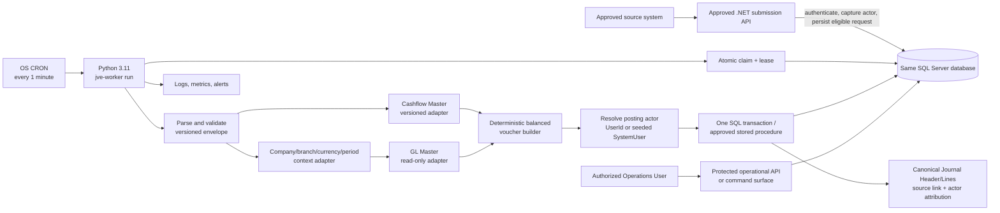
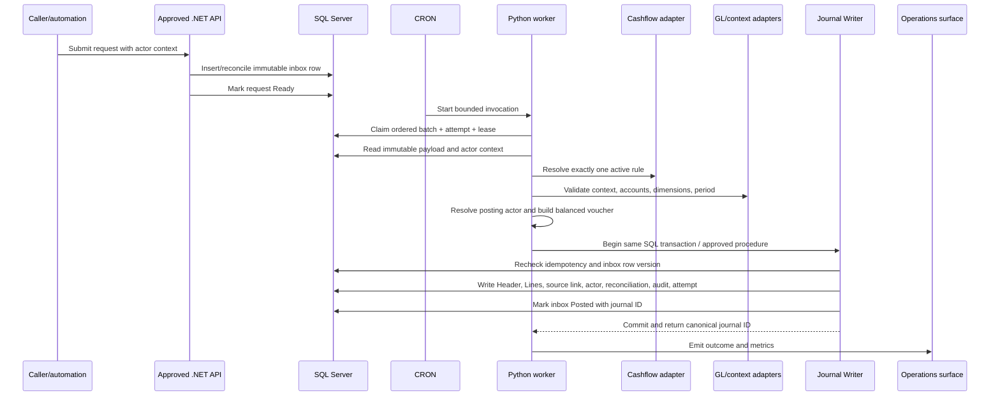
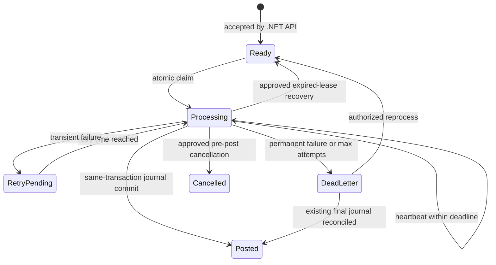

# Design Document — JV Posting Engine

**Feature:** `jv-posting-engine`  
**Source of truth:** `requirements.md`  
**Document purpose:** Architecture and implementation design only. This document does not create migrations, modify application source, enable production posting, or authorize a worker deployment.

## Overview

The JV Posting Engine (JVE) is a durable, asynchronous journal-posting worker for Finnova. An approved .NET API is the submission boundary. It authenticates the caller, captures the initiating actor context, persists an immutable request in the JV Posting Inbox, and marks the request eligible for processing. It does not parse the business payload, resolve Cashflow Master rules, validate vouchers, or post journals.

A Python 3.11 worker is invoked as a bounded one-shot process by operating-system CRON every minute. The worker claims eligible inbox rows under a SQL Server lease, parses and validates the versioned JSON envelope, resolves exactly one Cashflow Master rule through a configurable adapter, validates company/branch/currency/period and GL data, resolves the posting actor, constructs a deterministic balanced voucher, and writes the canonical journal atomically.

The feature-owned inbox, canonical Journal Header and Lines, canonical source link, actor attribution, reconciliation data, audit records, posting attempt outcome, and final `Posted` state use the same SQL Server database and one SQL transaction or approved stored procedure. The worker must not expose a public submission endpoint. Source systems must not write canonical journal tables directly.

The canonical Journal Header and source metadata must persist the resolved posting actor using the existing schema's `PostingUserId`/`PostedByUserId` convention. Exact canonical table and column names are not invented by this design. Their mapping is an implementation gate that must be confirmed by the accounting owner before the posting writer and migration are implemented.

Cashflow Master is a future authoritative dependency. JVE consumes a versioned and configurable rule-resolution contract, does not duplicate or hard-code Cashflow rules, and fails closed when no applicable rule exists. GL and Cashflow transport details use configurable defaults and are not production blockers unless the canonical journal mapping or same-transaction writer boundary is missing.

The baseline is India-specific and English-only. Defaults are Python 3.11, one-minute CRON cadence, batch size 50, a 10-minute claim lease and processing deadline, retry delays of 1, 5, and 30 minutes for up to 3 total attempts, Asia/Kolkata business timezone, INR with two-decimal round-half-up precision, and platform-approved retention, security, and observability defaults. Approved configuration may override these values without weakening the accounting, idempotency, audit, or authorization invariants.

Finnova-UI work is excluded. Browser journal viewing and browser-based JVE administration are deferred to a separate Journal Viewing UI. This feature provides only a protected operational API or equivalent command surface for queue monitoring, request inspection, stale-lease recovery, dead-letter recovery, and approved cancellation where cancellation is confirmed.

### Design goals

- Preserve the original source payload and complete processing history for the approved financial-record retention period.
- Guarantee at most one final journal for each immutable request/idempotency key and canonical source link.
- Prevent concurrent workers from processing one request through atomic claim, lease, and row-version controls.
- Keep accounting behavior deterministic, balanced, rounded, and independently testable.
- Resolve and persist the correct posting actor without inventing a worker or database identity.
- Commit the canonical journal and `Posted` inbox outcome in one SQL Server transaction or approved stored procedure.
- Keep Cashflow Master and GL Master authoritative through explicit, versioned adapter contracts.
- Make operational recovery safe, scoped, redacted, and auditable.

### Scope boundary

Included:

- Approved .NET submission boundary changes required to capture actor context and create eligible inbox work.
- Python worker package, one-shot command, configuration, and CRON contract.
- Feature-owned inbox, attempt, dead-letter, lifecycle audit, reconciliation, schema registry, and lease/idempotency data.
- Python domain logic for parsing, state transitions, actor resolution, failure classification, deterministic voucher construction, rounding, and reversal checks.
- Configurable Cashflow Master, GL/context/calendar, Journal Writer, authorization, and observability adapters.
- Protected operational API or equivalent command surface.
- Same-database SQL migration and transaction/stored-procedure contract for the feature-owned and canonical posting records.
- Backend unit, property, contract, integration, and host tests.

Excluded:

- A public submission endpoint in the Python worker.
- A duplicate Cashflow rule table, rule seed set, or hard-coded event-to-account mapping.
- Direct source-system writes to canonical journal tables.
- A remote-writer or transactional-outbox baseline. The approved design requires the same SQL Server transaction or stored procedure.
- Finnova-UI pages, browser journal viewing, and browser JVE administration.
- Automatic reversals unless a separately approved Cashflow Master reversal contract enables them.

## Architecture

### Runtime and submission-to-worker topology



The approved .NET API performs only submission responsibilities:

1. Authenticate and authorize the caller or approved automation source.
2. Capture `InitiatingUserId` when a person initiated the process.
3. Capture the approved automation context when an automation job initiated the process; the worker later resolves that context to the configured seeded `SystemUser`.
4. Validate submission/inbox fields and immutable request identity.
5. Insert or reconcile the immutable inbox request using request-idempotency rules.
6. Mark the request eligible as `Ready`.

The API does not parse `data`, invoke Cashflow Master, validate GL accounts or voucher balance, resolve the final posting rule, invoke the Journal Writer, or mark the request `Posted`.

The Python CRON process performs the actual posting:

1. Emit one invocation-start signal and create an invocation correlation identifier.
2. Claim up to 50 eligible requests in deterministic order.
3. Parse, version-check, and validate each raw payload.
4. Resolve the Cashflow rule, context, GL accounts, dimensions, period, and posting actor.
5. Build and validate the deterministic voucher.
6. Recheck ownership, idempotency, and the canonical source link immediately before writing.
7. Execute the same-database posting transaction.
8. Record `Posted`, `RetryPending`, or `DeadLetter` outcome and emit milestone signals.
9. Continue processing independently claimable requests after a request-level failure.
10. Emit exactly one invocation-end signal and exit.

The worker is not an HTTP submission service. It may have a local diagnostic command for health or configuration checks, but it does not expose a public request-ingestion endpoint.

### Processing sequence and atomic posting boundary



All records in the final posting operation are committed as one unit:

1. Begin the approved SQL transaction or invoke the approved stored procedure.
2. Recheck the request's immutable payload hash, request context, expected inbox row version, and current status/lease ownership.
3. Recheck an existing final canonical source link by request ID/idempotency key.
4. If a final link exists, return the existing journal identity and reconcile the inbox without inserting a second journal.
5. Resolve and validate the canonical mapping for Journal Header, Journal Lines, source link, actor-attribution columns, and status values.
6. Insert the Journal Header with company, branch, dates, currency, source metadata, rule version, and resolved `PostingUserId`/`PostedByUserId` according to the confirmed schema mapping.
7. Insert all validated Journal Lines in deterministic order.
8. Insert the canonical source link with the immutable request ID/idempotency key.
9. Insert reconciliation data and the final posting audit entry.
10. Complete the posting attempt with its outcome, journal ID, and correlation metadata.
11. Update the inbox to `Posted`, storing the canonical journal ID, posted timestamp, totals, context, rule version, and resolved actor attribution.
12. Commit. Any failure before commit rolls back every write from this posting operation.

The posting writer must not report success before all required records are durable. If the database response is uncertain, the worker performs an idempotency/source-link lookup before retrying. It never blindly inserts a second journal.

### Baseline configuration

| Setting | Baseline default | Design rule |
| --- | --- | --- |
| Worker runtime | Python 3.11 | The worker package declares and validates this runtime. |
| Invocation | OS CRON every 1 minute | The worker is one-shot and does not run an internal scheduler. |
| Batch size | 50 | The configured value is bounded and recorded in invocation metadata. |
| Claim lease | 10 minutes | Lease expiry permits approved recovery; ownership is checked before writes. |
| Processing deadline | 10 minutes | The worker stops new journal writes after the deadline or lost lease. |
| Retry schedule | 1, 5, 30 minutes | Applies to transient failures, up to 3 total attempts. |
| Business timezone | Asia/Kolkata | Used for date/period interpretation; technical timestamps remain UTC. |
| Currency | INR | Used only when request/rule/GL contracts permit the default. |
| Precision/rounding | Two decimals, round-half-up | Amounts are decimal, quantized before totals are compared. |
| Retention/security/observability | Platform-approved defaults | Configuration is injected and not hard-coded in business logic. |

Configuration validation must reject unsafe or incomplete settings before an invocation can post. Approved configuration may override a baseline value, but it must not disable idempotency, actor resolution, audit, redaction, or the same-transaction requirement.

## Repository and platform integration findings

| Existing capability or constraint | Design consequence |
| --- | --- |
| SQL Server is the durable platform store and the existing .NET repository uses EF Core | Feature-owned tables use SQL Server-compatible types, UTC timestamps, explicit indexes, and reviewed forward-only migration. The Python worker uses a SQL Server driver and explicit transaction handling. |
| Existing models contain GL accounts, account versions, branch applicability, company posting state, and GL audit concepts | GL validation is a read-only contract over existing master data. JVE does not create a second GL catalogue. |
| Existing .NET services own authentication, authorization, middleware, and gateway conventions | Submission and protected operational surfaces reuse those boundaries where hosted in .NET. The Python worker uses a database/service identity and has no public submission endpoint. |
| Cashflow Master is a future authoritative master | JVE defines a versioned adapter port only. It does not create Cashflow rule storage or hard-code event-to-accounting behavior. |
| Existing tests use xUnit, FsCheck.Xunit, `WebApplicationFactory`, EF-based test support, and Moq | .NET host and contract tests follow those conventions. Python domain tests use `pytest` and Hypothesis in the separate worker package. |
| Finnova-UI is a separate React/MUI repository | No frontend files or UI tasks are part of this feature. Browser journal viewing and browser JVE administration remain deferred. |

## Reused versus new

### Reused platform capabilities

- SQL Server and the approved Finnova database connection boundary.
- Existing authentication, JWT, authorization, scope, and RFC 7807 conventions for the .NET submission and operational boundaries.
- Existing company, branch, currency, accounting-period, GL, and user identity masters.
- Cashflow Master as the authoritative owner of event-to-accounting rules when it becomes available.
- Existing Journal Writer ownership and canonical accounting schema after the mapping gate is confirmed.
- Platform-approved logging, metrics, alerting, secrets, retention, and encryption controls.

### New feature assets

- Python 3.11 worker package and one-shot CRON command.
- Feature-owned inbox, attempt, dead-letter, lifecycle audit, reconciliation, schema registry, and lease/idempotency tables.
- Python domain layer for envelope parsing, validation, actor resolution, deterministic voucher building, state transitions, retries, and reversal checks.
- Configurable Cashflow Master, GL/context/calendar, Journal Writer, authorization, and observability adapters.
- Protected operational API or command contract for status, detail, stale-claim recovery, dead-letter recovery, and approved cancellation.
- Same-database transaction or approved stored-procedure implementation for final journal posting.
- Backend unit, property, contract, integration, and smoke tests.

## Requirements coverage map

| Requirement | Design coverage | Implementation note |
| --- | --- | --- |
| R1 Receive and persist requests | Submission-to-worker flow, immutable inbox, actor context, request conflict handling, eligibility transition, direct-write rejection. | API captures person `UserId` or automation context and performs no business posting. |
| R2 Deserialize and version JSON | Versioned parser, UTF-8/JSON/size/content checks, schema registry, projection and unknown-field policy. | Schema and transport are configurable contract details. |
| R3 Resolve Cashflow and validate GL | Exactly-one Cashflow rule, fail-closed missing/ambiguous rule handling, read-only GL validation, no duplicated rules. | Cashflow Master may be developed later; no rule means permanent failure. |
| R4 Construct balanced vouchers | Pure decimal voucher builder, one-sided positive lines, precision, deterministic ordering, balance and line-count checks. | Default is at least two lines unless the approved contract permits the single-line exception. |
| R5 Apply company/branch/currency/period rules | Context resolver, INR default gate, Asia/Kolkata interpretation, fiscal-period resolution, consistency checks, English-only values. | Future/back-date and fiscal-calendar details remain configurable contract inputs. |
| R6 Persist atomically | Same SQL Server transaction/stored procedure sequence, Journal Writer actor mapping, source link, reconciliation, audit, and Posted state. | Exact canonical table/column mapping is the sole implementation mapping gate. |
| R7 Claim safely | SQL atomic claim, row version, 10-minute lease/deadline, deterministic order, heartbeat, attempt creation, stale recovery. | Batch and timing defaults are confirmed and configurable. |
| R8 Idempotent/deterministic processing | Immutable payload hash, request/source-link uniqueness, deterministic voucher fingerprint, uncertain-response lookup, actor consistency. | Same request never creates a second final journal. |
| R9 Retry/dead letter/recovery | Stable failure taxonomy, 1/5/30-minute backoff, max 3 attempts, immutable dead-letter history, authorized reprocess. | Recovery keeps original payload and all previous attempts. |
| R10 Audit/reconciliation | Append-only lifecycle audit, attempts, reconciliation, safe diagnostics, source-to-journal trace, integrity alerts. | Retention uses platform-approved financial-record policy. |
| R11 Security/access boundaries | Separate source, worker, operations, and Journal Writer permissions; scope checks; secret redaction; no public worker submission. | Worker cannot change master data, users, or auth configuration. |
| R12 Monitoring/recovery | Protected operational API or command for queue status, request detail, expired lease recovery, dead-letter reprocess, and approved cancellation. | No browser UI or journal viewer is included. |
| R13 Observability | Invocation start/end, milestone and recovery signals, metrics, stable categories/codes, threshold alerts, UTC timestamps. | Platform sink and thresholds are configuration-owned. |
| R14 Reversals/corrections | New request model, original-link validation, no Posted mutation, Cashflow reversal-contract gate. | Automatic/scheduled reversal requires separate approval. |
| R15 Evolution/retention/integrity | Immutable identity/schema/actor fields, status and attempt constraints, schema registry, retention gate, read-only integrity checks. | Historical requests remain readable and linked to their final journal. |

## Components and interfaces

The Python package uses ports and adapters. Domain components do not import SQL drivers, HTTP clients, web framework request objects, or environment configuration.

### Application components

| Component | Responsibility |
| --- | --- |
| `InvocationRunner` | Creates invocation correlation ID, validates configuration, claims an ordered batch, processes each request independently, emits start/end signals, and returns an invocation result. |
| `SubmissionBoundary` | .NET API application service that authenticates callers, captures actor context, inserts/reconciles inbox requests, and marks accepted requests `Ready`. It does not execute worker business logic. |
| `ClaimRepository` | Atomically claims eligible rows, assigns worker and lease, creates the attempt, and appends claim audit. |
| `PostingOrchestrator` | Coordinates parsing, Cashflow resolution, context/GL validation, actor resolution, voucher construction, and final persistence. |
| `EnvelopeParser` | Decodes UTF-8 JSON, checks size/content policy, selects a registered schema, normalizes known fields, and preserves the immutable source payload. |
| `CashflowRuleResolver` | Calls the versioned Cashflow adapter, requires exactly one active rule, and maps no-rule/ambiguous/dependency outcomes. |
| `ContextResolver` | Resolves company, branch, currency, timezone, posting date, and accounting period, then checks contract consistency. |
| `GLValidator` | Validates accounts, postability, effective dates, currency compatibility, journal mode, and required dimensions through the GL adapter. |
| `ActorResolver` | Resolves a user-initiated request to its immutable `InitiatingUserId`, or an automation request to the configured seeded `SystemUser`. Fails closed for missing, inactive, ambiguous, or unauthorized identities. |
| `VoucherBuilder` | Purely derives and validates normalized lines, decimal amounts, deterministic ordering, totals, and voucher fingerprint. |
| `IdempotencyGuard` | Checks immutable request conflicts, existing source links, payload hash/context, actor consistency, and uncertain writer responses. |
| `PostingCoordinator` | Owns the same-database transaction/stored procedure call and commits journal, source link, actor attribution, reconciliation, audit, attempt outcome, and inbox `Posted` state together. |
| `FailureClassifier` | Maps schema, validation, authorization, dependency, persistence, concurrency, idempotency, and accounting-integrity errors to stable codes and retryability. |
| `RecoveryService` | Performs authorized dead-letter reprocessing, expired-lease recovery, and approved cancellation using compare-and-set state changes. |
| `Redactor` and `ObservabilityPublisher` | Removes prohibited sensitive values and emits structured logs, metrics, milestones, and alerts. |

### Domain and persistence ports

```text
PostingInboxRepository
  insert_or_get(request, immutable_payload, payload_hash, actor_context)
  claim_batch(now_utc, worker_id, lease_until_utc, batch_size)
  verify_ownership(request_id, worker_id, attempt_id, row_version)
  heartbeat(request_id, worker_id, attempt_id, lease_until_utc)
  get_by_id(request_id)
  queue_counts(scope)
  eligible_order(scope, now_utc)

AttemptRepository
  start(request_id, attempt_number, attempt_correlation_id, worker_id)
  finish(attempt_id, outcome, safe_error, journal_id, ended_at_utc)

CashflowMasterPort
  resolve_rule(rule_key, event_type, company_id, branch_id,
               value_date, posting_date, currency_code, data, schema_version)

GLMasterPort
  validate_accounts(account_checks, company_id, branch_id, currency_code,
                    posting_date, journal_mode="System")

ContextPort
  resolve_company_branch_currency_period(company_id, branch_id,
                                         currency_code, value_date,
                                         posting_date, business_timezone)

PostingActorPort
  resolve_initiating_user(user_id)
  resolve_seeded_system_user(automation_context)

JournalWriterPort
  find_by_source(request_id, idempotency_key)
  write_atomic(journal_request, source_link, actor_attribution,
               reconciliation_record, lifecycle_audit,
               posting_attempt_outcome, expected_inbox_version)

RecoveryPort
  reprocess_dead_letter(request_id, actor, reason)
  recover_expired_claim(request_id, actor, reason)
  cancel_before_posting(request_id, actor, reason)

AuthorizationScopePort
  can_submit(actor, company_id, branch_id)
  can_operate(actor, action, company_id, branch_id)
```

All concrete adapters use bounded timeouts, cancellation, TLS where applicable, safe-read retry rules, and correlation metadata. A dependency timeout is transient unless the response proves a permanent business or contract error.

### Submission contract

The approved .NET API accepts an immutable submission envelope containing the request identity, source metadata, raw JSON payload, required inbox fields, and actor context. The actor context distinguishes:

- **Person initiated:** authenticated caller's `InitiatingUserId` is captured as an immutable user identity.
- **Automation initiated:** approved automation context is captured; the worker later resolves the configured seeded `SystemUser`.

The submission service returns the existing request identity for an equivalent duplicate and rejects a reused request ID with a different payload or immutable context. It does not return a journal identity because no journal exists at submission time. It marks the accepted request `Ready` only after the inbox insert/reconciliation and eligibility update succeed.

### Actor resolution and Journal Writer contract

Actor resolution occurs in the worker after claim and before journal construction/persistence:

1. Read the immutable actor context stored at submission.
2. For a person-initiated request, resolve exactly one active, authorized user for the captured `InitiatingUserId`.
3. For an automation request, resolve exactly one configured, active seeded `SystemUser` associated with the approved automation context.
4. Reject missing, inactive, ambiguous, scope-invalid, or changed actor context as a permanent authorization/integrity failure.
5. Pass the resolved actor to `JournalWriterPort` as `PostingUserId`/`PostedByUserId` according to the canonical mapping.

The worker identity, CRON account, database principal, or arbitrary default user is never substituted for the posting actor. Repeated processing of the same immutable request must resolve the same actor. A changed actor context is an idempotency/integrity failure.

The Journal Writer contract is:

```text
find_by_source(request_id, idempotency_key)
  -> ExistingJournal | None

write_atomic(
  journal_header,
  journal_lines,
  canonical_source_link,
  resolved_posting_actor,
  reconciliation_record,
  lifecycle_audit_record,
  posting_attempt_outcome,
  expected_inbox_version
) -> canonical_journal_id
```

The canonical mapping gate must confirm, before implementation:

- Journal Header table and primary key.
- Journal Line table, foreign key, and amount representation.
- Canonical source-link table and unique request/idempotency constraint.
- Header/source metadata columns for `PostingUserId` or `PostedByUserId`.
- Journal status vocabulary and final posted value.
- Company, branch, currency, period, source, rule-version, and date column mappings.
- Transaction ownership, stored procedure signature if applicable, and database grants.

The design does not invent table or column names. Until this mapping is confirmed, migration and writer implementation cannot be completed, and production posting remains disabled. Cashflow/GL transport details are configurable defaults and do not create an equivalent blocker.

### Cashflow Master contract

The adapter sends request ID, schema version, event/rule key, source system, company, branch, value date, effective posting date if known, currency, and typed `data`. The response is exactly one of:

- `ResolvedRule`: immutable rule key/version, effective interval, permitted currency, journal mode, deterministic line derivation, required dimensions, source-line identity rules, and reversal policy.
- `NoRule`: no active rule. Permanent failure; fail closed and do not create a journal.
- `AmbiguousRule`: more than one active rule. Permanent failure and configuration alert.
- `DependencyUnavailable` or timeout: transient failure and retry according to policy.
- `ContractInvalid`: permanent dependency-contract failure until corrected.

The JVE stores the rule version on the attempt, source metadata, journal metadata, audit, and reconciliation records. It evaluates returned instructions but never maintains a separately administered Cashflow rule catalogue.

### GL and context contract

The read-only GL/context boundary validates resolved lines in batch where supported. It returns account identity/code, postability, effective-date validity, currency compatibility, System Journal permission, and required dimension results. It also resolves company, branch, currency, period, closed-period state, and configured date boundaries. Missing/inactive/non-postable/effective-date/currency/dimension failures are permanent. Transport timeout or dependency outage is transient.

The default journal mode is `System`. The adapter may use an approved .NET API, stored procedure, or read-only SQL contract. The choice is configurable and must not duplicate master data.

## Data models

All technical timestamps are UTC. Business dates are date-only values interpreted in Asia/Kolkata by default. Amounts use fixed-precision decimal/SQL `decimal`, never binary floating point. User-facing and stored display values are English-only.

### JV Posting Inbox (`jv_posting_inbox`)

| Column | Type/shape | Rules |
| --- | --- | --- |
| `request_id` | GUID | Primary key and immutable idempotency key. |
| `source_system` | `nvarchar(100)` | Required and scope-authorized. |
| `event_type`, `rule_key` | `nvarchar(150)` nullable | At least one is required. |
| `schema_version` | `nvarchar(40)` | Required and registered. |
| `company_id`, `branch_id` | GUID | Required and immutable. |
| `value_date`, `posting_date` | SQL `date` | Value date required; posting date may be null at intake. |
| `currency_code` | `nvarchar(10)` nullable | Defaults to INR only after rule and GL permission. |
| `description` | `nvarchar(500)` nullable | English-only narration. |
| `raw_payload` | `varbinary(max)` or validated UTF-8 `nvarchar(max)` | Immutable and encrypted at rest under platform policy. |
| `payload_hash` | binary(32) | SHA-256 of immutable payload and envelope context. |
| `metadata_json` | `nvarchar(max)` | Approved non-sensitive normalized metadata only. |
| `initiation_mode` | code | Person or Automation; immutable. |
| `initiating_user_id` | GUID nullable | Required for person-initiated requests and immutable. |
| `automation_context` | bounded approved value/reference nullable | Required for automation-initiated requests; no credentials. |
| `status` | status code | `Ready`, `Processing`, `RetryPending`, `Posted`, `DeadLetter`, `Cancelled`. |
| `attempt_count` | int | Non-negative at intake and strictly increasing. |
| `next_retry_at_utc` | datetime2 nullable | Required only for `RetryPending`. |
| `worker_id`, `claimed_at_utc`, `lease_expires_at_utc`, `heartbeat_at_utc` | nullable | Current lease fields; history remains in attempts/audit. |
| `journal_id` | canonical identifier nullable | Set only after canonical journal identity is known. |
| `posted_at_utc` | datetime2 nullable | Set only with `Posted`. |
| `posting_user_id` | canonical actor identifier nullable | Stores resolved actor where the inbox schema permits; canonical Journal Header/source metadata remains authoritative. |
| `rule_version` | bounded value nullable | Set after successful rule resolution/posting. |
| `debit_total`, `credit_total` | decimal nullable | Set with final posting result. |
| `last_error_category`, `last_error_code`, `last_error_message_safe` | bounded text nullable | Safe diagnostic state only. |
| `created_at_utc`, `updated_at_utc` | datetime2 | Creation is immutable; updates are controlled. |
| `row_version` | SQL `rowversion` | Compare-and-set guard. |

Constraints enforce valid statuses, non-negative attempts, retry-time/status consistency, Posted/journal consistency, lease-field consistency, immutable identity/actor/payload fields, and one request ID. Indexes support eligible work, stale lease recovery, company/branch operations, journal reconciliation, and source tracing.

### Posting Attempts (`jv_posting_attempts`)

One append-only row is created for each processing attempt, including recovery attempts. It contains `attempt_id`, `request_id`, positive `attempt_number`, stable attempt correlation ID, worker ID, start/end UTC timestamps, outcome, stable error category/code, safe message, dependency name when applicable, journal ID when known, and a protected diagnostic reference. Unique `(request_id, attempt_number)` prevents duplicate attempt numbers.

### Dead Letters (`jv_dead_letters`)

Each transition into `DeadLetter` creates a historical snapshot containing dead-letter ID, request ID, raw-payload reference, failure category/code, safe message, attempt count, last worker, timestamps, and recovery metadata. Recovery never deletes or overwrites prior dead-letter history. A request can have multiple historical dead-letter transitions after recovery.

### Lifecycle audit (`jv_lifecycle_audit`)

Append-only records capture receipt, claim, retry, post, cancellation, dead-letter, stale recovery, and reprocess actions. Each record contains audit ID, request ID, prior state, new state, action, actor/worker, correlation ID, safe details, reason code, and UTC occurrence time. No update/delete repository methods are exposed for normal processing.

### Reconciliation (`jv_reconciliation`)

One final reconciliation record exists for each successfully posted source request. It contains source request ID, source system, event/rule key and version, company, branch, value/posting dates, accounting period, currency, debit/credit totals, `InitiatingUserId` when present, resolved posting actor, and canonical journal ID. A reversal additionally stores the original request/journal reference. Unique source-to-journal constraints prevent duplicate final links.

### Schema registry (`jv_schema_registry`)

Immutable rows contain schema version, schema identifier/hash, supported date range, maximum payload bytes, unknown-field policy, active/retired state, and creation/retirement timestamps. A version is never edited in place. Historical versions remain readable for retained requests and approved recovery.

### Actor and SystemUser configuration

The configuration boundary contains:

- Automation-context-to-seeded-SystemUser mapping.
- Seeded SystemUser identifier and active status.
- Configuration source and secret-free reference to the identity.
- Allowed automation contexts and company/branch scope.
- Cache/refresh policy for the worker invocation.

The worker must resolve exactly one active seeded SystemUser for an automation request. The mapping is read-only to the worker. The worker cannot create, modify, substitute, or seed a user identity. An unavailable or ambiguous mapping is a permanent authorization/integrity failure for the request and emits an operational alert without exposing identity-sensitive data.

### Lease and idempotency model

Lease data lives on the inbox row for efficient claims. Attempt and audit history retains every prior worker/lease. `request_id` is the primary idempotency key. Payload hash and immutable company/branch/source/actor context detect conflicting reuse. The canonical source link is the second durable guard at the journal boundary. No idempotency record is deleted before approved retention expiry.

## Processing state machine and concurrency



`Posted`, `DeadLetter`, and `Cancelled` are terminal for normal processing. Reprocessing changes `DeadLetter` to `Ready` using compare-and-set, preserves all prior attempts/dead-letter snapshots, appends recovery audit, and allows a new claim. If a final source link already exists, recovery reconciles to `Posted` without a journal write.

### Claim algorithm

1. At invocation start, generate an invocation correlation ID and worker identity.
2. Read validated configuration: batch size 50, lease 10 minutes, processing deadline 10 minutes.
3. In a short SQL transaction, select eligible `Ready` rows and `RetryPending` rows whose retry time has arrived, ordered by received UTC timestamp then request ID, using SQL Server update/skip-locked semantics approved for the deployment.
4. Update each selected row to `Processing`, assign worker and lease fields, and increment its row version with a compare-and-set predicate.
5. Insert the first `PostingAttempt` and claim lifecycle audit in the claim transaction.
6. Commit the claim transaction before external dependency calls.
7. Before each external write and at the heartbeat interval, verify worker ownership, attempt ID, row version, lease, and deadline.
8. If lease renewal fails or the deadline passes, stop creating journal writes, record a safe concurrency outcome, and let approved recovery reclaim the request.

The claim transaction and final posting transaction are distinct. The final posting transaction is the one that must include the canonical journal and the `Posted` inbox state together. An OS-level singleton lock may reduce overlap but is not a correctness control.

## Voucher construction and accounting invariants

`VoucherBuilder` is pure. It receives a parsed envelope, one resolved Cashflow rule, resolved context, and validated GL results. It performs no database or network calls.

1. Extract rule-derived line candidates and stable source-line identifiers. Reject missing derivation values; never invent zero amounts.
2. Normalize monetary values to decimal and quantize to configured currency precision using round-half-up for baseline INR.
3. Require exactly one positive debit or credit side per line. Represent the other side as zero or absent according to the canonical writer mapping.
4. Reject negative/zero amounts, two-sided lines, duplicate line IDs, and invalid precision unless the approved accounting contract explicitly permits a case.
5. Apply rule-defined stable ordering and source-line ID tie-breaking.
6. Enforce the configured minimum line count. Default is at least two lines; the single-line zero-net exception is enabled only by explicit contract.
7. Compare rounded debit and credit totals to the smallest configured currency unit. Reject any difference.
8. Produce a deterministic voucher fingerprint from request ID, rule version, company, branch, dates, currency, actor identity, and canonical line fingerprint. The canonical Journal ID remains assigned by the Journal Writer.

## Failure classification, retry, and dead-letter handling

| Category | Examples | Default outcome |
| --- | --- | --- |
| `schema` | Invalid UTF-8/JSON, missing or unsupported schema, prohibited content, oversized payload | Permanent, `DeadLetter` |
| `validation` | Missing context, no rule, ambiguous rule, invalid date/period, missing dimension | Permanent, `DeadLetter` |
| `authorization` | Caller/scope failure, unresolved actor, unauthorized operation | Permanent rejection or `DeadLetter`, no journal write |
| `dependency` | Cashflow/GL/calendar timeout or unavailable service | Transient, `RetryPending`, then `DeadLetter` after max attempts |
| `persistence` | SQL failure before commit | Transient unless proven permanent; never Posted without commit |
| `concurrency` | Lost lease, row-version conflict, competing recovery | Stop current write and recover/retry safely |
| `idempotency` | Changed payload/context, duplicate source link, changed actor | Permanent conflict; preserve original outcome |
| `accounting-integrity` | Unbalanced, invalid side, precision, non-postable voucher | Permanent, `DeadLetter` |

Stable codes are versioned with the worker, for example `JVE-SCHEMA-UNSUPPORTED-VERSION`, `JVE-CASHFLOW-NO-RULE`, `JVE-ACTOR-SYSTEM-USER-UNRESOLVED`, and `JVE-ACCOUNTING-UNBALANCED`. Messages are English and redacted.

The baseline retry policy permits up to three total attempts with delays of 1, 5, and 30 minutes. Backoff calculation is pure and deterministic. Permanent failures are never retried. One request failure does not stop independently claimable requests in the same invocation. A global SQL/dependency outage before claims leaves unclaimed rows eligible for a later invocation and emits one infrastructure failure signal.

Dead-letter recovery requires an authorized Operations User, assigned company/branch scope, a reason, and compare-and-set on `DeadLetter`. It preserves the raw payload, prior attempts, and dead-letter history. Payload correction is disabled by default because it changes idempotency semantics. Cancellation, where confirmed, is allowed only before a journal write and never deletes a record or mutates a Posted journal.

## Security and least privilege

- **Submission identity:** may submit valid requests within assigned company/branch scope and receive duplicate identity outcomes. It cannot update raw payloads after creation or write canonical journal tables.
- **Worker identity:** may claim inbox rows, read schemas/master/adapter data, resolve the configured SystemUser, call the approved Journal Writer, append attempts/audit/reconciliation, and update permitted inbox statuses. It cannot modify Cashflow Master, GL Master, user identities, SystemUser configuration, or authentication settings.
- **Operations read identity:** may inspect only assigned company/branch scope and receives redacted fields by default.
- **Operations recovery identity:** separately grants dead-letter reprocessing, stale-lease recovery, and optional cancellation. Every action has a reason and audit entry.
- **Journal Writer identity:** owns canonical journal creation, source-link constraints, actor column mapping, and Posted status semantics. The worker cannot update Posted journals directly.
- **SystemUser configuration owner:** controls seeded identity, automation mapping, activation, and change audit. The worker has read-only access.
- **Secrets:** are injected by the approved secret mechanism, never committed to source, persisted in business records, logged, or returned in responses.
- **Scope checks:** happen at submission, actor resolution, worker posting, and operational actions. A request that outlives its submitting token is checked again before posting.
- **Redaction:** excludes credentials, tokens, raw payloads, customer identity numbers, contact details, and financial account details from diagnostics and normal responses.
- **Localization:** security and operational labels/messages are English-only. No RTL or secondary-language fields are introduced.

## Error handling

The worker handles errors at the request boundary so an isolated failure does not terminate the batch:

1. Cancellation, deadline, and lease loss stop further writes for the request and follow concurrency recovery policy.
2. Known domain failures map to stable category/code, safe message, and retryability.
3. Dependency timeout/unavailability is transient unless the response proves a permanent business or contract failure.
4. SQL uniqueness/idempotency conflicts trigger source-link reconciliation where possible; changed payload or actor context is a permanent conflict.
5. Unknown exceptions receive a protected diagnostic reference and are classified by the failing boundary. Stack traces and sensitive values never reach the operational response.
6. An uncertain Journal Writer response always triggers lookup by request/source link before a retry decision.

Before final posting, the coordinator must prove that the worker still owns the request and that no final source link exists. A failure before transaction commit cannot leave a final journal or `Posted` inbox state. A successful commit must include the canonical journal identity, actor attribution, source link, reconciliation data, audit record, attempt outcome, and inbox outcome.

The protected operational surface returns RFC 7807-compatible errors where hosted in .NET, with stable code, English safe detail, correlation ID, and no sensitive payload. A Python command surface uses the equivalent safe error contract.

## Observability and reconciliation

Every CRON invocation emits exactly one structured start and one end event. The start contains worker ID, invocation correlation ID, and UTC start time. The end contains the same correlation ID, UTC start/end times, and non-negative counts for claimed, posted, retried, dead-lettered, and failed requests.

Milestone signals are emitted for claim, validation, rule resolution, actor resolution, journal persistence, final outcome, and recovery. Signals contain request ID where applicable, invocation/attempt correlation, milestone/action, UTC timestamp, allowed company/branch scope, and stable error category/code when relevant.

Metrics include queue depth for `Ready`, `Processing`, `RetryPending`, `Posted`, and `DeadLetter`; oldest eligible age; processing duration; attempt count; Cashflow no-rule/ambiguity/dependency failures; GL failures; actor-resolution failures; journal failures; duplicate deliveries; stale leases; debit-credit inconsistencies; and dead-letter count.

Alerts are emitted when approved thresholds for stale claims, queue age, repeated dependency failure, actor mapping failure, dead-letter growth, or debit-credit inconsistency are exceeded. Alerts identify the threshold category and permitted scope/correlation data without payload or account details.

Technical timestamps are UTC. Business date and period context in signals uses Asia/Kolkata by default. Reconciliation queries return the current inbox state, all attempt outcomes, actor context/result where authorized, rule version, totals, and canonical journal identity when Posted.

## Reversals and corrections

A reversal is a new Posting Request with a new request ID and an explicit original request/journal reference. The original request and journal remain immutable. Cashflow Master must return an approved reversal rule; JVE never infers reversal lines by negating arbitrary input.

The worker verifies that the original journal exists, is Posted, is in scope, and has not already been reversed under the applicable rule. It creates a new balanced voucher and links the new reconciliation record to the original. Missing reference, reused ID, non-Posted original, existing reversal, disallowed rule, or absent reversal contract is a permanent failure. Automatic or scheduled reversals remain disabled unless a separately approved Cashflow contract enables them.

## Data retention and integrity

Inbox payloads, attempts, dead letters, lifecycle audit, reconciliation, source links, schema references, and actor-attribution history are retained for the platform-approved financial-record period. Archival preserves request ID, payload hash/reference, schema version, actor context, attempts, journal link, and audit chronology. Early deletion of Posted or DeadLetter data is rejected unless the approved retention/legal-hold process permits it.

Integrity checks are read-only by default. They report orphaned lines, duplicate source links, Posted rows without journal IDs, missing actor attribution, statuses without matching attempts, invalid status/lease combinations, schema versions no longer readable, and unbalanced canonical journals. They do not auto-repair financial data.

## Testing strategy

Testing uses a dual approach: example-based tests verify concrete API, database, dependency, authorization, and error scenarios; property-based tests verify universal pure-domain invariants. No test calls production dependencies or writes production journals.

### Python unit and property tests

- Use `pytest` for examples and edge cases and Hypothesis for the pure-domain properties below.
- Configure every property test for at least 100 generated examples.
- Use fakes for Cashflow, GL, actor, and Journal Writer ports; do not issue 100 external calls.
- Each property test contains a comment in the form `Feature: jv-posting-engine, Property N: [property text]`.
- Cover malformed/oversized payloads, unsupported versions, missing/ambiguous rules, unresolved SystemUser, date precedence, closed periods, INR default permission, line-side errors, duplicate IDs, precision, zero/negative amounts, lease loss, and uncertain writer responses.

## Correctness Properties

*A property is a characteristic or behavior that should hold true across all valid executions of a system. Properties connect the requirements to executable tests over broad generated input spaces.*

### Property 1: Envelope projection preserves the registered contract

For all valid envelopes generated for a registered schema version, parsing SHALL expose every required and present optional field, preserve the original payload and permitted unknown fields, and exclude permitted unknown fields from evaluator projection.

**Validates: Requirements 2.1, 2.2, 2.3, 2.9**

### Property 2: Posting actor resolution is stable and source-correct

For all immutable person-initiated or automation-initiated requests with exactly one valid actor mapping, actor resolution SHALL return the initiating person's UserId for person requests or the configured seeded SystemUser for automation requests, and repeated resolution SHALL return the same actor.

**Validates: Requirements 6.7, 6.8, 6.10, 8.7**

### Property 3: Voucher construction enforces accounting invariants

For all valid source/rule fixtures accepted by the voucher builder, every output line SHALL contain exactly one positive debit or credit side, the configured line-count policy SHALL be satisfied, and rounded debit and credit totals SHALL be equal to the smallest supported currency unit.

**Validates: Requirements 4.1, 4.2, 4.3, 4.4, 4.5, 4.6**

### Property 4: Canonical line ordering is input-order independent

For all valid line collections with stable source-line identifiers, constructing a voucher from any permutation of the same lines SHALL produce identical canonical ordering, totals, line fingerprint, and voucher identity decision.

**Validates: Requirements 4.6, 7.8, 7.9, 8.2**

### Property 5: Currency defaulting requires both permissions

For all request, Cashflow-rule, and GL-permission combinations, the context resolver SHALL select INR if and only if the request omits currency and both Cashflow Master and GL validation permit INR, and SHALL reject unsupported combinations rather than silently defaulting.

**Validates: Requirements 5.2, 5.3**

### Property 6: Posting-date precedence is deterministic

For all valid requests and rules, the resolved posting date SHALL be the explicit request posting date when present, otherwise the permitted rule-supplied date when present, otherwise the request value date.

**Validates: Requirements 5.4, 5.5, 5.6**

### Property 7: Context mismatches fail closed

For all combinations of request envelope, Cashflow rule, GL result, period, actor, and Journal Writer context, the coordinator SHALL accept the combination only when company, branch, period, currency, posting date, and resolved actor are mutually consistent.

**Validates: Requirements 5.8, 6.1, 6.7, 6.8, 6.9, 8.8**

### Property 8: Repeated immutable processing is deterministic and idempotent

For all valid immutable requests with the same rule version and source context, repeating pure processing SHALL produce the same voucher fingerprint, line order, totals, actor, and source-link decision, and an existing final source link SHALL always select the existing journal instead of a new write.

**Validates: Requirements 6.6, 8.1, 8.2, 8.4, 8.5, 8.6**

### Property 9: Redaction removes prohibited diagnostic data

For all structured diagnostics containing secrets, credentials, authentication tokens, raw payloads, customer identity numbers, contact details, or financial account details, redaction SHALL omit or mask those values while retaining stable category, code, dependency, and correlation metadata.

**Validates: Requirements 10.3, 11.5, 12.6**

### Property 10: Eligible batch ordering is repeatable

For all eligible request collections, selection SHALL be ordered by received UTC timestamp and request ID tie-breaker, and repeating selection over the same collection SHALL return the same order.

**Validates: Requirements 7.8, 7.9**

### Property 11: Approved lifecycle sequences preserve invariants

For all generated sequences of approved lifecycle actions, every state SHALL belong to the approved vocabulary, attempts SHALL be positive and strictly increasing, `Posted` SHALL have a journal link and resolved actor, and `RetryPending` SHALL have an eligible future retry time.

**Validates: Requirements 9.1, 9.2, 15.7**

### Example and integration tests

- .NET submission tests verify authentication, scope, actor capture, equivalent duplicate handling, changed-payload conflict, eligibility, and proof that the API does not call posting dependencies.
- SQL Server integration tests verify migration constraints, atomic claim, concurrent single-winner claims, lease expiry, row-version recovery, unique request/source links, immutable audit/attempt rows, same-transaction rollback after each header/line/link/audit failure, and final Posted consistency.
- Journal Writer contract tests verify canonical table/column mapping, actor persistence, source-link uniqueness, expected-version conflict, final status, and uncertain-response lookup.
- Cashflow contract tests verify zero/one/multiple rule responses, rule version/effective-date behavior, no-rule fail-closed behavior, timeout, and invalid contract payloads.
- GL/context tests verify postability, effective date, currency, System Journal permission, required dimensions, company/branch scope, period, and dependency failure mapping.
- Actor configuration tests verify person identity resolution, automation-to-SystemUser mapping, inactive/missing/ambiguous SystemUser failure, scope mismatch, and stable repeated resolution.
- Operational API/command tests verify 401/403 behavior, company/branch scopes, queue counts, request detail, stale-lease recovery, dead-letter reprocess, cancellation gate, redaction, and no mutation after denied actions.
- Deployment smoke tests verify Python 3.11 configuration, secret injection, SQL grants, schema registry, SystemUser configuration readability, transaction readiness, observability sink, bounded dry-run invocation, CRON overlap behavior, timeout, and reclaim after restart.

## Design decisions, tradeoffs, and mapping gate

| Decision | Chosen design | Tradeoff |
| --- | --- | --- |
| Submission boundary | Approved .NET API only; Python worker has no public submission endpoint | Preserves authentication and source-system control, while adding asynchronous processing latency. |
| Execution runtime | Separate Python 3.11 one-shot process invoked every minute by CRON | Adds deployment/package ownership but matches the required processing boundary and avoids ASP.NET request-lifetime coupling. |
| Persistence | Same SQL Server database for feature inbox and canonical journal records | Gives durable reconciliation and one transaction, but requires coordination with the existing accounting schema owner. |
| Journal atomicity | One SQL transaction or approved stored procedure includes journal, source link, actor, reconciliation, audit, attempt outcome, and Posted state | Strongest financial-integrity guarantee. Production cannot proceed without a confirmed canonical mapping and transaction boundary. |
| Actor attribution | Person requests use immutable initiating UserId; automation requests use configured seeded SystemUser | Prevents arbitrary worker attribution, but requires controlled SystemUser seed/configuration and active-identity checks. |
| Cashflow ownership | Versioned configurable adapter to future Cashflow Master; no duplicate rules | Keeps one authoritative rule source, but no-rule responses fail closed until Cashflow Master is available. |
| GL ownership | Read-only configurable adapter over existing GL/context data | Avoids duplicate master logic, while transport and schema details remain adapter configuration. |
| Concurrency | SQL claim, row version, lease, heartbeat, and deterministic order | Correct under overlapping CRON invocations, with operational complexity around stale claims. |
| Retry | Three total attempts with 1/5/30-minute deterministic delays | Auditable and predictable; operations may override values through approved configuration. |
| Payload storage | Immutable raw payload plus hash and safe normalized metadata | Preserves forensic fidelity while limiting sensitive logging and query exposure. |
| UI scope | Protected operational API/command only | Reduces feature scope; browser administration and journal viewing move to the separate Journal Viewing UI. |
| Reversal | New request linked to original, never mutation | Preserves accounting history but depends on an approved Cashflow reversal contract. |
| PBT | Hypothesis over pure parser, actor, context, voucher, ordering, redaction, and state logic | Finds broad domain defects efficiently; database and external-service behavior still requires integration tests. |

### Canonical mapping gate

The accounting owner must confirm the existing Journal Header, Journal Line, and source-link table/column mappings, including the exact actor field (`PostingUserId` or `PostedByUserId`), final journal status, source-link uniqueness, and transaction/stored-procedure boundary. The design intentionally does not invent these names.

This is the only implementation mapping gate identified by the confirmed decisions. While it remains open, the feature may implement and test parser/domain logic, adapter contracts, inbox/attempt/audit models, claim/retry behavior, operational contracts, and migration preparation. The Journal Writer, canonical journal migration integration, and production posting enablement must stop until the mapping is confirmed. Missing Cashflow Master implementation is not a blocker for adapter/domain work; the worker must fail closed when the adapter returns no rule.

## Implementation-ordered task list

The following sequence is the order in which the implementation tasks file should be applied. It is a design sequence only; no task file is created by this update.

1. Confirm and record the canonical Journal Header, Journal Line, source-link, actor-attribution, status, and same-transaction/stored-procedure mapping gate.
2. Create the Python 3.11 worker package, dependency lock/configuration model, one-shot command, and validated baseline defaults.
3. Add backend domain enums, immutable value objects, posting states, failure categories, actor-context types, and accounting policy types.
4. Add backend domain exceptions, stable error-code catalog, redaction primitives, and safe diagnostic models.
5. Add versioned posting-envelope, actor-context, Cashflow rule, GL validation, context, voucher, Journal Writer, reconciliation, and operational request/response contracts.
6. Add SQL Server feature-owned tables and constraints for inbox, attempts, dead letters, lifecycle audit, reconciliation, schema registry, and lease/idempotency data, while wiring the confirmed canonical journal mapping without inventing names.
7. Add `FinnovaDbContext` DbSets/configuration and the reviewed forward-only migration or approved stored-procedure deployment script; do not enable production posting before the mapping gate passes.
8. Add inbox, claim, attempt, dead-letter, audit, reconciliation, schema, actor-configuration, and operational repositories with compare-and-set and append-only behavior.
9. Add dependency adapters and DI/configuration registration for Cashflow Master, GL/context/calendar, actor/SystemUser resolution, Journal Writer, authorization scope, and observability.
10. Add pure/domain helpers for envelope parsing, schema projection, date precedence, currency defaulting, decimal rounding, deterministic ordering, voucher fingerprints, actor resolution, backoff, state transitions, and redaction.
11. Add the worker CQRS/application slice: invocation runner, posting orchestrator, idempotency guard, posting coordinator, failure classifier, lease heartbeat, and recovery service.
12. Add the approved .NET submission API behavior and middleware/authorization branches for actor capture, immutable request intake, duplicate/conflict responses, and eligibility marking only; ensure it does not call posting logic.
13. Add the protected operational API or command surface for queue status, request detail, stale-lease recovery, dead-letter reprocessing, reconciliation, and confirmed cancellation; add the API gateway route/alias if the hosting boundary requires it. Do not add Finnova-UI work.
14. Add backend unit tests for examples and edge cases, Hypothesis property tests with at least 100 iterations per design property, adapter contract tests, and SQL Server transaction/concurrency/integrity integration tests.
15. Add host and deployment smoke tests for authorization, actor/SystemUser configuration, gateway/operational routing, redaction, migration readiness, observability, CRON bounded execution, and restart/reclaim behavior.
16. Perform the canonical mapping review and atomicity/concurrency/reconciliation drills; enable production posting only after the mapping gate, same-transaction proof, actor attribution, retention, security, and observability checks pass.
