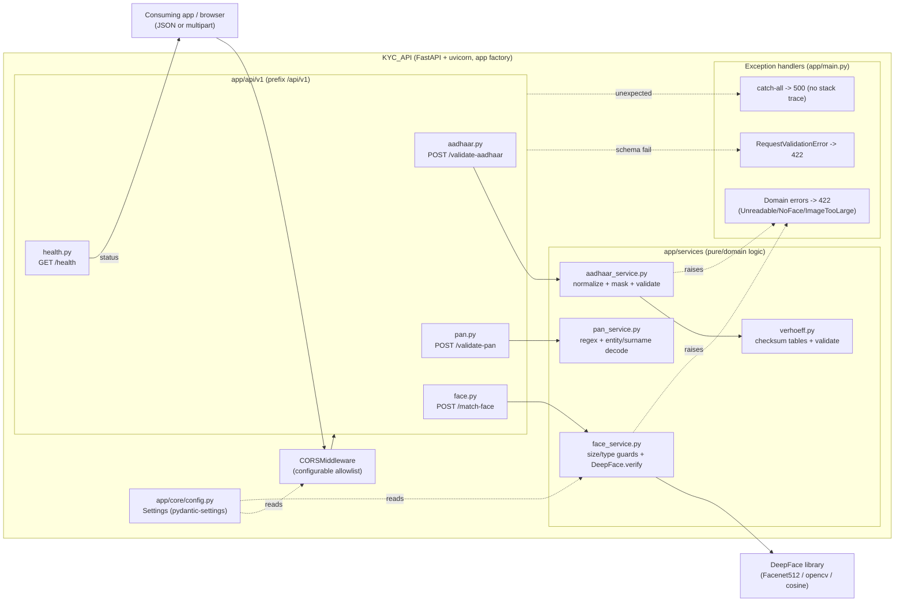
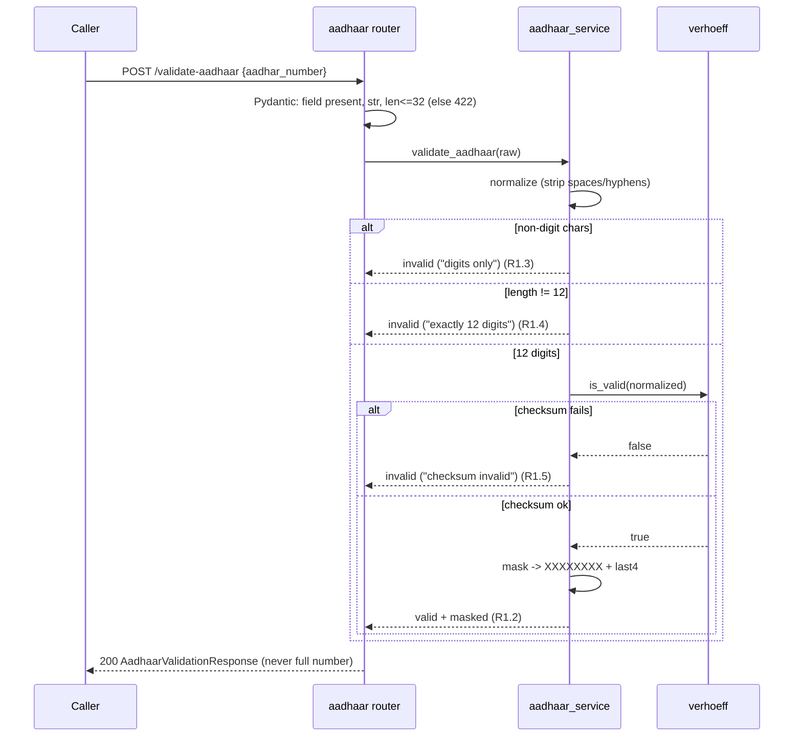

# Design Document — KYC Validation API

**JIRA:** FINNOVA-20 · **Deliverable:** Standalone Python (FastAPI) service · **Target repo:** `D:\Projects\Finnova\Finnova-KYC-API`
**Related references:** `D:\Projects\Finnova\Finnova-KYC-Verifier` (FastAPI / face-match structure) and the Verhoeff-based `github.com/toamitrawat/aadhar-validator`.

> **Spec convention:** Per the workspace spec-workflow, the three spec documents are the whole deliverable. This design explains the architecture, shape, contracts, and decisions; the companion `tasks.md` contains the copy-paste code in implementation order. No source files are created outside this spec folder, and no builds/tests are run here.

## Overview

The KYC Validation API is a **new, standalone Python service** (not part of `Finnova.Backend.slnx` and not in `Finnova-UI`) that exposes three Know-Your-Customer validation capabilities plus a health check, all under the `/api/v1/` prefix:

- **Aadhaar validation** (`POST /api/v1/validate-aadhaar`) — normalizes the input, confirms exactly 12 digits, and validates the trailing check digit with the **Verhoeff** algorithm. Returns a masked Aadhaar; the full value is never echoed.
- **PAN validation** (`POST /api/v1/validate-pan`) — trims/uppercases and validates the 10-character value against `[A-Z]{5}[0-9]{4}[A-Z]`; when valid, returns the decoded entity type (4th char) and surname initial (5th char).
- **Face matching** (`POST /api/v1/match-face`) — accepts a document photo and a selfie over `multipart/form-data`, runs **DeepFace** verification, and reports `is_match`, distance, model, and threshold. No webcam capture.
- **Health** (`GET /api/v1/health`) — liveness check requiring no input.

The service is built with **FastAPI + Pydantic v2**, served by **uvicorn**, and tested with **pytest + FastAPI `TestClient` (httpx)**. It is organized as a conventional layered app: thin routers delegate to pure/service-layer logic, Pydantic schemas define the request/response contracts, and a central config object holds tunables (CORS, DeepFace model/detector/metric, upload limits). FastAPI auto-generates Swagger UI at `/docs`.

### Design intent

- **Aadhaar/PAN "invalid" is a successful result, not an error.** A well-formed request carrying a checksum-invalid Aadhaar or a malformed PAN returns **HTTP 200** with `is_valid = false` (per Requirements 1.3–1.5, 2.3). HTTP 422 is reserved for *schema/shape* failures (missing field, wrong type, oversized value). This separation lets callers distinguish "we processed your input and it failed the rule" from "your request was malformed".
- **Privacy by construction.** The full Aadhaar number never appears in any response body; only the masked form is returned. Nothing is persisted — inputs and uploaded image bytes live only for the request lifetime.
- **Stateless and side-effect-free.** No database, no file store, no external calls other than the in-process DeepFace model. This keeps the service horizontally scalable and simple to reason about.

### Localization

Finnova is **India-only** and **English-only**. Aadhaar and PAN are India-specific identity artifacts. All field names, messages, entity-type labels, and documentation are English. There are no bilingual fields, no Arabic or other non-English content, and no right-to-left rendering.

## Architecture

The service is a thin HTTP shell over a set of pure, independently testable services. Requests enter FastAPI, pass CORS and (for uploads) size/type guards, are shape-validated by Pydantic, and are dispatched to a router that calls one service. Domain exceptions raised by services are translated to structured error responses by registered exception handlers.



### Request lifecycle

1. **App factory** (`create_app()` in `app/main.py`) builds the FastAPI instance, reads `Settings`, adds `CORSMiddleware`, registers exception handlers, and includes the v1 router (which itself includes the four endpoint routers under `/api/v1`).
2. **CORS** is applied first so browser callers from an allowed origin receive the CORS headers (R6.3).
3. **Shape validation**: for JSON endpoints, Pydantic v2 validates the body against the request schema; a failure raises `RequestValidationError` → **422** (R1.7, R2.6, R5.1). For the multipart endpoint, missing files raise `RequestValidationError` → **422** (R3.3).
4. **Router → service**: the router calls exactly one service function and wraps its result in a response schema. Routers hold no business logic.
5. **Domain errors**: `face_service` raises `UnreadableImageError`, `NoFaceDetectedError`, or `ImageTooLargeError`, each mapped to **422** with a precise message (R3.4–R3.6). Aadhaar/PAN rule failures are **not** exceptions — they return 200 with `is_valid = false`.
6. **Catch-all**: any unhandled exception becomes a generic **500** with no stack trace or file paths (R5.3).

### Aadhaar request flow



### Face-match request flow

```mermaid
sequenceDiagram
    participant C as Caller
    participant R as face router
    participant S as face_service
    participant D as DeepFace
    C->>R: POST /match-face (multipart document_image, selfie_image)
    R->>R: Pydantic/UploadFile both present? (else 422, R3.3)
    R->>S: match_face(document_image, selfie_image)
    S->>S: read bytes; size within 10MB? (else ImageTooLargeError, 422)
    S->>S: content-type decodable JPEG or PNG? (else UnreadableImageError, 422)
    S->>D: DeepFace.verify(img1, img2, model, detector, metric)
    alt no face detected
        D-->>S: raises "face could not be detected"
        S-->>R: NoFaceDetectedError, 422 (R3.5)
    else verified result
        D-->>S: verified, distance, threshold, model
        S-->>R: FaceMatchResult(is_match, distance, model, threshold)
    end
    R-->>C: 200 FaceMatchResponse (no raw bytes, R3.8)
```

## What is reused vs what is new

Because this is a greenfield repository, "reused" means **patterns and algorithms adopted from the references**, not shared code artifacts. Everything under `D:\Projects\Finnova\Finnova-KYC-API` is new.

| Concern | Source (reference) | How it is reused / adapted here |
| --- | --- | --- |
| FastAPI app + router layout, face-match endpoint shape | `Finnova-KYC-Verifier` (FastAPI / `verifier` / `face_match`) | Adopt the layered FastAPI structure and DeepFace-based verification; **replace** `cv2.VideoCapture` webcam capture with two uploaded images (R3.7). |
| Verhoeff checksum algorithm (d/p/inv tables) | `github.com/toamitrawat/aadhar-validator` | Reimplement the standard multiplication (`d`), permutation (`p`), and inverse (`inv`) tables and the digit-by-digit validation in `verhoeff.py`. |
| DeepFace verification | DeepFace library | Call `DeepFace.verify`; read its returned `verified`/`distance`/`threshold`/`model`. |
| Pydantic contracts, config-via-settings, exception-handler pattern | General FastAPI + Finnova spec conventions | New schemas, `Settings`, and handlers authored in this repo. |

**New in this feature (all authored here):**

- Project scaffolding: `requirements.txt`, `.env.example`, `.gitignore`, `README.md`.
- `app/main.py` app factory (CORS, exception handlers, router include).
- `app/core/config.py` `Settings` (app name/version, CORS origins, DeepFace model/detector/metric, max upload bytes).
- `app/api/v1/` routers: `aadhaar.py`, `pan.py`, `face.py`, `health.py` + an aggregating v1 router.
- `app/schemas/` Pydantic request/response + error models.
- `app/services/` `verhoeff.py`, `aadhaar_service.py`, `pan_service.py`, `face_service.py` and the domain exceptions.
- `tests/` unit + integration suites with DeepFace mocked.

## Requirements coverage map

| Requirement | Covered by |
| --- | --- |
| **R1** Validate Aadhaar | `aadhaar_service.validate_aadhaar` (normalize/mask/branching), `verhoeff.is_valid`, `aadhaar.py` router, `AadhaarValidationRequest/Response` (`aadhar_number` str `max_length=32`; masking `XXXXXXXX` + last 4; full number never returned — R1.6/1.8) |
| **R2** Validate PAN | `pan_service.validate_pan` (trim/upper/regex/decode), `pan.py` router, `PanValidationRequest/Response` (entity type + surname initial only when valid — R2.4/2.5) |
| **R3** Match face | `face_service.match_face` (size/type guards + `DeepFace.verify` + exception translation), `face.py` router, `FaceMatchResponse`; multipart fields `document_image`/`selfie_image`; JPEG/PNG; 10 MB cap; no webcam (R3.7); no raw bytes in response (R3.8) |
| **R4** Health | `health.py` router, `HealthResponse` (no input required — R4.2) |
| **R5** Structured errors | Exception handlers in `app/main.py`; `ErrorResponse` schema (`error`, `message`, `detail`, UTC ISO-8601 `timestamp`); 422 for schema + domain errors; 500 catch-all with no stack trace; English-only messages (R5.4) |
| **R6** API surface / docs / CORS | v1 router mounted at `/api/v1`; FastAPI `/docs`; `CORSMiddleware` from configurable allowlist; FastAPI default 404/405 handling surfaced via the error model (R6.4) |
| **R7** Automated tests | `tests/` — Verhoeff vectors, PAN matching/case-insensitivity, face mock (match + non-match), `TestClient` integration for all four endpoints; DeepFace mocked (R7.1–R7.5) |

## Project structure / layout

```
Finnova-KYC-API/
├── app/
│   ├── __init__.py
│   ├── main.py                      # create_app(): CORS, exception handlers, router include
│   ├── core/
│   │   ├── __init__.py
│   │   └── config.py                # Settings (pydantic-settings) + get_settings()
│   ├── api/
│   │   ├── __init__.py
│   │   └── v1/
│   │       ├── __init__.py
│   │       ├── router.py            # APIRouter(prefix="/api/v1") aggregating the four routers
│   │       ├── aadhaar.py           # POST /validate-aadhaar
│   │       ├── pan.py               # POST /validate-pan
│   │       ├── face.py              # POST /match-face
│   │       └── health.py            # GET /health
│   ├── schemas/
│   │   ├── __init__.py
│   │   ├── aadhaar.py               # AadhaarValidationRequest / AadhaarValidationResponse
│   │   ├── pan.py                   # PanValidationRequest / PanValidationResponse
│   │   ├── face.py                  # FaceMatchResponse
│   │   ├── health.py                # HealthResponse
│   │   └── error.py                 # ErrorResponse
│   └── services/
│       ├── __init__.py
│       ├── exceptions.py            # UnreadableImageError, NoFaceDetectedError, ImageTooLargeError
│       ├── verhoeff.py              # d/p/inv tables + is_valid(number)
│       ├── aadhaar_service.py       # normalize + mask + validate_aadhaar(raw)
│       ├── pan_service.py           # validate_pan(raw) + entity/surname decode
│       └── face_service.py          # match_face(document_image, selfie_image)
├── tests/
│   ├── __init__.py
│   ├── conftest.py                  # TestClient fixture, DeepFace monkeypatch helpers
│   ├── unit/
│   │   ├── test_verhoeff.py
│   │   ├── test_aadhaar_service.py
│   │   ├── test_pan_service.py
│   │   └── test_face_service.py     # DeepFace mocked
│   └── integration/
│       ├── test_aadhaar_api.py
│       ├── test_pan_api.py
│       ├── test_face_api.py         # DeepFace mocked
│       └── test_health_api.py
├── requirements.txt
├── .env.example
├── .gitignore
└── README.md
```

## Data Models

All schemas are Pydantic v2 models. Request models use `Field` constraints so shape violations raise `RequestValidationError` (→ 422) before any service runs. Response models never carry secrets (full Aadhaar) or raw bytes.

### Aadhaar

**Request** — `AadhaarValidationRequest`

| Field | Type | Constraint | Notes |
| --- | --- | --- | --- |
| `aadhar_number` | `str` | required, `max_length=32` | Ticket/reference spelling kept for the request field (R1.7 assumption resolved). May contain spaces/hyphens; normalized by the service. |

```jsonc
// POST /api/v1/validate-aadhaar  (request)
{ "aadhar_number": "2345 6789 0123" }
```

**Response** — `AadhaarValidationResponse`

| Field | Type | Notes |
| --- | --- | --- |
| `is_valid` | `bool` | Checksum + length + digit result |
| `aadhaar` | `str \| null` | **Masked only** (`XXXXXXXX` + last 4); `null` when not maskable | 
| `message` | `str` | English human-readable outcome |

```jsonc
// valid (HTTP 200)
{ "is_valid": true,  "aadhaar": "XXXXXXXX0123", "message": "Aadhaar number is valid." }
// invalid checksum (HTTP 200) — full number never echoed
{ "is_valid": false, "aadhaar": null,           "message": "Aadhaar checksum is invalid." }
```

> The response uses the spelling `aadhaar` while the request field is `aadhar_number` (R1.7 assumption). The full unmasked number is excluded from every body including errors (R1.6).

### PAN

**Request** — `PanValidationRequest`

| Field | Type | Constraint | Notes |
| --- | --- | --- | --- |
| `pan_number` | `str` | required | Trimmed and uppercased by the service (R2.1). |

```jsonc
// POST /api/v1/validate-pan  (request)
{ "pan_number": " abcpe1234f " }
```

**Response** — `PanValidationResponse`

| Field | Type | Notes |
| --- | --- | --- |
| `is_valid` | `bool` | Format result |
| `pan` | `str \| null` | Trimmed/uppercased PAN echoed back when present |
| `entity_type` | `str \| null` | Present **only** when valid (R2.4/2.5) |
| `surname_initial` | `str \| null` | 5th character; present **only** when valid |
| `message` | `str` | English human-readable outcome |

```jsonc
// valid (HTTP 200)
{ "is_valid": true,  "pan": "ABCPE1234F", "entity_type": "Individual", "surname_initial": "E",
  "message": "PAN is valid." }
// invalid (HTTP 200)
{ "is_valid": false, "pan": "ABCPE1234", "entity_type": null, "surname_initial": null,
  "message": "PAN must be five letters, then four digits, then one letter." }
```

**PAN entity-type decode (4th character):**

| Char | `entity_type` label |
| --- | --- |
| `P` | Individual |
| `C` | Company |
| `H` | HUF (Hindu Undivided Family) |
| `F` | Firm / LLP |
| `A` | Association of Persons (AOP) |
| `T` | Trust |
| `B` | Body of Individuals |
| `L` | Local Authority |
| `J` | Artificial Juridical Person |
| `G` | Government |

The 5th character is the **surname initial** (returned verbatim).

### Face match

**Request** — `multipart/form-data` (not a JSON body)

| Part | Type | Constraint |
| --- | --- | --- |
| `document_image` | `UploadFile` | required; JPEG or PNG; ≤ 10 MB |
| `selfie_image` | `UploadFile` | required; JPEG or PNG; ≤ 10 MB |

```
POST /api/v1/match-face
Content-Type: multipart/form-data; boundary=...

--...
Content-Disposition: form-data; name="document_image"; filename="doc.jpg"
Content-Type: image/jpeg
<bytes>
--...
Content-Disposition: form-data; name="selfie_image"; filename="selfie.jpg"
Content-Type: image/jpeg
<bytes>
--...--
```

**Response** — `FaceMatchResponse`

| Field | Type | Notes |
| --- | --- | --- |
| `is_match` | `bool` | `distance <= threshold` (DeepFace `verified`) |
| `distance` | `float` | DeepFace distance score (lower = more similar) |
| `threshold` | `float` | Threshold for the chosen model/metric |
| `model` | `str` | Model name used (e.g. `Facenet512`) |
| `message` | `str` | English human-readable outcome |

```jsonc
// match (HTTP 200) — no raw image bytes returned (R3.8)
{ "is_match": true, "distance": 0.21, "threshold": 0.30, "model": "Facenet512",
  "message": "Faces match." }
```

### Error model (shared)

**`ErrorResponse`** — the single structured error body for every error (R5.2).

| Field | Type | Notes |
| --- | --- | --- |
| `error` | `str` | Short error type/code, e.g. `validation_error`, `unreadable_image`, `no_face_detected`, `image_too_large`, `internal_error`, `not_found`, `method_not_allowed` |
| `message` | `str` | English human-readable summary |
| `detail` | `str \| list \| null` | Field-level detail (Pydantic errors) or a short description; never a stack trace |
| `timestamp` | `str` | UTC ISO-8601, e.g. `2025-01-15T10:30:00Z` |

```jsonc
// 422 — missing field (schema failure); submitted value never echoed (R1.7)
{ "error": "validation_error",
  "message": "Request validation failed.",
  "detail": [ { "field": "aadhar_number", "issue": "field required" } ],
  "timestamp": "2025-01-15T10:30:00Z" }

// 422 — no face detected (domain failure, R3.5)
{ "error": "no_face_detected",
  "message": "A face could not be detected in the selfie image.",
  "detail": "selfie_image", "timestamp": "2025-01-15T10:30:00Z" }

// 500 — internal error (R5.3): no stack trace / no file paths
{ "error": "internal_error",
  "message": "An internal error occurred while processing the request.",
  "detail": null, "timestamp": "2025-01-15T10:30:00Z" }
```

## Components and Interfaces

### `app/core/config.py` — `Settings`

`pydantic-settings` `BaseSettings` read from environment / `.env`:

- `app_name: str`, `app_version: str` — surfaced in OpenAPI metadata and health.
- `cors_origins: list[str]` — allowlist for `CORSMiddleware`; dev default permissive (`["*"]`), production narrowed via env (R6.3 assumption resolved).
- `face_model: str = "Facenet512"`, `face_detector_backend: str = "opencv"`, `face_distance_metric: str = "cosine"` — passed to `DeepFace.verify`.
- `max_upload_bytes: int = 10 * 1024 * 1024` — 10 MB per-file cap (R3.6).
- `allowed_image_content_types: set[str] = {"image/jpeg", "image/png"}` — accepted formats (R3.4 assumption resolved).

A cached `get_settings()` provides a single `Settings` instance for the app factory and services.

### `app/services/verhoeff.py`

Pure functions implementing the standard Verhoeff algorithm with the three lookup tables:

- `d` — the Dihedral-D5 multiplication table (10×10).
- `p` — the permutation table (8×10).
- `inv` — the multiplicative inverse table (10).
- `is_valid(number: str) -> bool` — iterates the digits **right to left**, accumulating `c = d[c][p[(i % 8)][int(digit)]]`; the full string (including the trailing check digit) is valid iff the final `c == 0`. Assumes a digit-only input of length 12 (the Aadhaar service guarantees this before calling).

### `app/services/aadhaar_service.py`

- `normalize(raw: str) -> str` — removes spaces and hyphens only.
- `mask(normalized: str) -> str` — `"X" * 8 + normalized[-4:]` → `XXXXXXXX9012` (R1.2).
- `validate_aadhaar(raw: str) -> AadhaarValidationResult` — branch order: non-digit after normalize → invalid "digits only" (R1.3); length ≠ 12 → invalid "exactly 12 digits" (R1.4); else `verhoeff.is_valid` → valid + masked (R1.2) or invalid "checksum invalid" (R1.5). Never returns the unmasked number (R1.6). Returns a small dataclass/dict the router maps to `AadhaarValidationResponse`.

### `app/services/pan_service.py`

- `_PAN_RE = re.compile(r"^[A-Z]{5}[0-9]{4}[A-Z]$")`.
- `ENTITY_TYPES: dict[str, str]` — the 4th-character decode table above.
- `validate_pan(raw: str) -> PanValidationResult` — `value = raw.strip().upper()`; match against `_PAN_RE`. Valid → echo `value`, `entity_type = ENTITY_TYPES.get(value[3], "Unknown")`, `surname_initial = value[4]` (R2.2/2.4). Invalid (including empty/whitespace) → `is_valid=false`, omit entity/surname fields, message "five letters, then four digits, then one letter" (R2.3/2.5).

### `app/services/face_service.py`

- `match_face(document_image, selfie_image) -> FaceMatchResult` — for each upload: read bytes; if `len > settings.max_upload_bytes` → `ImageTooLargeError` (R3.6); if content-type not in allowed set or the bytes cannot be decoded as an image → `UnreadableImageError` (R3.4). Then write the two images to NamedTemporaryFiles (or decode to numpy arrays) and call `DeepFace.verify(img1_path, img2_path, model_name=settings.face_model, detector_backend=settings.face_detector_backend, distance_metric=settings.face_distance_metric)`. Translate DeepFace's "Face could not be detected" `ValueError` into `NoFaceDetectedError` identifying the affected image (R3.5). Map the returned dict to `FaceMatchResult(is_match=result["verified"], distance=result["distance"], threshold=result["threshold"], model=settings.face_model)` (R3.2). Temp files are always cleaned up in a `finally` block; raw bytes never leave the function (R3.8).

### `app/services/exceptions.py`

Three domain exceptions, each carrying an English message and the affected field where relevant: `UnreadableImageError`, `NoFaceDetectedError`, `ImageTooLargeError`. All three map to HTTP 422.

### Routers (`app/api/v1/`)

- `aadhaar.py` — `POST /validate-aadhaar`, body `AadhaarValidationRequest`, returns `AadhaarValidationResponse` (200). No image uploads accepted (R1.8).
- `pan.py` — `POST /validate-pan`, body `PanValidationRequest`, returns `PanValidationResponse` (200).
- `face.py` — `POST /match-face`, params `document_image: UploadFile = File(...)`, `selfie_image: UploadFile = File(...)`, returns `FaceMatchResponse` (200). Missing files → 422 via FastAPI (R3.3).
- `health.py` — `GET /health`, returns `HealthResponse(status="healthy", ...)` (R4).
- `router.py` — `APIRouter(prefix="/api/v1")` that includes the four routers (R6.1).

### App factory (`app/main.py`)

`create_app()` builds `FastAPI(title=settings.app_name, version=settings.app_version)`, adds `CORSMiddleware(allow_origins=settings.cors_origins, allow_methods=["*"], allow_headers=["*"])`, registers the exception handlers (below), and `include_router(v1_router)`. `/docs` is FastAPI's default (R6.2). A module-level `app = create_app()` is the uvicorn entrypoint.

## Error handling

All errors share the `ErrorResponse` shape with a UTC ISO-8601 timestamp (R5.2). Handlers are registered on the app:

| Trigger | Handler | HTTP | `error` | Requirement |
| --- | --- | --- | --- | --- |
| `RequestValidationError` (missing/wrong-type field, missing upload, oversized `max_length`) | validation handler | 422 | `validation_error` | R1.7, R2.6, R3.3, R5.1 |
| `ImageTooLargeError` | domain handler | 422 | `image_too_large` | R3.6 |
| `UnreadableImageError` | domain handler | 422 | `unreadable_image` | R3.4 |
| `NoFaceDetectedError` | domain handler | 422 | `no_face_detected` | R3.5 |
| `StarletteHTTPException` 404 / 405 | http handler | 404 / 405 | `not_found` / `method_not_allowed` | R6.4 |
| Any other `Exception` | catch-all | 500 | `internal_error` | R5.3 |

Key behaviors:

- The validation handler **never echoes the submitted Aadhaar/PAN value** — it reports only the offending field name and the issue (R1.7, R6-privacy, R1.6).
- The catch-all handler returns a fixed generic message and `detail: null`, excluding stack traces and internal file paths (R5.3).
- Aadhaar/PAN rule failures are **not** routed through error handlers — they return 200 with `is_valid=false` and an English message (R1.3–R1.5, R2.3).
- All messages are English only (R5.4).

## Security & privacy

This ticket intentionally keeps the service lean; the following are the security-relevant design points.

- **Aadhaar masking & non-disclosure.** The full Aadhaar number is never returned in any body (valid, invalid, or error). Only `XXXXXXXX` + last 4 is returned, and only when the value is maskable (R1.6, R1.2).
- **No persistence.** No Aadhaar/PAN values and no uploaded image bytes are stored. Uploads are held in memory / short-lived temp files during the request and deleted in a `finally` block; nothing survives the request (requirements "Data handling" note, R3.8).
- **No webcam / camera capture.** Face matching operates only on the two uploaded images; there is no `VideoCapture` or device access (R3.7).
- **Upload limits & format allowlist.** Each file is capped at 10 MB and restricted to JPEG/PNG, rejecting oversized or unreadable uploads with 422 before any model runs (R3.4, R3.6) — this also bounds memory and blocks trivially malformed payloads.
- **CORS allowlist.** `CORSMiddleware` uses a configurable origin allowlist (permissive `*` default for dev, narrowed in production via env) (R6.3).
- **No stack-trace leakage.** The 500 handler returns a generic message only (R5.3).
- **Authentication/authorization — out of scope (tradeoff).** FINNOVA-20 deliberately excludes API keys / JWT. The service trusts its network boundary (the gateway / deployment environment) for access control. This is acceptable for the current internal, stateless validation role, but it means the endpoints are unauthenticated as shipped. **Recommendation:** before exposing beyond a trusted network, add an auth layer (API-key header dependency or JWT bearer) as a FastAPI dependency on the v1 router — a small, additive change. Flagged for confirmation in review.

## Testing strategy

Property-based testing is **not** adopted for this feature. The logic is either a fixed deterministic table check (Verhoeff), a simple regex/decode (PAN), or an I/O + external-model wrapper (face). These are best covered by **example/edge-based unit tests** with known vectors and by **FastAPI `TestClient` integration tests** — the requirements (R7) call for exactly this. DeepFace is mocked so the real model never runs in tests (R7.3).

Tests ship with the feature in `tests/`, run with `pytest`, and all must pass (R7.5).

### Unit tests

- **`test_verhoeff.py`** — assert `is_valid` against known-valid and known-invalid 12-digit vectors, including flipping the check digit and a transposition that Verhoeff must catch (R7.1).
- **`test_aadhaar_service.py`** — normalization (spaces/hyphens stripped), masking format (`XXXXXXXX` + last 4), and each invalid branch (non-digit, wrong length, bad checksum) returning `is_valid=false` with the right message and no unmasked number.
- **`test_pan_service.py`** — matching PANs (including lowercase/whitespace input uppercased/trimmed), non-matching PANs (wrong length, wrong pattern, empty), and entity-type/surname decode for valid PANs; invalid PANs omit entity/surname (R7.2).
- **`test_face_service.py`** — `DeepFace.verify` replaced by a test double returning `verified=True`/`verified=False`; assert `is_match` tracks `verified`, and that distance/threshold/model are passed through. Assert the size guard raises `ImageTooLargeError`, a non-image payload raises `UnreadableImageError`, and a DeepFace "face could not be detected" error becomes `NoFaceDetectedError` (R7.3).

### Integration tests (FastAPI `TestClient`, httpx)

A `conftest.py` fixture builds the app via `create_app()` and returns a `TestClient`; the face tests monkeypatch `DeepFace.verify`.

- **`test_aadhaar_api.py`** — 200 valid (masked), 200 invalid (checksum/length/non-digit), 422 for missing field / non-string / > 32 chars; assert the full number is never present in any body (R7.4, R1.6).
- **`test_pan_api.py`** — 200 valid (with entity_type + surname_initial), 200 invalid, 422 for missing/non-string `pan_number`.
- **`test_face_api.py`** — 200 match and non-match (DeepFace mocked), 422 for missing image, unreadable image, no face detected, and oversized upload; assert no raw bytes in the response (R3.8).
- **`test_health_api.py`** — 200 healthy with no input (R4).

Each integration test asserts the **response shape** (success schemas and the `ErrorResponse` shape with `error`/`message`/`detail`/`timestamp`).

## Design decisions & tradeoffs

1. **Standalone Python repo, not the .NET solution.** The required capabilities — Verhoeff checksum, PAN rules, and deep-learning face matching via DeepFace — are most naturally expressed in Python, and DeepFace has no first-class .NET equivalent. A separate FastAPI service keeps host separation clean and avoids forcing a Python runtime into the .NET solution. Tradeoff: one more deployable with its own lifecycle; acceptable and confirmed for FINNOVA-20.

2. **DeepFace over `face_recognition`/dlib.** DeepFace wraps multiple modern backbones (Facenet512, ArcFace, VGG-Face, …) behind a single `verify` call that returns `verified`, `distance`, and the model-specific `threshold`, so the service can report the exact model and threshold that produced a result (R3.2) and swap models via config without code changes. `face_recognition`/dlib would require hand-managing thresholds and offers a narrower model set. Tradeoff: DeepFace pulls in TensorFlow and is heavier to install and first-run (model download); acceptable for a server-side API and isolated in the standalone repo. **Defaults:** `Facenet512` / `opencv` detector / `cosine` metric, with `is_match = verified` (i.e. `distance <= threshold`).

3. **HTTP 200 for "processed but invalid".** Aadhaar/PAN rule failures return 200 with `is_valid=false`, reserving 422 for request-shape failures. Rationale: a checksum-invalid Aadhaar or malformed PAN is a *valid question with a negative answer*, not a client protocol error. This lets callers branch on `is_valid` for business logic and on HTTP status for transport/shape errors. Tradeoff: callers must read the body rather than relying on status alone; documented in the contracts and `/docs`.

4. **Uploaded images replace webcam capture.** The reference uses `cv2.VideoCapture`; a server API cannot capture a live camera. Two uploads (`document_image`, `selfie_image`) are the server-appropriate contract (R3.7).

5. **Single structured error body.** One `ErrorResponse` shape across 422/404/405/500 keeps client handling uniform (R5.2) and guarantees no stack traces or submitted secret values leak (R5.3, R1.6).

6. **Temp-file vs in-memory decode for DeepFace.** `DeepFace.verify` accepts image paths most reliably across backends, so the service writes validated uploads to `NamedTemporaryFile`s and cleans them up in `finally`. Decoding to numpy arrays is a supported alternative; temp files were chosen for backend compatibility and are never persisted. Tradeoff: brief disk I/O per request; bounded by the 10 MB cap.

7. **Config-driven tunables.** CORS origins, DeepFace model/detector/metric, and upload limits live in `Settings` so operational changes need no code edits and tests can override them. Tradeoff: slightly more indirection; standard FastAPI practice.

8. **Auth out of scope (see Security & privacy).** No API key/JWT in FINNOVA-20; recommended as an additive router dependency before external exposure. Flagged for confirmation.

9. **English-only, India-only.** Per product-context: all field names, messages, and entity-type labels are English; Aadhaar and PAN are India-specific. Any future multi-language need must be raised explicitly for confirmation.

## Implementation-ordered task list

The companion `tasks.md` provides the copy-paste code in this dependency order (dependencies before dependents). This list is the authoritative sequence:

1. **Project scaffolding** — `requirements.txt` (fastapi, uvicorn, pydantic, pydantic-settings, deepface, python-multipart, pytest, httpx), `.gitignore`, `.env.example`, `README.md`.
2. **`app/core/config.py`** — `Settings` + cached `get_settings()` (app metadata, CORS origins, DeepFace model/detector/metric, max upload bytes, allowed content types).
3. **`app/schemas/`** — `error.py`, `aadhaar.py`, `pan.py`, `face.py`, `health.py` (request/response + `ErrorResponse`).
4. **`app/services/exceptions.py`** — `UnreadableImageError`, `NoFaceDetectedError`, `ImageTooLargeError`.
5. **`app/services/verhoeff.py`** — d/p/inv tables + `is_valid`.
6. **`app/services/aadhaar_service.py`** — normalize + mask + `validate_aadhaar` (depends on verhoeff).
7. **`app/services/pan_service.py`** — regex + entity/surname decode + `validate_pan`.
8. **`app/services/face_service.py`** — size/type guards + `DeepFace.verify` + exception translation (depends on config + exceptions).
9. **`app/api/v1/` routers** — `aadhaar.py`, `pan.py`, `face.py`, `health.py`, then `router.py` aggregating them under `/api/v1` (depend on schemas + services).
10. **`app/main.py`** — `create_app()`: CORS, exception handlers, router include, module-level `app` (depends on routers + schemas + config).
11. **`tests/` unit** — `test_verhoeff.py`, `test_aadhaar_service.py`, `test_pan_service.py`, `test_face_service.py` (DeepFace mocked).
12. **`tests/` integration** — `conftest.py` + `test_aadhaar_api.py`, `test_pan_api.py`, `test_face_api.py`, `test_health_api.py` (TestClient; DeepFace mocked).
13. **`README.md` finalization** — run/serve (`uvicorn app.main:app`), `/docs`, env vars, and `pytest` instructions.
