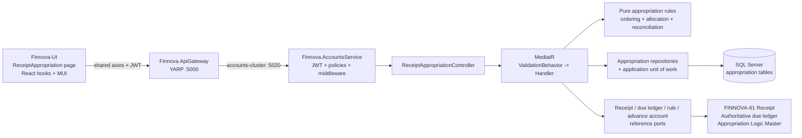
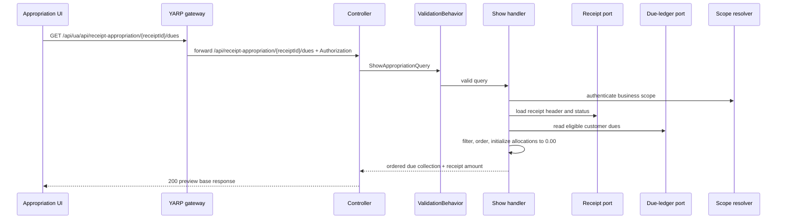
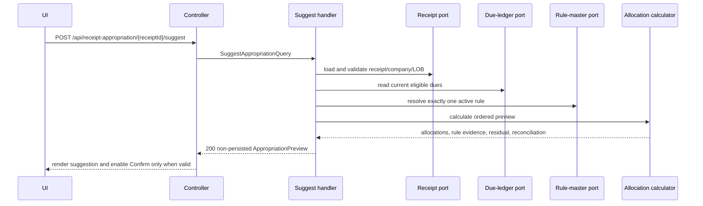
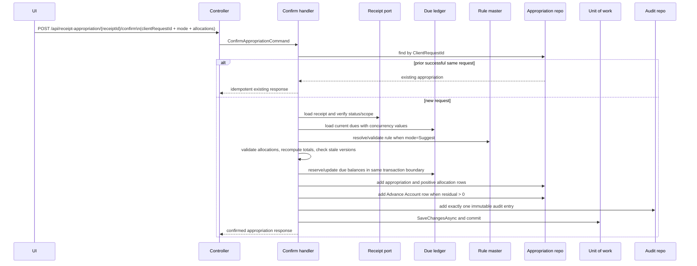

# Design Document: Receipt Appropriation Engine

**Jira:** FINNOVA-62  
**Feature slug:** `receipt-appropriation-engine`  
**Module:** Accounts / Receipt Operations  
**Related feature:** FINNOVA-61 Receipt Processing  
**Backend repository:** `D:\Projects\Finnova\Finnova-API`  
**Frontend repository:** product path `E:\Finnova\Finnova-UI\Finnova-UI`; local checkout inspected at `D:\Projects\Finnova\Finnova-UI`

## Overview

The Receipt Appropriation Engine lets an authorized Collection Officer review a receipt’s eligible customer dues, either enter allocations manually or request a deterministic suggestion from the active Appropriation Logic Master rule, review the residual, and confirm the complete appropriation atomically. A positive residual is transferred to the configured Advance Account only when the officer accepts that transfer.

The design covers the backend and frontend slices required by the approved requirements:

- **Backend:** contracts, domain entities and enums, pure allocation rules, persistence, repository ports, CQRS commands and queries, controller, exception mapping, authentication and authorization policy integration, audit, and API gateway routes.
- **Frontend:** receipt context entry, Show/Suggest/Manual/Confirm workflow, allocation grid, service interface, mock and real implementations, environment toggle, route, navigation, and Vitest/React Testing Library coverage.
- **Integration boundary:** FINNOVA-67 is the authoritative Appropriation Logic Master. FINNOVA-62 consumes its authenticated resolver contract for Suggest and Suggest-mode Confirm; it does not maintain a static rule, duplicate rule tables, or hard-code policy percentages.

The design does not add receipt capture, rule-maintenance CRUD, GL posting, receipt authorization, reversal, or a second due ledger. It also does not modify source code in either repository. The later tasks document will contain implementation instructions and complete code snippets.

### 1.1 Product constraints

All values and labels are English-only. Amounts are INR and use exactly two fractional digits. Dates and technical timestamps follow the existing platform conventions: business dates use the product’s India context and persisted technical timestamps are UTC. The UI remains left-to-right and adds no RTL or translation infrastructure.

### 1.2 Repository findings that affect the design

The backend currently contains the expected layered projects and conventions:

- `Finnova.Models` contains domain entities, enums, exceptions, and contracts.
- `Finnova.Repository` uses `FinnovaDbContext`, EF Core SQL Server, per-feature repositories, configuration classes, and `IApplicationUnitOfWork`.
- `Finnova.Service` uses MediatR, FluentValidation, `ValidationBehavior<,>`, ports for external/authoritative capabilities, pure rule helpers, and feature folders.
- `Finnova.AccountsService` already hosts JWT Bearer authentication, role policies, controllers, and `ExceptionHandlingMiddleware`.
- `Finnova.ApiGateway` routes Accounts features to `accounts-cluster` and has UI-composed aliases under `/api/ua/api/...`.
- `Finnova.Tests` uses xUnit, FsCheck.Xunit, EF Core InMemory, Moq, and `WebApplicationFactory<Program>`.

The current backend checkout does **not** contain concrete `Receipt`, `ReceiptAppropriation`, `PendingDue`, or Appropriation Logic Master source types. FINNOVA-61 and the rule-master implementation therefore remain prerequisites or separately delivered dependencies. The design names the interfaces this feature needs and marks the unresolved ownership decisions in Section 14 rather than pretending those entities already exist.

The inspected frontend checkout is at `D:\Projects\Finnova\Finnova-UI`, not at the product-defined `E:\Finnova\Finnova-UI\Finnova-UI` path. It uses React 18, TypeScript, Vite, MUI, React Router, React hooks, a shared `src/services/api.ts`, and flat feature service files such as `demandProcessing.service.ts` with `interfaces`, `mock`, and `real` subfolders. The implementation task must apply the same files under the product-defined checkout when that path is available.

## 2. Reused versus new assets

### 2.1 Reused backend assets

| Concern | Existing asset/convention | Design use |
| --- | --- | --- |
| Host | `Finnova.AccountsService` on port 5020 | Hosts `ReceiptAppropriationController`; no new host. |
| Serialization | `AddControllers().AddJsonOptions` with `JsonStringEnumConverter` | Enum values travel as English strings. |
| CQRS | MediatR registration in `Finnova.Service.DependencyInjection` | Commands and queries are dispatched from the controller. |
| Validation | FluentValidation plus `ValidationBehavior<,>` | Shape and field validation runs before handlers. |
| Persistence | `FinnovaDbContext`, configuration assembly scanning, SQL Server | Stores appropriation-owned records and concurrency tokens. |
| Transaction boundary | `IApplicationUnitOfWork.BeginTransactionAsync` and `SaveChangesAsync` | Confirm uses one transaction and one final save. |
| Authentication | JWT Bearer configured in `Finnova.AccountsService/Program.cs` | Authentication runs before authorization and handlers. |
| Authorization | `AddAuthorization`, role claims, `AuthorizationScopeResolver` pattern | New appropriation policy and business-scope checks. |
| Errors | `ExceptionHandlingMiddleware` and `ProblemDetails` extensions `code`, `message`, `correlationId` | Stable `ERR-APPROP-*` errors. |
| Money rules | Demand `Money` helper with `MidpointRounding.AwayFromZero` | Shared accounting rounding convention, with the final rule documented as round-half-up/AwayFromZero. |
| Ports | Demand `IAccountSourcePort`, `IAllocationEventPort`, `IJournalPort`, and reference-port pattern | New narrow receipt, due, rule, advance-account, and scope ports. |
| Tests | xUnit, FsCheck.Xunit, EF InMemory, Moq, `WebApplicationFactory<Program>` | Pure allocation properties plus handler, persistence, security, and host tests. |

### 2.2 Reused frontend assets

| Concern | Existing asset/convention | Design use |
| --- | --- | --- |
| HTTP | `src/services/api.ts` shared axios instance | Bearer injection, base URL, timeout, centralized 401/403/409/error toast behavior. |
| Service toggle | `VITE_USE_MOCK_API` selector pattern | Select mock or real appropriation service without changing page code. |
| Service structure | `src/services/<feature>.service.ts`, `interfaces`, `mock`, `real` | New appropriation service follows the existing demand pattern. |
| State | `useState`, `useEffect`, `useCallback` | Own receipt context, rows, loading, error, mode, and confirmation state. |
| UI | MUI, `DataGrid`, `TextField`, `Alert`, `Dialog`, `Button`, `RadioGroup` | Allocation grid and workflow controls. |
| Routing | `App.tsx` with `BrowserRouter`, `Routes`, protected `Layout` | Add appropriation route under the authenticated shell. |
| Navigation | `Layout.tsx` grouped menu structure | Add a Receipt Appropriation item under Operations or Finance, subject to product menu ownership. |
| Testing | Vitest + React Testing Library conventions | Service and page interaction tests. |

### 2.3 New backend assets

- Appropriation-owned entities: `ReceiptAppropriation`, `ReceiptAllocation`, `AdvanceAccountAllocation`, and immutable `AppropriationAuditEntry`.
- Enums: `AppropriationMode`, `AppropriationDirection`, `ReceiptAppropriationStatus`, `AppropriationAllocationStatus`, and `CashFlowDueType` only if the authoritative ledger does not already own the enum.
- Contract records for Show, Suggest, Confirm, due rows, rule details, allocation previews, totals, reconciliation, and error context.
- `ReceiptAppropriationException` family and stable error codes.
- Pure `AppropriationRules` / `AppropriationCalculator` helpers for validation, ordering, vertical/horizontal traversal, Full Due behavior, percentage rounding, residual calculation, and reconciliation.
- Repository interfaces and implementations for appropriation-owned data, plus adapter ports for receipt, due ledger, rule master, advance account, and authorization scope.
- CQRS handlers: `ShowAppropriationQuery`, `SuggestAppropriationQuery`, and `ConfirmAppropriationCommand`, with validators and response mappers.
- `ReceiptAppropriationController`, AccountsService registrations, middleware branch, and gateway aliases.

### 2.4 New frontend assets

- `models/receiptAppropriation.model.ts` containing DTO-aligned types and UI state types.
- `services/interfaces/receiptAppropriation.interface.ts`, `services/mock/receiptAppropriation.mock.ts`, `services/real/receiptAppropriation.real.ts`, and `services/receiptAppropriation.service.ts`.
- `pages/ReceiptAppropriation.tsx` and focused components under `components/receiptAppropriation/` such as header, mode selector, due grid, rule summary, totals, residual confirmation, and result panel.
- Route and navigation entries, plus Vitest/RTL service and page tests.

## Architecture

### 3.1 Logical architecture

The UI is a workflow client, not a calculation authority. The backend recomputes and validates every Confirm request using current receipt, due, rule, scope, and Advance Account data. Preview responses are advisory and are never trusted as persistence instructions without revalidation.

### 3.2 Show request flow

Show reads the receipt and due ledger without writing appropriation rows or audit entries. It rejects an inaccessible, cancelled, or otherwise non-appropriable receipt before exposing due data. A zero-result due set is a successful response.

### 3.3 Suggest request flow

Suggest performs no appropriation insert, due-balance update, Advance Account transfer, or audit insert. The preview includes the rule identity and detail/order evidence used by the calculator so the officer can review why each allocation was proposed.

### 3.4 Confirm request and transaction flow

The design assumes the authoritative due-ledger implementation can participate in the same SQL Server transaction or expose an atomic reservation command with equivalent rollback semantics. If it cannot, the implementation must stop before coding and obtain a ledger integration decision; a best-effort two-write flow is not acceptable for Confirm.

### 3.5 Layer responsibilities

- **Controller:** binds route/body/query values, applies policy attributes, extracts the authenticated actor and correlation ID, dispatches MediatR, and returns status codes. It does not calculate amounts or query EF directly.
- **Validators:** validate request shape, required identifiers, supported enum values, amount scale, page bounds, and client request identifier format. Business state validation stays in handlers and ports.
- **Handlers:** orchestrate receipt, due, rule, scope, calculation, idempotency, persistence, and audit. Show and Suggest remain read-only.
- **Pure calculator:** accepts normalized receipt amount, ordered immutable due projections, and normalized rule details. It has no clock, database, HTTP, logger, or claims dependency.
- **Repository:** owns appropriation tables and queries. Add methods do not save; Confirm saves through `IApplicationUnitOfWork`.
- **Authoritative ports:** isolate FINNOVA-61, due-ledger, rule-master, Advance Account, and user scope contracts from the service layer.
- **Frontend:** keeps the last valid editable state, shows server messages, disables initiating actions while requests are in flight, and never treats client validation as sufficient for Confirm.

## 4. Requirements coverage map

| Requirements | Design coverage |
| --- | --- |
| R1 Show and ordered dues | Sections 3.2, 5.1, 6.1, and 8: receipt validation, due filtering, stable ordering, empty state, and display totals. |
| R2 Manual allocation | Sections 5.2, 6.2, 7, 8.2, and 9: editable rows, per-due caps, total cap, explicit residual acceptance, and zero-row omission. |
| R3 Suggest from active rule | Sections 3.3, 5.3, 6.3, 7, and 10: unique active-rule resolution, percentage targets, rule evidence, and no preview persistence. |
| R4 Direction and Full Due | Section 6.4: vertical/horizontal traversal, configured detail order, due ordering, Full Due enabled/disabled, and repeatability. |
| R5 Advance Account residual | Sections 5.4, 6.5, 7, and 9: one residual allocation, missing-account rejection, and reconciliation. |
| R6 Atomic confirmation | Sections 3.4, 6.6, 7, 10, and 11: transaction, due reservation, audit, stale checks, duplicate protection, and rollback. |
| R7 Contracts and errors | Sections 5, 7, and 8: endpoint records, stable codes, ProblemDetails mapping, and collection contract. |
| R8 UI behavior | Sections 2.2, 8, 10, and 12: MUI workflow, shared client, mode state, loading, errors, and result state. |
| R9 Authorization and scope | Sections 3.5, 7.6, 9, and 11: JWT ordering, policies, Company/LOB/Branch/Customer scope, and no mutation on denial. |
| R10 precision and deterministic invariants | Section 6 and Section 10: two-decimal validation, round-half-up/AwayFromZero, stable ordering, reconciliation, and properties. |
| R11 examples and edge cases | Sections 6.7 and 10: representative 35,000/80%/20% case, over-allocation, empty dues, rounding remainder, stale due, and idempotency cases. |

## Data Models

### 5.1 Backend source projections and owned entities

The following are design-level models. Their exact foreign-key shape must be aligned with FINNOVA-61 and the due-ledger/rule-master owners before implementation.

#### Authoritative source projections

These are read-only service-layer records returned by ports, not duplicate domain ownership:

| Projection | Required fields | Owner |
| --- | --- | --- |
| `ReceiptContext` | Receipt ID, customer ID/code/name, Company ID, LOB ID, receipt amount, currency, status, row/version token, appropriation status | FINNOVA-61 Receipt Processing |
| `PendingDueProjection` | Due ID, Contract/Account ID and number, customer ID, due type, due date, outstanding amount, collectible status, row/version token | Authoritative demand/cash-flow due ledger |
| `AppropriationRuleProjection` | Rule ID/version, Company ID, LOB ID, direction, Full Due, active flag, ordered detail list | Appropriation Logic Master |
| `RuleDetailProjection` | Detail ID, due type, percentage, configured order | Appropriation Logic Master |
| `AdvanceAccountProjection` | Advance Account ID, Company/customer/company scope, active flag, currency, concurrency token | Accounting/master-data owner |
| `AuthorizedBusinessScope` | permitted Company IDs, LOB IDs, Branch IDs, and customer restrictions | Existing authorization/scope source |

#### `ReceiptAppropriation`

| Field | Rule |
| --- | --- |
| `Id` | Immutable GUID primary key. |
| `ReceiptId` | Required unique reference to the FINNOVA-61 receipt. One successful appropriation per receipt in this release. |
| `ClientRequestId` | Required unique idempotency identifier. Same key plus same normalized payload returns the existing result; same key plus different payload is a conflict. |
| `Mode` | `Manual` or `Suggest`. |
| `Status` | `Confirmed` only for the successful persisted result; failed previews are not stored as appropriation entities. |
| `ReceiptAmount` | INR `decimal(18,2)` snapshot. |
| `DueAllocationTotal` | INR `decimal(18,2)`. |
| `AdvanceAccountAmount` | INR `decimal(18,2)`, zero when no residual exists. |
| `ResidualAmount` | INR `decimal(18,2)`, equal to the amount routed to Advance Account after confirmation. |
| `RuleId`, `RuleVersion` | Nullable for Manual; required for Suggest. |
| `RuleDirection`, `FullDue` | Snapshot of applied Suggest policy. |
| `CustomerId`, `CompanyId`, `LineOfBusinessId` | Scope snapshots used for audit and query filtering. |
| `ConfirmedBy`, `ConfirmedAtUtc` | Authenticated actor and UTC confirmation time. |
| `RowVersion` | SQL Server concurrency token. |

Recommended unique indexes are `ReceiptId` and `ClientRequestId`. If the existing receipt model already enforces a one-to-one relation, the appropriation table uses a unique FK rather than a second logical uniqueness mechanism.

#### `ReceiptAllocation`

| Field | Rule |
| --- | --- |
| `Id`, `ReceiptAppropriationId` | Immutable identity and parent. |
| `PendingDueId`, `AccountId`, `AccountNumber`, `CustomerId` | Due identity plus safe display snapshots. |
| `CashFlowDueType`, `DueDate` | Due category and date snapshots. |
| `AllocatedAmount` | Positive INR `decimal(18,2)` only. Zero allocations are not inserted. |
| `OutstandingAmountAtShow`, `OutstandingAmountAtConfirm` | Evidence and concurrency diagnostics. |
| `RuleDetailId`, `RuleOrder`, `TargetAmount` | Suggest evidence; null for Manual. |
| `DueRowVersionAtConfirm` | Recheck token used to reject stale confirmation. |

A unique constraint on `(ReceiptAppropriationId, PendingDueId)` prevents duplicate rows within one confirmation.

#### `AdvanceAccountAllocation`

| Field | Rule |
| --- | --- |
| `Id`, `ReceiptAppropriationId`, `AdvanceAccountId` | One row at most for a confirmed appropriation. |
| `Amount` | Positive INR `decimal(18,2)` and exactly equal to `ResidualAmount`. |
| `CompanyId`, `CustomerId`, `Currency` | Scope and accounting snapshots. |
| `CreatedAtUtc` | UTC persistence timestamp. |

#### `AppropriationAuditEntry`

Append-only and immutable. It contains ID, Receipt ID, Appropriation ID, mode, actor ID/display-safe text, client request ID, correlation ID, due allocation total, Advance Account amount, residual, rule identity/version when applicable, and `OccurredAtUtc`. It stores references and totals, not secrets, JWTs, payment credentials, or unrestricted customer data.

### 5.2 Enums and ordering

- `AppropriationMode`: `Manual`, `Suggest`.
- `AppropriationDirection`: `Vertical`, `Horizontal`.
- `ReceiptAppropriationStatus`: `Confirmed`.
- `CashFlowDueType`: `Installment`, `Principal`, `Interest`, `Insurance`, `ODI`, `OtherCharges`. Reuse the authoritative due-type enum when one exists; do not create two incompatible representations.
- Due type order is a fixed business order, not lexical order.
- Within all groups, order by Account Number ascending, due-type hierarchy, Due Date ascending, and stable Due ID ascending. For Horizontal mode, due-type is the outer configured detail group and Account Number/date/ID are the inner order.

### 5.3 Frontend models

The frontend model mirrors JSON camelCase contracts and keeps server amounts as strings at input boundaries when necessary to avoid browser floating-point surprises. Display and arithmetic helpers normalize to two-decimal decimal-compatible strings; the server remains authoritative.

Core types:

- `ReceiptAppropriationContext`: receipt ID, customer display, receipt amount, Company/LOB labels, and receipt status.
- `PendingDueRow`: due ID, account number, due type, due date, outstanding amount, allocated amount, remaining amount, and optional rule evidence.
- `AppropriationRuleSummary`: rule ID/version, direction, Full Due, and ordered details.
- `AppropriationPreview`: receipt amount, ordered rows, due total, Advance Account amount, residual, reconciliation status, and rule summary.
- `ConfirmAppropriationRequest`: receipt ID, mode, normalized allocation rows, `acceptResidualTransfer`, client request ID, and optional preview version/concurrency tokens.
- `ConfirmedAppropriation`: appropriation ID, receipt ID, mode, allocation rows, totals, Advance Account amount, UTC timestamp, status, and correlation ID.
- `AppropriationPageState`: `idle | loading | loaded | confirming | confirmed | error`, selected mode, editable rows, last preview, field errors, and blocking error.

The UI does not store or expose JWT contents beyond the existing auth context. It does not allow the user to edit receipt amount, customer, Company, LOB, rule identity, or due identifiers.

## 6. Allocation algorithm and invariants

### 6.1 Input normalization and validation

1. Validate receipt identifier and load the current receipt through `IReceiptContextPort`.
2. Require a positive INR receipt amount with no more than two fractional digits. Preserve the original decimal value; never truncate an input with extra precision.
3. Verify receipt status permits appropriation, customer is active/in scope, Company and LOB are present, and currency is INR.
4. Load eligible dues from the authoritative ledger. Exclude outstanding amounts less than or equal to `0.00` and non-collectible statuses.
5. Normalize each amount to a decimal with scale two only after validating its input scale. Assign the fixed sort key `(AccountNumber, DueTypeRank, DueDate, DueId)`.
6. For Suggest, resolve the active FINNOVA-67 rule using authoritative Receipt CompanyId and LineOfBusinessId. Reject no-match, ambiguity, unsupported resolver contract versions, duplicate details, invalid mappings, percentages outside 0.00..100.00, and detail totals above 100.00. Permit totals below 100.00; the unallocated portion remains residual and is handled by Advance Account policy.

### 6.2 Manual calculation

The server treats missing or cleared UI allocations as `0.00`. Each submitted allocation must satisfy `0.00 <= allocated <= current outstanding amount`, have two-decimal scale, and reference an eligible due belonging to the receipt customer. The sum must not exceed the receipt amount.

`dueAllocationTotal = sum(positive allocations)`  
`residual = receiptAmount - dueAllocationTotal`

When residual is positive, Confirm requires `acceptResidualTransfer = true` and an active Advance Account. Confirm creates one Advance Account row equal to residual. When residual is zero, no Advance Account row is created and the acceptance flag is ignored or must be false according to the final contract decision.

### 6.3 Suggest target calculation

For each ordered rule detail:

`detailTarget = Money(receiptAmount * percentage / 100)`

The detail target is a maximum target for that detail, not a permission to exceed a due balance. The calculator processes rule details in configured order and caps each line by the current remaining due balance and the remaining receipt/detail target.

The unfulfilled target caused by absent or insufficient matching dues remains part of the unapplied amount and is ultimately included in residual. It is not redistributed to a different due type unless the approved rule-master semantics explicitly add that policy.

The calculator tracks:

- remaining receipt amount;
- remaining target for the current rule detail;
- remaining outstanding amount for each due;
- applied rule detail ID and order;
- deterministic rounding remainder.

### 6.4 Direction and Full Due traversal

- **Vertical:** for each Contract in Account Number order, process the complete configured detail sequence before moving to the next Contract.
- **Horizontal:** for each configured detail, process matching dues across all Contracts in Account Number/date/ID order before moving to the next detail.
- **Full Due enabled:** fill a matching due up to its outstanding balance before moving to the next eligible due, subject to the detail target and receipt remainder.
- **Full Due disabled:** apply the detail target oldest-due-date-first, with the same deterministic tie-breakers and outstanding-balance cap. The design retains this rule interpretation from assumption A7/A8 pending product confirmation.

The calculator returns a value object rather than mutating EF entities. This makes repeated Suggest calls deterministic and allows property tests to run without a database.

### 6.5 Rounding and residual

Use `decimal.Round(value, 2, MidpointRounding.AwayFromZero)`, which is the .NET accounting-rounding convention already used by Demand Processing and represents the required round-half-up behavior for non-negative monetary values. Percentage targets are rounded to two decimals. A rounding remainder is assigned to the final eligible allocation in the configured iteration order if the due cap permits it; otherwise it remains residual.

The calculator enforces:

`receiptAmount = dueAllocationTotal + advanceAccountAmount + unappliedResidual`

For a preview, `advanceAccountAmount` is equal to the positive residual only when an Advance Account is available and the preview contract elects to show the prospective transfer. For Confirm, a positive residual requires explicit acceptance and a configured account. The persisted confirmed result has `unappliedResidual = 0.00` because all remaining money is either due allocation or Advance Account allocation.

### 6.6 Concurrency and idempotency

- Show and Suggest include receipt and due version evidence in the response but do not reserve money.
- Confirm reloads the receipt, rule, Advance Account, and affected due rows. It rejects any changed receipt status, changed due row version/balance, changed applicable rule version, or changed scope with a stale-data error.
- SQL Server rowversion tokens and a unique `ReceiptId` index prevent two different successful appropriations for one receipt.
- `ClientRequestId` is the idempotency key. Existing successful same-key requests return the stored result. Same-key/different-payload requests return `409 ERR-APPROP-IDEMPOTENCY-CONFLICT`.
- Confirm starts a database transaction, adds appropriation-owned rows and audit, updates/reserves due balances through the authoritative due-ledger contract, saves once, and commits. Any exception rolls back all writes in the transaction.
- If the due ledger is external and cannot join the transaction, the only acceptable replacement is an atomic ledger reservation/commit protocol with a compensating failure state agreed by the ledger owner. A non-atomic sequence is out of scope.

### 6.7 Representative calculations

For receipt `35000.00`, Installment `30000.00`, ODI `15000.00`, and rule details Installment `80.00%`, ODI `20.00%`, Suggest calculates targets `28000.00` and `7000.00`, proposes those amounts, leaves due balances `2000.00` and `8000.00`, and has residual `0.00`.

For receipt `1000.00` and one due of `600.00`, no algorithm may allocate more than `600.00`; the remaining `400.00` is the Advance Account amount when configured and accepted for Confirm. For zero eligible dues, the due total is `0.00` and the full receipt amount is residual/Advance Account amount.

## API Contracts

The controller base route is `/api/receipt-appropriation`. All endpoints require the appropriation read or confirm policy, and all responses use JSON camelCase and string enum values.

### 7.1 Show

`GET /api/receipt-appropriation/{receiptId}/dues?page=1&pageSize=100`

Response: `200 PaginatedResponse<PendingDueResponse>` using the existing common contract (`data`, `total`, `page`, `pageSize`, `totalPages`) when pagination is retained. The feature should use a bounded non-paginated collection only if the due-ledger owner confirms a safe maximum and documents that choice.

`PendingDueResponse` contains `dueId`, `accountId`, `accountNumber`, `cashFlowDueType`, `dueDate`, `outstandingAmount`, `allocatedAmount: 0.00`, `remainingAmount`, `currency: "INR"`, and a due version token. The envelope contains receipt ID, customer display, Company/LOB references, `receiptDocumentAmount`, `totalAllocatedAmount: 0.00`, `residualAmount`, and `scopeVersion`.

### 7.2 Suggest

`POST /api/receipt-appropriation/{receiptId}/suggest`

The body is empty or contains an optional preview version, depending on the final controller convention. The handler reloads all required context; it does not trust client-supplied Company, LOB, amount, or rule identity.

`AppropriationPreviewResponse` contains:

- receipt ID and receipt amount;
- customer, Company, and LOB references;
- mode `Suggest`;
- applied rule ID/version, direction, Full Due, and ordered detail summaries;
- ordered allocation rows with proposed amount, remaining due, target amount, detail ID, and rule order;
- due allocation total, prospective Advance Account amount, residual amount, and reconciliation status;
- receipt version, due version set/fingerprint, rule version, generated-at UTC, and correlation ID.

Suggest returns `200` and never inserts a persisted appropriation or audit entry.

### FINNOVA-67 runtime evidence

The Suggest preview and Suggest-mode Confirm request use the FINNOVA-67 resolution envelope. FINNOVA-62 re-resolves the rule during Confirm and rejects a changed Rule_Version as stale. The persisted appropriation and audit snapshot includes RuleId, RuleVersionId/version number, resolverContractVersion, CompanyId, LineOfBusinessId, UsedGlobalFallback, Direction, FullDue, and ordered detail ID, sequence, canonical due type, ledger code, and percentage. FINNOVA-62 applies Vertical/Horizontal traversal and Full Due; FINNOVA-67 only supplies configuration.

### 7.3 Confirm

`POST /api/receipt-appropriation/{receiptId}/confirm`

`ConfirmAppropriationRequest` contains:

- `clientRequestId` (required GUID);
- `mode` (`Manual` or `Suggest`);
- `allocations` with due ID and amount; zero rows may be omitted;
- `acceptResidualTransfer`;
- optional preview/version evidence used for diagnostics, never as a substitute for reload/recheck.

`ConfirmedAppropriationResponse` contains appropriation ID, receipt ID, client request ID, mode, positive due allocations, Advance Account allocation if any, receipt amount, due total, residual, confirmed status, confirmation timestamp UTC, actor-safe display, audit ID, and correlation ID.

## Error Handling

The existing Accounts middleware returns RFC 7807-compatible JSON with stable `code`, English `message`, `detail`, and `correlationId`. Add a typed `ReceiptAppropriationException` branch before generic fallback.

| Condition | HTTP | Code |
| --- | ---: | --- |
| Missing/malformed fields, unsupported mode/type, extra decimal places | 400 | `ERR-APPROP-VALIDATION` |
| Receipt or due context does not exist or is inaccessible without revealing existence | 404 | `ERR-APPROP-NOT-FOUND` |
| Missing/expired/invalid JWT | 401 | framework authentication response; `ERR-AUTH-401` if middleware owns the body |
| Authenticated user lacks role or business scope | 403 | `ERR-APPROP-403` |
| Receipt already confirmed with different allocation | 409 | `ERR-APPROP-ALREADY-CONFIRMED` |
| Same client request ID with different payload | 409 | `ERR-APPROP-IDEMPOTENCY-CONFLICT` |
| Due/rule/receipt changed before Confirm | 409 | `ERR-APPROP-STALE-DATA` |
| Competing confirmation or rowversion conflict | 409 | `ERR-APPROP-CONCURRENCY` |
| Rule missing, ambiguous, invalid, unsupported direction/details | 422 | `ERR-APPROP-RULE-CONFIGURATION` |
| Missing active Advance Account for positive residual | 422 | `ERR-APPROP-ADVANCE-ACCOUNT` |
| Due cap, total receipt cap, negative balance, or reconciliation failure | 422 | `ERR-APPROP-RECONCILIATION` |
| Authoritative source unavailable | 503 | `ERR-APPROP-DEPENDENCY` |
| Unexpected exception | 500 | `ERR-APPROP-500` with safe generic message |

Field and allocation context is returned in structured `errors`/`allocations` extensions where the existing middleware contract permits. Do not return SQL messages, stack traces, JWT data, or secrets.

## Components and Interfaces

### 8.1 Models and contracts

- `Finnova.Models/Domain/Entities/ReceiptAppropriation.cs`: appropriation aggregate and positive allocation children.
- `Finnova.Models/Domain/Entities/AppropriationAuditEntry.cs`: append-only audit.
- `Finnova.Models/Domain/Enums/ReceiptAppropriationEnums.cs`: mode, direction, status, and due type only when not already owned.
- `Finnova.Models/Domain/Exceptions/ReceiptAppropriationExceptions.cs`: typed exception family and error codes.
- `Finnova.Models/Contracts/ReceiptAppropriation/ReceiptAppropriationContracts.cs`: request/response records and error context.

Contract records should be immutable `record` types, use `decimal` for server monetary values, `Guid` for IDs, `DateOnly` for due dates, and `DateTime` UTC for technical timestamps. They must not expose EF entities directly.

### 8.2 Repository and integration ports

Add repository interfaces under `Finnova.Repository/Interfaces` and implementations under `Finnova.Repository/Repositories`:

- `IReceiptAppropriationRepository`: lookup by receipt/client request, add aggregate, load confirmed response, detect existing receipt appropriation.
- `IAppropriationAuditRepository`: append-only add method.
- `IReceiptAppropriationReferenceRepository` only for local source references if the FINNOVA-61 implementation does not expose a service port.

Add service-layer ports under `Finnova.Service/ReceiptAppropriation/Ports`:

- `IReceiptContextPort`: load a receipt, status, customer, Company, LOB, amount, and concurrency/version evidence.
- `IPendingDuePort`: read eligible due projections and atomically reserve/apply confirmed allocations.
- `IAppropriationRuleResolver`: authenticated FINNOVA-67 contract returning one active exact-LOB rule before one active global fallback, with Rule ID/version, resolver contract version, matched scope, fallback flag, direction, Full Due, ordered details, and ledger mappings. No local static rule source is permitted.
- `IAdvanceAccountPort`: resolve one active account for Company/customer context.
- `IAppropriationScopeResolver`: resolve Company/LOB/Branch/customer permissions from `ClaimsPrincipal`.
- `IAppropriationClock`: reuse `IClock` if acceptable; otherwise use the existing clock abstraction for UTC confirmation timestamps.

The ports must document whether their calls use the same `FinnovaDbContext` transaction. The implementation must not fall back to a second local due-balance table.

### 8.3 CQRS handlers

- `ShowAppropriationQueryValidator` and handler: validate route/page input, authorize scope, load receipt and dues, apply deterministic order, return initialized rows.
- `SuggestAppropriationQueryValidator` and handler: perform Show context loading, resolve one rule, invoke pure calculator, return preview.
- `ConfirmAppropriationCommandValidator` and handler: validate shape, check idempotency, reload all authoritative state, recompute/validate allocations, perform transaction, persist and return result.
- `AppropriationMapper`: map owned entities and projections to contracts without exposing persistence models.

A handler must never use UI-supplied `AccountNumber`, due type, Company, LOB, or receipt amount as authoritative identity. The due ID and receipt ID are re-resolved and checked against the loaded customer/scope.

### 8.4 Controller and host

`Finnova.AccountsService/Controllers/ReceiptAppropriationController.cs` exposes Show, Suggest, and Confirm. Suggested policy names are `ReceiptAppropriationRead` and `ReceiptAppropriationConfirm`. Both allow the configured Collection Officer role and `SystemAdmin`; Confirm may use a stricter policy if product confirms it.

`Program.cs` registers policies, the feature service graph, and the existing repository/service layers. `FinnovaDbContext` receives DbSets for appropriation-owned entities and configuration assembly scanning picks up their configurations.

## 9. Frontend component and service design

### 9.1 Service interface and transport

`IReceiptAppropriationService` exposes:

- `show(receiptId, query): Promise<ShowAppropriationResponse>`;
- `suggest(receiptId): Promise<AppropriationPreview>`;
- `confirm(receiptId, request): Promise<ConfirmedAppropriationResponse>`.

The real service uses the shared `api` instance and a single feature base path. The UI-composed base should be `/receipt-appropriation` when the existing `VITE_API_BASE_URL` is the gateway `/api/ua/api` prefix. The mock service returns deterministic English INR examples, supports cleared values as zero, reproduces total-cap and missing-Advance-Account errors, and stores one in-memory successful request per client request ID.

The feature toggle remains exactly `import.meta.env.VITE_USE_MOCK_API === 'true'`. No ad-hoc axios client is introduced.

### 9.2 Page state and component boundaries

`ReceiptAppropriation.tsx` owns receipt context, mode, request lifecycle, last-good rows, blocking error, and navigation after success. Components remain presentational or callback-driven:

- `ReceiptAppropriationHeader`: customer, receipt ID, Company/LOB, receipt amount, status.
- `AppropriationModeSelector`: Manual/Suggest radio group and accessible labels.
- `PendingDueGrid`: MUI DataGrid or the project’s existing table pattern. Manual mode renders editable two-decimal fields; Suggest mode renders read-only proposed values and rule evidence.
- `AppropriationRuleSummary`: direction, Full Due, rule version, ordered detail percentages.
- `AppropriationTotals`: receipt amount, due total, Advance Account amount, residual, and reconciliation.
- `ResidualTransferPanel`: explicit acceptance checkbox/decision and missing-account warning.
- `AppropriationActions`: Show, Suggest, Confirm, Refresh, and return-to-receipt controls.
- `AppropriationResult`: confirmed status, totals, timestamp, and return action.

Show is the initial data load. Manual edits update local totals only. Suggest replaces proposed allocation values only after a successful response and keeps Confirm disabled while loading or when a blocking error exists. Confirm uses a fresh client request ID per logical submission and disables itself after success.

On service failure, preserve editable values when still valid, show the server’s English message in the page and existing centralized toast, and keep Confirm disabled until the blocking error is resolved. A 401 is handled by the shared client’s session redirect; a 403 shows no successful-operation state.

### 9.3 Routing and navigation

Add an authenticated route such as `/receipt-appropriation/:receiptId` in `App.tsx` below the existing `ProtectedRoute`/`Layout`. Add a menu item labelled `Receipt Appropriation` to the Operations or Finance group in `Layout.tsx`, using an existing MUI icon and the same active-path behavior. The exact launch path from FINNOVA-61 must be wired when that receipt page is available; direct receipt ID navigation remains supported.

## 10. Security, authorization, tenant scope, and data protection

### 10.1 Authentication and authorization

ASP.NET Core JWT authentication must run before authorization. Missing, expired, malformed, or invalid-signature tokens receive 401 and cannot reach scope or data handlers. Allowed roles are the approved Collection Officer mapping and `SystemAdmin`; the design keeps `BranchCollectionOfficer` as the current assumption until the role catalog owner confirms a different claim.

The policy establishes role access, but handlers also enforce business scope. The scope check must cover Company, LOB, Branch, and customer access. A user with an allowed role but an out-of-scope receipt receives a safe 403 or not-found response according to the platform’s enumeration policy. It must not reveal whether an out-of-scope receipt exists.

### 10.2 Tenant and business scope

Finnova is India-only, but Company, LOB, Branch, and customer are still business isolation dimensions. Every Show, Suggest, and Confirm query applies the caller’s resolved scope. Confirm rechecks scope after loading the receipt and before any mutation. Do not accept Company/LOB/Branch scope from the browser as a privilege grant.

### 10.3 Audit and data protection

Only successful Confirm creates one immutable Appropriation Audit Entry. Show, Suggest, validation failures, stale rejection, and failed Confirm create zero appropriation audit entries. Operational logs may include IDs, codes, amounts, rule version, and correlation ID, but not JWTs, secrets, payment instrument credentials, or unnecessary customer personal data.

Persist only the minimum customer and receipt display snapshots needed for traceability. Protect database access through existing connection-string configuration and do not add secrets to source, contracts, mocks, or logs. Use parameterized EF queries and server-side authorization predicates.

## Testing Strategy

No builds or tests are run during spec creation. The later implementation must run the repository’s normal validation commands and keep tests in the same change.

### 11.1 Pure unit and property tests

Property-based testing applies to the pure appropriation calculator because it has a broad input space and universal invariants. Use **FsCheck.Xunit** in `Finnova.Tests`, configure each property for at least 100 iterations, and tag each test with the exact design property reference format:

`Feature: receipt-appropriation-engine, Property N: <property text>`

Property tests cover non-negative/capped allocations, deterministic ordering, direction traversal, rounding, residual reconciliation, and idempotent calculation for unchanged inputs. They do not call SQL Server, external services, or the UI.

Example-based and edge-case unit tests cover the explicit 35,000/80%/20% example, zero dues, no matching rule detail, missing Advance Account, extra decimal places, unsupported direction, duplicate due IDs, negative amounts, cleared Manual values, and exact receipt-total boundaries.

### 11.2 Backend integration tests

Use xUnit and EF Core InMemory or the repository’s established test fixture for handler/persistence cases:

- Show filters non-collectible/zero dues and returns the required order.
- Suggest returns a non-persisted preview and exact rule evidence.
- Confirm persists the appropriation, positive rows, optional Advance Account row, and one audit entry in one successful transaction.
- A failing validation, stale token, missing Advance Account, due-ledger conflict, or reconciliation check leaves no partial writes.
- Same `ClientRequestId` returns the original result without duplicate rows/audit; different payload conflicts.
- Two competing Confirm requests are resolved by unique constraints/rowversion and do not over-allocate.
- Receipt, rule, and due ports are mocked for handler isolation; a real in-memory context verifies owned persistence.

Use `WebApplicationFactory<Program>` for controller/host wiring, JWT 401/403 behavior, policy access, middleware error payloads, gateway-composed route assumptions where practical, and JSON enum/decimal contracts.

### 11.3 Frontend Vitest/RTL tests

Test the service toggle, real endpoint paths and request bodies with mocked axios, mock service behavior, page Show loading/success/empty states, Manual editing and totals, over-allocation disablement, Suggest preview rendering, residual acceptance, error preservation, 401/403 handling through the shared client, successful Confirm lockout, and navigation back to the receipt workflow. Do not add Redux, RxJS, or RTL layout tests that duplicate MUI behavior.

## Correctness Properties

A property is a characteristic or behavior that should hold true across all valid executions of a system. Properties bridge the human-readable requirements and automated correctness guarantees by stating what must remain true for every generated valid input.

### Property 1: Allocation caps and non-negative balances

For any valid receipt, ordered pending-due collection, and valid Manual or Suggest allocation result, every allocation shall be between `0.00` and the corresponding current Outstanding Amount, every remaining balance shall be non-negative, and the due allocation total shall not exceed the Receipt Document Amount.

**Validates: Requirements 2.2, 2.3, 3.2, 5.3, 10.7**

### Property 2: Exact monetary reconciliation

For any valid receipt amount and calculated allocation set, the rounded due allocation total plus Advance Account allocation plus any unapplied residual shall equal the rounded Receipt Document Amount; a confirmed result shall have zero unapplied residual.

**Validates: Requirements 5.1, 5.5, 5.6, 6.1, 10.3**

### Property 3: Stable deterministic ordering

For any collection of eligible dues with arbitrary input order, sorting by Account Number, due-type hierarchy, Due Date, and stable Due ID shall produce the same order on every execution and shall preserve the relative identity of equal business keys through the Due ID tie-breaker.

**Validates: Requirements 1.2, 4.3, 4.7, 10.5, 10.6**

### Property 4: Direction and detail-order conformance

For any valid rule and eligible due collection, Vertical calculation shall complete each Contract’s configured detail traversal before the next Contract, while Horizontal calculation shall complete each configured detail across all eligible Contracts before the next detail; all applied detail orders shall be non-decreasing in their configured traversal position.

**Validates: Requirements 3.3, 4.1, 4.2, 4.4, 4.5**

### Property 5: Suggest repeatability

For any unchanged Receipt Document Amount, eligible Pending Due collection, active Appropriation Rule, and calculation inputs, repeated Suggest calculations shall return identical allocation amounts, residual, rule evidence, and allocation ordering.

**Validates: Requirements 4.7, 10.5**

### Property 6: Percentage rounding remains bounded

For any valid non-negative Receipt Document Amount and valid rule percentages totaling `100.00%`, every rounded detail target shall be non-negative, the sum of detail targets shall differ from the Receipt Document Amount only by the deterministic rounding remainder, and no rounded allocation shall exceed its due cap or receipt remainder.

**Validates: Requirements 3.2, 3.8, 5.1, 10.1, 10.4**

### Reflection on property redundancy

Properties 1 and 2 are intentionally separate: capping and non-negative balances can hold while the total still fails to reconcile, and reconciliation can hold while one line is over its due balance. Properties 3 and 5 are also separate: stable sorting verifies the ordering function, while repeatability verifies the complete calculation output. Property 4 subsumes separate per-direction traversal checks without duplicating them. Property 6 adds percentage-target rounding coverage not implied by the general reconciliation property.

## 13. Design decisions, alternatives, and tradeoffs

### 13.1 Keep the feature in AccountsService

**Decision:** Add the feature to `Finnova.AccountsService`, matching receipt and due operational ownership.  
**Alternative:** Create a new appropriation host.  
**Tradeoff:** AccountsService gains another vertical slice, but UI routing, shared DbContext, transaction participation, and existing receipt/due boundaries remain simpler. A new host would increase deployment and transaction-boundary complexity without a confirmed ownership need.

### 13.2 Consume authoritative sources through ports

**Decision:** Use narrow ports for receipt, due ledger, rule master, Advance Account, and scope.  
**Alternative:** Copy receipt/due/rule tables into an appropriation-specific model.  
**Tradeoff:** Ports require adapter work and explicit contracts, but avoid stale balances, duplicate rule ownership, and unsafe split-brain accounting.

### 13.3 Persist only confirmed appropriations

**Decision:** Show and Suggest are read-only previews.  
**Alternative:** Persist every preview as a draft.  
**Tradeoff:** Read-only previews avoid cleanup and audit ambiguity. A draft feature could improve resumability but is not required by FINNOVA-62 and would need lifecycle, authorization, and retention rules.

### 13.4 Recompute on Confirm

**Decision:** Confirm reloads and recomputes against current authoritative values.  
**Alternative:** Persist the UI preview and accept it directly.  
**Tradeoff:** Recalculation rejects stale work instead of risking incorrect allocation. It costs another set of reads but is required for accounting safety.

### 13.5 Use SQL transaction plus rowversion/idempotency

**Decision:** Combine one transaction, unique ReceiptId/ClientRequestId constraints, and rowversion checks.  
**Alternative:** Application-only locks or client-only duplicate prevention.  
**Tradeoff:** Database constraints protect against process races and retries. They require the due ledger to share a transaction or provide an equivalent atomic reservation protocol.

### 13.6 Use MUI DataGrid and React hooks

**Decision:** Follow the actual UI stack and the existing Demand/master page patterns.  
**Alternative:** Add Redux/RxJS or a new table framework.  
**Tradeoff:** Hook-local state is sufficient for one workflow and avoids unsupported architecture. A global store would add code without cross-page state requirements.

## 14. Explicit unresolved assumptions and required confirmations

The approved requirements record assumptions A1-A19. The following remain implementation gates:

| Assumption | Design treatment | Confirmation needed before tasks are executed |
| --- | --- | --- |
| A1, A12 | FINNOVA-61 supplies the authoritative Receipt and this feature stops before GL posting/authorization. | Confirm receipt identifiers, status names, Company/LOB fields, and receipt row-version contract. |
| A2 | AccountsService and the Accounts gateway cluster host the feature. | Confirm no separate receipt/operations host is planned. |
| A3, A18 | Due projections come from the authoritative demand/cash-flow ledger across all eligible customer contracts. | Identify the exact due entity/port, collectible statuses, balance version, and atomic reserve/update operation. |
| A4, A6 | FINNOVA-67 owns rule maintenance and exposes the authoritative resolver. FINNOVA-62 permits detail totals below 100.00, rejects totals above 100.00, and routes the residual through its Advance Account flow. | Confirm FINNOVA-67 resolver endpoint/port, contract version, due-head mappings, and final Legal Charges ledger code before implementing Tasks 4, 7, and 8. |
| A7 | Full Due fills a due before the next eligible due subject to detail target. | Confirm Full Due semantics against the rule-master owner and screenshot. |
| A8 | Vertical is Contract-first; Horizontal is detail-first and oldest-first inside the group. | Confirm Horizontal distribution policy and whether Contract means Account Number grouping. |
| A9 | Manual lines cannot exceed current due balance. | Confirm the per-due cap is mandatory business policy. |
| A10 | Positive Manual residual requires explicit transfer acceptance. | Confirm whether Manual may leave residual and whether the checkbox is required for zero residual. |
| A11 | One active Advance Account exists per applicable context. | Confirm lookup key, ownership, currency, and atomic posting/reservation contract. |
| A13 | Client Request Identifier is idempotent and one confirmed appropriation exists per receipt. | Confirm amendment/reversal behavior and identifier format. |
| A14 | Confirm rejects changed dues/rules/receipt as stale with no partial result. | Confirm the authoritative concurrency token and user refresh flow. |
| A15 | `BranchCollectionOfficer` and `SystemAdmin` are the initial roles. | Confirm final role names and Company/LOB/Branch scope claims. |
| A16 | Exactly one immutable audit entry is created on successful Confirm. | Confirm whether it is a new table or an extension of the FINNOVA-61 receipt audit trail. |
| A17 | Non-negative INR calculations use two-decimal AwayFromZero/round-half-up behavior and deterministic remainder assignment. | Confirm the platform’s official rounding wording and any tax/accounting exceptions. |
| A19 | English-only, India-only, INR, left-to-right UI, UTC technical timestamps. | No further localization decision is expected. |
| Repository path | The product frontend path is unavailable in this environment; a local checkout was inspected at `D:\Projects\Finnova\Finnova-UI`. | Confirm the implementation checkout path before frontend task execution. |

If any integration gate changes, update this design and the later tasks document before implementation. In particular, do not create local due or rule tables merely to bypass an unresolved authoritative contract.

## 15. Implementation-ordered task list

The later `tasks.md` must follow this dependency order. Each task should be a copy/paste-ready `CREATE <path>` or `MODIFY <path>` step, but this design intentionally does not inline source code.

1. **Backend domain entities and enums** in `Finnova.Models/Domain/Entities` and `Finnova.Models/Domain/Enums`: add appropriation aggregate, positive allocation child, Advance Account allocation, immutable audit entry, and only the enums not already owned by receipt/due modules.
2. **Backend domain exceptions** in `Finnova.Models/Domain/Exceptions`: add typed appropriation exceptions and stable error-code constants/messages.
3. **Backend contracts** in `Finnova.Models/Contracts/ReceiptAppropriation`: add Show, Suggest, Confirm, due, rule, preview, totals, reconciliation, and confirmed-result records using the common pagination contract where applicable.
4. **Backend authoritative integration contracts** in `Finnova.Service/ReceiptAppropriation/Ports`: define receipt, due-ledger, rule-master, Advance Account, business-scope, clock, and transaction/reservation seams; document the FINNOVA-61 and ledger prerequisites.
5. **EF configuration and DbContext** in `Finnova.Repository/Configuration` and `Finnova.Repository/Context/FinnovaDbContext.cs`: configure SQL Server tables, decimal `(18,2)` columns, enum storage, unique receipt/client-request indexes, positive amount checks, relationships, and rowversion tokens. Add the migration command to the task text, but do not run it during spec execution.
6. **Backend repositories and DI** in `Finnova.Repository/Interfaces`, `Finnova.Repository/Repositories`, and `Finnova.Repository/DependencyInjection.cs`: implement appropriation reads/adds, append-only audit, idempotency lookup, and registration. Ensure add methods do not save independently.
7. **Pure/domain helpers** in `Finnova.Service/ReceiptAppropriation/Rules`: implement monetary scale checks, due-type ranks, deterministic ordering, Manual validation, Vertical/Horizontal traversal, Full Due behavior, percentage rounding, residual, and reconciliation. Keep helpers dependency-free.
8. **CQRS service slice** in `Finnova.Service/ReceiptAppropriation`: add validators, Show query, Suggest query, Confirm command, handlers, mappers, scope checks, idempotency, stale-data checks, and transaction orchestration. Register services and ports in `Finnova.Service/DependencyInjection.cs`.
9. **Backend controller, middleware, host policy, and gateway**: create `ReceiptAppropriationController`, add `ReceiptAppropriationRead`/`ReceiptAppropriationConfirm` policies in `Finnova.AccountsService/Program.cs`, add the typed middleware branch, and add direct Accounts routes plus `/api/ua/api/receipt-appropriation` aliases to `Finnova.ApiGateway/appsettings.json` with Authorization forwarding.
10. **Backend unit/property tests** in `Finnova.Tests`: add FsCheck.Xunit properties 1-6 with at least 100 iterations, example/edge tests, and handler tests for all error and reconciliation cases.
11. **Backend integration/security tests** in `Finnova.Tests`: add `WebApplicationFactory<Program>` coverage for JSON contracts, Show/Suggest/Confirm host wiring, JWT 401/403, business scope, transaction rollback, concurrency, unique idempotency, and exactly-one audit behavior.
12. **Frontend models and service boundary** in the product-defined UI repository: add `models/receiptAppropriation.model.ts`, interface, real service, mock service, feature toggle module, service barrel export, and any shared decimal/form helpers.
13. **Frontend page and components**: add `pages/ReceiptAppropriation.tsx` and `components/receiptAppropriation/*` for header, mode selector, grid, rule summary, totals, residual decision, actions, loading/error states, and confirmed result. Use React hooks and MUI only.
14. **Frontend route and navigation**: modify `src/App.tsx` and `src/components/Layout.tsx` with the protected receipt-appropriation route, Operations/Finance menu entry, permission-aware control state, and return-to-receipt integration.
15. **Frontend Vitest/RTL tests**: add service tests for mock/real request shapes and toggle behavior, page tests for Show/Manual/Suggest/Confirm/error/loading/empty/residual/idempotency states, and English-only/no-RTL assertions.
16. **Dependency confirmation and final verification handoff**: before implementation begins, resolve the receipt, due-ledger, rule-master, Advance Account, role/scope, audit, frontend path, and transaction-boundary assumptions in Section 14. The implementer then runs the repository-approved build/test/migration checks outside this design-only workflow.
