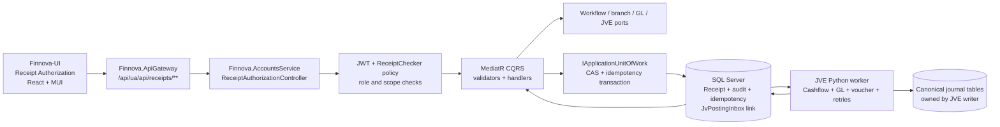
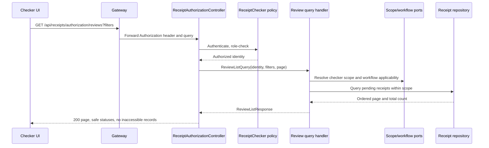
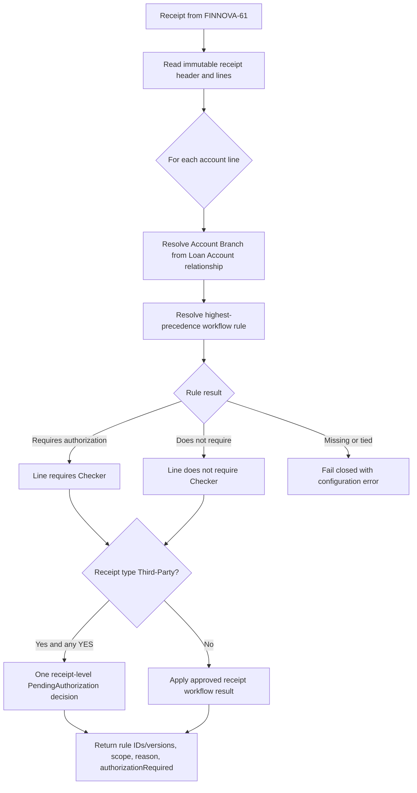
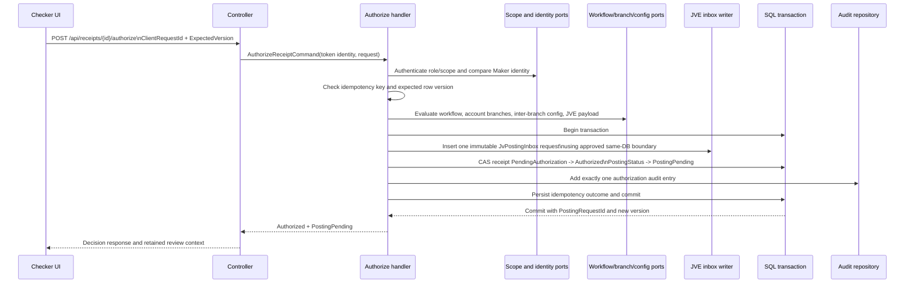
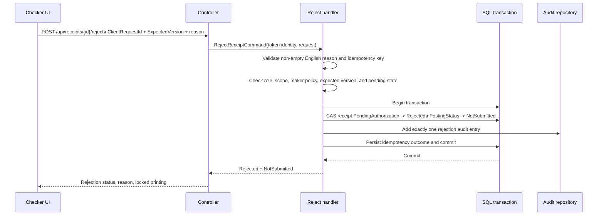
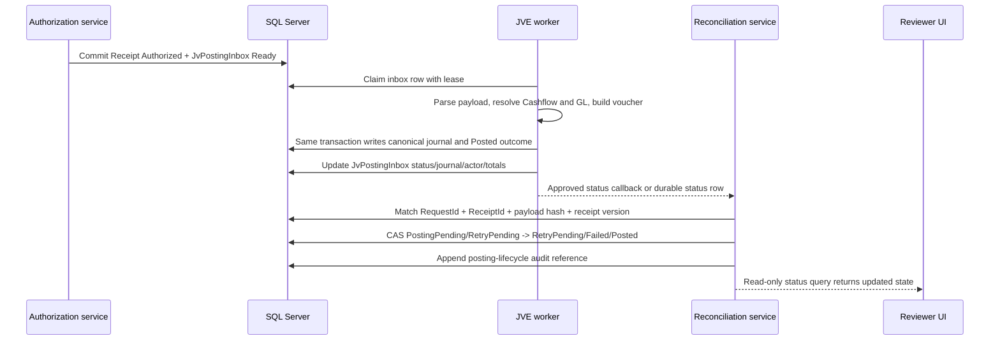
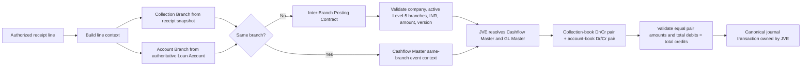
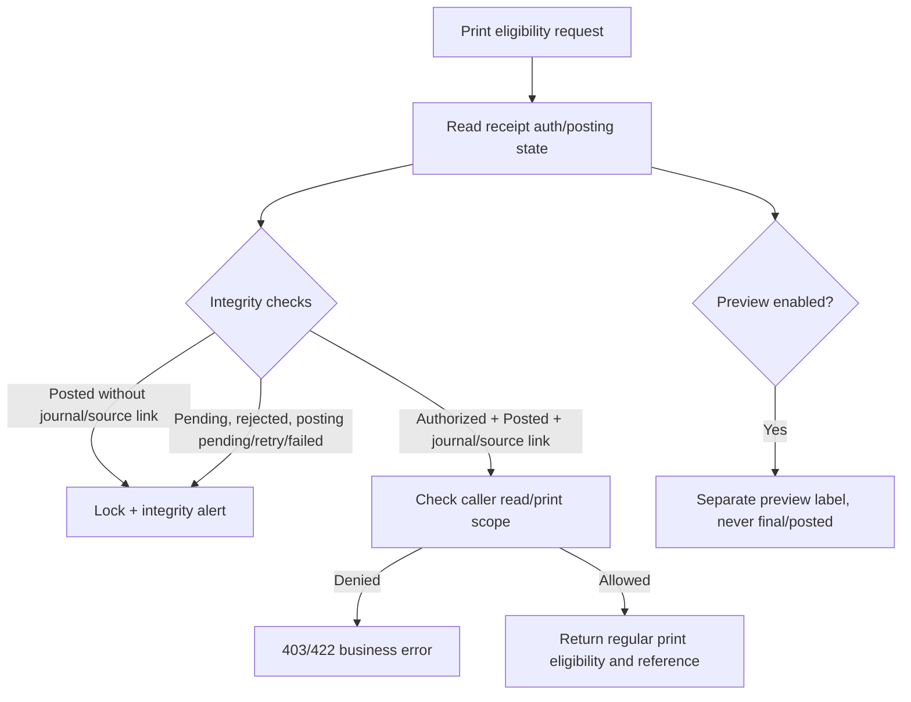

# Design Document — Receipt Authorization and Inter-Branch Accounting

**Feature:** `receipt-authorization-inter-branch-accounting`  
**Jira:** FINNOVA-63  
**Authoritative input:** `requirements.md`  
**Integration references:** FINNOVA-61 `receipt-processing` and `jv-posting-engine`  
**Repositories:** `Finnova-API` and `Finnova-UI`

## Overview

FINNOVA-63 adds the maker-checker decision and posting-control slice after FINNOVA-61 receipt capture. A Cashier or Branch Collection Officer continues to save a receipt through the FINNOVA-61 flow without creating a financial journal. A permitted Authorized Approver or Branch Manager reviews the complete receipt, authorizes or rejects it, and receives a separate authorization and posting status. An approved authorization creates exactly one immutable posting request for the existing JV Posting Engine (JVE). The JVE later resolves Cashflow Master rules, validates GL and branch context, creates the canonical journal atomically, and reports the posting outcome.

The feature treats a Third-Party receipt as one authorization unit. If one account line requires authorization, the entire receipt remains pending. A cross-branch line carries its authoritative Collection Branch and Account Branch context to the JVE. FINNOVA-63 does not write canonical Journal Header or Journal Line records, duplicate Cashflow Master rules, select a GL code from client input, or expose a public posting endpoint in the JVE worker.

The UI adds a focused Receipt Authorization screen with a paginated review list, read-only receipt detail, account-branch information, audit history, decision dialogs, posting status, and a printing gate. It uses the existing Finnova-UI React 18, TypeScript, MUI, shared axios, React hooks, and mock/real service toggle conventions.

The design preserves the product constraints: India-only business behavior, English-only labels and values, INR with two decimal places, UTC technical timestamps, India business dates where already defined by FINNOVA-61, and no RTL handling.

### Design inputs and confirmed integration findings

- FINNOVA-61 owns receipt capture, numbering, receipt lines, customer and account snapshots, the initial `PendingAuthorization` state, the receipt read model, and the creation audit entry.
- FINNOVA-61 deliberately does not authorize, reject, submit to the JVE, or create canonical journals.
- The existing JVE model has a durable `JvPostingInbox` with `RequestId`, `SourceSystem`, `EventType`, `RuleKey`, `SchemaVersion`, `CompanyId`, `BranchId`, `ValueDate`, `CurrencyCode`, immutable `RawPayload`/`PayloadHash`, lifecycle status, retry fields, `JournalId`, `PostingUserId`, rule version, totals, safe error fields, timestamps, and a row version.
- The existing Accounts host uses JWT Bearer authentication, role policies, MediatR validation behavior, EF Core repositories, `IApplicationUnitOfWork`, and `ExceptionHandlingMiddleware`.
- The existing gateway uses YARP and already maps feature-specific `/api/ua/api/**` aliases to backend hosts. FINNOVA-63 extends the receipt alias to the Accounts host; it does not add a new host.
- The existing JVE design requires the approved .NET submission boundary and the same SQL Server transaction or approved stored procedure for the final canonical journal write. The Python worker has no public submission endpoint.
- The frontend repository is a separate Finnova-UI application. The implementation follows the FINNOVA-61 service interface, real implementation, mock implementation, toggle, page, and navigation conventions.

## Scope boundaries

### Included

- Backend review-list, review-detail, authorization, rejection, audit, posting-status, trace, and printing-eligibility operations in `Finnova.AccountsService`.
- Receipt authorization decision and posting-status persistence related to FINNOVA-61 receipts.
- Authoritative workflow-rule, account-branch, inter-branch configuration, and JVE submission ports.
- Atomic authorization decision, audit entry, and approved JVE inbox request identity persistence.
- Compare-and-set concurrency using the existing receipt row version and request idempotency using `ClientRequestId`.
- JVE status callback/reconciliation with immutable request identity and receipt-version checks.
- Inter-branch posting context construction and contract validation.
- Gateway aliasing through the existing UI-facing receipt origin.
- Finnova-UI review page, read-only detail, decision dialogs, status display, audit view, printing gate, route, navigation, mock/real service toggle, and tests.
- Backend unit, FsCheck property, API integration, authorization, atomicity, gateway, JVE contract, and printing-gate tests.

### Excluded

- Receipt entry redesign or duplication of FINNOVA-61 capture entities and rules.
- Direct writes to canonical Journal Header, Journal Line, source-link, Cashflow Master, or GL Master tables.
- A second Cashflow Master, GL catalogue, account-branch master, or workflow-rule store unless the owning master explicitly approves one.
- A public HTTP submission endpoint in the Python JVE worker.
- Automatic receipt reopening or correction after rejection. Reopening is a separately approved workflow.
- Foreign currency, foreign exchange, or non-INR posting.
- Individual line authorization or partial Third-Party posting.
- Browser-based JVE administration or a journal-viewing UI.
- Redux, Redux Toolkit, RxJS, ad-hoc axios clients, localization frameworks, Arabic/non-English values, or RTL layout handling.
- Source-code implementation, migration execution, builds, and test execution as part of this design phase.

## Reused versus new assets

### Reused assets

| Area | Existing asset | FINNOVA-63 use |
| --- | --- | --- |
| Receipt aggregate | FINNOVA-61 `Receipt`, lines, customer/account snapshots, existing row version | Read and extend the lifecycle; do not create a parallel receipt aggregate. |
| Receipt creation audit | FINNOVA-61 `ReceiptAuditEntry` | Include its creation event in the trace response. |
| Accounts host | `Finnova.AccountsService` on the existing service port | Add controller actions, policies, middleware mapping, and service registrations. |
| Authentication | Existing JWT Bearer and role claims | Derive Maker, Checker, and acting-user identities from validated claims and immutable receipt data. |
| CQRS pipeline | MediatR and `ValidationBehavior<,>` | Add review, decision, reconciliation, audit, trace, and print queries/commands. |
| Persistence | EF Core, `FinnovaDbContext`, `IApplicationUnitOfWork` | One database transaction for decision, audit, idempotency record, receipt state, and approved JVE inbox request. |
| JVE inbox | Existing `JvPostingInbox` and JVE submission boundary | Reuse as the one approved posting-request record; store its `RequestId` on the receipt/link projection. |
| JVE worker | Existing Python worker design | Resolve Cashflow rules, validate GL/context, build canonical journals, retry/dead-letter, and report status. |
| Errors | `ExceptionHandlingMiddleware` and RFC 7807 `ProblemDetails` | Add a typed `ERR-RCA-*` branch and correlation/rule extensions. |
| Gateway | YARP aliases and `accounts-cluster` | Add or extend the receipt alias to route UI calls to Accounts. |
| UI HTTP | Shared axios `api` instance | Reuse JWT injection, central 401/403/409/timeout toast behavior, and gateway base URL. |
| UI service pattern | FINNOVA-61 receipt service interface, mock, real, toggle, and barrels | Add authorization operations to the receipt feature service or its dedicated authorization service following the same pattern. |
| UI framework | React 18, TypeScript, MUI, MUI Data Grid, React hooks | Build the review grid, detail dialog, decision dialogs, audit timeline, and status controls. |
| Test infrastructure | xUnit, FsCheck.Xunit, Moq, EF test support, WebApplicationFactory, Vitest, RTL | Cover pure decisions, host security/atomicity/gateway flows, and UI interactions. |

### New assets

#### Backend

- `AuthorizationDecision` and `PostingStatus` enums, with explicit compatibility mapping to the FINNOVA-61 receipt status field.
- Receipt authorization and posting-state columns or owned state configuration on `Receipt`.
- `ReceiptAuthorizationRequest` idempotency record.
- Append-only `ReceiptAuthorizationAuditEntry` record for authorization and posting-lifecycle events.
- Typed authorization domain exceptions and stable `ERR-RCA-*` rule keys.
- Workflow-rule, account-branch, inter-branch configuration, JVE submission, and JVE reconciliation ports.
- Pure workflow aggregation, identity comparison, branch-context, status-transition, printing-gate, payload-hash, and contract-validation helpers.
- CQRS commands, queries, validators, handlers, mapper, authorization policy helper, and status reconciler.
- Receipt authorization controller actions and internal JVE reconciliation action if the approved callback transport is HTTP.
- Accounts host policy registrations, middleware branch, gateway receipt alias, and DI registrations.
- EF configurations, indexes, constraints, and a forward-only migration.
- Backend unit, property, API integration, gateway, and JVE contract tests.

#### Frontend

- Authorization models and filter/request/response types.
- Authorization service interface, real axios service, mock service, toggle selector, and barrel exports.
- Receipt Authorization page, review grid, detail panel/dialog, account-line table, audit timeline, status chips, rejection dialog, confirmation dialog, and printing control.
- Route and Operations navigation entry.
- Vitest and React Testing Library coverage for list/detail/decision/status/printing behavior.

## Architecture



### Review flow



The review query filters at the database boundary where possible and applies workflow applicability through the authoritative workflow port. It returns only receipts whose authorization decision is pending and whose resolved rule requires a Checker. It orders by `DocDate DESC`, `CreatedAtUtc DESC`, then receipt identifier `DESC`. Default page number is 1 and default page size is 20; page size is bounded at 100.

### Workflow evaluation and Third-Party aggregation



The workflow evaluation result is a deterministic value object containing `AuthorizationRequired`, the selected rule identifier and version, evaluated company/LOB/branch/account-line scope, Cashflow event key, and an English reason. A Third-Party receipt is held as one unit when any line requires authorization. Equal highest precedence, missing rule under fail-closed configuration, missing account branch, or inconsistent company context stops the operation without an executable posting decision.

### Authorize flow



The handler performs all validation and authoritative resolution before the transaction. Inside the transaction it uses a compare-and-set predicate on receipt identifier, expected row version, and pending authorization decision. The transaction includes the receipt transition, one audit entry, the idempotency record, and the JVE inbox request identity. A remote HTTP submission that could create a posting request before the transaction commits is not an allowed implementation.

### Reject flow



Rejection never inserts a JVE inbox row, never creates a journal, and never authorizes a line independently. The exact maker self-authorization rule applies to authorization decisions; any maker rejection behavior follows the confirmed workflow policy and remains explicitly audited.

### JVE submission and status reconciliation



The preferred reconciliation path reads the existing same-database `JvPostingInbox` status by immutable `PostingRequestId`. If the JVE integration requires a callback, it uses the same contract described below and is protected as an internal authenticated operation. Reconciliation is idempotent and rejects a mismatched request identity, receipt version, or payload hash without changing the receipt. `RetryPending` and `DeadLetter` preserve `AuthorizationStatus = Authorized`; only a valid `Posted` outcome with a durable canonical journal identifier can unlock printing.

### Inter-branch posting flow



FINNOVA-63 supplies facts, not accounting rules. For each cross-branch line, the payload identifies the collection branch, account branch, company, receipt/line identity, amount, currency, value date, authorization actor/time, workflow identity, Cashflow event, schema version, and immutable receipt version/hash. The JVE resolves the configured cashier, inter-branch control, and loan-installment accounts through authoritative rules and GL Master. It creates the canonical journal and source link in its own same-database transaction.

### Printing flow



Regular Printing is a computed gate, not a client-controlled flag. It requires authorization decision `Authorized`, posting status `Posted`, a durable canonical journal identifier, a matching source link, and caller permission/scope. Pending, rejected/revoked, posting-pending, retry-pending, failed, or integrity-alert states remain locked. Preview Print, if separately enabled, is labeled as a preview and cannot imply authorization, posting, or final-print availability.

## Receipt lifecycle and status strategy

### Canonical status model

FINNOVA-63 introduces two explicit state dimensions:

| Dimension | Values | Meaning |
| --- | --- | --- |
| `AuthorizationDecision` | `PendingAuthorization`, `Authorized`, `Rejected` | The synchronous maker-checker outcome. `Rejected` is the design-level value; the existing FINNOVA-61 `Revoked` representation remains a compatibility mapping until the product owner confirms the persisted vocabulary. |
| `PostingStatus` | `NotSubmitted`, `PostingPending`, `RetryPending`, `Failed`, `Posted` | The asynchronous JVE request outcome. `Posted` is valid only with a canonical journal identifier and source link. |

The existing FINNOVA-61 `ReceiptStatus` column remains readable during migration. The design uses the following compatibility projection:

- `AuthorizationDecision = PendingAuthorization` projects `ReceiptStatus = PendingAuthorization`.
- `AuthorizationDecision = Authorized` projects `ReceiptStatus = Authorized`.
- `AuthorizationDecision = Rejected` projects `ReceiptStatus = Revoked` until a confirmed migration changes the legacy value to `Rejected`.

The new authorization and posting fields are authoritative for FINNOVA-63 operations. No operation may infer `Posted` from `ReceiptStatus = Authorized`, JVE inbox acceptance alone, or an authorization response. The service exposes both statuses in responses so the UI can display `Authorized` and `Posting Pending` separately.

### Valid state transitions

| From | Operation/event | To | Side effects |
| --- | --- | --- | --- |
| PendingAuthorization / NotSubmitted | Authorize succeeds | Authorized / PostingPending | One JVE request, one decision audit, one idempotency outcome. |
| PendingAuthorization / NotSubmitted | Reject succeeds | Rejected / NotSubmitted | One rejection audit, no JVE request. |
| PendingAuthorization / NotSubmitted | Invalid/stale/unauthorized request | Unchanged | No successful decision audit and no JVE request. |
| Authorized / PostingPending | JVE retryable failure | Authorized / RetryPending | Append lifecycle audit; retain request identity. |
| Authorized / RetryPending | JVE retries | Authorized / PostingPending or Failed | No second request; append lifecycle audit. |
| Authorized / PostingPending or RetryPending | JVE dead-letter | Authorized / Failed | Preserve authorization, store safe recovery reference, lock printing. |
| Authorized / PostingPending or RetryPending | JVE posts | Authorized / Posted | Store canonical journal ID; append lifecycle audit; unlock printing after integrity checks. |
| Authorized / any posting state | Second authorize/reject/submit | Unchanged | Reject with invalid-state or conflict error; no duplicate side effect. |
| Rejected / NotSubmitted | Normal authorize/reject/submit | Unchanged | Reject; reopen requires separate approved workflow. |

Transitions are guarded with receipt identifier, expected row version, current authorization decision, current posting status, immutable posting request identity, and any configured status monotonicity rule. A rejected or authorized terminal authorization decision cannot be overwritten by an ordinary request.

## Data models

Entities remain in the existing Finnova domain/repository layering. Names below describe the design; exact namespaces follow FINNOVA-61 conventions.

### Receipt lifecycle additions

The existing `Receipt` aggregate gains or owns the following fields. Amounts remain `decimal(18,2)`, currency is `INR`, and technical timestamps are UTC.

| Field | Type | Rule |
| --- | --- | --- |
| `AuthorizationDecision` | string enum | Required; defaults from FINNOVA-61 `PendingAuthorization`. |
| `PostingStatus` | string enum | Required; defaults to `NotSubmitted`. |
| `AuthorizationRuleId` | `Guid?` | Selected workflow rule identity. |
| `AuthorizationRuleVersion` | string? | Immutable selected rule version. |
| `AuthorizationRequired` | bool | Resolved workflow result, not client input. |
| `AuthorizationActorId` | `Guid?` | Stable Checker identity from JWT. |
| `AuthorizationActorDisplay` | string? | Safe display snapshot only. |
| `AuthorizationAtUtc` | `DateTime?` | UTC decision timestamp. |
| `AuthorizationReason` | string? | Optional authorization reason or approved decision summary. |
| `RejectionReason` | string? | Required for rejected outcome; English text subject to configured maximum. |
| `PostingRequestId` | `Guid?` | FK/reference to the existing `JvPostingInbox.RequestId`; unique per receipt version. |
| `PostingSchemaVersion` | string? | Version used for the immutable JVE payload. |
| `PostingPayloadHash` | byte[]? | Hash of immutable payload sent to JVE. |
| `CanonicalJournalId` | `Guid?` | Set only after a valid JVE `Posted` result. |
| `PostingFailureCode` | string? | Safe operational code; never secrets. |
| `PostingFailureMessageSafe` | string? | Safe operational detail. |
| `PostingRecoveryReference` | string? | Dead-letter/recovery reference, if supplied by JVE. |
| `PostingUpdatedAtUtc` | `DateTime?` | UTC status transition time. |
| `PrintingUnlockedAtUtc` | `DateTime?` | Set when the printing gate first becomes valid. |
| `RowVersion` | byte[] | Existing EF concurrency token; used in every decision and reconciliation CAS. |

A unique filtered index on `PostingRequestId` prevents two receipts from claiming the same request identity. A unique filtered index on `(ReceiptId, AuthorizationDecision terminal version)` or the authorization request record prevents a second terminal outcome. Existing FINNOVA-61 keys and indexes remain intact.

### `ReceiptAuthorizationRequest`

This idempotency record stores one client decision attempt and its immutable outcome:

| Field | Rule |
| --- | --- |
| `Id` | Primary key. |
| `ClientRequestId` | Unique; client-generated GUID. |
| `ReceiptId` | Receipt target. |
| `Action` | `Authorize` or `Reject`. |
| `ExpectedVersion` | Exact version token supplied by the client. |
| `RequestHash` | Hash of receipt ID, action, expected version, reason, and relevant contract version. |
| `OutcomeStatus` | `Succeeded`, `Rejected`, or approved terminal outcome. |
| `AuthorizationDecision` | Decision returned by the original request. |
| `PostingStatus` | Posting status returned by the original request. |
| `PostingRequestId` | Same JVE request identity, when authorization succeeded. |
| `AuditEntryId` | Successful decision audit entry, when one exists. |
| `ResponseSnapshot` | Safe response data needed to replay the same outcome, excluding secrets. |
| `CreatedAtUtc` / `CompletedAtUtc` | UTC technical timestamps. |
| `RowVersion` | Concurrency token. |

Reusing a `ClientRequestId` with a different receipt, action, expected version, reason/payload hash, or decision is an idempotency conflict. Repeating the same request returns the original outcome without a second audit or JVE request.

### `ReceiptAuthorizationAuditEntry`

This is append-only and captures both decision and posting-lifecycle traceability. It does not replace the FINNOVA-61 creation audit.

| Field | Rule |
| --- | --- |
| `Id` | Monotonic/unique entry identifier. |
| `ReceiptId` | Receipt reference. |
| `EntryKind` | `AuthorizationDecision`, `PostingLifecycle`, `IntegrityAlert`, or approved operational event. |
| `PriorAuthorizationDecision` / `NewAuthorizationDecision` | Required for decision events. |
| `PriorPostingStatus` / `NewPostingStatus` | Required for posting lifecycle events. |
| `MakerUserId` | Stable maker identity from receipt. |
| `CheckerUserId` | Stable checker identity for decision events. |
| `OccurredAtUtc` | UTC timestamp. |
| `ExpectedVersion` | Version used by the decision. |
| `ClientRequestId` | Decision idempotency key when applicable. |
| `CorrelationId` | Request/JVE correlation identifier. |
| `PostingRequestId` | JVE request identity when applicable. |
| `CanonicalJournalId` | Set for valid Posted lifecycle event. |
| `SafeOutcomeCode` | Redacted, stable outcome code. |
| `Reason` / `ChangeSummary` | English, non-sensitive, bounded text. |

The repository exposes add and read operations only. No normal service operation updates or deletes these entries. Audit retrieval orders by `OccurredAtUtc DESC`, then entry identifier `DESC`.

### Workflow and branch value objects

`WorkflowEvaluationResult` contains `AuthorizationRequired`, `RuleId`, `RuleVersion`, `Precedence`, `EvaluatedCompanyId`, `LineOfBusinessId`, `CollectionBranchId`, account-line results, Cashflow event key, and safe reason.

`AccountBranchContext` contains Receipt ID, line ID, Loan Account ID, Company ID, Collection Branch, Account Branch, branch level, active/effective flags, and source version. Account Branch is never accepted from the request body.

`InterBranchPostingContract` contains:

- immutable Receipt ID and receipt version/hash;
- line ID and line sequence;
- Company ID;
- Collection Branch ID/code and Account Branch ID/code;
- Loan Account ID and account identifier required by the approved JVE contract;
- receipt type, receipt mode, receipt component, and Cashflow event key;
- amount quantized to INR two decimal places and currency `INR`;
- business Value Date;
- authorization actor ID and authorization timestamp UTC;
- workflow rule ID/version;
- JVE schema version and correlation/request identity;
- `BranchRelationship = SameBranch | InterBranch`.

The contract contains facts and approved references. It does not contain a client-authoritative GL code or a duplicate Cashflow debit/credit rule.

## Contracts and integration ports

### Workflow-rule port

```text
IReceiptWorkflowRulePort
  ResolveAsync(ReceiptWorkflowContext context, CancellationToken ct)
    -> WorkflowEvaluationResult
```

`ReceiptWorkflowContext` is built from immutable FINNOVA-61 fields: Company, Line of Business, Receipt Type, Receipt From, Collection Branch, account-line component and Account Branch, Value Date, and any approved receipt-mode dimensions. The port must return one highest-precedence active rule, a no-rule result, or an explicit equal-precedence conflict. It must not silently choose between tied rules. Rule IDs and versions are captured in the receipt and posting payload.

### Account-branch port

```text
IReceiptAccountBranchPort
  ResolveForAccountsAsync(IReadOnlyList<Guid> loanAccountIds, CancellationToken ct)
    -> IReadOnlyList<AccountBranchContext>
```

The adapter reads the authoritative Loan Account relationship and validates that every account is active/resolvable, belongs to the receipt company, and maps to an active Level-5 branch. The request cannot override or supply Account Branch. Missing, inactive, unresolved, out-of-company, or non-Level-5 branch data fails closed.

### Inter-branch configuration and GL ports

```text
IInterBranchConfigurationPort
  ResolveAsync(InterBranchConfigurationQuery query, CancellationToken ct)
    -> InterBranchConfigurationResult

IGlPostingValidationPort
  ValidateAsync(GlPostingValidationContext context, CancellationToken ct)
    -> GlPostingValidationResult
```

The configuration query uses Company, Collection Branch, Account Branch, Currency, and Cashflow event. It resolves active cashier-account and inter-branch-control configuration identifiers or approved rule references. The service does not select a GL code from a branch name, request body, or hard-coded dictionary. GL Master remains authoritative for active, authorized, postable, effective, company-compatible accounts and dimensions. The owner of each configuration error is explicit: pre-submission resolution belongs to the Receipt Authorization Service; final Cashflow/GL validation belongs to the JVE when the payload is processed.

### Approved JVE submission port

```text
IApprovedJveSubmissionPort
  PrepareAsync(ApprovedReceiptPostingFacts facts, CancellationToken ct)
    -> PreparedJvePostingRequest

  InsertReadyRequestAsync(PreparedJvePostingRequest request,
                          DbTransaction transaction,
                          CancellationToken ct)
    -> JvePostingRequestIdentity
```

`PreparedJvePostingRequest` contains `RequestId`, `SourceSystem = ReceiptAuthorization`, `EventType`, `RuleKey`/Cashflow event, schema version, Company, collection branch as the inbox branch context, Value Date, currency `INR`, safe description, immutable JSON payload, payload hash, initiation mode, initiating/authorization actor context, and the complete receipt/line contracts. `InsertReadyRequestAsync` writes the existing `JvPostingInbox` row in the same database transaction as the receipt decision or calls an approved stored procedure that participates in that transaction.

The JVE inbox identity is the one Posting Request Identity. A local receipt link or projection may be added for query performance, but it is not a second posting queue and does not create canonical journal records. The service does not call the worker over public HTTP.

### JVE status callback/reconciliation contract

The preferred implementation reads `JvPostingInbox` by request identity in a reconciler. If a callback is required, the internal contract is:

```text
POST /internal/receipts/{receiptId}/posting-status

ReceiptPostingStatusCallback {
  Guid ReceiptId;
  Guid PostingRequestId;
  string ReceiptVersionOrHash;
  string PayloadHash;
  string PriorPostingStatus;
  string NewPostingStatus;       // RetryPending, Posted, DeadLetter/Failed
  Guid? CanonicalJournalId;
  string? SafeOutcomeCode;
  string? SafeMessage;
  string? RecoveryReference;
  DateTime OccurredAtUtc;
  string CorrelationId;
}
```

The callback is authenticated as an approved internal JVE caller, is not exposed through the normal UI gateway, and is validated against the receipt's stored `PostingRequestId`, receipt version/hash, payload hash, and current state. A mismatch returns a conflict/integrity response, preserves the receipt, and writes an integrity event. A duplicate valid callback returns the current outcome without adding a second lifecycle event. `Posted` is accepted only with a canonical journal ID and valid source link. Status progression never changes the historical authorization decision.

## Requirements coverage map

| Requirements | Design coverage |
| --- | --- |
| 1 Review Pending Receipts | Review flow, `ReviewAuthorizationListQuery`, filters/defaults/order, scope query, read-only detail, UI review grid. |
| 2 Workflow and Aggregate Authorization | Workflow evaluation flow, `IReceiptWorkflowRulePort`, Third-Party aggregate rule, rule/version result, fail-closed conflict handling. |
| 3 Entry Must Not Post | FINNOVA-61 boundary, no JVE call during entry, pending/not-submitted gate, direct journal-write rejection, preserved receipt on failure. |
| 4 Authorize | Authorize sequence, CAS transaction, Checker identity from JWT, one JVE request, complete aggregate payload, UI state, pre-commit rejection and post-commit JVE failure ownership. |
| 5 Reject | Reject sequence, required reason, CAS transaction, no JVE/journal, complete Third-Party rejection, locked print. |
| 6 Self-Authorization | Stable-ID comparison helper, 422 `MAKER_CANNOT_AUTHORIZE_OWN_RECEIPT`, exact UI text, unchanged state and no posting. |
| 7 Inter-Branch Contract | `AccountBranchContext`, `InterBranchPostingContract`, authoritative branch/configuration ports, same-branch marker, no client GL authority. |
| 8 Balanced JVE Posting | JVE-owned Cashflow/GL resolution, pair construction, INR quantization, canonical transaction, no partial journal, source reconciliation. |
| 9 Decision/Posting Boundary | Lifecycle table, separate statuses, status callback/reconciliation contract, RetryPending/DeadLetter/Posted behavior, no false Posted. |
| 10 Printing Gate | Pure eligibility predicate, integrity alert, regular/preview distinction, API and UI print behavior. |
| 11 API/UI Contracts | Endpoint table and records below, shared axios, mock/real toggle, duplicate-submit, stale refresh, formatting and no RTL. |
| 12 Security and Scope | Policies, stable token identities, role/company/LOB/branch checks, non-disclosure, redaction, gateway Authorization forwarding. |
| 13 Audit and Trace | Append-only `ReceiptAuthorizationAuditEntry`, lifecycle references, trace composition, ordering, integrity alerts, no update/delete. |
| 14 Concurrency/Idempotency | Row-version CAS, `ReceiptAuthorizationRequest`, unique ClientRequestId, one terminal decision/request invariant, uncertain-response lookup. |
| 15 Error Contract | `ERR-RCA-*` middleware branch, status/rule mapping, safe JVE failure, generic fallback and correlation ID. |
| 16 Dependencies | Workflow, account-branch, inter-branch configuration, GL, JVE ports and migration/external gates. |
| 17 Acceptance Scenarios | REC-101 Barka-to-Muscat flow, maker rejection, Third-Party aggregate hold, multiple inter-branch lines, Posted/print unlock integration scenarios. |
| 18 Testability | Pure helper ports, FsCheck properties, xUnit examples/edges, WebApplicationFactory security/atomicity/gateway flows, Vitest/RTL coverage. |

## API endpoints and contracts

All endpoints are hosted by `Finnova.AccountsService` under `[Route("api/receipts")]` and are reached by the UI through the existing receipt gateway origin. Exact route names should remain aligned with FINNOVA-61 if an equivalent route already exists.

| Method and route | Policy | Result |
| --- | --- | --- |
| `GET /api/receipts/authorization/reviews` | `ReceiptAuthorizationRead` | `PaginatedResponse<ReceiptAuthorizationListItemResponse>` |
| `GET /api/receipts/{receiptId}/authorization-review` | `ReceiptAuthorizationRead` | `ReceiptAuthorizationReviewResponse` |
| `POST /api/receipts/{receiptId}/authorize` | `ReceiptAuthorizationDecision` | `ReceiptAuthorizationDecisionResponse` |
| `POST /api/receipts/{receiptId}/reject` | `ReceiptAuthorizationDecision` | `ReceiptAuthorizationDecisionResponse` |
| `GET /api/receipts/{receiptId}/authorization-audit` | `ReceiptAuthorizationRead` | `IReadOnlyList<ReceiptAuthorizationAuditEntryResponse>` |
| `GET /api/receipts/{receiptId}/posting-status` | `ReceiptAuthorizationRead` | `ReceiptPostingStatusResponse` |
| `GET /api/receipts/{receiptId}/trace` | `ReceiptAuthorizationRead` | `ReceiptTraceResponse` |
| `GET /api/receipts/{receiptId}/print-eligibility` | `ReceiptPrint` | `ReceiptPrintEligibilityResponse` |
| `GET /api/receipts/{receiptId}/print` | `ReceiptPrint` | Final printable response/document only when the gate passes. |
| `POST /internal/receipts/{receiptId}/posting-status` | Internal JVE callback policy, if used | `204 No Content` or a safe conflict/problem response. |

### Review query

```csharp
public sealed record ReceiptAuthorizationReviewFilter(
    ReceiptType? ReceiptType,
    ReceiptMode? ReceiptMode,
    Guid? CollectionBranchId,
    string? CustomerCode,
    string? DocumentNumber,
    DateOnly? DocDateFrom,
    DateOnly? DocDateTo,
    Guid? MakerUserId,
    AuthorizationDecision? AuthorizationDecision,
    PostingStatus? PostingStatus,
    int Page = 1,
    int PageSize = 20);
```

The handler rejects page less than 1 and page size less than 1 or greater than 100 with field-specific validation. List items include receipt identifier/document number, document date, maker, customer, collection branch, amount, receipt type/mode, authorization status, posting status, and expected version. No inaccessible receipt existence is disclosed.

### Detail and decision records

```csharp
public sealed record ReceiptAuthorizationReviewResponse(
    Guid ReceiptId,
    string DocumentNumber,
    DateOnly DocDate,
    DateOnly ValueDate,
    ReceiptType ReceiptType,
    ReceiptMode ReceiptMode,
    string CurrencyCode,
    decimal Amount,
    ReceiptPartySnapshot Customer,
    ReceiptPartySnapshot Maker,
    BranchSnapshot CollectionBranch,
    AuthorizationDecision AuthorizationDecision,
    PostingStatus PostingStatus,
    bool AuthorizationRequired,
    string? WorkflowRuleId,
    string? WorkflowRuleVersion,
    string ExpectedVersion,
    IReadOnlyList<ReceiptAuthorizationLineResponse> Lines,
    IReadOnlyList<ReceiptAuthorizationAuditEntryResponse> AuditEntries,
    ReceiptPrintEligibilityResponse PrintEligibility);

public sealed record AuthorizeReceiptRequest(
    Guid ClientRequestId,
    string ExpectedVersion,
    string? DecisionReason);

public sealed record RejectReceiptRequest(
    Guid ClientRequestId,
    string ExpectedVersion,
    string Reason);

public sealed record ReceiptAuthorizationDecisionResponse(
    Guid ReceiptId,
    AuthorizationDecision AuthorizationDecision,
    PostingStatus PostingStatus,
    Guid DecisionActorId,
    DateTime DecisionAtUtc,
    string ExpectedVersion,
    Guid ClientRequestId,
    Guid? PostingRequestId,
    Guid? CanonicalJournalId,
    string? SafeMessage,
    bool PrintingAllowed);
```

`AuthorizeReceiptRequest` and `RejectReceiptRequest` contain no Checker identity. The controller obtains the acting stable user ID from the validated JWT. Enum JSON values are strings, dates are ISO `yyyy-MM-dd`, technical timestamps are ISO UTC, and money is serialized as INR-compatible two-decimal decimal values.

### Status, audit, trace, and printing records

```csharp
public sealed record ReceiptPostingStatusResponse(
    Guid ReceiptId,
    Guid? PostingRequestId,
    AuthorizationDecision AuthorizationDecision,
    PostingStatus PostingStatus,
    Guid? CanonicalJournalId,
    string? SafeOutcomeCode,
    string? RecoveryReference,
    DateTime? UpdatedAtUtc,
    bool PrintingAllowed);

public sealed record ReceiptPrintEligibilityResponse(
    Guid ReceiptId,
    bool CanPrint,
    string ReasonCode,
    string EnglishReason,
    Guid? PostingRequestId,
    Guid? CanonicalJournalId,
    bool IsPreview);
```

The audit response exposes safe trace fields, UTC timestamps, decision/posting statuses, actor identifiers appropriate to the caller, reasons where permitted, and no bearer token, credential, full instrument number, unnecessary contact data, or unredacted financial secrets. The trace response relates the FINNOVA-61 creation audit, authorization entries, JVE request and attempt references, canonical journal ID, lifecycle outcome, and printing-unlock event.

## Components and Interfaces

### Backend components and interfaces

### Domain enums and exceptions

- `AuthorizationDecision`: `PendingAuthorization`, `Authorized`, `Rejected`.
- `PostingStatus`: `NotSubmitted`, `PostingPending`, `RetryPending`, `Failed`, `Posted`.
- `ReceiptAuthorizationAction`: `Authorize`, `Reject`.
- `ReceiptBranchRelationship`: `SameBranch`, `InterBranch`.
- `ReceiptAuthorizationException` base with stable `ErrorCode`, optional `Rule`, and safe message.
- Typed exceptions for not found, forbidden scope, self-authorization, invalid state, stale version, idempotency conflict, workflow conflict, branch/configuration failure, JVE submission failure, posting-integrity failure, and print-gate failure.

### Repositories and unit of work

```text
IReceiptAuthorizationRepository
  GetReviewPageAsync(filter, scope, ct)
  GetReviewDetailAsync(receiptId, scope, ct)
  GetForDecisionAsync(receiptId, ct)                 // tracked, includes RowVersion
  CompareAndSetDecisionAsync(receiptId, expectedVersion, expectedState, newState, ct)

IReceiptAuthorizationRequestRepository
  GetByClientRequestIdAsync(clientRequestId, ct)
  AddAsync(request, ct)

IReceiptAuthorizationAuditRepository
  AddAsync(entry, ct)
  GetByReceiptIdAsync(receiptId, ct)
  GetTraceAsync(receiptId, scope, ct)
  // no Update or Delete methods

IReceiptPostingReconciliationRepository
  GetPostingStateAsync(receiptId, ct)
  ApplyStatusCompareAndSetAsync(callback, ct)

IApplicationUnitOfWork
  BeginTransactionAsync(ct)
  SaveChangesAsync(ct)
  CommitAsync(ct)
  RollbackAsync(ct)
```

The decision handler uses one tracked receipt and one transaction. Repository methods must not call `SaveChangesAsync` independently. Unique indexes and row-version predicates remain the final protection against concurrent requests. DI registers the repositories and ports in the Accounts host using existing scoped lifetimes.

### Pure/domain helpers

- `ReceiptWorkflowAggregator`: folds line-level workflow results into one receipt-level result, including Third-Party hold.
- `ReceiptIdentityRules`: compares stable Maker and Checker IDs only; display name/email/request-body labels are not identity keys.
- `ReceiptBranchContextBuilder`: joins immutable receipt lines with authoritative account branches and produces same/inter-branch contexts without changing amounts.
- `InterBranchPostingContractBuilder`: creates one traceable contract per line, quantizes INR amounts to two decimals, and preserves the aggregate amount.
- `ReceiptAuthorizationStateMachine`: validates allowed decision/posting transitions.
- `ReceiptPrintingGate`: pure predicate and reason code generator.
- `ReceiptAuthorizationPayloadHasher`: canonicalizes the approved payload before hashing; it is deterministic and excludes non-contractual transport metadata.
- `ReceiptAuthorizationMessages`: English-only exact messages, including `Maker cannot authorize their own receipt`.

### CQRS slices

Commands:

- `AuthorizeReceiptCommand` + validator + handler.
- `RejectReceiptCommand` + validator + handler.
- `ReconcileReceiptPostingStatusCommand` + validator + handler.
- `RecoverReceiptPostingStatusCommand` only if a separately approved operational recovery action is required; it must not create a second JVE request.

Queries:

- `GetReceiptAuthorizationReviewPageQuery` + validator + handler.
- `GetReceiptAuthorizationReviewQuery`.
- `GetReceiptAuthorizationAuditQuery`.
- `GetReceiptPostingStatusQuery`.
- `GetReceiptTraceQuery`.
- `GetReceiptPrintEligibilityQuery`.

The validator handles shape rules: GUIDs, expected-version format, ClientRequestId, rejection reason required/non-empty/max length, supported enum/filter values, page bounds, and date-range shape. The handler handles role/scope, state, workflow, account branch, configuration, idempotency, and transaction rules. `ReceiptAuthorizationMapper` maps entities and safe audit/status values to response records.

### Controller, policies, middleware, and gateway

`ReceiptAuthorizationController` injects `IMediator`, obtains actor ID and correlation ID from the request context, and does not accept identity fields in request bodies. Proposed policies:

- `ReceiptAuthorizationRead`: authenticated user with `AuthorizedApprover`, `BranchManager`, approved `SystemAdmin`, or another confirmed read-only authorization role, followed by company/LOB/branch scope filtering.
- `ReceiptAuthorizationDecision`: authenticated user with `AuthorizedApprover` or `BranchManager` and approved decision scope.
- `ReceiptPrint`: existing authorized receipt-print role plus receipt scope; the decision role alone is not assumed to grant final printing.
- `ReceiptJveCallback`: internal authenticated JVE identity only, not a browser/UI role.

The host adds an `ERR-RCA-*` branch to `ExceptionHandlingMiddleware`. The gateway adds or extends the two standard receipt alias routes:

```text
/api/ua/api/receipts/{**catch-all} -> accounts-cluster
/api/ua/api/receipts                 -> accounts-cluster
```

Transforms match the FINNOVA-61 receipt alias pattern: remove `/api/ua/api` and add `/api`. The gateway forwards the Authorization header by default. The internal callback route is not made reachable through the UI alias.

## Error Handling

### Failure ownership

### Error mapping

| Condition | HTTP | Code | Rule/behavior |
| --- | ---: | --- | --- |
| FluentValidation or malformed request | 400 | `ERR-RCA-400` | Field details, English message, correlation ID. |
| Receipt/reference not found | 404 | `ERR-RCA-404` | No record details when scope cannot be established. |
| Missing role or out-of-scope company/LOB/branch | 403 | `ERR-RCA-403` | No inaccessible-record disclosure. |
| Stale expected version, concurrent terminal decision, or idempotency conflict | 409 | `ERR-RCA-409` | Refresh/conflict instruction; original idempotent outcome is replayed when the request is identical. |
| Self-authorization | 422 | `ERR-RCA-422` | Rule `MAKER_CANNOT_AUTHORIZE_OWN_RECEIPT`; exact message required. |
| Invalid authorization state or missing/ambiguous workflow/branch/configuration | 422 | `ERR-RCA-422` | Stable rule such as `INVALID_AUTHORIZATION_STATE`, `WORKFLOW_CONFIGURATION_MISSING`, `ACCOUNT_BRANCH_UNRESOLVED`, or `INTER_BRANCH_CONFIGURATION_MISSING`. |
| Approved JVE boundary unavailable before transaction commit | 503 | `ERR-RCA-503` | Receipt remains pending; no successful audit or posting request. This is a safe operational dependency error. |
| JVE retry/dead-letter after authorization | 200 on status read | none in decision response | Preserve `Authorized`; expose `RetryPending` or `Failed` and safe recovery information. |
| Print gate not satisfied | 422 | `ERR-RCA-422` | Rule `PRINTING_NOT_AVAILABLE`; no final document. |
| Integrity mismatch in callback/status | 409 | `ERR-RCA-409` | Rule `POSTING_IDENTITY_MISMATCH`; preserve current receipt and audit integrity event. |
| Unexpected exception | 500 | `ERR-RCA-500` | Generic English message, correlation ID, no internal details. |

Every authorization problem response contains `code`, `message`, `correlationId`, and a stable `rule` extension when a business rule applies. JVE safe error categories and messages are copied only after redaction. A failed transaction cannot report the receipt as Posted.

### Atomicity

Before transaction start, the service resolves all authoritative references, workflow rules, account branches, inter-branch configuration, and immutable payload facts. Within one approved database transaction it:

1. locks/loads the receipt for decision;
2. checks `ClientRequestId` and request hash;
3. checks expected row version and `PendingAuthorization` state;
4. inserts the ready `JvPostingInbox` request with immutable payload/hash;
5. updates receipt authorization/posting state and posting identity;
6. appends the decision audit entry;
7. stores the idempotency outcome;
8. commits all records together.

If any step fails, the transaction rolls back the receipt transition, request, audit, and idempotency outcome. If the JVE later fails, that is a different ownership boundary: the authorization decision remains committed and the JVE status is reconciled as retryable or failed.

### Compare-and-set concurrency

The decision update predicate includes receipt ID, expected row version, `AuthorizationDecision = PendingAuthorization`, `PostingStatus = NotSubmitted`, and the current `PostingRequestId IS NULL`. A zero-row update becomes `ERR-RCA-409`. Concurrent authorize/authorize and authorize/reject requests therefore produce at most one terminal decision and at most one posting request. The losing request does not write a successful decision audit.

Status reconciliation uses `PostingRequestId`, payload hash, receipt version/hash, and allowed current posting status. It is safe to retry a valid callback and unsafe to apply a callback for another receipt or request.

### ClientRequestId idempotency and uncertain responses

The service looks up `ClientRequestId` before work and relies on a unique database index inside the transaction for races. An identical completed request returns the stored response snapshot and original Posting Request Identity. A reused key with a different request hash returns `ERR-RCA-409`. If the HTTP response is uncertain, the client/service first looks up the idempotency record and receipt posting identity; it never inserts another JVE request blindly.

### Retry and dead-letter ownership

The JVE owns transient retry scheduling, lease/attempt history, permanent failure classification, and dead-letter state. The Receipt Authorization Service owns the receipt-facing projection, safe status exposure, and lifecycle audit reference. A JVE retry does not change receipt authorization or mutate the original payload. A dead-letter outcome sets posting status to `Failed`, stores a safe recovery reference, and keeps printing locked. Recovery reprocesses the same immutable request or follows a separately approved operational command; it does not create a new decision or second Posting Request.

## Security and scope enforcement

- JWT authentication happens before the controller action. Missing, expired, malformed, or invalid tokens return 401 and make no data change.
- Role policy checks happen before handler execution. Missing decision role returns 403 and reveals no receipt existence outside an authorized scope.
- The handler resolves the acting stable user ID from `ClaimTypes.NameIdentifier` or the approved platform claim. It never trusts a request-body Checker ID.
- The Maker ID comes from the immutable FINNOVA-61 receipt creator identity. Self-authorization compares stable IDs only.
- Company, Line of Business, and Collection Branch scope is checked against the Checker’s authoritative access assignment. Account Branch is validated for company consistency and is not a substitute for collection-branch access.
- SystemAdmin access is explicit and policy-controlled; it is not inferred from client routes.
- The JVE callback requires a separate internal identity and cannot be invoked by a browser token or UI route.
- EF queries are parameterized. State transitions use row-version/CAS predicates and unique indexes.
- Audit and logs exclude credentials, bearer tokens, full instrument numbers, unnecessary contact data, raw account secrets, and unredacted payload data.
- Status and print responses expose safe failure codes and references only.
- The UI route and disabled controls are convenience protections. Server-side policy, scope, self-authorization, state, and printing checks remain authoritative.
- All display data, seed/test values, errors, and labels are English-only. No RTL or bilingual fields are added.

## Frontend design

### Service and model layer

The UI adds an authorization model module alongside the FINNOVA-61 receipt models. The model includes receipt status enums, review filters, paginated list items, line/account-branch snapshots, decision requests, decision responses, audit entries, posting status, trace, and print eligibility.

The service layer follows the established four-part pattern:

```text
src/services/interfaces/receiptAuthorization.interface.ts
src/services/real/receiptAuthorization.real.ts
src/services/mock/receiptAuthorization.mock.ts
src/services/receiptAuthorization.service.ts
```

The interface exposes `getReviewPage`, `getReview`, `authorize`, `reject`, `getAudit`, `getPostingStatus`, `getTrace`, `getPrintEligibility`, and `getPrint`. The real service uses the shared `api` axios instance and the gateway-composed receipt path. It does not create a new axios client. The toggle selects the mock implementation when `VITE_USE_MOCK_API === 'true'`; otherwise it selects the real implementation. Mock data uses English-only values, INR two-decimal amounts, UTC timestamps, Barka/Muscat-style branch examples only where the existing acceptance scenario requires them, and deterministic state transitions for tests.

### Page and components

`ReceiptAuthorization.tsx` owns page-level hooks and server state. It does not introduce a global store. Proposed components:

- `ReceiptAuthorizationReviewGrid`: MUI Data Grid with server-side pagination, filters, sorting display, loading, empty, and error states.
- `ReceiptAuthorizationDetail`: read-only header, customer, maker, collection branch, amount, type/mode, workflow result, posting status, and expected version.
- `ReceiptAuthorizationLinesGrid`: line identifier, account identifier, component, amount, Account Branch, and Same/Inter-Branch indicator.
- `ReceiptAuthorizationAuditTimeline`: descending UTC audit entries with safe reasons and outcome codes.
- `ReceiptAuthorizationStatusChips`: separate Authorization and Posting status chips; never collapses Authorized/Posting Pending into Posted.
- `ReceiptDecisionDialog`: Authorize confirmation and decision-reason input where enabled.
- `ReceiptRejectionDialog`: required English reason, bounded input, validation, submit/disable state.
- `ReceiptPrintControl`: fetches print eligibility, shows English lock reason, enables only a valid Posted response, and handles preview separately if configured.
- `ReceiptAuthorizationErrorAlert`: preserves current review context and renders the returned English message/code.

State uses `useState`, `useEffect`, `useMemo`, and `useCallback`. It tracks selected receipt, filters, page, loading, pending action, rejection reason, expected version, audit/status refresh, and recoverable errors. The UI disables duplicate submit while a request is in flight. A stale response refreshes detail/version without showing a successful decision. Monetary values use an INR formatter with exactly two decimal places; technical timestamps are explicitly UTC.

### Route and navigation

- Route: `/receipts/authorization` in `App.tsx`, protected by the existing application authorization mechanism.
- Navigation: Operations group entry labeled `Receipt Authorization` in `Layout.tsx`.
- No RTL direction, localization provider, bilingual fields, or non-English display data is introduced.

## Printing gate

`ReceiptPrintingGate.CanPrint` requires all of the following:

1. caller has the approved print permission and receipt scope;
2. `AuthorizationDecision == Authorized`;
3. `PostingStatus == Posted`;
4. canonical journal identifier is present;
5. the JVE source link matches the receipt and stored Posting Request Identity;
6. no integrity alert is active.

The gate returns a reason code and English message for every false result. Regular printing is denied for PendingAuthorization, Rejected/Revoked, PostingPending, RetryPending, Failed, and Posted-without-journal/source-link. A preview response, if enabled, is explicitly labeled `Preview` and omits any final/authorized/posted indication.

## Correctness properties

*A property is a characteristic or behavior that should hold true across all valid executions of a system, essentially a formal statement about what the system should do. Properties bridge human-readable requirements and machine-verifiable guarantees.*

### Property reflection

The prework classified CRUD, HTTP, authorization, gateway, JVE, and UI rendering criteria as example or integration tests. The unique property tests below consolidate overlapping criteria: one aggregate workflow property covers line-to-receipt authorization; one branch-context property covers line preservation and aggregate amount; one posting property covers pair equality and request balance; one state/idempotency property covers one terminal decision and one request; and one printing property covers the full gate truth table. This avoids separate properties that assert the same invariant for individual branch counts or individual UI states.

### Property 1: Third-Party authorization is aggregate and deterministic

For any valid receipt with any finite set of account lines and workflow results, if at least one line requires authorization, the aggregate result SHALL require authorization for the complete receipt, apply one receipt-level pending decision, and contain no independently executable subset decision; if no line requires authorization, the aggregate result SHALL not require a Checker decision.

**Validates: Requirements 2.1, 2.2, 2.3, 2.4, 2.5**

### Property 2: Self-authorization uses stable identity only

For any receipt Maker ID and Checker ID, authorization SHALL be rejected with the maker self-authorization rule exactly when the stable IDs are equal, regardless of display names, email addresses, or request-body identity labels.

**Validates: Requirements 6.1, 6.2, 6.3, 6.10, 6.11**

### Property 3: Branch-context construction preserves receipt amounts and line traceability

For any valid receipt line collection with authoritative Account Branch values, building branch context SHALL preserve every line identifier and its INR amount exactly after two-decimal normalization, preserve the aggregate line total, and classify each line as SameBranch exactly when Collection Branch equals Account Branch.

**Validates: Requirements 7.1, 7.3, 7.5, 7.6, 18.4**

### Property 4: Inter-branch pairs are equal and complete-request totals balance

For any valid collection of Inter-Branch Posting Contracts with INR amounts rounded to two decimals, the collection-book amount and account-book amount for every contract SHALL be equal, and the complete derived voucher SHALL have total debits equal to total credits to the smallest configured INR unit.

**Validates: Requirements 8.5, 8.6, 17.14, 17.15, 18.3**

### Property 5: Valid lifecycle transitions are one-way at the decision boundary

For any receipt state and decision command, the state machine SHALL allow authorization or rejection only from PendingAuthorization/NotSubmitted with a matching expected version, shall allow at most one terminal authorization decision, and shall preserve Authorized while JVE posting transitions through PostingPending, RetryPending, Failed, or Posted.

**Validates: Requirements 4.1, 4.6, 4.11, 5.1, 5.8, 9.1, 9.3, 9.4, 9.7, 9.14, 14.13**

### Property 6: Idempotent decision commands have one outcome

For any valid decision command repeated with the same ClientRequestId and identical request hash, processing SHALL return the original outcome and SHALL create no second decision, audit entry, or Posting Request; any reuse with a different target, action, version, or payload SHALL be rejected as an idempotency conflict.

**Validates: Requirements 4.8, 5.5, 14.5, 14.6, 14.7, 14.8, 14.9, 14.10, 14.11**

### Property 7: Status reconciliation accepts only the matching immutable request

For any status callback or durable JVE status observation, the reconciler SHALL update the receipt only when Posting Request Identity, receipt version/hash, and payload hash match the stored approved request and the transition is allowed; otherwise it SHALL preserve the current state and record an integrity event.

**Validates: Requirements 9.10, 9.12, 9.13, 13.6, 13.12, 13.13**

### Property 8: Printing is unlocked only by a complete Posted state

For any combination of authorization decision, posting status, canonical journal identity, source-link integrity, and caller scope, Regular Printing SHALL be allowed if and only if the decision is Authorized, the posting status is Posted, the canonical journal and matching source link exist, no integrity alert is active, and the caller is authorized; all other combinations SHALL remain locked.

**Validates: Requirements 10.1, 10.2, 10.3, 10.4, 10.6, 10.7, 10.13**

### Property test implementation requirements

- Use FsCheck.Xunit in `Finnova.Tests` for pure workflow, identity, branch-context, voucher, lifecycle, idempotency-model, reconciliation, and printing-gate properties.
- Configure every FsCheck property to run at least 100 iterations.
- Each property test includes a comment in the exact form `Feature: receipt-authorization-inter-branch-accounting, Property N: [property text]`.
- Use mocks/in-memory models for pure service logic; do not use randomization against live databases, the UI, the gateway, or the JVE worker.
- Keep concrete status, security, acceptance-scenario, and persistence checks as xUnit facts/theories and integration tests.

## Testing strategy

### Backend unit and property tests

- Workflow rule precedence, no-rule/fail-closed, and Third-Party aggregate hold.
- Stable-ID maker-checker comparison and exact maker message.
- Account Branch resolution validation and same/inter-branch classification.
- Inter-Branch Posting Contract amount/line preservation and INR two-decimal equal-pair property.
- State machine transitions, printing-gate truth table, safe error/rule mapping, payload hash stability, and idempotency model.
- FsCheck properties above with at least 100 iterations each.
- xUnit examples for missing reason, overlong reason, invalid status, missing configuration, inaccessible scope, duplicate ClientRequestId, stale version, retry/dead-letter/Posted mapping, and integrity mismatch.

### Backend WebApplicationFactory/integration tests

- Unauthenticated requests return 401 and make no change.
- Authenticated users without an approved Checker role return 403.
- Authorized users outside company/LOB/branch scope receive 403 without receipt disclosure.
- Review list filters, ordering, pagination defaults, and read-only detail.
- Successful authorize persists exactly one decision/audit/JVE request and returns Authorized/Posting Pending.
- Successful reject persists exactly one decision audit and no JVE request.
- Concurrent authorize/authorize and authorize/reject requests commit at most one terminal decision and one posting request.
- Reused identical ClientRequestId replays the original outcome; changed payload returns conflict.
- Pre-commit JVE submission rejection leaves receipt pending and creates no successful audit.
- JVE RetryPending, DeadLetter, and Posted reconciliation preserves authorization and changes only posting state.
- Posted without journal/source link reports integrity alert and keeps printing locked.
- Valid Posted status enables print eligibility; all earlier states suppress final print.
- Gateway-compatible `/api/ua/api/receipts/**` routes forward the Authorization header and reach Accounts.
- REC-101 Barka-to-Muscat, maker self-authorization, Third-Party aggregate hold, and multiple account-branch scenarios.

### JVE contract and persistence tests

Use a fake approved submission port for Accounts tests and a contract fixture matching the JVE schema version. Verify that the payload contains all lines and branch contexts, uses INR, contains immutable version/hash and actor metadata, and contains no client-authoritative GL selection. JVE-side integration tests verify Cashflow/GL resolution, no partial journals, same-database journal/source-link/Posted atomicity, retry/dead-letter classification, and reconciliation fields. These tests do not create a second canonical journal model in Accounts.

### Frontend Vitest and React Testing Library tests

- Review grid renders pending receipt, maker, customer, collection branch, amount, type/mode, and posting status.
- Detail view renders all fields read-only and shows Account Branch for every line.
- Third-Party message explains that one line requiring authorization holds the complete receipt.
- Authorize and Reject dialogs send expected version and ClientRequestId, disable duplicate submission, and preserve context on failure.
- Reject requires a reason; successful reject displays status/reason and keeps printing disabled.
- Successful authorization displays separate `Authorized` and `Posting Pending` states and disables further decisions.
- Exact self-authorization message is rendered and the receipt remains available for another Checker.
- RetryPending/Failed remain locked; Posted with valid journal reference enables Regular Print.
- Stale response refreshes detail/version without showing success.
- `VITE_USE_MOCK_API` selects mock versus real service implementation.
- INR values show two decimal places and technical timestamps are explicitly UTC.
- Tests contain no RTL, non-English, or bilingual fixture values.

## Migration and external dependency gates

### Database migration gate

The implementation migration is forward-only and must be reviewed against the FINNOVA-61 schema before application. It should:

1. add authorization decision/posting status and posting identity/hash/status fields to `receipts` or the approved owned state table;
2. add `receipt_authorization_requests` with a unique `ClientRequestId` and safe outcome snapshot;
3. add append-only `receipt_authorization_audit_entries` with receipt/status/request/journal/correlation indexes;
4. add filtered uniqueness for one Posting Request Identity and the approved terminal decision/idempotency constraints;
5. preserve existing receipt rows by mapping `PendingAuthorization` to `PendingAuthorization`, `Authorized` to `Authorized`, and `Revoked` to the confirmed rejected representation;
6. avoid changing or duplicating `JvPostingInbox`, canonical journal, Cashflow Master, or GL Master ownership;
7. use UTC datetime types, SQL Server-compatible decimal precision, and reviewed foreign-key/delete behavior so audit records cannot be deleted by normal receipt deletion;
8. include a safe backfill/validation plan for any existing receipts already marked Authorized or Revoked.

No migration is considered ready until existing FINNOVA-61 entity/configuration names and the JVE inbox table mapping are confirmed.

### External dependency gates

Implementation cannot complete the posting path until these decisions are confirmed:

- authoritative workflow-rule owner, precedence, default/no-rule behavior, and rule version contract;
- final persisted mapping of `Rejected` versus legacy `Revoked`;
- exact Authorized Approver, Branch Manager, SystemAdmin, and read/print role names and access-assignment scope;
- authoritative Loan Account to Account Branch relationship and active Level-5 branch validation;
- cashier-account and inter-branch-control configuration owner and key dimensions;
- exact JVE schema version, `JvPostingInbox` table mapping, payload event key, and same-transaction insertion mechanism;
- JVE callback versus same-database reconciliation transport and internal authentication identity;
- canonical Journal Header/Line/source-link actor and branch-book column mapping;
- retry/dead-letter safe outcome and recovery-reference vocabulary;
- regular print versus preview-print approval and existing receipt print endpoint integration;
- final FINNOVA-UI path/file names if they differ from the FINNOVA-61 receipt pattern.

## Design decisions, alternatives, and tradeoffs

### Separate authorization and posting statuses

**Decision:** Store and expose `AuthorizationDecision` separately from `PostingStatus`, with a legacy `ReceiptStatus` compatibility projection.  
**Reason:** A synchronous approval and asynchronous posting have different owners and failure modes. A single status would either hide retry/dead-letter state or incorrectly report Authorized as Posted.  
**Alternative:** Add `PostingPending` and `Posted` to the existing receipt status enum only.  
**Tradeoff:** Separate fields require migration and UI changes but make the accounting boundary explicit and prevent false printing.

### Same-database JVE inbox insertion

**Decision:** Insert the approved JVE inbox row in the same database transaction as authorization, through a repository/stored-procedure port.  
**Reason:** The requirements require atomic decision and Posting Request identity, and the JVE design requires a durable inbox rather than a public worker endpoint.  
**Alternative:** Call a remote JVE HTTP endpoint after updating the receipt.  
**Tradeoff:** Same-database coupling requires a confirmed schema/transaction mapping, but remote submission would create a lost-request window or require an outbox model outside the approved baseline.

### One append-only lifecycle audit entity

**Decision:** Use one append-only authorization audit table with entry kinds for decision, posting lifecycle, and integrity events.  
**Reason:** It provides one ordered trace while preserving the FINNOVA-61 creation audit and keeping normal update/delete operations absent.  
**Alternative:** Separate decision audit, posting audit, and integrity-event tables.  
**Tradeoff:** One table requires nullable/type-specific columns and strict entry-kind validation, but simplifies trace queries and cardinality guarantees.

### Authoritative ports instead of local master copies

**Decision:** Use ports for workflow rules, Account Branch, inter-branch configuration, GL validation, and JVE submission.  
**Reason:** Cashflow Master, GL Master, organization hierarchy, and Loan Account remain authoritative. Duplicating rules would permit branch-accounting drift.  
**Alternative:** Add FINNOVA-63-owned configuration tables.  
**Tradeoff:** Port contracts and test fakes are more dependent on integration readiness, but they preserve ownership and fail-closed behavior.

### Callback plus durable reconciliation

**Decision:** Prefer same-database status reconciliation and allow a protected callback only where the JVE deployment requires it.  
**Reason:** The JVE inbox already stores status and avoids a fragile cross-service callback dependency. The callback contract remains explicit for operational deployments that need push updates.  
**Alternative:** Require callback-only status updates.  
**Tradeoff:** Dual transport support adds code paths, but durable reconciliation prevents an accepted posting from remaining permanently stale after a callback outage.

### Server-side printing gate

**Decision:** Compute print eligibility on the server and repeat the check at final print generation.  
**Reason:** A disabled UI button is not a security or accounting control. The journal/source-link integrity requirement must be enforced at the trust boundary.  
**Alternative:** Unlock printing from UI state after authorization.  
**Tradeoff:** The UI must refresh status, but it cannot produce an unauthorized final document.

## Implementation-ordered task list for the later tasks document

The later `tasks.md` must turn this sequence into copy/paste-ready implementation tasks. The sequence is dependency ordered and covers both repositories without implementing anything in this design phase.

1. **Backend domain/status/entities** — Add `AuthorizationDecision`, `PostingStatus`, branch relationship values, receipt lifecycle fields, `ReceiptAuthorizationRequest`, and append-only `ReceiptAuthorizationAuditEntry`; preserve FINNOVA-61 receipt ownership and legacy status mapping.
2. **Backend domain exceptions** — Add typed `ReceiptAuthorizationException` classes, stable `ERR-RCA-*` codes, rule keys, exact self-authorization message, and safe error payload fields.
3. **Backend contracts and ports** — Add review/filter, detail, authorize/reject, audit, posting-status, trace, print, callback, workflow, account-branch, inter-branch configuration, GL, JVE submission, and reconciliation contracts. Keep request bodies free of Checker identity.
4. **EF configuration and migration** — Configure new fields, tables, indexes, row-version/CAS constraints, append-only audit behavior, JVE request identity link, UTC timestamps, INR decimal precision, and a forward-only migration with FINNOVA-61 backfill mapping.
5. **Repositories and DI** — Implement review/detail/decision repositories, idempotency repository, append-only audit repository, posting reconciliation repository, approved JVE inbox writer, and all authoritative ports; register scoped dependencies and the unit-of-work transaction boundary.
6. **Pure workflow and branch-context helpers** — Implement workflow aggregation, Third-Party hold, stable identity comparison, Account Branch validation, same/inter-branch context construction, inter-branch contract building, payload hashing, state transitions, and printing gate.
7. **CQRS review and decision slices** — Implement list/detail/audit/status/trace/print queries; authorize/reject commands and validators; workflow/configuration resolution; maker-checker and scope enforcement; CAS/idempotency transaction; mapper and safe response snapshots.
8. **CQRS JVE reconciliation slice** — Implement callback/reconciliation command, request/version/hash matching, allowed posting transitions, RetryPending/DeadLetter/Posted projection, lifecycle audit, integrity alerts, and recovery-reference handling without second submission.
9. **Controller, middleware, gateway, and JVE integration** — Add controller endpoints and policies; add `ERR-RCA-*` middleware mapping; add/extend receipt YARP aliases; wire internal JVE callback or reconciliation trigger; confirm Authorization forwarding and route isolation.
10. **Backend tests** — Add FsCheck.Xunit properties with at least 100 iterations; xUnit examples and edge cases; WebApplicationFactory authentication/authorization, scope, atomicity, concurrency, idempotency, gateway, JVE status, REC-101, and printing-gate flows; add JVE contract fixtures without canonical-journal duplication.
11. **Frontend models and services** — Add TypeScript models, service interface, real axios implementation, mock implementation, `VITE_USE_MOCK_API` toggle, barrel exports, INR/UTC formatting helpers, and deterministic mock state.
12. **Frontend page and components** — Add Receipt Authorization page, review grid, filters, read-only detail, account-line grid, audit timeline, status chips, authorize/reject dialogs, error alert, print eligibility control, loading/empty/error states, and duplicate-submit/stale-refresh behavior.
13. **Frontend route and navigation** — Add `/receipts/authorization` route in `App.tsx`, Operations navigation entry in `Layout.tsx`, and the existing authorization wrapper/convention without adding a new global state library.
14. **Frontend tests** — Add Vitest/RTL tests for review/detail rendering, account branches, Third-Party aggregate hold, authorize/reject, exact maker error, pending/retry/failed/posted states, printing unlock, mock/real toggle, INR/UTC display, duplicate-submit protection, and error-context preservation.

The task file should keep migration, JVE schema mapping, role/scope vocabulary, and print/preview decisions visibly gated where the unresolved assumptions remain. No task should create a second receipt aggregate, canonical journal model, Cashflow rule store, or public Python-worker submission endpoint.
