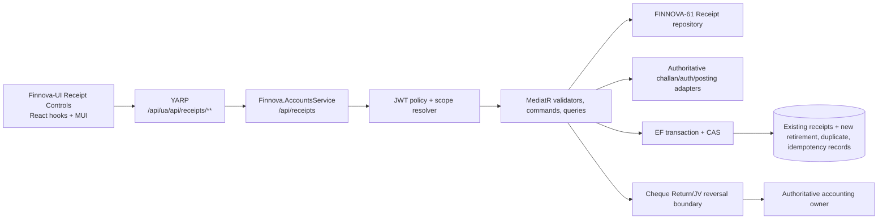

# Design Document: Receipt Processing Controls

**Jira:** FINNOVA-64  
**Feature slug:** `receipt-processing-controls`  
**Backend repository:** `E:\Finnova\Finnova-API`  
**Frontend repository:** `E:\Finnova\Finnova-UI\Finnova-UI`  
**Authoritative requirements:** `requirements.md` in this directory  
**Prerequisites:** FINNOVA-61 `receipt-processing`; FINNOVA-63 `receipt-authorization-inter-branch-accounting`

## Overview

FINNOVA-64 adds controlled correction, cancellation, document retirement, accounting-boundary coordination, and duplicate reprinting to the FINNOVA-61 Receipt Aggregate. The feature is a control layer over one authoritative receipt record. It does not create a second `Receipt` entity, receipt table, receipt-number sequence, authorization model, canonical journal model, or UI authentication store.

A Branch Supervisor can modify or cancel an eligible unauthorized receipt only when the server confirms role and organizational scope, the receipt has no authoritative challan relationship, the supplied Receipt Version still matches, and the request is idempotency-safe. Challaned and authorized receipts remain immutable through these operations. Authorized financial corrections use the confirmed Cheque Return or JV Posting Engine reversal boundary. Cancellation writes the cancelled state, audit entry, retirement tombstone, and required reversal-request identity as one durable outcome. A reprint is allowed only for an authoritative Printed Receipt that satisfies the confirmed print rules; the server atomically assigns the next duplicate copy number, increments `DuplicationCount`, persists a duplicate-copy record, and renders the exact English title and watermark `DUPLICATE RECEIPT`.

The backend remains authoritative for state, scope, actor identity, version checks, document-number retirement, accounting effects, duplicate numbering, and audit. The UI reflects returned permissions and statuses, but client-side disabled controls never replace server enforcement.

## Compatibility gate and implementation posture

The current investigation found no executable FINNOVA-61 Receipt Aggregate, FINNOVA-63 authorization/posting contract, receipt-specific audit store, challan relationship, receipt print endpoint, or receipt gateway route. The existing receipt specifications are unchecked planning artifacts. The implementation tasks therefore begin with a hard compatibility gate:

1. FINNOVA-61 must provide the authoritative `Receipt` type, child details, `Id`, document-number fields, branch/company/LOB ownership, creator metadata, mutable-field contract, current status, persisted concurrency token, and receipt read route.
2. FINNOVA-63 must provide the authoritative authorization decision, posting state, posting/accrual source links, print eligibility/first-print state, and approved JVE submission or Cheque Return boundary.
3. The implementer must bind the FINNOVA-64 adapters to those confirmed types and paths before copying any later task. A missing or incompatible contract must fail closed and stop the sequence. No guessed substitute fields may be introduced.
4. The expected compatibility shape is documented below so the gate can compare the delivered FINNOVA-61/63 contracts against a known target. If the final contract uses different names, update the task's exact insertion snippet to the final agreed names before applying it.

The design intentionally does not claim that generic DCN sequence issuance, generic `DocumentAuditEntry`, generic `JvPostingInbox`, generic `ChallanRule`, or generic PDF export already satisfies receipt behavior. Those assets are reusable only through explicit adapters and ownership checks.

## Scope and non-goals

### In scope

- Eligibility summary and permission decisions for one receipt.
- Modification of the final FINNOVA-61-approved mutable fields while the receipt is eligible and unauthorized.
- Supervisor cancellation with mandatory trimmed English reason.
- Immutable receipt audit entries and immutable document-retirement tombstones.
- Permanent reuse prevention for online and manual document numbers.
- Prior-accrual detection through the authoritative accounting contract and one idempotent reversal request.
- Reprint of an authoritative Printed Receipt with duplicate title, watermark, copy number, counter, audit, and idempotency.
- Optimistic concurrency, database uniqueness, atomic transactions, and deterministic retry behavior.
- AccountsService API, middleware mapping, authorization policies, YARP alias, UI service toggle, page, controls, navigation, and automated tests.

### Non-goals

- Creating or replacing FINNOVA-61 receipt capture, numbering, customer, account-line, or ordinary read behavior.
- Reimplementing FINNOVA-63 maker-checker authorization, posting, Cashflow Master, GL Master, canonical journals, or JVE worker behavior.
- Direct writes to canonical journal headers, journal lines, balances, or reversal journals.
- Inferring challan, accrual, posting, or print state from client input, free text, browser preview, or a generic status alone.
- Reusing a cancelled document number, reopening a cancelled receipt, or deleting audit/tombstone history.
- Foreign currency, bilingual data, Arabic/non-English localization, RTL layout, Redux, RxJS, or a second axios/authentication client.
- Running builds, tests, migrations, or source implementation as part of this design deliverable.

## Reused versus new assets

| Area | Reused after compatibility gate | New for FINNOVA-64 |
|---|---|---|
| Receipt | FINNOVA-61 `Receipt` Aggregate, lines, snapshots, document identity, existing row-version, status/read contract | Control-owned fields added to that aggregate only where not already supplied: cancellation metadata, accrual/reversal projection, duplicate count, and duplicate-print timestamp |
| Authorization/posting | FINNOVA-63 authorization decision, posting status, source-link identity, print eligibility, approved JVE/Cheque Return boundary | Thin adapters and control-specific reversal request mapping; no duplicate authorization or journal model |
| Audit | FINNOVA-61 receipt audit relationship and append-only repository pattern | `Modify`, `Cancel`, and `Reprint` operation context, before/after JSON, retirement/reversal references if not present in the authoritative audit contract |
| Numbering | FINNOVA-61/DCN issuance for ordinary numbers | `ReceiptDocumentRetirement` immutable tombstone and atomic active-plus-retired uniqueness check |
| Backend host | `Finnova.AccountsService`, MediatR, FluentValidation, EF Core, `IApplicationUnitOfWork`, JWT | Receipt-control commands, queries, ports, repositories, controller, policies, error family, and migration |
| Errors | Existing RFC 7807 middleware shape and correlation ID | `ERR-RCC-*` mapping with stable control rules |
| Gateway | YARP `accounts-cluster` and existing `/api/ua/api/**` alias convention | `/api/ua/api/receipts` root and catch-all alias to AccountsService |
| UI | React 18, TypeScript, MUI, Data Grid, hooks, shared `src/services/api.ts`, existing service toggle convention | Receipt-control model, interface, real/mock services, page/components, route, navigation, and Vitest/RTL tests |
| Testing | xUnit, FsCheck.Xunit, Moq, EF test support, WebApplicationFactory, Vitest, RTL | FINNOVA-64 scenario, concurrency, security, accounting, print, and UI tests |

## Architecture

### Architecture and data flow



### Control summary flow

The controller derives the actor from the validated JWT and passes only the actor identity and correlation ID to MediatR. The query loads the receipt through the FINNOVA-61 read contract, resolves challan, authorization, posting/accrual, print, and scope facts through authoritative adapters, and returns a safe summary. Scope is applied before disclosure. The response contains server-calculated `availableActions`, not client-calculated authority.

### Modification flow

The validator checks the receipt ID, expected Receipt Version, Idempotency Key, request shape, and only the final FINNOVA-61 mutable-field contract. The handler reloads a tracked receipt, verifies scope and state, rechecks challan and authorization facts, and computes a before/after change set. One transaction uses a compare-and-set predicate on receipt ID and the expected row-version. It updates only approved fields, preserves identity/document/creation/accounting fields, increments the existing row-version, appends exactly one immutable `Modify` audit entry, stores the idempotency outcome, and commits. No journal or reversal request is created.

### Cancellation flow

The handler trims and validates the English reason, checks scope, verifies eligible unauthorized state and absence of challan, obtains the authoritative accrual fact, and resolves whether a reversal is required. If a reversal is required, the confirmed boundary must durably accept one immutable request before successful cancellation is reported. The database transaction then CAS-updates the receipt to `Cancelled`, preserves the document number, records actor/time/reason, appends one `Cancel` audit entry, creates one immutable `ReceiptDocumentRetirement`, persists the reversal reference or `NoReversalRequired` outcome, stores idempotency response data, and commits. If the boundary cannot durably accept the required request, the pre-cancellation state remains unchanged unless the confirmed contract explicitly supplies a durable `CancellationPending` state.

### Reprint flow

The handler checks authorization scope and the authoritative Printed Receipt/print-eligibility state. A cancelled, unposted, unprinted, out-of-scope, or otherwise ineligible receipt is rejected before changing print state. Within one transaction, it resolves the idempotency key, atomically increments the Receipt Aggregate's duplicate counter, creates the next `ReceiptDuplicateCopy` with a unique `(ReceiptId, DuplicateCopyNumber)` key, renders or stores one print-ready output descriptor, appends one `Reprint` audit entry, and commits. The returned output keeps the original Document Number and contains `DUPLICATE RECEIPT`, the same repeated watermark, `Duplicate Copy No: N`, `DuplicationCount`, and UTC print time.

## Requirements coverage map

| Requirements | Design coverage |
|---|---|
| 1.1-1.9 Eligibility | Control summary query, trusted JWT/scope adapter, challan/authorization gates, safe not-found/out-of-scope responses |
| 2.1-2.10 Protection | Server-side challan/authorized conflict rules, unchanged-state guarantees, UI disable/warning/instruction behavior |
| 3.1-3.14 Modification | Mutable-field allow-list, receipt CAS, exact audit change set, no accounting side effects, UI replacement/error preservation |
| 4.1-4.13 Cancellation | Reason validation, cancelled transition, actor/time, one audit/tombstone, atomic transaction, idempotent replay, UI state refresh |
| 5.1-5.8 Retirement | Immutable tombstone, active-plus-retired uniqueness, online/manual issuance adapter, history query, no update/delete API |
| 6.1-6.15 Reversal | Accrual adapter, one idempotent Reversal Request, required payload, no-reversal outcome, boundary-only canonical journal authority, UI outcomes |
| 7.1-7.16 Reprint | Printed-state gate, exact title/watermark, atomic sequential duplicate copy and counter, output/audit contract, UI preview/error behavior |
| 8.1-8.11 Concurrency/idempotency | Row-version CAS, unique keys, operation hash, atomic counter, rollback, timeout replay, payload mismatch conflict |
| 9.1-9.16 Security/audit | JWT-first policy, role/scope checks, actor derivation, append-only repositories, no mutation endpoints, shared UI auth behavior |
| 10.1-10.18 API | AccountsService routes, gateway alias, request/response records, stable Problem Details, descending audit order, no audit/tombstone mutation endpoints |
| 11.1-11.25 UI | Detail/list/edit/cancel/reprint controls, server permissions, reason/version/idempotency payloads, MUI/hooks/shared axios/mock parity, English-only behavior |

## Compatibility contract expected from FINNOVA-61 and FINNOVA-63

The following is an integration contract, not a new local model. The gate must bind these names to the final delivered contracts or record the approved mapping before tasks continue.

### FINNOVA-61 Receipt Aggregate facts

The authoritative aggregate must expose `Id`, `DocNo`/Document Number, numbering mode and scope, `CompanyId`, `LineOfBusinessId`, `BranchId`, `ValueDate`, `DocAmount`, creator identity, creation/update timestamps, current receipt status, child receipt details, and a database concurrency token. It must expose or durably relate the challan identifier, receipt audit relationship, and ordinary receipt read path. FINNOVA-64 uses the existing row-version as the Receipt Version and serializes it as an opaque base64 string; it does not add a competing integer version.

### FINNOVA-63 authorization/accounting facts

The authoritative contract must expose separate authorization and posting state, authorization actor/time, posting request/source-link identity, canonical journal reference when posted, and the approved accounting boundary:

```csharp
public interface IReceiptAccountingBoundary
{
    Task<ReceiptAccrualFact> GetAccrualAsync(Guid receiptId, CancellationToken cancellationToken);
    Task<ReversalAcceptance> AcceptReversalAsync(ReceiptReversalRequest request, CancellationToken cancellationToken);
}

public sealed record ReceiptAccrualFact(
    bool HasAccrual, string? SourceLink, decimal? Amount, DateOnly? ValueDate,
    Guid? PostingRequestId, string? CurrencyCode);

public sealed record ReceiptReversalRequest(
    Guid IdempotencyKey, Guid ReceiptId, string DocumentNumber, string SourceLink,
    decimal Amount, string CurrencyCode, DateOnly ValueDate, Guid CollectionBranchId,
    string ActorId, DateTime CancellationAtUtc, string CancellationReason);

public sealed record ReversalAcceptance(
    bool Accepted, Guid? ReversalRequestId, string? SourceLink,
    string? StatusCode, string? EnglishMessage);
```

The actual FINNOVA-63/JVE types remain authoritative. This shape only states the minimum facts FINNOVA-64 requires. If FINNOVA-63 owns the reversal request transactionally in an inbox, the adapter returns that durable identity; FINNOVA-64 never inserts canonical journal rows.

## Data Models

### Existing Receipt Aggregate extensions

The implementation modifies the FINNOVA-61 `Receipt` class only after the gate. Fields already owned by FINNOVA-61/63 are reused. FINNOVA-64-owned fields are limited to the following when the gate confirms they are absent:

| Field | Type | Invariant |
|---|---|---|
| `CancellationReason` | `nvarchar(500)` nullable | Set once, trimmed English text, only on successful cancellation |
| `CancelledBy` | `nvarchar(200)` nullable | Derived from JWT, never request body |
| `CancelledAtUtc` | `datetime2` nullable | UTC, set once with cancellation |
| `AccrualOutcome` | string enum/text | `ReversalRequired`, `NoReversalRequired`, or confirmed pending state |
| `ReversalRequestId` | `Guid?` | Set only to the accepted authoritative request |
| `ReversalSourceLink` | `nvarchar(200)` nullable | Set only from the accounting boundary |
| `DuplicationCount` | `int` | Non-negative; increments only after one committed duplicate output |
| `LastDuplicatePrintedAtUtc` | `datetime2` nullable | UTC timestamp of the latest committed duplicate |

The receipt's existing row-version is the Receipt Version. `Cancelled` is a terminal operational state for FINNOVA-64. Document Number, numbering scope, creation metadata, authorization decision, and existing accounting links are immutable through modification.

### `ReceiptDocumentRetirement`

A new feature-owned immutable entity is allowed because it is a tombstone owned by the Receipt Aggregate boundary, not a parallel receipt. It contains `Id`, `ReceiptId`, `DocumentNumber`, `NumberingMode`, `NumberingScopeKey`, `ReceiptType`, `RetiredBy`, `RetiredAtUtc`, `CancellationReason`, and a unique key on `(NumberingScopeKey, NormalizedDocumentNumber)`. It has no update or delete repository method. The cancellation transaction creates exactly one row.

### `ReceiptDuplicateCopy`

A new child/history entity contains `Id`, `ReceiptId`, `DocumentNumber`, `DuplicateCopyNumber`, `DuplicationCountAfter`, `OutputTitle`, `WatermarkText`, `OutputReference` or approved document bytes/reference, `PrintedBy`, `PrintedAtUtc`, and `IdempotencyKey`. Unique keys are `(ReceiptId, DuplicateCopyNumber)` and `(ReceiptId, IdempotencyKey)`. `OutputTitle` and `WatermarkText` must equal `DUPLICATE RECEIPT`; `DuplicateCopyNumber` starts at 1.

### `ReceiptControlOperation`

A new idempotency entity contains `Id`, `IdempotencyKey`, `ReceiptId`, `Operation`, `RequestHash`, `ResponseSnapshot`, `CreatedAtUtc`, `CompletedAtUtc`, and a unique key on `(IdempotencyKey)`. The service returns the stored response for an equivalent completed request and returns `IDEMPOTENCY_CONFLICT` for a different receipt or payload.

### Receipt audit

The existing FINNOVA-61 append-only `ReceiptAuditEntry` is extended only if its final contract lacks `Operation`, prior/new status, actor, reason, before/after values, retirement reference, reversal reference, duplicate-copy number, and correlation data. No `Update` or `Delete` method is added. Audit retrieval orders by `OccurredAtUtc DESC`, then `Id DESC`.

### Invariants

1. One authoritative Receipt Aggregate exists for each receipt; no parallel receipt table or API exists.
2. A Receipt Version CAS permits at most one modification or cancellation for one reviewed version.
3. A cancelled document number remains unavailable in its numbering scope for both online and manual creation.
4. A successful cancellation has one cancellation audit entry and one retirement tombstone.
5. A prior accrual produces one accepted reversal request; no prior accrual produces no reversal request and an explicit no-reversal outcome.
6. A successful duplicate has one history row, one audit entry, one increment, and one sequential copy number.
7. Equivalent idempotent retries do not create new state transitions, audits, tombstones, reversal requests, or duplicate outputs.
8. Unauthorized callers cannot learn protected receipt details or alter any state.
9. All monetary values are INR with two fractional digits; technical timestamps are UTC; all display text is English-only.

## API contracts, routes, and gateway

The host remains `Finnova.AccountsService` and the controller route remains `api/receipts`. The UI reaches it through both the existing direct Accounts route and the UI-facing alias:

- `GET /api/receipts/{receiptId}/control-summary`
- `GET /api/receipts/{receiptId}/audit`
- `PATCH /api/receipts/{receiptId}/control` with `expectedReceiptVersion` and `idempotencyKey`
- `POST /api/receipts/{receiptId}/cancel` with `expectedReceiptVersion`, `idempotencyKey`, and `cancellationReason`
- `POST /api/receipts/{receiptId}/reprint` with `idempotencyKey`
- `GET /api/receipts/{receiptId}/duplicate-copies`
- `GET /api/ua/api/receipts/{**catch-all}` and `/api/ua/api/receipts` YARP aliases to the Accounts cluster, removing `/api/ua/api` and adding `/api`

The internal accounting callback, if FINNOVA-63 requires one, is not exposed through the UI alias.

### Request/response shape

The final C# records must be bound to the confirmed FINNOVA-61/63 types before copying. The minimum control records are:

```csharp
public sealed record ReceiptControlSummaryResponse(
    Guid ReceiptId, string DocumentNumber, string ReceiptStatus, string AuthorizationStatus,
    bool IsChallaned, string? ChallanReference, bool IsPrinted, int DuplicationCount,
    string ReceiptVersion, Guid CollectionBranchId, string CollectionBranchCode,
    IReadOnlyList<string> AvailableActions, bool CanModify, bool CanCancel, bool CanReprint,
    bool RequiresAccountingReversal, string? AccountingCorrectionInstruction);

public sealed record ModifyReceiptControlRequest(
    string ExpectedReceiptVersion, Guid IdempotencyKey,
    IReadOnlyDictionary<string, string?> MutableFields);

public sealed record CancelReceiptRequest(
    string ExpectedReceiptVersion, Guid IdempotencyKey, string CancellationReason);

public sealed record DuplicateReceiptOutputResponse(
    Guid ReceiptId, string DocumentNumber, string OutputTitle, string WatermarkText,
    int DuplicateCopyNumber, int DuplicationCount, DateTime PrintedAtUtc,
    string OutputReference);
```

No request contains actor ID, role, scope, authorization decision, challan state, accrual state, or document number. The backend derives those facts. All errors use the existing `ProblemDetails` JSON shape with `code`, `message`, `correlationId`, and stable `rule` where applicable.

## Components and interfaces

### Backend domain and ports

- `ReceiptControlEnums.cs`: operation, accrual outcome, and duplicate-output state values not already owned by FINNOVA-61/63.
- `ReceiptControlEntities.cs`: `ReceiptDocumentRetirement`, `ReceiptDuplicateCopy`, and `ReceiptControlOperation` only.
- `ReceiptControlExceptions.cs`: typed `ERR-RCC-400`, `404`, `403`, `409`, `422`, `503`, and `500` family with rules for challan protection, authorized protection, stale version, retirement conflict, accounting failure, immutability, and idempotency.
- `IReceiptControlRepository`: tracked control load, CAS mutation, retirement existence, duplicate allocation, operation lookup, and append-only audit methods. Repository methods never save independently.
- `IReceiptControlAuthorizationPort`: trusted role/scope and actor lookup.
- `IReceiptChallanPort`: authoritative receipt-to-challan lookup.
- `IReceiptAccountingBoundary`: the FINNOVA-63/JVE/Cheque Return adapter defined by the compatibility gate.
- `IReceiptPrintPort`: authoritative printed-state/eligibility lookup and approved PDF or print-ready output renderer.
- Pure helpers: `ReceiptControlRules`, `ReceiptCancellationRules`, `ReceiptReversalRules`, `DuplicateReceiptOutputRules`, and `ReceiptControlHashing`.

### CQRS

Commands: `ModifyReceiptControlCommand`, `CancelReceiptCommand`, `ReprintReceiptCommand`. Queries: `GetReceiptControlSummaryQuery`, `GetReceiptAuditQuery`, `GetDuplicateCopiesQuery`. Validators handle shape and required fields. Handlers perform authoritative scope/state checks and transactions. `ReceiptControlMapper` maps only safe response data.

### Host and middleware

`ReceiptsController` adds explicit actions and policies such as `ReceiptControlRead`, `ReceiptControlModify`, `ReceiptControlCancel`, and `ReceiptControlReprint` after exact role names are confirmed. `Program.cs` registers the policies without granting callback access to browsers. `ExceptionHandlingMiddleware` adds the typed control branch. `Finnova.ApiGateway/appsettings.json` adds root and catch-all receipt aliases using the existing transform convention.

### Frontend

The feature follows the repository's actual pattern:

- `src/models/receiptControl.model.ts` and `src/models/index.ts` barrel export.
- `src/services/interfaces/receiptControl.interface.ts`.
- `src/services/real/receiptControl.real.ts` using the shared `api` instance.
- `src/services/mock/receiptControl.mock.ts` with the same stable error shape, transitions, duplicate output, and English data.
- `src/services/receiptControl.service.ts` selecting mock versus real with `VITE_USE_MOCK_API`.
- `src/services/index.ts` export.
- `src/pages/ReceiptControl.tsx`, with MUI detail/list, edit form, cancellation dialog, audit/retirement panel, and duplicate print preview.
- `src/components/receiptControl/*` for status, edit, cancellation, audit, and output components.
- `/receipt-controls/:receiptId` and `/receipt-controls` routes in `App.tsx`; Operations/Finance navigation entry in `Layout.tsx`.

The UI displays server-provided actions and versions, disables unsafe actions, requires a non-whitespace reason, creates a fresh UUID for each operation, preserves displayed state on errors, and shows exact duplicate text. It introduces no Redux, RxJS, RTL, localization framework, or non-English values.

## Authorization and security

JWT authentication runs before policy authorization. Missing, expired, malformed, and invalid-signature tokens return 401 without disclosure or mutation. Role policies run before handler data access. Scope is resolved from trusted user/branch/company/LOB assignments and the receipt's authoritative ownership, never from request-body values. The acting user for audit, cancellation, modification, and reprint comes from the validated JWT claim selected by the platform convention.

Challan, authorization, posting/accrual, and print state are read from authoritative adapters. The backend rechecks all control gates inside the transaction to prevent a stale UI summary from bypassing protection. Audit and output responses exclude bearer tokens, secrets, unnecessary contacts, and raw accounting payloads. Logs contain correlation IDs and stable codes, not full instrument numbers or sensitive account data. Audit and retirement records are append-only with no public mutation endpoints.

## Error handling

| Condition | HTTP | Code/rule |
|---|---:|---|
| Missing/invalid request shape | 400 | `ERR-RCC-400`, field details |
| Missing receipt | 404 | `ERR-RCC-404` |
| Missing role or scope | 403 | `ERR-RCC-403`, `SCOPE_DENIED` |
| Challaned direct edit/cancel | 409 | `CHALLAN_PROTECTED` |
| Authorized direct edit/cancel | 409 | `AUTHORIZED_RECEIPT_PROTECTED` |
| Cancelled/printed/ineligible state | 409 or 422 | `INVALID_RECEIPT_STATE` / `PRINT_NOT_ELIGIBLE` |
| Stale Receipt Version | 409 | `RECEIPT_VERSION_CONFLICT` |
| Reused key with different payload | 409 | `IDEMPOTENCY_CONFLICT` |
| Retired number collision | 409 | `DOCUMENT_NUMBER_RETIRED` |
| Immutable audit/tombstone mutation | 409 | `IMMUTABLE_RECORD` |
| Accounting boundary cannot accept required reversal | 503 or confirmed pending status | `ACCOUNTING_REVERSAL_UNAVAILABLE` |
| Unexpected exception | 500 | `ERR-RCC-500` and generic English message |

Validation, authorization, state checks, and dependency checks occur before any mutation. Failed requests preserve the current Receipt, version, audit, tombstone, reversal, duplicate count, and accounting links. Shared axios displays the returned English message and preserves the page state.

## Transaction, concurrency, idempotency, and accounting boundary

Modification and cancellation use a tracked receipt plus a database compare-and-set predicate on receipt ID, expected row-version, and eligible state. The losing concurrent operation receives a conflict and writes no success audit. The cancellation transaction includes the receipt state, metadata, audit, retirement tombstone, reversal-request identity/outcome, and idempotency snapshot. A reversal boundary that is remote and non-transactional is not acceptable; it must provide a durable inbox or same-database transaction before cancellation success is returned.

Reprint uses a database-side atomic counter update or serializable transaction and unique `(ReceiptId, DuplicateCopyNumber)`. Different keys receive distinct sequential numbers. The same key and equivalent request returns the original output; a different payload conflicts. A transaction failure rolls back counter, duplicate row, audit, and idempotency snapshot. Timeout recovery queries the idempotency record instead of issuing another operation.

The Receipt_Control_Service never creates a canonical reversal journal. When a prior accrual exists, it submits one `ReceiptReversalRequest` containing Receipt ID, Document Number, source link, amount, INR, value date, collection branch, JWT actor, UTC cancellation time, reason, and idempotency key. When no accrual exists, it stores `NoReversalRequired`. The approved accounting boundary owns canonical reversal creation and returns the durable request/source identity.

## Duplicate PDF/print behavior

The first regular print remains owned by FINNOVA-61/63 and is the only event that establishes authoritative Printed Receipt state. FINNOVA-64 reprint is a separate output. Every successful duplicate output has exact title `DUPLICATE RECEIPT`, a prominent repeated watermark with the exact same text, the original Document Number, `Duplicate Copy No: N`, the post-operation `DuplicationCount`, and UTC print timestamp. The renderer must not silently convert a browser preview into a production print or alter the original receipt identity. A cancelled receipt cannot be reprinted unless the confirmed print contract explicitly permits it; the default design rejects it.

## Correctness properties

*A property is a characteristic or behavior that should hold true across all valid executions of a system, essentially a formal statement about what the system should do. Properties bridge human-readable specifications and machine-verifiable guarantees.*

The prework classified persistence, authorization, gateway, external accounting, PDF rendering, and UI criteria as example or integration tests. Property reflection consolidated overlapping pure logic into the following four properties; each property has one FsCheck test with at least 100 iterations.

### Property 1: Approved modification preserves immutable receipt identity

For any valid FINNOVA-61 receipt and any change set containing only approved mutable fields, applying the change set preserves Receipt ID, Document Number, numbering mode/scope, creation metadata, authorization decision, and accounting links, while changing only the approved fields and increasing the Receipt Version exactly once.

**Validates: Requirements 3.1, 3.2, 3.3, 3.4, 3.5, 3.6**

### Property 2: Cancellation retirement is one-way and idempotent

For any eligible receipt and any non-whitespace English reason, normalizing and applying cancellation once yields `Cancelled` plus one retirement outcome, and applying the equivalent idempotent operation again yields the same result without a second audit entry, retirement record, or state transition.

**Validates: Requirements 4.1, 4.2, 4.4, 4.5, 4.6, 4.7, 4.10, 4.11, 5.1, 5.7**

### Property 3: Accrual determines one reversal request or no reversal

For any valid receipt accounting fact, the reversal decision is deterministic: a prior accrual produces exactly one stable reversal request identity derived from the Receipt and idempotency key, while no prior accrual produces no reversal request and an explicit `NoReversalRequired` outcome; retrying the same key does not change that result.

**Validates: Requirements 6.1, 6.3, 6.4, 6.5, 6.6, 6.7, 6.10**

### Property 4: Duplicate output numbering and markers remain consistent

For any non-negative committed duplicate count and any successful duplicate allocation, the assigned copy number is the prior count plus one, the returned count equals the assigned number, the original Document Number is preserved, and both output title and watermark equal `DUPLICATE RECEIPT`; repeated equivalent allocation with the same key returns the same output.

**Validates: Requirements 7.1, 7.2, 7.3, 7.4, 7.5, 7.6, 7.7, 7.8, 7.9, 7.10, 8.5, 8.6, 8.7, 8.8, 8.11**

## Testing strategy

### Backend

- xUnit facts/theories cover every Jira scenario: challaned `REC-205` lockout and warning; pending-authorization supervisor cancellation of `REC-302`; cancellation actor/time/reason/tombstone and permanent number reuse prevention; prior-accrual reversal and no-accrual path; authorized direct-operation rejection and correction instruction; first and later duplicate print output; exact title/watermark/copy number; error-state preservation.
- FsCheck.Xunit tests implement Properties 1-4 with a minimum of 100 iterations per property and comments in the required form: `Feature: receipt-processing-controls, Property N: ...`.
- xUnit with Moq/EF test support covers validation, immutable fields, stale version, malformed/missing JWT, scope, role, idempotency payload mismatch, audit ordering, append-only behavior, retirement uniqueness, accounting boundary rejection, no direct journal writes, and rollback.
- `WebApplicationFactory<Program>` covers host registration, policy authentication (401/403), controller routes, problem details, gateway-facing URL composition, server-side enforcement, persistence behavior, and concurrent/retry examples. Tests for the FINNOVA-61/63 adapters fail closed when contracts are absent or incompatible.
- Integration tests use the final approved accounting/JVE contract and verify exactly one durable reversal request, no duplicate canonical journal, and no completed cancellation when required acceptance fails. No test treats generic DCN, generic JVE, generic challan-rule, or generic audit behavior as receipt proof.

### Frontend

- Vitest + React Testing Library covers summary fields, challan warning/disabled Edit and Cancel, authorized warning and correction instruction, pending-authorization supervisor Edit/Cancel, whitespace reason rejection, successful cancellation and retirement display, server-version display, first/later reprint title/watermark/copy number, and ordinary print lock after cancellation.
- Service tests verify shared axios paths/payloads, JWT/error behavior, mock/real parity, fresh idempotency keys, exact output fields, stable problem shape, and state preservation after 400/403/409/422/503 errors.
- Route/navigation tests cover `/receipt-controls`, `/receipt-controls/:receiptId`, the Operations/Finance menu entry, and no Redux/RxJS/RTL/non-English localization additions.

## Design decisions and tradeoffs

| Decision | Alternative | Reason |
|---|---|---|
| Extend one FINNOVA-61 Receipt Aggregate | Create a FINNOVA-64 Receipt table | Avoids divergent identity, status, number, and accounting facts; explicitly required by D1. |
| Use existing row-version as Receipt Version | Add an integer version beside row-version | Avoids two concurrency authorities and maps naturally to EF CAS. |
| Tombstone document numbers | Delete or only advance DCN sequence | Tombstones cover manual numbers and prove permanent reuse prevention. |
| Boundary-owned reversal | Insert a local reversal journal | Preserves accounting ownership, balances, source links, and idempotency in FINNOVA-63/JVE. |
| Persist duplicate-copy history | Only increment a counter | History, audit, copy-number uniqueness, and idempotent replay need a durable row. |
| Server-provided available actions | Recompute permissions in React | The server owns trusted identity, scope, and state. |
| Exact English duplicate markers | Localized or configurable title | The requirements require exact text and product context is English-only. |
| Fail closed at dependency gate | Guess missing FINNOVA-61/63 fields | Planning-only dependencies make guessed code unsafe and incompatible. |

## Implementation-ordered task list

The tasks file uses the same sequence. Each step is a copy/paste task or an explicit compatibility-gated modification; no source is changed during this specification phase.

1. Compatibility gate and binding notes for the final FINNOVA-61 Receipt and FINNOVA-63 authorization/accounting/print contracts.
2. Backend control enums, immutable entities, exceptions, and pure rules.
3. FINNOVA-61 Receipt/Audit modifications for only the confirmed control-owned fields.
4. Backend request/response contracts and authoritative adapter interfaces.
5. EF configurations, Receipt DbSets, indexes, migration command, and repository transaction primitives.
6. Backend repositories and DI registrations, including fail-closed dependency adapters.
7. CQRS validators, commands, queries, mappers, and handlers for summary, modify, cancel, audit, and reprint.
8. AccountsService policies, controller, middleware, and YARP receipt aliases.
9. Backend xUnit/FsCheck/WebApplicationFactory tests and compatibility contract tests.
10. Frontend model, service interface, real service, mock service, toggle, and barrels.
11. Frontend MUI components/page, routes, navigation, and error/print behavior.
12. Frontend Vitest/RTL tests.
13. Later verification commands and migration application notes for the user; no commands are run by this workflow.
