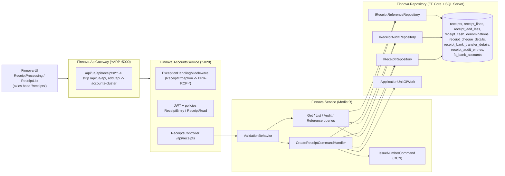
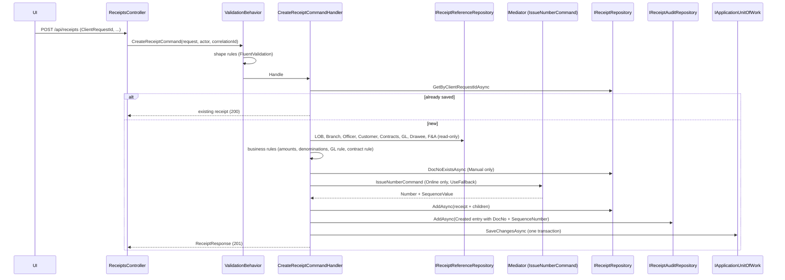

# Design Document: Receipt Processing

**JIRA:** FINNOVA-61 · **FRS:** Sections 1.6 and 1.13 · **Module:** Accounts / Operations · **Spec:** `receipt-processing`
**Related features:** `application-account-creation` (Loan Account = contract), `customer-master`, `document-number-control-master` (DCN issuance), `drawee-bank-challan-rules-master` (Drawee Bank), `gl-master-management` (GL validation), `jv-posting-engine` (follow-up posting target).

## Overview

Receipt Processing is a transactional capture feature. A Cashier or Branch Collection Officer enters a receipt of one of three types (Temporary, Regular, Third-Party) in one of three modes (Cash, Cheque, Bank Transfer), allocates the amount to live loan accounts of the selected customer, optionally applies Add/Less adjustments, and saves it. Save issues a Document Number from the existing Document Number Control (DCN) module, stores the receipt with status Pending Authorization, and writes an audit entry that contains the sequence number.

The design delivers the capture slice only. Authorize, Revoke, and the submission to the JV Posting Engine are a follow-up (Assumption A2). To make that follow-up cheap and deterministic, Save resolves and stores the credit GL account of every line (the GL entered on the line when GL Based is Yes, otherwise the Customer GL account) and stores the Bank Transfer GL/SL snapshot.

The backend is one vertical slice in `Finnova.AccountsService` (route `api/receipts`). The UI is a "Receipt Processing" create page and a receipt list/view page in Finnova-UI, built on the repository's service-layer pattern (interface, mock, real, toggle).

### Localization

India-only, English-only. Currency is INR with two decimals. Denominations follow Indian currency. Amounts in words use the Indian numbering system (Crore, Lakh). No bilingual fields, no RTL. The Oman-specific references in the Jira story are recorded as Assumption A1 for confirmation.

### What already exists and is reused

| Concern | Existing asset | Use in this feature |
| --- | --- | --- |
| Host | `Finnova.AccountsService` (:5020), `public partial class Program {}` | New `ReceiptsController`; no new host |
| AuthN/AuthZ | JWT Bearer, role claim type, named policies in `Program.cs` | Two new policies `ReceiptEntry`, `ReceiptRead` |
| Errors | `Finnova.AccountsService.Middlewares.ExceptionHandlingMiddleware` (RFC 7807 with `code`, `message`, `correlationId`) | New `ReceiptException` branch and `ERR-RCP-*` codes |
| Mediation | MediatR + `ValidationBehavior<,>` + FluentValidation assembly scan | New commands and queries are picked up automatically |
| Numbering | `IssueNumberCommand(... UseFallback: true)` with `NumberingScheme`, `SchemeResolver`, `NumberFormatter` | Issues the Online Document Number and the Sequence Number |
| Contract | `LoanAccount` (`AccountNumber`, `CustomerId`, `Status`, `ClosedAt`) | Contract validation (live and owned by the customer) |
| Customer | `Customer` (`CustomerCode`, `CompanyId`, `GLAccountId`, `Addresses`, name fields) | Customer snapshot, GL for GL Based = No, contact display |
| GL | `GLAccount` (`Status`, `AuthorizedVersionNumber`, `IsPostable`, `CompanyId`) | Validation of GL codes; same criteria as `GetActiveApprovedPostableByCompanyAndCodeAsync` |
| Masters | `LineOfBusiness`, `Location` (Level 5 = Branch), `UserAccount`, `LookupValue`, `DraweeBank` / `DraweeBranch` | Header validation and dropdowns |
| Unit of work | `IApplicationUnitOfWork` (Add methods do not save; the caller saves once) | Atomic save of receipt, children, and audit |
| Audit pattern | `AccountAuditEntry` / `IAccountAuditRepository` (Add-only) | Pattern for `ReceiptAuditEntry` |
| Contracts | `PaginatedResponse<T>`, `LineOfBusinessRefResponse`, `ApplicationReferenceOptionResponse`, `LookupDropdownItemResponse` | Reused as response types |
| Gateway | YARP, `ua-loan-accounts-alias-*` routes | Two new alias routes for `receipts` |
| Tests | xUnit, FsCheck.Xunit, Moq, EF InMemory, `LoanAccountsApiFactory`, `LoanAccountTestData` | Extended |
| UI | axios `api` instance, `VITE_USE_MOCK_API` toggle, MUI, `PaginatedResponse<T>` model | Same service-layer pattern as `demandProcessing.service.ts` |

### What is new

- Entities: `Receipt` aggregate (`ReceiptLine`, `ReceiptAddLess`, `ReceiptCashDenomination`, `ReceiptChequeDetail`, `ReceiptBankTransferDetail`), `ReceiptAuditEntry`, and the minimal `FaBankAccount` (Assumption A8).
- Enums: `ReceiptType`, `ReceiptMode`, `ReceiptEntryMode`, `ReceiptStatus`, `ReceiptFrom`, `AddLessKind`, `DenominationKind`.
- Pure helpers: `ReceiptCalculator`, `AmountInWords`, `CashDenominationCatalog`, `ReceiptMessages`.
- Exceptions: `ReceiptException` family with `ERR-RCP-*` codes and rule keys.
- Repositories: `IReceiptRepository`, `IReceiptAuditRepository`, `IReceiptReferenceRepository`.
- Service slice: `CreateReceiptCommand`, `GetReceiptByIdQuery`, `GetReceiptsPagedQuery`, `GetReceiptAuditTrailQuery`, and the reference queries.
- Host: `ReceiptsController`, two policies, middleware branch, two gateway routes, two roles in `AppRoleCatalog`.
- UI: models, `receipt.service` (interface, mock, real, toggle), helpers, `ReceiptProcessing` page, `ReceiptList` page, route and menu entries.

## Requirements Coverage Map

| Requirement | Covered by |
| --- | --- |
| R1 Receipt types, TR Ref No | `ReceiptType` enum; `CreateReceiptCommandValidator` (TR Ref rules, Third-Party vs Receipt From); UI `showTrRef` rule |
| R2 Save, Doc No, status, idempotency | `CreateReceiptCommandHandler` (step order below); `IssueNumberCommand`; unique indexes on `ClientRequestId` and `(ReceiptType, DocNo)`; `IApplicationUnitOfWork` single save |
| R3 Header and references | Validator + `IReceiptReferenceRepository.GetActive*` + snapshot columns |
| R4 Cash and denominations | `CashDenominationCatalog`, `ReceiptCalculator.DenominationTotal`, rule `CASH_DENOMINATION_MISMATCH`, UI `CashDenominationDialog` |
| R5 Cheque | Validator (`^\d{6}$`), `ReceiptReferenceRepository` Drawee lookups, `ReceiptChequeDetail` |
| R6 Bank Transfer | `FaBankAccount`, `ReceiptBankTransferDetail` snapshot, `GetReceiptBankAccountsQuery` |
| R7 Contract validation | `GetContractsAsync` + rules `ACCOUNT_NOT_FOUND`, `ACCOUNT_NOT_LIVE`, `ACCOUNT_CUSTOMER_MISMATCH` |
| R8 Lines and GL credit rule | Handler GL resolution (Yes / No branches), `ReceiptLine.CreditGlAccountId` |
| R9 Add/Less and Doc Amount | `ReceiptCalculator.DocAmount`, rule `DOC_AMOUNT_MISMATCH`, Add/Less GL validation |
| R10 Amount in words | `AmountInWords` (C#) and `amountInWords.ts` (TS) with shared test vectors |
| R11 Audit trail | `ReceiptAuditEntry`, `IReceiptAuditRepository` (Add-only), `GetReceiptAuditTrailQuery` |
| R12 Query and view | `GetReceiptsPagedQuery`, `GetReceiptByIdQuery`, `ReceiptList` page |
| R13 Reference data | `ReceiptReferenceQueries` and `ReceiptsController` `references/*` endpoints |
| R14 AuthN/AuthZ | Policies `ReceiptEntry` / `ReceiptRead`, role catalog additions, `ActorText` from JWT |
| R15 Error contract | `ReceiptException` + middleware branch + `ERR-RCP-*` |
| R16 UI screen | `ReceiptProcessing.tsx` and components, `ReceiptList.tsx`, `receipt.service.ts` toggle |
| R17 Gateway | Two `ua-receipts-alias-*` routes in `Finnova.ApiGateway/appsettings.json` |

## Architecture



### Save sequence



All reads and rule checks happen before number issuance, so a business-rule failure never consumes a sequence value (R2.12). The only remaining gap source is a database failure after issuance (Assumption A6).

### Handler algorithm (order is normative)

1. Return the existing receipt when `ClientRequestId` already exists (R2.9).
2. Load header references: active LOB, active Level-5 Branch, active Marketing Officer, active Customer by code (R3.5 to R3.8).
3. Mode exclusivity (Cash forbids bank sections; Cheque requires the cheque section and forbids the transfer section and denominations; Bank Transfer mirrors this, R4.8, R4.9, R5.10, R6.5) is enforced by `CreateReceiptCommandValidator` with HTTP 400 before the handler runs; the handler can rely on it.
4. Compute `linesTotal`, `addTotal`, `lessTotal`, `docAmount` with `ReceiptCalculator`. Reject `DOC_AMOUNT_NOT_POSITIVE` or `DOC_AMOUNT_MISMATCH` (R9.2, R9.3, R9.7).
5. Cash: compute the denomination total, reject `CASH_DENOMINATION_MISMATCH` with `ReceiptMessages.DenominationMismatch` (R4.6).
6. Contracts: load all prime account numbers of lines and Add/Less rows in one query; reject `ACCOUNT_NOT_FOUND`, `ACCOUNT_NOT_LIVE`, `ACCOUNT_CUSTOMER_MISMATCH` (R7).
7. Cheque: resolve Drawee Bank (active) and Drawee Branch (belongs to bank, effective on Value Date) (R5.6, R5.7). Bank Transfer: resolve the active `FaBankAccount` (R6.2, R6.3).
8. Component codes: each line `ComponentCode` must be an active lookup value (R8.3). One query returns the active set; membership is checked in memory.
9. GL: when GL Based is Yes, resolve each line GL code; when No, resolve the customer GL once. Resolve each Add/Less GL code. Reject `GL_NOT_POSTABLE` or `CUSTOMER_GL_NOT_CONFIGURED` (R8, R9.6).
10. Document Number: Manual checks uniqueness (409); Online sends `IssueNumberCommand` (R2.1, R2.5, R2.6). `NumberingSchemeNotFoundException`, `NumberingSchemeInactiveException`, and `NumberingSchemeValidationException` map to rule `NUMBERING_SCHEME_NOT_CONFIGURED` (R2.8).
11. Build the aggregate, add the audit entry, call `SaveChangesAsync` once. A `DbUpdateException` caused by the unique `ClientRequestId` index is resolved by reloading and returning the existing receipt (race on double submit).

## Data Models

Entities live in `Finnova.Models/Domain/Entities`, enums in `Finnova.Models/Domain/Enums`. Amounts are `decimal(18,2)`. Enums are stored as strings (platform convention for `AccountStatus`, `KycStatus`).

### Enums

| Enum | Values |
| --- | --- |
| `ReceiptType` | `Temporary`, `Regular`, `ThirdParty` |
| `ReceiptMode` | `Cash`, `Cheque`, `BankTransfer` |
| `ReceiptEntryMode` | `Online`, `Manual` |
| `ReceiptStatus` | `PendingAuthorization`, `Authorized`, `Revoked` (only `PendingAuthorization` is produced here) |
| `ReceiptFrom` | `Customer`, `Guarantor`, `ThirdParty` |
| `AddLessKind` | `Add`, `Less` |
| `DenominationKind` | `Note`, `Coin` |

### `Receipt` (table `receipts`)

| Column | Type | Notes |
| --- | --- | --- |
| `Id` | uuid | PK |
| `ClientRequestId` | uuid | Unique, idempotency key |
| `DocNo` | nvarchar(100) | Unique with `ReceiptType`; Manual entry is limited to 30 characters, Online numbers follow the DCN template (up to 100) |
| `SequenceNumber` | bigint null | DCN sequence value; null for Manual |
| `EntryMode`, `ReceiptType`, `Mode`, `ReceiptFrom`, `Status` | nvarchar(20) | String-converted enums |
| `DocDate`, `ValueDate` | date | `DateOnly` |
| `LineOfBusinessId`, `LineOfBusinessName` | uuid, nvarchar(200) | Name snapshot |
| `BranchId`, `BranchCode`, `BranchName` | uuid, nvarchar(20), nvarchar(100) | Snapshots of the Level-5 `Location` |
| `MarketingOfficerUserId`, `MarketingOfficerName` | uuid, nvarchar(50) | Snapshot |
| `GlBased` | bit | Default 0 |
| `TrRefNo` | nvarchar(30) null | Regular and Third-Party only |
| `CustomerId`, `CustomerCode`, `CustomerName`, `CompanyId` | uuid, nvarchar(12), nvarchar(300), uuid | FK to `Customer` (Restrict) |
| `CurrencyCode` | nvarchar(3) | `INR` |
| `DocAmount` | decimal(18,2) | Check constraint `> 0` |
| `AmountInWords` | nvarchar(300) | |
| `AuthorizedBy`, `AuthorizedAtUtc` | nvarchar(200) null, datetime2 null | Reserved for the follow-up |
| `CreatedBy`, `CreatedAtUtc`, `UpdatedAtUtc` | nvarchar(200), datetime2 | |
| `RowVersion` | rowversion | Concurrency token |

Indexes: unique `ClientRequestId`; unique `(ReceiptType, DocNo)`; `(BranchId, DocDate)`; `CustomerCode`; `(DocDate, CreatedAtUtc)`.

### Child tables

| Entity (table) | Columns |
| --- | --- |
| `ReceiptLine` (`receipt_lines`) | `Id`, `ReceiptId` (cascade), `LineNo`, `LoanAccountId` (FK Restrict), `PrimeAccountNo`, `SubAccountNo?`, `AccountDescription`, `ComponentCode`, `CreditGlAccountId`, `CreditGlCode`, `SlAccountCode?`, `Amount`; unique `(ReceiptId, LineNo)` |
| `ReceiptAddLess` (`receipt_add_less`) | `Id`, `ReceiptId` (cascade), `LineNo`, `LoanAccountId` (FK Restrict), `AccountNumber`, `VehicleOrMachineNo?`, `Kind`, `AccountDescription`, `GlAccountId`, `GlAccountCode`, `SlAccountCode?`, `Amount`, `Remarks?`; unique `(ReceiptId, LineNo)` |
| `ReceiptCashDenomination` (`receipt_cash_denominations`) | `Id`, `ReceiptId` (cascade), `Kind`, `FaceValue` decimal(9,2), `Count`, `Amount`; unique `(ReceiptId, Kind, FaceValue)` |
| `ReceiptChequeDetail` (`receipt_cheque_details`) | `Id`, `ReceiptId` (cascade, unique), `InstrumentNo` char(6), `InstrumentDate` date, `DraweeBankId`, `DraweeBankCode`, `DraweeBankName`, `DraweeBranchId`, `DraweePlaceName`, `PaymentGatewayRefNo?`, `AckNo?` |
| `ReceiptBankTransferDetail` (`receipt_bank_transfer_details`) | `Id`, `ReceiptId` (cascade, unique), `FaBankAccountId`, `BankName`, `AccountNo`, `MicrCode`, `BankBranch`, `GlCode`, `SlCode?` |
| `ReceiptAuditEntry` (`receipt_audit_entries`) | `Id`, `ReceiptId`, `Action` ("Created"), `DocNo`, `SequenceNumber?`, `Actor`, `CorrelationId`, `ChangeSummary`, `OccurredAtUtc`; index `(ReceiptId, OccurredAtUtc)`; no FK so entries outlive the receipt |
| `FaBankAccount` (`fa_bank_accounts`) | `Id`, `BankName`, `BankBranch`, `AccountNumber`, `MicrCode`, `GlCode`, `SlCode?`, `IsActive`, `CreatedAt`, `UpdatedAt`; unique `(BankName, AccountNumber)` |

The cheque Drawee data and the bank-transfer data are stored as snapshots next to their ids, so a later rename in a master does not change a saved receipt.

### Cash denomination catalog (Assumption A1)

`CashDenominationCatalog.Entries` is a fixed, ordered list: Note 500, 200, 100, 50, 20, 10; Coin 10, 5, 2, 1, 0.50. It is code, not a table, so the server can validate rows without a master. The UI loads it from `GET references/denominations`.

### Rule keys

`CASH_DENOMINATION_MISMATCH`, `DOC_AMOUNT_MISMATCH`, `DOC_AMOUNT_NOT_POSITIVE`, `ACCOUNT_NOT_FOUND`, `ACCOUNT_NOT_LIVE`, `ACCOUNT_CUSTOMER_MISMATCH`, `GL_NOT_POSTABLE`, `CUSTOMER_GL_NOT_CONFIGURED`, `NUMBERING_SCHEME_NOT_CONFIGURED`.

## Contracts

All in `Finnova.Models/Contracts/Receipts/ReceiptContracts.cs`. JSON is camelCase; enums travel as strings (the host already registers `JsonStringEnumConverter`); dates are ISO `yyyy-MM-dd`.

```csharp
public sealed record CreateReceiptRequest(
    Guid ClientRequestId, ReceiptEntryMode EntryMode, string? DocNo, ReceiptType ReceiptType,
    DateOnly DocDate, DateOnly ValueDate, Guid LineOfBusinessId, Guid BranchId, Guid MarketingOfficerUserId,
    ReceiptMode Mode, ReceiptFrom ReceiptFrom, bool GlBased, string CustomerCode, string? TrRefNo,
    decimal DocAmount, IReadOnlyList<ReceiptLineRequest> Lines, IReadOnlyList<ReceiptAddLessRequest>? AddLess,
    IReadOnlyList<CashDenominationRequest>? Denominations, ChequeDetailRequest? Cheque,
    BankTransferDetailRequest? BankTransfer);
```

| Endpoint | Policy | Result |
| --- | --- | --- |
| `POST /api/receipts` | `ReceiptEntry` | 201 `ReceiptResponse` (200 when the `ClientRequestId` already exists) |
| `GET /api/receipts` | `ReceiptRead` | `PaginatedResponse<ReceiptListItemResponse>` |
| `GET /api/receipts/{id}` | `ReceiptRead` | `ReceiptResponse` (adds a live `Customer` block) |
| `GET /api/receipts/{id}/audit-trail` | `ReceiptRead` | `List<ReceiptAuditEntryResponse>` |
| `GET /api/receipts/references/lines-of-business` | `ReceiptRead` | `List<LineOfBusinessRefResponse>` |
| `GET /api/receipts/references/branches` | `ReceiptRead` | `List<ApplicationReferenceOptionResponse>` |
| `GET /api/receipts/references/customers?search&page&pageSize` | `ReceiptRead` | `PaginatedResponse<ReceiptCustomerOption>` |
| `GET /api/receipts/references/customers/{code}` | `ReceiptRead` | `ReceiptCustomerResponse` |
| `GET /api/receipts/references/customers/{code}/contracts` | `ReceiptRead` | `List<ReceiptContractOption>` (live only) |
| `GET /api/receipts/references/marketing-officers` | `ReceiptRead` | `List<ReceiptOfficerOption>` |
| `GET /api/receipts/references/drawee-banks` | `ReceiptRead` | `List<ReceiptDraweeBankOption>` |
| `GET /api/receipts/references/drawee-banks/{id}/branches?asOf` | `ReceiptRead` | `List<ReceiptDraweeBranchOption>` |
| `GET /api/receipts/references/bank-accounts` | `ReceiptRead` | `List<ReceiptFaBankAccountOption>` |
| `GET /api/receipts/references/components` | `ReceiptRead` | `List<LookupDropdownItemResponse>` (module `Receipts`, type `RECEIPT_COMPONENT`) |
| `GET /api/receipts/references/denominations` | `ReceiptRead` | `List<CashDenominationOption>` |

`ReceiptResponse` carries the header, the snapshots, `Lines`, `AddLess`, `Denominations`, `Cheque?`, `BankTransfer?`, `Customer?`, `StatusText` ("Pending Authorization"), `AmountInWords`, `AuthorizedBy?`, and `AuthorizedAtUtc?`. Full record definitions are in the tasks file.

### Error mapping

| Condition | HTTP | `code` | Notes |
| --- | --- | --- | --- |
| FluentValidation failure, `ReceiptValidationException` | 400 | `ERR-RCP-400` | `detail` lists all field messages |
| `ReceiptNotFoundException` | 404 | `ERR-RCP-404` | Receipt, customer |
| `ReceiptDuplicateDocNoException` | 409 | `ERR-RCP-409` | "Document number already exists" |
| `ReceiptBusinessRuleException` | 422 | `ERR-RCP-422` | Extension `rule` carries the rule key |
| `DbUpdateConcurrencyException` on `/api/receipts` | 409 | `ERR-RCP-409` | Generic retry message |
| Any other exception | 500 | `ERR-RCP-500` | Generic message |

## Components and Interfaces

### Pure helpers (`Finnova.Models/Domain/Receipts`)

- `ReceiptCalculator.LinesTotal`, `AddTotal`, `LessTotal`, `DocAmount(lines, addLess)`, `DenominationTotal(rows)`. All use `decimal` and `Math.Round(..., 2, MidpointRounding.AwayFromZero)` only on output; inputs are already two-decimal.
- `AmountInWords.ToWords(decimal)` for 0.00 to 99,99,99,999.99.
- `CashDenominationCatalog.Entries` and `Contains(kind, faceValue)`.
- `ReceiptMessages` constants, including `DenominationMismatch = "Document Amount must match the sum of Cash Denominations"`.

### Repositories (`Finnova.Repository`)

- `IReceiptRepository`: `AddAsync` (no save), `GetByClientRequestIdAsync`, `GetDetailAsync(id)` (no tracking, with children), `DocNoExistsAsync(type, docNo)`, `SearchAsync(filter)`.
- `IReceiptAuditRepository`: `AddAsync` (no save), `GetByReceiptIdAsync`. No update or delete (R11.3).
- `IReceiptReferenceRepository`: read-only projections over the masters. Using one reference repository keeps the handler testable with one fake and avoids touching the existing application-processing ports.

### Service slice (`Finnova.Service/Receipts`)

- `Commands/CreateReceipt`: `CreateReceiptCommand(Request, ActorText, CorrelationId)`, validator, handler.
- `Queries`: `GetReceiptByIdQuery`, `GetReceiptsPagedQuery` (+ validator), `GetReceiptAuditTrailQuery`, and `ReceiptReferenceQueries` with one multi-interface handler class.
- `ReceiptMapper`: entity to response mapping.

### Host

- `ReceiptsController` with `[ApiController, Route("api/receipts")]`. Actor identity comes from `ClaimTypes.NameIdentifier` (R14.4).
- `Program.cs`: policies `ReceiptEntry` and `ReceiptRead` (assertion on roles `Cashier`, `BranchCollectionOfficer`, `SystemAdmin`).

### UI (`Finnova-UI/src`)

- `models/receipt.model.ts`, `services/interfaces/receipt.interface.ts`, `services/mock/receipt.mock.ts`, `services/real/receipt.real.ts`, `services/receipt.service.ts`, barrel updates.
- `utils/receiptCalculator.ts` and `utils/amountInWords.ts` (TypeScript twins of the C# helpers, tested against the same vectors).
- `components/receipt/*`: `ReceiptHeaderSection`, `CustomerSection`, `AccountDetailsGrid`, `AddLessGrid`, `CashDenominationDialog`, `BankDetailsTab`, `ReceiptDetailDialog`.
- `pages/ReceiptProcessing.tsx` (create) and `pages/ReceiptList.tsx` (list and view); routes `/receipts/new` and `/receipts`; menu group Operations.
- State: React hooks only (`useState`, `useEffect`, `useMemo`, `useCallback`). No Redux or RxJS.

### UI behavior rules (derived from the legacy screens)

- Tabs: General and Bank Details. Bank Details is disabled when Mode is Cash.
- TR Ref No is rendered only when Receipt Type is Regular or Third-Party.
- The Cash Denominations button is enabled only when Mode is Cash. The dialog edits counts; the page keeps the total and shows the mismatch message next to the button, and Save is disabled while the total differs from Doc Amount.
- Doc Amount is editable. The page also shows the computed amount (lines plus Add minus Less). Save is disabled when they differ.
- When GL Based is No, the line GL Account and SL Account cells are read-only. When Yes, GL Account is required.
- The Amount In Words area shows `amountInWords(docAmount)`.
- Entry Mode Online shows Doc No as read-only "Generated on Save"; Manual shows an editable Doc No.

## Error Handling

- Shape errors are collected by FluentValidation and returned together (400).
- Business-rule errors fail fast in the normative order above (422), each naming the offending value (for example the account number or GL code) but never instrument numbers or contact data in logs.
- The UI shows `message` from the problem response through the existing axios interceptor toast and also inline on the screen (R16.5). Entered values stay on the screen.
- Unexpected exceptions are logged server-side with the correlation id; the client receives a generic message.

## Security

- Authentication: existing JWT Bearer scheme. Authorization: `ReceiptEntry` for create, `ReceiptRead` for reads and references. Both policies accept `Cashier`, `BranchCollectionOfficer`, and `SystemAdmin`.
- The actor is read from the token. Request bodies carry no user identity (R14.4).
- Input validation at the trust boundary: lengths, formats, enum values, decimal scale, list size caps (50 lines, 50 Add/Less rows, catalog-bounded denominations), date bounds.
- All queries use EF Core parameterization. No raw SQL except the optional dev seed script.
- Audit summaries contain only non-sensitive text (Doc No, type, mode, amount, line count). Instrument numbers, account numbers, and contact data are excluded (R11.6).
- Branch and LOB scoping of users is not enforced here (Assumption A17) and is the first follow-up security item.

## Correctness Properties

### Property 1: Doc Amount identity

For any non-empty lines and any Add/Less rows, `DocAmount = ΣLines + ΣAdd − ΣLess`, and reordering the rows does not change it.
**Validates: Requirements 9.1**

### Property 2: Adjustment inverse

Adding an Add row of value x and a Less row of the same value x leaves `DocAmount` unchanged.
**Validates: Requirements 9.1**

### Property 3: Denomination total

`DenominationTotal = Σ(faceValue × count)` and equals the sum of the per-row amounts.
**Validates: Requirements 4.5**

### Property 4: Denomination guard

A Cash request whose denomination total differs from Doc Amount is always rejected with `CASH_DENOMINATION_MISMATCH`; one whose total equals it never raises that rule.
**Validates: Requirements 4.6**

### Property 5: Amount in words

For every amount in range, the output starts with "Rupees ", ends with " Only", contains "Paise" exactly when the paise value is non-zero, and is stable under repeated calls; the known vectors give the exact strings of R10.2 and R10.3.
**Validates: Requirements 10.1, 10.2, 10.3**

### Property 6: Idempotent Save

Saving the same `ClientRequestId` twice yields one receipt, one audit entry, and one issued sequence value.
**Validates: Requirements 2.9**

### Property 7: Atomic rejection

For any request that violates a business rule, the receipt count, the audit count, and the DCN `CurrentValue` are unchanged.
**Validates: Requirements 2.12, 11.2**

### Property 8: GL credit rule

With GL Based = No, every stored line has `CreditGlAccountId` equal to the customer GL; with Yes, each equals the resolved line GL.
**Validates: Requirements 8.4, 8.5, 8.6, 8.7**

### Property 9: Contract guard

A line whose account is not Active, has a Closed date, or belongs to another customer always yields the matching rule key.
**Validates: Requirements 7.2, 7.3, 7.4**
## Testing Strategy

- **Backend property tests (FsCheck.Xunit, minimum 100 iterations):** properties 1 to 5 over the pure helpers `ReceiptCalculator`, `AmountInWords`, and `CashDenominationCatalog`.
- **Backend handler tests (xUnit, EF InMemory via `LoanAccountTestData.NewDb`, Moq for `IMediator`):** properties 6 to 9 and the two Jira scenarios, with seeded customers, loan accounts, GL accounts, drawee banks, and F&A bank accounts. Mode rules (Cash, Cheque, Bank Transfer), TR Ref No, Third-Party rule, Manual Document Number conflict, idempotent Save, and the audit entry content are example tests.
- **Backend API tests (`LoanAccountsApiFactory`, `WebApplicationFactory`):** 401 without a token, 403 for a user without a receipt role, 201 for the Gherkin cheque scenario, 422 with `rule = CASH_DENOMINATION_MISMATCH` for the cash scenario, and a paged list.
- **Role seeding test:** the existing `RoleSeedingAndGatewayTests` expectation changes from four to the catalog size.
- **Frontend (Vitest + React Testing Library, jsdom):** service tests for the mock service; unit tests for `receiptCalculator.ts` and `amountInWords.ts` with the shared vectors; page tests for `ReceiptProcessing` (TR Ref No visibility, Bank Details tab disabled for Cash, mismatch message and disabled Save, GL Based behavior, successful Save, server error display).
- **Out of scope for tests:** the DCN module itself, the Drawee Bank master, and GL master behavior are covered by their own specs.

## Design Decisions and Tradeoffs

| Decision | Alternatives | Reason |
| --- | --- | --- |
| Host in `Finnova.AccountsService` | New host; SystemAdmin host | Receipts touch loan accounts and posting, which already live on the accounts host. The `LoanAccount` DbSet is shared by all hosts, so the choice is about ownership, not access. |
| One `IReceiptReferenceRepository` over `FinnovaDbContext`, plus the existing LOB and branch ports for those two dropdowns | Reuse all four existing application-processing ports | The customer and branch ports lack names, snapshot data, and the customer name search; the application-processing controller is also tied to the `ApplicationProcessor` policy. The LOB and branch lists fit the existing ports as they are and are re-exposed under the receipt policies. |
| Snapshot name and bank columns on the receipt | Join masters at read time | Saved receipts must not change when a master is renamed. Customer contact data is not snapshotted (data minimization) and is read live on the detail view. |
| `ClientRequestId` idempotency | No guard; rely on the UI disabling Save | Double submit would issue two Document Numbers and cannot be undone in DCN. |
| Issue the number last, after all rule checks | Issue first | A rejected request must not burn a sequence value (R2.12). |
| Credit GL resolved and stored per line at Save | Resolve at posting time | Makes the follow-up posting deterministic and keeps the GL rule testable now. |
| Minimal read-only `FaBankAccount` | Wait for an F&A Bank Master | The story needs the lookup now. The table is small and replaceable (Assumption A8). |
| Denomination catalog in code | Master table | Currency denominations change rarely; avoids a new master. |
| `422` for business rules, `400` for shape | Everything `400` | Lets the UI distinguish "fix the field" from "the data conflicts with the ledger state". |
| Doc Amount is submitted and verified, not derived | Derive on the server | The screen has an editable Doc Amount and the story requires a mismatch check. |
| Status `Authorized` and `Revoked` exist but are unused | Add them in the follow-up | Avoids an enum migration later; nothing writes them here. |
| Amount-in-words twin in TypeScript | Call the API for each keystroke | The screen shows the value live; shared test vectors keep both in sync. |

## Implementation-Ordered Task List

The tasks file applies these steps in order. Dependencies come before dependents.

1. Backend enums (`ReceiptEnums.cs`).
2. Backend entities (`Receipt` aggregate, `ReceiptAuditEntry`, `FaBankAccount`).
3. Backend exceptions and messages.
4. Backend pure helpers (`ReceiptCalculator`, `AmountInWords`, `CashDenominationCatalog`).
5. Backend contracts.
6. EF configuration, `FinnovaDbContext` DbSets, migration command.
7. Repository interfaces, implementations, DI registration.
8. Service: `CreateReceipt` command, validator, handler, mapper.
9. Service: queries (by id, paged, audit trail, references).
10. Host: role catalog and test fix, `Program.cs` policies, middleware branch, controller, gateway alias routes.
11. Dev seed script for F&A banks, lookup values, and numbering schemes.
12. Backend tests (property, handler, API).
13. UI model, service interface, mock, real, toggle, barrels.
14. UI helpers (`receiptCalculator.ts`, `amountInWords.ts`).
15. UI components, pages, route (`App.tsx`), navigation (`Layout.tsx`).
16. UI Vitest tests.


